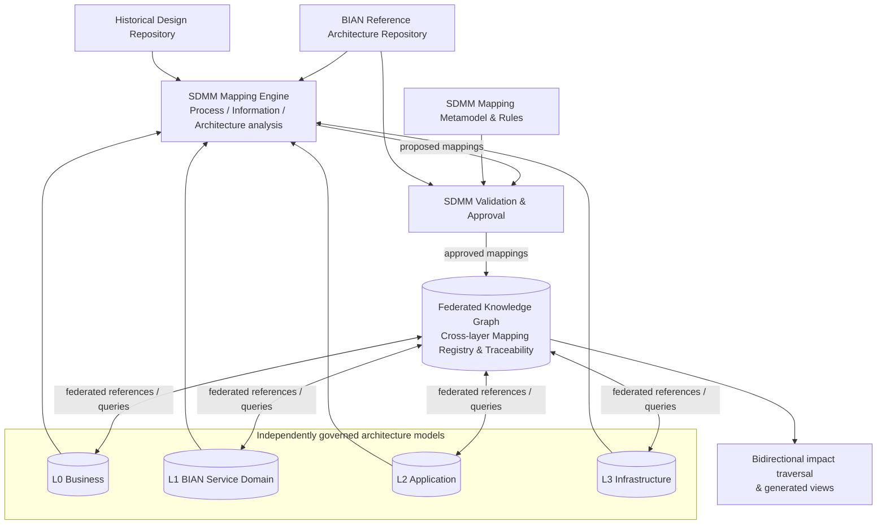
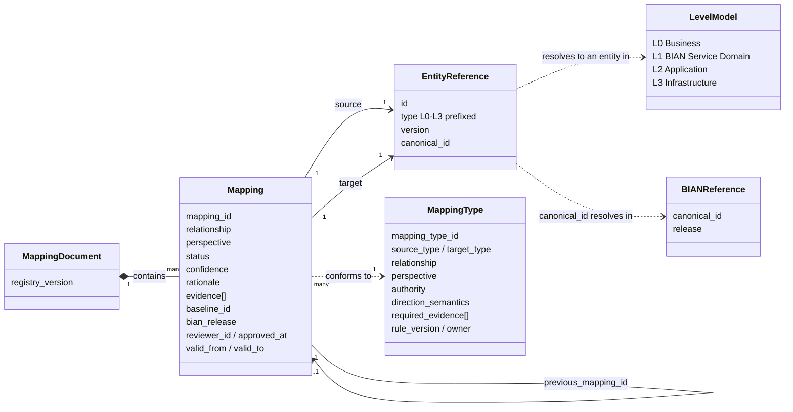
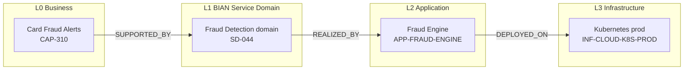
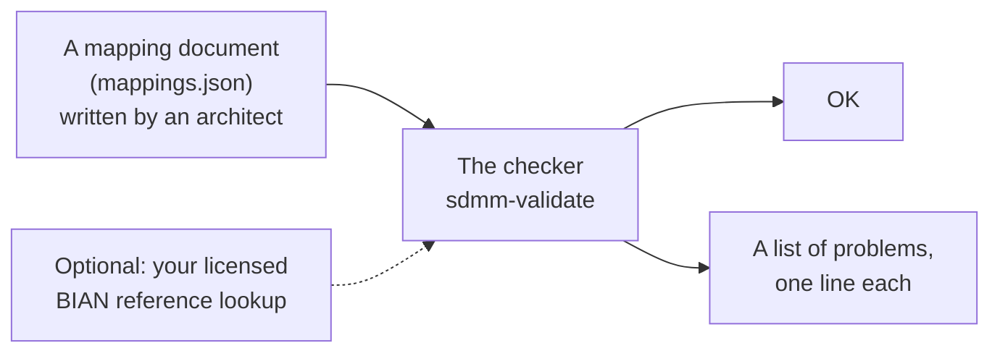
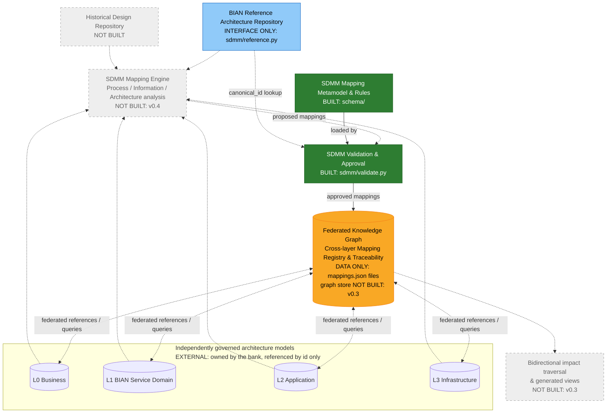

# BIAN Service Domain Mapping Model (SDMM)

> **Status:** community proposal / starter reference implementation, **not** an official BIAN standard.

SDMM is a proposed methodology and typed cross-layer mapping model for tracing banking architecture across four bank-defined design levels:

| Level | Scope |
|---|---|
| L0 | Business Architecture — capabilities, value streams, processes, business information |
| L1 | BIAN-aligned Service Domain Architecture — domains, operations, scenarios, Control Records and business objects |
| L2 | High-Level Application Architecture — application components, interfaces, API operations |
| L3 | Detailed Infrastructure Architecture — deployment, compute, networks and supporting infrastructure |

**BIAN provides reference definitions and business-to-service alignment guidance; SDMM adds enterprise-specific L1→L2→L3 mappings and governance.** BIAN reference models and trademarks are not included in this repository.

**In this README:** [Target state architecture](#target-state-architecture) · [Core concepts](#core-concepts-how-the-four-levels-become-data) · [What this repository ships](#what-this-repository-ships) · [Where this repository sits in the target architecture](#where-this-repository-sits-in-the-target-architecture) · [Quick start](#quick-start) · [Rules of use](#rules-of-use) · [Licenses](#licenses-and-attribution)

## Target state architecture

The end state SDMM is designed for: four independently governed architecture models, a mapping engine that proposes cross-layer links from them, a rules-and-approval gate, and a federated knowledge graph holding the approved links for bidirectional traceability and impact analysis.



Only part of this exists today. *What this repository ships* says what exists; *Where this repository sits in the target architecture* marks each box above as built, data-only, interface-only or not built.

## Core concepts: how the four levels become data

Read this section first if you know enterprise architecture but not this repository. It uses one example — a bank adding a **Card Fraud Alerts** capability — and carries it from the business level to the infrastructure level.

### 1. Entities live in the levels; SDMM does not store them

Each level already has its own model, owned by its own team, holding its own things:

| Level | Owner (typically) | Example entity | ID in that model |
|---|---|---|---|
| L0 | Business architecture | the capability *Card Fraud Alerts* | `CAP-310` |
| L1 | Domain / BIAN architecture | the selected BIAN-aligned *Fraud Detection* Service Domain | `SD-044` |
| L2 | Application architecture | the *Fraud Engine* application | `APP-FRAUD-ENGINE` |
| L3 | Infrastructure | the production *Kubernetes* platform | `INF-CLOUD-K8S-PROD` |

SDMM never copies these entities. It only ever refers to them by ID. If you want to know what `CAP-310` *is*, you go to the L0 model.

### 2. Service Domain Mapping Model

The Service Domain Mapping Model is a **metamodel**: it defines the small set of element types from which every mapping is built, and how they relate. There are six.



| Element | What it represents | Owned by |
|---|---|---|
| **Level model** | One of the four architecture models (L0–L3) and the entities inside it | The level's own team and tooling. **Outside SDMM.** |
| **Entity reference** | A pointer to one entity in one level model: its `id`, its level-prefixed `type`, and the `version` being referred to. Optionally the BIAN `canonical_id` it is based on | SDMM, as part of a mapping |
| **Mapping type** | One permitted kind of cross-level relationship: which source type, which relationship word, which target type, whose authority it rests on, and what evidence it needs | SDMM governance. Eight exist; see *Mapping Types* below |
| **Mapping** | One concrete relationship between a source entity reference and a target entity reference, conforming to exactly one mapping type, carrying evidence, rationale, status and approval | An architect (or, as `proposed`, a future engine) |
| **Mapping document** | A set of mappings for one initiative, pinned to a registry version | An initiative team, in version control |
| **BIAN reference** | A canonical BIAN definition in a named release, reachable through the bank's licensed adapter | BIAN; the bank holds the licence. **Outside SDMM.** |

Three rules hold the model together:

1. **A mapping refers; it never contains.** Both ends are references into level models. The capability, the domain, the application and the server are never copied into SDMM.
2. **A mapping conforms to exactly one mapping type.** The `(source.type, relationship, target.type)` triple on the mapping must match a row in the mapping-type registry. The type decides the perspective, the authority, and whether a BIAN release is mandatory.
3. **A mapping is immutable once approved.** Change is expressed by a new mapping whose `previous_mapping_id` points at the old one, and the old one becomes `superseded`. History is never rewritten.

#### The model instantiated

The same model, populated for the Card Fraud Alerts initiative. Each box is an entity reference resolving into its level model; each arrow is one mapping, labelled with the relationship from its mapping type:



Three mappings. The first one, as the record the model prescribes:

```jsonc
{
  "mapping_id": "FRD-001",
  "source":   { "id": "CAP-310", "type": "L0.BusinessCapability", "version": "1.0" },   // entity reference
  "relationship": "SUPPORTED_BY",                                                        // + source/target types = mapping type
  "target":   { "id": "SD-044",  "type": "L1.ServiceDomain",      "version": "1.0",
                "canonical_id": "<the BIAN id this domain is based on>" },               // entity reference, BIAN-anchored
  "status":   "approved",                                                                // lifecycle (see Mapping Lifecycle)
  "evidence": ["BA-FRAUD-2026#s2"],                                                      // where the claim is documented
  "rationale": "Fraud-alerting sits inside the selected domain's scope",
  "bian_release": "<the BIAN release consulted>",                                        // mandatory: this type's authority is BIAN guidance
  "baseline_id": "BASE-2026-Q4",                                                         // the architecture baseline it belongs to
  "reviewer_id": "jane.architect",
  "approved_at": "2026-10-22"
}
```

The arrow in the diagram, the record in the file, and the `Mapping` element in the metamodel are one and the same thing seen three ways. Everything the record carries beyond the two IDs — evidence, rationale, release, reviewer, baseline — is what turns an opinion into an auditable architecture fact.

#### Mapping Types

A mapping type is one permitted kind of cross-level relationship. SDMM defines eight, and every mapping must conform to exactly one of them. In plain English:

| From | Reads as | To | Whose rule |
|---|---|---|---|
| L0 Business Capability | *is supported by* | L1 Service Domain | BIAN alignment guidance |
| L0 Value Stream | *is aligned to* | L1 Business Scenario | BIAN alignment guidance |
| L0 Business Process | *uses* | L1 Service Domain | bank's own rule |
| L0 Business Object | *is aligned to* | L1 BIAN Business Object | BIAN alignment guidance |
| L1 Service Domain | *is realised by* | L2 Application Component | bank's own rule |
| L1 Service Operation | *is implemented by* | L2 API Operation | bank's own rule |
| L1 BIAN Business Object | *is mapped to* | L2 Data Entity | bank's own rule |
| L2 Application Component | *is deployed on* | L3 Infrastructure Component | bank's own rule |

Three consequences of this grammar:

- **Arrows only cross one level boundary.** There is no L0 → L2 shortcut; a capability reaches an application *through* a Service Domain. Links *within* a level (app calls app, capability decomposes into capability) belong in that level's own model, not here.
- **Every arrow into L1 leans on BIAN; every arrow out of L1 is the bank's.** That is the division of labour: BIAN tells you how business concepts align to Service Domains; only the bank knows which of its applications and servers realise them. Mappings of a BIAN-guided type must name the BIAN release they consulted.
- **Many-to-many is normal.** One capability may be supported by several domains; one domain may be realised by several applications. A Service Domain is not a microservice.

The authoritative list is `schema/relationship-types.json`. Adding a ninth kind of arrow means adding a row there first.

#### Mapping Document

Mappings are grouped into a **mapping document** (`mappings.json`) — typically one per initiative or design, held in version control. `examples/card-fraud-alerts/mappings.json` is the Card Fraud Alerts initiative: the three arrows above, plus a superseded deployment and one unreviewed candidate.

#### Mapping Lifecycle

```
proposed ──▶ validated ──▶ approved ──▶ superseded
                 │
                 └──▶ needs_review / rejected
```

| Status | Who sets it | Meaning |
|---|---|---|
| `proposed` | an architect, or a future mapping engine | a candidate; may carry a `confidence` score |
| `validated` | the validator | passes every structural and governance rule |
| `needs_review` / `rejected` | an architect | flagged or declined, with the decision kept |
| `approved` | a named reviewer | an architecture fact; the only status that counts in traceability |
| `superseded` | a named reviewer | replaced by a newer mapping that points back to it; never deleted |

A proposal from an AI engine and an approved fact are therefore different *statuses on the same record shape*, not different systems. An engine can only ever add `proposed` rows.

### 3. Knowledge Graph Composition

A knowledge graph needs three components. SDMM supplies one of them.

| Ingredient | What it is | Who supplies it | Exists today? |
|---|---|---|---|
| **Nodes** | the entities — capabilities, domains, applications, servers | your L0–L3 models | yes, in your EA tooling |
| **Arrows** | the approved mappings between entities in adjacent levels | **this repository's `mappings.json` files** | yes |
| **Engine** | something that loads the arrows, attaches each end to its node, and walks the result | a graph database and query service | no — roadmap v0.3 |

When the engine loads the Card Fraud Alerts arrows and attaches them to their nodes, this is what it holds:


and it can then answer questions in either direction, without any extra arrows being stored:

| Question | Direction | Answer |
|---|---|---|
| *What does Card Fraud Alerts depend on?* | follow the arrows **down** | Fraud Detection domain → Fraud Engine → Kubernetes prod |
| *What is affected if Kubernetes prod changes?* | follow the arrows **up** | Fraud Engine → Fraud Detection domain → Card Fraud Alerts |

The design specification calls this the **federated knowledge graph**: *federated* because the nodes stay in four different models owned by four different teams; SDMM owns only the arrows between them.

**So, today:** the arrows exist, as records in files. The nodes exist, in your own tools. The engine that joins them does not exist yet, so there is no live knowledge graph yet — only the arrows it will be built from. Walking the chain today means a small script over the files (the walkthrough in `examples/card-fraud-alerts/README.md` does exactly that). When the engine arrives, the records will not need to change; they are already the right shape.

### The six concepts, side by side

| Concept | In one sentence | In this repository |
|---|---|---|
| **Entity** | A thing in one level — a capability, a domain, an application, a server | Not here. Lives in the level's own model; SDMM refers to it by ID |
| **Mapping type** | One of the eight permitted kinds of arrow | `schema/relationship-types.json` |
| **Mapping** | One actual arrow between two entities, with its evidence and approval | A record in a `mappings.json` file |
| **Mapping document** | All the arrows for one initiative | `examples/<initiative>/mappings.json` |
| **Validator** | The gate that rejects arrows that break the rules | `sdmm/validate.py` |
| **Knowledge graph** | Nodes (your models) + arrows (the mappings) + an engine to walk them | Roadmap. This repo supplies the arrows only |

## Service Domain Mapping Model Validator

If you are expecting to deploy something: there is nothing to deploy. This repository is **a rulebook, a file format, and a checker.**

| What | In plain terms | Where |
|---|---|---|
| **The rulebook** | The eight permitted arrow types and the fields every mapping must carry | `schema/` |
| **The files** | Mapping documents written to that rulebook. One per initiative, kept in git. This is the *only* data SDMM holds | `examples/*/mappings.json` and your own |
| **The checker** | One script that reads a mapping document and says *OK* or lists what is wrong | `sdmm/validate.py` |
| **The reasoning** | Why the rulebook is shaped this way, and the platform it is designed to grow into | `docs/` |

### What goes in and what comes out



**In:** a mapping document. It names entities by ID only (`CAP-310 SUPPORTED_BY SD-044`); the entities themselves stay in your EA tool, BIAN model and CMDB.

**What the checker looks at:** whether each arrow is one of the eight permitted types; whether the required fields are present; whether an approved arrow names its reviewer; whether a replaced arrow is linked to its replacement; whether a BIAN-guided arrow names the BIAN release it used.

**What the checker does *not* look at:** whether the mapping is *right*. It cannot tell whether Fraud Detection is the correct domain for Card Fraud Alerts. That judgement is the architect's, and the record's `rationale` and `evidence` fields are where it is written down.

**Out:** *OK*, or a list of problems. Nothing is stored, transformed or sent anywhere. The approved records in your files are the result — a versioned, machine-readable set of arrows that later tooling (a graph loader, an impact engine, a diagram generator) can read.

### How it runs

| Mode | Command | Typical user |
|---|---|---|
| Local | `python -m sdmm.validate path/to/mappings.json` | Architect authoring a document |
| CI | `.github/workflows/validate.yml` on every push | Repo gate; a broken document cannot merge |
| Library | `from sdmm.validate import validate` | Developer embedding the check in another tool |

There is no server, no database, no scheduler and no UI. A production deployment would wrap this in whatever hosts your other EA tooling.

## Where this repository sits in the target architecture

The design specification (`docs/BIAN_SDMM_Design_Specification.md`) describes a platform built around a **federated knowledge graph**. This repository is *not* that graph. It is two of its building blocks plus the data that will populate it.



Green = built. Amber = data present, engine absent. Blue = interface defined, implementation yours. Grey dashed = roadmap. Solid arrows are flows that happen today; dotted arrows are flows the target state adds.

| Box | Spec responsibility | Status in this repo |
|---|---|---|
| **Mapping Metamodel & Rules** | Which cross-layer links are legal; what a record must contain | **Built** — `schema/relationship-types.json`, `schema/mapping.schema.json` |
| **Validation & Approval** | Deterministic checks, then architect sign-off | **Checks built** — `sdmm/validate.py`. Approval is recorded as fields (`status`, `reviewer_id`), not a workflow system |
| **Federated Knowledge Graph / Mapping Registry** | Store of approved cross-layer edges, queryable in both directions | **Data only** — each `mappings.json` record *is* one edge of this graph, held as a flat file in git. The graph store and traversal engine are not built (v0.3) |
| **BIAN Reference Repository** | Licensed BIAN definitions by release | **Interface only** — `ReferenceResolver` in `sdmm/reference.py`; you implement it |
| **Mapping Engine** | Reads L0–L3 and proposes mappings | **Not built** (v0.4). `status: proposed` + `confidence` reserve its output slot |
| **Historical Design Repository** | Legacy documents and patterns | **Not built** |
| **Bidirectional impact traversal & generated views** | Upstream/downstream queries, impact classification, diagrams projected from the graph | **Not built** (v0.3) |
| **L0–L3 models** | The bank's own capability, domain, application and infrastructure models | **External, never in scope.** SDMM references their entity IDs; it never copies the entities |

## Quick start

Requires Python 3.10+; no third-party dependencies.

```bash
python -m sdmm.validate examples/customer-onboarding/mappings.json
python -m sdmm.validate --json examples/customer-onboarding/mappings.json   # machine-readable report
python -m unittest discover -s tests -v
```

Or install it: `pip install -e .` gives you an `sdmm-validate` command. Exit codes: `0` valid, `1` issues found, `2` usage/registry error.

What the validator checks is listed under *What goes in and what comes out* above; `--registry` points it at your own registry and `validate(..., resolver=)` attaches a licensed BIAN lookup. It is **not a certification of BIAN conformance** or of architectural correctness.

## Contents

- `docs/`: reference methodology and governance
- `schema/`: SDMM cross-layer relationship registry + JSON Schema
- `examples/`: synthetic mappings — `customer-onboarding` (full vertical slice) and `card-fraud-alerts` (a change event with supersession)
- `sdmm/`: standalone Python validator and the `ReferenceResolver` adapter interface
- `tests/`: basic automated tests
- `.github/workflows/`: CI validation

## Rules of use

- Preserve historical architecture documents; never overwrite or silently reclassify them.
- New designs may reference legacy designs and patterns with provenances and approvals.
- Keep canonical BIAN reference content separate from your own design objects.
- Store mappings as versioned, typed claims. An AI confidence value is not evidence of compliance.
- A reverse traversal is a query, not a duplicate inverse edge.
- Affected-by-change does not mean must-change: impact requires semantic assessment and approval.

## Licenses and attribution

- Source code and machine-readable schema/templates: Apache-2.0 (see `LICENSE`).
- Original methodology prose in `docs/` and this README: CC BY 4.0 (see `LICENSES.md`).
- External BIAN content is not relicensed by this repository. See `THIRD_PARTY.md`.

This is an independent community proposal, not affiliated with, endorsed by, or sponsored by BIAN or any bank. No guarantees of fitness, correctness, or compliance are made.
