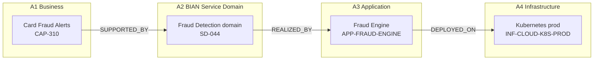
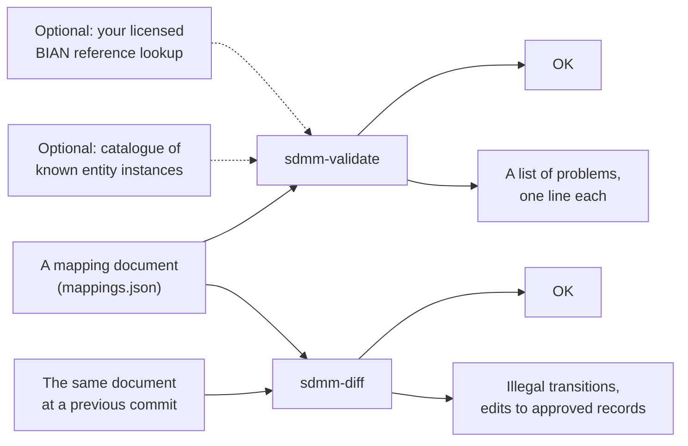
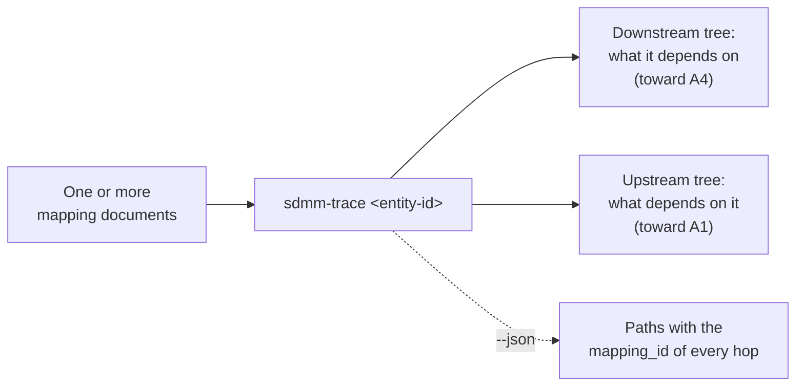
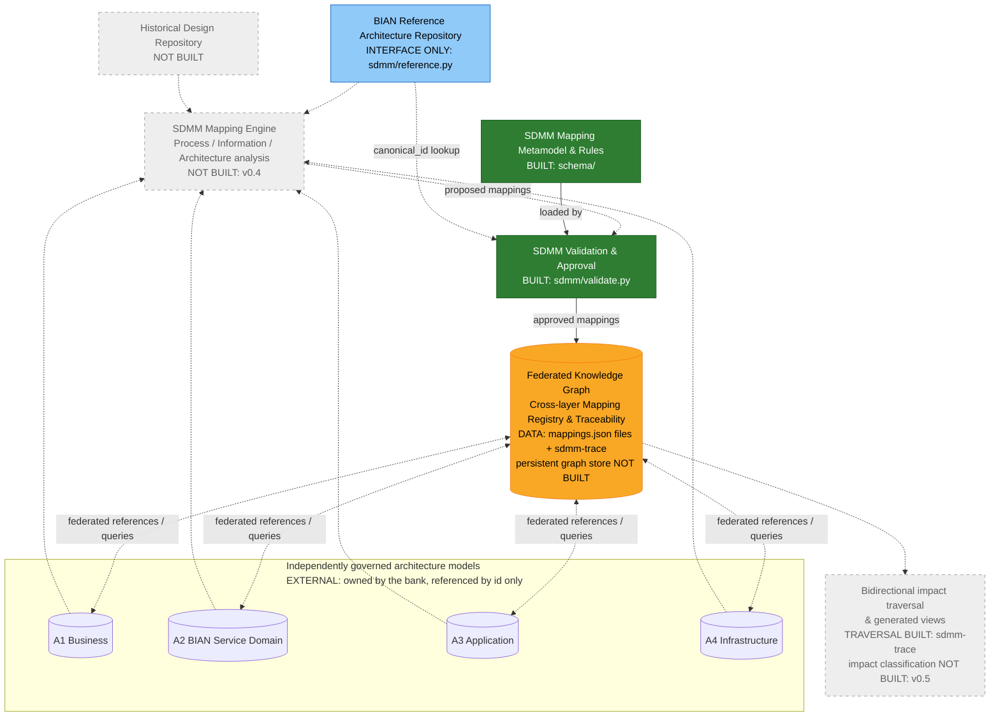

# BIAN Service Domain Mapping Model (SDMM)

> **Status:** community proposal / starter reference implementation, **not** an official BIAN standard.

SDMM is a proposed methodology and typed cross-layer mapping model for tracing banking architecture across the four design models of a **Service Domain Architecture Design Model (SDADM)**:

| Code | Design model | Scope |
|---|---|---|
| **A1** | Business Architecture | capabilities, value streams, processes, business information |
| **A2** | Service Domain Architecture | BIAN-aligned domains, operations, scenarios, Control Records and business objects |
| **A3** | Application Architecture | application components, interfaces, API operations |
| **A4** | Technology Architecture | deployment, compute, networks and supporting infrastructure |

SDADM is a generic four-level design lifecycle; an institution's own level numbering is one instance of it and is mapped by that institution's profile. Entities are prefixed with the level code (`A2.ServiceDomain`). The registry can declare an institution's legacy prefixes as aliases of `A1.`–`A4.`, so documents written against an earlier numbering continue to validate unchanged. "Service Domain Architecture" names both the whole (SDADM) and its second level (A2), in the same way BIAN's Service Landscape contains Service Domains.

**BIAN provides reference definitions and business-to-service alignment guidance; SDMM adds enterprise-specific A2→A3→A4 mappings and governance.** BIAN reference models and trademarks are not included in this repository.

## Reference architecture provenance

Every entity in the SDMM vocabulary derives from a **publicly available reference architecture** — BIAN, ArchiMate 3.2 or TOGAF 10 — or is a documented SDMM extension of one. No entity is named after, defined by, or copied from any institution's architecture model; institution-specific entities belong in that institution's private profile, never here. Of the 31 core entities, **12 derive from BIAN, 19 from ArchiMate, 1 from TOGAF**. Full detail, including classification and the public URL for each, is in [`docs/reference-architecture-provenance.md`](docs/reference-architecture-provenance.md).

| Key | Public source |
|---|---|
| **BIAN-SL** | [BIAN Service Landscape 14.0, InSite portal](https://bian.org/servicelandscape-14-0-0/) — publicly browsable |
| **BIAN-BCM** | [BIAN BCM *Statement of Alignment with the Service Landscape*](https://bian.org/wp-content/uploads/2023/08/BIAN-BCM-Relationship-with-BIAN-Service-Landscape-Final.pdf) |
| **BIAN-API** | [BIAN Semantic API Practitioner Guide](https://bian.org/wp-content/uploads/2024/12/BIAN-Semantic-API-Pactitioner-Guide-V8.1-FINAL.pdf) |
| **AM** | [ArchiMate® 3.2 Specification](https://pubs.opengroup.org/architecture/archimate3-doc/) — ch. 6 Motivation, 7 Strategy, 8 Business, 9 Application, 10 Technology |
| **TOGAF** | [TOGAF® Standard, 10th Edition](https://pubs.opengroup.org/togaf-standard/) |

**A1 — Business Architecture**

| Entity | Reference architecture | Concept | Source |
|---|---|---|---|
| `A1.BusinessCapability` | BIAN BCM; ArchiMate Strategy | Business Capability; Capability | BIAN-BCM; AM ch. 7 |
| `A1.ValueStream` | ArchiMate Strategy | Value Stream | AM ch. 7; BIAN-BCM |
| `A1.ValueStreamStage` | SDMM extension of Value Stream | — | AM ch. 7 (parent) |
| `A1.BusinessProcess` | ArchiMate Business | Business Process | AM ch. 8 |
| `A1.BusinessActivity` | SDMM extension of Business Process | — | AM ch. 8 (parent) |
| `A1.BusinessService` | ArchiMate Business | Business Service | AM ch. 8 |
| `A1.BusinessActor` | ArchiMate Business | Business Actor | AM ch. 8 |
| `A1.BusinessRole` | ArchiMate Business | Business Role | AM ch. 8 |
| `A1.BusinessObject` | ArchiMate Business; aligned to BIAN BOM | Business Object | AM ch. 8; BIAN-SL |
| `A1.BusinessRequirement` | ArchiMate Motivation | Requirement | AM ch. 6 |

**A2 — Service Domain Architecture** — all BIAN reference, all `pending_release_validation` until verified against release 14.0

| Entity | Reference architecture | Concept | Source |
|---|---|---|---|
| `A2.BusinessArea` | BIAN Service Landscape | Business Area | BIAN-SL |
| `A2.BusinessDomain` | BIAN Service Landscape | Business Domain | BIAN-SL |
| `A2.ServiceDomain` | BIAN Service Landscape | Service Domain | BIAN-SL MetaModel Overview |
| `A2.FunctionalPattern` | BIAN Service Landscape | Functional Pattern | BIAN-SL MetaModel Overview |
| `A2.AssetType` | BIAN Service Landscape | Asset Type | BIAN-SL MetaModel Overview |
| `A2.ControlRecord` | BIAN Control Record Model | Control Record | BIAN-SL Control Record Model |
| `A2.ServiceGroup` | BIAN Service Landscape | Service Group | BIAN-SL MetaModel Overview |
| `A2.ServiceOperation` | BIAN Service Landscape; Semantic APIs | Service Operation | BIAN-SL; BIAN-API |
| `A2.BehaviorQualifier` | BIAN Service Landscape; Semantic APIs | Behavior Qualifier | BIAN-SL; BIAN-API |
| `A2.BusinessScenario` | BIAN Business Scenarios | Business Scenario (illustrative) | BIAN-SL Business Scenarios |
| `A2.BusinessObject` | BIAN Business Object Model | Business Object | BIAN-SL BOM |
| `A2.BusinessObjectAttribute` | BIAN Business Object Model | BOM attribute | BIAN-SL BOM |
| `A2.BOMModel`, `A2.Wireframe`, `A2.SemanticAPI` | BIAN model artefacts — citable as evidence, never mapping endpoints | — | BIAN-SL; BIAN-API |

**A3 — Application Architecture**

| Entity | Reference architecture | Concept | Source |
|---|---|---|---|
| `A3.ApplicationComponent` | ArchiMate Application | Application Component | AM ch. 9 |
| `A3.ApplicationService` | ArchiMate Application | Application Service | AM ch. 9 |
| `A3.ApplicationInterface` | ArchiMate Application | Application Interface | AM ch. 9 |
| `A3.ApplicationFunction` | ArchiMate Application | Application Function | AM ch. 9 |
| `A3.APIOperation` | SDMM extension; aligned to BIAN Semantic API / OpenAPI | — | BIAN-API |
| `A3.DataEntity` | ArchiMate Application (related) | Data Object | AM ch. 9 |
| `A3.Event` | ArchiMate Application (related) | Application Event | AM ch. 9 |
| `A3.SolutionBuildingBlock` | TOGAF Architecture Content | Solution Building Block | TOGAF |

**A4 — Technology Architecture**

| Entity | Reference architecture | Concept | Source |
|---|---|---|---|
| `A4.InfrastructureComponent` *(abstract)* | SDMM compatibility supertype of every A4 entity | — | — |
| `A4.Deployment` | SDMM extension of Artifact assigned to Node | — | AM ch. 10 (parents) |
| `A4.DeploymentEnvironment` | SDMM extension of Node grouping | — | AM ch. 10 (parent) |
| `A4.Node` | ArchiMate Technology | Node | AM ch. 10 |
| `A4.Device` | ArchiMate Technology | Device | AM ch. 10 |
| `A4.SystemSoftware` | ArchiMate Technology | System Software | AM ch. 10 |
| `A4.TechnologyService` | ArchiMate Technology | Technology Service | AM ch. 10 |
| `A4.TechnologyInterface` | ArchiMate Technology | Technology Interface | AM ch. 10 |
| `A4.CommunicationNetwork` | ArchiMate Technology | Communication Network | AM ch. 10 |
| `A4.Path` | ArchiMate Technology | Path | AM ch. 10 |
| `A4.Artifact` | ArchiMate Technology | Artifact | AM ch. 10 |

Cloud-specific entities (compute resource, container platform, storage, database platform, security control, …) are **not core**: they live in the `example-cloud` profile, each extending one of the ArchiMate-derived A4 entities above. Definitions in the catalogue are SDMM paraphrases; no text, diagram or dataset from BIAN or The Open Group is reproduced. BIAN®, ArchiMate® and TOGAF® are trademarks of their respective owners; SDMM is independent and not endorsed by either organisation.


**In this README:** [Reference architecture provenance](#reference-architecture-provenance) · [Target state architecture](#target-state-architecture) · [Core concepts](#core-concepts-how-the-four-levels-become-data) · [What this repository ships](#what-this-repository-ships) (Validator v0.2 · Query v0.3) · [Where this repository sits in the target architecture](#where-this-repository-sits-in-the-target-architecture) · [Quick start](#quick-start) · [Rules of use](#rules-of-use) · [Licenses](#licenses-and-attribution)

## Target state architecture

The end state SDMM is designed for: four independently governed architecture models, a mapping engine that proposes cross-layer links from them, a rules-and-approval gate, and a federated knowledge graph holding the approved links for bidirectional traceability and impact analysis.


Only part of this exists today. *What this repository ships* says what exists; *Where this repository sits in the target architecture* marks each box above as built, data-only, interface-only or not built.

## Core concepts: how the four levels become data

Read this section first if you know enterprise architecture but not this repository. It uses one example — a bank adding a **Card Fraud Alerts** capability — and carries it from the business level to the infrastructure level.

### 1. Entity instances live in the levels; SDMM does not store them

Two words, used precisely throughout: an **entity** is a kind of thing in the vocabulary (`A2.ServiceDomain`, one of 31); an **entity instance** is an actual thing of that kind in your bank (`SD-044`, the Fraud Detection domain). SDMM defines the entities. Your tools hold the instances.

Each level already has its own model, owned by its own team, holding its own instances:

| Level | Owner (typically) | Example entity instance | ID in that model |
|---|---|---|---|
| A1 | Business architecture | the capability *Card Fraud Alerts* | `CAP-310` |
| A2 | Domain / BIAN architecture | the selected BIAN-aligned *Fraud Detection* Service Domain | `SD-044` |
| A3 | Application architecture | the *Fraud Engine* application | `APP-FRAUD-ENGINE` |
| A4 | Infrastructure | the production *Kubernetes* platform | `INF-CLOUD-K8S-PROD` |

SDMM never copies these instances. It only ever refers to them by ID. If you want to know what `CAP-310` *is*, you go to the A1 model.

### 2. Service Domain Mapping Model

The Service Domain Mapping Model is a **metamodel**: it defines the small set of element types from which every mapping is built, and how they relate. There are six.


| Element | What it represents | Owned by |
|---|---|---|
| **Level model** | One of the four architecture models (A1–A4) and the entity instances inside it | The level's own team and tooling. **Outside SDMM.** |
| **Entity reference** | A pointer to one entity instance in one level model: its `id`, its entity (the level-prefixed `type` field), and the `version` being referred to. Optionally the BIAN `canonical_id` it is based on | SDMM, as part of a mapping |
| **Mapping type** | One permitted kind of cross-level relationship: which source type, which relationship word, which target type, whose authority it rests on, and what evidence it needs | SDMM governance. Eight exist; see *Mapping Types* below |
| **Mapping** | One concrete relationship between a source entity reference and a target entity reference, conforming to exactly one mapping type, carrying evidence, rationale, status and approval | An architect (or, as `proposed`, a future engine) |
| **Mapping document** | A set of mappings for one initiative, pinned to a registry version | An initiative team, in version control |
| **BIAN reference** | A canonical BIAN definition in a named release, reachable through the bank's licensed adapter | BIAN; the bank holds the licence. **Outside SDMM.** |

Three rules hold the model together:

1. **A mapping refers; it never contains.** Both ends are references into level models. The capability, the domain, the application and the server are never copied into SDMM.
2. **A mapping conforms to exactly one mapping type.** The `(source.type, relationship, target.type)` triple on the mapping must match a row in the mapping-type registry. The type decides the perspective, the authority, and whether a BIAN release is mandatory.
3. **A mapping is immutable once approved.** Change is expressed by a new mapping whose `previous_mapping_id` points at the old one, and the old one becomes `superseded`. History is never rewritten.

#### The model instantiated

The same model, populated for the Card Fraud Alerts initiative. Each box is an entity reference resolving to an instance in its level model; each arrow is one mapping, labelled with the relationship from its mapping type:



Three mappings. The first one, as the record the model prescribes:

```jsonc
{
  "mapping_id": "FRD-001",
  "source":   { "id": "CAP-310", "type": "A1.BusinessCapability", "version": "1.0" },   // entity reference
  "relationship": "SUPPORTED_BY",                                                        // + source/target types = mapping type
  "target":   { "id": "SD-044",  "type": "A2.ServiceDomain",      "version": "1.0",
                "canonical_id": "<the BIAN id this domain is based on>" },               // entity reference, BIAN-anchored
  "status":   "approved",                                                                // lifecycle (see Mapping Lifecycle)
  "evidence": ["BA-FRAUD-2026#s2"],                                                      // where the claim is documented
  "rationale": "Fraud-alerting sits inside the selected domain's scope",
  "bian_release": "<the BIAN release consulted>",                                        // mandatory: this type's authority is BIAN guidance
  "baseline_id": "BASE-2026-Q4",                                                         // the architecture baseline it belongs to
  "reviewer_id": "jane.architect",
  "approved_at": "2026-10-22"
}
```

The arrow in the diagram, the record in the file, and the `Mapping` element in the metamodel are one and the same thing seen three ways. Everything the record carries beyond the two IDs — evidence, rationale, release, reviewer, baseline — is what turns an opinion into an auditable architecture fact.

#### Mapping Types

A mapping type is one permitted kind of cross-level relationship. SDMM defines eight, and every mapping must conform to exactly one of them. In plain English:

| From | Reads as | To | Whose rule |
|---|---|---|---|
| A1 Business Capability | *is supported by* | A2 Service Domain | BIAN alignment guidance |
| A1 Value Stream | *is aligned to* | A2 Business Scenario | BIAN alignment guidance |
| A1 Business Process | *uses* | A2 Service Domain | bank's own rule |
| A1 Business Object | *is aligned to* | A2 BIAN Business Object | BIAN alignment guidance |
| A2 Service Domain | *is realised by* | A3 Application Component | bank's own rule |
| A2 Service Operation | *is implemented by* | A3 API Operation | bank's own rule |
| A2 BIAN Business Object | *is mapped to* | A3 Data Entity | bank's own rule |
| A3 Application Component | *is deployed on* | A4 Infrastructure Component | bank's own rule |

Three consequences of this grammar:

- **Arrows only cross one level boundary.** There is no A1 → A3 shortcut; a capability reaches an application *through* a Service Domain. Links *within* a level (app calls app, capability decomposes into capability) belong in that level's own model, not here.
- **Every arrow into A2 leans on BIAN; every arrow out of A2 is the bank's.** That is the division of labour: BIAN tells you how business concepts align to Service Domains; only the bank knows which of its applications and servers realise them. Mappings of a BIAN-guided type must name the BIAN release they consulted.
- **Many-to-many is normal.** One capability may be supported by several domains; one domain may be realised by several applications. A Service Domain is not a microservice.

The authoritative list is `schema/relationship-types.json`. Adding a ninth kind of arrow means adding a row there first.

#### Mapping Document

Mappings are grouped into a **mapping document** (`mappings.json`) — typically one per initiative or design, held in version control. `examples/card-fraud-alerts/mappings.json` is the Card Fraud Alerts initiative: the three arrows above, plus a superseded deployment and one unreviewed candidate.

#### Mapping Lifecycle

```
proposed ──▶ validated ──▶ approved ──▶ superseded
                 │
                 └──▶ needs_review / rejected
```

| Status | Who sets it | Meaning |
|---|---|---|
| `proposed` | an architect, or a future mapping engine | a candidate; may carry a `confidence` score |
| `validated` | the validator | passes every structural and governance rule |
| `needs_review` / `rejected` | an architect | flagged or declined, with the decision kept |
| `approved` | a named reviewer | an architecture fact; the only status that counts in traceability |
| `superseded` | a named reviewer | replaced by a newer mapping that points back to it; never deleted |

A proposal from an AI engine and an approved fact are therefore different *statuses on the same record shape*, not different systems. An engine can only ever add `proposed` rows.

### 3. Knowledge Graph Composition

A knowledge graph needs three components. SDMM supplies one of them.

| Ingredient | What it is | Who supplies it | Exists today? |
|---|---|---|---|
| **Nodes** | the entity instances — capabilities, domains, applications, servers | your A1–A4 models | yes, in your EA tooling |
| **Arrows** | the approved mappings between entity instances in adjacent levels | **this repository's `mappings.json` files** | yes |
| **Engine** | something that loads the arrows, attaches each end to its node, and walks the result | `sdmm-trace` walks the arrows today (v0.3); a persistent graph store and query service are roadmap |

When the engine loads the Card Fraud Alerts arrows and attaches them to their nodes, this is what it holds:


and it can then answer questions in either direction, without any extra arrows being stored:

| Question | Direction | Answer |
|---|---|---|
| *What does Card Fraud Alerts depend on?* | follow the arrows **down** | Fraud Detection domain → Fraud Engine → Kubernetes prod |
| *What is affected if Kubernetes prod changes?* | follow the arrows **up** | Fraud Engine → Fraud Detection domain → Card Fraud Alerts |

The design specification calls this the **federated knowledge graph**: *federated* because the nodes stay in four different models owned by four different teams; SDMM owns only the arrows between them.

**So, today:** the arrows exist, as records in files, and `sdmm-trace` walks them in either direction from the command line, naming the mapping that justifies each hop. The nodes exist in your own tools. What does not exist yet is a persistent graph store with a query service and impact classification — that is the roadmap. When it arrives, the records will not need to change; they are already the right shape.

### The seven concepts, side by side

| Concept | In one sentence | In this repository |
|---|---|---|
| **Entity** | A kind of thing in one level — Business Capability, Service Domain, Application Component | `schema/relationship-types.json` today; the 31-entity catalogue in v0.4 |
| **Entity instance** | An actual thing of that kind — *Card Fraud Alerts*, *Fraud Detection domain* | Not here. Lives in the level's own model; SDMM refers to it by ID |
| **Mapping type** | One of the eight permitted kinds of arrow | `schema/relationship-types.json` |
| **Mapping** | One actual arrow between two entity instances, with its evidence and approval | A record in a `mappings.json` file |
| **Mapping document** | All the arrows for one initiative | `examples/<initiative>/mappings.json` |
| **Validator** | The gate that rejects arrows that break the rules | `sdmm/validate.py` |
| **Knowledge graph** | Nodes (your models) + arrows (the mappings) + an engine to walk them | Roadmap. This repo supplies the arrows only |

## What this repository ships

If you are expecting to deploy something: there is nothing to deploy. This repository is **a rulebook, a file format, and two command-line components** that work on files written to that rulebook.

| Component | Version | Commands | Job | Gives a verdict? |
|---|---|---|---|---|
| **Contract** | v0.2 | — | The rulebook: the eight permitted arrow types (`schema/relationship-types.json`) and the fields every mapping must carry (`schema/mapping.schema.json`) | — |
| **Service Domain Mapping Model Validator** | v0.2 | `sdmm-validate`, `sdmm-diff` | **Gate.** Checks that a mapping document is well-formed and governed, and that its history has not been tampered with | yes — OK / errors |
| **Service Domain Mapping Model Query** | v0.3 | `sdmm-trace` | **Query.** Answers traceability questions over approved mappings: what does X depend on, what depends on X | no — it reports, it does not judge |

Both components read the same `mappings.json` files. The validator decides whether a file is acceptable; the query assumes it already is. Neither stores anything, transforms anything, or sends anything anywhere.

### Service Domain Mapping Model Validator (v0.2)



**`sdmm-validate` — is this document acceptable?** It checks whether each arrow is one of the eight permitted types; whether the required fields are present; whether a reviewed arrow names its reviewer and date; whether a replaced arrow is linked to its replacement; whether a BIAN-guided arrow names the BIAN release it used and anchors its A2 end to a canonical id; whether the evidence cited covers the kinds the arrow's type requires. With a catalogue of known entity instances (`--catalogue`) it also confirms both ends exist. With a licensed BIAN lookup attached, it confirms canonical ids exist in the named release.

**`sdmm-diff` — has history been respected?** It compares a document with its previous version (a file, or a git revision such as `HEAD~1`) and rejects removed records, status transitions the lifecycle does not permit, and any edit to an `approved`, `rejected` or `superseded` record other than supersession itself.

**What the validator does *not* look at:** whether a mapping is *right*. It cannot tell whether Fraud Detection is the correct domain for Card Fraud Alerts. That judgement is the architect's, and the record's `rationale` and `evidence` fields are where it is written down.

**In:** a mapping document naming entity instances by ID only (`CAP-310 SUPPORTED_BY SD-044`); the instances stay in your EA tool, BIAN model and CMDB. **Out:** *OK*, or a list of problems, with exit code `0` / `1`. The approved records in your files are the result — a versioned, machine-readable set of arrows that the query component and later tooling can read.

### Service Domain Mapping Model Query (v0.3)



**`sdmm-trace` — starting here, what is connected?** Give it an entity instance ID and it follows the approved arrows from there — forward toward Technology Architecture (*downstream*: what this depends on) or backward toward Business Architecture (*upstream*: what depends on this) — and prints the chain. Each hop names the `mapping_id` that justifies it, so a level-skipping answer such as "this capability runs on that Kubernetes platform" is always a derived path with provenance, never a stored record. Arrows are stored once, in their registry direction; upstream reads them backwards. Nothing is stored in reverse.

**What counts as an arrow:** only `approved` records by default. Superseded records are history and proposed records are suggestions; `--status approved,superseded` or `--status approved,proposed` includes them explicitly, so neither can leak into a traceability answer unasked.

**What the query does *not* do:** validate (it assumes the documents passed `sdmm-validate`), judge whether a mapping is correct, or decide what *must change* when something is reachable. Classifying reachable instances as `no_impact` / `review_required` / `design_change_required` is the v0.5 impact component.

```bash
python -m sdmm.trace CAP-310 --direction down examples/card-fraud-alerts/mappings.json
```
```
CAP-310  [A1.BusinessCapability]
└─ -SUPPORTED_BY-> SD-044  [A2.ServiceDomain]  (FRD-001)
   └─ -REALIZED_BY-> APP-FRAUD-ENGINE  [A3.ApplicationComponent]  (FRD-002)
      └─ -DEPLOYED_ON-> INF-CLOUD-K8S-PROD  [A4.InfrastructureComponent]  (FRD-005)
```

### How it runs

| Component | Mode | Command | Typical user |
|---|---|---|---|
| Validator | Local | `python -m sdmm.validate path/to/mappings.json` | Architect authoring a document |
| Validator | CI | `.github/workflows/validate.yml` on every push | Repo gate; a broken document cannot merge |
| Validator | History | `python -m sdmm.diff --git HEAD~1 path/to/mappings.json` | CI, to block edits to approved records and illegal status changes |
| Validator | Library | `from sdmm.validate import validate` | Developer embedding the check in another tool |
| Query | Local | `python -m sdmm.trace CAP-310 path/to/mappings.json` | Architect asking what an instance depends on, or what depends on it |
| Query | Pipeline | `sdmm-trace INF-X --direction up` with exit code `1` meaning "nothing depends on it" | Decommissioning gate |
| Query | Library | `from sdmm.trace import load_edges, walk` | Developer feeding a dashboard or diagram generator |

There is no server, no database, no scheduler and no UI. A production deployment would wrap these in whatever hosts your other EA tooling.

## Where this repository sits in the target architecture

The design specification (`docs/BIAN_SDMM_Design_Specification.md`) describes a platform built around a **federated knowledge graph**. This repository is *not* that graph. It is two of its building blocks plus the data that will populate it.



Green = built. Amber = data present, engine absent. Blue = interface defined, implementation yours. Grey dashed = roadmap. Solid arrows are flows that happen today; dotted arrows are flows the target state adds.

| Box | Spec responsibility | Status in this repo |
|---|---|---|
| **Mapping Metamodel & Rules** | Which cross-layer links are legal; what a record must contain | **Built** — `schema/relationship-types.json`, `schema/mapping.schema.json` |
| **Validation & Approval** | Deterministic checks, then architect sign-off | **Checks built** — `sdmm/validate.py` (structure, registry, evidence, anchoring) and `sdmm/diff.py` (transitions, immutability). Approval is recorded as fields (`status`, `reviewer_id`, `approved_at`), not a workflow system |
| **Federated Knowledge Graph / Mapping Registry** | Store of approved cross-layer edges, queryable in both directions | **Data + traversal** — each `mappings.json` record is one edge, held as a flat file in git; `sdmm-trace` queries them both ways with provenance. A persistent graph store is not built |
| **BIAN Reference Repository** | Licensed BIAN definitions by release | **Interface only** — `ReferenceResolver` in `sdmm/reference.py`; you implement it |
| **Mapping Engine** | Reads A1–A4 and proposes mappings | **Not built** (v0.4). `status: proposed` + `confidence` reserve its output slot |
| **Historical Design Repository** | Legacy documents and patterns | **Not built** |
| **Bidirectional impact traversal & generated views** | Upstream/downstream queries, impact classification, diagrams projected from the graph | **Traversal built** (`sdmm-trace`); impact classification and generated views not built (v0.5) |
| **A1–A4 models** | The bank's own capability, domain, application and infrastructure models | **External, never in scope.** SDMM references their instance IDs; it never copies the instances. An `EntityResolver` (file catalogue or your adapter) lets the validator confirm the IDs exist |

## Quick start

Requires Python 3.10+; no third-party dependencies.

```bash
python -m sdmm.validate --strict examples/*/mappings.json                 # structure, registry, evidence, anchoring
python -m sdmm.validate --catalogue examples/card-fraud-alerts/entities.json examples/card-fraud-alerts/mappings.json
python -m sdmm.diff --git HEAD~1 examples/*/mappings.json                 # transitions and immutability vs last commit
python -m sdmm.trace CAP-310 examples/card-fraud-alerts/mappings.json     # what it depends on / what depends on it
python -m sdmm.validate --json examples/*/mappings.json                   # machine-readable report
python -m unittest discover -s tests -v
```

Or install it: `pip install -e .` gives you `sdmm-validate`, `sdmm-diff` and `sdmm-trace` commands. Exit codes: `0` valid, `1` issues found, `2` usage/registry error.

What the validator checks is listed under *What goes in and what comes out* above; `--registry` points it at your own registry and `validate(..., resolver=)` attaches a licensed BIAN lookup. It is **not a certification of BIAN conformance** or of architectural correctness.

## Contents

- `docs/`: reference methodology, governance, the v0.4 entity metamodel spec and `reference-architecture-provenance.md` (every entity traced to a public standard)
- `schema/`: SDMM cross-layer relationship registry + JSON Schema
- `examples/`: synthetic mappings — `customer-onboarding` (full vertical slice) and `card-fraud-alerts` (a change event with supersession)
- `sdmm/`: validator, document diff, traceability walker, and the `ReferenceResolver` / `EntityResolver` adapter interfaces
- `tests/`: basic automated tests
- `.github/workflows/`: CI validation

## Rules of use

- Preserve historical architecture documents; never overwrite or silently reclassify them.
- New designs may reference legacy designs and patterns with provenances and approvals.
- Keep canonical BIAN reference content separate from your own design objects.
- Store mappings as versioned, typed claims. An AI confidence value is not evidence of compliance.
- A reverse traversal is a query, not a duplicate inverse edge.
- Affected-by-change does not mean must-change: impact requires semantic assessment and approval.

## Licenses and attribution

- Source code and machine-readable schema/templates: Apache-2.0 (see `LICENSE`).
- Original methodology prose in `docs/` and this README: CC BY 4.0 (see `LICENSES.md`).
- External BIAN content is not relicensed by this repository. See `THIRD_PARTY.md`.

This is an independent community proposal, not affiliated with, endorsed by, or sponsored by BIAN or any bank. No guarantees of fitness, correctness, or compliance are made.
