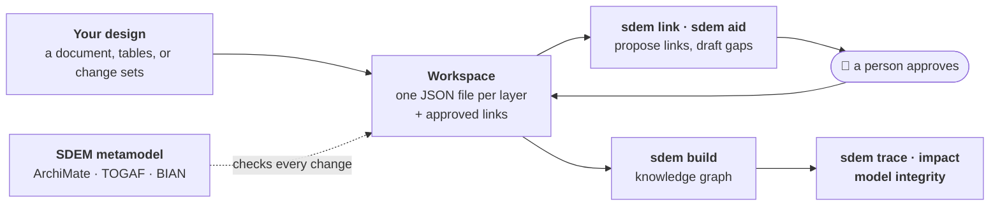

# SDEM — Service Domain Enterprise Metamodel

**Design solution architecture as version-controlled data — business, BIAN service domains, data, applications and technology in one checked model — and trace any requirement down to the server that runs it, or any server up to the requirements that depend on it.**

[](https://github.com/taumoeps/bian-sdem-framework/actions/workflows/validate.yml)
[](https://github.com/taumoeps/bian-sdem-framework/releases/latest)
[](LICENSE)
[](pyproject.toml)
[](pyproject.toml)

> [!NOTE]
> **v0.21.14 · ready for evaluation on synthetic data.** Using it on real designs needs a pilot ([what that takes](#using-sdem-on-real-designs)). SDEM uses BIAN's published Semantic APIs under BIAN's licence; it is **not an official BIAN standard and is not endorsed by BIAN**.


*The made-up Payment example, published from SDEM to [DESNRE](https://desnre.vercel.app/example/payment): SDEM's integrity verdict on the left, the design's five layers on the right — every shape and line from SDEM's knowledge graph.*

## Key features

- **One model, every layer** — business capabilities and processes, BIAN service domains, data, applications and technology, checked against one metamodel aligned to ArchiMate 3.2, TOGAF and BIAN.
- **Trace and impact** — follow approved links down from a requirement to its technology, or up from a server to everything that depends on it; see what a change would affect (`sdem trace`, `sdem impact`).
- **People decide** — SDEM proposes the links between layers and drafts what a design leaves out (AID), but nothing counts until a person approves it, with evidence.
- **Architecture as code** — designs are JSON in your own Git repository; every change is a recorded change set; the knowledge graph is rebuilt from them.
- **No dependencies, no AI inside** — pure Python standard library, deterministic answers; optional AI agents (GitHub Copilot, Claude Code, Codex, Gemini) drive the same CLI.

## Prerequisites

- **Python 3.10 or later** and **Git** (macOS: `brew install python@3.13`; Windows: `winget install Python.Python.3.13`)
- Nothing else — no API keys, environment variables or services. SDEM runs offline.

## Install

```bash
mkdir my-sdem && cd my-sdem
python3 -m venv .venv && source .venv/bin/activate          # Windows PowerShell: .venv\Scripts\Activate.ps1
python -m pip install "sdem @ git+https://github.com/taumoeps/bian-sdem-framework@v0.21.14"
sdem --version
```

The install includes the metamodel, its rules and BIAN's catalogue of 258 service domains (Semantic APIs 14.0.0).

## Quick start

### See a finished design in one command

```bash
sdem new --workspace workspaces/payments --person your.name --example payment-initiation --explore
open work/sdem/index.html                                     # Linux: xdg-open · Windows: start
```

A complete made-up Payments architecture with approved links: its records, the knowledge graph, trace and impact, as local HTML pages.

### Start a design of your own

Every command below was run as written on SDEM v0.21.14; the ledger is made-up data.

**1. Create an organisation and a workspace**

```bash
sdem new --organisation bank-xyz --person your.name                                # once per organisation
cd bank-xyz
sdem new --workspace workspaces/ledger --organisation bank-xyz --person your.name   # each workspace
```

```
bank-xyz/
├── profiles/bank-xyz-base.json        ← your organisation's own types, attributes and rules
└── workspaces/ledger/
    ├── business.json  bian.json  data.json  application.json  technology.json   ← one file per layer
    ├── mappings.json                  ← the approved links between layers
    └── sdem-profile.json              ← extends the organisation's base profile
```

**2. Find the BIAN service domains** your design needs

```bash
sdem bian search ledger posting       # → Financial Accounting, operation SO-FINANCIAL-ACCOUNTING-CAPTURE-LEDGER-POSTING
```

**3. Write what you know** — one capability and one process that invokes that BIAN operation. Save as `ledger-a1.json` (`sdem types A1` lists the allowed types and fields):

```json
{
  "layer": "A1",
  "reason": "Initial business design for the general ledger",
  "changes": [
    {"op": "add", "record": {"id": "CAP-GL", "type": "A1.BusinessCapability", "version": "1",
      "name": "General Ledger Management", "lifecycle_status": "planned"}},
    {"op": "add", "record": {"id": "PRC-GL-POST", "type": "A1.BusinessProcess", "version": "1",
      "name": "Post journal entries", "lifecycle_status": "planned",
      "attributes": {"invokes": ["SO-FINANCIAL-ACCOUNTING-CAPTURE-LEDGER-POSTING"]}}}
  ],
  "relationships": {"add": [{"source": "PRC-GL-POST", "kind": "realization", "target": "CAP-GL"}]}
}
```

```bash
sdem change propose ledger-a1.json --workspace workspaces/ledger --agent architect --person your.name --dry-run
sdem change propose ledger-a1.json --workspace workspaces/ledger --agent architect --person your.name
```

SDEM checks the change against the metamodel before writing it, and records it.

**4. Let AID draft the rest** — the BIAN service domain the process invokes, candidate applications, APIs and a deployment, and the links between layers, each marked *inferred* with its source, reasoning and confidence:

```bash
sdem aid --workspace workspaces/ledger --person your.name
```

**5. Review and decide** — only what you approve counts:

```bash
sdem aid confirm SD-FINANCIAL-ACCOUNTING --workspace workspaces/ledger --person your.name
sdem review workspaces/ledger/aid/AID-001-proposals.json                  # proposed links, weakest first
sdem approve AID-001-P001 --proposals workspaces/ledger/aid/AID-001-proposals.json \
  --workspace workspaces/ledger --reviewer your.name --evidence process_model:GL-design-v1
```

**6. Build the knowledge graph and trace**

```bash
sdem build --workspace workspaces/ledger --out workspaces/ledger/graph
sdem trace PRC-GL-POST --direction down --graph workspaces/ledger/graph
sdem trace GAPS --graph workspaces/ledger/graph                            # what does not yet reach every layer
sdem status --workspace workspaces/ledger                                  # where the design is, and what to do next
```

```
PRC-GL-POST 'Post journal entries'  [A1 Business · Business Process]
├─ -USES_DOMAIN-> SD-FINANCIAL-ACCOUNTING 'Financial Accounting'  [A2 BIAN · Service Domain]  (MAP-001)
│  └─ -HAS_PART-> CR-FINANCIAL-ACCOUNTING 'Financial Booking Log'  [A2 BIAN · Control Record]
└─ -REALIZES-> CAP-GL 'General Ledger Management'  [A1 Business · Business Capability]
```

The trace reaches as far as you have approved: approve the remaining proposals to see the chain run on to applications and technology.

> [!TIP]
> **Already have designs?** A Confluence export, a folder of designs, or a Word or Excel file can be brought in by rules with `sdem transform` and `sdem load` ([onboarding](docs/sdem-onboarding-workflow.md)); prose design documents through an AI agent ([AI agent setup](docs/sdem-agent-setup.md)). How a design gets in and how a trace works: [From a design to a trace](docs/sdem-from-design-to-trace.md).

## How it works



The **workspace** is the source of truth; the **knowledge graph** is derived from it. SDEM never invents a link: a trace follows only links stated in the design or approved by a person. In full: [How SDEM works](docs/sdem-how-it-works.md).

## Documentation

| Read | For |
|---|---|
| [How SDEM works](docs/sdem-how-it-works.md) | the metamodel, the three components (data, CLI, agents), the BIAN catalogue, the local workbench, comparison with other tools |
| [From a design to a trace](docs/sdem-from-design-to-trace.md) | how a design gets in, where every link comes from, how `sdem trace` walks them — with a worked example |
| [Quick start](docs/sdem-quick-start.md) | a first design with the ten everyday commands |
| [User guide](docs/sdem-workbench-user-guide.md) | every task step by step, and troubleshooting |
| [Scenarios](docs/sdem-scenarios.md) | 16 jobs end to end — the commands in order and who decides |
| [CLI reference](docs/reference/cli-reference.md) | every command and option — generated from the code |
| [Documentation index](docs/README.md) | everything else, and the [glossary](docs/glossary.md) |

Examples to copy: [`examples/`](examples/README.md). What changed in each release: [CHANGELOG](CHANGELOG.md).

## Using SDEM on real designs

This repository holds **synthetic data only**. Real architecture belongs in your organisation's **private workspace repository** ([template](templates/workspace-repo/README.md)), with a pinned SDEM release, access control, version history and governance. SDEM is suitable for evaluation and controlled architect pilots; production use needs your own security, governance and operational validation — the [adoption checklist](docs/sdem-adoption-checklist.md) and the [pilot plan](docs/sdem-pilot-plan.md) say what. Each organisation extends the metamodel with its own types, attributes, rules and layers in a profile, never by changing the core ([configuration](docs/sdem-configuration.md)).

## Contributing

Contributions are welcome — read [CONTRIBUTING.md](CONTRIBUTING.md) first: tests before every push (`make test`, or `python -m unittest discover -s tests`), made-up data only, every rule with an id, no new dependencies. Report a vulnerability privately as [SECURITY.md](SECURITY.md) describes, never in a public issue. Maintained by one person as an independent project; responses are best effort.

## Licence

Apache License 2.0 — private, commercial and organisational use, under its terms ([`LICENSE`](LICENSE), [what it means in plain words](docs/sdem-licence-and-use.md)). The base BIAN catalogue in `bian/` is BIAN's Semantic APIs under BIAN's own Apache-2.0 licence ([`LICENSES.md`](LICENSES.md), [`THIRD_PARTY.md`](THIRD_PARTY.md)). SDEM collects nothing ([`PRIVACY.md`](PRIVACY.md)).

BIAN®, ArchiMate® and TOGAF® are trademarks of their owners. SDEM is an independent project — not affiliated with, endorsed by, or sponsored by BIAN, The Open Group or any other organisation; no guarantees of fitness, correctness or compliance.
