# SDEM — Service Domain Enterprise Metamodel

**SDEM connects a bank's architecture — from what the business does, through BIAN, to the applications and the technology underneath — into one picture you can question.** It checks every connection against a rulebook and keeps a person in charge of every decision.

> **Status:** v0.7.0 released. Everything since is built on `main` and not yet released — releases are tagged after the owner's review. Open source; aligned with BIAN, but **not** an official BIAN standard or endorsed by BIAN. Uses made-up example data only.

---

## The four architectures

SDEM looks at a bank's architecture as four layers. Each layer has its own owners and its own data; SDEM connects them.

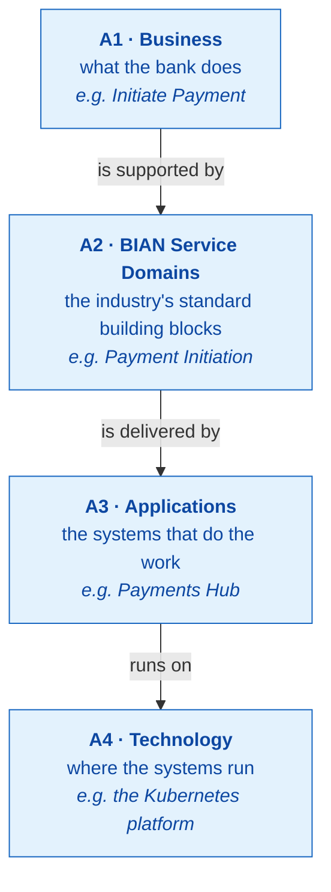

## Why it matters

Today, the answer to *"what does this business capability depend on?"* is spread across documents, spreadsheets and tools — and lives in people's heads. SDEM puts it in one connected place.

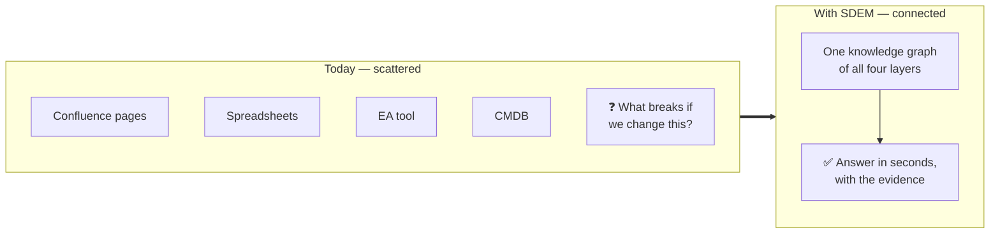

## SDEM in three layers

SDEM is built from the ground up in three layers. Each one stands on the one below — **the agents are optional; the data and the tools are not.**

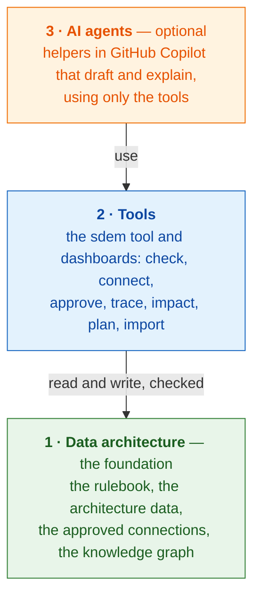

| Layer | What it is | Who uses it |
|---|---|---|
| **1 · Data architecture** | what SDEM knows, and the rules it must follow | everything above it |
| **2 · Tools** | how people (and agents) work with that knowledge | architects, every day |
| **3 · AI agents** | optional helpers that use the tools | architects who want AI support |

## Layer 1 — Data architecture

The foundation: **the rules, the data, and the connections** — kept as files, checked, with a full history.

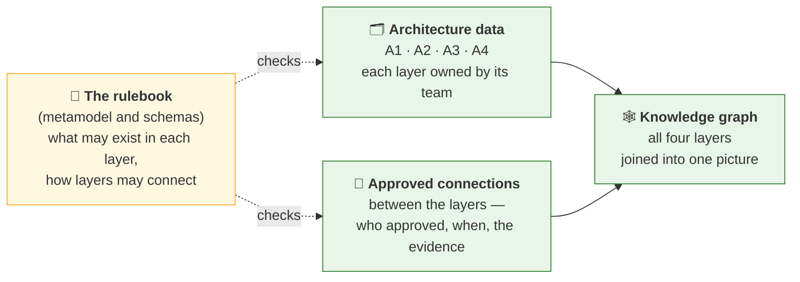

| Part | In plain words |
|---|---|
| **The rulebook** | 44 types of thing (capability, application, server …), which may be linked inside a layer (132 rules) and between layers (9 kinds of connection), and the rules for proposing them (69) — each traced to a public standard (BIAN, ArchiMate, TOGAF) |
| **Architecture data** | the bank's records for each layer — one file per layer, in a fixed format |
| **Approved connections** | the links between layers, each a record of who approved it, when, and the document that proves it |
| **Knowledge graph** | built from the data and the approved connections; what every question is answered from |

## Layer 2 — Tools

One tool, `sdem`, and dashboards on top of it. **Every function works without AI.**

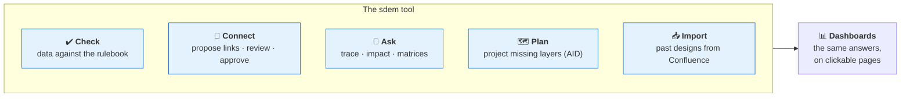

### How it works

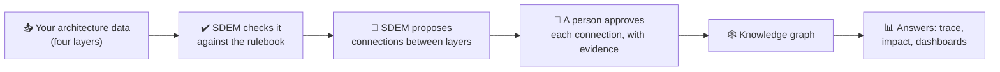

- **The rulebook** (the *metamodel*) says what can exist in each layer and how layers may connect. It is based on public standards — BIAN, ArchiMate and TOGAF.
- **SDEM proposes; people decide.** SDEM suggests connections using rules — not AI — and shows why and how sure it is. Nothing counts until a person approves it.

### One example, end to end

Follow one business capability all the way down to the technology it runs on:

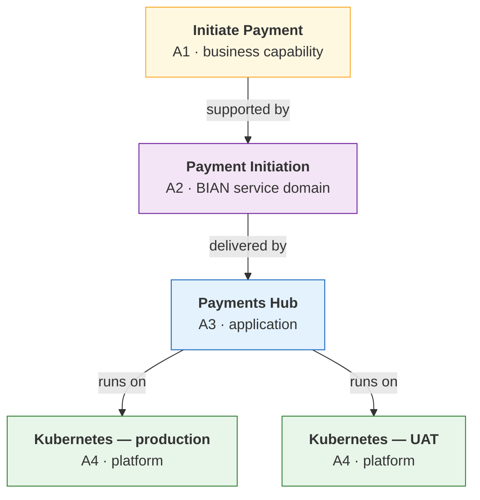

Every arrow is an approved connection, with who approved it, when, and the document that proves it.

### Asking "what if?"

*"What happens if we retire the production Kubernetes platform?"* SDEM follows the connections and answers:

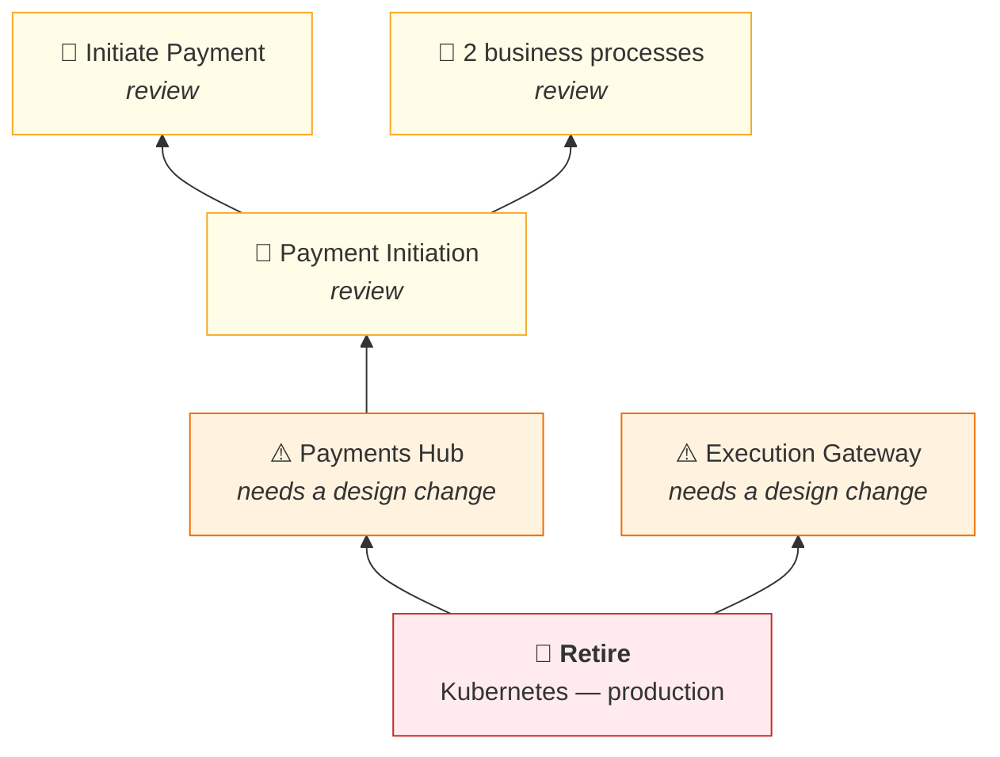

Two applications need a design change; one BIAN domain, one capability and two processes need a review. An architect confirms before anything changes.

### Onboarding past designs

Years of designs live in Confluence as pages, diagrams and pictures. SDEM can turn them into architecture data — on your own machine, without AI.

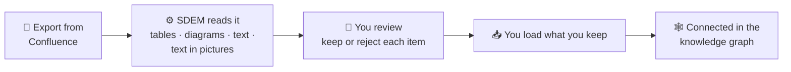

Every item SDEM finds says **which page it came from, where on the page, and how sure SDEM is** — never more than "medium" until a person checks it. **Nothing is thrown away:** what does not fit an architecture entity — a table of risks, a detail with no field for it, text, pictures, a PDF — is kept as a *gap record* next to the data, linked to its page and entities, for a person to deal with. How to do it: [*Onboarding your existing designs*](#onboarding-your-existing-designs) below.

### People stay in charge

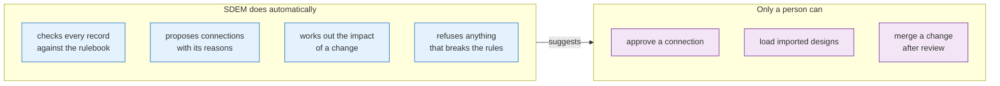

These rules are built into the software — SDEM refuses an approval with no evidence, or one signed by an AI agent.

## Layer 3 — AI agents (optional)

Architects can work with AI helpers in **GitHub Copilot**: one for each layer and a coordinator. They draft changes and explain results — but work only through SDEM's checked commands, and never approve.

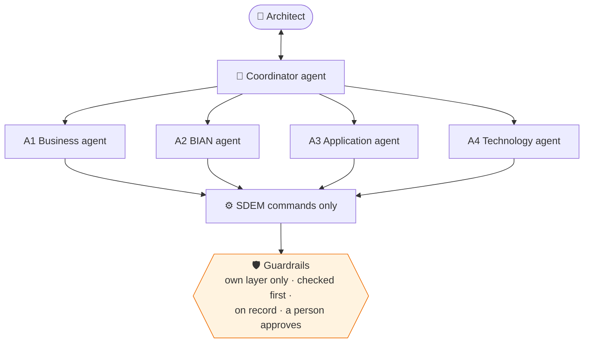

Every function also works without AI. The agents are built; trying them in Copilot is the next step ([`docs/sdem-agent-platform-spike.md`](docs/sdem-agent-platform-spike.md)).

## What's built and what's next

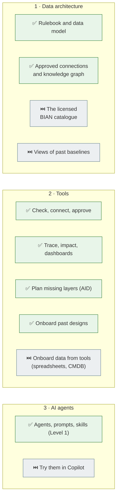

✅ built · ⏭️ next. Details and dates: [`docs/ROADMAP.md`](docs/ROADMAP.md).

## Onboarding your existing designs

**Onboarding** brings data from a new source into SDEM until it is **governed and ready for use** — reviewed, checked against the rulebook, connected, approved and built into the knowledge graph. It has two parts: **ingestion** (getting the data into an estate) and **normal processing** (making it ready — the same for every estate).

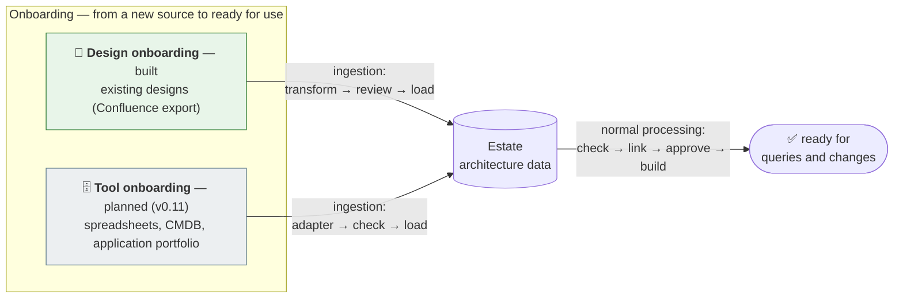

### Design onboarding at a glance

What an architect does, in their own VS Code terminal — purple is you, blue is SDEM:

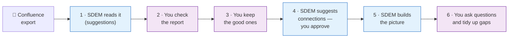

How ready the data is at each stage — and what is kept when something does not fit:

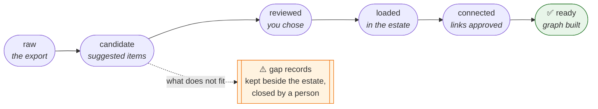

### The commands

| # | Command | In plain words |
|---|---|---|
| 1 | `sdem transform inspect <export folder>` | **Look before you start** — what is in the export, what SDEM can read. Changes nothing |
| 2 | `sdem transform run <export folder> -o work/history` | **Read the designs** — suggested architecture items, and a report for you |
| 3 | *(read `work/history/extraction-report.md`)* | **Check the suggestions** — decide which are wrong |
| 4 | `sdem load work/history --estate estates/history --person <you> --exclude <wrong ones>` | **Keep the good ones** — into your project; what did not fit is kept as *gaps* (`--dry-run` first) |
| 5 | `sdem check --estate estates/history` | **Health check** — everything follows the rules |
| 6 | `sdem link --estate estates/history --out work/links` | **Suggest connections** between the layers |
| 7 | `sdem review work/links/proposals.json` | **See the suggested connections**, weakest first |
| 8 | `sdem approve <id> … --reviewer <you> --evidence <document>` | **Accept a connection**, with the document that proves it |
| 9 | `sdem build --estate estates/history --out work/graph` | **Make the picture** — the knowledge graph |
| 10 | `sdem trace <item>` · `sdem impact <item> --change retire` | **Ask questions** — what it depends on · what breaks if it goes |
| 11 | `sdem dashboard --estate estates/history -o work/dashboard.html` | **See it as a web page** |
| 12 | `sdem designs --estate estates/history --gaps` | **See the gaps** — what did not fit |
| 13 | `sdem designs accept` · `resolve <gap id> … --person <you> --note "<why>"` | **Close a gap** |
| 14 | copy `estates/history` to your team's **private** estate repository → commit → pull request | **Save and share** for review |

**In short:** read → you check → keep → connect → picture → use → tidy up → save. Commands 1–4 are *ingestion*, 5–9 *normal processing*. Your name is on every decision; keep the export in `work/` (never saved to Git); `estates/history/` is the result you save.

**Full guide:** [`docs/sdem-onboarding-workflow.md`](docs/sdem-onboarding-workflow.md) — every step with what you will see, what each step does to the data, gaps, and what to do when something goes wrong. **Test it** with expected results: [`docs/use-case-example-4.md`](docs/use-case-example-4.md).


## Start here

| You are… | Start with |
|---|---|
| **Seeing SDEM for the first time** | the dashboard — run `sdem home -o work/sdem` and open `work/sdem/index.html`: SDEM's architecture, the rulebook, health and the example projects, all clickable |
| **An architect who will use it** | the [user guide](docs/sdem-workbench-user-guide.md) — set-up, a 15-minute quick start, every task step by step |
| **Onboarding your existing designs** | [the onboarding workflow](docs/sdem-onboarding-workflow.md) (step by step, with the commands) · [the test script](docs/use-case-example-4.md) |
| **Setting up the AI agents** | [Copilot set-up](docs/sdem-copilot-setup.md), then [the spike](docs/sdem-agent-platform-spike.md) |
| **Wanting the concepts** | [the overview](docs/sdem-overview.md) and the [glossary](docs/glossary.md) |
| **A maintainer** | [CONTRIBUTING.md](CONTRIBUTING.md) and the technical section below |

---

## For technical users

### Quick start

Python 3.10+, no other dependencies. `pip install -e .` installs the `sdem` command (or run `python -m sdem …`). Architects run it in the VS Code terminal, with Copilot Chat for help ([workbench design](docs/sdem-workbench-design.md)).

```bash
sdem --help                                              # every task; `sdem <task> --help` shows an example
sdem home -o work/sdem                                   # the main dashboard — open work/sdem/index.html
E=examples/payment-initiation

# check, trace, impact
sdem check --estate $E                                   # the data against the rulebook
sdem build --estate $E --out work/graph                  # the knowledge graph
sdem trace CAP-PAY-010 --direction down --graph work/graph
sdem impact INF-K8S-PAY-PROD --change retire --graph work/graph
sdem matrix --estate $E                                  # business → BIAN → application → technology

# propose, review, approve connections
sdem link --estate $E --out work/links                   # the rules engine proposes
sdem review work/links/proposals.json                    # weakest first, with reasons
sdem approve P-RUN-001 --proposals work/links/proposals.json --estate <your copy> \
     --reviewer <your name> --evidence <kind:document> [--bian-release <release>]   # a person, then a pull request

# onboard existing designs
sdem transform run <confluence export> -o work/history   # candidates with their evidence
sdem load work/history --estate estates/history --person <your name> --exclude <ids you reject>

# plan missing layers, maintain
sdem aid project --have $E/a1-business.json --catalogue <bian catalogue> --out work/prj
sdem model check                                         # generated documents current (as CI)
python -m unittest discover -s tests                     # the test suite
```

Exit codes: `0` ok, `1` issues found or refused by a check, `2` usage or input error (a missing folder, a file that is not valid JSON), `3` an internal error in SDEM (one line; `SDEM_DEBUG=1` shows the details). `sdem --version` shows the version.

### Documentation map

All documents, by reader (use · understand · govern · build · reference · test · history): **[`docs/README.md`](docs/README.md)**.

| Area | Documents |
|---|---|
| **Using SDEM** | [user guide](docs/sdem-workbench-user-guide.md) · [workbench design](docs/sdem-workbench-design.md) / [spec](docs/sdem-workbench-spec.md) · [dashboards](docs/sdem-dashboard-design.md) / [spec](docs/sdem-dashboard-spec.md) · [overview](docs/sdem-overview.md) · [glossary](docs/glossary.md) |
| **The rulebook (metamodel) and data** | [governing detail spec](docs/architecture-metamodel-detail-level-spec.md) · [high-level spec](docs/architecture-metamodel-high-level-spec.md) (frozen reference) · [entities](docs/architecture-entity-design.md) · [attributes](docs/architecture-attribute-design.md) · [logical data model](docs/logical-data-model.md) · [physical data model](docs/physical-data-model.md) · [provenance](docs/reference-architecture-provenance.md) |
| **Connections, engine and graph** | [relationship rules](docs/relationship-rules-spec.md) · [registry](docs/relationship-registry-spec.md) · [governance](docs/architecture-governance-spec.md) · [knowledge graph](docs/knowledge-graph-design.md) / [spec](docs/knowledge-graph-spec.md) · [graph store](docs/graph-store-design.md) / [spec](docs/graph-store-spec.md) · [within-level rows](docs/relationships-planning.md) / [testing](docs/relationships-testing.md) · [mapping logic](docs/mapping-logic-planning.md) · [execution](docs/mapping-execution.md) |
| **Planning missing layers (AID)** | [design](docs/aid-design.md) · [spec](docs/aid-spec.md) |
| **Onboarding existing designs** | [**onboarding workflow**](docs/sdem-onboarding-workflow.md) · [transform design](docs/sdem-transform-design.md) / [spec](docs/sdem-transform-spec.md) · [load design](docs/sdem-load-design.md) / [spec](docs/sdem-load-spec.md) |
| **AI agents and Copilot** | [principles](docs/sdem-agent-platform-principles.md) · [design](docs/sdem-agent-platform-design.md) / [spec](docs/sdem-agent-platform-spec.md) · [Copilot set-up](docs/sdem-copilot-setup.md) · [spike](docs/sdem-agent-platform-spike.md) · [repository protection](docs/sdem-repository-protection.md) |
| **Controls** | [controls register](docs/controls-register.md) |
| **Tests and examples** | [use-case testing](docs/use-case-testing.md) · [example 1](docs/use-case-example-1.md) (mappings and graph) · [example 2](docs/use-case-example-2.md) (AID) · [example 3](docs/use-case-example-3.md) (agents) · [example 4](docs/use-case-example-4.md) (importing past designs, export to build) |
| **Releases and history** | [roadmap](docs/ROADMAP.md) · [changelog](CHANGELOG.md) · [renamed from SDMM](docs/history/renamed-from-sdmm.md) |

### Repository contents

| Folder | Holds |
|---|---|
| `metamodel/` | the rulebook: entity types (A1–A4), attributes, links allowed inside and between layers, engine rules, controls, transform rules |
| `schema/` | file formats: datasets, per-entity schemas (`entities/`), registry, graph store, projections, coordination records, link types |
| `sdem/` | the `sdem` tool: CLI, checks, rules engine, approval, graph store, trace and impact, dashboards, AID, agents' coordination, transform and load, document generators |
| `examples/` | made-up estates: `payment-initiation`, `legacy-core-ledger`, `acquired-fintech`, `digital-lending`, `trade-finance`, `card-fraud-alerts`, `customer-onboarding`, `reference-structure` |
| `.github/` | Copilot agents, prompts and skills; Copilot instructions; code owners; CI |
| `docs/` | designs, specifications, guides, test plans and results |
| `scripts/` | use-case example runs and sample generators |
| `tests/` | the test suite, and synthetic Confluence exports (`fixtures/`) |
| `sdmm/` | deprecated compatibility shim from the rename |

### How it was tested

| Test | Result |
|---|---|
| Rules engine against sealed answer keys | 8 of 8 acceptance cases pass |
| Use-case example 1 — four datasets to mappings and graph, clean and with planted defects | 30 of 30 |
| Use-case example 2 — planning missing layers (AID) | 12 of 12; safety 16 of 16 |
| Use-case example 3 — agents carry a technology change to an approved link | 8 of 8; controls 19 of 19 |
| Earlier procedure runs — ten use cases, eleven runs ([`use-case-testing.md`](docs/use-case-testing.md)) | every proposable rule reached its sealed answers |
| Links allowed inside a layer | 132 rows: 16 checked on BIAN's public pages, 113 against the open-source ArchiMate implementation, 0 contradicted |
| Automated tests | the full suite (about 350 tests) on every push (GitHub Actions), with a check that generated documents are current |

**Caveats.** All data and answer keys were made by this project; a blind test by someone else is still to come. The ArchiMate and TOGAF specifications need a login, so those rows were checked against an implementation. The AI agents have not yet run in real Copilot.

### Where the rulebook comes from

Every entity type comes from a **public reference architecture** — BIAN, ArchiMate 3.2 or TOGAF 10 — or is a documented SDEM extension of one; none is copied from any institution's model, and no BIAN or Open Group text is reproduced. Entity by entity, with sources: [`docs/reference-architecture-provenance.md`](docs/reference-architecture-provenance.md). BIAN®, ArchiMate® and TOGAF® are trademarks of their owners; SDEM is independent and not endorsed by them.

---

## Rules of use

- Preserve historical architecture documents; never overwrite or silently reclassify them.
- New designs may reference legacy designs and patterns with provenance and approvals.
- Keep canonical BIAN reference content separate from your own design objects.
- Store connections as versioned, typed claims. An AI confidence value is not evidence of compliance.
- A reverse traversal is a query, not a duplicate inverse edge.
- Affected-by-change does not mean must-change: impact needs an architect's assessment and approval.

## Licenses and attribution

- Source code and machine-readable schemas and templates: Apache-2.0 (see `LICENSE`).
- Original methodology prose in `docs/` and this README: CC BY 4.0 (see `LICENSES.md`).
- External BIAN content is not relicensed by this repository. See `THIRD_PARTY.md`.

This is an independent community proposal, not affiliated with, endorsed by, or sponsored by BIAN or any bank. No guarantees of fitness, correctness, or compliance are made.
