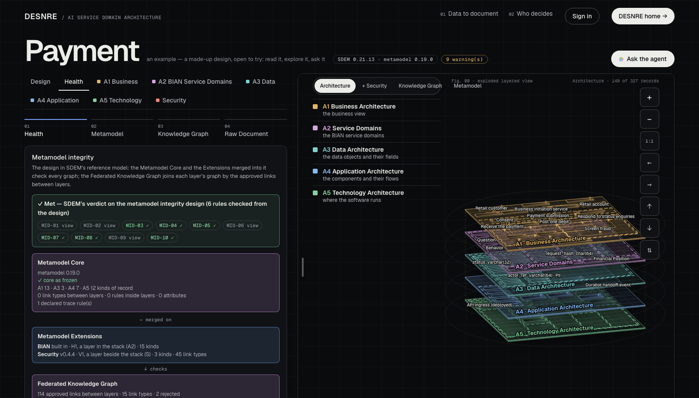
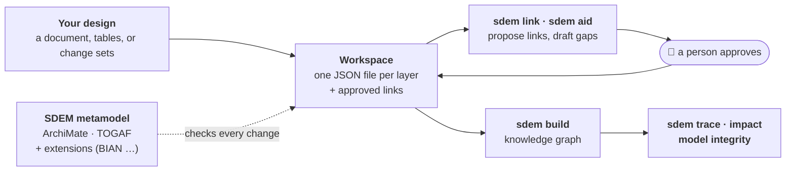

# SDEM — Solution Domain Enterprise Model

**Design solution architecture as version-controlled data — business, data, applications and technology in one checked model, extended for your industry (BIAN for banking) — and trace any requirement down to the server that runs it, or any server up to the requirements that depend on it.**

[](https://github.com/taumoeps/sdem/actions/workflows/validate.yml)
[](https://github.com/taumoeps/sdem/releases/latest)
[](LICENSE)
[](pyproject.toml)
[](pyproject.toml)

> [!NOTE]
> **v0.22.0 · ready for evaluation on synthetic data.** Using it on real designs needs a pilot ([what that takes](#using-sdem-on-real-designs)). SDEM uses BIAN's published Semantic APIs under BIAN's licence; it is **not an official BIAN standard and is not endorsed by BIAN**.



*The made-up Payment example, published from SDEM to [DESNRE](https://desnre.vercel.app/example/payment): SDEM's integrity verdict on the left, the design's five layers on the right — every shape and line from SDEM's knowledge graph.*

## Key features

- **One model, every layer** — business capabilities and processes, data, applications and technology, checked against one metamodel aligned to ArchiMate 3.2 and TOGAF — and, with the BIAN extension, BIAN's service domains for banking.
- **Trace and impact** — follow approved links down from a requirement to its technology, or up from a server to everything that depends on it; see what a change would affect (`sdem trace`, `sdem impact`).
- **People decide** — SDEM proposes the links between layers and drafts what a design leaves out (AID), but nothing counts until a person approves it, with evidence.
- **Architecture as code** — designs are JSON in your own Git repository; every change is a recorded change set; the knowledge graph is rebuilt from them.
- **No dependencies, no AI inside** — pure Python standard library, deterministic answers; optional AI agents (GitHub Copilot, Claude Code, Codex, Gemini) drive the same CLI.

## Prerequisites

- **Python 3.10 or later** and **Git** (macOS: `brew install python@3.13`; Windows: `winget install Python.Python.3.13`)
- Nothing else — no API keys, environment variables or services. SDEM runs offline.

## Install

```bash
mkdir my-sdem && cd my-sdem
python3 -m venv .venv && source .venv/bin/activate          # Windows PowerShell: .venv\Scripts\Activate.ps1
python -m pip install "sdem @ git+https://github.com/taumoeps/sdem@v0.22.0"
sdem --version
```

The install is SDEM's core: the metamodel for Business, Data, Application and Technology, its rules, and a made-up example — for any industry. **For banking**, add BIAN's Service Domain layer and its catalogue of 258 service domains (Semantic APIs 14.0.0):

```bash
python -m pip install "sdem-bian @ git+https://github.com/taumoeps/sdem-extensions@bian-v1.3.0#subdirectory=metamodel/bian"
```

## Quick start

### See a finished design in one command

```bash
sdem new --workspace workspaces/library --person your.name --example library-holds --explore
open work/sdem/index.html                                     # Linux: xdg-open · Windows: start
```

A made-up library's holds service with approved links: its records, the knowledge graph, trace and impact, as local HTML pages. With `sdem-bian` installed, `--example payment-initiation` gives a complete banking design the same way.

### Start a design of your own

Every command below was run as written on SDEM 0.22 without `sdem-bian`; the room bookings are made-up data.

**1. Create an organisation and a workspace**

```bash
sdem new --organisation acme --person your.name                                    # once per organisation
cd acme
sdem new --workspace workspaces/bookings --organisation acme --person your.name    # each workspace
```

```
acme/
├── profiles/acme-base.json            ← your organisation's own types, attributes and rules
└── workspaces/bookings/
    ├── business.json  data.json  application.json  technology.json   ← one file per layer
    ├── mappings.json                  ← the approved links between layers
    └── sdem-profile.json              ← extends the organisation's base profile
```

**2. Write what you know** — one change set per layer (`sdem types A1` lists the allowed types and fields). The business, saved as `bookings-a1.json`:

```json
{
  "layer": "A1",
  "reason": "Initial business design for room bookings",
  "changes": [
    {"op": "add", "record": {"id": "CAP-BOOK", "type": "A1.BusinessCapability", "version": "1",
      "name": "Room Booking", "lifecycle_status": "planned"}},
    {"op": "add", "record": {"id": "PRC-BOOK", "type": "A1.BusinessProcess", "version": "1",
      "name": "Book a meeting room", "lifecycle_status": "planned"}}
  ],
  "relationships": {"add": [{"source": "PRC-BOOK", "kind": "realization", "target": "CAP-BOOK"}]}
}
```

The application that serves it and where it runs, as `bookings-a3.json` and `bookings-a4.json`:

```json
{
  "layer": "A3",
  "reason": "The application that books rooms",
  "changes": [
    {"op": "add", "record": {"id": "APP-BOOK", "type": "A3.ApplicationComponent", "version": "1",
      "name": "Room booking app", "lifecycle_status": "planned", "attributes": {"deployed_on": ["SYS-BOOK-RT"]}}},
    {"op": "add", "record": {"id": "APS-BOOK", "type": "A3.ApplicationService", "version": "1",
      "name": "Room reservation", "lifecycle_status": "planned"}}
  ],
  "relationships": {"add": [{"source": "APP-BOOK", "kind": "realization", "target": "APS-BOOK"}]}
}
```

```json
{
  "layer": "A4",
  "reason": "Where room bookings runs",
  "changes": [
    {"op": "add", "record": {"id": "SYS-BOOK-RT", "type": "A4.SystemSoftware", "version": "1",
      "name": "Bookings runtime", "lifecycle_status": "planned"}}
  ]
}
```

```bash
sdem change propose bookings-a1.json --workspace workspaces/bookings --agent architect --person your.name --dry-run
sdem change propose bookings-a1.json --workspace workspaces/bookings --agent architect --person your.name
sdem change propose bookings-a4.json --workspace workspaces/bookings --agent architect --person your.name
sdem change propose bookings-a3.json --workspace workspaces/bookings --agent architect --person your.name
```

SDEM checks each change against the metamodel before writing it, and records it.

**3. Let SDEM propose the links between layers** — from what the records say (`deployed_on`), each with its rule and confidence:

```bash
sdem link --workspace workspaces/bookings --out workspaces/bookings/links
```

```
  [0.8] P-RUN-001  APP-BOOK -DEPLOYED_ON-> SYS-BOOK-RT   rule S33
        why: data join (S36 subsumed in S33); a3 APP-BOOK.deployed_on lists SYS-BOOK-RT
```

**4. Review and decide** — only what a person approves or states counts:

```bash
sdem approve P-RUN-001 --proposals workspaces/bookings/links/proposals.json \
  --workspace workspaces/bookings --reviewer your.name --evidence deployment_design:bookings-deploy-v1
sdem connect PRC-BOOK SERVED_BY APS-BOOK --workspace workspaces/bookings --person your.name \
  --evidence process_model:bookings-design-v1 --rationale "the reservation service serves the booking process"
```

**5. Build the knowledge graph and trace**

```bash
sdem build --workspace workspaces/bookings --out workspaces/bookings/graph
sdem trace SYS-BOOK-RT --direction up --graph workspaces/bookings/graph    # everything that depends on the runtime
sdem trace GAPS --graph workspaces/bookings/graph                          # what does not yet reach every layer
sdem status --workspace workspaces/bookings                                # where the design is, and what to do next
```

```
SYS-BOOK-RT 'Bookings runtime'  [A4 Technology · System Software]
└─ <-DEPLOYED_ON- APP-BOOK 'Room booking app'  [A3 Application · Application Component]  (MAP-002)
   └─ <-REALIZES- APS-BOOK 'Room reservation'  [A3 Application · Application Service]
      └─ <-SERVED_BY- PRC-BOOK 'Book a meeting room'  [A1 Business · Business Process]  (MAP-001)
         └─ <-REALIZES- CAP-BOOK 'Room Booking'  [A1 Business · Business Capability]
```

The trace follows only what you have approved or stated.

### A banking design, with BIAN

With `sdem-bian` installed, a design can take BIAN's Service Domain layer between Business and Application, and AID drafts much of the rest from it — the service domains a process invokes, candidate applications, APIs and a deployment, and the links between layers, each marked *inferred* with its source, reasoning and confidence:

```bash
sdem new --workspace workspaces/ledger --organisation acme --person your.name --with bian
sdem bian search ledger posting       # → Financial Accounting, operation SO-FINANCIAL-ACCOUNTING-CAPTURE-LEDGER-POSTING
```

A process names the BIAN operation it invokes (`"attributes": {"invokes": ["SO-FINANCIAL-ACCOUNTING-CAPTURE-LEDGER-POSTING"]}`); then:

```bash
sdem aid --workspace workspaces/ledger --person your.name
sdem aid confirm SD-FINANCIAL-ACCOUNTING --workspace workspaces/ledger --person your.name
sdem review workspaces/ledger/aid/AID-001-proposals.json                  # proposed links, weakest first
```

The whole walk-through: [Quick start](docs/sdem-quick-start.md); what BIAN adds: [`sdem-bian`](https://github.com/taumoeps/sdem-extensions/tree/main/metamodel/bian).

> [!TIP]
> **Already have designs?** A Confluence export, a folder of designs, or a Word or Excel file can be brought in by rules with `sdem transform` and `sdem load` ([onboarding](docs/sdem-onboarding-workflow.md)); prose design documents through an AI agent ([AI agent setup](docs/sdem-agent-setup.md)). How a design gets in and how a trace works: [From a design to a trace](docs/sdem-from-design-to-trace.md).

## How it works



The **workspace** is the source of truth; the **knowledge graph** is derived from it. SDEM never invents a link: a trace follows only links stated in the design or approved by a person. In full: [How SDEM works](docs/sdem-how-it-works.md).

## Documentation

| Read | For |
|---|---|
| [How SDEM works](docs/sdem-how-it-works.md) | the metamodel, the three components (data, CLI, agents), the BIAN catalogue, the local workbench, comparison with other tools |
| [From a design to a trace](docs/sdem-from-design-to-trace.md) | how a design gets in, where every link comes from, how `sdem trace` walks them — with a worked example |
| [Quick start](docs/sdem-quick-start.md) | a first design with the ten everyday commands |
| [User guide](docs/sdem-workbench-user-guide.md) | every task step by step, and troubleshooting |
| [Scenarios](docs/sdem-scenarios.md) | 16 jobs end to end — the commands in order and who decides |
| [CLI reference](docs/reference/cli-reference.md) | every command and option — generated from the code |
| [Extensions](docs/sdem-extensions-guide.md) | what extensions add (BIAN, security, publishers), and how to use and write one |
| [Documentation index](docs/README.md) | everything else, and the [glossary](docs/glossary.md) |

Examples to copy: [`examples/`](examples/README.md). What changed in each release: [CHANGELOG](CHANGELOG.md).

## Extensions

SDEM's core is industry-neutral: Business, Data, Application, Technology. Extensions add the rest — an industry's reference model, a cross-cutting architecture, a place to publish to — each a separate package you install beside SDEM, and each design says which it uses.

| Extension | Kind | Adds |
|---|---|---|
| [`sdem-bian`](https://github.com/taumoeps/sdem-extensions/tree/main/metamodel/bian) | horizontal (metamodel) | BIAN's Service Domain layer, its 258-domain catalogue, its link types and inference — for banking designs (`sdem new --with bian`) |
| [`sdem-security`](https://github.com/taumoeps/sdem-extensions/tree/main/metamodel/security) | vertical (metamodel), checker | threats, controls and zones beside every layer |
| [`sdem-desnre`](https://github.com/taumoeps/sdem-extensions/tree/main/publishers/desnre) | publisher | a made-up workspace as a 3D view on the web |

`sdem extensions` lists what is installed. How to find, install, include and write one: the [Extensions guide](docs/sdem-extensions-guide.md).

## Using SDEM on real designs

This repository holds **synthetic data only**. Real architecture belongs in your organisation's **private workspace repository** ([template](templates/workspace-repo/README.md)), with a pinned SDEM release, access control, version history and governance. SDEM is suitable for evaluation and controlled architect pilots; production use needs your own security, governance and operational validation — the [adoption checklist](docs/sdem-adoption-checklist.md) and the [pilot plan](docs/sdem-pilot-plan.md) say what. Each organisation extends the metamodel with its own types, attributes, rules and layers in a profile, never by changing the core ([configuration](docs/sdem-configuration.md)).

## Contributing

Contributions are welcome — read [CONTRIBUTING.md](CONTRIBUTING.md) first: tests before every push (`make test`, or `python -m unittest discover -s tests`), made-up data only, every rule with an id, no new dependencies. Report a vulnerability privately as [SECURITY.md](SECURITY.md) describes, never in a public issue. Maintained by one person as an independent project; responses are best effort.

## Licence

Apache License 2.0 — private, commercial and organisational use, under its terms ([`LICENSE`](LICENSE), [what it means in plain words](docs/sdem-licence-and-use.md)). The base BIAN catalogue, in the `sdem-bian` extension, is BIAN's Semantic APIs under BIAN's own Apache-2.0 licence ([`LICENSES.md`](LICENSES.md), [`THIRD_PARTY.md`](THIRD_PARTY.md)). SDEM collects nothing ([`PRIVACY.md`](PRIVACY.md)).

BIAN®, ArchiMate® and TOGAF® are trademarks of their owners. SDEM is an independent project — not affiliated with, endorsed by, or sponsored by BIAN, The Open Group or any other organisation; no guarantees of fitness, correctness or compliance.
