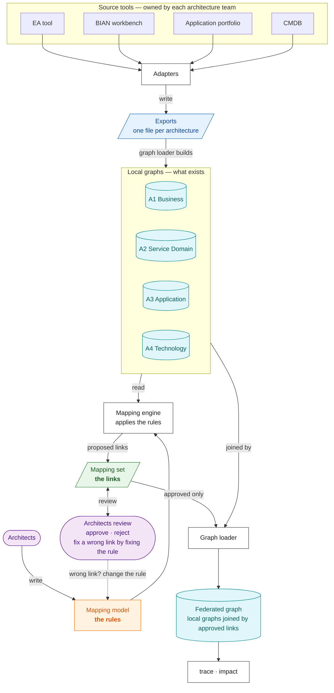

# BIAN Service Domain Mapping Model (SDMM)

> **Status:** community proposal and reference implementation (v0.6.2), **not** an official BIAN standard. BIAN reference content is not included.

SDMM traces a bank's architecture across four design models, from business capability to running platform, through BIAN Service Domains. It defines **the rules for linking them** (the *mapping model*), **the format of the links** (the *mapping set*), and **the graphs that join them** (the *local* and *federated* knowledge graphs), with validators, query tools and a tested procedure for producing links automatically.

| Code | Architecture | Holds |
|---|---|---|
| **A1** | Business Architecture | capabilities, value streams, processes, business services and objects |
| **A2** | Service Domain Architecture | BIAN-aligned Service Domains, operations, control records, scenarios, business objects |
| **A3** | Application Architecture | applications, interfaces, API operations, data entities, events |
| **A4** | Technology Architecture | platforms, nodes, deployments, environments, networks |

Together these four are the **Service Domain Architecture Design Model (SDADM)**. Entity names carry the level code, e.g. `A3.APIOperation`.

> **New here?** Read [`docs/mapping-model-design.md`](docs/mapping-model-design.md) first (one page, with a worked example), then [`docs/knowledge-graph-design.md`](docs/knowledge-graph-design.md).

---

## How SDMM works

**Rules → engine → links → review → graph.**

- Each architecture's **data** is exported from the tool that owns it and loaded as a **local graph**: *what exists*.
- Architects write the **mapping model**: the **rules** for how things in one architecture connect to things in the next.
- The **mapping engine** applies the rules to the local graphs and produces the **mapping set**: the **actual links**, each with evidence and confidence.
- Architects **review** the links. The **graph loader** joins the local graphs with the approved links into the **federated graph**, which answers questions across architectures: *what does this capability run on? what is affected if this platform changes?*



| Part | What it is | Owned by | Where |
|---|---|---|---|
| **Exports → local graphs** | one per architecture: what exists and the links inside it | each architecture team | `examples/<estate>/a1…a4-*.json` |
| **Mapping model** | the rules for links between architectures | architects | `schema/relationship-types.json`, `metamodel/new-mappings.json`, `metamodel/export-conventions.json` |
| **Mapping engine** | applies the rules, writes proposed links | runs on request | `sdmm/engine.py` |
| **Mapping set** | the links between real things, with status and evidence | built by the engine, reviewed by architects | `examples/<estate>/mappings.json` |
| **Graph loader → federated graph** | the local graphs joined by the approved links | rebuilt every run | `sdmm/graph.py` (`sdmm-graph`) |

---

## The mapping model

The mapping model is the **rules**, stated over entity **types**. It is not the links, and it is not the schema.

| | Mapping model | Mapping set | Schema |
|---|---|---|---|
| In one word | **rules** | **links** | **form** |
| Talks about | types: `A2.ServiceOperation` | real things: `SO-PI-01` | fields: `status` |
| Example | rule `S24`: an operation is `IMPLEMENTED_BY` an API when the HTTP method fits its action and the payload carries its attributes | link `PAY-101`: *Initiate Payment Instruction* is implemented by `POST /payment-instructions`, approved by an architect | `schema/mapping.schema.json` |

| The mapping model in numbers | |
|---|---|
| Entity types | 44 |
| Links allowed *inside* each architecture (within-level rows) | 132 |
| Kinds of link allowed *between* architectures (registry) | 9 |
| Plan rows: rules for finding cross-architecture links | 69 — 9 registry rules that produce links; 41 candidate, conditional, derived or institution-only rules that are reported; 14 BIAN-internal; 5 ruled out |
| Join keys the rules read from exports | 52 |

**Read:** [`mapping-model-design.md`](docs/mapping-model-design.md) (overview) · [`mapping-model-spec.md`](docs/mapping-model-spec.md) (every rule, and the engine's 33 requirements) · [`mapping-model-diagram.puml`](docs/mapping-model-diagram.puml) (every rule by ID, one picture) · [`relationships-planning.md`](docs/relationships-planning.md) (every within-level row with source, reasoning and confidence).

---

## The knowledge graph

| | Local graph | Federated graph |
|---|---|---|
| How many | four, one per architecture | one |
| Built from | that architecture's **export** | the **approved** records of the **mapping set**, plus the four local graphs |
| Holds | what exists, and the links inside one architecture | the links between architectures, each pointing into two local graphs |
| Answers | "What is the Payments Hub made of?" | "What does the Initiate Payment capability run on?" |

The **graph loader** builds all five on every run: it checks each export against the entity catalogue and the within-level rows, keeps approved links only, and resolves both ends of each link in the right local graph. Nothing edits a graph directly; a change reaches it by changing an export or the mapping set.

```text
$ sdmm-graph trace CAP-PAY-010 --direction down examples/payment-initiation/a*.json examples/payment-initiation/mappings.json
CAP-PAY-010 'Initiate Payment'                [A1]
└─ SUPPORTED_BY → SD-PI 'Payment Initiation'  [A2]   (PAY-001)
   └─ REALIZED_BY → APP-PAY-HUB 'Payments Hub' [A3]  (PAY-106)
      ├─ DEPLOYED_ON → INF-K8S-PAY-PROD         [A4]  (PAY-108)
      └─ DEPLOYED_AS → DEP-PAYHUB-PROD          [A4]  (PAY-109)
```

Every step across architectures cites the mapping-set record that justifies it.

**Read:** [`knowledge-graph-design.md`](docs/knowledge-graph-design.md) (how the graphs are built; local query paths L1–L3 and federated paths F1–F4) · [`knowledge-graph-spec.md`](docs/knowledge-graph-spec.md) (node and edge schemas, identity, versions, every component and service, change workflows, open decisions).

---

## How it was tested

The mapping model was run as a procedure by an AI executor against sealed answer keys, on synthetic bank estates, and corrected after each run.

| Test | Result |
|---|---|
| Ten use cases, eleven runs ([`use-case-testing.md`](docs/use-case-testing.md)) — brownfield, reverse mapping from a legacy ledger, hostile naming, greenfield design, and three coverage cases | every proposable rule reached its sealed answers; no false link after v0.5.4 except one fixed by a rule change |
| Plan coverage | **50** of 69 plan rows validated against sealed answers; the other 19 are BIAN-internal or ruled out by decision; **0** untested |
| Hostile naming | recall 0.78 → 1.00 at precision 1.00 when the institution's decoded names were supplied as data: naming is an input problem, not a rule problem |
| Within-level rows ([`relationships-testing.md`](docs/relationships-testing.md)) | 132 rows: 16 verified on BIAN's public pages, 113 confirmed by the open-source Archi implementation of the ArchiMate relationship tables, 0 contradicted; the checker accepts exactly the rows |

**Caveats.** Every estate and answer key was authored by this project; one blind case authored by someone else would retire that. The ArchiMate and TOGAF specifications are login-gated, so those rows are verified against an implementation, not the specification text.

---

## What is built

| Component | Status |
|---|---|
| Entity catalogue, within-level rows, mapping model records, export and mapping-set schemas | built |
| Validators: `sdmm-graph check` (exports), `sdmm-validate` (mapping set), `sdmm-diff` (approved links never edited) | built |
| Graph loader, local and federated graphs (in memory), `trace`, `impact`, `stats` | built |
| Generated documents and diagrams, checked current in CI | built |
| Mapping engine | interface, baseline and scorer built; **rule logic is the next build**, to [`mapping-model-spec.md`](docs/mapping-model-spec.md) |
| Export diff, refresh trigger, review queue, query service interface, assistant access, persistent store | specified ([`knowledge-graph-spec.md`](docs/knowledge-graph-spec.md) §11), not built |
| Adapters from real tools | not built here — they belong in an institution's private repository |

---

## Quick start

Python 3.10+; no third-party dependencies. `pip install -e .` installs the commands; or run them with `python -m sdmm.<module>`.

```bash
E=examples/payment-initiation

sdmm-graph check  $E/a*.json $E/mappings.json                          # load and check the graphs
sdmm-graph trace  CAP-PAY-010 --direction down $E/a*.json $E/mappings.json   # what does this depend on?
sdmm-graph trace  INF-K8S-PAY-PROD --direction up $E/a*.json $E/mappings.json  # what depends on this?
sdmm-graph impact APP-PAY-HUB --change replace $E/a*.json $E/mappings.json    # what is affected by a change?

sdmm-validate --strict $E/mappings.json                                 # check a mapping set
sdmm-diff --git HEAD~1 $E/mappings.json                                 # approved links not edited since last commit
sdmm-eval $E/m1-gold-mappings.json --proposals $E/m1-proposals.json     # score proposals against an answer key

python -m unittest discover -s tests                                    # the test suite
```

Exit codes: `0` ok, `1` issues found, `2` usage error.

**Regenerating documents and diagrams** after changing a record: `sdmm-relationships`, `sdmm-spec`, `sdmm-kgspec`, `sdmm-structure`, `python -m sdmm.diagram`. Each has `--check`, which CI runs.

---

## Documentation map

| Read | For |
|---|---|
| [`mapping-model-design.md`](docs/mapping-model-design.md) | **start here** — the five parts, the three things that look alike, a worked example, a glossary |
| [`knowledge-graph-design.md`](docs/knowledge-graph-design.md) | how the local and federated graphs are built and queried |
| [`mapping-model-spec.md`](docs/mapping-model-spec.md) · [`mapping-model-diagram.puml`](docs/mapping-model-diagram.puml) | the mapping model in full; the engine's requirements |
| [`knowledge-graph-spec.md`](docs/knowledge-graph-spec.md) | the graphs' requirements, components, services and change workflows |
| [`relationships-planning.md`](docs/relationships-planning.md) · [`relationships-testing.md`](docs/relationships-testing.md) | every within-level row, and how they were tested |
| [`mapping-logic-planning.md`](docs/mapping-logic-planning.md) | why the mapping model is shaped this way: BIAN's own mappings, the supporting frameworks, the gap-fill strategy |
| [`mapping-execution.md`](docs/mapping-execution.md) · [`use-case-testing.md`](docs/use-case-testing.md) | the procedure as executed, and the eleven test runs |
| [`reference-architecture-provenance.md`](docs/reference-architecture-provenance.md) | every entity traced to a public standard |
| [`ROADMAP.md`](docs/ROADMAP.md) · [`CHANGELOG.md`](CHANGELOG.md) | releases |

## Repository contents

| Folder | Holds |
|---|---|
| `metamodel/` | entity catalogue (A1–A4), within-level rows, mapping-model plan and export conventions, generated diagrams |
| `schema/` | export and mapping-set schemas, the nine-relationship registry, impact rules |
| `sdmm/` | validators (`validate.py`, `diff.py`), graph loader and queries (`graph.py`, `trace.py`, `metamodel.py`), engine interface and scorer (`engine.py`, `evaluate.py`), document generators |
| `examples/` | synthetic estates: `payment-initiation`, `legacy-core-ledger`, `acquired-fintech`, `digital-lending`, `trade-finance`, `card-fraud-alerts`, `customer-onboarding`, and `reference-structure` (generated: one link per within-level row) |
| `docs/` | designs, specifications, test plans and results |
| `tests/` | the test suite |

## Roadmap

| Release | Delivered |
|---|---|
| v0.1–v0.3 | rulebook, validators, traceability queries, generic A1–A4 naming |
| v0.4 | entity catalogue traced to public standards, export format, local and federated graphs, impact |
| v0.5 | engine harness (interface, baseline, scorer); mapping plan and procedure; ten use cases, eleven runs; within-level rows from BIAN, ArchiMate and TOGAF, verified |
| v0.6 | mapping-model spec and diagram; knowledge-graph design and spec with service specifications |
| **next** | the mapping engine, accepted by reproducing the eleven runs; export diff; refresh and load record; a blind test case |
| later | live BIAN reference lookup; review queue; persistent store; generated views; v1.0 conformance profile |

Full table with acceptance tests: [`docs/ROADMAP.md`](docs/ROADMAP.md).

---

## Reference architecture provenance

Every entity in the SDMM vocabulary derives from a **publicly available reference architecture** — BIAN, ArchiMate 3.2 or TOGAF 10 — or is a documented SDMM extension of one. No entity is named after, defined by, or copied from any institution's architecture model; institution-specific entities belong in that institution's private profile, never here. Of the 41 core entities, **13 derive from BIAN (12 reference, 1 aligned), 21 from ArchiMate 3.2, 1 from TOGAF, and 6 are SDMM extensions** of an ArchiMate concept or compatibility supertypes. Full detail, including classification and the public URL for each, is in [`docs/reference-architecture-provenance.md`](docs/reference-architecture-provenance.md). The same provenance governs how entities may be linked **inside** a level: `metamodel/level-relationships.json` holds, per level, the relationship rows derived from that level's reference architecture (BIAN for A2; ArchiMate 3.2 and TOGAF for A1, A3, A4), and `sdmm-graph check` rejects any other within-level relationship. Every row has an ID, description, source, reasoning and confidence in [`docs/relationships-planning.md`](docs/relationships-planning.md), generated from the record; [`docs/relationships-testing.md`](docs/relationships-testing.md) is the test plan that validates them. The within-level and cross-level records, the conventions, the procedure and the test results merge into [`docs/mapping-model-spec.md`](docs/mapping-model-spec.md), the generated design specification that is the engine's input and requirements; [`docs/knowledge-graph-spec.md`](docs/knowledge-graph-spec.md) specifies the local and federated graphs.

| Key | Public source |
|---|---|
| **BIAN-SL** | [BIAN Service Landscape 14.0, InSite portal](https://bian.org/servicelandscape-14-0-0/) — publicly browsable |
| **BIAN-BCM** | BIAN Business Capability Model, per the [v13.0](https://bian.org/wp-content/uploads/2025/06/BIAN-v13.0-Release-Notes-v0.3.pdf) and [v14.0](https://bian.org/wp-content/uploads/2026/02/BIAN-v14.0-Release-Notes-v1.0_-Final-Version.pdf) release notes — the BCM↔Service Domain mapping is stated there to be work in progress, not yet published |
| **BIAN-API** | [BIAN Semantic API Practitioner Guide](https://bian.org/wp-content/uploads/2024/12/BIAN-Semantic-API-Pactitioner-Guide-V8.1-FINAL.pdf) |
| **AM** | [ArchiMate® 3.2 Specification](https://pubs.opengroup.org/architecture/archimate3-doc/) — ch. 6 Motivation, 7 Strategy, 8 Business, 9 Application, 10 Technology (free Open Group account required to read online) |
| **TOGAF** | [TOGAF® Standard, 10th Edition](https://pubs.opengroup.org/togaf-standard/) (free Open Group account required to read online) |

**A1 — Business Architecture**

| Entity | Reference architecture | Concept | Source |
|---|---|---|---|
| `A1.BusinessCapability` | BIAN BCM; ArchiMate Strategy | Business Capability; Capability | BIAN-BCM; AM ch. 7 |
| `A1.ValueStream` | ArchiMate Strategy | Value Stream | AM ch. 7; BIAN-BCM |
| `A1.ValueStreamStage` | SDMM extension of Value Stream | — | AM ch. 7 (parent) |
| `A1.BusinessProcess` | ArchiMate Business | Business Process | AM ch. 8 |
| `A1.BusinessActivity` | SDMM extension of Business Process | — | AM ch. 8 (parent) |
| `A1.BusinessService` | ArchiMate Business | Business Service | AM ch. 8 |
| `A1.BusinessActor` | ArchiMate Business | Business Actor | AM ch. 8 |
| `A1.BusinessRole` | ArchiMate Business | Business Role | AM ch. 8 |
| `A1.BusinessObject` | ArchiMate Business; aligned to BIAN BOM | Business Object | AM ch. 8; BIAN-SL |
| `A1.BusinessRequirement` | ArchiMate Motivation | Requirement | AM ch. 6 |

**A2 — Service Domain Architecture** — all BIAN reference, all `pending_release_validation` until verified against release 14.0

| Entity | Reference architecture | Concept | Source |
|---|---|---|---|
| `A2.BusinessArea` | BIAN Service Landscape | Business Area | BIAN-SL |
| `A2.BusinessDomain` | BIAN Service Landscape | Business Domain | BIAN-SL |
| `A2.ServiceDomain` | BIAN Service Landscape | Service Domain | BIAN-SL MetaModel Overview |
| `A2.FunctionalPattern` | BIAN Service Landscape | Functional Pattern | BIAN-SL MetaModel Overview |
| `A2.AssetType` | BIAN Service Landscape | Asset Type | BIAN-SL MetaModel Overview |
| `A2.ControlRecord` | BIAN Control Record Model | Control Record | BIAN-SL Control Record Model |
| `A2.ServiceGroup` | BIAN Service Landscape | Service Group | BIAN-SL MetaModel Overview |
| `A2.ServiceOperation` | BIAN Service Landscape; Semantic APIs | Service Operation | BIAN-SL; BIAN-API |
| `A2.BehaviorQualifier` | BIAN Service Landscape; Semantic APIs | Behavior Qualifier | BIAN-SL; BIAN-API |
| `A2.BusinessScenario` | BIAN Business Scenarios | Business Scenario (illustrative) | BIAN-SL Business Scenarios |
| `A2.BusinessObject` | BIAN Business Object Model | Business Object | BIAN-SL BOM |
| `A2.BusinessObjectAttribute` | BIAN Business Object Model | BOM attribute | BIAN-SL BOM |
| `A2.BOMModel`, `A2.Wireframe`, `A2.SemanticAPI` | BIAN model artefacts — citable as evidence, never mapping endpoints | — | BIAN-SL; BIAN-API |

**A3 — Application Architecture**

| Entity | Reference architecture | Concept | Source |
|---|---|---|---|
| `A3.ApplicationComponent` | ArchiMate Application | Application Component | AM ch. 9 |
| `A3.ApplicationService` | ArchiMate Application | Application Service | AM ch. 9 |
| `A3.ApplicationInterface` | ArchiMate Application | Application Interface | AM ch. 9 |
| `A3.ApplicationFunction` | ArchiMate Application | Application Function | AM ch. 9 |
| `A3.APIOperation` | SDMM extension; aligned to BIAN Semantic API / OpenAPI | — | BIAN-API |
| `A3.DataEntity` | ArchiMate Application (related) | Data Object | AM ch. 9 |
| `A3.Event` | ArchiMate Application (related) | Application Event | AM ch. 9 |
| `A3.SolutionBuildingBlock` | TOGAF Architecture Content | Solution Building Block | TOGAF |

**A4 — Technology Architecture**

| Entity | Reference architecture | Concept | Source |
|---|---|---|---|
| `A4.InfrastructureComponent` *(abstract)* | SDMM compatibility supertype of every A4 entity | — | — |
| `A4.Deployment` | SDMM extension of Artifact assigned to Node | — | AM ch. 10 (parents) |
| `A4.DeploymentEnvironment` | SDMM extension of Node grouping | — | AM ch. 10 (parent) |
| `A4.Node` | ArchiMate Technology | Node | AM ch. 10 |
| `A4.Device` | ArchiMate Technology | Device | AM ch. 10 |
| `A4.SystemSoftware` | ArchiMate Technology | System Software | AM ch. 10 |
| `A4.TechnologyService` | ArchiMate Technology | Technology Service | AM ch. 10 |
| `A4.TechnologyInterface` | ArchiMate Technology | Technology Interface | AM ch. 10 |
| `A4.CommunicationNetwork` | ArchiMate Technology | Communication Network | AM ch. 10 |
| `A4.Path` | ArchiMate Technology | Path | AM ch. 10 |
| `A4.Artifact` | ArchiMate Technology | Artifact | AM ch. 10 |

Cloud-specific entities (compute resource, container platform, storage, database platform, security control, …) are **not core**: they live in the `example-cloud` profile, each extending one of the ArchiMate-derived A4 entities above. Definitions in the catalogue are SDMM paraphrases; no text, diagram or dataset from BIAN or The Open Group is reproduced. BIAN®, ArchiMate® and TOGAF® are trademarks of their respective owners; SDMM is independent and not endorsed by either organisation.

---

## Rules of use

- Preserve historical architecture documents; never overwrite or silently reclassify them.
- New designs may reference legacy designs and patterns with provenances and approvals.
- Keep canonical BIAN reference content separate from your own design objects.
- Store mappings as versioned, typed claims. An AI confidence value is not evidence of compliance.
- A reverse traversal is a query, not a duplicate inverse edge.
- Affected-by-change does not mean must-change: impact requires semantic assessment and approval.

## Licenses and attribution

- Source code and machine-readable schema/templates: Apache-2.0 (see `LICENSE`).
- Original methodology prose in `docs/` and this README: CC BY 4.0 (see `LICENSES.md`).
- External BIAN content is not relicensed by this repository. See `THIRD_PARTY.md`.

This is an independent community proposal, not affiliated with, endorsed by, or sponsored by BIAN or any bank. No guarantees of fitness, correctness, or compliance are made.
