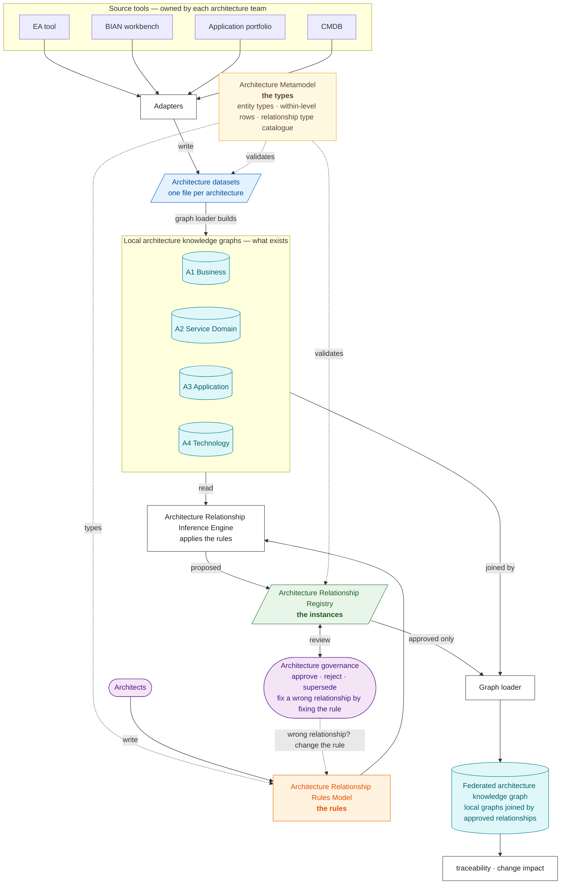

# Service Domain Enterprise Metamodel (SDEM)

> **Status:** v0.7.0 released; v0.8.0 (data model, enforced conformance, physical schemas) awaiting baseline review — open-source reference implementation; BIAN-aligned, **not** an official BIAN standard or BIAN-endorsed framework. BIAN reference content is not included. *(Until v0.6.2 this project was called SDMM, the BIAN Service Domain Mapping Model; see [Renamed from SDMM](#renamed-from-sdmm).)*

**Service Domain Enterprise Metamodel (SDEM)** is an open-source, model-driven enterprise architecture metamodel designed to define, validate and govern architecture entities and relationships across Business, Service Domain, Application and Technology architectures.

SDEM provides a structured foundation for four local architecture knowledge graphs and a federated architecture knowledge graph, enabling end-to-end architecture traceability, relationship governance and change-impact analysis.

Its architecture relationship rules and inference components support evidence-based discovery and validation of relationships between architecture entities.

SDEM is BIAN-aligned but is not an official BIAN standard or BIAN-endorsed framework.

| Level | Architecture | Scope |
|---|---|---|
| **A1** | Business Architecture | capabilities, processes, business services and business objects |
| **A2** | Service Domain Architecture | BIAN Service Domains, operations, control records and business objects |
| **A3** | Application Architecture | applications, application services, APIs, events and data entities |
| **A4** | Technology Architecture | infrastructure, deployment, platforms, networks and environments |

Each level has its own entity metamodel, relationship definitions, architecture data model and local architecture knowledge graph. Entity types carry the level code, e.g. `A3.APIOperation`.

> **New here?** Read [`docs/sdem-overview.md`](docs/sdem-overview.md) first, then [`docs/knowledge-graph-design.md`](docs/knowledge-graph-design.md).

## Principles

1. **Model-driven architecture** — entities, relationships and constraints are defined by explicit metamodels.
2. **Four architecture levels** — Business, Service Domain, Application, Technology.
3. **Independent local knowledge graphs** — each level has its own entities and relationships.
4. **Federated knowledge graph** — approved cross-architecture relationships connect the local graphs.
5. **Typed relationships** — relationship types and constraints govern valid connections.
6. **Evidence-based inference** — automated relationship discovery provides supporting evidence.
7. **Governance** — relationships carry versions, approval status, provenance and lifecycle history.
8. **Bidirectional traceability** — dependencies can be traversed upstream and downstream.
9. **Change-impact analysis** — a change to an entity can be traced across levels.

---

## How SDEM works

**Metamodel → data → rules → inference → registry → review → federated graph.**



| Component | Is | Lives in | Status |
|---|---|---|---|
| **Architecture Metamodel** | the **types**: entity types per level, the links allowed inside each level, and the **relationship type catalogue** (the nine kinds of link allowed between levels) | `metamodel/a1…a4-*.json`, `metamodel/level-relationships.json`, `schema/relationship-types.json` | built |
| **Local architecture knowledge graphs** | one per level: real entities and the links inside the level, built from that level's architecture dataset | `sdem/graph.py` (`LevelGraph`) | built (in memory) |
| **Architecture Relationship Rules Model** | the **rules**: how each cross-level relationship is established, from which data, with what evidence and confidence | `metamodel/relationship-rules.json`, `metamodel/export-conventions.json` | built as records; tested |
| **Architecture Relationship Inference Engine** | applies the rules to the local graphs and **proposes** relationships | `sdem/rules_engine.py` | built (v0.10) |
| **Architecture Relationship Registry** | the **instances**: actual relationships with evidence, status, versions and approval provenance | `examples/<estate>/mappings.json`; schema `schema/relationship-registry.schema.json` | built |
| **Federated architecture knowledge graph** | the local graphs joined by **approved** registry records | `sdem/graph.py` (`FederatedGraph`) | built (in memory) |
| **Architecture Governance and traceability** | approval, supersession, immutability; trace and change impact | `sdem-validate`, `sdem-diff`, `sdem-graph trace / impact` | built |

---

## The architecture model

Three layers, easy to confuse, kept separate:

| | Architecture Metamodel | Relationship Rules Model | Relationship Registry |
|---|---|---|---|
| In one word | **types** | **rules** | **instances** |
| Example | `IMPLEMENTED_BY` is allowed from `A2.ServiceOperation` to `A3.APIOperation` | `S24`: establish it when the HTTP method fits the operation's action and the payload carries its attributes; high confidence; needs an API contract | `PAY-101`: *Initiate Payment Instruction* is implemented by `POST /payment-instructions`, approved by an architect |

| The model in numbers | |
|---|---|
| Entity types | 44 |
| Within-level rows (links allowed inside each architecture) | 132 |
| Relationship type catalogue (kinds of link allowed between architectures) | 9 |
| Plan rows (rules for establishing cross-architecture relationships) | 69 — 9 catalogue rules that produce registry records; 41 candidate, conditional, derived or institution-only rules that are reported; 14 BIAN-internal; 5 ruled out |
| Join keys the rules read from architecture datasets | 52 |

**Read:** [`sdem-overview.md`](docs/sdem-overview.md) · [`architecture-metamodel-detail-level-spec.md`](docs/architecture-metamodel-detail-level-spec.md) (governing; follows the high-level spec) and [`relationships-planning.md`](docs/relationships-planning.md) (the metamodel) · [`relationship-rules-spec.md`](docs/relationship-rules-spec.md) (the rules and the inference engine's 33 requirements) · [`relationship-registry-spec.md`](docs/relationship-registry-spec.md) (the registry) · [`architecture-model-diagram.puml`](docs/architecture-model-diagram.puml) (metamodel and rules by ID, one picture).

---

## The architecture knowledge graphs

| | Local knowledge graph | Federated knowledge graph |
|---|---|---|
| How many | four, one per architecture | one |
| Built from | that architecture's **architecture dataset** | the **approved** records of the **relationship registry**, plus the four local knowledge graphs |
| Holds | what exists, and the links inside one architecture | the links between architectures, each pointing into two local knowledge graphs |
| Answers | "What is the Payments Hub made of?" | "What does the Initiate Payment capability run on?" |

The **graph loader** builds all five on every run: it checks each architecture dataset against the entity catalogue and the within-level rows, keeps approved links only, and resolves both ends of each link in the right local knowledge graph. Nothing edits a graph directly; a change reaches it by changing an architecture dataset or the relationship registry.

```text
$ sdem-graph trace CAP-PAY-010 --direction down examples/payment-initiation/a*.json examples/payment-initiation/mappings.json
CAP-PAY-010 'Initiate Payment'                [A1]
└─ SUPPORTED_BY → SD-PI 'Payment Initiation'  [A2]   (PAY-001)
   └─ REALIZED_BY → APP-PAY-HUB 'Payments Hub' [A3]  (PAY-106)
      ├─ DEPLOYED_ON → INF-K8S-PAY-PROD         [A4]  (PAY-108)
      └─ DEPLOYED_AS → DEP-PAYHUB-PROD          [A4]  (PAY-109)
```

Every step across architectures cites the relationship registry record that justifies it.

**Read:** [`knowledge-graph-design.md`](docs/knowledge-graph-design.md) (how the graphs are built; local query paths L1–L3 and federated paths F1–F4) · [`knowledge-graph-spec.md`](docs/knowledge-graph-spec.md) (node and edge schemas, identity, versions, every component and service, change workflows, open decisions).

---

---

## How it was tested

The Relationship Rules Model was run as a procedure by an AI executor (standing in for the inference engine) against sealed answer keys, on synthetic bank estates, and corrected after each run.

| Test | Result |
|---|---|
| Ten use cases, eleven runs ([`use-case-testing.md`](docs/use-case-testing.md)) — brownfield, reverse mapping from a legacy ledger, hostile naming, greenfield design, and three coverage cases | every proposable rule reached its sealed answers; no false link after v0.5.4 except one fixed by a rule change |
| Plan coverage | **50** of 69 plan rows validated against sealed answers; the other 19 are BIAN-internal or ruled out by decision; **0** untested |
| Hostile naming | recall 0.78 → 1.00 at precision 1.00 when the institution's decoded names were supplied as data: naming is an input problem, not a rule problem |
| Within-level rows ([`relationships-testing.md`](docs/relationships-testing.md)) | 132 rows: 16 verified on BIAN's public pages, 113 confirmed by the open-source Archi implementation of the ArchiMate relationship tables, 0 contradicted; the checker accepts exactly the rows |

**Caveats.** Every estate and answer key was authored by this project; one blind case authored by someone else would retire that. The ArchiMate and TOGAF specifications are login-gated, so those rows are verified against an implementation, not the specification text.

---

## What is built

| Component | Status |
|---|---|
| Architecture Metamodel (entity types, within-level rows, relationship type catalogue); Relationship Rules Model records; architecture dataset and registry schemas | built |
| Validators: `sdem-graph check` (architecture datasets), `sdem-validate` (registry records), `sdem-diff` (approved records never edited) | built |
| Graph loader, local and federated graphs (in memory), `trace`, `impact`, `stats` | built |
| Data model: common, entity-specific and derived attributes for A1–A4 with source reference, reasoning and confidence | built ([`architecture-attribute-design.md`](docs/architecture-attribute-design.md)) |
| Logical data model: 14 rules, all enforced by `sdem-graph check` (`sdem/conformance.py`) | built ([`logical-data-model.md`](docs/logical-data-model.md)) |
| Physical data model: one JSON Schema per entity type (`sdem-physical`) | built ([`physical-data-model.md`](docs/physical-data-model.md)) |
| Generated documents and diagrams, checked current in CI | built |
| Graph store: local JSON files (JSON Graph Format), load record, baselines, `query`, offline HTML `view` | built ([`graph-store-design.md`](docs/graph-store-design.md)) |
| Baseline review pack for `SDEM-METAMODEL-0.8` | built; awaiting independent review ([`baseline/`](docs/baseline/SDEM-METAMODEL-0.8-review-pack.md)) |
| Architecture Relationship Inference Engine (`sdem-infer rules`) | built (v0.10): all eight acceptance cases pass (`sdem-accept`); specified in [`relationship-rules-spec.md`](docs/relationship-rules-spec.md) |
| Architecture dataset diff, refresh trigger, review queue, query service interface, assistant access | specified ([`knowledge-graph-spec.md`](docs/knowledge-graph-spec.md) §11), not built |
| Ingestion (spreadsheet templates and ingest command) | planned for v0.10; adapters for real tools belong in an institution's private repository |

---

## Quick start

**New to SDEM?** Read the [user guide](docs/sdem-workbench-user-guide.md). **The SDEM workbench:** open this project in **VS Code**, run SDEM in the **terminal pane**, and use the **Copilot Chat** window to explain any output ([`docs/sdem-workbench-design.md`](docs/sdem-workbench-design.md)). The CLI is SDEM's only interface: one `sdem` command, a subcommand per journey.

Python 3.10+; no third-party dependencies. `pip install -e .` installs the `sdem` command; without installing, `python -m sdem …` does the same.

```bash
sdem --help                                                    # every journey, J1–J8; each subcommand has --help with an example
sdem dashboard --estate examples/payment-initiation -o work/dashboard.html   # the estate on one page — open it in a browser
E=examples/payment-initiation

sdem check --estate $E                                         # J1 check the datasets and registry against the rulebook
sdem build --estate $E --out work/graph                        # J4 save the checked graphs as a local graph store
sdem trace CAP-PAY-010 --direction down --graph work/graph     # J5 what does this depend on?
sdem trace INF-K8S-PAY-PROD --direction up --graph work/graph  #    what depends on this?
sdem impact APP-PAY-HUB --change replace --graph work/graph    #    what is affected by a change?
sdem query --graph work/graph --unmapped A2                    #    records still waiting for a cross-level link
sdem view --graph work/graph                                   # J7 writes work/graph/view.html — open it in a browser

sdem link $E/a1-business.json $E/a2-service-domain.json $E/a3-application.json $E/a4-technology.json --out work/links
                                                               #    (without the registry, so there is something to review;
                                                               #     `sdem link --estate $E` skips links already approved)
                                                               # J2 the engine proposes the cross-level links
sdem review work/links/proposals.json                          # J3 weakest first, with rule, confidence, reasoning
sdem explain P-RUN-001 --proposals work/links/proposals.json   # J8 why one link was proposed
sdem approve P-RUN-001 --proposals work/links/proposals.json --estate <your-copy> --reviewer your.name \
     --evidence <kind:document-ref>                            # J3 you approve it (then a pull request)

sdem aid project --have $E/a1-business.json --catalogue <bian-catalogue.json> --out work/prj
                                                               # J6 project the layers you do not have (AID)
sdem view --graph work/graph --projection work/prj -o work/plan.html   # projected parts dashed, labelled PROJECTED

sdem validate --strict $E/mappings.json                        # check a relationship document
sdem diff --git HEAD~1 $E/mappings.json                        # approved links not edited since last commit
sdem model check                                               # maintainers: generated documents current (as CI)
python -m unittest discover -s tests                           # the test suite
```

Exit codes: `0` ok, `1` issues found, `2` usage error. Approving a link is done by a person: set it `approved` with reviewer and time in the registry, in a reviewed pull request.

**Maintainers:** `sdem model regenerate` regenerates every document, diagram and schema after a record changes; `sdem model check` fails if any is stale (CI runs it); `sdem model accept` runs the engine's acceptance cases; `sdem model examples` re-runs use-case examples 1 and 2. The older `sdem-*` commands (`sdem-graph`, `sdem-infer`, `sdem-aid`, …) still work.

---

## Documentation map

| Read | For |
|---|---|
| [`sdem-overview.md`](docs/sdem-overview.md) | **start here** — principles, components and boundaries, the four things that look alike, a worked example, a glossary |
| [`knowledge-graph-design.md`](docs/knowledge-graph-design.md) | how the local and federated graphs are built and queried |
| [`graph-store-design.md`](docs/graph-store-design.md) · [`graph-store-spec.md`](docs/graph-store-spec.md) | the local JSON graph store: files, build, load record, queries, view |
| [`logical-data-model.md`](docs/logical-data-model.md) | the Logical Data Model: one card per entity — what it is, how it is identified, its fields and its links — with a diagram per architecture; rules and conformance in appendices |
| [`physical-data-model.md`](docs/physical-data-model.md) | the Physical Data Model: one JSON Schema per entity type (`schema/entities/`), the architecture dataset format tool adapters validate against; source, reasoning and confidence on every property |
| [`architecture-attribute-design.md`](docs/architecture-attribute-design.md) | the Architecture Attribute Design: every attribute by architecture, with type, source reference, readers, verification, reasoning and confidence |
| [`architecture-entity-design.md`](docs/architecture-entity-design.md) | the Architecture Entity Design: every entity type by architecture, with source reference, verification, reasoning and confidence |
| [`architecture-metamodel-detail-level-spec.md`](docs/architecture-metamodel-detail-level-spec.md) | **the governing Architecture Metamodel specification**: follows the high-level spec section by section, with the implemented detail and a gap register |
| [`architecture-metamodel-high-level-spec.md`](docs/architecture-metamodel-high-level-spec.md) | the owner's v0.4 high-level specification — the frozen reference |
| [`relationship-rules-spec.md`](docs/relationship-rules-spec.md) · [`architecture-model-diagram.puml`](docs/architecture-model-diagram.puml) | the Relationship Rules Model and the inference engine's requirements |
| [`relationship-registry-spec.md`](docs/relationship-registry-spec.md) | the Relationship Registry: fields, lifecycle, immutability, legacy names |
| [`architecture-governance-spec.md`](docs/architecture-governance-spec.md) | approval, supersession and impact |
| [`knowledge-graph-spec.md`](docs/knowledge-graph-spec.md) | the graphs' requirements, components, services and change workflows |
| [`relationships-planning.md`](docs/relationships-planning.md) · [`relationships-testing.md`](docs/relationships-testing.md) | every within-level row, and how they were tested |
| [`mapping-logic-planning.md`](docs/mapping-logic-planning.md) | why the relationship rules model is shaped this way: BIAN's own mappings, the supporting frameworks, the gap-fill strategy |
| [`mapping-execution.md`](docs/mapping-execution.md) · [`use-case-testing.md`](docs/use-case-testing.md) | the procedure as executed, and the eleven test runs |
| [`reference-architecture-provenance.md`](docs/reference-architecture-provenance.md) | every entity traced to a public standard |
| [`aid-design.md`](docs/aid-design.md) · [`aid-spec.md`](docs/aid-spec.md) | **Architecture Inference Design (AID)** (approved, built — `sdem-aid`): projecting missing architecture layers, upstream or downstream, for planning — with gap analysis against the real design |
| [`sdem-dashboard-design.md`](docs/sdem-dashboard-design.md) · [`sdem-dashboard-spec.md`](docs/sdem-dashboard-spec.md) | **the dashboard** (phase 1 built): one read-only HTML page per estate — health, attention, review, trace & impact, matrices, changes, AID, controls; `sdem matrix`, `sdem impact --report`; phase 2 (`sdem serve`, actions and forms) proposed |
| [`sdem-agent-platform-principles.md`](docs/sdem-agent-platform-principles.md) | what makes a good agent platform (data, tools, guardrails, agents, prompts, skills, proof) and how SDEM measures up; the next improvements |
| [`sdem-copilot-setup.md`](docs/sdem-copilot-setup.md) | setting up a GitHub account, a Copilot plan and VS Code for the SDEM agents (`.github/agents/`), prompt files (`.github/prompts/`) and skills (`.github/skills/`) |
| [`sdem-workbench-user-guide.md`](docs/sdem-workbench-user-guide.md) | **start here if you are new**: the user guide for architects — set-up, the workbench screen, a 15-minute quick start, every command, workflow examples (onboard data, link and approve, trace, impact, plan with AID), working with Copilot, troubleshooting |
| [`sdem-agent-platform-design.md`](docs/sdem-agent-platform-design.md) · [`sdem-agent-platform-spec.md`](docs/sdem-agent-platform-spec.md) | **SDEM agent platform** (approved; Level 1 built): one Copilot agent per architecture and an orchestrator (`.github/agents/`), coordinating through the federated graph — change sets, change events, work items (`sdem change`, `events`, `work`) — not direct messages; the rules engine decides links; architects approve. Spike to run in your VS Code: [`sdem-agent-platform-spike.md`](docs/sdem-agent-platform-spike.md) |
| [`sdem-workbench-design.md`](docs/sdem-workbench-design.md) · [`sdem-workbench-spec.md`](docs/sdem-workbench-spec.md) | **the SDEM workbench** (draft): the architect opens the SDEM project in VS Code, runs SDEM from the terminal pane (the CLI — SDEM's only interface) and uses the Copilot Chat window for AI support; Git as history and approval trail — no MCP, no AI API in SDEM |
| [`controls-register.md`](docs/controls-register.md) | every control that enforces the rulebook: where it runs, where its outcome is recorded, what monitors it, and the known gaps |
| [`use-case-example-3.md`](docs/use-case-example-3.md) | the agent platform carries a technology change A4 → A3 to an approved link: 8 of 8 sealed criteria, controls CTL-19/20 14 of 14 |
| [`use-case-example-2.md`](docs/use-case-example-2.md) | test plan for Architecture Inference Design: hide layers of a known estate, project them, compare with the real ones (expected results sealed) |
| [`use-case-example-1.md`](docs/use-case-example-1.md) | worked example (plan): establishing the mappings and knowledge graph from four separate architecture datasets, clean and with planted defects |
| [`glossary.md`](docs/glossary.md) | the terms used across the documents, in plain language |
| [`ROADMAP.md`](docs/ROADMAP.md) · [`CHANGELOG.md`](CHANGELOG.md) | releases and what comes next |

## Repository contents

| Folder | Holds |
|---|---|
| `metamodel/` | Architecture Metamodel (entity catalogue A1–A4, within-level rows), Relationship Rules Model (`relationship-rules.json`, `export-conventions.json`), BIAN's official mappings, generated diagrams |
| `schema/` | architecture dataset and registry schemas, the relationship type catalogue (`relationship-types.json`), impact rules, per-entity schemas (`entities/`) |
| `sdem/` | validators (`validate.py`, `diff.py`), data-model conformance (`conformance.py`), graph loader and queries (`graph.py`, `trace.py`, `metamodel.py`), inference engine interface and scorer (`inference.py`, `evaluate.py`), confidence rule (`confidence.py`), terminology (`terms.py`), document and schema generators (`catalogue.py`, `attributes.py`, `logical.py`, `physical.py`, …) |
| `sdmm/` | deprecated compatibility shim for v0.7: re-architecture datasets `sdem` with a warning |
| `examples/` | synthetic estates: `payment-initiation`, `legacy-core-ledger`, `acquired-fintech`, `digital-lending`, `trade-finance`, `card-fraud-alerts`, `customer-onboarding`, and `reference-structure` (generated: one link per within-level row) |
| `docs/` | designs, specifications, test plans and results |
| `tests/` | the test suite |

## Roadmap

| Release | Delivered |
|---|---|
| v0.1–v0.3 | rulebook, validators, traceability queries, generic A1–A4 naming |
| v0.4 | entity catalogue traced to public standards, architecture dataset format, local and federated graphs, impact |
| v0.5 | engine harness (interface, baseline, scorer); mapping plan and procedure; ten use cases, eleven runs; within-level rows from BIAN, ArchiMate and TOGAF, verified |
| v0.6 | rules spec and diagram; knowledge-graph design and spec with service specifications |
| v0.7 | renamed SDEM — Service Domain Enterprise Metamodel; model-driven terminology; registry spec; compatibility aliases |
| **v0.8** (unreleased) | **data model** for A1–A4, all logical rules enforced, per-entity JSON Schemas; baseline review pack — released on baseline approval |
| **v0.9** (unreleased) | **graph store**: local JSON files, queries, offline view |
| **v0.10** (unreleased) | the **inference engine**, reading the graph store; passes all 8 acceptance cases |
| **v0.11 — next** | ingestion (spreadsheet templates, ingest command) and approval of proposals |
| built | **Architecture Inference Design** — projecting missing layers for planning (v0.12, unreleased; `sdem-aid project`, `check`, `gaps`) |
| later | change handling (v0.13); query service and assistant access (v0.14); BIAN reference integration (v0.15); generated views (v0.16); v1.0 conformance profile |

Full table with acceptance tests: [`docs/ROADMAP.md`](docs/ROADMAP.md).

---

## Renamed from SDMM

In v0.7.0 the project was renamed from **SDMM (BIAN Service Domain Mapping Model)** to **SDEM (Service Domain Enterprise Metamodel)**, and its terms aligned with model-driven enterprise architecture. Behaviour and data are unchanged. **The compatibility layer below — the `sdmm` package, the `sdmm-*` commands, the `MappingEngine` name, the old schema path and the old enum values — is removed in v0.8.0.**

| Before | Now |
|---|---|
| Python package `sdmm` | `sdem` (`sdmm` still imports, with a deprecation warning, in v0.7) |
| Commands `sdmm-*`, `sdmm-engine` | `sdem-*`, `sdem-infer` (`sdmm-*` still installed in v0.7) |
| `sdmm/engine.py`, `MappingEngine` | `sdem/inference.py`, `RelationshipInferenceEngine` (old class name kept as an alias) |
| `schema/mapping.schema.json` | `schema/relationship-registry.schema.json` (old path kept as a deprecated copy) |
| `metamodel/new-mappings.json` | `metamodel/relationship-rules.json` |
| mapping set / mapping document | Architecture Relationship Registry |
| mapping model (the rules) | Architecture Relationship Rules Model |
| registry (the nine relationship types) | relationship type catalogue, part of the Architecture Metamodel |
| mapping engine | Architecture Relationship Inference Engine |
| local / federated graph | local / federated architecture knowledge graph |
| `sdmm_extension`, `sdmm_definition`, `sdmm_reading`, `sdmm_rule` | `sdem_*` (old values still accepted) |

**Not renamed:** the registry's record fields `mappings`, `mapping_id`, `previous_mapping_id` and the catalogue's `mapping_type_id`, `registry_version`, because they sit inside immutable approved records (see [`relationship-registry-spec.md`](docs/relationship-registry-spec.md) §7); file names such as `mappings.json` and `official-mappings.json` (BIAN's own mappings); and historical test logs and results, which record what ran under the old name. The GitHub repository was renamed from `bian-sdmm-framework` to `bian-sdem-framework`; the old URL redirects.

---

## Reference architecture provenance

Every entity in the SDEM vocabulary derives from a **publicly available reference architecture** — BIAN, ArchiMate 3.2 or TOGAF 10 — or is a documented SDEM extension of one. No entity is named after, defined by, or copied from any institution's architecture model; institution-specific entities belong in that institution's private profile, never here. Of the 41 core entities, **13 derive from BIAN (12 reference, 1 aligned), 21 from ArchiMate 3.2, 1 from TOGAF, and 6 are SDEM extensions** of an ArchiMate concept or compatibility supertypes. Full detail, including classification and the public URL for each, is in [`docs/reference-architecture-provenance.md`](docs/reference-architecture-provenance.md). The same provenance governs how entities may be linked **inside** a level: `metamodel/level-relationships.json` holds, per level, the relationship rows derived from that level's reference architecture (BIAN for A2; ArchiMate 3.2 and TOGAF for A1, A3, A4), and `sdem-graph check` rejects any other within-level relationship. Every row has an ID, description, source, reasoning and confidence in [`docs/relationships-planning.md`](docs/relationships-planning.md), generated from the record; [`docs/relationships-testing.md`](docs/relationships-testing.md) is the test plan that validates them. The within-level and cross-level records, the conventions, the procedure and the test results merge into [`docs/relationship-rules-spec.md`](docs/relationship-rules-spec.md), the generated design specification that is the engine's input and requirements; [`docs/knowledge-graph-spec.md`](docs/knowledge-graph-spec.md) specifies the local and federated graphs.

| Key | Public source |
|---|---|
| **BIAN-SL** | [BIAN Service Landscape 14.0, InSite portal](https://bian.org/servicelandscape-14-0-0/) — publicly browsable |
| **BIAN-BCM** | BIAN Business Capability Model, per the [v13.0](https://bian.org/wp-content/uploads/2025/06/BIAN-v13.0-Release-Notes-v0.3.pdf) and [v14.0](https://bian.org/wp-content/uploads/2026/02/BIAN-v14.0-Release-Notes-v1.0_-Final-Version.pdf) release notes — the BCM↔Service Domain mapping is stated there to be work in progress, not yet published |
| **BIAN-API** | [BIAN Semantic API Practitioner Guide](https://bian.org/wp-content/uploads/2024/12/BIAN-Semantic-API-Pactitioner-Guide-V8.1-FINAL.pdf) |
| **AM** | [ArchiMate® 3.2 Specification](https://pubs.opengroup.org/architecture/archimate3-doc/) — ch. 6 Motivation, 7 Strategy, 8 Business, 9 Application, 10 Technology (free Open Group account required to read online) |
| **TOGAF** | [TOGAF® Standard, 10th Edition](https://pubs.opengroup.org/togaf-standard/) (free Open Group account required to read online) |

**A1 — Business Architecture**

| Entity | Reference architecture | Concept | Source |
|---|---|---|---|
| `A1.BusinessCapability` | BIAN BCM; ArchiMate Strategy | Business Capability; Capability | BIAN-BCM; AM ch. 7 |
| `A1.ValueStream` | ArchiMate Strategy | Value Stream | AM ch. 7; BIAN-BCM |
| `A1.ValueStreamStage` | SDEM extension of Value Stream | — | AM ch. 7 (parent) |
| `A1.BusinessProcess` | ArchiMate Business | Business Process | AM ch. 8 |
| `A1.BusinessActivity` | SDEM extension of Business Process | — | AM ch. 8 (parent) |
| `A1.BusinessService` | ArchiMate Business | Business Service | AM ch. 8 |
| `A1.BusinessActor` | ArchiMate Business | Business Actor | AM ch. 8 |
| `A1.BusinessRole` | ArchiMate Business | Business Role | AM ch. 8 |
| `A1.BusinessObject` | ArchiMate Business; aligned to BIAN BOM | Business Object | AM ch. 8; BIAN-SL |
| `A1.BusinessRequirement` | ArchiMate Motivation | Requirement | AM ch. 6 |

**A2 — Service Domain Architecture** — all BIAN reference, all `pending_release_validation` until verified against release 14.0

| Entity | Reference architecture | Concept | Source |
|---|---|---|---|
| `A2.BusinessArea` | BIAN Service Landscape | Business Area | BIAN-SL |
| `A2.BusinessDomain` | BIAN Service Landscape | Business Domain | BIAN-SL |
| `A2.ServiceDomain` | BIAN Service Landscape | Service Domain | BIAN-SL MetaModel Overview |
| `A2.FunctionalPattern` | BIAN Service Landscape | Functional Pattern | BIAN-SL MetaModel Overview |
| `A2.AssetType` | BIAN Service Landscape | Asset Type | BIAN-SL MetaModel Overview |
| `A2.ControlRecord` | BIAN Control Record Model | Control Record | BIAN-SL Control Record Model |
| `A2.ServiceGroup` | BIAN Service Landscape | Service Group | BIAN-SL MetaModel Overview |
| `A2.ServiceOperation` | BIAN Service Landscape; Semantic APIs | Service Operation | BIAN-SL; BIAN-API |
| `A2.BehaviorQualifier` | BIAN Service Landscape; Semantic APIs | Behavior Qualifier | BIAN-SL; BIAN-API |
| `A2.BusinessScenario` | BIAN Business Scenarios | Business Scenario (illustrative) | BIAN-SL Business Scenarios |
| `A2.BusinessObject` | BIAN Business Object Model | Business Object | BIAN-SL BOM |
| `A2.BusinessObjectAttribute` | BIAN Business Object Model | BOM attribute | BIAN-SL BOM |
| `A2.BOMModel`, `A2.Wireframe`, `A2.SemanticAPI` | BIAN model artefacts — citable as evidence, never mapping endpoints | — | BIAN-SL; BIAN-API |

**A3 — Application Architecture**

| Entity | Reference architecture | Concept | Source |
|---|---|---|---|
| `A3.ApplicationComponent` | ArchiMate Application | Application Component | AM ch. 9 |
| `A3.ApplicationService` | ArchiMate Application | Application Service | AM ch. 9 |
| `A3.ApplicationInterface` | ArchiMate Application | Application Interface | AM ch. 9 |
| `A3.ApplicationFunction` | ArchiMate Application | Application Function | AM ch. 9 |
| `A3.APIOperation` | SDEM extension; aligned to BIAN Semantic API / OpenAPI | — | BIAN-API |
| `A3.DataEntity` | ArchiMate Application (related) | Data Object | AM ch. 9 |
| `A3.Event` | ArchiMate Application (related) | Application Event | AM ch. 9 |
| `A3.SolutionBuildingBlock` | TOGAF Architecture Content | Solution Building Block | TOGAF |

**A4 — Technology Architecture**

| Entity | Reference architecture | Concept | Source |
|---|---|---|---|
| `A4.InfrastructureComponent` *(abstract)* | SDEM compatibility supertype of every A4 entity | — | — |
| `A4.Deployment` | SDEM extension of Artifact assigned to Node | — | AM ch. 10 (parents) |
| `A4.DeploymentEnvironment` | SDEM extension of Node grouping | — | AM ch. 10 (parent) |
| `A4.Node` | ArchiMate Technology | Node | AM ch. 10 |
| `A4.Device` | ArchiMate Technology | Device | AM ch. 10 |
| `A4.SystemSoftware` | ArchiMate Technology | System Software | AM ch. 10 |
| `A4.TechnologyService` | ArchiMate Technology | Technology Service | AM ch. 10 |
| `A4.TechnologyInterface` | ArchiMate Technology | Technology Interface | AM ch. 10 |
| `A4.CommunicationNetwork` | ArchiMate Technology | Communication Network | AM ch. 10 |
| `A4.Path` | ArchiMate Technology | Path | AM ch. 10 |
| `A4.Artifact` | ArchiMate Technology | Artifact | AM ch. 10 |

Cloud-specific entities (compute resource, container platform, storage, database platform, security control, …) are **not core**: they live in the `example-cloud` profile, each extending one of the ArchiMate-derived A4 entities above. Definitions in the catalogue are SDEM paraphrases; no text, diagram or dataset from BIAN or The Open Group is reproduced. BIAN®, ArchiMate® and TOGAF® are trademarks of their respective owners; SDEM is independent and not endorsed by either organisation.

---

## Rules of use

- Preserve historical architecture documents; never overwrite or silently reclassify them.
- New designs may reference legacy designs and patterns with provenances and approvals.
- Keep canonical BIAN reference content separate from your own design objects.
- Store mappings as versioned, typed claims. An AI confidence value is not evidence of compliance.
- A reverse traversal is a query, not a duplicate inverse edge.
- Affected-by-change does not mean must-change: impact requires semantic assessment and approval.

## Licenses and attribution

- Source code and machine-readable schema/templates: Apache-2.0 (see `LICENSE`).
- Original methodology prose in `docs/` and this README: CC BY 4.0 (see `LICENSES.md`).
- External BIAN content is not relicensed by this repository. See `THIRD_PARTY.md`.

This is an independent community proposal, not affiliated with, endorsed by, or sponsored by BIAN or any bank. No guarantees of fitness, correctness, or compliance are made.
