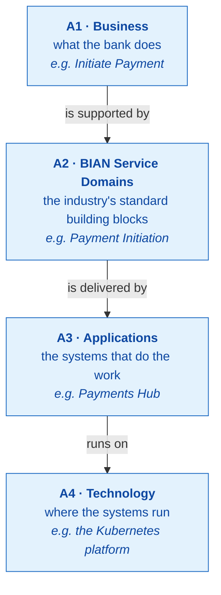
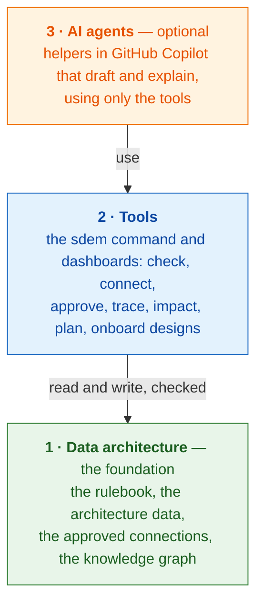
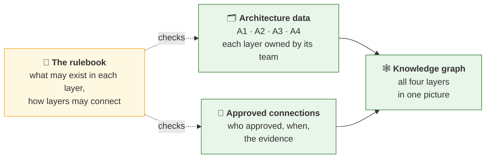
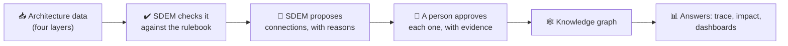
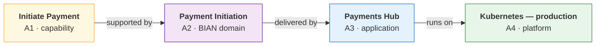
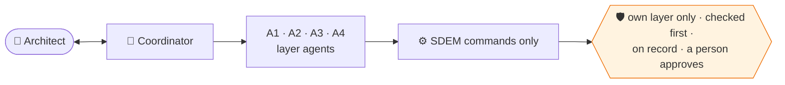
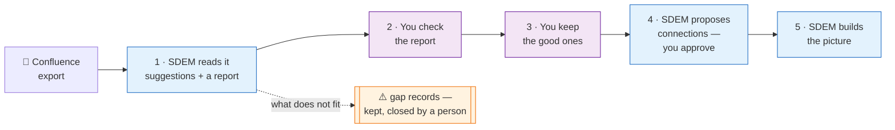
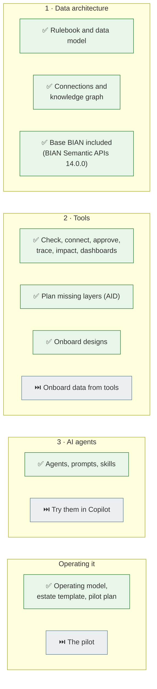
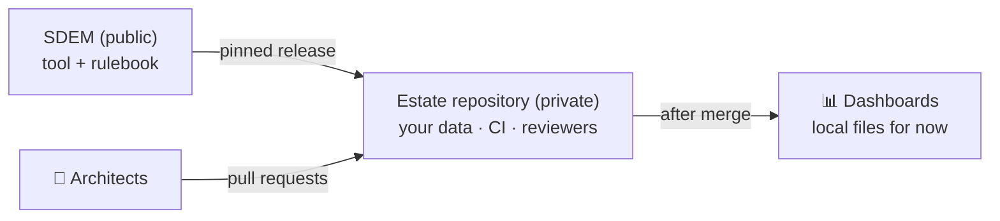

# SDEM — Service Domain Enterprise Metamodel

**SDEM connects a bank's architecture — from what the business does, through BIAN, to the applications and the technology underneath — into one picture you can question.** It checks every connection against a rulebook and keeps a person in charge of every decision.

> **Status:** v0.9.1 (2026-10-29). Ready to try on made-up data; use on real designs follows a pilot ([what that needs](#using-sdem-on-real-designs)). Open source; aligned with BIAN, but **not** an official BIAN standard or endorsed by BIAN. Made-up example data only.

## Start here

| You are… | Start with |
|---|---|
| **New to SDEM** | read on, then run the dashboard: `sdem home -o work/sdem` and open `work/sdem/index.html` |
| **An architect who will use it** | [Install](#install), then the [user guide](docs/sdem-workbench-user-guide.md) — a 15-minute quick start and every task step by step |
| **Bringing in existing designs** | the [onboarding workflow](docs/sdem-onboarding-workflow.md); practise with [use-case example 4](docs/evidence/use-case-example-4.md) |
| **Planning to use it on real data** | the [operating model](docs/sdem-operating-model.md) and the [pilot plan](docs/sdem-pilot-plan.md) |
| **Setting up the AI agents** | [Copilot set-up](docs/sdem-copilot-setup.md) |
| **Looking for a document** | the [documentation index](docs/README.md) — every document by reader — and the [glossary](docs/glossary.md) |
| **A maintainer** | [CONTRIBUTING.md](CONTRIBUTING.md) |

## The four architectures

SDEM looks at a bank's architecture as four layers. Each has its own owners and its own data; SDEM connects them.



**Why it matters.** Today the answer to *"what does this depend on — and what breaks if we change it?"* is spread across Confluence, spreadsheets, the EA tool and the CMDB, and lives in people's heads. SDEM puts it in one connected place, with the evidence, and answers in seconds.

## SDEM in three layers

SDEM is built in three layers, each standing on the one below. **The agents are optional; the data and the tools are not.**



### 1 · Data architecture

The rules, the data and the connections — kept as files, checked, with a full history.



The rulebook holds 44 types of thing (capability, application, server …), which may be linked inside a layer (132 rules) and between layers (9 kinds of connection), and the 69 rules for proposing connections — each traced to a public standard (BIAN, ArchiMate, TOGAF).

### 2 · Tools

One command, `sdem`, and dashboards on top of it. **Every function works without AI.**



**Follow one capability down to the technology** — every arrow an approved connection, with who approved it and the document that proves it:



**Ask "what if?"** — *retire the production Kubernetes platform* — and SDEM follows the connections: two applications need a design change; one BIAN domain, one capability and two processes need a review. An architect confirms before anything changes.

**People stay in charge.** SDEM checks, proposes and works out impact; **only a person** approves a connection, loads onboarded designs, or merges a change after review. This is built into the software — SDEM refuses an approval with no evidence, or one signed by an AI agent.

### 3 · AI agents (optional)

Helpers in **GitHub Copilot** — one per layer and a coordinator — draft changes and explain results. They work only through SDEM's checked commands, stay in their own layer, and never approve. No MCP, no AI inside SDEM.



## Onboarding your existing designs

Years of designs live in Confluence as pages, diagrams and pictures. SDEM turns an export of them into architecture data — **on your own machine, without AI**.



**BIAN is included.** SDEM ships with a **base BIAN** — BIAN's public Semantic APIs (release 14.0.0) — so your BIAN layer is one command (`sdem bian import --base --only "<service domain>"`); your organisation can replace it with its own BIAN.

Every suggestion says **which page it came from, where, and how sure SDEM is** — never above "medium" until a person checks it. **Nothing is thrown away:** what does not fit — a risk table, text, a picture — is kept as a *gap record* beside the data. It works for any domain (tested on payments and lending).

**How:** the [onboarding workflow](docs/sdem-onboarding-workflow.md) — every step, its command, and what you will see. Data from tools (spreadsheets, CMDB) is planned.

## What's built and what's next



✅ built · ⏭️ next. Details: [ROADMAP](docs/design/ROADMAP.md) · what changed: [CHANGELOG](CHANGELOG.md).

## Install

You need **Python 3.10 or later** (3.13 recommended). Macs come with 3.9, which is too old. Install 3.13 with Homebrew (`brew install python@3.13`) or the installer from [python.org](https://www.python.org/downloads/macos/), then find it:

```bash
python3 --version                      # 3.10 or later? then use python3 below
for d in /opt/homebrew/bin /usr/local/bin; do ls "$d" 2>/dev/null | grep "^python3\.1[0-9]*$" | sed "s|^|$d/|"; done   # installed but "command not found"? it is one of these
```

```bash
git clone https://github.com/taumoeps/bian-sdem-framework.git && cd bian-sdem-framework
python3.13 -m venv .venv               # or the full path you found, e.g. /opt/homebrew/bin/python3.13 -m venv .venv
source .venv/bin/activate              # do this in every new terminal
pip install -e .                       # installs the sdem command
sdem --version                         # 0.9.1
```

If `pip` says *File "setup.py" … not found* or *requires a different Python*, the `.venv` was made with an old Python: delete it (`rm -rf .venv`) and make it again with 3.13. More: [administration — troubleshooting](docs/sdem-administration.md#troubleshooting).

**Try it** on the made-up examples:

```bash
sdem home -o work/sdem && open work/sdem/index.html             # the dashboards, as local files
sdem check --estate examples/payment-initiation                 # the data against the rulebook
sdem build --estate examples/payment-initiation -o work/graph   # the knowledge graph
sdem impact INF-K8S-PAY-PROD --change retire --graph work/graph # what breaks if it goes
sdem --help                                                     # every command; sdem <command> --help shows an example
```

Every command, with examples: the [user guide](docs/sdem-workbench-user-guide.md#7-command-reference). `work/` is scratch space and is never committed.

## Using SDEM on real designs

This repository is **public and holds made-up data only**. Real architecture data lives in your organisation's **private estate repository**, made from [`templates/estate-repo`](templates/estate-repo/README.md): SDEM pinned to a release, CI checks on every change, reviewers named.



Before starting: legal and IP clearance, the private repository with branch protection, and Python 3.10+ on architects' machines. Roles, workflows and support: the [operating model](docs/sdem-operating-model.md). The first step: a ten-week [pilot](docs/sdem-pilot-plan.md) on one domain. Security: [SECURITY.md](SECURITY.md).

## How it was tested

| Test | Result |
|---|---|
| Rules engine against sealed answer keys | 8 of 8 acceptance cases |
| Use-case examples 1–4: datasets to graph · planning missing layers · agents · onboarding designs | 30 of 30 · 12 of 12 · 8 of 8 · replayed on every push |
| Design onboarding on a second domain (lending), expectations sealed first | 18 of 18 records, nothing lost |
| Links allowed inside a layer | 132 rows; 16 checked on BIAN's public pages, 113 against the open-source ArchiMate implementation, 0 contradicted |
| Automated tests on every push, Python 3.10–3.13, plus the installed package | the full suite |

**Caveats.** All data and answer keys were made by this project; a blind test by someone else is still to come. The ArchiMate and TOGAF specifications need a login, so those rows were checked against an implementation. The AI agents have not yet run in real Copilot.

## Where the rulebook comes from

Every entity type comes from a **public reference architecture** — BIAN, ArchiMate 3.2 or TOGAF 10 — or is a documented SDEM extension of one; none is copied from any institution's model, and no BIAN or Open Group text is reproduced ([provenance, entity by entity](docs/reference/reference-architecture-provenance.md)). BIAN®, ArchiMate® and TOGAF® are trademarks of their owners; SDEM is independent and not endorsed by them.

**Rules of use.** Keep historical designs; never overwrite or silently reclassify them. Keep BIAN reference content separate from your own design objects. A connection is a versioned, typed claim with evidence — an AI confidence value is not evidence. *Affected by a change* does not mean *must change*: impact needs an architect's assessment.

## Licences

Source code, schemas and templates: Apache-2.0 (`LICENSE`). Original prose in `docs/` and this README: CC BY 4.0 (`LICENSES.md`). The **base BIAN** in `bian/` is BIAN's public Semantic APIs 14.0.0, distributed under BIAN's Apache-2.0 licence (`bian/LICENSE`, `THIRD_PARTY.md`). An independent community proposal — not affiliated with, endorsed by, or sponsored by BIAN or any bank; no guarantees of fitness, correctness or compliance.
