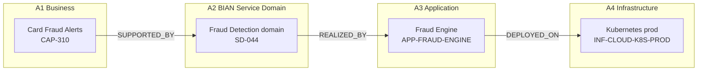
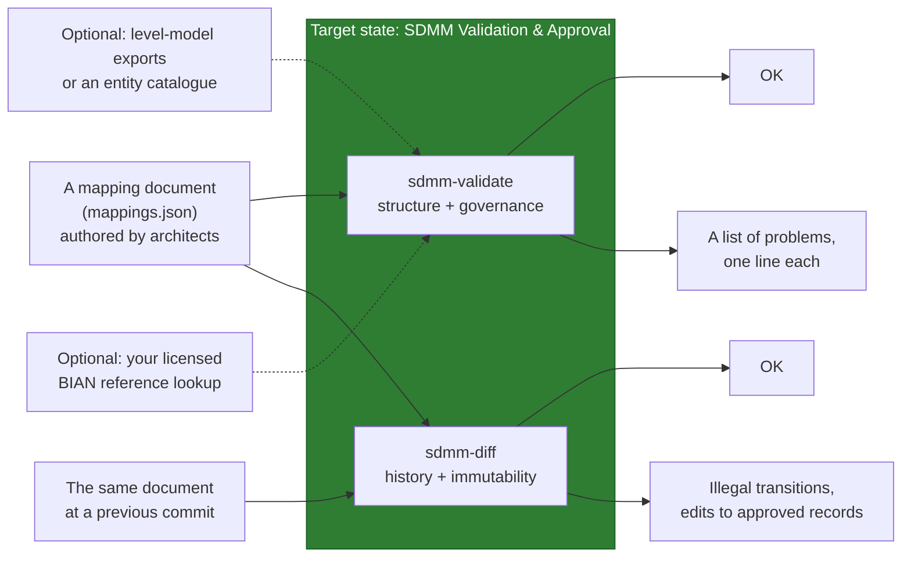
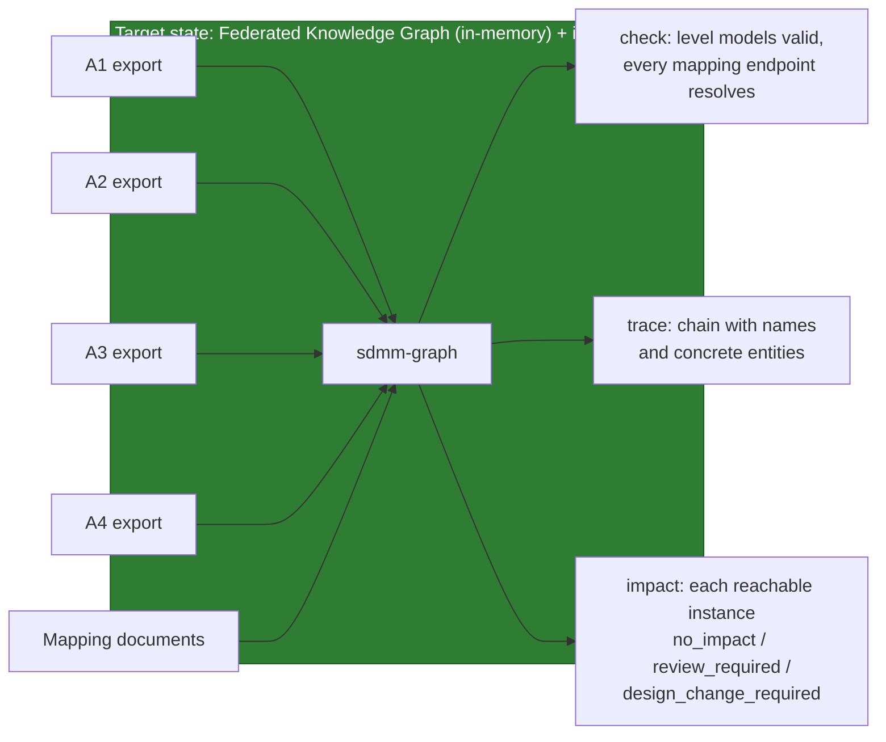
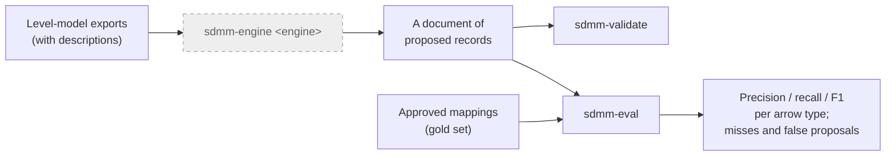
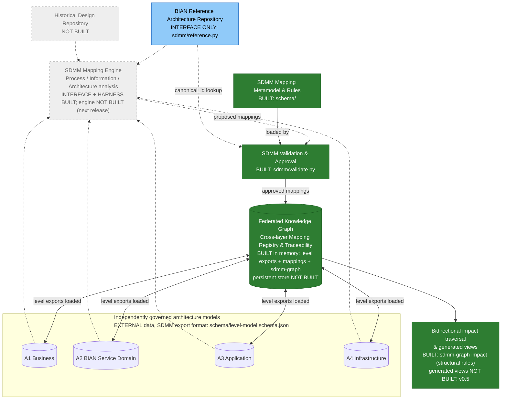

# BIAN Service Domain Mapping Model (SDMM)

> **Status:** community proposal / starter reference implementation, **not** an official BIAN standard.

SDMM is a proposed methodology and typed cross-layer mapping model for tracing banking architecture across the four design models of a **Service Domain Architecture Design Model (SDADM)**:

| Code | Design model | Scope |
|---|---|---|
| **A1** | Business Architecture | capabilities, value streams, processes, business information |
| **A2** | Service Domain Architecture | BIAN-aligned domains, operations, scenarios, Control Records and business objects |
| **A3** | Application Architecture | application components, interfaces, API operations |
| **A4** | Technology Architecture | deployment, compute, networks and supporting infrastructure |

SDADM is a generic four-level design lifecycle; an institution's own level numbering is one instance of it and is mapped by that institution's profile. Entities are prefixed with the level code (`A2.ServiceDomain`). The registry can declare an institution's legacy prefixes as aliases of `A1.`–`A4.`, so documents written against an earlier numbering continue to validate unchanged. "Service Domain Architecture" names both the whole (SDADM) and its second level (A2), in the same way BIAN's Service Landscape contains Service Domains.

**BIAN provides reference definitions and business-to-service alignment guidance; SDMM adds enterprise-specific A2→A3→A4 mappings and governance.** BIAN reference models and trademarks are not included in this repository.

## Reference architecture provenance

Every entity in the SDMM vocabulary derives from a **publicly available reference architecture** — BIAN, ArchiMate 3.2 or TOGAF 10 — or is a documented SDMM extension of one. No entity is named after, defined by, or copied from any institution's architecture model; institution-specific entities belong in that institution's private profile, never here. Of the 41 core entities, **13 derive from BIAN (12 reference, 1 aligned), 21 from ArchiMate 3.2, 1 from TOGAF, and 6 are SDMM extensions** of an ArchiMate concept or compatibility supertypes. Full detail, including classification and the public URL for each, is in [`docs/reference-architecture-provenance.md`](docs/reference-architecture-provenance.md).

| Key | Public source |
|---|---|
| **BIAN-SL** | [BIAN Service Landscape 14.0, InSite portal](https://bian.org/servicelandscape-14-0-0/) — publicly browsable |
| **BIAN-BCM** | BIAN Business Capability Model, per the [v13.0](https://bian.org/wp-content/uploads/2025/06/BIAN-v13.0-Release-Notes-v0.3.pdf) and [v14.0](https://bian.org/wp-content/uploads/2026/02/BIAN-v14.0-Release-Notes-v1.0_-Final-Version.pdf) release notes — the BCM↔Service Domain mapping is stated there to be work in progress, not yet published |
| **BIAN-API** | [BIAN Semantic API Practitioner Guide](https://bian.org/wp-content/uploads/2024/12/BIAN-Semantic-API-Pactitioner-Guide-V8.1-FINAL.pdf) |
| **AM** | [ArchiMate® 3.2 Specification](https://pubs.opengroup.org/architecture/archimate3-doc/) — ch. 6 Motivation, 7 Strategy, 8 Business, 9 Application, 10 Technology (free Open Group account required to read online) |
| **TOGAF** | [TOGAF® Standard, 10th Edition](https://pubs.opengroup.org/togaf-standard/) (free Open Group account required to read online) |

**A1 — Business Architecture**

| Entity | Reference architecture | Concept | Source |
|---|---|---|---|
| `A1.BusinessCapability` | BIAN BCM; ArchiMate Strategy | Business Capability; Capability | BIAN-BCM; AM ch. 7 |
| `A1.ValueStream` | ArchiMate Strategy | Value Stream | AM ch. 7; BIAN-BCM |
| `A1.ValueStreamStage` | SDMM extension of Value Stream | — | AM ch. 7 (parent) |
| `A1.BusinessProcess` | ArchiMate Business | Business Process | AM ch. 8 |
| `A1.BusinessActivity` | SDMM extension of Business Process | — | AM ch. 8 (parent) |
| `A1.BusinessService` | ArchiMate Business | Business Service | AM ch. 8 |
| `A1.BusinessActor` | ArchiMate Business | Business Actor | AM ch. 8 |
| `A1.BusinessRole` | ArchiMate Business | Business Role | AM ch. 8 |
| `A1.BusinessObject` | ArchiMate Business; aligned to BIAN BOM | Business Object | AM ch. 8; BIAN-SL |
| `A1.BusinessRequirement` | ArchiMate Motivation | Requirement | AM ch. 6 |

**A2 — Service Domain Architecture** — all BIAN reference, all `pending_release_validation` until verified against release 14.0

| Entity | Reference architecture | Concept | Source |
|---|---|---|---|
| `A2.BusinessArea` | BIAN Service Landscape | Business Area | BIAN-SL |
| `A2.BusinessDomain` | BIAN Service Landscape | Business Domain | BIAN-SL |
| `A2.ServiceDomain` | BIAN Service Landscape | Service Domain | BIAN-SL MetaModel Overview |
| `A2.FunctionalPattern` | BIAN Service Landscape | Functional Pattern | BIAN-SL MetaModel Overview |
| `A2.AssetType` | BIAN Service Landscape | Asset Type | BIAN-SL MetaModel Overview |
| `A2.ControlRecord` | BIAN Control Record Model | Control Record | BIAN-SL Control Record Model |
| `A2.ServiceGroup` | BIAN Service Landscape | Service Group | BIAN-SL MetaModel Overview |
| `A2.ServiceOperation` | BIAN Service Landscape; Semantic APIs | Service Operation | BIAN-SL; BIAN-API |
| `A2.BehaviorQualifier` | BIAN Service Landscape; Semantic APIs | Behavior Qualifier | BIAN-SL; BIAN-API |
| `A2.BusinessScenario` | BIAN Business Scenarios | Business Scenario (illustrative) | BIAN-SL Business Scenarios |
| `A2.BusinessObject` | BIAN Business Object Model | Business Object | BIAN-SL BOM |
| `A2.BusinessObjectAttribute` | BIAN Business Object Model | BOM attribute | BIAN-SL BOM |
| `A2.BOMModel`, `A2.Wireframe`, `A2.SemanticAPI` | BIAN model artefacts — citable as evidence, never mapping endpoints | — | BIAN-SL; BIAN-API |

**A3 — Application Architecture**

| Entity | Reference architecture | Concept | Source |
|---|---|---|---|
| `A3.ApplicationComponent` | ArchiMate Application | Application Component | AM ch. 9 |
| `A3.ApplicationService` | ArchiMate Application | Application Service | AM ch. 9 |
| `A3.ApplicationInterface` | ArchiMate Application | Application Interface | AM ch. 9 |
| `A3.ApplicationFunction` | ArchiMate Application | Application Function | AM ch. 9 |
| `A3.APIOperation` | SDMM extension; aligned to BIAN Semantic API / OpenAPI | — | BIAN-API |
| `A3.DataEntity` | ArchiMate Application (related) | Data Object | AM ch. 9 |
| `A3.Event` | ArchiMate Application (related) | Application Event | AM ch. 9 |
| `A3.SolutionBuildingBlock` | TOGAF Architecture Content | Solution Building Block | TOGAF |

**A4 — Technology Architecture**

| Entity | Reference architecture | Concept | Source |
|---|---|---|---|
| `A4.InfrastructureComponent` *(abstract)* | SDMM compatibility supertype of every A4 entity | — | — |
| `A4.Deployment` | SDMM extension of Artifact assigned to Node | — | AM ch. 10 (parents) |
| `A4.DeploymentEnvironment` | SDMM extension of Node grouping | — | AM ch. 10 (parent) |
| `A4.Node` | ArchiMate Technology | Node | AM ch. 10 |
| `A4.Device` | ArchiMate Technology | Device | AM ch. 10 |
| `A4.SystemSoftware` | ArchiMate Technology | System Software | AM ch. 10 |
| `A4.TechnologyService` | ArchiMate Technology | Technology Service | AM ch. 10 |
| `A4.TechnologyInterface` | ArchiMate Technology | Technology Interface | AM ch. 10 |
| `A4.CommunicationNetwork` | ArchiMate Technology | Communication Network | AM ch. 10 |
| `A4.Path` | ArchiMate Technology | Path | AM ch. 10 |
| `A4.Artifact` | ArchiMate Technology | Artifact | AM ch. 10 |

Cloud-specific entities (compute resource, container platform, storage, database platform, security control, …) are **not core**: they live in the `example-cloud` profile, each extending one of the ArchiMate-derived A4 entities above. Definitions in the catalogue are SDMM paraphrases; no text, diagram or dataset from BIAN or The Open Group is reproduced. BIAN®, ArchiMate® and TOGAF® are trademarks of their respective owners; SDMM is independent and not endorsed by either organisation.


**In this README:** [Reference architecture provenance](#reference-architecture-provenance) · [Target state architecture](#target-state-architecture) · [Core concepts](#core-concepts-how-the-four-levels-become-data) · [What this repository ships](#what-this-repository-ships) · [Where this repository sits in the target architecture](#where-this-repository-sits-in-the-target-architecture) · [Roadmap](#roadmap) · [Quick start](#quick-start) · [Rules of use](#rules-of-use) · [Licenses](#licenses-and-attribution)

## Target state architecture

The end state SDMM is designed for: four independently governed architecture models, a mapping engine that proposes cross-layer links from them, a rules-and-approval gate, and a federated knowledge graph holding the approved links for bidirectional traceability and impact analysis.


Only part of this exists today. *What this repository ships* says what exists; *Where this repository sits in the target architecture* marks each box above as built, data-only, interface-only or not built.

## Core concepts: how the four levels become data

Read this section first if you know enterprise architecture but not this repository. It uses one example — a bank adding a **Card Fraud Alerts** capability — and carries it from the business level to the infrastructure level.

### 1. Entity instances live in the levels; SDMM does not store them

Two words, used precisely throughout: an **entity** is a kind of thing in the vocabulary (`A2.ServiceDomain`, one of 41); an **entity instance** is an actual thing of that kind in your bank (`SD-044`, the Fraud Detection domain). SDMM defines the entities. Your tools hold the instances.

Each level already has its own model, owned by its own team, holding its own instances:

| Level | Owner (typically) | Example entity instance | ID in that model |
|---|---|---|---|
| A1 | Business architecture | the capability *Card Fraud Alerts* | `CAP-310` |
| A2 | Domain / BIAN architecture | the selected BIAN-aligned *Fraud Detection* Service Domain | `SD-044` |
| A3 | Application architecture | the *Fraud Engine* application | `APP-FRAUD-ENGINE` |
| A4 | Infrastructure | the production *Kubernetes* platform | `INF-CLOUD-K8S-PROD` |

SDMM never copies these instances. It only ever refers to them by ID. If you want to know what `CAP-310` *is*, you go to the A1 model.

### 2. Service Domain Mapping Model

The Service Domain Mapping Model is a **metamodel**: it defines the small set of element types from which every mapping is built, and how they relate. There are six.


| Element | What it represents | Owned by |
|---|---|---|
| **Level model** | One of the four architecture models (A1–A4) and the entity instances inside it | The level's own team and tooling. **Outside SDMM.** |
| **Entity reference** | A pointer to one entity instance in one level model: its `id`, its entity (the level-prefixed `type` field), and the `version` being referred to. Optionally the BIAN `canonical_id` it is based on | SDMM, as part of a mapping |
| **Mapping type** | One permitted kind of cross-level relationship: which source type, which relationship word, which target type, whose authority it rests on, and what evidence it needs | SDMM governance. Eight exist; see *Mapping Types* below |
| **Mapping** | One concrete relationship between a source entity reference and a target entity reference, conforming to exactly one mapping type, carrying evidence, rationale, status and approval | An architect (or, as `proposed`, a future engine) |
| **Mapping document** | A set of mappings for one initiative, pinned to a registry version | An initiative team, in version control |
| **BIAN reference** | A canonical BIAN definition in a named release, reachable through the bank's licensed adapter | BIAN; the bank holds the licence. **Outside SDMM.** |

Three rules hold the model together:

1. **A mapping refers; it never contains.** Both ends are references into level models. The capability, the domain, the application and the server are never copied into SDMM.
2. **A mapping conforms to exactly one mapping type.** The `(source.type, relationship, target.type)` triple on the mapping must match a row in the mapping-type registry. The type decides the perspective, the authority, and whether a BIAN release is mandatory.
3. **A mapping is immutable once approved.** Change is expressed by a new mapping whose `previous_mapping_id` points at the old one, and the old one becomes `superseded`. History is never rewritten.

#### The model instantiated

The same model, populated for the Card Fraud Alerts initiative. Each box is an entity reference resolving to an instance in its level model; each arrow is one mapping, labelled with the relationship from its mapping type:



Three mappings. The first one, as the record the model prescribes:

```jsonc
{
  "mapping_id": "FRD-001",
  "source":   { "id": "CAP-310", "type": "A1.BusinessCapability", "version": "1.0" },   // entity reference
  "relationship": "SUPPORTED_BY",                                                        // + source/target types = mapping type
  "target":   { "id": "SD-044",  "type": "A2.ServiceDomain",      "version": "1.0",
                "canonical_id": "<the BIAN id this domain is based on>" },               // entity reference, BIAN-anchored
  "status":   "approved",                                                                // lifecycle (see Mapping Lifecycle)
  "evidence": ["BA-FRAUD-2026#s2"],                                                      // where the claim is documented
  "rationale": "Fraud-alerting sits inside the selected domain's scope",
  "bian_release": "<the BIAN release consulted>",                                        // mandatory: this type's authority is BIAN guidance
  "baseline_id": "BASE-2026-Q4",                                                         // the architecture baseline it belongs to
  "reviewer_id": "jane.architect",
  "approved_at": "2026-10-22"
}
```

The arrow in the diagram, the record in the file, and the `Mapping` element in the metamodel are one and the same thing seen three ways. Everything the record carries beyond the two IDs — evidence, rationale, release, reviewer, baseline — is what turns an opinion into an auditable architecture fact.

#### Mapping Types

A mapping type is one permitted kind of cross-level relationship. SDMM defines eight, and every mapping must conform to exactly one of them. In plain English:

| From | Reads as | To | Whose rule |
|---|---|---|---|
| A1 Business Capability | *is supported by* | A2 Service Domain | BIAN alignment guidance |
| A1 Value Stream | *is aligned to* | A2 Business Scenario | BIAN alignment guidance |
| A1 Business Process | *uses* | A2 Service Domain | bank's own rule |
| A1 Business Object | *is aligned to* | A2 BIAN Business Object | BIAN alignment guidance |
| A2 Service Domain | *is realised by* | A3 Application Component | bank's own rule |
| A2 Service Operation | *is implemented by* | A3 API Operation | bank's own rule |
| A2 BIAN Business Object | *is mapped to* | A3 Data Entity | bank's own rule |
| A3 Application Component | *is deployed on* | A4 Infrastructure Component | bank's own rule |

Three consequences of this grammar:

- **Arrows only cross one level boundary.** There is no A1 → A3 shortcut; a capability reaches an application *through* a Service Domain. Links *within* a level (app calls app, capability decomposes into capability) belong in that level's own model, not here.
- **Every arrow into A2 leans on BIAN; every arrow out of A2 is the bank's.** That is the division of labour: BIAN tells you how business concepts align to Service Domains; only the bank knows which of its applications and servers realise them. Mappings of a BIAN-guided type must name the BIAN release they consulted.
- **Many-to-many is normal.** One capability may be supported by several domains; one domain may be realised by several applications. A Service Domain is not a microservice.

The authoritative list is `schema/relationship-types.json`. Adding a ninth kind of arrow means adding a row there first.

#### Mapping Document

Mappings are grouped into a **mapping document** (`mappings.json`) — typically one per initiative or design, held in version control. `examples/card-fraud-alerts/mappings.json` is the Card Fraud Alerts initiative: the three arrows above, plus a superseded deployment and one unreviewed candidate.

#### Mapping Lifecycle

```
proposed ──▶ validated ──▶ approved ──▶ superseded
                 │
                 └──▶ needs_review / rejected
```

| Status | Who sets it | Meaning |
|---|---|---|
| `proposed` | an architect, or a future mapping engine | a candidate; may carry a `confidence` score |
| `validated` | the validator | passes every structural and governance rule |
| `needs_review` / `rejected` | an architect | flagged or declined, with the decision kept |
| `approved` | a named reviewer | an architecture fact; the only status that counts in traceability |
| `superseded` | a named reviewer | replaced by a newer mapping that points back to it; never deleted |

A proposal from an AI engine and an approved fact are therefore different *statuses on the same record shape*, not different systems. An engine can only ever add `proposed` rows.

### 3. Knowledge Graph Composition

A knowledge graph needs three components. SDMM supplies one of them.

| Ingredient | What it is | Who supplies it | Exists today? |
|---|---|---|---|
| **Nodes** | the entity instances — capabilities, domains, applications, servers | your A1–A4 models | yes, in your EA tooling |
| **Arrows** | the approved mappings between entity instances in adjacent levels | **this repository's `mappings.json` files** | yes |
| **Engine** | something that loads the arrows, attaches each end to its node, and walks the result | `sdmm-graph` loads the four level models and the arrows into an in-memory federated graph, resolves every endpoint, traces with names and classifies impact; a persistent store is roadmap |

When the engine loads the Card Fraud Alerts arrows and attaches them to their nodes, this is what it holds:


and it can then answer questions in either direction, without any extra arrows being stored:

| Question | Direction | Answer |
|---|---|---|
| *What does Card Fraud Alerts depend on?* | follow the arrows **down** | Fraud Detection domain → Fraud Engine → Kubernetes prod |
| *What is affected if Kubernetes prod changes?* | follow the arrows **up** | Fraud Engine → Fraud Detection domain → Card Fraud Alerts |

The design specification calls this the **federated knowledge graph**: *federated* because the nodes stay in four different models owned by four different teams; SDMM owns only the arrows between them.

**So, today:** the arrows exist as records in files; the nodes exist as level-model exports (your tools write them to `schema/level-model.schema.json`); and `sdmm-graph` joins the two into a federated graph in memory — checking every endpoint resolves, tracing with real names, and classifying impact by rule. What does not exist is a persistent store or a UI; a database adapter would load the same files.

### The seven concepts, side by side

| Concept | In one sentence | In this repository |
|---|---|---|
| **Entity** | A kind of thing in one level — Business Capability, Service Domain, Application Component | `schema/relationship-types.json` today; the 41-entity catalogue in v0.4 |
| **Entity instance** | An actual thing of that kind — *Card Fraud Alerts*, *Fraud Detection domain* | Not here. Lives in the level's own model; SDMM refers to it by ID |
| **Mapping type** | One of the eight permitted kinds of arrow | `schema/relationship-types.json` |
| **Mapping** | One actual arrow between two entity instances, with its evidence and approval | A record in a `mappings.json` file |
| **Mapping document** | All the arrows for one initiative | `examples/<initiative>/mappings.json` |
| **Validator** | The gate that rejects arrows that break the rules | `sdmm/validate.py` |
| **Knowledge graph** | Nodes (your level exports) + arrows (the mappings) + an engine to walk them | `sdmm-graph` — in memory, rebuilt per run; persistent store is roadmap |

## What this repository ships

Current release: **v0.5.0**. If you are expecting to deploy something: there is nothing to deploy. The repository is **a contract and four command-line components** that work on files written to that contract. Earlier releases are not separate things to install — each one is folded into the components below; the version-by-version history is in the Roadmap.

| Component | Commands | Operates on | Job | Target-state box it implements |
|---|---|---|---|---|
| **Contract** | — | — | The rulebook: the nine permitted arrow types, the fields every mapping must carry, the 41-entity vocabulary with its hierarchy, the export format for an institution's four design models, and the impact rules | *SDMM Mapping Metamodel & Rules* |
| **Validator** | `sdmm-validate`, `sdmm-diff` | an **existing** mapping document, and its previous version | **Gate.** Checks the document's *structure and governance* — not the correctness of any A1–A4 relationship in it — and that approved records have not been edited | *SDMM Validation & Approval* (deterministic checks; approval is recorded as fields) |
| **Graph** | `sdmm-graph`, `sdmm-trace` | **existing** level-model exports (A1–A4) plus mapping documents | **Federate and trace.** Validates each level model against the vocabulary, resolves every mapping endpoint, follows the approved arrows in either direction with real names, and classifies impact by structural rule. `sdmm-trace` is the same traversal over mapping documents alone | *Federated Knowledge Graph* (in-memory reference implementation) · *Bidirectional impact traversal* (structural classification) |
| **Engine harness** | `sdmm-engine`, `sdmm-eval` | level-model exports, and a document of **proposed** records | **Score.** Defines what a mapping engine is, runs one, and measures its proposals against approved mappings. Ships a naive baseline as the floor to beat; the engine itself is the next release | *SDMM Mapping Engine* (interface and acceptance test; the engine is not built) |

**Context of use — read this before the names mislead you.** None of the components contains mapping logic. None decides, suggests or assesses whether a Business Capability belongs to a Service Domain, whether a domain is realised by an application, or whether anything should be deployed anywhere. Those decisions are made by architects and recorded in a mapping document. The Validator checks that the *document* is well-formed and governed; the Graph reads the *document's* approved arrows, joins them to the institution's level models and applies impact *rules*; the Engine harness measures *proposals* that something else produced. All are downstream of the architect, never a substitute for one. A gap in a trace means no mapping has been decided there yet.

All components read the same files. The validator decides whether a mapping document is acceptable; the graph and harness assume it already is. None stores anything, transforms anything, or sends anything anywhere — the graph is rebuilt in memory on every run.

### Contract

| Part | File | Defines |
|---|---|---|
| Relationship registry | `schema/relationship-types.json` | the nine arrow types, each with level codes, perspective, authority, required evidence kinds, owner and version; the ordered level list; legacy-prefix aliases |
| Mapping document schema | `schema/mapping.schema.json` | the shape of a mapping record and document |
| Entity catalogue | `metamodel/a1…a4-*.json`, `metamodel/entity.schema.json` | 41 entities (+3 artefacts) with `extends`, `abstract`, public-standard provenance and verification status |
| Within-level relationship kinds | `metamodel/level-relationships.json` | the ArchiMate relationship kinds a level model may use; BIAN's A2 structure as fixed constraints |
| Level-model export format | `schema/level-model.schema.json` | how an institution exports one design model: instances (concrete entities, with `description`) and within-level relationships |
| Impact rules | `schema/impact-rules.json` | how far each kind of change propagates, with owner, version and rationale |
| Official-mapping traceability | `metamodel/official-mappings.json` | the 69 mappings assessed in the planning document — 15 BIAN-internal, 54 cross-level candidates — with authority, verification status and disposition; tested against the document and the connector diagram |

### Validator

**Target-state component:** *SDMM Validation & Approval.* **Operates on:** an existing mapping document written and approved by architects. **Does not:** decide or assess any A1–A4 relationship.



**`sdmm-validate` — is this document acceptable?** It checks that each arrow is one of the nine permitted types, with endpoint entities from the catalogue (a rule naming an abstract entity accepts any of its descendants); that required fields are present; that a reviewed arrow names its reviewer and date; that a replaced arrow is linked to its replacement; that a BIAN-guided arrow names the BIAN release it used and anchors its A2 end to a canonical id; and that cited evidence covers the kinds the arrow's type requires. With level-model exports or a catalogue attached it also confirms both ends exist; with a licensed BIAN lookup, that canonical ids exist in the named release. `--json` reports a separate verdict per mapping — structural, governance, referential, BIAN, semantic — never collapsed into one flag; checks that could not run say `unverified`. A `proposed` record missing evidence or BIAN anchoring is warned, not failed: those are completed at review.

**`sdmm-diff` — has history been respected?** It compares a document with its previous version (a file, or a git revision such as `HEAD~1`) and rejects removed records, status transitions the lifecycle does not permit, and any edit to an `approved`, `rejected` or `superseded` record other than supersession itself.

**What the validator does *not* look at:** whether a mapping is *right*. It cannot tell whether Fraud Detection is the correct domain for Card Fraud Alerts. That judgement is the architect's, and the record's `rationale` and `evidence` fields are where it is written down.

### Graph

**Target-state component:** *Federated Knowledge Graph* as an in-memory reference implementation, and *Bidirectional impact traversal* as structural classification. **Operates on:** the institution's A1–A4 level-model exports plus mapping documents. **Does not:** store anything, propose mappings, or judge whether a change is semantically necessary — it applies the published rule table and an architect confirms.



**`sdmm-graph check`** validates each level export (concrete entities only; relationship kinds from the catalogue; A2 structure per BIAN) and then every mapping document with the federated graph as the entity resolver, so a mapping written to the abstract `A4.InfrastructureComponent` resolves against a concrete `A4.SystemSoftware` instance.

**`sdmm-graph trace <id>`** follows the approved arrows from an instance — toward Technology Architecture (*downstream*: what it depends on) or toward Business Architecture (*upstream*: what depends on it) — printing names, concrete entities and the `mapping_id` that justifies each hop. A level-skipping answer such as "this capability runs on that Kubernetes platform" is always a derived path with provenance, never a stored record. Only `approved` arrows count unless `--status` says otherwise, so superseded history and unreviewed proposals never leak into an answer unasked. **`sdmm-trace`** does the same over mapping documents alone, without level models.

**`sdmm-graph impact <id> --change <kind>`** classifies every reachable instance by the rules in `schema/impact-rules.json` and names the mapping records to supersede:

```bash
python -m sdmm.graph impact INF-CLOUD-K8S-PROD --change rehost examples/card-fraud-alerts/a*.json examples/card-fraud-alerts/mappings.json
```
```
  design_change_required   A4  INF-CLOUD-K8S-PROD  Managed Kubernetes (production)  via -
  design_change_required   A3  APP-FRAUD-ENGINE    Fraud Engine                     via FRD-005
  no_impact                A2  SD-044              Fraud Detection                  via FRD-005, FRD-002
  no_impact                A1  CAP-310             Card Fraud Alerts                via FRD-005, FRD-002, FRD-001

  mappings to supersede: FRD-005
```

### Engine harness

**Target-state component:** *SDMM Mapping Engine* — the interface, the output contract and the acceptance test; the engine itself is the next release. **Operates on:** level-model exports (with `description` text) and a document of proposed records. **Does not:** approve anything.



An engine implements `MappingEngine.propose(graph)` and returns records with `status: proposed`, a `confidence`, a `rationale`, `evidence` beginning `engine_rationale:` and `created_by`. The validator refuses to let such a record become `approved` without a named reviewer and date. **`sdmm-engine baseline`** is a deliberately naive engine (name and description word overlap) that exists to exercise the harness: on the shipped example it finds two of three approved arrows and misses the deployment, scoring F1 0.67 — the floor the real engine must beat. **`sdmm-eval`** scores any proposal document against approved mappings and can gate CI with `--min-f1`.

### How it runs

| Component | Mode | Command | Typical user |
|---|---|---|---|
| Validator | Local | `python -m sdmm.validate --strict path/to/mappings.json` | Architect authoring a document |
| Validator | CI | `.github/workflows/validate.yml` on every push | Repo gate; a broken document cannot merge |
| Validator | History | `python -m sdmm.diff --git HEAD~1 path/to/mappings.json` | CI, to block edits to approved records and illegal status changes |
| Validator | Library | `from sdmm.validate import validate` | Developer embedding the check in another tool |
| Graph | Local / CI | `python -m sdmm.graph check a1.json a2.json a3.json a4.json mappings.json` | Gate: level models valid and every mapping endpoint exists |
| Graph | Local | `python -m sdmm.graph trace CAP-310 <files>` / `impact INF-X --change rehost <files>` | Architect assessing a change |
| Graph | Pipeline | `sdmm-trace INF-X --direction up` with exit code `1` meaning "nothing depends on it" | Decommissioning gate |
| Graph | Library | `from sdmm.graph import FederatedGraph` | Developer loading the graph into a store or UI |
| Engine harness | Local / CI | `python -m sdmm.engine baseline a*.json > proposals.json` then `python -m sdmm.evaluate mappings.json --proposals proposals.json --min-f1 0.5` | Anyone building or buying a mapping engine: is it better than the floor? |

There is no server, no database, no scheduler and no UI. A production deployment would wrap these in whatever hosts your other EA tooling.

## Where this repository sits in the target architecture

The design specification (`docs/BIAN_SDMM_Design_Specification.md`) describes a platform built around a **federated knowledge graph**. This repository is *not* that graph. It is two of its building blocks plus the data that will populate it.



Green = built. Blue = interface defined, implementation yours. Grey dashed = roadmap. Solid arrows are flows that happen today; dotted arrows are flows the target state adds.

| Box | Spec responsibility | Status in this repo |
|---|---|---|
| **Mapping Metamodel & Rules** | Which cross-layer links are legal; what a record must contain; the entity vocabulary | **Built** — `schema/relationship-types.json` (9 rules), `schema/mapping.schema.json`, `metamodel/` (41 entities + 3 artefacts, hierarchy, within-level relationship kinds) |
| **Validation & Approval** | Deterministic checks, then architect sign-off | **Checks built** — `sdmm/validate.py` (structure, registry, evidence, anchoring) and `sdmm/diff.py` (transitions, immutability). Approval is recorded as fields (`status`, `reviewer_id`, `approved_at`), not a workflow system |
| **Federated Knowledge Graph / Mapping Registry** | Store of approved cross-layer edges, queryable in both directions | **Built, in memory** — `sdmm-graph` loads the four level exports and the mapping documents, resolves every endpoint (is-a), traces with names. A persistent store or query service is not built; a database adapter would load the same files |
| **BIAN Reference Repository** | Licensed BIAN definitions by release | **Interface only** — `ReferenceResolver` in `sdmm/reference.py`; you implement it |
| **Mapping Engine** | Reads A1–A4 and proposes mappings | **Interface, record shape, baseline and evaluation harness built**; the engine that reads descriptions and proposes with evidence is the next release (v0.6) |
| **Historical Design Repository** | Legacy documents and patterns | **Not built** |
| **Bidirectional impact traversal & generated views** | Upstream/downstream queries, impact classification, diagrams projected from the graph | **Traversal and impact classification built** (`sdmm-trace`, `sdmm-graph impact` — structural rules, architect confirms); generated views not built (v0.5) |
| **A1–A4 models** | The bank's own capability, domain, application and infrastructure models | **External data, SDMM format.** The bank exports each model to `schema/level-model.schema.json`; `sdmm-graph` loads the exports and the validator resolves mapping endpoints against them. SDMM never holds the exports |

## Roadmap

Each release adds one component and maps to one box of the target-state architecture. Shipped releases are tagged on GitHub; the full table with acceptance tests is in [`docs/ROADMAP.md`](docs/ROADMAP.md).

| Release | Component | What it adds | How it is used | Output | Target-state box | Status |
|---|---|---|---|---|---|---|
| **v0.1** | Contract | The first rulebook: which arrows are allowed and what a mapping record must contain | Architects write mapping documents to it | A mapping document that follows the rules | *Mapping Metamodel & Rules* | shipped |
| **v0.2** | Contract · Validator | A complete rulebook, and a checker for documents written to it | Run the checker on an existing mapping document | *OK*, or a list of what is wrong | *Metamodel & Rules* · *Validation & Approval* | shipped |
| **v0.2.1** | Validator | Stricter checks: who approved, when, on what BIAN release, with what evidence — and a guard against editing approved records | Run in CI on every change to a mapping document | *OK*, or the records that break governance | *Validation & Approval* | shipped — `v0.2.1` |
| **v0.3** | Query | Follow the arrows in an existing mapping document from any starting point, in either direction | Ask "what does X depend on?" or "what depends on X?" | The chain of connected instances, each hop naming the mapping that justifies it | *Federated Knowledge Graph* (traversal) | shipped — `v0.3.0` |
| **v0.3.1** | Contract | Generic level names (A1–A4) so the vocabulary belongs to no single institution | Existing documents keep working through aliases | Same documents, institution-neutral naming | *Mapping Metamodel & Rules* | shipped — `v0.3.1` |
| **v0.4** | Contract · Validator · Graph | The whole data architecture: a vocabulary of 41 entities traced to public standards, an export format for an institution's four design models, and a federated graph that joins them to the mappings — with impact classification | Export your A1–A4 models; run `sdmm-graph` to check, trace and assess change | Every mapping endpoint confirmed to exist; chains with real names; each affected instance classified no impact / review / redesign | *Metamodel & Rules* · *Validation & Approval* · *Federated Knowledge Graph* · *Impact traversal* | shipped — `v0.4.0` |
| **v0.4.1** | Contract · Validator | A way for an institution to declare how its own entity names map onto the SDMM vocabulary | An institution publishes a profile; the checker resolves its names through it | Institution documents validated without changing their own vocabulary | *Metamodel & Rules* · *Validation & Approval* | planned |
| **v0.4.2** | Contract | A record of which BIAN definitions have been checked against which release, by whom | Someone with BIAN access records what they verified | Each BIAN-derived entity marked verified or pending | *BIAN Reference Repository* (verification) | planned |
| **v0.5** | Engine harness | Everything an engine needs except the engine: descriptions to read, a fixed output shape, a baseline, and a scorer | Run the baseline over your level exports; score any engine's proposals against your approved mappings | A precision / recall / F1 report per arrow type, with every miss and false proposal listed | *SDMM Mapping Engine* (interface and acceptance test) | shipped — `v0.5.0` |
| **v0.6** | Engine | Suggested mappings, with evidence, for an architect to accept or reject — deterministic candidates first, model-assisted ranking second | Run over the institution's models to draft candidate arrows | Proposed records only — never approved without a reviewer; must beat the baseline on `sdmm-eval` | *SDMM Mapping Engine* | next |
| **v0.7** | Reference | A live lookup of BIAN identifiers and definitions in a licensed release | Attach the institution's BIAN access to the checker and the engine | Mappings rejected if they cite a BIAN id that does not exist; the engine can read definitions | *BIAN Reference Repository* | planned |
| **v0.8** | Graph | Generated views — matrices and diagrams projected from the graph — and baseline-aware impact | Produce the capability-to-domain matrix or an impact report for a steering pack | Views derived from approved data, never drawn by hand | *Impact traversal & generated views* | planned |
| **v1.0** | — | A stable, published specification others can conform to | Adopt it; test against it | A conformance profile | — | planned |

Not on the roadmap: a UI, identity or workflow management, or any guarantee of BIAN conformance. A persistent graph database is an adapter over the same files, added when an institution needs one.

## Quick start

Requires Python 3.10+; no third-party dependencies.

```bash
python -m sdmm.validate --strict examples/*/mappings.json                 # structure, registry, evidence, anchoring
python -m sdmm.validate --catalogue examples/card-fraud-alerts/entities.json examples/card-fraud-alerts/mappings.json
python -m sdmm.diff --git HEAD~1 examples/*/mappings.json                 # transitions and immutability vs last commit
python -m sdmm.trace CAP-310 examples/card-fraud-alerts/mappings.json     # what it depends on / what depends on it
python -m sdmm.graph check  examples/card-fraud-alerts/a*.json examples/card-fraud-alerts/mappings.json   # level models + endpoint resolution
python -m sdmm.graph impact INF-CLOUD-K8S-PROD --change rehost examples/card-fraud-alerts/a*.json examples/card-fraud-alerts/mappings.json
python -m sdmm.validate --json examples/*/mappings.json                   # machine-readable report
python -m unittest discover -s tests -v
```

Or install it: `pip install -e .` gives you `sdmm-validate`, `sdmm-diff`, `sdmm-trace`, `sdmm-graph`, `sdmm-engine` and `sdmm-eval` commands. Exit codes: `0` valid, `1` issues found, `2` usage/registry error.

What the validator checks is listed under *What goes in and what comes out* above; `--registry` points it at your own registry and `validate(..., resolver=)` attaches a licensed BIAN lookup. It is **not a certification of BIAN conformance** or of architectural correctness.

## Contents

- `docs/`: reference methodology, governance, the v0.4 entity metamodel spec and `reference-architecture-provenance.md` (every entity traced to a public standard)
- `schema/`: relationship registry, mapping-document schema, level-model export schema, impact rules
- `metamodel/`: the A1–A4 entity catalogue (41 + 3 artefacts) and within-level relationship kinds
- `examples/`: synthetic mappings — `customer-onboarding` (full vertical slice) and `card-fraud-alerts` (a change event with supersession)
- `sdmm/`: the four components — validator (`validate.py`, `diff.py`), graph (`graph.py`, `trace.py`, `metamodel.py`), engine harness (`engine.py`, `evaluate.py`) — and the `ReferenceResolver` / `EntityResolver` adapter interfaces (`reference.py`)
- `tests/`: basic automated tests
- `.github/workflows/`: CI validation

## Rules of use

- Preserve historical architecture documents; never overwrite or silently reclassify them.
- New designs may reference legacy designs and patterns with provenances and approvals.
- Keep canonical BIAN reference content separate from your own design objects.
- Store mappings as versioned, typed claims. An AI confidence value is not evidence of compliance.
- A reverse traversal is a query, not a duplicate inverse edge.
- Affected-by-change does not mean must-change: impact requires semantic assessment and approval.

## Licenses and attribution

- Source code and machine-readable schema/templates: Apache-2.0 (see `LICENSE`).
- Original methodology prose in `docs/` and this README: CC BY 4.0 (see `LICENSES.md`).
- External BIAN content is not relicensed by this repository. See `THIRD_PARTY.md`.

This is an independent community proposal, not affiliated with, endorsed by, or sponsored by BIAN or any bank. No guarantees of fitness, correctness, or compliance are made.
