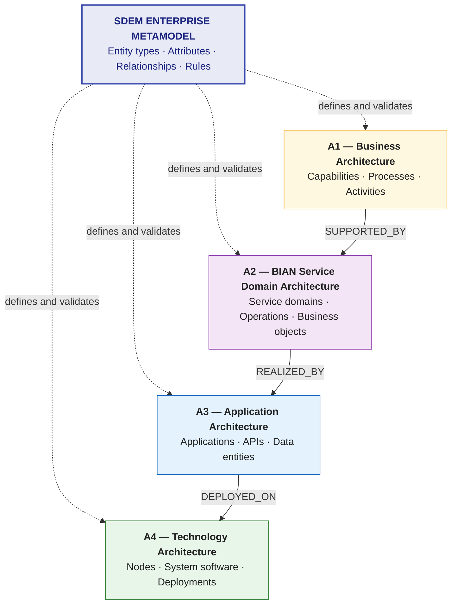
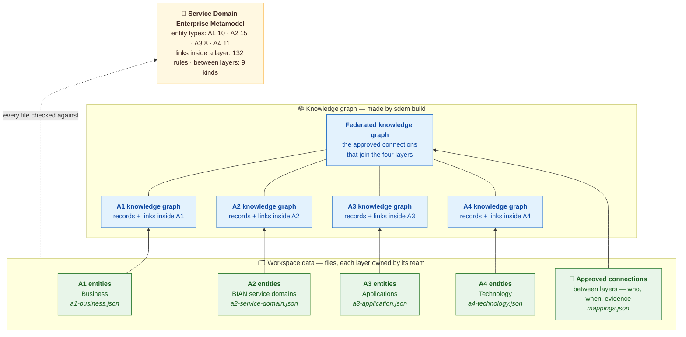
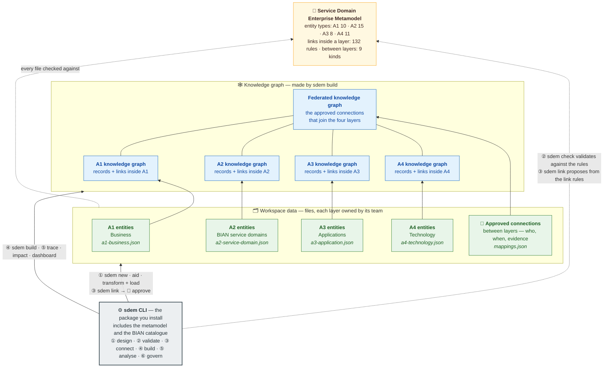
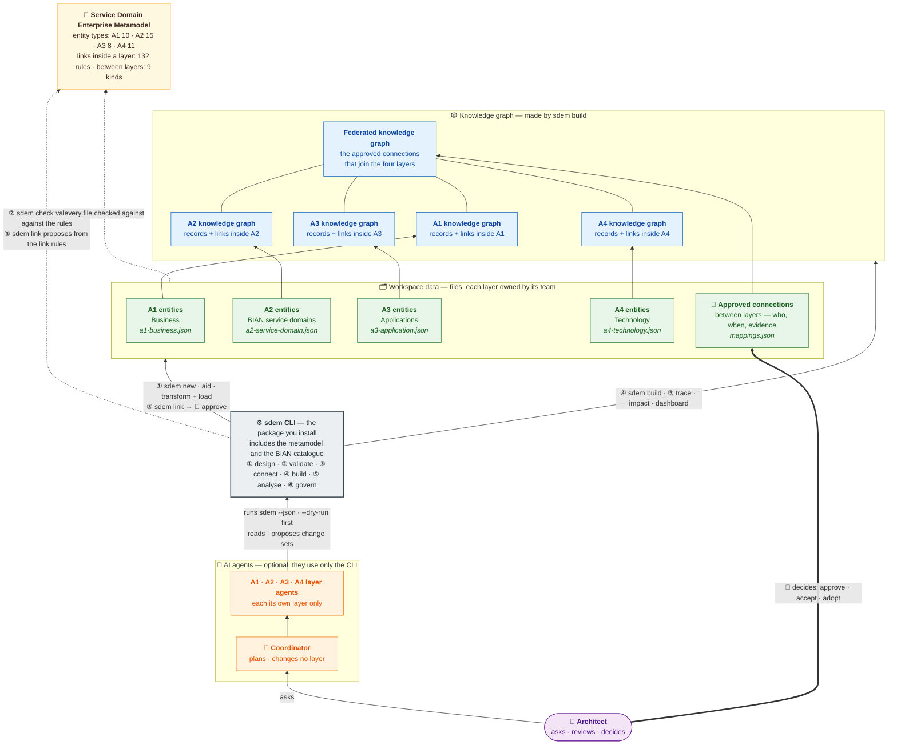
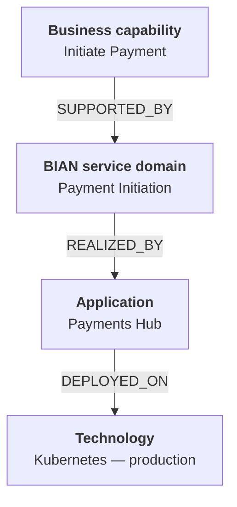

# SDEM — Service Domain Enterprise Metamodel

## Overview
**SDEM is an open-source, customisable Enterprise Architecture Metamodel and Architecture-as-Code framework for designing, aligning and governing banking solution architectures using BIAN Service Domains.**

SDEM provides a structured approach to solution architecture through four interconnected design models:

- **A1 — Business Architecture:** Business capabilities, value streams, processes, activities and requirements.
- **A2 — BIAN Service Domain Architecture:** BIAN Service Domains, service operations, control records, behaviour qualifiers and business objects.
- **A3 — Application Architecture:** Application components, services, APIs, interfaces and data.
- **A4 — Technology Architecture:** Infrastructure components, nodes, system software, deployments, deployment environments and technology services.

Its primary purpose is to support the **BIAN-aligned solution architecture design lifecycle**. Architects use a predefined, customisable metamodel to develop the four designs within a governed **workspace**, connect the layers and validate alignment. SDEM focuses on developing, aligning, validating and governing individual solution designs.

The framework operates locally through a command-line interface (CLI), maintaining architecture designs as structured, version-controlled data. It also supports AI agents to assist with architecture modelling, analysis and governance, while architects retain responsibility for design decisions and approvals. This includes:

- **Model-driven design:** Consistent architecture definitions and relationships governed by the enterprise metamodel.
- **BIAN alignment:** Mapping business requirements and processes to established BIAN Service Domains and operations.
- **Architecture inference:** Deterministically identifying candidate architecture elements and relationships across design layers.
- **Design governance:** Validating architecture consistency and requiring appropriate evidence and human approval for governed relationships.
- **Architecture traceability:** Understanding how business capabilities, BIAN Service Domains, applications and technology components relate.
- **Change-impact analysis:** Identifying affected architecture elements and dependencies when a solution changes.
- **Architecture-as-Code:** Managing solution designs as version-controlled, machine-readable architecture data, with optional AI-agent assistance.

### Example: a payment solution

An architect designing a payment solution can use SDEM to:

1. **Model business requirements (A1):** Define the business capabilities, processes and requirements the payment solution must support.
2. **Align with BIAN (A2):** Identify relevant BIAN Service Domains and operations, using deterministic inference where applicable.
3. **Design applications (A3):** Define the application components, APIs, services and data structures that implement the Service Domains.
4. **Design technology (A4):** Model the infrastructure, deployment environments and technology components supporting the applications.
5. **Validate and govern:** Verify cross-layer relationships, identify architecture gaps, review inferred relationships and assess the impact of proposed changes.

> **v0.18.0** · Apache-2.0 · Ready for evaluation using synthetic data; adoption for real solution designs requires a pilot ([pilot requirements](#using-sdem-on-real-designs)).
>
> SDEM uses BIAN's published Semantic APIs under BIAN's applicable licence. SDEM is **not an official BIAN standard and is not endorsed by BIAN**.

### What kind of architecture tool is SDEM?

SDEM brings together four complementary approaches to architecture tooling:

| Tool classification                      | Existing examples                                                                                                                    | What SDEM provides                                                                                                                                                                                                                       |
| ---------------------------------------- | ------------------------------------------------------------------------------------------------------------------------------------ | ---------------------------------------------------------------------------------------------------------------------------------------------------------------------------------------------------------------------------------------- |
| **Enterprise Architecture Metamodel**    | [SAP LeanIX](https://www.leanix.net/), [Bizzdesign](https://bizzdesign.com/), [Avolution ABACUS](https://www.avolutionsoftware.com/) | A predefined, customisable architecture metamodel covering Business (A1), BIAN Service Domain (A2), Application (A3) and Technology (A4), including entity types, attributes, permitted relationships, constraints and validation rules. |
| **Solution Architecture Modelling**      | [Sparx Enterprise Architect](https://sparxsystems.com/), [Archi](https://www.archimatetool.com/)                                     | Workspaces that instantiate four interconnected design models, enabling architects to develop, relate and validate solution architectures across business, BIAN Service Domains, applications and infrastructure.               |
| **Architecture-as-Code (AaC)**           | [Architecture-as-Code](https://arch-as-code.org/), [Structurizr](https://structurizr.com/), [LikeC4](https://likec4.dev/)            | Architecture maintained as structured, version-controlled data, supported by CLI automation, deterministic validation, generated views, reports and integration with development workflows.                                              |
| **BIAN-centred Architecture Governance** | [BIAN](https://bian.org/) reference architecture and BIAN-enabled architecture platforms                                             | BIAN Service Domain and operation modelling, deterministic architecture inference, evidence-based relationship governance, federated knowledge graphs, architecture traceability and change-impact analysis.                             |

### Relationship to existing architecture platforms

General-purpose Enterprise Architecture platforms such as SAP LeanIX, Bizzdesign and Avolution ABACUS provide overlapping capabilities in metamodel management, architecture modelling, dependency analysis and governance.

Detailed modelling tools such as Sparx Enterprise Architect also support solution architecture design, extensible metamodels and custom validation or automation.

SDEM can complement established architecture repositories and modelling platforms by providing a structured methodology and automation engine for developing and governing solution designs.

## BIAN Service Domain Catalogue

SDEM ships a built-in catalogue of **258 BIAN Service Domains** from BIAN's Semantic APIs, release 14.0.0 — the distinct areas of banking functionality, from payments and lending to accounting and customer servicing. It is the foundation of the A2 layer: instead of defining banking functions from scratch, you take the domains your architecture needs from it.

Examples, grouped for reading (the groups are SDEM's, not BIAN's classification):

| Area | Example Service Domains |
|---|---|
| **Accounting and finance** | Financial Accounting · Account Reconciliation · Position Keeping · Internal Bank Account |
| **Payments** | Payment Order Initiation · Direct Debit · Standing Order · Transaction Engine |
| **Lending and credit** | Loan · Consumer Loan · Corporate Loan · Mortgage Loan · Syndicated Loan · Credit Facility |
| **Accounts and deposits** | Current Account · Savings Account · Term Deposit · Virtual Account · Cash Concentration · Notional Pooling |
| **Cards and merchants** | Credit Card · Merchant Acquiring Facility |
| **Investments and markets** | Investment Account · Investment Portfolio Management · Custody Administration · Market Making · Public Offering |
| **Corporate and specialised finance** | Factoring · Corporate Lease · Project Finance · Corporate Payroll Services · Corporate Trust Services |
| **Customer services** | Customer Event History · Customer Tax Handling · Reward Points Account |

**[Explore the complete catalogue — 258 Service Domains](bian/base-14.0.0.json)**, or list it with `sdem bian list --base`. For each domain the catalogue holds its **operations** (method, path, input and output fields), its **control record** and fields, and its **behaviour qualifiers** — what lets AID find the domains a business process uses. BIAN's descriptions and object schemas are left out.

| Catalogue | |
|---|---|
| **File** | [`bian/base-14.0.0.json`](bian/base-14.0.0.json) (about 3.4 MB) — what it is: [`bian/README.md`](bian/README.md) |
| **Source** | [BIAN's public repository](https://github.com/bian-official/public), Semantic APIs 14.0.0 |
| **Licence** | Apache License 2.0 (BIAN's) |
| **In a workspace** | a shared reference — each workspace holds only the domains it needs |

## What is an Enterprise Metamodel?

An **Enterprise Metamodel defines the types of architecture element an organisation can model and the rules for how they relate.** SDEM's metamodel connects four architecture layers:

- **A1 — Business Architecture:** capabilities, processes and activities.
- **A2 — BIAN Service Domain Architecture:** banking Service Domains and their operations.
- **A3 — Application Architecture:** applications, APIs and data.
- **A4 — Technology Architecture:** nodes, system software and deployments.

**The metamodel** defines the permitted relationships. **The workspace** stores the actual designs. **The knowledge graph** connects their approved relationships.

| Question | SDEM capability |
|---|---|
| **What do we have?** | Model and validate the enterprise architecture |
| **How is everything connected?** | Trace approved relationships across the layers (`sdem trace`) |
| **What happens when something changes?** | Analyse dependencies and change impact across the enterprise (`sdem impact`) |



**BIAN Service Domains are the central connection** between the business and the applications and technology that support it: links run A1 → A2 → A3 → A4 only, so a capability reaches its applications through the Service Domains that support it. Domains can be chosen manually from the catalogue or inferred by AID, which finds them from the BIAN operations your business processes reference and presents them for you to confirm ([how](docs/sdem-new-design.md#how-sdem-chooses-the-bian-service-domains)). More: the [overview](docs/sdem-overview.md) and the [metamodel guide](docs/sdem-metamodel-guide.md).

## How SDEM works

SDEM consists of three core components, each standing on the one below. The three diagrams build on each other: the data architecture first, then the CLI added beneath it, then the agents beneath the CLI — the same picture each time, one layer more. **The agents are optional; the data and the tools are not.**

### 1 · Data architecture — the foundation



- **Enterprise Metamodel:** the architecture entity types, attributes, relationships and validation rules, built from BIAN, ArchiMate 3.2 and TOGAF ([metamodel guide](docs/sdem-metamodel-guide.md)).
- **Architecture workspace:** the actual designs, approved connections, requirements, evidence and recorded decisions, as structured JSON in your own repository under Git.
- **Knowledge graph:** the architecture entities and their approved relationships, used for dependency tracing and impact analysis.

The workspace is the **source of truth**. The knowledge graph is **derived** from it by `sdem build` and can be rebuilt after any change. Organisation profiles add your own entity types, attributes, constraints and extra layers ([profiles](docs/design/sdem-profile-spec.md)).

### 2 · CLI tools — the architecture engine

One Python command, `sdem`. **The data architecture comes with it:** installing SDEM installs the four architectures (A1–A4), the metamodel and the base BIAN catalogue inside the `sdem` package. Your designs and their knowledge graph live in your workspace; the CLI creates, checks, connects and builds them at each step of the lifecycle. **Every function works without AI.** 👤: a person decides. The diagram is the data architecture above, with the CLI added:



| Lifecycle step | What it does | Main commands | Data architecture used |
|---|---|---|---|
| **① Design** | create, import or infer designs | `new`, `bian search`, `aid`, `transform` + `load`, `change propose` | writes the A1–A4 workspace files; A2 domains copied from the BIAN catalogue, marked inferred until confirmed |
| **② Validate** | check the designs | `check`, `validate` | the metamodel: entity types, attributes, link rules |
| **③ Connect** | propose links between layers; a person approves | `link`, `review`, `approve`, `connect` | the metamodel's cross-layer link types → approved connections in `mappings.json` |
| **④ Build** | generate the knowledge graph | `build` | the workspace → four layer graphs and the federated graph; refuses if checks fail |
| **⑤ Explore and analyse** | trace, impact, requirements, read-only HTML pages | `trace`, `impact`, `query`, `matrix`, `requirements evaluate`, `home`, `dashboard`, `view` | the knowledge graph — approved connections only |
| **⑥ Govern** | decisions, history, upgrades, profiles | `events`, `governance verify`, `upgrade check`, `profile` | the workspace record; profiles extend the metamodel, never change it |

Every command takes `--json` and `--help` (with a worked example); writing commands take `--dry-run`. The pages: **SDEM Home** (the framework, metamodel and workspaces), the **workspace dashboard** (health, relationships, changes, governance) and the **architecture graph** (entities and approved connections). In full: [the commands, step by step](docs/sdem-workbench-user-guide.md#4c-from-your-designs-to-the-knowledge-graph--the-commands).

### 3 · AI agents — optional architecture assistants

The agents sit **on top of** the CLI and the data architecture, never beside them. An agent doesn't keep its own copy of the architecture or its own rules: it asks `sdem` (always with `--json`), and `sdem` reads and checks the workspace against the metamodel. So an agent sees exactly what a person sees, gets the same answer every time, and can change the architecture only the way a person can — through a checked, recorded change set. `sdem agents install` writes the instruction files for GitHub Copilot, Claude Code, OpenAI Codex or Gemini CLI; SDEM itself contains no AI. The diagram is the CLI diagram above, with the agents added — they are instructed to reach the data architecture only through the CLI, and the architect makes the decisions:



**How an architect uses them:** ask in plain words (*"what breaks if we rehost the payments cluster?"*, *"draft the A1 design for a ledger"*). The agent runs the commands, answers with the command each fact came from, and drafts changes as change sets. Anything that is a decision — approving a connection, accepting an impact or a risk, adopting an edit — it prepares as an exact command **for you to run**.

**Agent best practice, built in.** The controls follow common guidance for using AI agents safely — SDEM enforces most of them, and the agents' instructions repeat them:

| Practice | How SDEM does it |
|---|---|
| **Ground answers in tools, not memory** | facts come only from `sdem` output and the files; every statement gives its source, reasoning and confidence |
| **Deterministic tools** | SDEM contains no AI: the same command on the same workspace always gives the same answer |
| **Structured interface** | `--json` on every command; `sdem commands --json` to discover them; errors as JSON with a code and a hint |
| **Least privilege** | one layer per agent; the coordinator changes none (control CTL-19); cross-layer links only from the rules engine |
| **Preview before acting** | `--dry-run` on every writing command lists what would change |
| **Human in the loop** | agents propose, check, preview and explain; only a person approves, accepts or adopts |
| **Audit trail** | every change is a recorded change set; a direct file edit is flagged as unrecorded (`sdem check`) until a person adopts it |
| **State outside the conversation** | the architecture lives in the workspace, not the chat: any new session — or person — reads the same model |
| **Say what isn't known** | inferred records stay marked until confirmed; `sdem impact` reports what it could not see; a missing path is not proof of no impact |

Agent instructions constrain intended behaviour; SDEM's validation and governance controls enforce the architecture rules. Instructions alone do not stop an agent with file access from editing workspace files directly — SDEM then flags the edit as unrecorded, and nothing is accepted until a person adopts it. So these are safeguards, not a security boundary: a `--person` name is attribution. Where decisions must be verifiable, use the [governed mode](docs/design/sdem-governance.md) — signed approvals checked by `sdem governance verify`. Set-up: the [AI agent setup guide](docs/sdem-agent-setup.md).

## Example — Payments architecture

The synthetic **Payments** example that ships with SDEM models these approved relationships:



If the production Kubernetes platform is rehosted, `sdem impact` traces the connected applications, service domains and capabilities and classifies the effect: a design change for *Payments Hub* and *Execution Gateway*; none for the BIAN domain and capability above. Architects review the findings, evaluate the requirements and record their decisions.

**Change is analysed across the whole architecture, not within one isolated diagram.**

## Quick start

Two ways in:

- **Create a new architecture** — start from a business design, find the BIAN Service Domains it needs, let AID infer the missing layers, approve, then build and explore the knowledge graph (steps 1–7).
- **Explore the bundled example** — the synthetic Payments architecture, ready-made, in one command (steps 1 and 8).

**Requirements:** Python 3.10 or later and Git (macOS: `brew install python@3.13`; Windows: `winget install Python.Python.3.13`). Every command below was run as written on SDEM v0.18.0; the ledger is made-up data.

### 1. Install SDEM

```bash
mkdir my-sdem && cd my-sdem
python3 -m venv .venv && source .venv/bin/activate          # Windows PowerShell: .venv\Scripts\Activate.ps1
python -m pip install "sdem @ git+https://github.com/taumoeps/bian-sdem-framework@v0.18.0"
sdem --version
```

The install includes the Enterprise Metamodel, its rules and the BIAN Service Domain catalogue.

### 2. Create a workspace

```bash
sdem new --workspace workspaces/ledger --person your.name
```

SDEM creates the four layer files — A1 Business, A2 BIAN Service Domains, A3 Application, A4 Technology — all empty, plus an empty `mappings.json` for the approved connections. Start with the layer you know; the others can follow.

### 3. Find the BIAN Service Domains

Browse and search the [built-in catalogue](#bian-service-domain-catalogue) of 258 BIAN Service Domains instead of defining banking services from scratch:

```bash
sdem bian list --base                                  # all 258, with operations and control record
sdem bian list --base > bian-service-domains.txt       # save the full list
sdem bian list --base | grep -i accounting             # by name
sdem bian search ledger posting                        # by business activity — domains and operation ids
sdem bian search payment                               # also: loan, account, customer …
```

More examples: [BIAN Service Domain Catalogue](#bian-service-domain-catalogue).

`sdem bian search ledger posting` finds **Financial Accounting** and its operation `SO-FINANCIAL-ACCOUNTING-CAPTURE-LEDGER-POSTING`. Two ways to bring domains into a workspace:

| Method | How |
|---|---|
| **Automatic — AID (recommended)** | name the BIAN operations in your business design (step 4); AID brings in the domains that own them, for you to confirm (step 5) |
| **Manual** | `sdem bian custom --workspace workspaces/ledger --add "Financial Accounting" --person your.name` |

The catalogue is a shared reference: each workspace holds only the domains its architecture needs ([choosing BIAN Service Domains](docs/sdem-new-design.md#how-sdem-chooses-the-bian-service-domains)).

### 4. Write the initial design

Write what you already know — here, one capability and one process that invokes the BIAN operation. `sdem types A1` lists the allowed types and fields; `sdem types change-set` the file format. Save as `ledger-a1.json`:

```json
{
  "layer": "A1",
  "reason": "Initial business design for the general ledger",
  "changes": [
    {"op": "add", "record": {"id": "CAP-GL", "type": "A1.BusinessCapability", "version": "1",
      "name": "General Ledger Management", "lifecycle_status": "planned"}},
    {"op": "add", "record": {"id": "PRC-GL-POST", "type": "A1.BusinessProcess", "version": "1",
      "name": "Post journal entries", "lifecycle_status": "planned",
      "attributes": {"invokes": ["SO-FINANCIAL-ACCOUNTING-CAPTURE-LEDGER-POSTING"]}}}
  ],
  "relationships": {"add": [{"source": "PRC-GL-POST", "kind": "realization", "target": "CAP-GL"}]}
}
```

Preview, then apply — SDEM checks it against the metamodel and records the change:

```bash
sdem change propose ledger-a1.json --workspace workspaces/ledger --agent architect --person your.name --dry-run
sdem change propose ledger-a1.json --workspace workspaces/ledger --agent architect --person your.name
```

### 5. Infer the missing architecture with AID

**Architecture Inference Design (AID)** reads the workspace and fills the gaps: the BIAN Service Domains your processes invoke, then candidate applications, APIs and deployments, and the connections between layers — each with its source, reasoning and confidence.

```bash
sdem aid --workspace workspaces/ledger --person your.name --dry-run
sdem aid --workspace workspaces/ledger --person your.name
```

For the ledger, AID brings in Financial Accounting (A2), 8 application records (A3) and 1 deployment (A4), and proposes 11 connections in `workspaces/ledger/aid/AID-001-proposals.json`. **Inferred records stay marked until you confirm or reject them**; AID can only infer what the evidence supports ([AID guide](docs/sdem-planning-with-aid.md)).

### 6. Review, confirm and approve

AID's output is **candidate** architecture: review it before you confirm anything. The dashboard shows every inferred record with its source, reasoning and confidence.

```bash
sdem dashboard --workspace workspaces/ledger                                        # review the inferred records
sdem aid confirm SD-FINANCIAL-ACCOUNTING --workspace workspaces/ledger --person your.name   # the domain and its operations
sdem aid reject <ids> --workspace workspaces/ledger --person your.name              # anything you doubt
sdem review workspaces/ledger/aid/AID-001-proposals.json                            # proposed connections, weakest first
sdem approve AID-001-P001 --proposals workspaces/ledger/aid/AID-001-proposals.json \
  --workspace workspaces/ledger --reviewer your.name --evidence process_model:GL-design-v1
sdem check --workspace workspaces/ledger
```

Confirm the A3 and A4 candidates the same way, by id, once you agree with them; `sdem aid confirm --all` is a shortcut only after you have reviewed everything. Each kind of connection needs its own evidence — links to BIAN also need `--bian-release 14.0.0`; if anything is missing, `sdem approve` says what and writes nothing. `sdem link --workspace workspaces/ledger --out workspaces/ledger/links` proposes further connections the same way. **Only approved connections enter the knowledge graph.**

### 7. Build and explore the knowledge graph

```bash
sdem build --workspace workspaces/ledger --out workspaces/ledger/graph
sdem trace PRC-GL-POST --direction down --graph workspaces/ledger/graph
sdem view --graph workspaces/ledger/graph
sdem dashboard --workspace workspaces/ledger
sdem home --root workspaces -o work/sdem
open work/sdem/index.html                                     # Linux: xdg-open · Windows: start
```

`build` writes the four layer graphs and the federated graph; `trace` follows the approved connections down from the process — after the one approval above, to Financial Accounting. **How far a trace reaches depends on which cross-layer connections you have approved**; unapproved proposals are not in the knowledge graph, so approve the A2 → A3 and A3 → A4 proposals to see the full A1 → A4 chain. Go **SDEM Home → workspace dashboard → architecture graph**. Rebuild after every approved change. More: [create a new design](docs/sdem-new-design.md).

### 8. Or explore the Payments example

A complete synthetic architecture with approved connections, in one command:

```bash
sdem new --workspace workspaces/payments --person your.name --example payment-initiation --explore
open work/sdem/index.html
```

`--explore` builds the graph and writes the pages. Explore capabilities connected to BIAN Service Domains, applications and infrastructure; the approved connections and their evidence; tracing across the four layers; and change impact. Walkthrough: [Explore your architecture](docs/sdem-workbench-user-guide.md#4a-explore-your-architecture--home-dashboard-and-graph). AI agents: `sdem agents install` ([setup](docs/sdem-agent-setup.md)). Developing SDEM: [CONTRIBUTING.md](CONTRIBUTING.md). Troubleshooting: [administration](docs/sdem-administration.md#troubleshooting).

## Customising SDEM for your organisation

SDEM's Enterprise Metamodel, built around BIAN Service Domains, is reusable: each organisation extends it for its own environment and keeps its own:

- business, solution, application and infrastructure architecture data;
- entity types, attributes and validation constraints;
- additional architecture layers;
- governance configuration and approval requirements.

Two organisations can share the same SDEM framework and BIAN catalogue while keeping different application landscapes, technology platforms, standards and governance. Core metamodel rules stay protected; extensions are declared in [organisation profiles](docs/design/sdem-profile-spec.md).

### Using SDEM on real designs

The public SDEM repository holds synthetic data only. Real architecture belongs in your organisation's **private workspace repository** ([template](templates/workspace-repo/README.md)), with a pinned SDEM release, access control, version history and governance. **v0.18.0 is suitable for evaluation and controlled architect pilots**; production use needs your own security, governance and operational validation.

[Configuration](docs/sdem-configuration.md) · [Operating model](docs/sdem-operating-model.md) · [Pilot plan](docs/sdem-pilot-plan.md)

## Documentation

| Guide | Description |
|---|---|
| [SDEM overview](docs/sdem-overview.md) | Framework concepts and capabilities |
| [Workbench user guide](docs/sdem-workbench-user-guide.md) | CLI operations and architecture exploration |
| [Metamodel guide](docs/sdem-metamodel-guide.md) | Entity types, relationships and rules |
| [Architecture](docs/sdem-architecture.md) | SDEM's data architecture, components and knowledge graph |
| [Create a new design](docs/sdem-new-design.md) | Authoring and inference |
| [Onboarding workflow](docs/sdem-onboarding-workflow.md) | Onboarding existing designs |
| [AI agent setup](docs/sdem-agent-setup.md) | Configuring AI-agent support |
| [Configuration](docs/sdem-configuration.md) | Configuring and customising SDEM |
| [Administration](docs/sdem-administration.md) | Installation, upgrades and maintenance |
| [Documentation index](docs/README.md) | All project documentation, and the [glossary](docs/glossary.md) |

## Licence and project status

SDEM is open source under the **Apache License 2.0**: private, commercial and organisational use, subject to the licence terms. The base BIAN in `bian/` is BIAN's Semantic APIs under BIAN's own Apache-2.0 licence. SDEM collects nothing. The public repository contains synthetic example data only.

BIAN®, ArchiMate® and TOGAF® are trademarks of their owners. SDEM is an independent project — not affiliated with, endorsed by, or sponsored by BIAN, The Open Group or any other organisation; no guarantees of fitness, correctness or compliance.

[`LICENSE`](LICENSE) · [`LICENSES.md`](LICENSES.md) · [Using SDEM](docs/sdem-licence-and-use.md) · [`PRIVACY.md`](PRIVACY.md) · [`SECURITY.md`](SECURITY.md) · [CHANGELOG](CHANGELOG.md) · [ROADMAP](docs/design/ROADMAP.md) · [How it was tested](docs/evidence/README.md#how-it-was-tested--the-summary)

---

**SDEM combines Architecture-as-Code and Enterprise Architecture modelling in a CLI-driven framework built around BIAN Service Domains, enabling architecture design, dependency tracing, impact analysis and governance.**
