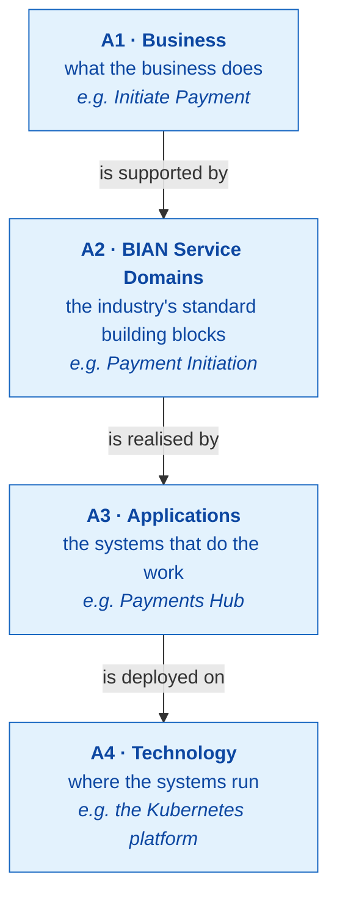
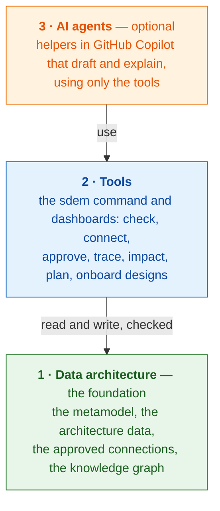
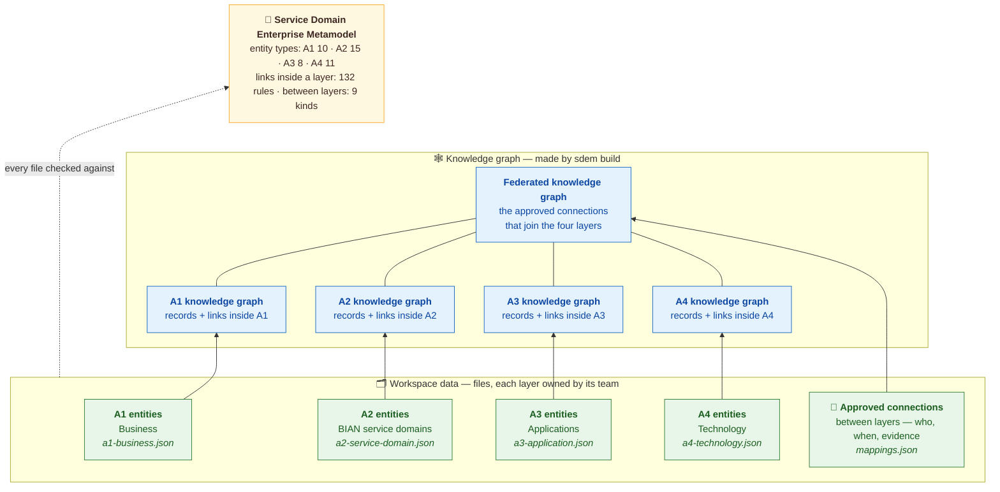
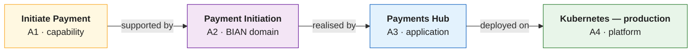
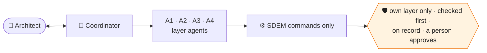
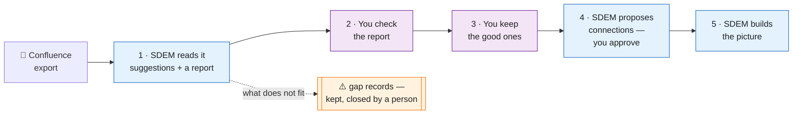
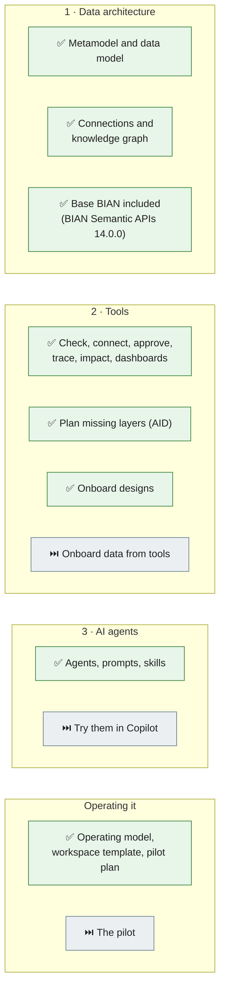
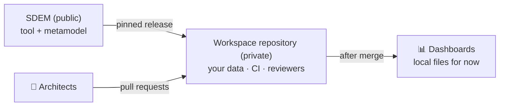

# SDEM — Service Domain Enterprise Metamodel

**SDEM connects an organisation's architecture — from what the business does, through BIAN, to the applications and the technology underneath — into one picture you can question.** It checks every connection against a metamodel and keeps a person in charge of every decision.

> **Status:** v0.9.11 (2026-10-31). Ready to try on made-up data; use on real designs follows a pilot ([what that needs](#using-sdem-on-real-designs)). **Open source and free for any organisation** (Apache-2.0 — [using SDEM](docs/sdem-licence-and-use.md)); aligned with BIAN, but **not** an official BIAN standard or endorsed by BIAN. Made-up example data only.

## Start here

| You are… | Start with |
|---|---|
| **New to SDEM** | read on, then run the dashboard: `sdem home -o work/sdem` and open `work/sdem/index.html` |
| **An architect who will use it** | [how an architect uses it](#how-an-architect-uses-it) (five steps), [install](#install), then the [user guide](docs/sdem-workbench-user-guide.md) — a 15-minute quick start and every task step by step |
| **Bringing in existing designs** | the [onboarding workflow](docs/sdem-onboarding-workflow.md); practise with [use-case example 4](docs/evidence/use-case-example-4.md) |
| **Planning to use it on real data** | the [operating model](docs/sdem-operating-model.md) and the [pilot plan](docs/sdem-pilot-plan.md) |
| **Setting up the AI agents** | [Copilot set-up](docs/sdem-copilot-setup.md) |
| **Looking for a document** | the [documentation index](docs/README.md) — every document by reader — and the [glossary](docs/glossary.md) |
| **A maintainer** | [CONTRIBUTING.md](CONTRIBUTING.md) |

## The four architectures

SDEM looks at an organisation's architecture as four layers. Each has its own owners and its own data; SDEM connects them.



**Why it matters.** Today the answer to *"what does this depend on — and what breaks if we change it?"* is spread across Confluence, spreadsheets, the EA tool and the CMDB, and lives in people's heads. SDEM puts it in one connected place, with the evidence, and answers in seconds.

## SDEM in three layers

SDEM is built in three layers, each standing on the one below. **The agents are optional; the data and the tools are not.**



### 1 · Data architecture

The rules, the data and the connections — kept as files, checked, with a full history.



**Reading it from the bottom:**

- **Workspace data.** Each layer's records — its *entities* — live in their own file, owned by that layer's team. Connections between layers live in `mappings.json`; only approved ones count.
- **Knowledge graph.** `sdem build` turns each layer file into that layer's graph (its records and the links inside the layer), and the approved connections into the **federated graph**, which joins the four. Trace and impact follow the federated graph across layers.
- **Metamodel.** Not part of the graph: it is the metamodel every file is checked against before it is accepted — 44 types of thing (capability, BIAN service domain, application, server …), 132 rules for links inside a layer, 9 kinds of connection between layers and 69 rules for proposing them — each traced to a public standard (BIAN, ArchiMate, TOGAF).

### 2 · Tools

One command, `sdem`, and dashboards on top of it. **Every function works without AI.** The same parts as the data architecture above, with each command on the step where it acts. Purple: a person decides.

```mermaid
flowchart LR
    IN["📄 <b>Your designs</b><br/>existing or new"]
    D["🗂️ <b>Workspace data</b><br/>A1 · A2 · A3 · A4 entities"]
    P["💡 <b>Proposed connections</b><br/>with reasons"]
    C["🔗 <b>Approved connections</b><br/><i>mappings.json</i>"]
    K["🕸️ <b>Knowledge graph</b><br/>four layer graphs +<br/>the federated graph"]
    A["📊 <b>Answers</b>"]
    PL["🧭 <b>Inferred records</b><br/>in the layers, marked —<br/>you confirm or reject"]
    MM["📘 <b>Metamodel</b><br/>what may exist and connect"]
    IN -->|"sdem new, then<br/>sdem transform · sdem load"| D
    IN -.->|"new design:<br/>sdem aid — fills the gaps,<br/>marked inferred"| PL
    PL -->|"sdem aid confirm"| D
    D -->|"sdem link"| P
    P -->|"👤 sdem approve<br/>(or sdem connect)"| C
    D -->|"sdem build"| K
    C -->|"sdem build"| K
    K -->|"sdem trace · impact<br/>matrix · dashboard"| A
    D -.->|"sdem check"| MM
    C -.->|"sdem check"| MM
    classDef r fill:#FFF8E1,stroke:#F9A825,color:#3E2723
    classDef d fill:#E8F5E9,stroke:#2E7D32,color:#1B5E20
    classDef g fill:#E3F2FD,stroke:#1565C0,color:#0D47A1
    classDef p fill:#F3E5F5,stroke:#6A1B9A,color:#4A148C
    classDef o fill:#ECEFF1,stroke:#455A64,color:#263238
    class MM r
    class D,C d
    class K,A g
    class P p
    class IN,PL o
```



The steps in order, from your designs to the knowledge graph:

| # | Step | Command | What happens | Who |
|---|---|---|---|---|
| 1 | **Start the workspace** | `sdem new --workspace <workspace> --person <you>` | creates the workspace: the four layers, empty, and an empty set of connections; BIAN's service domains stay in the catalogue until your design needs them; checked, recorded | **you** |
| 2 | *Existing design:* look at it | `sdem transform inspect <export>` | shows what is in the export and what SDEM can read; changes nothing | SDEM |
| 3 | *Existing design:* read it | `sdem transform run <export> -o work/history` | turns pages, tables and diagrams into *suggested* items, with a report of where each came from | SDEM |
| 4 | *Existing design:* keep the good ones | `sdem load work/history --workspace <workspace> --person <you>` | copies the items you accept into the workspace — you are recorded as the person who decided; what does not fit is kept as a gap record | **you** |
| — | **Fill the gaps** — after loading an existing design, or for a new one instead of steps 2–4 | `sdem aid --workspace <workspace> --person <you>` | from whatever the workspace has (any of A1…A4), adds what it is missing into its layer files — **the BIAN service domains your design points to**, and for a new design the applications and deployments — each marked *inferred*, with source, reasoning and confidence, and proposes the connections; you then `sdem aid confirm` or `sdem aid reject` each record | SDEM, then **you** |
| *optional* | Add a BIAN service domain | `sdem bian custom --workspace <workspace> --add "<service domain>" … --person <you>` — or keep one shared catalogue for every workspace: `sdem bian import --base --all -o bian/a2-service-domain.json` | `sdem aid` brings in the domains your design needs; add one it did not pick, or let the SDEM lead keep a shared catalogue — [choosing your BIAN service domains](#choosing-your-bian-service-domains) | **you**, or the SDEM lead for the catalogue |
| 5 | Check | `sdem check --workspace <workspace>` | every file against the metamodel; errors must be fixed, warnings are advice — also run by CI on every change | SDEM |
| 6 | Propose and review connections | `sdem link --workspace <workspace> --out work/links` | proposes connections between layers and shows them straight away, weakest first, each with its reasons — you judge which are true (`sdem review <file>` shows any proposals file again, such as AID's) | SDEM, then **you** |
| 7 | Approve | `sdem approve <id> --reviewer <you> --evidence <document>` — or `sdem connect` for one SDEM missed | writes the approved connection to `mappings.json`, with you, the date and the evidence; final when its pull request is merged | **you** |
| 8 | Build | `sdem build --workspace <workspace> --out work/graph` | makes the four layer graphs and the federated graph from the data and the approved connections | SDEM |

#### Choosing your BIAN service domains

**Nobody needs to know which to pick.** All 258 service domains of BIAN 14.0.0 are the **catalogue** — your organisation's shared BIAN layer, or the base BIAN that ships with SDEM — and the catalogue is read, never copied. A workspace holds **only the domains its design needs**: `sdem aid` brings them in from what you wrote, each marked *inferred* with the reason, for you to confirm or reject. To choose by hand instead:

| Option | Gives the workspace | When |
|---|---|---|
| *(nothing — `sdem aid` chooses)* | the domains your design points to | **the simplest start**, especially if you are new to service domains |
| `sdem bian custom --workspace <workspace> --add "Payment Order Initiation" … --person <you>` | these domains, beside what it holds | AID did not pick one you need — find names with `sdem bian list --base \| grep -i payment` |
| `sdem bian custom --workspace <workspace> --only … --person <you>` (or `--from my-domains.txt`) | exactly these domains | you know the area's list — kept in your repository and reviewed like code |

Every change is checked and recorded, and refuses to remove a domain an approved connection uses. When the SDEM lead updates the shared catalogue (`sdem bian update --root workspaces`), each workspace refreshes only the domains it holds.

**240 come with full values; 18 are marked *not known yet*.** The metamodel gives every service domain an *asset type* and a *functional pattern*. BIAN's public files do not state them; SDEM works them out from the control record's name, following BIAN's own naming rule, for 192 domains. For 48 more, SDEM's **inference record** supplies values a person has accepted. The other 18 have no accepted value yet. SDEM does not guess: those 66 are imported marked `classification: unknown`, can still be connected through their operations, and `sdem check` advises on each until the values are given. The inference record ([BIAN inferences](docs/reference/bian-inferences.md)) holds each inferred value with its source, reasoning and confidence, a status and a history; the import applies an entry once a person has **accepted** it (`sdem bian inference accept <id> --person <you>`), and the domain records `classification: inferred` and the entry's id. Anyone can challenge or change an entry later, with a reason, and every change is kept. Or give values yourself: the import writes a template (`…needs-patterns.csv`) to fill in and use with `--patterns <template>`. A full BIAN layer does not flood you with proposals: on the example workspace, `sdem link` took about eight seconds and proposed 13 connections with all 258 domains loaded.

Then ask the graph: `sdem trace` (*what does this depend on?* — for one record, or a whole layer: `sdem trace A4 --direction up` shows which technology supports nothing above it), `sdem impact` (*what breaks if it goes?*), `sdem matrix`, `sdem view`, `sdem dashboard`. Every command, with examples: the [user guide](docs/sdem-workbench-user-guide.md#7-command-reference).

**Follow one capability down to the technology** — every arrow an approved connection, with who approved it and the document that proves it:



**Ask "what if?"** — *retire the production Kubernetes platform* — and SDEM follows the connections: two applications need a design change; one BIAN domain, one capability and two processes need a review. An architect confirms before anything changes.

**People stay in charge.** SDEM checks, proposes and works out impact; **only a person** approves a connection, loads onboarded designs, or merges a change after review. This is built into the software — SDEM refuses an approval with no evidence, or one signed by an AI agent.

### 3 · AI agents (optional)

Helpers in **GitHub Copilot** — one per layer and a coordinator — draft changes and explain results. They work only through SDEM's checked commands, stay in their own layer, and never approve. No MCP, no AI inside SDEM.

**Any agent can drive SDEM** (Copilot, Claude Code or others that run commands): every command takes `--json` (results *and* failures as JSON, with a code and a next step), `--dry-run` (nothing written; what would be is listed) and `--limit`; `sdem commands --json` lists every command and option. See [built for agents](docs/design/sdem-agent-cli-spec.md).



## How an architect uses it

Six steps, the same for every area. Each links to where it is written in full.

1. **Install and practise.** [Install](#install) SDEM, then do the user guide's [15-minute quick start](docs/sdem-workbench-user-guide.md#5-quick-start--15-minutes) on the made-up example: check the data, build the knowledge graph, trace a business process down to its technology.
2. **Start your workspace** — `sdem new --workspace workspaces/<area> --person <you>`: the folder where your area's architecture is kept; it reads BIAN's service domains from the catalogue and holds only the ones your design needs.
3. **Bring in your design** — one of two routes:

   | Your design | What happens | In full |
   |---|---|---|
   | **Existing** — already documented, e.g. in Confluence | you export it; SDEM reads it into *suggested* items with a report (`sdem transform`); you keep the good ones (`sdem load`); what does not fit is kept as a gap record | [below](#onboarding-your-existing-designs) and the [onboarding workflow](docs/sdem-onboarding-workflow.md) |
   | **New** — not built yet | you write what you have — any of the four layers, even a few capabilities and activities; `sdem aid` fills in what is missing (the BIAN domains, applications, APIs and deployments), each marked *inferred* with its source, reasoning and confidence; you review, confirm or reject, then validate as usual | [designing with AID](docs/sdem-planning-with-aid.md) |

4. **Connect the layers.** SDEM proposes connections across the layers (`sdem link`). You approve the true ones, naming the document that proves each (`sdem approve`), or state one SDEM missed (`sdem connect`). Agents and Copilot never approve.
5. **Review.** Commit on a branch in your organisation's private workspace repository and open a pull request: a reviewer checks it and CI runs every check. A connection is final when the pull request is merged.
6. **Use it.** Build the knowledge graph (`sdem build`), then ask *what does this depend on?* (`sdem trace`), *what breaks if it goes?* (`sdem impact`), or open the dashboard (`sdem dashboard`). Copilot can explain any result in plain words.

Every task step by step: the user guide's [workflow examples](docs/sdem-workbench-user-guide.md#8-workflow-examples).

## Onboarding your existing designs

Years of designs live in Confluence as pages, diagrams and pictures. SDEM turns an export of them into architecture data — **on your own machine, without AI**.



**BIAN is included.** SDEM ships with a **base BIAN** — BIAN's public Semantic APIs (release 14.0.0) — so your BIAN layer is one command (`sdem bian import --base --all`, or `--only` the domains you use); your organisation can replace it with its own BIAN.

Every suggestion says **which page it came from, where, and how sure SDEM is** — never above "medium" until a person checks it. **Nothing is thrown away:** what does not fit — a risk table, text, a picture — is kept as a *gap record* beside the data. It works for any domain (tested on payments and lending).

**How:** the [onboarding workflow](docs/sdem-onboarding-workflow.md) — every step, its command, and what you will see. Data from tools (spreadsheets, CMDB) is planned.

## What's built and what's next



✅ built · ⏭️ next. Details: [ROADMAP](docs/design/ROADMAP.md) · what changed: [CHANGELOG](CHANGELOG.md).

## Install

You need **Python 3.10 or later** (3.13 recommended). Macs come with 3.9, which is too old. Install 3.13 with Homebrew (`brew install python@3.13`) or the installer from [python.org](https://www.python.org/downloads/macos/), then find it:

```bash
python3 --version                      # 3.10 or later? then use python3 below
for d in /opt/homebrew/bin /usr/local/bin; do ls "$d" 2>/dev/null | grep "^python3\.1[0-9]*$" | sed "s|^|$d/|"; done   # installed but "command not found"? it is one of these
```

```bash
git clone https://github.com/taumoeps/bian-sdem-framework.git && cd bian-sdem-framework
python3.13 -m venv .venv               # or the full path you found, e.g. /opt/homebrew/bin/python3.13 -m venv .venv
source .venv/bin/activate              # do this in every new terminal
pip install -e .                       # installs the sdem command
sdem --version                         # 0.9.11
```

If `pip` says *File "setup.py" … not found* or *requires a different Python*, the `.venv` was made with an old Python: delete it (`rm -rf .venv`) and make it again with 3.13. More: [administration — troubleshooting](docs/sdem-administration.md#troubleshooting).

**Try it** on the made-up examples:

```bash
sdem home -o work/sdem && open work/sdem/index.html             # the dashboards, as local files
sdem check --workspace examples/payment-initiation                 # the data against the metamodel
sdem build --workspace examples/payment-initiation -o work/graph   # the knowledge graph
sdem impact INF-K8S-PAY-PROD --change retire --graph work/graph # what breaks if it goes
sdem --help                                                     # every command; sdem <command> --help shows an example
```

Every command, with examples: the [user guide](docs/sdem-workbench-user-guide.md#7-command-reference). `work/` is scratch space and is never committed.

## Using SDEM on real designs

This repository is **public and holds made-up data only**. Real architecture data lives in your organisation's **private workspace repository**, made from [`templates/workspace-repo`](templates/workspace-repo/README.md): SDEM pinned to a release, CI checks on every change, reviewers named.



Before starting: legal and IP clearance, the private repository with branch protection, and Python 3.10+ on architects' machines. Roles, workflows and support: the [operating model](docs/sdem-operating-model.md). The first step: a ten-week [pilot](docs/sdem-pilot-plan.md) on one domain. Security: [SECURITY.md](SECURITY.md).

## How it was tested

| Test | Result |
|---|---|
| Rules engine against sealed answer keys | 8 of 8 acceptance cases |
| Use-case examples 1–4: datasets to graph · planning missing layers · agents · onboarding designs | 30 of 30 · 12 of 12 · 8 of 8 · replayed on every push |
| Design onboarding on a second domain (lending), expectations sealed first | 18 of 18 records, nothing lost |
| Links allowed inside a layer | 132 rows; 16 checked on BIAN's public pages, 113 against the open-source ArchiMate implementation, 0 contradicted |
| Automated tests on every push, Python 3.10–3.13, plus the installed package | the full suite |

**Caveats.** All data and answer keys were made by this project; a blind test by someone else is still to come. The ArchiMate and TOGAF specifications need a login, so those rows were checked against an implementation. The AI agents have not yet run in real Copilot.

## Where the metamodel comes from

Every entity type comes from a **published reference architecture** — BIAN (publicly available), ArchiMate 3.2 or TOGAF 10 (published by The Open Group; sign-in required) — or is a documented SDEM extension of one; none is copied from any institution's model, and no BIAN or Open Group text is reproduced ([provenance, entity by entity](docs/reference/reference-architecture-provenance.md)). BIAN®, ArchiMate® and TOGAF® are trademarks of their owners; SDEM is independent and not endorsed by them.

**Rules of use.** Keep historical designs; never overwrite or silently reclassify them. Keep BIAN reference content separate from your own design objects. A connection is a versioned, typed claim with evidence — an AI confidence value is not evidence. *Affected by a change* does not mean *must change*: impact needs an architect's assessment.

## Licences

**Free for any organisation: SDEM is open source under the Apache License 2.0** — download it, use it privately, change it, use it commercially; the conditions apply only when you pass SDEM on to others: include the licence, mark the files you changed, and keep the existing notices (including BIAN's in `bian/`). SDEM collects nothing. In plain words: [**Using SDEM**](docs/sdem-licence-and-use.md). Everything here is Apache-2.0 (`LICENSE`, `LICENSES.md`); the **base BIAN** in `bian/` is BIAN's Semantic APIs under BIAN's own Apache-2.0 licence (`bian/LICENSE`, `THIRD_PARTY.md`).

**For enterprises:** SDEM supports internal commercial use and private customisation — your own BIAN catalogue, design formats, rules and a private fork — subject to the licence, your organisation's policies and your contractual obligations; the licence does not override employment or confidentiality terms.

| Read | For |
|---|---|
| [`LICENSE`](LICENSE) | the Apache License 2.0 |
| [`LICENSES.md`](LICENSES.md) | which licence covers each part, and what it does not cover |
| [Using SDEM](docs/sdem-licence-and-use.md) | the licence in plain words; enterprise use and customisation; framework vs organisation IP |
| [`PRIVACY.md`](PRIVACY.md) | what SDEM reads, writes and stores; no telemetry, no network requests |
| [`THIRD_PARTY.md`](THIRD_PARTY.md) | BIAN's content and licence; ArchiMate and TOGAF, named not copied; trademarks |
| [`SECURITY.md`](SECURITY.md) | reporting a vulnerability; keeping real data out of public repositories |
| [Adoption checklist](docs/sdem-adoption-checklist.md) | what to clear before real data — legal, security, support (SDEM has one maintainer) |
| [`CONTRIBUTING.md`](CONTRIBUTING.md) | contributing to the public project |

An independent community proposal — not affiliated with, endorsed by, or sponsored by BIAN, The Open Group or any other organisation; no guarantees of fitness, correctness or compliance.
