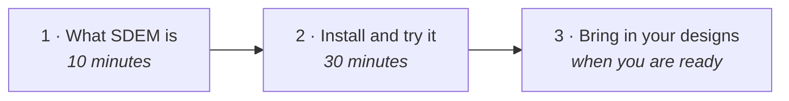

# SDEM documentation

> **Status: current (v0.18.0)** — start here. Everything on this page is written for people who will use or run SDEM; nothing assumes you know it already.

## New to SDEM? Read these, in order

| | Read | For |
|---|---|---|
| 1 | [**SDEM — read this first**](sdem-overview.md) | what SDEM is, the five ideas behind it, a worked example |
| 2 | [**Explore your architecture**](sdem-workbench-user-guide.md#4a-explore-your-architecture--home-dashboard-and-graph) | the synthetic Payments example in five minutes: SDEM Home, the workspace dashboard and the architecture graph; trace, impact, a proposed connection — then [**architect tasks**](sdem-workbench-user-guide.md#4b-architect-tasks--what-you-can-do-by-goal), everything you can do by goal |
| 3 | [**User guide**](sdem-workbench-user-guide.md) | install, a 15-minute quick start, every task step by step, **the command reference** (§7), troubleshooting |
| 4 | [**Onboarding your existing designs**](sdem-onboarding-workflow.md) | turning a Confluence export, a folder, or Word and Excel designs into SDEM data, step by step |
| 5 | [**Scenarios**](sdem-scenarios.md) | 15 jobs end to end — set up an organisation, a new design, onboarding, linking, change events, requirements, standards and patterns, narratives, BIAN, upgrades: the commands in order and who decides |
| — | [**CLI reference**](reference/cli-reference.md) | every command and subcommand with all its options — generated from the code |
| — | [Glossary](glossary.md) | any word you do not know |

**Running a pilot?** The [first-time architect usability test](sdem-usability-test-plan.md) — five scenarios, a facilitator script and a recording template.

## More tasks

| Read | For |
|---|---|
| [Ways of working](sdem-ways-of-working.md) | using SDEM directly with the CLI, or through an AI agent that reads and writes your documents — and what is planned |
| [Designing with AID](sdem-planning-with-aid.md) | a new design: write what you know, `sdem aid` fills in the missing layers — each record marked *inferred*, with source, reasoning and confidence, for you to confirm or reject |

## Understanding SDEM

| Read | For |
|---|---|
| [The metamodel in plain words](sdem-metamodel-guide.md) | the kinds of thing, the nine connections between layers, how sure SDEM is, what it refuses |
| [SDEM architecture](sdem-architecture.md) | the parts, where every file lives, how a change flows, what checks it, limits |

## Setting it up and running it

| Read | For |
|---|---|
| [Using SDEM — free for any organisation](sdem-licence-and-use.md) | the licence in plain words: what anyone may do, what SDEM contains from others, what it does not claim; enterprise use and customisation |
| [Privacy and data handling](../PRIVACY.md) | what SDEM reads, writes and stores; what optional tools around it may send |
| [Adoption checklist](sdem-adoption-checklist.md) | what your organisation clears first: legal and licences, data, security, AI, and depending on an open-source tool |
| [Operating model](sdem-operating-model.md) | where things live, who does what, how changes and upgrades flow, support |
| [Configuration](sdem-configuration.md) | everything you can set: workspaces, the SDEM version, how onboarding reads designs, OCR, reviewers, CI, VS Code, Copilot |
| [Administration](sdem-administration.md) | installing, upgrading, metamodel changes, backups, health, troubleshooting |
| [Repository protection](sdem-repository-protection.md) | branch protection and code owners, so a person's approval is enforced |
| [AI agent setup](sdem-agent-setup.md) · [agent spike checklist](sdem-agent-platform-spike.md) · [readiness assessment](evidence/agent-cli-readiness.md) · [impact validation](evidence/impact-validation.md) · [requirements and risk](evidence/requirements-risk.md) · [governance — who decided, and how far it can be trusted](design/sdem-governance.md) · [organisation profiles — your own specs on top of SDEM](design/sdem-profile-spec.md) · [layers your team adds above A1 or below A4](design/sdem-layers-spec.md) · [create a new design](sdem-new-design.md) · [updating SDEM safely](design/sdem-update-framework.md) · [metamodel health and stability](design/sdem-metamodel-stability.md) · [`sdem types` and `sdem bian search`](design/sdem-types-search-spec.md) | using SDEM with an AI agent — GitHub Copilot, Claude Code, OpenAI Codex, Gemini CLI — or with SDEM's own Copilot agents (optional); the checklist to try them; how far each platform is proven |
| [Pilot plan](sdem-pilot-plan.md) | the first ten weeks on real designs |
| [Workspace repository template](../templates/workspace-repo/README.md) · [Security](../SECURITY.md) | your private repository for real data · keeping data safe |

## Looking something up

| Read | For |
|---|---|
| [Reference](reference/README.md) | generated from the metamodel: every kind of thing and attribute, the data models, the controls register, sources |

---

## For builders and reviewers — you do not need these to use SDEM

| Folder | Holds | Read it if you |
|---|---|---|
| [`design/`](design/README.md) | every design and specification, the governing specs, the roadmap, the reasoning behind the rules | change SDEM, review the metamodel, or want to know *why* |
| [`evidence/`](evidence/README.md) | the use-case examples and test records, with their recorded results | want proof that something was tested |
| [`history/`](history/README.md) | documents that are no longer current | are tracing how SDEM got here |

Maintaining SDEM: [CONTRIBUTING.md](../CONTRIBUTING.md).
