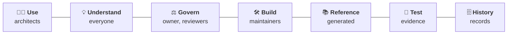

# SDEM documentation — where to read what

Find your role, start at the top of its list. **Generated** documents are rebuilt from the rulebook (`sdem model regenerate`) — never edit them by hand; **history** documents are records of how SDEM got here and are kept as written.

## 🧑‍💼 Use — architects

| Read | For |
|---|---|
| [`sdem-workbench-user-guide.md`](sdem-workbench-user-guide.md) | **start here**: set-up, the workbench screen, a 15-minute quick start, every command, workflow examples, troubleshooting |
| [`sdem-onboarding-workflow.md`](sdem-onboarding-workflow.md) | **onboarding your existing designs** (Confluence): the commands in plain words, every step with what you will see, gaps |
| [`sdem-copilot-setup.md`](sdem-copilot-setup.md) | GitHub Copilot, VS Code, the agents, prompts and skills |
| [`glossary.md`](glossary.md) | every term in plain words |

## 💡 Understand — everyone

| Read | For |
|---|---|
| [`../README.md`](../README.md) | what SDEM is, in pictures — the three layers, how it works, what is built |
| [`sdem-overview.md`](sdem-overview.md) | the concepts: principles, components and boundaries, the four things that look alike, a worked example |
| [`knowledge-graph-design.md`](knowledge-graph-design.md) | how the local and federated knowledge graphs are built and queried |
| [`sdem-agent-platform-principles.md`](sdem-agent-platform-principles.md) | what makes a good agent platform, and how SDEM measures up |

## ⚖️ Govern — owner and reviewers

| Read | For |
|---|---|
| [`architecture-metamodel-high-level-spec.md`](architecture-metamodel-high-level-spec.md) | the owner's frozen reference specification (pinned) |
| [`architecture-metamodel-detail-level-spec.md`](architecture-metamodel-detail-level-spec.md) | **the governing specification** (generated): the high-level spec section by section, with the detail and the gap register |
| [`controls-register.md`](controls-register.md) | every control: what it enforces, where it runs, its last result (generated) |
| [`architecture-governance-spec.md`](architecture-governance-spec.md) | approval, supersession, impact |
| [`sdem-repository-protection.md`](sdem-repository-protection.md) | branch protection and code owners — so a person's approval is a control |
| [`reference-architecture-provenance.md`](reference-architecture-provenance.md) | every entity type traced to a public standard |
| [`baseline/SDEM-METAMODEL-0.8-review-pack.md`](baseline/SDEM-METAMODEL-0.8-review-pack.md) | the 0.8 baseline, awaiting independent review |
| [`PUBLICATION_CHECKLIST.md`](PUBLICATION_CHECKLIST.md) · [`ROADMAP.md`](ROADMAP.md) | legal and IP before publication · releases and what is next |

## 🛠️ Build — maintainers

Each feature has a **design** (why and how) and a **spec** (numbered, testable requirements). Start with [`../CONTRIBUTING.md`](../CONTRIBUTING.md).

| Feature | Design | Spec |
|---|---|---|
| The workbench (VS Code, CLI, Copilot) | [`sdem-workbench-design.md`](sdem-workbench-design.md) | [`sdem-workbench-spec.md`](sdem-workbench-spec.md) |
| Graph store | [`graph-store-design.md`](graph-store-design.md) | [`graph-store-spec.md`](graph-store-spec.md) |
| Dashboards (`sdem dashboard`, `sdem home`) | [`sdem-dashboard-design.md`](sdem-dashboard-design.md) | [`sdem-dashboard-spec.md`](sdem-dashboard-spec.md) |
| Planning missing layers (AID) | [`aid-design.md`](aid-design.md) | [`aid-spec.md`](aid-spec.md) |
| Design onboarding — transform | [`sdem-transform-design.md`](sdem-transform-design.md) | [`sdem-transform-spec.md`](sdem-transform-spec.md) |
| Design onboarding — load, gap records | [`sdem-load-design.md`](sdem-load-design.md) | [`sdem-load-spec.md`](sdem-load-spec.md) |
| Agent platform | [`sdem-agent-platform-design.md`](sdem-agent-platform-design.md) · [spike](sdem-agent-platform-spike.md) | [`sdem-agent-platform-spec.md`](sdem-agent-platform-spec.md) |
| Relationship registry | — | [`relationship-registry-spec.md`](relationship-registry-spec.md) |

## 📚 Reference — generated from the rulebook

| Read | For |
|---|---|
| [`relationship-rules-spec.md`](relationship-rules-spec.md) | the engine's rules (69), decisions and requirements |
| [`knowledge-graph-spec.md`](knowledge-graph-spec.md) | the graphs' requirements, components and services |
| [`architecture-entity-design.md`](architecture-entity-design.md) · [`architecture-attribute-design.md`](architecture-attribute-design.md) | every entity type (44) and attribute, with source, reasoning and confidence |
| [`logical-data-model.md`](logical-data-model.md) · [`physical-data-model.md`](physical-data-model.md) | the data model: one card per entity; one JSON Schema per entity |
| [`relationships-planning.md`](relationships-planning.md) | every link allowed inside an architecture (132) |
| `architecture-model-diagram.puml` · `architecture-metamodel-detail-level-spec.puml` | the diagrams |

## 🧪 Test — evidence

| Read | For |
|---|---|
| [`use-case-example-1.md`](use-case-example-1.md) | four datasets to mappings and the knowledge graph — 30 of 30 |
| [`use-case-example-2.md`](use-case-example-2.md) | planning missing layers (AID) — 12 of 12, safety 16 of 16 |
| [`use-case-example-3.md`](use-case-example-3.md) | the agents carry a technology change to an approved link — 8 of 8, controls 19 of 19 |
| [`use-case-example-4.md`](use-case-example-4.md) | onboarding existing designs, export to build — the test script (replayed on every push) |
| [`relationships-testing.md`](relationships-testing.md) | how the 132 within-level rows were tested |
| `evidence/` | the recorded inputs and outputs of each example run |

## 🗄️ History — records, kept as written

They use the old names (SDMM, *mapping*, `sdem-graph` …); see [`history/renamed-from-sdmm.md`](history/renamed-from-sdmm.md).

| Read | For |
|---|---|
| [`BIAN_SDEM_Design_Specification.md`](BIAN_SDEM_Design_Specification.md) | the original design |
| [`mapping-logic-planning.md`](mapping-logic-planning.md) · [`mapping-execution.md`](mapping-execution.md) | how the rules were planned and hand-executed (v0.5–v0.6) |
| [`use-case-testing.md`](use-case-testing.md) · [`inference-audit.md`](inference-audit.md) | the hand-executed test runs; the 2026-10-23 inference audit |
| `drafts/` | the A1–A4 data-model reviews (approved 2026-10-24/25) |
| [`history/`](history/) | early notes (v0.4–v0.5): first mapping notes, the reference-model boundary, data architecture, engine readiness; the SDMM rename |
