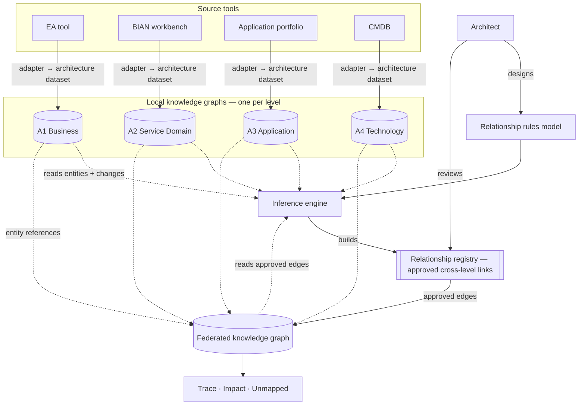
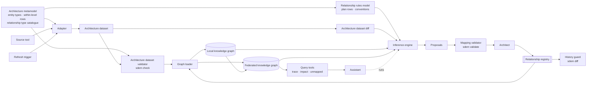

# SDEM Knowledge Graph Specification — local and federated graphs

> New to SDEM? Read `docs/sdem-overview.md` first — it explains how the local knowledge graphs, relationship rules model, inference engine, relationship registry and federated knowledge graph fit together.

> How the graphs are built and queried, in plain terms: `docs/design/knowledge-graph-design.md`.

Generated from the schemas and records by `python -m sdem.kgspec`; the test suite checks it is current. Companion to `docs/design/relationship-rules-spec.md`, which specifies the engine. This document specifies the graphs: what each holds, how its nodes and edges are shaped, how identity and versions work, what queries it must answer, and how it is loaded. Requirements carry `KG-*` IDs; each says whether it is **built** (in `sdem/graph.py` and the validators) or **not built**.

## 1. Architecture

Four **local knowledge graphs**, one per architecture level, each owned by the team that governs that level, and one **federated knowledge graph** that holds only the approved links between levels and resolves each link's ends into the local knowledge graphs. The federated knowledge graph never copies a local knowledge graph's content and never holds a proposal. Architects design and manage the **relationship rules model** (the cross-level rules); the engine reads both kinds of graph, applies that model and **builds the relationship registry**; architects review its output, and only approved records become federated edges.



| Graph | Holds | Owner | Source | Built from |
|---|---|---|---|---|
| A1 Business Architecture local knowledge graph | the level's entity instances and the links inside the level | business architecture | EA tool — capability, value-stream and process models | one architecture dataset (`schema/level-model.schema.json`) |
| A2 Service Domain Architecture local knowledge graph | the level's entity instances and the links inside the level | BIAN alignment (enterprise architecture) | BIAN workbench / the bank's BIAN alignment | one architecture dataset (`schema/level-model.schema.json`) |
| A3 Application Architecture local knowledge graph | the level's entity instances and the links inside the level | application architecture | application portfolio, API catalogue, data models | one architecture dataset (`schema/level-model.schema.json`) |
| A4 Technology Architecture local knowledge graph | the level's entity instances and the links inside the level | infrastructure / platform engineering | CMDB, deployment manifests | one architecture dataset (`schema/level-model.schema.json`) |
| Federated knowledge graph | approved cross-level edges, and references to their ends in the local knowledge graphs | enterprise architecture | the relationship registry | the relationship registry (`schema/relationship-registry.schema.json`) joined to the four local knowledge graphs |


| ID | Requirement | Status |
|---|---|---|
| KG-A-01 | Hold each level in its own local knowledge graph, loaded only from that level's architecture dataset; a change in one level never requires reloading another. | built (in memory; persisted by the graph store, `sdem build`) |
| KG-A-02 | Hold in the federated knowledge graph only approved cross-level edges and references to their ends; never copy local content; never hold a proposed, rejected or superseded record as an edge used for answers. | built (in memory; persisted by the graph store, `sdem build`) |
| KG-A-03 | The engine reads the four local knowledge graphs (entities, within-level links, and what changed since the last baseline) and the federated knowledge graph (approved edges), read-only; it never writes to either. Approved edges stop it re-proposing what exists and are the inputs to its step-3 derivations. | partly built (reads architecture datasets and approved mappings directly; change-since-baseline not built) |

## 2. Local knowledge graphs

### 2.1 Node schema (every level)

One node per instance in the architecture dataset. Fields from `schema/level-model.schema.json` › `instance`:

| Field | Type | Required | Note |
|---|---|---|---|
| `id` | string | yes | node key; see §4 identity |
| `type` | string | yes | an entity from the catalogue; concrete, never abstract or artefact |
| `version` | string | yes | the instance's version, matched by mapping ends |
| `name` | string | yes |  |
| `lifecycle_status` | planned, active, deprecated, retired | no |  |
| `canonical_id` | string | no | the external reference identity (e.g. a BIAN id) on A2 nodes |
| `attributes` | object | no | level-specific properties, including the join keys of §2.3 |
| `description` | string | no | Plain-language description of this instance; the text a inference engine reads |
| `definition_uri` | string | no | Where the authoritative description lives in the institution's tooling |

Graph header fields (one per local knowledge graph): `level`, `model_id`, `model_version`, `metamodel_version`, `source_system` — `model_version` is the local knowledge graph's version (§5).

### 2.2 Edge schema (every level)

One edge per relationship in the architecture dataset, from `relationship`:

| Field | Type | Required |
|---|---|---|
| `source` | string | yes |
| `kind` | string | yes |
| `target` | string | yes |
| `name` | string | no |

### 2.3 Node and edge types per level

| Level | Node types (concrete) | Edge rows | Join-key properties |
|---|---|---|---|
| A1 Business Architecture | 10: BusinessCapability, ValueStream, ValueStreamStage, BusinessProcess, BusinessActivity, BusinessService, BusinessActor, BusinessRole, BusinessObject, BusinessRequirement | 48 (`RA1-01` …) | BusinessActivity.invokes, BusinessCapability.description, BusinessObject.attributes, BusinessObject.field_aliases, BusinessProcess.invokes, BusinessRequirement.applies_to, BusinessService.inputs, BusinessService.outputs, ValueStream.stages |
| A2 Service Domain Architecture | 12: BusinessArea, BusinessDomain, ServiceDomain, FunctionalPattern, AssetType, ControlRecord, ServiceGroup, ServiceOperation, BehaviorQualifier, BusinessScenario, BusinessObject, BusinessObjectAttribute | 17 (`RA2-01` …) | AssetType.aliases, BehaviorQualifier.aliases, BusinessObject.attributes, BusinessScenario.operation_sequence, ControlRecord.attributes, ControlRecord.lifecycle_states, ServiceDomain.asset_type, ServiceDomain.functional_pattern, ServiceOperation.action_term, ServiceOperation.behavior_qualifier, ServiceOperation.input_attributes, ServiceOperation.output_attributes |
| A3 Application Architecture | 8: ApplicationComponent, ApplicationService, ApplicationInterface, ApplicationFunction, APIOperation, DataEntity, Event, SolutionBuildingBlock | 31 (`RA3-01` …) | APIOperation.method, APIOperation.path, APIOperation.payload_fields, ApplicationComponent.built_as, ApplicationComponent.deployed_as, ApplicationComponent.deployed_on, ApplicationComponent.network_zone, ApplicationFunction.consumes, ApplicationFunction.exposed_through, ApplicationInterface.exposed_through, ApplicationInterface.field_aliases, ApplicationService.consumes, DataEntity.attributes, DataEntity.field_aliases, DataEntity.stored_in, Event.published_to, SolutionBuildingBlock.components |
| A4 Technology Architecture | 10: Deployment, DeploymentEnvironment, Node, Device, SystemSoftware, TechnologyService, TechnologyInterface, CommunicationNetwork, Path, Artifact | 36 (`RA4-01` …) | Artifact.of_component, CommunicationNetwork.connects, Deployment.component_id, Deployment.environment_id, Deployment.platform_id, Device.hosts, Node.hosts, Path.carries, Path.from, Path.network, Path.to, SystemSoftware.hosts, TechnologyInterface.exposes, TechnologyInterface.of_service |

Every allowed edge is a row in `metamodel/level-relationships.json`, listed with ID, source, reasoning and verification in `docs/reference/relationships-planning.md`. `association` is allowed between any two nodes of one level.

### 2.4 Local knowledge graph requirements

| ID | Requirement | Status |
|---|---|---|
| KG-L-01 | Accept a node only if its `type` resolves to a concrete, non-artefact catalogue entity of the graph's level. | built |
| KG-L-02 | Accept an edge only if both ends are nodes of this graph and (source type, kind, target type) matches a constraint row of the level through inheritance, or the kind is `association`. | built |
| KG-L-03 | Reject the whole architecture dataset, and keep the previously loaded local knowledge graph, if any node or edge fails; report every failure. | built |
| KG-L-04 | Answer within-level queries on its own: neighbours by kind, part-whole closure (composition, aggregation), and nodes by type and lifecycle status. | partly built (closure in trace); `sdem query --neighbours/--type/--where` (graph store, GS-Q-02/03) |

## 3. Federated knowledge graph

### 3.1 Edge types — the nine catalogued relationship types

| Relationship | Source node type → target node type | Cardinality | Perspective | Authority |
|---|---|---|---|---|
| `SUPPORTED_BY` (CAPABILITY_SUPPORTED_BY_DOMAIN) | A1.BusinessCapability → A2.ServiceDomain | many to many | architecture | bian_alignment_guidance |
| `ALIGNED_TO` (VALUE_STREAM_ALIGNED_TO_SCENARIO) | A1.ValueStream → A2.BusinessScenario | many to many | process | bian_alignment_guidance |
| `USES_DOMAIN` (PROCESS_USES_DOMAIN) | A1.BusinessProcess → A2.ServiceDomain | many to many | process | enterprise_rule |
| `ALIGNED_TO` (BUSINESS_OBJECT_ALIGNED_TO_BIAN_OBJECT) | A1.BusinessObject → A2.BusinessObject | many to many | information | bian_alignment_guidance |
| `REALIZED_BY` (DOMAIN_REALIZED_BY_COMPONENT) | A2.ServiceDomain → A3.ApplicationComponent | many to many | architecture | enterprise_rule |
| `IMPLEMENTED_BY` (OPERATION_IMPLEMENTED_BY_API) | A2.ServiceOperation → A3.APIOperation | many to many | architecture | enterprise_rule |
| `MAPPED_TO` (BIAN_OBJECT_MAPPED_TO_DATA_ENTITY) | A2.BusinessObject → A3.DataEntity | many to many | information | enterprise_rule |
| `DEPLOYED_ON` (COMPONENT_DEPLOYED_ON_INFRASTRUCTURE) | A3.ApplicationComponent → A4.InfrastructureComponent | many to many | architecture | enterprise_rule |
| `DEPLOYED_AS` (COMPONENT_DEPLOYED_AS_DEPLOYMENT) | A3.ApplicationComponent → A4.Deployment | many to many | architecture | enterprise_rule |

Adjacent levels only (A1→A2, A2→A3, A3→A4). A level-skipping answer is a path, never a stored edge. The 41 candidate and derived rows of the plan are never federated edges.

### 3.2 Edge schema

One edge per approved mapping record; its fields become the edge's properties (`schema/relationship-registry.schema.json` › `mapping`):

| Field | Type | Required |
|---|---|---|
| `mapping_id` | string | yes |
| `source` | entity | yes |
| `target` | entity | yes |
| `relationship` | string | yes |
| `perspective` | process, information, architecture | no |
| `status` | proposed, validated, needs_review, approved, rejected, superseded | yes |
| `evidence` | array | yes |
| `rationale` | string | yes |
| `baseline_id` | string | yes |
| `confidence` | number | no |
| `bian_release` | string | no |
| `reviewer_id` | string | no |
| `created_by` | string | no |
| `approved_at` | string | no |
| `valid_from` | string | no |
| `valid_to` | string | no |
| `previous_mapping_id` | string | no |

Each end (`source`, `target`) is a reference, not a copy: `id`, `type`, `version`, `canonical_id`, `source_system`, `source_entity_id`.

### 3.3 Resolving an edge's ends

1. The end's `type` prefix names the level, and therefore the local knowledge graph.
2. The local knowledge graph must contain a node with that `id` and `version`.
3. The node's concrete type must be the end's `type` or a descendant of it (is-a) — so a `DEPLOYED_ON` edge to `A4.InfrastructureComponent` resolves to a node, system software or device.
4. An end that does not resolve makes the edge unresolved: reported, not used.

### 3.4 Federated knowledge graph requirements

| ID | Requirement | Status |
|---|---|---|
| KG-F-01 | Load an edge only from a record with `status: approved`; keep the other statuses in the relationship registry for history but never in answers unless a query asks for them explicitly. | built (`--status`) |
| KG-F-02 | Resolve every edge end into its local knowledge graph by level prefix, id, version and is-a; report unresolved ends and exclude those edges. | built (`sdem check`) |
| KG-F-03 | Store only adjacent-level edges of the nine catalogued relationship types; derive level-skipping answers as paths with the mapping id of every hop. | built |
| KG-F-04 | Collapse duplicate edges between the same two nodes with the same relationship into one answer hop listing every mapping id. | built |

## 4. Identity

The federated knowledge graph points into the local knowledge graphs by id. These rules keep those pointers valid.


| ID | Requirement | Status |
|---|---|---|
| KG-I-01 | A node id is unique within its level and stable for the life of the thing it names; it is never reused for a different thing, even after retirement. | not enforced (uniqueness within an architecture dataset is checked; stability across versions is not) |
| KG-I-02 | A rename changes `name`, never `id`. A genuine re-keying in a source tool is handled as retire-and-add: the old node is retired, the new one added, and the mappings to the old one are superseded by mappings to the new one. | not built (needs architecture dataset diff) |
| KG-I-03 | A2 nodes that correspond to a BIAN concept carry `canonical_id`; the federated edge's A2 end repeats it, and BIAN-authority edges require it before approval. | built |
| KG-I-04 | Institution aliases (asset-type, qualifier, field and glossary aliases) are node attributes, never alternative ids. | built (convention) |

## 5. Versions and baselines

| Thing | Versioned by | Meaning |
|---|---|---|
| A node | `version` | the instance's own version, which an edge end pins |
| A local knowledge graph | `model_version`, `metamodel_version` | which architecture dataset and which catalogue it was built from |
| An edge | `baseline_id`, `valid_from` / `valid_to`, `previous_mapping_id` | which release it belongs to, its validity, and what it replaced |
| The federated knowledge graph | the set of (local knowledge graph `model_version` ×4, relationship-registry commit) it was loaded from | one reproducible state |


| ID | Requirement | Status |
|---|---|---|
| KG-V-01 | Record, for every federated load, the four local `model_version`s and the relationship-registry version used — the load's baseline — and return it with every answer. | built (graph store) |
| KG-V-02 | Keep earlier baselines queryable, so an impact analysis can be rerun against the state it was originally run on. | built (graph store) |
| KG-V-03 | Never edit an approved edge; change is a new edge with `previous_mapping_id` and the old one `superseded`. | built |
| KG-V-04 | Reject a federated load where the four local knowledge graphs disagree on `metamodel_version`. | built |

## 6. Queries the graphs must answer

| Query | Must answer | Implemented by | Status |
|---|---|---|---|
| KG-Q-01 Trace | from any node, follow approved edges down (towards A4) or up (towards A1), optionally through within-level part-whole links; every hop shows the mapping id | `sdem trace`, `--follow-composition` | built |
| KG-Q-02 Impact | given a node and a change kind (modify, replace, retire, rehost), classify every dependent node design_change_required / review_required / no_impact and list the edges to supersede | `sdem impact`, impact-rules.json | built |
| KG-Q-03 Check | validate the four local knowledge graphs and the federated edges; report every unresolved or disallowed item | `sdem check` | built |
| KG-Q-04 Unmapped | list nodes of a level with no approved cross-level edge where the plan expects one — the engine's work list | `sdem query --unmapped` (GS-Q-04) | built |
| KG-Q-05 History | for an edge or a node, list its superseded predecessors and the baselines it appeared in | relationship-registry history | not built |
| KG-Q-06 Stats | counts of nodes, edges and statuses per level | `sdem stats` | built |
| KG-Q-07 Climb to the whole | an upward trace with part-whole following also climbs from a part to its whole inside a level (an API operation's operation to its Service Domain), so a trace from an API reaches the capability | knowledge-graph-design.md, limit of path F2 | not built |

## 7. Load and refresh

```
source tool → adapter → architecture dataset → validate (local) → load local knowledge graph
                                                  ↓
relationship registry (approved records) → validate → resolve ends → load federated knowledge graph → record baseline
```

| Step | Requirement | Status |
|---|---|---|
| KG-R-01 | An adapter per source tool translates its records to an architecture dataset; adapters are institution-specific and live in the institution's private repository. | not built (examples are hand-written architecture datasets) |
| KG-R-02 | A local knowledge graph is rebuilt in full from its architecture dataset; incremental update is an optimisation, not a requirement. | built (full rebuild) |
| KG-R-03 | A failed architecture dataset validation leaves the previous local knowledge graph in place and raises an alert. | built (graph store: rejected build recorded, store unchanged) |
| KG-R-04 | The federated knowledge graph is rebuilt whenever a local knowledge graph or the relationship registry changes. | built (rebuilt on every run) |
| KG-R-05 | The refresh trigger is configurable per source: on demand, scheduled, event-driven, or refresh-on-read (§12 DEC-02). | not built |

## 8. Components and dependencies

Every component the local and federated graphs depend on to be built, updated and changed: what it reads, what it writes, what it needs first, where it lives, and whether it exists.



| ID | Component | Does | Reads | Writes | Depends on | Lives in | Status |
|---|---|---|---|---|---|---|---|
| C-01 | Architecture Metamodel | the entity types (`a1…a4-*.json`), the within-level rows (`level-relationships.json`) and the relationship type catalogue — the nine cross-level relationship types (`relationship-types.json`) — with `impact-rules.json` | SDEM model owner's edits | the rules every other component applies | — | `metamodel/`, `schema/` | built |
| C-01b | Architecture Relationship Rules Model | the rules the inference engine applies to establish relationships of the nine catalogued types: the plan rows with their steps, thresholds, evidence and confidence, and the join keys and alias conventions — **designed and managed by architects** | architects' edits | the rules C-08 applies | C-01 | `relationship-rules.json`, `export-conventions.json` | built (as records; an editing interface is not built) |
| C-02 | Source tool | the institution's system of record for one level | its users | its own records | — | institution | external |
| C-03 | Adapter | extract, translate to SDEM entities and keys, write the architecture dataset | C-02; C-01 (catalogue and conventions) | one architecture dataset | C-01, C-02 | institution's private repository | not built (examples hand-written; `sdem/structure.py` is the one generator) |
| C-04 | Architecture dataset | the file a local knowledge graph is built from | C-03 | — | C-03 | `examples/*/a[1-4]-*.json` (stand-ins) | built (format); schema `level-model.schema.json` |
| C-05 | Architecture dataset validator | checks an architecture dataset against C-01, including the data model: attribute types, allowed values, references, keys and link counts (logical rules LC-04…LC-13) | C-04, C-01 | pass, or every failure | C-01, C-04 | `sdem check` (`LevelGraph`, `sdem/conformance.py`) | built |
| C-06 | Graph loader | rebuilds local knowledge graphs from architecture datasets and the federated knowledge graph from the relationship registry; records the baseline | C-04 (validated), C-09 | local knowledge graphs, federated knowledge graph | C-05, C-09 | `sdem/graph.py` (`LevelGraph`, `FederatedGraph`) | built in memory; persistence and baselines not built |
| C-07 | Architecture dataset diff | compares a new architecture dataset with the last loaded one: added, removed, changed instances and links | two versions of C-04 | a change list | C-04 | — | not built |
| C-08 | Engine | applies the relationship rules model (C-01b) to the local knowledge graphs and **builds the relationship registry**: new links for what changed, re-checks of approved links, with evidence and confidence | local knowledge graphs, federated knowledge graph, C-07, C-01, C-01b | relationship registry records (status `proposed`, or `approved` where the rule is auto-approved under `enterprise_rule`), candidate reports, inference log | C-06, C-07, C-01b | `sdem/rules_engine.py` (`sdem link`); acceptance `sdem/acceptance.py` | built (v0.10): all 8 acceptance cases pass |
| C-09 | Relationship registry | the cross-level links with status and evidence — built by the engine from the relationship rules model; hand-made links are an exception, recorded with `created_by` naming the architect | C-08 output; architect decisions | — | C-08, C-11 | `examples/*/mappings.json`; schema `relationship-registry.schema.json` | built |
| C-10 | Mapping validator | checks proposals and the relationship registry: registry, evidence, anchoring | C-09, C-01 | pass, or every failure | C-01 | `sdem validate` | built |
| C-11 | Architect review | reviews the engine's output: approves, rejects or supersedes records; corrects the relationship rules model (C-01b) when a rule produces a wrong link, rather than hand-editing the set | validated proposals; impact reports | status changes in C-09 | C-10, C-14 | a person; recorded as fields | built (as fields); review queue not built |
| C-12 | History guard | rejects edits to approved records and invalid status transitions | two versions of C-09 | pass, or every violation | C-09 | `sdem diff` | built |
| C-13 | Local knowledge graphs, federated knowledge graph | the graphs themselves | C-06 | — | C-06 | `sdem/store.py`; local JSON graph store (JGF v2), `examples/*/graph/` | built (DEC-01: local JSON files) |
| C-14 | Query tools | trace, impact, check, stats, query (records, neighbours, unmapped), view | C-13 | answers with mapping ids and the baseline | C-13 | `sdem check`, `sdem trace` | built (history not built) |
| C-15 | Refresh trigger | decides when C-03 and C-06 run: on demand, scheduled, event, refresh-on-read | source events or queries | runs | C-03, C-06 | — | not built (on demand only) |
| C-16 | Assistant | answers design questions from C-14; runs C-08 and C-10 on request | C-14 answers | proposals via C-08 only | C-14, C-08 | per DEC-04 — GitHub Copilot Chat (SDEM workbench) | not built — Copilot instructions and prompt files (WB-C01…C03) |
| C-17 | Generators and CI | regenerate documents, diagrams, per-entity schemas and the reference-structure estate from C-01; fail the build if any is stale; rerun acceptance cases | C-01 | generated files; pass / fail | C-01 | `sdem/diagram.py`, `relationships.py`, `structure.py`, `spec.py`, `kgspec.py`, `catalogue.py`, `attributes.py`, `logical.py`, `physical.py`, `confidence.py`; `.github/workflows/validate.yml` | built |
| C-18 | AID projector | Architecture Inference Design: projects missing layers forward or reverse from the datasets an architect has, using C-01b rules and BIAN patterns; writes a projection package kept apart from C-09 and C-13; gap analysis against real data | C-04 (one or more levels), BIAN reference catalogue, C-01, C-01b | projection package (`PRJ-` records and links, inference confidence) | C-01, C-01b | `sdem/aid.py` (`sdem aid project`, `check`, `gaps`); `docs/design/aid-spec.md` | built — with `schema/projection.schema.json` and the view and trace overlay |

### 8.1 Component requirements

| ID | Requirement | Status |
|---|---|---|
| KG-C-01 | Build an adapter (C-03) per source tool that writes a valid architecture dataset and fails loudly rather than writing a partial one. | not built |
| KG-C-02 | Build the architecture dataset diff (C-07) so the engine re-checks only changed instances and removals are routed to impact and supersession. | not built |
| KG-C-03 | Build the engine step logic (C-08) to the relationship-rules spec (docs/design/relationship-rules-spec.md), accepted by reproducing the eleven executor runs. | not built |
| KG-C-04 | Provide a review queue for C-11 that lists proposals and pending supersessions with their evidence and impact. | not built |

## 9. Change workflows — which components run for each change

| Change | Example | Components, in order | Human step |
|---|---|---|---|
| Model structure | a new entity kind, relationship row or join key | C-01 edit → C-17 regenerate and test → C-03 updated to emit it → C-04 → C-05 → C-06 | model owner decides; adapter maintainer updates the translation |
| Instance added | a new API operation appears | C-15 → C-03 → C-04 → C-05 → C-06 (local) → C-07 → C-08 → C-10 → C-11 → C-12 → C-06 (federated) | approve the proposals |
| Instance removed or retired | a platform is decommissioned | C-15 → C-03 → C-04 → C-05 → C-06 (local) → C-07 → C-14 impact → C-11 supersede → C-12 → C-06 (federated) | confirm the supersessions |
| Instance attributes changed | an API path or a table's columns change | C-03 → C-04 → C-05 → C-06 → C-07 → C-08 re-checks dependent mappings | only if an approved mapping no longer holds |
| Within-level link changed | a process gains an activity | C-03 → C-04 → C-05 → C-06 | none; derived paths recompute |
| Instance re-keyed in its tool | an application gets a new id | as removed + added, then C-11 supersedes the old mappings with new ones (KG-I-02) | approve the replacements |
| Mapping approved, rejected or superseded | an architect reviews the queue | C-11 → C-09 → C-10 → C-12 → C-06 (federated) | the decision itself |
| Mapping rule changed | a threshold, alias convention or a rule that produced a wrong link | C-01b edit → C-17 (acceptance cases rerun and scored) → C-08 rebuilds the affected relationship registry records → C-11 | architect adopts the rule only if the scores hold |
| BIAN release | a new Service Landscape version | C-01 (A2 rows and catalogue) → C-03 for A2 → C-04 → C-05 → C-06 → C-07 → C-08 → C-11 | review changed A2 mappings |

Every workflow ends with C-06 rebuilding the graphs; no component edits a graph in place.

## 10. Governance boundary

| Actor | May | May not |
|---|---|---|
| Level owner | change its source tool; publish a new architecture dataset | write federated edges |
| Engine | read local knowledge graphs and approved edges; apply the relationship rules model; build relationship registry records (proposed, or approved only under an architect-declared `enterprise_rule`) | change the relationship rules model; write to any graph |
| Architect | design and manage the relationship rules model; review, approve, reject or supersede mapping records; declare which rules are auto-approved | edit an approved record |
| Agent (assistant) | query the graphs; run the engine and validators | approve; write to any graph or relationship registry |
| Graph loader | rebuild graphs from architecture datasets and the relationship registry | change any input |


| ID | Requirement | Status |
|---|---|---|
| KG-G-01 | Only an architect action sets `approved`; no automated component, engine or agent may. | built (convention; validator requires reviewer_id and approved_at) |

## 11. Service specifications

One subsection per service the graphs depend on. Each gives the purpose, interface, inputs, behaviour, outputs and errors, what it records, and its status. **SVC-01** is specified from the code as it runs today, with target behaviour marked; the others are target design.

| ID | Service | Component | Status |
|---|---|---|---|
| SVC-01 | Graph loader | C-06 | built in memory (`sdem/graph.py`); built: persisted to the graph store with its load record and failure handling (`sdem build`, `sdem/store.py`; graph-store-spec.md) |
| SVC-02 | Adapter contract | C-03 | not built — adapters are institution-specific; `sdem/structure.py` is the one generator in this repository |
| SVC-03 | Architecture dataset diff | C-07 | not built |
| SVC-04 | Refresh trigger | C-15 | not built (on demand only: someone runs a command) |
| SVC-05 | Query service | C-14 | built as commands with `--json`; a programmatic interface and the history, unmapped and local queries are not built |
| SVC-06 | Review queue | C-11 | not built (today: architects edit the relationship-registry file; `sdem diff` guards history) |
| SVC-07 | Assistant access | C-16 | not built — transport per DEC-04 (CLI run by the assistant, VS Code extension, context snapshot, or MCP where allowed) |

### 11.1 SVC-01 Graph loader (C-06)

**Purpose.** Build the four local knowledge graphs from their architecture datasets and the federated knowledge graph from the approved relationship registry, every time it runs; nothing else ever writes a graph.

**Status.** built in memory (`sdem/graph.py`); built: persisted to the graph store with its load record and failure handling (`sdem build`, `sdem/store.py`; graph-store-spec.md)

**Interface**

| | |
|---|---|
| Command | `sdem check <check|trace|impact|stats> [args] <files…>` — files in any order; each is classified by content |
| Library | `FederatedGraph.load(paths)` → `FederatedGraph`; `LevelGraph.load(path)` → `LevelGraph` |
| Exit codes | 0 ok · 1 issues found (or an empty trace) · 2 usage error (unreadable file, unknown command) |

**Inputs**

| Input | Detail |
|---|---|
| Architecture datasets | `a1…a4-*.json`, shape `schema/level-model.schema.json`; a file with `level` + `instances` is an architecture dataset |
| Relationship registry | `mappings.json`, shape `schema/relationship-registry.schema.json`; a file with `mappings` is a relationship registry |
| Model records | the entity catalogue, `level-relationships.json`, `relationship-types.json` — loaded from `metamodel/` and `schema/` |

**Behaviour**

| Step | Does | On failure / settings / limits |
|---|---|---|
| 1 Load the model | read the catalogue and relationship rows; all metamodel files must carry the same `metamodel_version` | stop: "metamodel files disagree" |
| 2 Classify files | architecture dataset or relationship registry, by content | stop: "neither an architecture dataset nor a relationship registry" (exit 2) |
| 3 Build local knowledge graphs | one per architecture dataset: index instances by id and version | — |
| 4 Validate each local knowledge graph | architecture dataset `metamodel_version` matches; no duplicate id@version; every type is a known, concrete, non-artefact entity of that level; every link's ends are in the architecture dataset and the link matches a relationship row (or is `association`) | each failure reported as an issue |
| 5 Validate the relationship registry | schema, registry relationship, evidence kinds, BIAN fields; each end resolved into its local knowledge graph by level, id, version and is-a | each failure reported as an issue |
| 6 Build the federated knowledge graph | the records in the requested statuses (default: `approved`) become links; duplicates between the same two nodes collapse to one hop listing every record id | — |
| 7 Answer | run the requested query on the loaded graphs | — |

**Validity.** A load is **valid** when steps 4 and 5 report no issue. `check` prints every issue and exits 1. **Today** `trace` and `impact` still answer from an invalid load, marking unresolved ends `(unresolved)`.

**Target design**

| | |
|---|---|
| Refuse invalid loads | any issue in steps 4–5 → the new graphs are discarded, the last valid graphs stay in service, an alert is raised (SVC-04 notifies) |
| Record each load | write a load record (below) for every attempt, valid or not |
| Persist | write valid graphs to the local JSON graph store (DEC-01, `sdem build`), recorded in the load record; earlier baselines stay queryable (`sdem baseline`) |

**Records**

| Field | Content |
|---|---|
| load_id | unique per attempt |
| started_at / finished_at | timestamps |
| inputs | per architecture dataset: path, `model_id`, `model_version`, content hash; the relationship registry: path and content hash (or git commit) |
| metamodel_version | of the model records used |
| result | `valid` or `rejected`, with the issue list |
| counts | nodes and links per local knowledge graph; approved links; unresolved ends |
| baseline_id | assigned when valid; returned with every answer from this load |

### 11.2 SVC-02 Adapter contract (C-03)

**Purpose.** Turn one source tool's records into one architecture dataset. Every adapter, for every tool, meets the same contract.

**Status.** not built — adapters are institution-specific; `sdem/structure.py` is the one generator in this repository

**Interface**

| | |
|---|---|
| Command | `<adapter> extract --out <file>` (writes one architecture dataset) and `<adapter> version` |
| Configuration | a translation table: source record type → SDEM entity; source field → architecture dataset key; source link type → relationship kind |

**Inputs**

| Input | Detail |
|---|---|
| Source tool | API, report or database view of the tool |
| Translation table | held with the adapter, versioned |
| Model records | the catalogue and `export-conventions.json`, to know the allowed entities and keys |

**Behaviour**

| Step | Does | On failure / settings / limits |
|---|---|---|
| 1 Extract | read the source records in scope | source unreachable → exit non-zero, no file written |
| 2 Translate | map each record and link through the translation table | an unmapped record type → listed, not guessed; the run fails if any in-scope record is unmapped |
| 3 Self-check | run the architecture dataset validator (SDEM step 4, including data-model conformance) on the result in memory | any error → fail; warnings reported |
| 4 Write atomically | write to a temporary file, then rename over the target | a partial architecture dataset is never visible |

**Validity.** An adapter succeeds only if every in-scope record is translated and the architecture dataset passes validation. **It fails loudly rather than writing a partial architecture dataset.**

**Target design**

| | |
|---|---|
| Version | `model_version` = the source tool's change marker if it has one (revision, last-modified), else the extraction timestamp; `source_system` names the tool; `version` reports the source's current marker cheaply so SVC-04 can poll |
| Identity | instance `id` is the source tool's persistent key; a renamed record keeps its id (KG-I-01, KG-I-02) |
| Scope | one adapter per tool per level; an adapter never writes mappings |

**Records**

| Field | Content |
|---|---|
| run log | start, end, source marker, records read, records written, unmapped types, result |

### 11.3 SVC-03 Architecture dataset diff (C-07)

**Purpose.** Say exactly what changed between the architecture dataset last loaded and a new one, so the engine re-checks only what changed and removals go to impact analysis.

**Status.** not built

**Interface**

| | |
|---|---|
| Command | `sdem check diff <old-architecture dataset> <new-architecture dataset> [--json]` |
| Library | `diff_exports(old, new)` → change list |

**Inputs**

| Input | Detail |
|---|---|
| Two architecture datasets of the same level and `model_id` | the last valid one (from the load record) and the new one |

**Behaviour**

| Step | Does | On failure / settings / limits |
|---|---|---|
| 1 Match instances | by `id` | — |
| 2 Classify instances | **added** (new id) · **removed** (id gone) · **retired** (`lifecycle_status` → retired) · **changed** (same id; name, version, type or attributes differ — the changed fields listed) · **unchanged** | — |
| 3 Classify links | by (source, kind, target): added · removed | — |
| 4 Flag possible re-keys | a removed and an added instance of the same type whose name and attributes match ≥ 90 % → reported as a **possible re-key**, never merged automatically | — |
| 5 List affected mappings | approved relationship registry records whose ends are removed, retired, re-keyed or changed in a join key | — |

**Validity.** The two architecture datasets must be the same level and `model_id`; otherwise the diff refuses.

**Target design**

| | |
|---|---|
| Change list format | `{level, model_id, old_version, new_version, instances: {added, removed, retired, changed: [{id, fields}], possible_rekeys: [{old, new, score}]}, links: {added, removed}, affected_mappings: [mapping_id]}` |
| Routing | added and changed → the engine; removed, retired and possible re-keys → impact (SVC-05) and the review queue (SVC-06) |

**Records**

| Field | Content |
|---|---|
| diff record | the change list, stored with the load record of the new architecture dataset |

### 11.4 SVC-04 Refresh trigger (C-15)

**Purpose.** Decide when each adapter and the graph loader run. Configured per source tool.

**Status.** not built (on demand only: someone runs a command)

**Interface**

| | |
|---|---|
| Configuration | one entry per source: `{source, level, adapter, mode, settings}` |

**Inputs**

| Input | Detail |
|---|---|
| Mode | one of the four below |
| Source version | from `<adapter> version` |

**Behaviour**

| Step | Does | On failure / settings / limits |
|---|---|---|
| On demand | a person or the assistant asks; run the adapter, then the loader | settings: none |
| Scheduled | run at a set time | settings: `cron` expression; skip if the source version is unchanged |
| Event (webhook) | the source tool calls an endpoint when it changes; run the adapter for that source | settings: endpoint path, shared secret; debounce window (e.g. 5 min) so a burst of edits runs once |
| Refresh on read | before answering a query, compare each source version with the last load; run adapters for changed sources, then load | settings: maximum staleness (e.g. 15 min) to avoid checking on every query; timeout after which the query is answered from the last valid load and says so |

**Validity.** Only one load runs at a time; a trigger that fires during a load queues one follow-up run.

**Target design**

| | |
|---|---|
| Alerts | adapter failure, rejected load, unresolved ends, a source not refreshed within its expected window |
| Recommended | event where the tool supports webhooks, scheduled otherwise; refresh on read only as a top-up (DEC-02) |

**Records**

| Field | Content |
|---|---|
| trigger log | which trigger fired, for which source, and the load_id it started |

### 11.5 SVC-05 Query service (C-14)

**Purpose.** Answer questions over the loaded graphs, read-only, with every answer citing the load it came from and the relationship registry record behind every cross-architecture step.

**Status.** built as commands with `--json`; a programmatic interface and the history, unmapped and local queries are not built

**Interface**

| | |
|---|---|
| Command (today) | `sdem trace|impact|stats … [--json]` |
| Function interface (target) | one function per query below, same parameters, returning the JSON shown; wrapped by any transport the institution chooses (CLI, HTTP, assistant tool) |

**Inputs**

| Input | Detail |
|---|---|
| Queries | **trace**(entity, direction=down|up|both, statuses=[approved], follow_composition=false) · **impact**(entity, change=modify|replace|retire|rehost) · **local**(entity, level, kinds?) · **unmapped**(level) · **history**(mapping_id or entity) · **stats**() · **check**() |

**Behaviour**

| Step | Does | On failure / settings / limits |
|---|---|---|
| Trace | walk approved links (and part–whole links if asked) from the entity | — |
| Impact | classify dependents by `schema/impact-rules.json` | — |
| Local | neighbours and part–whole closure inside one local knowledge graph | built (`sdem query --neighbours`) |
| Unmapped | nodes of a level with no approved cross-level link where a catalogue rule expects one | built (`sdem query --unmapped`) |
| History | superseded predecessors of a record; the baselines a node or link appeared in | not built (KG-Q-05) |

**Validity.** Queries run only against a valid load (SVC-01 target); the answer carries that load's `baseline_id`.

**Target design**

| | |
|---|---|
| Response | `{baseline_id, query, result, warnings}`. Trace result: a tree of `{id, name, type, level, lifecycle_status, children: [{via: {relationship, mapping_ids}, node}]}`; impact result: `[{id, level, classification, via}]` plus `supersede: [mapping_id]` |
| Errors | `unknown_entity` (id in no local knowledge graph) · `no_paths` (entity exists, no links in the chosen statuses) · `invalid_load` (no valid graph to answer from) · `bad_parameter` |
| Design marking | nodes with `lifecycle_status: planned` carry `design: true` (as the trace marks them today) |

**Records**

| Field | Content |
|---|---|
| query log | who asked, which query, parameters, baseline_id, result size — audit logging is not yet specified |

### 11.6 SVC-06 Review queue (C-11)

**Purpose.** Give architects one place to decide on the engine's output and on links affected by change, and write each decision back to the relationship registry.

**Status.** not built (today: architects edit the relationship-registry file; `sdem diff` guards history)

**Interface**

| | |
|---|---|
| Views | a list of items; an item detail; filters by estate, level pair, rule (plan row), confidence, item type |
| Actions | approve · reject · send back · supersede · bulk-approve (one rule, one estate) |

**Inputs**

| Input | Detail |
|---|---|
| Items | **proposed** records from the engine · **affected** approved records from the architecture dataset diff (an end removed, retired, re-keyed or a join key changed) · **flagged** approved records the engine re-checked and found no longer holding |

**Behaviour**

| Step | Does | On failure / settings / limits |
|---|---|---|
| Item detail shows | the link (both ends with names, levels and types); the rule that produced it (plan row, step, band); the evidence and the working; confidence; for affected items, what changed and the impact report | — |
| Approve | status → `approved`; `reviewer_id`, `approved_at`, `baseline_id` set | missing required evidence → blocked |
| Reject | status → `rejected`, reason recorded | reason required |
| Supersede | old record → `superseded`, `valid_to` set; a replacement record (if any) gets `previous_mapping_id` | — |
| Send back | status → `needs_review` with a comment; typically "fix the rule" — routed to the relationship-rules owner | — |
| Write back | each decision is a change to the relationship registry that passes `sdem validate` and `sdem diff` before it is saved | a decision that fails validation is not saved |

**Validity.** Only a named architect can decide; the engine and the assistant cannot (§10 governance).

**Target design**

| | |
|---|---|
| Rule-level approval | an architect may declare a rule auto-approved for an estate (`enterprise_rule`); its records then skip the queue but are listed in a weekly summary |
| Implementation | the EA tool's own review features, or a small application over the relationship registry (see the EA-tool options discussion) |

**Records**

| Field | Content |
|---|---|
| decision log | item, action, architect, time, reason |

### 11.7 SVC-07 Assistant access (C-16)

**Purpose.** Let an AI assistant answer design questions from the graphs and help architects act, without ever approving or writing a graph.

**Status.** not built — transport per DEC-04 (CLI run by the assistant, VS Code extension, context snapshot, or MCP where allowed)

**Interface**

| | |
|---|---|
| Tools | the table below; each is a thin wrapper over SVC-05, the engine, the validators or SVC-04 |

**Inputs**

| Input | Detail |
|---|---|
| Tools and limits | — |

**Behaviour**

| Step | Does | On failure / settings / limits |
|---|---|---|
| `graph_trace`, `graph_impact`, `graph_local`, `graph_unmapped`, `graph_history` | read-only queries (SVC-05) | limit: answers must cite `baseline_id` and mapping ids; no write |
| `graph_refresh` | ask SVC-04 for an on-demand refresh of one source | limit: rate-limited (e.g. once per source per 15 min); returns the load result, never edits an architecture dataset |
| `engine_propose` | run the engine for a named entity or estate | limit: writes `proposed` records only, to the review queue; never `approved` |
| `validate` | run `sdem validate` / `sdem check` on a file | limit: read-only |
| **not available** | approve, reject, supersede; edit an architecture dataset, the relationship registry or the relationship rules model | these stay human (§10 governance) |

**Validity.** Every tool call is logged with the user it acted for; the assistant sees only what that user may see (access control is not yet specified).

**Target design**

| | |
|---|---|
| Answer style | state the baseline and its age; name each mapping id; say "unmapped" rather than guess when a link is missing; mark design (planned) nodes |

**Records**

| Field | Content |
|---|---|
| tool-call log | user, tool, parameters, result size, time |

## 12. Open design decisions

| ID | Decision | Options | SDEM default |
|---|---|---|---|
| DEC-01 | Graph store | in memory from files (today); property graph (e.g. Neo4j: nodes and edges map one-to-one to §2 and §3); RDF store (named graph per local knowledge graph, edges as reified statements with PROV) | **decided 2026-10-25: local JSON files in JSON Graph Format v2** ([`graph-store-spec.md`](graph-store-spec.md)), read through one access layer so a database can replace them later |
| DEC-02 | Refresh trigger per source | on demand; scheduled; event-driven (webhook); refresh-on-read | on demand now; event-driven where the tool supports it |
| DEC-03 | One store or five | one store with a partition per local knowledge graph plus the federated edges; or separate stores per team federated by id | **decided 2026-10-25: one directory — four local files and one federated file** |
| DEC-04 | Agent access | CLI run by the assistant; VS Code extension; context snapshot; MCP where policy allows | **decided (SDEM-D01/D02, 2026-10-28):** GitHub Copilot Chat in VS Code runs the `sdem-*` commands; no MCP (organisation policy) — `sdem-workbench-design.md` |
| DEC-05 | Standard interchange format for the relationship registry | none; SSSOM; RDF + PROV-O | SSSOM when interoperability is needed |

## 13. Requirements index

43 requirements — built 26, not 15, partly 2. Groups: A architecture, L local knowledge graph, F federated knowledge graph, I identity, V versions, Q queries, R load and refresh, C components, G governance, S services.

| ID | Requirement | Basis | Status |
|---|---|---|---|
| KG-A-01 | Hold each level in its own local knowledge graph, loaded only from that level's architecture dataset; a change in one level never requires reloading another. | level-model.schema.json; `LevelGraph` | built (in memory; persisted by the graph store, `sdem build`) |
| KG-A-02 | Hold in the federated knowledge graph only approved cross-level edges and references to their ends; never copy local content; never hold a proposed, rejected or superseded record as an edge used for answers. | relationship-registry.schema.json; `FederatedGraph` status filter | built (in memory; persisted by the graph store, `sdem build`) |
| KG-A-03 | The engine reads the four local knowledge graphs (entities, within-level links, and what changed since the last baseline) and the federated knowledge graph (approved edges), read-only; it never writes to either. Approved edges stop it re-proposing what exists and are the inputs to its step-3 derivations. | relationship-rules-spec §6; §8 governance | partly built (reads architecture datasets and approved mappings directly; change-since-baseline not built) |
| KG-L-01 | Accept a node only if its `type` resolves to a concrete, non-artefact catalogue entity of the graph's level. | entity catalogue | built |
| KG-L-02 | Accept an edge only if both ends are nodes of this graph and (source type, kind, target type) matches a constraint row of the level through inheritance, or the kind is `association`. | level-relationships.json | built |
| KG-L-03 | Reject the whole architecture dataset, and keep the previously loaded local knowledge graph, if any node or edge fails; report every failure. | `sdem check`; `sdem build` (graph store, GS-B-02) | built |
| KG-L-04 | Answer within-level queries on its own: neighbours by kind, part-whole closure (composition, aggregation), and nodes by type and lifecycle status. | `LevelGraph` | partly built (closure in trace); `sdem query --neighbours/--type/--where` (graph store, GS-Q-02/03) |
| KG-F-01 | Load an edge only from a record with `status: approved`; keep the other statuses in the relationship registry for history but never in answers unless a query asks for them explicitly. | relationship-registry.schema.json status | built (`--status`) |
| KG-F-02 | Resolve every edge end into its local knowledge graph by level prefix, id, version and is-a; report unresolved ends and exclude those edges. | §3.3 | built (`sdem check`) |
| KG-F-03 | Store only adjacent-level edges of the nine catalogued relationship types; derive level-skipping answers as paths with the mapping id of every hop. | relationship-types.json | built |
| KG-F-04 | Collapse duplicate edges between the same two nodes with the same relationship into one answer hop listing every mapping id. | `walk` via['also'] | built |
| KG-I-01 | A node id is unique within its level and stable for the life of the thing it names; it is never reused for a different thing, even after retirement. | new requirement | not enforced (uniqueness within an architecture dataset is checked; stability across versions is not) |
| KG-I-02 | A rename changes `name`, never `id`. A genuine re-keying in a source tool is handled as retire-and-add: the old node is retired, the new one added, and the mappings to the old one are superseded by mappings to the new one. | new requirement; supersession | not built (needs architecture dataset diff) |
| KG-I-03 | A2 nodes that correspond to a BIAN concept carry `canonical_id`; the federated edge's A2 end repeats it, and BIAN-authority edges require it before approval. | relationship-registry.schema.json; validator | built |
| KG-I-04 | Institution aliases (asset-type, qualifier, field and glossary aliases) are node attributes, never alternative ids. | export-conventions.json | built (convention) |
| KG-V-01 | Record, for every federated load, the four local `model_version`s and the relationship-registry version used — the load's baseline — and return it with every answer. | graph store load record (GS-R-01/02) | built (graph store) |
| KG-V-02 | Keep earlier baselines queryable, so an impact analysis can be rerun against the state it was originally run on. | `sdem baseline` (GS-R-03) | built (graph store) |
| KG-V-03 | Never edit an approved edge; change is a new edge with `previous_mapping_id` and the old one `superseded`. | `sdem diff` | built |
| KG-V-04 | Reject a federated load where the four local knowledge graphs disagree on `metamodel_version`. | Metamodel load | built |
| KG-Q-01 | Trace: from any node, follow approved edges down (towards A4) or up (towards A1), optionally through within-level part-whole links; every hop shows the mapping id. | `sdem trace`, `--follow-composition` | built |
| KG-Q-02 | Impact: given a node and a change kind (modify, replace, retire, rehost), classify every dependent node design_change_required / review_required / no_impact and list the edges to supersede. | `sdem impact`, impact-rules.json | built |
| KG-Q-03 | Check: validate the four local knowledge graphs and the federated edges; report every unresolved or disallowed item. | `sdem check` | built |
| KG-Q-04 | Unmapped: list nodes of a level with no approved cross-level edge where the plan expects one — the engine's work list. | `sdem query --unmapped` (GS-Q-04) | built |
| KG-Q-05 | History: for an edge or a node, list its superseded predecessors and the baselines it appeared in. | relationship-registry history | not built |
| KG-Q-06 | Stats: counts of nodes, edges and statuses per level. | `sdem stats` | built |
| KG-Q-07 | Climb to the whole: an upward trace with part-whole following also climbs from a part to its whole inside a level (an API operation's operation to its Service Domain), so a trace from an API reaches the capability. | knowledge-graph-design.md, limit of path F2 | not built |
| KG-R-01 | An adapter per source tool translates its records to an architecture dataset; adapters are institution-specific and live in the institution's private repository. | §7 | not built (examples are hand-written architecture datasets) |
| KG-R-02 | A local knowledge graph is rebuilt in full from its architecture dataset; incremental update is an optimisation, not a requirement. | §7 | built (full rebuild) |
| KG-R-03 | A failed architecture dataset validation leaves the previous local knowledge graph in place and raises an alert. | §7 | built (graph store: rejected build recorded, store unchanged) |
| KG-R-04 | The federated knowledge graph is rebuilt whenever a local knowledge graph or the relationship registry changes. | §7 | built (rebuilt on every run) |
| KG-R-05 | The refresh trigger is configurable per source: on demand, scheduled, event-driven, or refresh-on-read (§12 DEC-02). | §7 | not built |
| KG-C-01 | Build an adapter (C-03) per source tool that writes a valid architecture dataset and fails loudly rather than writing a partial one. | C-03 | not built |
| KG-C-02 | Build the architecture dataset diff (C-07) so the engine re-checks only changed instances and removals are routed to impact and supersession. | C-07 | not built |
| KG-C-03 | Build the engine step logic (C-08) to the relationship-rules spec (docs/design/relationship-rules-spec.md), accepted by reproducing the eleven executor runs. | C-08; relationship-rules-spec §8 | not built |
| KG-C-04 | Provide a review queue for C-11 that lists proposals and pending supersessions with their evidence and impact. | C-11 | not built |
| KG-G-01 | Only an architect action sets `approved`; no automated component, engine or agent may. | mapping-execution.md §2; registry enterprise_rule | built (convention; validator requires reviewer_id and approved_at) |
| KG-S-01 | SVC-01 Graph loader: implement to §11.1. | C-06 | built in memory |
| KG-S-02 | SVC-02 Adapter contract: implement to §11.2. | C-03 | not built |
| KG-S-03 | SVC-03 Architecture dataset diff: implement to §11.3. | C-07 | not built |
| KG-S-04 | SVC-04 Refresh trigger: implement to §11.4. | C-15 | not built |
| KG-S-05 | SVC-05 Query service: implement to §11.5. | C-14 | built as commands with `--json`; a programmatic interface and the history, unmapped and local queries are not built |
| KG-S-06 | SVC-06 Review queue: implement to §11.6. | C-11 | not built |
| KG-S-07 | SVC-07 Assistant access: implement to §11.7. | C-16 | not built |

