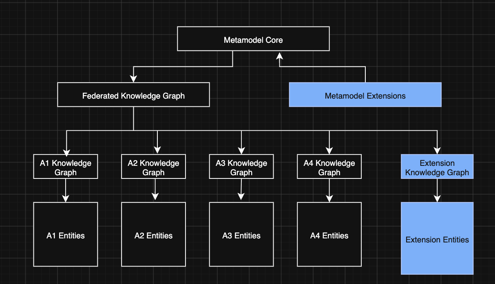

# Metamodel integrity — the reference architecture

> **Status: the owner's reference architecture (2026-11-22)** — what SDEM is built on, and what every change is measured against. The
> [analysis](sdem-metamodel-integrity-analysis.md) checked SDEM against it (MI-Q0: it matches); the [plan](metamodel-integrity-planning.md)
> (MIP-00…MIP-09) is the work that makes every part of SDEM keep to it. Made-up data only.

## 1. The reference diagram



*The owner's diagram (2026-11-22). Core in black, extensions in blue.*

The same structure, with what each arrow means in SDEM:

```
                     Metamodel Core ◄──────────────── merged on ──── Metamodel Extensions (BIAN, Security)
                          │  checks every graph and link; defines how a trace walks
                          ▼
                Federated Knowledge Graph  ◄── joined by the mapping registry (approved links between layers)
                          │  is made of
        ┌───────────┬─────┴─────┬───────────┬──────────────────────┐
   A1 graph     A2 graph     A3 graph     A4 graph       Extension graph(s)
        ▲           ▲            ▲            ▲                   ▲
        │ built from│            │            │                   │
   A1 entities  A2 entities  A3 entities  A4 entities    Extension entities
                          │
                          ▼
   SDEM CLI — the only place anything is computed (trace, impact, completeness, gaps)
                          │
                          ▼
   Views — ArchiMate per layer, the extensions, Connections, the agent: they render what the CLI returns
```

**A1–A4 are the core without BIAN**: A1 Business, A2 Data, A3 Application, A4 Technology. An extension in the stack renumbers it — with
BIAN on: A1 Business, A2 BIAN, A3 Data, A4 Application, A5 Technology (ST-03, DL-06).

## 2. The parts

| Part | What it is | In SDEM |
|---|---|---|
| **Metamodel Core** | The **architecture mapping**: which kinds of record may exist in each layer, which links may join them inside a layer and between layers, their attributes, and how a trace walks them. SDEM's own, versioned, frozen per release | `metamodel/*.json` (types, RA… rules inside a layer, attributes, `identity.json`), `schema/relationship-types*.json` (links between layers), `metamodel/stability.json` (what is frozen); `sdem types`, `sdem model check` |
| **Metamodel Extensions** | Additions a person switches on per workspace: types, attributes, link types, rules — and a layer. **Merged into** the core, never changing its definitions | a pack (`metamodel/ext-bian-pack.json` built in; `sdem_security/pack.json`), merged by `sdem profile include`; the stable-core test proves the core unchanged |
| **Layer knowledge graph** (A1…A4, A5 with BIAN) | One per layer: the layer's records and the links **inside** it, checked against the metamodel | the graph store's `business`, `bian`, `data`, `application`, `technology` `.graph.json`; `LevelGraph` |
| **Extension knowledge graph** | One per extension that adds a layer: its records and their links, checked the same way | `bian.graph.json` (BIAN, in the stack), `s.graph.json` (Security, beside it) |
| **Entities** | The design's records — what the architect states, layer by layer | the workspace's layer files (`business.json` … `security.json`), changed only through change sets |
| **Mapping registry** | Every link **between** layers — each approved by a named person with its evidence, or proposed by the rules engine and waiting | `mappings.json`; `sdem link` proposes, `sdem approve` / `sdem connect` decide |
| **Federated Knowledge Graph** | The **data mapping**: the layer and extension graphs joined by the registry — the design as one connected graph | `federated.graph.json`; `FederatedGraph` |
| **SDEM CLI** | The only place anything is computed from the two mappings: trace (direct and indirect, upstream and downstream), impact, completeness, gaps | `sdem trace`, `sdem impact`, `sdem status`, `sdem query` |
| **Views** | What a person or agent sees, built from the CLI's answers | DESNRE's Architecture and Connections views, the workbench, `sdem dashboard`, the agent |

## 3. The two extensions

Each brings **metamodel additions, its own entities and its own knowledge graph**; they differ in where they sit.

| | **BIAN** | **Security** |
|---|---|---|
| Sits | **in the stack**, as A2 — its layer renumbers the stack | **beside the stack** (`position: across`), layer S with S1–S5 |
| Adds to the metamodel | BIAN's types (service domain, control record, service operation, business object…), BIAN's attributes, links to Business, Data and Application | controls, threats, trust boundaries; PROTECTS, THREATENS, ENFORCED_BY, BOUNDS to every layer; the SEC rules |
| Its entities | the design's service domains and operations — and **BIAN's information model**: business objects with typed fields (BIAN's Business Object Model), held by each domain's control record | the design's controls, threats and trust boundaries |
| Its graph | `bian.graph.json` | `s.graph.json` |
| Reaches the Data layer | a business object MAPPED_TO a data entity, a field FIELD_MAPPED_TO a data field — approved by a person | PROTECTS and THREATENS a data entity or field |

BIAN's business objects are **BIAN's** model, in BIAN's graph; the Data layer is **the design's own** data. They are joined by approved
links, so a design's tables never have to be BIAN's.

An extension may also add only **inside an existing layer** — a type that extends a core type, attributes, rules — with no graph of its
own (MX-32a).

## 3a. Horizontal and vertical extensions — now and in future

*(the owner, 2026-11-22: "does the model support the horizontal and vertical extensions now and in future, e.g. Disaster Recovery
(vertical) and Networks (A5 horizontal)?")*

An extension is **horizontal** when it adds to the stack — a layer in it, or kinds of record inside one of its layers — and **vertical**
when it cuts across every layer, beside the stack. The reference model holds both: each brings metamodel additions, its entities and,
when it adds a layer, its own knowledge graph, joined to the others by the registry.

| Pattern | Placement | Graph | Today's example | A future example |
|---|---|---|---|---|
| **H1 — a layer in the stack** | `position: above` / `below`, or BIAN's own place; the stack is renumbered (ST-03) | its own | **BIAN** (A2) | a *Physical* layer below Technology (sites, racks) |
| **H2 — kinds of record inside a layer** | types that extend a core type (MX-32a), attributes, link types, rules | none — the layer's own graph | a firewall type extending a node (tested in `sdem-security`) | **Networks**: firewalls, load balancers, subnets, routes as kinds of A5 node, network and path, with port and direction on a path |
| **V1 — a layer beside the stack** | `position: across` (LR-11), sub-layers per design layer | its own | **Security** (S1–S5) | **Disaster Recovery**: recovery plans, recovery groups, replicas, failover — RECOVERS and REPLICATES_TO links to every layer, RTO/RPO checked against them |

**What SDEM supports now — in its core, generically:**

| Capability | H1 | H2 | V1 | Evidence |
|---|---|---|---|---|
| Metamodel additions merged, the core unchanged | ✓ | ✓ | ✓ | `include_pack`; the stable-core test |
| Its own entities and graph, joined by the registry | ✓ | (in the layer's) | ✓ | layer positions above/below/across (`sdem/layers.py`) |
| The stack renumbered, labels computed | ✓ | — | — | ST-03, DL-06, DL-07 |
| A subtype counted as its core type by every rule and trace | — | ✓ | — | `is_a`; MX-32a |
| Traced through what it links to (up and down) | ✓ (as any layer) | ✓ (as its base type) | ✓ (FT-09, any `across` layer) | `FederatedGraph.across` |
| Its rules in SDEM's standards, its own computed checks, its reports to the agent | ✓ | ✓ | ✓ | EXT-05, XA-01…XA-10 |

**Where the model is not yet generic — what a third extension would hit:**

| Gap | Today | Fix |
|---|---|---|
| **G1 — In-stack code written for BIAN** | `parts.bian_on()`, a link type that `requires` BIAN (BX-50), the stack id `bian` in places, the site's four-file layer list with BIAN's plate special | any H1 extension handled as BIAN is: by its id and position, not by name (MID-08) |
| **G2 — Vertical views are Security's own** | the site's Security view is built for Security alone (`buildSecurity`, its link styles) | a V1 extension is an **overlay on the one stack**, drawn from what its manifest declares — its link types and how each is drawn (MIP-06, MID-09) |
| **G3 — One extension needing another** | only "requires BIAN" is understood | `requires: [extension]` for any extension (Disaster Recovery needing Networks), said — not an error — when the other is off, as BX-50 does for BIAN |
| **G4 — Two vertical extensions together** | *built (FT-14)*: two vertical layers may link; the trace goes on into the other only where the link type declares `"trace": "through"` | — the default stays "never on into another vertical record" |
| **G5 — Extensions pinned to a metamodel range** | one additive change needed three releases | MIP-01: an extension accepts additive metamodel minors |
| **G6 — Horizontal layers the site does not draw** | the publisher and the site know Business, BIAN, Data, Application, Technology | MIP-04: the site draws the stack the design names, whatever its layers |

## 4. The rules this architecture holds to

| Id | Rule |
|---|---|
| **MID-01** | **Two sources of truth.** The Metamodel Core (with the extensions merged in) says what may be; the Federated Knowledge Graph says what is. Nothing else is a source. (MIP-00) |
| **MID-02** | **One place computes.** The SDEM CLI computes every trace, impact, completeness figure and gap; views and the agent render its answers and never work them out again. (MIP-00, MIP-03) |
| **MID-03** | **The core is not changed by an extension.** An extension adds; switching it off leaves the core exactly as it was (the stable-core test). |
| **MID-04** | **Each graph is built from its entities and checked by the metamodel**; a link between layers enters the federated graph only through the registry. |
| **MID-05** | **Every shape is accounted for.** Every record reaches upstream and downstream through the CLI's trace, directly or indirectly, or is listed as a *design gap* or a *rule gap*. (MIP-00a, MIP-05) |
| **MID-06** | **Views are of the source.** A view shows the design in its own form and numbers — never a translated copy. (MIP-04) |
| **MID-07** | **Every link is ArchiMate's kind; how a trace walks it is SDEM's rule, labelled so** (FT-01…). Every type says where it comes from — ArchiMate, BIAN, TOGAF, NIST or SDEM's own. |
| **MID-08** | **Extensions are handled by pattern, not by name.** A horizontal extension (H1 a layer in the stack, H2 kinds of record in a layer) or a vertical one (V1 beside the stack) is placed, numbered, traced, checked and published by its declared position and types — no code path names an extension (G1). |
| **MID-09** | **A vertical extension is an overlay on the one stack.** Its records are drawn with the design records they link to, styled as its manifest declares; it is never a second stack repeating the design (G2). |
| **MID-10** | **An extension may require another**, declared in its manifest; when the other is off, what depends on it is left out and said — never an error (G3). |

## 5. How integrity is checked

| Check | Proves | Where |
|---|---|---|
| Stable-core test | MID-03 | `tests/test_core_stability.py` |
| `sdem model check` | the generated documents match the metamodel | CI |
| `sdem check` / graph build | MID-04: each graph and the registry pass the metamodel | per workspace; CI on the examples |
| The completeness test | MID-05 | `sdem trace GAPS` — every record traced, or a design gap or a rule gap; no example has a rule gap (`tests/test_full_trace.py`) |
| Site against CLI | MID-02: the view's chain equals `sdem trace` | `sdem trace ALL` sent with the design; the site lights it (`tests/test_full_trace.py`, DW-78) |
| Extensions by pattern | MID-08 | `tests/test_extension_patterns.py` — H1, H2, V1, and two vertical extensions linked (G4, FT-14), each made-up |
| An extension requiring another | MID-10 | `tests/test_metamodel_extensions.py` (`ExtensionRequiresAnother`) |
| ArchiMate labels | MID-07 | `tests/test_archimate_labels.py`: every type has a source and an ArchiMate element (own or inherited), every link inside and between layers is an ArchiMate kind, every trace rule is SDEM's (FT-…) with its reason; SDEM's own notation check passes. (An Open Exchange Format export, MIP-08, would be a further check — not needed for the rule) |

## 6. Conformance (2026-11-22, SDEM 0.21.12)

*Checked on the Payment example, not only SDEM's own: 327 of 327 records reach every other layer (0 design gaps, 0 rule gaps — MID-05), every link type in it has its ArchiMate kind (MID-07). A metamodel change that leaves the core as frozen (a declared trace rule, a notation entry) ships as an SDEM release with the metamodel version unchanged — MS-04/05, MIP-D2; `sdem model stability`: "the core is as frozen" at 0.19.0.*

| Rule | Met | Evidence — or what is missing |
|---|---|---|
| MID-01 Two sources of truth | ✅ | views read the published design and SDEM's answers |
| MID-02 One place computes | ✅ | the site lights SDEM's chains (MIP-03); Health's per-layer figures are `sdem trace GAPS`'s `by_layer`; the Security view's *inherited* protection is `sdem security coverage`'s `inherited_from`. A zone lit with a record is the record's own zone on the plate — drawn, not computed. Designs published before keep the site's older reckoning until republished |
| MID-03 The core is not changed by an extension | ✅ | the stable-core test |
| MID-04 Graphs built from entities, checked by the metamodel | ✅ | `sdem check`, graph stores current, CI |
| MID-05 Every shape accounted for | ✅ | `sdem trace GAPS`; no rule gap in any example (tested); the Payment example: 152 of 255 records reach every other layer, 103 design gaps for a person, 0 rule gaps |
| MID-06 Views are of the source | ✅ | a design in 0.20's form published and shown in its own form (MIP-04, DW-79) |
| MID-07 Links and types labelled by their standard | ✅ | checked over the whole metamodel and every shipped pack (`tests/test_archimate_labels.py`, sdem-security's own test); it found two gaps, both closed — `ACCESSED_BY` (Data → Application) had no ArchiMate kind (it is *access*), and an extension's link types had none (a pack now says each one's, `"archimate"`; Security's four are association, realization, influence, aggregation). On the Payment example every link type in use has its kind |
| MID-08 Extensions by pattern, not by name | ✅ | three made-up extensions — *Facilities* (H1, a layer below the stack), *Networks* (H2, a kind of Technology node) and *Disaster Recovery* (V1, beside the stack) — switch on, check, link and trace with no SDEM code naming them (`tests/test_extension_patterns.py`); the trace's own rules are declared (`trace_rules`). BIAN keeps its built-in switch (on by default, BX-11, so 0.19 designs read as before) — BIAN's compatibility, not a path another extension needs |
| MID-09 A vertical extension is an overlay | ✅ | Security is a switch on the one stack — the design's own plates (A1–A5 + security), never S1–S5 (DESNRE DW-80) — drawn as its manifest declares (`viewer.overlay`: plates, shapes and their place, link styles; sdem-security 0.4.2, DW-81) |
| MID-10 An extension may require another | ✅ | `requires` for any extension, on anything it adds — left out and said when the other is off (tested) |

## 7. Related

- [Metamodel integrity — the analysis](sdem-metamodel-integrity-analysis.md): MI-Q0…MI-Q13, findings and recommendations.
- [Metamodel integrity — the plan](metamodel-integrity-planning.md): MIP-00…MIP-10 and the owner's decisions MIP-D1…D6.
- [Knowledge graph specification](knowledge-graph-spec.md), [the data layer](sdem-data-layer-spec.md), [stable identity](sdem-stable-identity-spec.md),
  [metamodel extensions](sdem-metamodel-extensions-spec.md), [the full trace](sdem-full-trace-spec.md).
