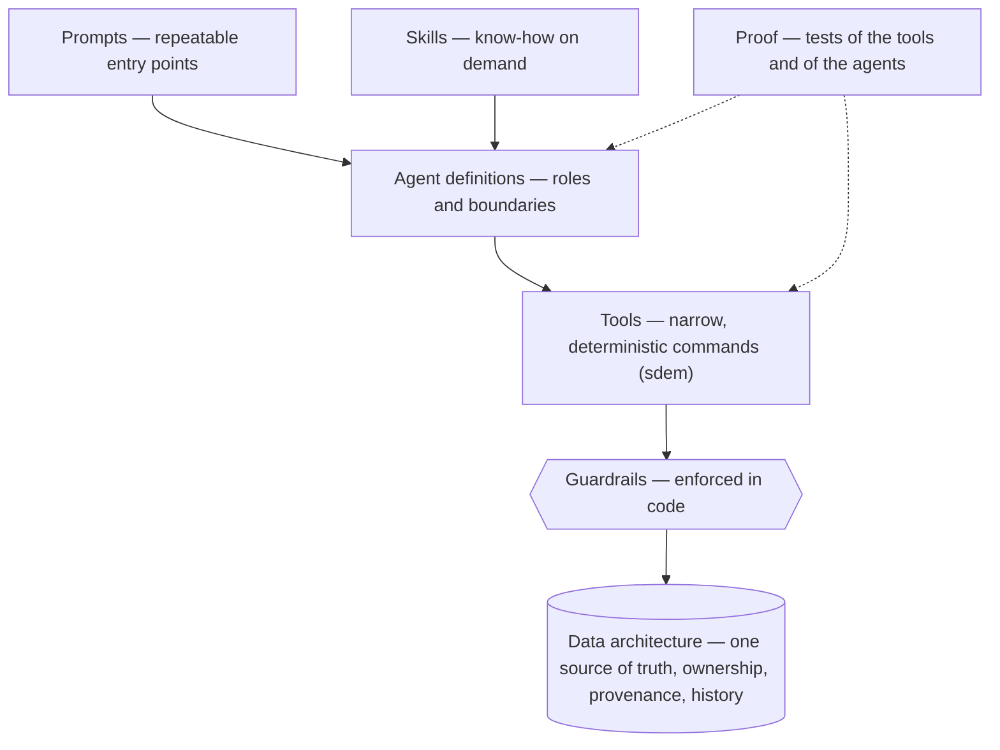

# What makes a good agent platform — and how SDEM measures up

> **Status: approved assessment (2026-10-28); its improvements were built.**

> Assessment 2026-10-28, against the agent platform as built ([`sdem-agent-platform-design.md`](sdem-agent-platform-design.md), [`sdem-agent-platform-spec.md`](sdem-agent-platform-spec.md)). The improvements it leads to are recorded in the spec as AG-S08, AG-K06, AG-E01 and AG-O01.

## The principle

**Intelligence in the model, truth in the data, rules in code.**

Agents are the least reliable part of the platform. A good platform makes sure that when an agent is wrong, the mistake is **caught** (the tools refuse it), **visible** (it is on record) and **cheap to undo**.



The lower a layer sits in this picture, the more the platform's reliability depends on it.

## Build order — importance is not the order you build in

The sections below go from the most important to the least: data, tools, guardrails, agent definitions, prompts, skills, proof. That is the order of **importance**. The agent layers are **built** in the order they depend on each other:

```
skills   ← the know-how             (agents load them when needed)
  ▲
agents   ← the roles and boundaries (short; point to skills for detail)
  ▲
prompts  ← the entry points         (start an agent on a task, with inputs)
```

| Build | Because |
|---|---|
| **1. Skills** | agents and prompts point to them — the know-how is written once, and an agent file stays short ("for imports, use the *sdem-onboard-designs* skill") |
| **2. Agent definitions** | the roles and boundaries ("you do X; you never do Y") refer to the skills; the safety-relevant wording lives here |
| **3. Prompts** | they start an agent on a task — the agent and its skills must exist first |

Two cautions:
- **Prompts and skills are convenience, not safety.** What stops an agent doing harm is the code (§3) and branch protection — the agent files only describe the boundaries.
- **Proof before polish.** Until the agents have run in real Copilot (the spike, then AG-E01), more prompt and skill work is guesswork: make the minimum change, run the spike, and improve from what the agents actually did.

## 1. The data architecture — the foundation (most important)

Agents are only as good as the data they read and write.

| What good looks like | Why | SDEM |
|---|---|---|
| **One source of truth, with a schema** | agents need a fixed shape to read and write; no guessing | ✅ four architecture datasets, the registry, the graph store — all schema-checked |
| **Clear ownership** | each agent knows exactly what it may change | ✅ one layer per agent, enforced by CTL-19 |
| **Durable shared state** | agents coordinate through records, not chat; nothing is lost when a session ends | ✅ change sets, change events, work items |
| **Provenance on everything** | who changed this, why, from what | ✅ agent and person on every change (CTL-20); source, reasoning and confidence on every link |
| **History, not overwrite** | mistakes can be traced and undone | ✅ append-only coordination records; supersession instead of edits; Git |

**SDEM's strongest part.**

## 2. The tools — how agents act

An agent should never touch data directly: it calls **narrow, deterministic tools** that do the work correctly.

| What good looks like | Why | SDEM |
|---|---|---|
| **Hard logic in code, not in the model** | rules give the same answer every time; a model does not | ✅ the rules engine, impact and checks are Python; agents never decide links or impact |
| **Every write through a checked command** | bad changes are refused before they land | ✅ `sdem change propose` checks first; a direct edit of a file is **detected** by `sdem check` (AG-S08) until a person adopts it (`sdem change adopt`); approvals through `sdem approve` |
| **Machine-readable output** | agents read results reliably | ✅ `--json` on the commands |
| **Error messages that say how to fix it** | the agent can correct itself | ✅ e.g. *"CTL-19: agent … may change only A3"*, *"evidence missing required kind …"* |
| **Small, single-purpose commands** | easy for a model to choose the right one | ✅ one subcommand per journey |
| **Safe to retry and undo** | agents retry; mistakes happen | ✅ `sdem change revert` restores a layer exactly and records it (AG-K06) |

**Strong.** Gaps: detecting direct edits, a proper undo.

## 3. Guardrails — what stops an agent doing harm

| What good looks like | SDEM |
|---|---|
| **Enforced in code**, not only asked for in instructions | ✅ CTL-16, CTL-17, CTL-19, CTL-20, CTL-21, CTL-23 and the governance check refuse bad actions |
| **Least privilege** — each agent only the tools it needs | ⚠️ **partly.** Tool lists per agent; layer agents cannot call other agents (`agents: []`). But a layer agent has `edit` and `execute`, and Copilot cannot limit them to certain files — an agent *can* edit another layer's dataset or `mappings.json`. That is **detected afterwards** (AG-S08 change-set chain, `sdem check`, CI), **not prevented** |
| **A person approves anything that matters** | ⚠️ **enforced once branch protection is on.** CTL-21 refuses an agent's or tool's name as reviewer, but cannot stop a person's name being typed; the real control is a required, code-owner-reviewed pull request (`.github/CODEOWNERS` added) — a GitHub setting the owner turns on: [`sdem-repository-protection.md`](../sdem-repository-protection.md) |
| **A limit on runaway loops** | ✅ the round limit (3) — the orchestrator stops and asks; since 2026-10-28 a **cap**: an agent may lower it, never raise it — only the architect can (AG-S07) |

**The key test:** *anything written only in an instruction is a request, not a control.* "Never edit dataset files directly" and "never approve" were instructions only; both are now controls — the change-set chain (AG-S08, CTL-20) and human approval (CTL-21).

**Checked 2026-10-28** against the code and the repository: the round limit was only a default (an agent could pass a higher `--max-rounds`) — now a cap; least privilege is detection, not prevention; and approval by a reviewed pull request depends on branch protection, which was not on (changes were pushed straight to `main`).

## 4. Agent definitions — the roles

| What good looks like | SDEM |
|---|---|
| a clear **role and boundary** — "you do X; you never do Y" | ✅ every agent file has *what you do* and *what you never do* |
| **short**, pointing to skills for detail | ✅ |
| **one job per agent** | ✅ four layer owners and one orchestrator |

## 5. Prompts — repeatable entry points

A prompt makes a frequent task **one action, done the same way every time**.

| What good looks like | SDEM |
|---|---|
| one prompt per frequent task, naming the exact commands | ✅ 9 prompts (explain, fix, review, impact note, pull request, AID, process events, layer work, example 3) |
| inputs asked for explicitly | ✅ `${input:workspace}`, `${input:person}` |
| a defined output | ◐ most prompts describe what to report, not a strict format |

Prompts improve **consistency**. They are convenience, not safety.

## 6. Skills — know-how on demand

Skills hold **domain knowledge** the agent loads only when needed, keeping each conversation short and focused.

| What good looks like | SDEM |
|---|---|
| a clear *when to use me* in the description | ✅ |
| worked examples and reference tables | ✅ example change sets; the evidence table generated from the metamodel, so it cannot drift |
| no duplicated rules that can drift from the code | ◐ skills describe rules in words; the code is the truth; tests check the command names only |

## 7. Proof — knowing it works

| What good looks like | SDEM |
|---|---|
| **tests of the tools and controls** with good and bad data | ✅ use-case example 3: 8 of 8 criteria; controls 14 of 14 |
| **tests of the agents themselves** — does the model draft the right change set? | ❌ not yet: example 3 scripts the agents' decisions; the spike is the first real check (**AG-E01**) |
| **records of agent sessions** for audit | ◐ coordination records capture every change, not the conversation that led to it (**AG-O01**) |

## Overall

| Layer | How much it matters | SDEM today |
|---|---|---|
| Data architecture | highest | strong |
| Tools / engine | very high | strong — undo built; engine–metamodel agreement checked (CTL-22) |
| Guardrails | very high | strong in code (CTL-16…23, round cap); direct edits **detected**, not prevented (AG-S08); human approval **enforced only with branch protection on** |
| Agent definitions | medium | good |
| Prompts | low–medium | good |
| Skills | medium | good |
| Proof of the agents themselves | high | **missing** — the spike, then scored runs |

Many agent platforms invest in prompts and skills and neglect the data and the tools. SDEM is built the other way round, which is the right way.

## Hardening done (2026-10-28)

| Fix | Requirement |
|---|---|
| coordination ids scoped to the branch, one file per record — parallel work cannot clash | AG-R06 |
| `sdem check` checks the coordination records | AG-R07 |
| warning when a graph store is older than its data | WB-K08 |
| `--workspace DIR` on every command; `*` patterns expanded by `sdem` | WB-K07 |
| direct dataset edits detected (the change-set chain); `sdem change adopt` for a person's edit | AG-S08, AG-K07, CTL-20 |
| `sdem approve` — a person approves, the registry is validated before writing; a reviewer that is an agent or tool is rejected | WB-A04, CTL-21 |
| `sdem change revert` — undo the latest change set of a layer, exactly, on record | AG-K06 |
| the engine checked against the metamodel (rules, steps, implementation) | CTL-22 (gap G-A partly closed) |
| fallback B capped at low in the engine (DEC-E-10); needs_review allowed while the BIAN id is awaited (F-1); 21 entities downgraded until verified (G-02); scenario BIAN ids added | owner decisions |

## What to do next

| # | Improvement | Requirement | Why first |
|---|---|---|---|
| 0 | ~~**Bring the agents up to date** with the import of past designs (transform → load), CTL-23, DEC-E-11 and the round cap — skills, then agents, then prompts~~ | AG-A07 | **done 2026-10-28** — the minimum before the spike |
| 1 | **Score the agents, not just the tools:** after the spike, run example 3 with the real Copilot agents several times; score how often they draft the right change sets and plan the right work | AG-E01 | the only way to know the agents' accuracy |
| 2 | **Session record:** keep a short summary of each agent session (who asked what, which commands ran) with its change event | AG-O01 | the *why* behind a change, for audit |
