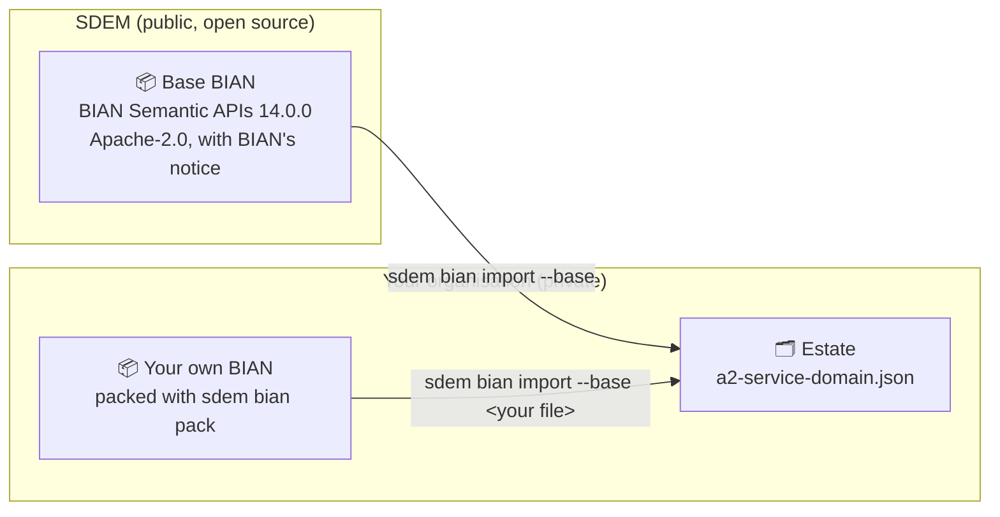

# Base BIAN — design

> **Status: approved by the owner 2026-10-29** ("create the design and spec … then implement"). Requirements: [`sdem-bian-base-spec.md`](sdem-bian-base-spec.md). Builds on the BIAN import ([`sdem-bian-import-design.md`](sdem-bian-import-design.md)).

## The idea

SDEM ships with a **base BIAN**: BIAN's public Semantic APIs, release 14.0.0, packed into one file inside SDEM. Any architect can build their BIAN layer from it straight away — nothing to download. A company that has its **own BIAN** (a newer release, its own selection, or its own extensions in BIAN's format) packs it the same way and points SDEM at it instead. The base is a starting point, never a lock-in.



## Why this is allowed — and what it does not change

| Point | Basis | Confidence |
|---|---|---|
| BIAN's Semantic APIs are published by BIAN at `github.com/bian-official/public` under **Apache-2.0** | the repository's licence file, read 2026-10-29 | high |
| Apache-2.0 allows copying and redistributing, also in changed form, if a copy of the licence is included, changes are stated, and notices are kept | Apache License 2.0 §4 | high |
| SDEM is Apache-2.0 too, so the two fit | `LICENSE` | high |
| The base is **not** an endorsement by BIAN, and SDEM does not claim one | README; BIAN® is BIAN's trademark | high |

This **changes one earlier rule**: SDEM did not include BIAN content. From now on SDEM includes exactly one piece — BIAN's public Semantic APIs, in the `bian/` folder, with BIAN's licence and a statement of what was changed — and nothing else of BIAN's (no portal content, no member material, no descriptions).

## Decisions

| # | Decision | Chosen | Why | Confidence |
|---|---|---|---|---|
| **BB-D1** | What to ship | a **packed** file: for each service domain its name, release, operations (method, path, name, input and output fields), control record and its fields, behaviour qualifiers — about 3 MB | BIAN's raw files are 24 MB and need reading each time; the packed file holds exactly what the import uses | high |
| **BB-D2** | BIAN's descriptions and object schemas | **left out** of the base | keeps BIAN prose out of SDEM and the file small; a company wanting them imports from BIAN's files with `--descriptions` / `--objects` | high |
| **BB-D3** | Which release | **14.0.0** (the latest, 2026-02) | newest public release; the pack records it, and replacing it is one command | high |
| **BB-D4** | How a company replaces it | `sdem bian pack <BIAN-format folder> -o <file>` makes their own base; `--base <file>` uses it. Their raw folder also still works directly | one form for everyone; a small file is easy to keep in the estate repository and share with the team | high |
| **BB-D5** | The 66 service domains (about 1 in 4) whose asset type and functional pattern cannot be derived | the base **marks them**; `sdem bian list --base` shows *needs your pattern* beside them, and the import asks for a `--patterns` row as today | BIAN's public material does not state them (the API files do not; the public landscape page does not show them); guessing would be wrong — BIAN's own release notes show a *Facility* domain changing pattern | high |
| **BB-D6** | Default when no source is named | **none** — `--base`, `--base <file>` or a folder must be named | the architect always knows which BIAN they are using; the output records it | high |

## How it is used

```bash
sdem bian list --base                                             # 258 service domains of BIAN 14.0.0 — some marked "needs your pattern"
sdem bian import --base --only "Payment Order Initiation" -o work/bian/a2-service-domain.json

# a company with its own BIAN, in BIAN's format:
sdem bian pack ~/acme-bian -o bian/acme-bian.json                 # once; commit it to the estate repository
sdem bian import --base bian/acme-bian.json --only "Payment Order Initiation" -o work/bian/a2-service-domain.json
```

Everything after that is unchanged: `sdem load --a2`, `link`, `approve --bian-release`, `trace`. Every A2 record says which BIAN it came from (`source_system`, `version`, `source_id`).

## Moving from the base to your own BIAN later

Import from your own BIAN with `--previous <your current A2 file>`: the report lists what was added, dropped or renamed. Ids come from BIAN's names, so a service domain with the same name keeps its id and its approved connections; one renamed or dropped is reported, and `sdem check` shows any approved connection that no longer finds its target — those are superseded, never edited.

## Keeping the base current

`scripts/build_bian_base.py <BIAN release folder>` rebuilds the base from a downloaded release; the maintainer runs it when BIAN publishes a release, with `scripts/bian_import_check.py`, and records it in the CHANGELOG.
