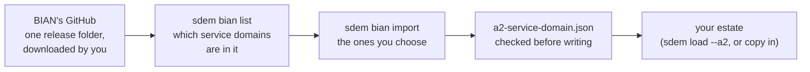

# BIAN import — design

> **Status: approved by the owner and built 2026-10-29** (decisions BI-D1…D6 as recommended). Requirements: [`sdem-bian-import-spec.md`](sdem-bian-import-spec.md). Built in `sdem/bian.py`; tests `tests/test_bian.py`; checked against BIAN releases 10.0–14.0 (*What the real releases showed*, below).

## The problem

Every connection between business and applications passes through the BIAN layer (A2), and SDEM never builds A2 from design documents. Today an architect must write `a2-service-domain.json` by hand. Two walkthroughs by a newcomer found this the hardest step: what goes in it, in what format, from where.

BIAN publishes its **Semantic APIs** openly — `github.com/bian-official/public`, **Apache-2.0**, releases 9.1 to 14.0.0; release 14.0.0 has 258 service-domain files (OpenAPI 3 YAML; 9.1 is Swagger JSON in an older shape). Checked 2026-10-29.

## The idea



An architect downloads one BIAN release (SDEM never goes online), lists what is in it, and imports the service domains their area uses. SDEM writes an A2 dataset that passes its own checks, with BIAN's names and the BIAN release recorded on every record.

## What one BIAN file gives, and what it becomes

Read from BIAN's file for *Payment Order Initiation* (release 14.0.0):

| In BIAN's file | Becomes | Confidence |
|---|---|---|
| `info.title` — *Payment Order Initiation* | an `A2.ServiceDomain` — name, BIAN identifier (`canonical_id`), release | high — BIAN's own name |
| `info.version` — *14.0.0* | the BIAN release on every record and the dataset | high |
| `info.description` | the description — **only if you ask** (BI-D3) | high |
| each operation in `paths` — `POST …/Initiate`, `operationId: Initiate` | an `A2.ServiceOperation` with its action (*Initiate*), method and path — what the engine matches APIs against | high |
| the `CR - …` tag — *PaymentOrderInitiationTransaction* | the domain's `A2.ControlRecord` | high |
| `BQ - …` tags — *Compliance*, *Confirmation*, *OrderInitiation* | `A2.BehaviorQualifier` records | high |
| the schemas under `components` | `A2.BusinessObject` records — **only if you ask** (BI-D4); there are many | high |
| — (not in the file) | the domain's **asset type** and **functional pattern**, which the rulebook requires | see BI-D2 |

The links inside A2 that the rulebook expects (domain → control record, domain → operation, operation → qualifier) are written too.

## Decisions for the owner

| # | Decision | Options | Recommendation | Confidence |
|---|---|---|---|---|
| **BI-D1** | Reading YAML | (a) a small reader in SDEM for the regular structure of BIAN's OpenAPI files; (b) an optional dependency (PyYAML); (c) ask the architect to convert the files to JSON first | **(a)** — SDEM keeps no dependencies; BIAN's files are machine-generated and regular; the reader reads only the fields above and refuses anything it does not understand; tested on a made-up file in CI and checked against a real release by the maintainer | medium — a real-release check before release decides it |
| **BI-D2** | Asset type and functional pattern (required by the rulebook, not in BIAN's API files) | (a) **derive** them from the control record's name: BIAN names a control record *asset type + generic artefact* (*PaymentOrderInitiation* + *Transaction*), and each generic artefact belongs to one functional pattern; (b) a small table the architect fills in from the BIAN portal; (c) both — derive, and let a table override | **(c)** — derived values marked *medium*, listed in the import report for a person to confirm; a table (`--patterns`) overrides any of them | medium — the artefact → pattern list must be checked against BIAN's published material when building |
| **BI-D3** | BIAN's descriptions | include always · never · on request | **on request** (`--descriptions`) — off by default. The licence allows them, but the project's rule is not to reproduce BIAN text; a bank's private estate may choose to | high |
| **BI-D4** | Business objects (the schemas) | always · never · on request | **on request** (`--objects`) — they are many (hundreds per release) and the engine's main rules match operations, not objects | medium |
| **BI-D5** | Which service domains | all by default · chosen | **chosen** — `--only <names>` or `--from <file of names>`; `--all` must be said explicitly. Release 14 imported whole is about 7,100 records (measured), beyond a comfortable estate | high |
| **BI-D6** | Where it fits | a new command `sdem bian` · part of `sdem load` | **a new command** with `list` and `import`; its output is an ordinary A2 dataset that `sdem load --a2` (or a copy into the estate) takes as today | high |

## What stays true

- **Offline.** SDEM reads a folder you downloaded; it never fetches anything.
- **Nothing written unless it passes.** The A2 dataset is checked with the rulebook before it is written (all-or-nothing, like `sdem load`).
- **The rulebook does not change.** The import produces what the rulebook already defines (A2 record kinds, their attributes, the links inside A2).
- **BIAN content stays with the bank.** The output goes wherever you write it — your private estate repository; the public SDEM repository holds the converter and a made-up test file only.
- **Provenance on every record:** BIAN release, source file, and how each value was obtained (read · derived · from your table).
- **Re-import is safe.** Importing a newer release reports what was added, renamed or dropped; it does not silently change records already approved links point to (an existing id is kept; a dropped domain is reported, not deleted).

## What the real releases showed (2026-10-29)

Every file of BIAN releases 10.0, 11.0, 12.0, 13.0 and 14.0 — 1,241 files — was read and imported in full (`scripts/bian_import_check.py`, run on the maintainer's machine; BIAN's files are not kept in this repository).

| Finding | What was done |
|---|---|
| **The reader is exact.** The facts it extracts are identical to those of a full YAML library (PyYAML) for all 1,241 files. Two YAML forms appeared that the first version refused rather than guess — long paths written as complex keys (`? …` in 10.0) and keys containing a colon (11.0, 12.0) | both read; BI-D1 confirmed (confidence now high) |
| **Release 9.1 is a different shape** (Swagger 2: no control-record tags, operations named differently) | refused with a message to use 10.0 or later (BI-C04 narrowed) |
| **Derivation covers 74%** (192 of 258 service domains in 14.0). The rest end in *Facility* (39), *Log* (7) or *Measurement* (1), or have no control record (19). BIAN's release 14 notes show a *Facility* domain changing from FULFILL to AGREE TERMS — so *Facility* does not imply one pattern | not guessed: those domains need a `--patterns` row; the error lists them all at once with the CSV format |
| **BIAN reuses behaviour-qualifier names across domains** (*Payment* in 15) but the rulebook keys a qualifier by its name | each qualifier is named with its domain, e.g. *Payment (Card Transaction)* |
| **Two domains share one control-record name** in 14.0 (*Trust Services*, *Corporate Trust Services*) but the rulebook gives each control record one domain | each domain keeps its own control record (id by domain); the report lists the shared name for a person |
| **Every release imported whole passes the rulebook** — 0 errors; only advice (no business domain named) | — |

## How the architect uses it

```bash
# once: download a BIAN release (e.g. from github.com/bian-official/public, folder release14.0.0/semantic-apis/oas3/yamls)
sdem bian list ~/bian/release14.0.0                                    # 259 service domains, with their operations
sdem bian import ~/bian/release14.0.0 --only "Payment Order Initiation" "Payment Execution" \
     -o work/bian/a2-service-domain.json                               # checked, then written; a report beside it
sdem load work/history --estate estates/payments --person <you> --a2 work/bian/a2-service-domain.json
```

The report lists every record with its source file, every derived asset type and functional pattern for a person to confirm, and anything in BIAN's files SDEM did not read.

## Not in scope

The BIAN portal's full model (members' UML), BIAN business scenarios and value chains, and keeping a bank's A2 layer in step with new BIAN releases automatically — the import reports differences; a person decides.
