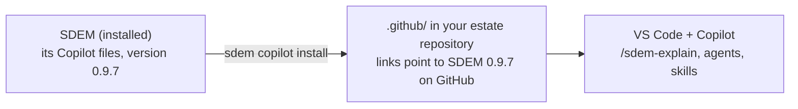

# Copilot files in the estate repository — design and specification

> **Status: approved by the owner and built 2026-10-29** ("go ahead"). Tests: `tests/test_copilot_install.py`, `tests/test_installed.py`.

## The problem

GitHub Copilot reads agents, prompts and skills only from the folder open in VS Code. Architects working for real open their **private estate repository**, not the SDEM project — so the SDEM agents and skills were not there unless someone copied them by hand (the estate template said so). Copied by hand, they also pointed at files that exist only in the SDEM project (`docs/…`, `metamodel/…`, `examples/…`), and one prompt (`/example3-rehost`) works only on a made-up example.

## The idea

The Copilot files ship **with SDEM** (package data, like the metamodel), and one command puts the ones for real work into the estate repository, matching the installed SDEM version:

```bash
cd <your estate repository>
sdem copilot install                 # writes .github/copilot-instructions.md, agents/, prompts/, skills/
```



## Decisions

| # | Decision | Chosen | Why |
|---|---|---|---|
| CI-D1 | How the files reach the estate repository | a command, `sdem copilot install`, from SDEM's own copy | they always match the SDEM version installed; no hand-copying |
| CI-D2 | References to files that exist only in the SDEM project | rewritten at install to links to the same file **at the installed version** on GitHub (`…/blob/v0.8.0/docs/…`) | a reader — person or Copilot — reaches the right version of the document; the SDEM project's own copies stay as they are |
| CI-D3 | Example-only prompts | left out (`/example3-rehost`) | they only work on the made-up example |
| CI-D4 | A file the team has changed | never overwritten silently: the install records what it wrote (`.github/sdem-copilot.json`); a file changed since is reported and kept unless `--force` | teams may tailor instructions; an upgrade must not undo that |
| CI-D5 | What it does not touch | the estate repository's own `.github/` files (CI workflow, code owners, pull-request template) | they belong to the team |

## Requirements

| ID | Requirement | Accepted by |
|---|---|---|
| CI-01 | The Copilot instructions, agents, prompts and skills are installed with SDEM and found from any directory. | `tests/test_installed.py` runs `sdem copilot install` |
| CI-02 | `sdem copilot install [--to DIR]` writes them into `DIR/.github/` (default: the current folder), except example-only prompts. `--dry-run` lists what would change and writes nothing. | test |
| CI-03 | Every reference to a file of the SDEM project (`docs/`, `metamodel/`, `schema/`, `examples/`, `templates/`) becomes a link to that file at the installed SDEM version on GitHub; no installed file refers to a local path that does not exist in the estate repository. | test: install into a copy of the estate template, then check every reference |
| CI-04 | Every `sdem` command the installed files name is a real command. | test |
| CI-05 | `.github/sdem-copilot.json` records the SDEM version and each file's fingerprint. On a later install, a file unchanged since the last install is replaced; a file the team changed is kept and reported, unless `--force`. | test |
| CI-06 | Files not written by `sdem copilot install` are never touched. | test: the template's workflow, code owners and pull-request template unchanged |
| CI-07 | The estate template's README uses the command (set-up and upgrade), and its `.vscode/` recommends the same extensions as the SDEM project. | test |
