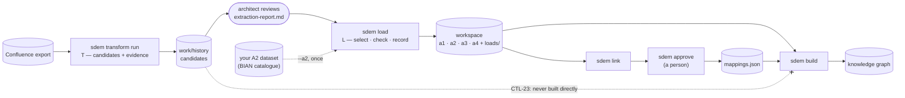
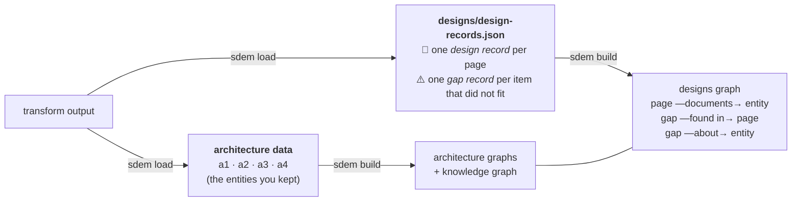
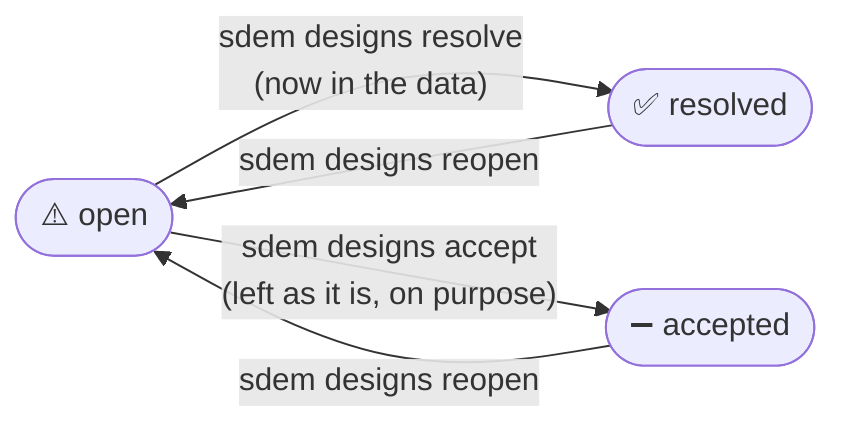

# SDEM Load — Putting reviewed entities into a workspace

> **Status: approved 2026-10-28 ("go ahead"); built 2026-10-28.** `sdem load`. Requirements: [`sdem-load-spec.md`](sdem-load-spec.md). The **L** of the ETL for past designs; the **T** is [`sdem transform`](sdem-transform-design.md).

**Objective:** move the entities an architect has **reviewed and kept** from the transform's output into an SDEM workspace — **checked and recorded**. The whole journey, export to knowledge graph, is in [`sdem-onboarding-workflow.md`](../sdem-onboarding-workflow.md).

**The load does not change the data.** The transform creates the architecture data; the load copies the entities you keep, **unchanged**, into the workspace. It:
- leaves out the ones you reject (and any link or `deployed_on` that would point to them)
- relabels the datasets from *candidate* to *loaded*
- merges into what the workspace already holds
- checks the whole workspace before writing
- records your decision

It is a **review gate**, not a data step. It exists because `link`, `approve` and `build` work on the workspace, and the workspace must hold only data that is both **validated** (checked by SDEM) and **reviewed** (judged correct by you).

## 1. Where it fits — the ETL

| ETL | In SDEM | Command | Output |
|---|---|---|---|
| **E — Extract** | get the designs out of Confluence | the Confluence export (architect) | an export folder |
| **T — Transform** | read the export → candidate A1, A3, A4 entities with evidence | `sdem transform run` | a candidates folder (`work/history`) |
| *review* | the architect reads `extraction-report.md` and decides what to keep | — | a decision |
| **L — Load** | copy the kept entities, **unchanged**, into a workspace — checked and recorded | **`sdem load`** | the workspace's datasets, a load record |
| *after* | SDEM's normal processing — the same for every workspace | `sdem link` → `sdem approve` → `sdem build` | proposals, `mappings.json`, the knowledge graph |

`link`, `approve` and `build` are not part of the ETL: they are SDEM's governance, the same however data arrived.



## 2. The command

```bash
sdem load work/history --workspace workspaces/history --person jane.architect --exclude HIS-A3-SANCTIONS-CHECKEL --a2 workspaces/current/a2-service-domain.json
```

| Option | Meaning |
|---|---|
| `CANDIDATES` | the folder `sdem transform run` wrote (must hold its `extraction.json`) |
| `--workspace DIR` | the workspace to load into — created if it does not exist. Recommended for past designs: **a separate historical workspace** (e.g. `workspaces/history/`), apart from current designs (HI-D03) |
| `--person NAME` | who reviewed and loads — a person, never an agent or a tool (as CTL-21) |
| `--all` · `--only ID …` · `--exclude ID …` · `--keep FILE` | **what to load — one is required**, so loading is always a decision: everything, only these, all but these, or the ids listed in a file (one per line, `#` comments) |
| `--a2 FILE` | your organisation's A2 dataset (from the BIAN catalogue), copied into the workspace if it has none — so the engine can propose capability → domain → application links (§4) |
| `--dry-run` | check and show what would be loaded; write nothing |
| `--json` | machine-readable result |

## 3. What it does

1. **Checks the source** is a transform output: `extraction.json` present, its datasets marked `CONFLUENCE-EXTRACT`. Anything else is refused.
2. **Selects** the entities the person chose. A link inside an architecture is kept only when **both** ends are loaded; a `deployed_on` reference to an entity not loaded is dropped. What was dropped is listed.
3. **Merges** into the workspace: an entity already there with the **same content** is skipped; with **different content** the load is refused (a person resolves it — rename, exclude, or edit the workspace). A dataset the workspace does not have yet is created (`model_id` `<workspace>-<A>`, `source_system` `SDEM-LOAD`).
4. **Checks the whole workspace as it would be** — every dataset, the registry, the metamodel — **before writing**. Any error: nothing is written.
5. **Writes** the datasets and a **load record** `<workspace>/loads/LOAD-<n>.json`: who, when, from which transform run (export and rules fingerprints), what was loaded, excluded and dropped, the A2 dataset added, the check result.
6. **Prints next steps** and the **BIAN mentions** from the transform as hints for `sdem link`.

Every loaded entity keeps `attributes.source_id` = `confluence:<pages>`, so its origin stays visible after loading.

## 4. Getting links between architectures

The knowledge graph needs links **between** architectures (`mappings.json`), proposed by the engine and approved by a person. Two changes make transformed designs usable there:

| Change | Phase | What it does |
|---|---|---|
| **"Deployed on" written as data** (R2) | Transform | a candidate "application deployed on node" (from nesting in a diagram or "runs on / hosted on" in text) is written as the A3 entity's `deployed_on` attribute — the form the engine reads (rule S33–S35) |
| **Document-derived links capped at low** (DEC-E-11) | Engine | any link the engine proposes that touches an entity transformed from a document (`source_id` `confluence:…`) is capped at **low** confidence, with the reason in its rationale — a person sees it came from a document, as name-only evidence is capped (DEC-E-10) |
| **Your A2 dataset** (`--a2`) | Load | with the BIAN layer present, the engine can propose capability → Service Domain and Service Domain → application links; the transform's BIAN mentions are hints for the reviewer |

## 4a. Data that does not fit an entity — design records and gap records

ETL practice: data that does not fit the target is **never thrown away** — it goes to a separate **quarantine** with its **lineage** (where it came from), and a **reconciliation** shows that what came in = what was loaded + what was quarantined + what was rejected. SDEM does exactly that, **beside** the four architectures, never inside them:



| Record | Holds | Example |
|---|---|---|
| **Design record** (`DOC-…`) | one per source page or file: title, Confluence id and link, date, the page's **facts** (owner, review date …), its **coverage**, and the entities loaded from it | `DOC-55501` Payments Hub Design, 2022-05-10, owner *Payments architecture team*, 80% captured, documents 10 entities |
| **Gap record** (`GAP-…`) | one per item that did not fit: **category**, place on the page, **original text**, the reason, the entities it is about, and **status** (`open` until a person deals with it) | *no entity type* — the Risks table, "Clearing file late …"; *column not mapped* — Payments Hub, "Support hours: 24x7"; *rejected at load* — HIS-A3-SANCTIONS-CHECKEL, excluded by jane.architect |

**Gap categories:** everything the transform listed as *not captured* (no entity type, no rule matched, text not read, needs a person, line without both ends, diagram kind not read, file not read), plus **column not mapped** — one gap per loaded entity and column, with its value — and **rejected at load**, one per candidate the person excluded.

- **Consistent:** one file, one schema (`schema/design-records.schema.json`), checked by `sdem check`, kept in Git and covered by CODEOWNERS.
- **Kept apart:** gap records are information, not architecture — the link engine, impact and the four graphs never see them. The metamodel is unchanged.
- **Stable ids:** a record's id comes from its page and content, so loading the same transform again adds nothing twice.
- **Reconciliation** in the load record: candidates = loaded + already in the workspace + excluded; transform items = captured + skipped by design + gaps.
### Dealing with a gap — and where you are told



- `sdem designs resolve|accept|reopen GAP-… --workspace DIR --person <you> --note "<why>"` — a **person's** decision: their name, the date and the note are added to the gap's **history**; an agent's or tool's name is refused (as CTL-21). `sdem check` rejects a gap whose status was changed by hand without that history.
- **Where you are told:** the transform's report and the load's output (as before); `sdem trace` (*N open gap(s)*); `sdem designs --gaps --status open`; and the **dashboards** — the project dashboard's *What needs your attention* (*N open gap(s)*) and its **Designs & gaps** tab (open gaps by category, each with the command to resolve or accept it; the pages with their facts and coverage), and the home page's projects table (*Open gaps* column). No e-mail or chat alerts — nothing leaves the machine.

- **Access:** `sdem designs --workspace DIR` (or `--graph DIR`) lists design records and gaps — `--entity ID` shows an entity's pages and gaps; `sdem trace` ends with *documented in*: the entity's pages and their open gaps. A recurring *no entity type* is evidence for a metamodel decision by the owner.

## 5. The control — CTL-23

**Unreviewed candidates never enter a knowledge graph.** `sdem build` refuses a dataset marked `CONFLUENCE-EXTRACT`, as it refuses AID projections (CTL-16); the only way in is `sdem load`, which a person runs and which is recorded. Candidate folders still pass `sdem check`, so they can be reviewed.

## 6. Agent-managed workspaces

In a workspace with coordination records (the agent platform), loading is a change to a layer like any other direct edit: `sdem check` reports it as a direct edit waiting to be adopted (AG-S08) until `sdem change adopt` records it. Load on a branch and merge through a reviewed pull request, as for any change.

## 7. Decisions

| # | Decision | Status |
|---|---|---|
| LD-D01 | Load is its own command (`sdem load`), separate from the transform — one job each | approved 2026-10-28 |
| LD-D02 | What to load is always explicit (`--all`, `--only`, `--exclude` or `--keep`) | built |
| LD-D03 | Conflicting content is refused, never overwritten | built |
| LD-D04 | Transform subcommand `extract` renamed `run` (no clash with ETL's Extract) | approved 2026-10-28, built |
| HI-D03 | Past designs load into a separate historical workspace | recommended; `--workspace` takes any folder |
| HI-D04 | CTL-23 | approved 2026-10-28, built |
| DEC-E-11 | Engine caps document-derived links at low | approved 2026-10-28, built |
