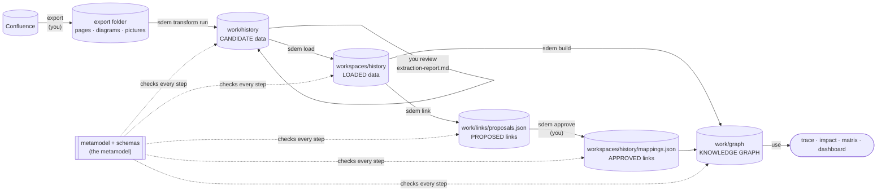

# Onboarding — what happens inside

> **Status: current (v0.9.9)** — for builders and reviewers: what each onboarding step does to the data, and why the metamodel is never an output. The architect's guide is the [onboarding workflow](../sdem-onboarding-workflow.md).

## What each step does to the data

**Only two steps create anything new:** the **transform** creates the architecture data; **`sdem build`** creates the graphs. Every other step reviews, moves, proposes or approves.

| Stage | Who | What happens to the data | Produces | Lives in | Stopped by | Data is now |
|---|---|---|---|---|---|---|
| **Export** | you / Confluence | pages, diagrams and pictures leave Confluence | an export folder (any layout) | `work/imports/…` — never committed | — | **raw** |
| **Transform** — `sdem transform run` | SDEM (rules; on-device OCR for pictures) | every item is accounted for — captured, skipped by design, or **not captured** (listed with its place and text); **the architecture data is created**: A1, A3, A4 entities and the links inside each architecture, each with its source | candidate datasets `a1/a3/a4-*.json`, `extraction.json`, `design-index.json`, `extraction-report.md` | `work/history` | nothing is refused — problems are **reported** so you can see them | **candidate**: right format, *not yet* reviewed, *maybe* not valid |
| **Review** | you | you decide what is right — validation cannot tell an OCR misread from a real name | the ids to reject | — | your judgement | **reviewed** |
| **Load** — `sdem load` | you run it | **the data is not changed**: the entities you keep are copied, unchanged, into the workspace; the ones you reject are left out; your decision is recorded; what did not fit is kept as **gap records** | the workspace's datasets (+ A2 with `--a2`), `designs/design-records.json`, `mappings.json` (empty for a new workspace), `loads/LOAD-<n>.json` with the reconciliation | `workspaces/history` | **refused, nothing written**, if the workspace would fail validation, an entity there would change, or the person is not a person | **loaded**: validated *and* reviewed |
| **Link** — `sdem link` | SDEM (rules engine) | links **between** architectures are **proposed**; those touching onboarded entities are never above *low* until the entity is confirmed | `proposals.json` | `work/links` | — (proposals only) | **proposed links** |
| **Approve** — `sdem approve` | you | a proposal becomes an approved record — your name, the date, the evidence, the BIAN release for BIAN links | records in `mappings.json` | `workspaces/history/mappings.json` | **refused** if evidence or the BIAN release is missing, or the reviewer is not a person | **approved links** |
| **Build** — `sdem build` | SDEM | **the graphs are created** from the loaded data and approved links | a graph per architecture, `federated.graph.json` (the knowledge graph), `designs.graph.json` (pages and gaps) | `work/graph` | **refused** if any data fails validation, or it is unloaded candidate data (CTL-23) | **ready** |

## The metamodel is not an output

The metamodel (`metamodel/`) and the schemas (`schema/`) are **written and approved before any data**. Onboarding never generates or changes them; every step checks the data against them.

| Metamodel file | Used by | For |
|---|---|---|
| `metamodel/a1…a4-*.json`, `entity-attributes.json` | transform, load, check, build | which entity types exist, their attributes |
| `metamodel/level-relationships.json` | transform, load, check, build | which links are allowed **inside** an architecture |
| `schema/relationship-types.json`, `metamodel/relationship-rules.json` | transform, link | which links may exist **between** architectures; the engine's rules |
| `schema/level-model.schema.json`, `schema/entities/<A>/<Entity>.schema.json` | transform, load, check | the format of a dataset and of each entity |
| `schema/design-records.schema.json` | load, check, build | the format of design and gap records |
| `schema/relationship-registry.schema.json` | approve | the format of an approved link |
| `schema/graph-store.schema.json` | build | the format of the graph store |
| `metamodel/transform-rules.json` | transform | how to read tables, diagrams and text (yours to tune) |
