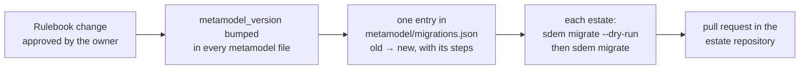

# Rulebook versioning and migration

> **Status: built 2026-10-29** (audit phase 3). Command: `sdem migrate`. Record: `metamodel/migrations.json`. Tests: `tests/test_migrate.py`.

## The problem

Every architecture dataset and registry says which **rulebook** (metamodel) version it was written for (`metamodel_version`). SDEM refuses a file whose version differs from the rulebook it has loaded, because a changed rulebook may rename a type, an attribute or a link kind — reading old data with new rules could silently mean something else. Until now there was no way forward: changing the rulebook would have stranded every estate.

## The rule



1. **A change to the rulebook that affects data bumps `metamodel_version`** (in every `metamodel/*.json` file that carries it — SDEM refuses files that disagree) **and adds one migration** from the old version to the new. A change that only *adds* (a new optional attribute, a new type) is a migration with no steps — it moves the version only.
2. **Versions** follow the baselines: `0.4.0` today; `0.8.0` when the owner approves the 0.8 baseline. Patch numbers are not used for the rulebook.
3. **Approved links are never rewritten in meaning.** A migration may rename a relationship type in the registry; it never changes which records a link joins or its approval. If a change would, it is a supersession (a new link replacing the old), not a migration.
4. **Estates move on purpose.** `sdem migrate` is run by a person, checks the whole estate as it would be, writes all-or-nothing, records `migrations/MIG-nnn.json`, and goes through a pull request like any change.

## The steps a migration can contain

| Step | Fields | Applies to |
|---|---|---|
| `rename_type` | `from`, `to` | records in the datasets; link ends in the registry |
| `rename_attribute` | `from`, `to`, `type` (optional) | record attributes |
| `drop_attribute` | `name`, `type` (optional) | record attributes |
| `set_attribute` | `type`, `name`, `value` | records of that type that do not have it |
| `rename_kind` | `from`, `to` | links inside an architecture |
| `rename_relationship` | `from`, `to` | links between architectures (registry) |

Example entry:

```json
{"from": "0.4.0", "to": "0.8.0", "note": "0.8 baseline: deprecated accesses attribute and sdmm_* spellings removed",
 "steps": [{"step": "drop_attribute", "name": "accesses"}]}
```

## Using it

```bash
sdem migrate --estate estates/history --person jane.architect --dry-run   # what would change; the estate checked; nothing written
sdem migrate --estate estates/history --person jane.architect             # migrate, check, write, record MIG-001
```

| Result | Exit |
|---|---|
| migrated, or already current | 0 |
| no recorded path from the file's version, or the estate would fail its checks — **nothing written** | 1 |
| not an estate folder; `--person` is not a person | 2 |

A file with no `metamodel_version` is taken to be current. The error SDEM gives for a version mismatch names this command.

## Requirements

| ID | Requirement | Test |
|---|---|---|
| RV-01 | A dataset or registry whose version differs from the rulebook is refused, and the message names `sdem migrate`. | `test_the_mismatch_error_names_the_command` |
| RV-02 | Migrations chain from any recorded version to the current one; a version with no path is refused. | `test_chain`, `test_no_recorded_path_is_refused` |
| RV-03 | The migrated estate is checked before anything is written; a migration that breaks it writes nothing. | `test_a_migration_that_breaks_the_estate_writes_nothing` |
| RV-04 | `--dry-run` writes nothing. | `test_dry_run_writes_nothing` |
| RV-05 | A person migrates; the migration is recorded with the person, files, versions and changes. | `test_a_person_decides`, `test_migrates_checks_and_records` |
| RV-06 | `metamodel/migrations.json` is well formed and every recorded version reaches the current one. | `test_the_rulebook_record_is_well_formed` |
