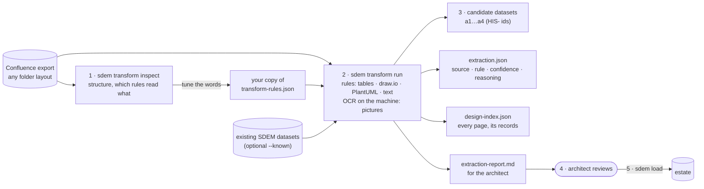
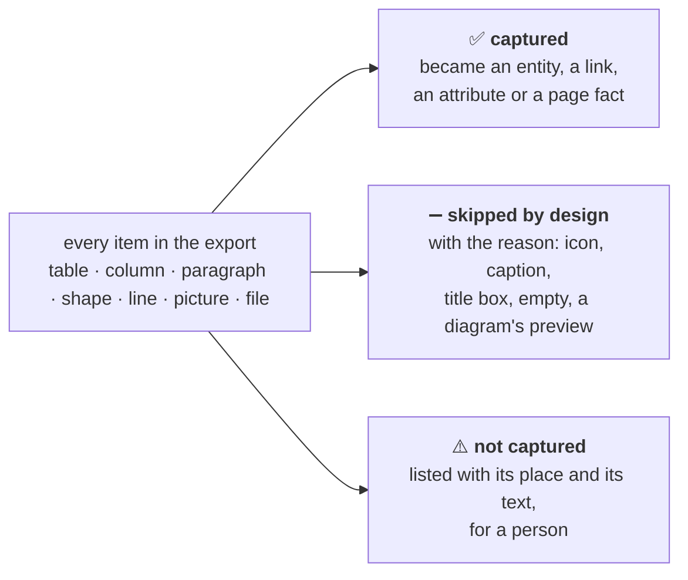

# SDEM Transform — Turning past designs into architecture entities

`sdem transform` takes an **export** of past designs (from Confluence) and **transforms** it into SDEM architecture entities. Getting the pages out of Confluence — the export — is done by the architect or Confluence; SDEM does the transform. (Named `sdem history` until 2026-10-28.)

> **Status: built 2026-10-28, tested on two synthetic exports only** (Confluence's standard HTML export, and a prepared export with provenance files in the root, raw HTML and diagrams in `archives/`, sections as folders — `tests/fixtures/`). `sdem transform inspect` and `sdem transform run`. Requirements: [`sdem-transform-spec.md`](sdem-transform-spec.md). It is the first part of the historical design repository (original design §9; roadmap v0.11 ingestion and v0.16 history).

The whole journey, export to knowledge graph — what each step does to the data, what it produces and when the data is ready: [`sdem-onboarding-workflow.md`](../sdem-onboarding-workflow.md).

## 1. The problem

Past designs live in Confluence as **narrative pages with embedded diagrams and tables**. To trace them, compare them with new BIAN-aligned designs, or reuse them, SDEM needs their content as architecture records. But:

- the designs are **the organisation's confidential information** — they never leave the work machine, and nobody outside sees them;
- the work machine has **no AI** (no large language model) — so the reading is done by **rules**; the only machine learning used is the computer's own **on-device text recognition (OCR)** for the text in pictures, which can be switched off;
- SDEM was built **without seeing a single real page** — so the rules must be easy to adjust on the work machine, without code.

## 1a. Scope

The transform does **one stage**: an export of past designs → **candidate architecture entities, with their evidence**. What comes before and after belongs to other steps.

**In scope**

| Does | Detail |
|---|---|
| Read the export | any folder layout: root files = provenance, pages in any folder (HTML, Markdown, text, CSV), folders = sections |
| Read the content | tables · draw.io · PlantUML · known names and simple phrases in text · text in pictures (on-device OCR) |
| Create **A1, A3 and A4 entities** | candidates, typed with the metamodel's entity types (§4.2) |
| Create links **inside** each architecture | only kinds the metamodel allows (e.g. Payments Hub *flow* Clearing Gateway) |
| List candidate links **between** architectures | e.g. Clearing Gateway *deployed on* PAYAPP01 — suggestions in `extraction.json`, never in a dataset |
| Record evidence | page, place, rule, confidence, reasoning — for every entity and link |
| Index the designs | every page: Confluence id, link, date, the entities found on it |
| Check its own output | SDEM's normal dataset checks on the candidates |
| Flag what it cannot do | pictures, unknown shapes, diagrams no page refers to, BIAN names — for a person |

**Out of scope**

| Does not | Done by |
|---|---|
| Export from Confluence | the architect / Confluence |
| Change the metamodel | nobody here — the transform only **uses** it |
| Create **A2 (BIAN) entities** | the BIAN catalogue only (CTL-17). A BIAN name in a design is recorded as a **BIAN mention** — a hint for `sdem link` — never as an entity. Enforced in code, even if a rules file asks for an A2 type |
| Write to the estate | **`sdem load`** — the L of the ETL, run by the architect after review ([`sdem-load-design.md`](sdem-load-design.md)) |
| Create or approve links between architectures (`mappings.json`) | `sdem link` proposes; `sdem approve` (a person) approves |
| Build the knowledge graph | `sdem build`, from loaded entities and approved links — never from candidates (CTL-23) |
| Trace, impact, matrices, dashboards | the usual SDEM commands, once the graph exists |
| Understand narrative text | a person — without AI only names and simple phrases are read |
| Read boxes and arrows in pictures | a person — OCR reads text only |

## 2. How it works

In five steps — SDEM does the first three, the architect the last two:

| Step | Who | What happens |
|---|---|---|
| **1. Scan** | `sdem transform inspect` | walks the whole export and works out its structure: root files = provenance, `.html`/`.md`/`.txt`/`.csv` = pages, folder names = sections, draw.io and PlantUML = diagrams, other images = pictures; shows which rule reads each table and shape. Writes nothing |
| **2. Read** | `sdem transform run` | tables → entities (by column headings) and links (source/target tables); draw.io and PlantUML → entities from shapes, links from lines and nesting; text → links between names already found; pictures → names read by OCR (never links) |
| **3. Write** | `sdem transform run` | candidate datasets (`a1…a4`, `HIS-` ids), `extraction.json` (source, rule, confidence, reasoning for every item), `design-index.json` (every page and its entities), `extraction-report.md` — into the output folder only; the estate is not touched |
| **4. Review** | the architect | keeps, fixes or deletes each candidate against its page (confidence is never above medium) |
| **5. Load** | the architect, with `sdem load` | loads the entities kept into an estate — selected, checked first, recorded ([`sdem-load-design.md`](sdem-load-design.md)); then `sdem link`, `sdem approve`, `sdem build` as usual |



On the work machine:

```bash
# 1. Put the export in a folder outside the repository, e.g. ~/designs/payarch (Confluence's HTML export or a prepared one)
sdem transform inspect ~/designs/payarch                       # tables, diagram shapes, headings — and which rule reads each
cp metamodel/transform-rules.json my-rules.json                # 2. only if inspect shows "no rule" or "unclassified" items you want
sdem transform run ~/designs/payarch -o work/history --rules my-rules.json --known estate/a3-application.json
open work/history/extraction-report.md                        # 3. review
```

## 2a. Any folder layout

The reader does not depend on Confluence's own export layout. It sorts every file by **what it is and where it sits**:

| File | Treated as |
|---|---|
| Files in the export's **root** that are not HTML pages (readme, source, evidence — Markdown, text, JSON, CSV, anything) | **provenance**: listed with size and SHA-256. JSON and CSV lists are matched to pages (a row whose value equals a page's file path, file name or title) and fill in the page id, link, title, date and space (`manifest_keys` in the rules) |
| `.html`, `.md`, `.txt`, `.csv` **anywhere else** (e.g. raw HTML in `archives/`, section files in section folders) | **pages**: HTML headings, tables, paragraphs and pictures; Markdown headings, pipe tables, paragraphs and ``; text paragraphs; a CSV is one table |
| Any file holding a **draw.io diagram** — wherever it is | a **diagram**, linked to the page whose HTML or Markdown **refers to it** (resolved from the page's own folder; or the picture the page shows has the same name in the same folder). A diagram no page refers to is still read, with its folder as context, and listed for a person |
| Other pictures | **for a person**, whether a page shows them or they just sit in a section folder |

**Folders are sections.** `Payments Hub Design/3. Infrastructure/servers.csv` is read as if under the headings "Payments Hub Design › Infrastructure" (numbering dropped; container folders such as `archives` and `attachments` left out). That is what places a shape with nothing else to go by in the right architecture.

`sdem transform inspect EXPORT --anonymous` prints the folder layout — what each folder holds — with folder names replaced by F1, F2 …, so the structure can be described to someone outside without naming anything.

If the same content appears twice (e.g. a section both in the raw HTML and in its folder), the records merge by name and both places are listed as sources.

## 3. What it reads, and how sure it is

| In the export | How (rules) | Confidence |
|---|---|---|
| **Tables** with a heading row | The column headings choose the entity type: a table with an "Application" column lists application components (rule HT-01); "Server" → nodes; "Capability" → capabilities; "Database" → system software… Other columns fill the description, lifecycle status ("Live" → active, "Decommissioned" → retired) and attributes (vendor, version, hosting). | medium |
| **Source/target tables** (interface lists) | A row "Payments Hub → Fraud Screening" becomes a flow between the two (HL-01). Names not found elsewhere become application components. | medium (link), low (new names) |
| **draw.io diagrams** | Read from the diagram's own file, whatever its name: a plain `.drawio`/XML file, a compressed one, or a PNG/SVG with the diagram inside it. A shape's **ArchiMate type** gives the entity type (HD-01…23); otherwise its **fill colour** gives the architecture and its **label or shape** the type ("cluster" → node, cylinder → system software). | medium (ArchiMate shape), low (colour, words) |
| **Lines** in diagrams | A line between two shapes in one architecture becomes a relationship of the first kind the rulebook allows for the pair ("triggers" on the line → triggering); a shape drawn **inside** another is part of it — or, across architectures, deployed on it. | low |
| **PlantUML diagrams** | Read from the **source**, not the picture: `.puml` files, `@startuml` blocks in pages (HTML code blocks, Markdown ```` ```plantuml ````, text files), PNGs with the source in their `plantuml` text chunk, SVGs with an encoded `plantuml-src`. Element keywords give the type (`component`, `node`, `database`, `actor` …), as do C4 macros (`Person`, `Container`, `ContainerDb`, `Deployment_Node` …) and ArchiMate (`archimate … <<application-component>>`, `Application_Component(…)`); arrows and `Rel(…)` give links (`Rel_Serving` → serving); nesting gives part-of or deployed-on. Activity diagrams, mind maps and Gantt charts are listed for a person (HU-*). | medium (typed), low (untyped, sequence participants) |
| **Pictures** (screenshots, exported PNG/JPG) | **Text read by OCR on the machine**: macOS's built-in text recognition (Apple Vision — nothing to install) or Tesseract where installed; SVG pictures' text is read exactly. Stacked lines become one label (name, then description); captions in small letters (usually on lines) are skipped. A label becomes a candidate only when a name already found, a label word or the section decides its type (HO-*). **Boxes and lines are not read** — the picture is always listed for a person, with the labels read. | low |
| **Narrative text** | Only **names already found** (in tables, diagrams or the `--known` datasets) are recognised. Two names joined by a simple phrase become a link: "X sends … to Y" → flow, "X calls Y" → Y serves X, "X is hosted on Y" → deployed on. Text **never creates** a record. | low |
| **Key-value tables** (Owner \| Payments team) | Not read; shown by `inspect`. | — |

Never above medium: every record is a **candidate** until a person confirms it (as AID-B6 caps name-only evidence).

## 3a. Nothing silently lost — every item accounted for

The transform cannot read everything, but it must **say what it did not read**. Every item in the export is accounted for with one of three outcomes:



A test proves the three add up to the total on every page — nothing disappears.

| Item | Captured when | Skipped by design | Not captured (category) |
|---|---|---|---|
| **Table** | a rule reads it (entities or links); a key-value table → **page facts** | empty | no rule matched · **no entity type** |
| **Column** of a table that was read | it fills the name, description, status, a link end or a mapped attribute | — | **column not mapped** — and the values are kept with the entity or link (`unmapped`) |
| **Paragraph** | it names a known entity, or a phrase between two names gives a link (the *meaning* is not read) | — | text not read |
| **Picture** | it is a diagram (read as one), or OCR labels became candidates (lines still for a person) | an icon; a diagram's preview | needs a person |
| **Diagram shape** | it became an entity | a text box, caption, legend or title; no label; a group | no rule matched |
| **Diagram line** | it became a link | — | line without both ends |
| **Diagram** (PlantUML) of a kind not read | — | — | diagram kind not read |
| **File** | a page, a diagram, a picture, or a provenance file in the root | styles, icons, the space index | file not read (PDF, Word, Excel, Visio …) |

### Content that does not fit an architecture entity

| Case | Example | Where it goes |
|---|---|---|
| a **detail of an entity** | a table's *RTO*, *Vendor*, *Protocol* column | onto the entity when the data model has the attribute and the rules map it; otherwise kept as **not mapped** beside the entity, for a person to map |
| **about the page**, not an entity | owner, review date, approval status | the page's **facts** in the design index (from key-value tables) |
| a **kind of thing SDEM has no type for** | risks, issues, costs, SLAs, decisions, constraints | **not captured — no entity type**, listed with its place and text; never forced into a wrong type. Recurring ones are **candidate metamodel gaps** for the owner — the metamodel changes only with the owner's approval |

Words that signal *no entity type* (e.g. "risk", "cost", "SLA") are in `metamodel/transform-rules.json` (`no_entity_type_words`), so a table of risks is reported as a possible gap, not as "no rule".

### Coverage

Per page and overall: **captured ÷ (captured + not captured)**, skipped items left out. Shown in the report, the design index (with each page's facts and its not-captured count) and `sdem transform inspect`.

## 4. What it produces — and what it does not

```
Confluence ──export──▶ folder ──sdem transform run──▶ candidate entities + evidence
 (architect)                          (transform)                         │
                                                        the architect reviews, then sdem load (L)
                                                                          ▼
                                     estate (a1…a4 datasets) ──sdem link / approve──▶ mappings.json
                                                                          │
                                                                     sdem build
                                                                          ▼
                                                                knowledge graph ──▶ trace, impact, dashboard
```

| Produces | Does not produce | Why — and how it is made |
|---|---|---|
| **A1, A3, A4 entities** (candidates) and the **links inside each architecture** | **A2 (BIAN) entities** | BIAN elements come from the BIAN catalogue only (CTL-17); BIAN names found are listed as mentions |
| **Evidence** for every entity and link | **The metamodel** | the fixed rulebook: the transform **uses** it to type and check every entity, never changes it |
| **Candidate links between architectures** (in `extraction.json` only) | **Approved links between architectures** (`mappings.json`) | they need a person's approval with evidence — `sdem link` proposes, `sdem approve` approves |
| **Design index** — every page and its entities | **The knowledge graph** (graph store) | built from loaded entities and approved links only — `sdem build`; candidates are refused (CTL-23) |

### 4.1 Expected outputs — the files

Everything is written to the output folder (`-o`); nothing else is created or changed.

| File | Expected content | Format | Written |
|---|---|---|---|
| `a1-business.json` | candidate **A1 Business** entities and the links between them | SDEM architecture dataset (`schema/level-model.schema.json`) — passes `sdem check` | when A1 entities are found |
| `a3-application.json` | candidate **A3 Application** entities and the links between them | same | when A3 entities are found |
| `a4-technology.json` | candidate **A4 Technology** entities and the links between them | same | when A4 entities are found |
| *(no `a2-service-domain.json`)* | — | — | never (CTL-17) |
| `extraction.json` | every entity and link with **all its sources** (page, place, rule, confidence, reasoning); candidate links between architectures with the SDEM link type that fits (or none — a person decides); BIAN mentions; items for a person; the check result; provenance files of the export root; fingerprints of the export and the rules; summary figures | JSON | always |
| `design-index.json` | every page (and loose diagram or picture file): Confluence id, title, space, link, breadcrumb, file, last modified, the entities found on it, existing records it mentions, its diagrams and pictures; the provenance files | JSON | always |
| `extraction-report.md` | the review page: Summary · **Coverage** · Check · Records · Links inside · Links between · BIAN elements named · For a person · **Not captured** · Export provenance · Designs · Next | Markdown | always |

**In every entity** (dataset format): `id` `HIS-<architecture>-<NAME>` · `type` (an entity type of the metamodel) · `name` · `version` = the page's last-modified date (else `1`) · `lifecycle_status` when a status column says so · `description` (a table's description column first, else a diagram's second line) · `attributes.source_id` = `confluence:<pages>` (links the engine later proposes for it are capped at low, DEC-E-11) · `attributes.modified` · `attributes.deployed_on` for an application drawn inside, or said to run on, a node (HI-R06 — the form the engine reads) · `source_system` `CONFLUENCE-EXTRACT` on the dataset. **In every link inside an architecture:** `source`, `kind` (one the metamodel allows for the pair), `target`, `name` (the line's or row's label).

### 4.2 Expected outputs — the entity types

What each architecture's candidates can be, and what produces them (rules in `metamodel/transform-rules.json`):

| Architecture | Entity types the transform can produce | From |
|---|---|---|
| **A1 Business** | BusinessCapability · BusinessProcess · BusinessActor · BusinessRole · BusinessService · BusinessObject · BusinessRequirement · BusinessActivity · ValueStream | tables (capability, process, actor, requirement columns), draw.io ArchiMate shapes, PlantUML (actor, person, ArchiMate business / strategy / motivation), label words (customer, merchant …), the section default (capability) |
| **A2 Service Domain (BIAN)** | **none** — BIAN mentions only | — (CTL-17) |
| **A3 Application** | ApplicationComponent · ApplicationService · ApplicationInterface · ApplicationFunction · DataEntity · Event | tables (application, service, interface columns), source/target tables, draw.io ArchiMate shapes, PlantUML (component, interface, participant, C4 container, ArchiMate application), label words (app, system, hub …), the section default (component) |
| **A4 Technology** | Node · Device · SystemSoftware · TechnologyService · TechnologyInterface · Artifact · CommunicationNetwork | tables (server, database, technology service columns), draw.io ArchiMate shapes and cloud icons, PlantUML (node, database, queue, artifact, C4 deployment node, ArchiMate technology), label words (server, cluster, database, network …), the section default (node) |

### 4.3 Expected outputs — the walkthrough example

`sdem transform run examples/designs/confluence-folder-export -o work/history` (the made-up export in the prepared layout) produces:

| Output | Expected |
|---|---|
| `a1-business.json` | **3 entities**: Payment Clearing, Payment Initiation (capabilities), Retail Customer (actor) |
| `a3-application.json` | **8 entities**: Payments Hub, Clearing Gateway, Mobile Banking App, Sanctions Screening, Scheme Adapter, Ledger Posting Service, Sanctions Checkel (an OCR misread of "Checker"), Payment Order (data); **5 links**, e.g. Payments Hub *flow* Clearing Gateway "Clearing file (SFTP)" |
| `a4-technology.json` | **8 entities**: PAYAPP01, PAYAPP02, Payments Kubernetes Cluster, Core Switch (nodes), Edge Firewall (device), Payments DMZ (network), Payments Store, PostgreSQL 15 (system software); **2 links** |
| `extraction.json` | 19 entities (14 medium, 5 low) with their sources — Payments Hub has 7; **6 candidate links between architectures** (3 *deployed on*, e.g. Clearing Gateway → PAYAPP01 from "is hosted on"; 3 for a person to type); **6 items for a person** (3 pictures, 3 diagrams no page refers to); check: 1 error (Payment Order needs its attribute list); 3 provenance files |
| `design-index.json` | **10 entries**: the archive page (Confluence id 55501, 2022-05-10, 10 entities, 3 diagrams, 1 picture), 5 section files, 4 loose files |
| `extraction-report.md` | the same, for review |

These figures come from macOS with OCR on; with `--ocr off` the whiteboard's labels are not read (Ledger Posting Service and Sanctions Checkel are not produced).

## 5. Working without seeing the real pages

| Risk | How it is handled |
|---|---|
| Real exports differ from the sample | `inspect` shows the structure — column headings, draw.io shape names, headings, each with the rule that read it or "no rule" / "unclassified". |
| Your pages use other words | All words, shapes, colours and phrases are in **`metamodel/transform-rules.json`**. Copy it, add your words, pass `--rules`. No code changes. |
| A wrong guess becomes "fact" | Candidates only; confidence never above medium; every item says where it came from and why; the architect loads only what is right (`sdem load`), and a graph is never built from candidates (CTL-23). |
| Content leaks | No network, no large language model, Python standard library only (OCR uses the computer's own text recognition, on the machine; `--ocr off` turns it off). The export, the outputs and the report stay on the work machine. The sample in this repository is made up. |

## 6. Assumptions about Confluence's export (to confirm on the first real run)

| Assumption | Basis | Confidence |
|---|---|---|
| (standard Confluence layout, still supported) HTML space export: one `.html` per page named `Title_<pageId>.html` (older: `<pageId>.html`); the body in `div#main-content`; "last modified on …" in `div.page-metadata`; files in `attachments/<pageId>/` | general knowledge of Confluence exports; not checked against Atlassian's documentation today | medium |
| draw.io keeps the editable diagram as an attachment (XML, possibly compressed), with a PNG preview on the page | general knowledge of the draw.io Confluence app | medium |
| PlantUML PNGs keep the source in a `plantuml` text chunk; SVGs in a `<?plantuml-src …?>` instruction, encoded as in PlantUML URLs | general knowledge of PlantUML; the decoder reproduces PlantUML's documented example (`SyfFKj2rKt3CoKnELR1Io4ZDoSa70000` = "Bob -> Alice : hello") | medium (high for the encoding) |
| macOS Vision text recognition is usable from `osascript` (JavaScript for Automation) without installing anything | **tested on this machine** (macOS 26.4) — read every label of a rendered diagram; a locked-down Mac may block `osascript` (then Tesseract, or `--ocr off`) | high here; to confirm on the work Mac |
| draw.io's ArchiMate 3 shapes are styled `shape=mxgraph.archimate3.application;appType=comp` (and `…tech;techType=node`, …) | general knowledge of draw.io's shape library | medium — business-layer styles least sure; `inspect` shows the styles actually used |

If any of these is wrong, `inspect` shows it at once (0 pages, 0 diagrams, or shapes "unclassified"); most fixes are a rules change, the first two may need a small code change.

## 7. Decisions

| # | Decision | Recommendation | Status |
|---|---|---|---|
| HI-D01 | How past designs come into SDEM | **index every design, convert with rules, a person confirms** (option 4 of the discussion: reference index plus candidates) | built 2026-10-28 |
| HI-D02 | AI for narrative and pictures | **No large language model on the work machine.** Pictures: **OCR** (macOS Vision built in, or Tesseract) reads their text — a local, on-device text-recognition model, no network, not a chat AI; **check your organisation allows it** (`--ocr off` turns it off). Narrative meaning stays with a person | decided for OCR 2026-10-28; LLM drafting open — owner |
| HI-D03 | Where loaded historical records live | **a separate historical estate** (e.g. `estates/history/`) so `sdem check`, `trace` and the dashboard work on it, apart from current designs; `sdem load --estate` takes any folder | recommended 2026-10-28 |
| HI-D04 | Guard against candidates entering real data unreviewed | **CTL-23**: `sdem build` refuses `CONFLUENCE-EXTRACT` datasets; the only way in is `sdem load` (candidates still pass `sdem check`, so they can be reviewed) | approved and built 2026-10-28 |

## 8. Limits

- From pictures only their text is read (OCR), never their boxes and lines; OCR can misread (e.g. "Checker" → "Checkel") — always low confidence, always listed for a person.
- Visio and Gliffy diagrams, PDFs and Word attachments are not read (listed for a person where they appear on a page).
- PlantUML: `!include`d files and `!define` macros are not expanded; activity, mind-map and Gantt diagrams are not read.
- Narrative text is read only for names already known and a few phrases; most narrative meaning is left to a person.
- Key-value tables are not read.
- Names are matched exactly (ignoring case and punctuation): "Payments Hub" and "Payment Hub" become two records — the report shows both.
