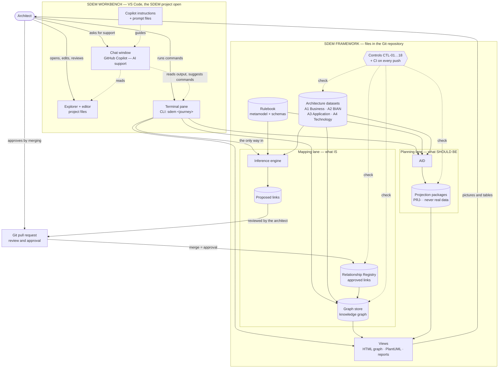
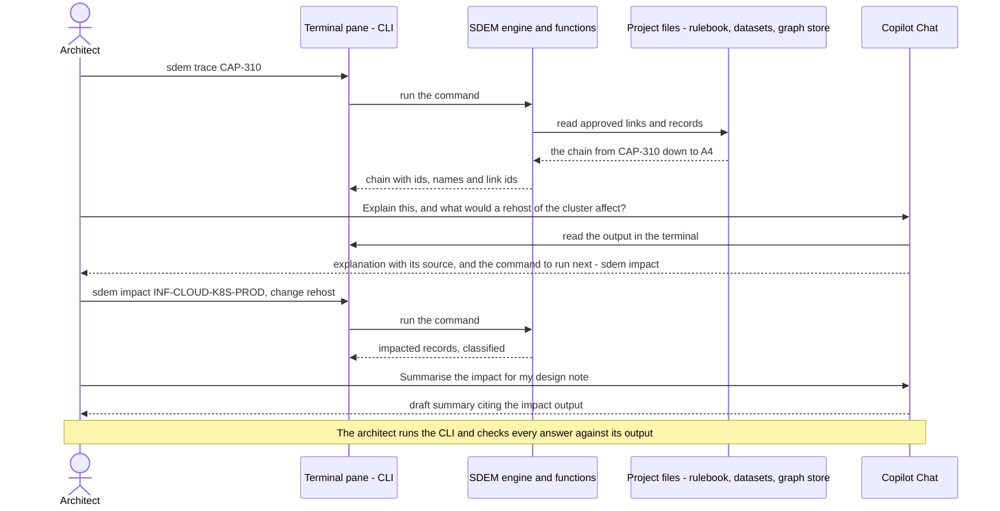
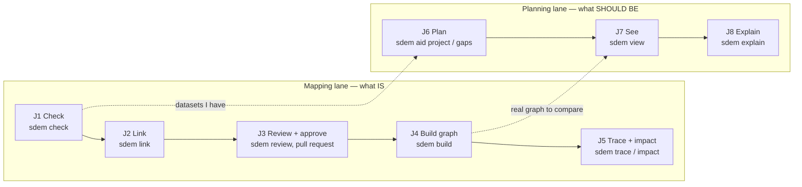
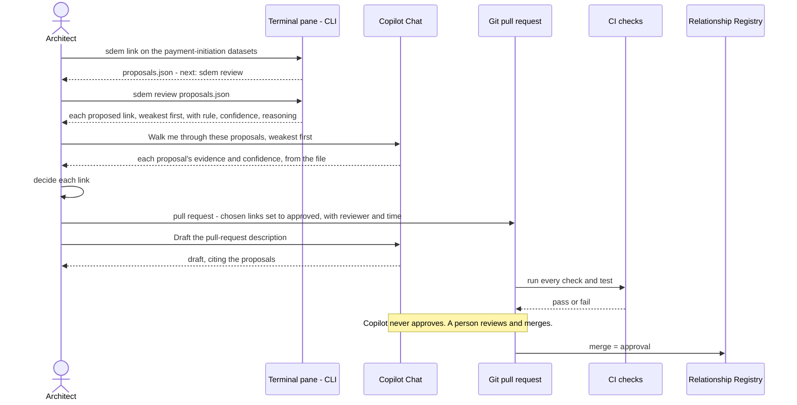
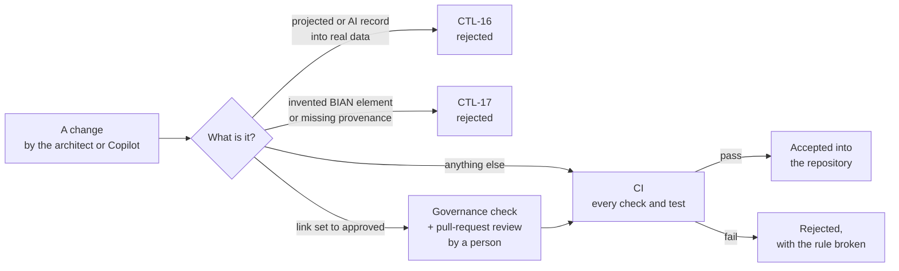
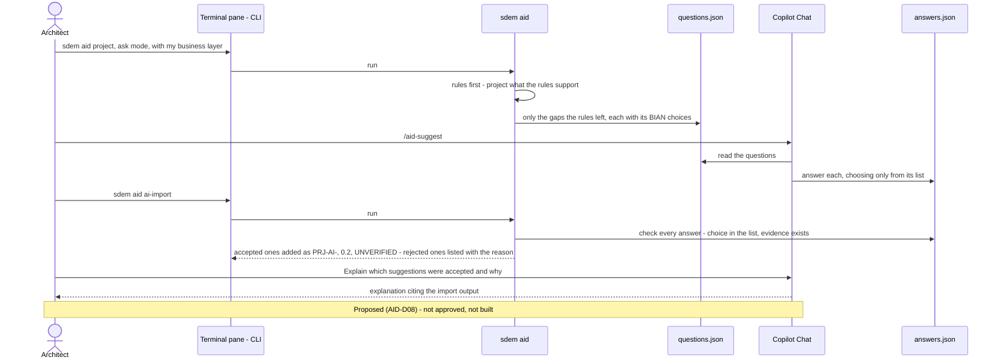

# SDEM Workbench — Design

> **Status: approved by the owner and built (2026-10-28).** Direction set by the owner (SDEM-D01): the architect opens the SDEM project in **VS Code**, runs SDEM from the **terminal pane (CLI)**, and uses the **Copilot Chat window** for AI support. Requirements: [`sdem-workbench-spec.md`](sdem-workbench-spec.md). How to use it: [`sdem-workbench-user-guide.md`](../sdem-workbench-user-guide.md). The CLI — one `sdem` command (SDEM-D07) — and the controls are built; the Copilot set-up (instructions and prompt files) is **not built**.
>
> **Diagrams** are Mermaid: GitHub shows them as pictures; in VS Code install the recommended extension *Markdown Preview Mermaid Support* (`bierner.markdown-mermaid`, listed in `.vscode/extensions.json`) and open the Markdown preview. No diagram server is used.

## 1. What the workbench is

The **SDEM workbench** is how an architect uses SDEM day to day. It is not a new application — it is VS Code, set up for SDEM:

| VS Code part | Used for | Who drives it |
|---|---|---|
| **The SDEM project** (Explorer + editor) | the rulebook, the architecture datasets, the registry, the stores, projections and documents — opened, read, edited and reviewed as files | the architect |
| **Terminal pane — the CLI** | **runs SDEM**: every engine and function is a command — check, link, build, trace, impact, plan (AID), view, regenerate | **the architect** |
| **Chat window — GitHub Copilot** | **AI support**: explains command output, suggests the right command, drafts records and pull-request text, reviews proposals with the architect | the architect asks; Copilot supports |
| **Git** (Source Control) | history; a link is approved in a reviewed pull request | the architect and reviewers |

**The CLI is SDEM's only interface** (SDEM-D07). Copilot does not have a back door into SDEM: when it runs anything, it runs the same CLI command, visibly, in the terminal. The **rules and controls decide** what is valid — Copilot can be wrong, and SDEM's checks do not depend on it being right.

## 2. The layers

| Layer | What | Role | Built? |
|---|---|---|---|
| **Workbench** | VS Code: Explorer, editor, terminal pane, chat window, Source Control | the architect's enterprise architecture tool | yes (VS Code) |
| **Interface** | the **CLI** in the terminal pane — one `sdem` command with a subcommand per journey (SDEM-D07); the older `sdem-*` commands remain as aliases | runs every engine and function | built |
| **AI support** | GitHub Copilot Chat | explains, suggests commands, drafts, reviews. Runs a command only when asked, visibly. **Never approves** | instructions and prompt files not built |
| **Engine and functions** | Python package `sdem` | checks, inference engine, AID, trace, impact, gap analysis, views, generators | built |
| **Rulebook** | `metamodel/`, `schema/` | what may exist and link, on what published basis | built |
| **Repository** | architecture datasets, Relationship Registry, graph store, projection packages — JSON files | the architecture data | built |
| **History and approval** | Git, with pull requests | who changed what and why; links are approved in reviewed changes | built (Git); approval flow to document |
| **Views** | the **dashboard** (`sdem dashboard`: the estate on one read-only HTML page), the HTML graph view, matrices and impact reports, PlantUML diagrams | pictures and tables for review — VS Code is not a drawing tool; open HTML in VS Code's Simple Browser | built |
| **Controls** | CTL-01…17 (CTL-18 proposed), CI on every push | keep people and the AI honest: nothing unchecked becomes real | built |

### 2.1 How the workbench fits into the SDEM framework

The architect works in the **VS Code workbench** (top). The **CLI** is the one way into the **SDEM framework** (bottom). Copilot sits beside the architect: it reads files and terminal output and suggests what to run; when asked to run something, it uses the same CLI. The controls check everything that becomes real; approval is a person merging a reviewed pull request.



### 2.2 What the architect sees in VS Code

```
┌─ VS Code — SDEM project ─────────────────────────────────────────────────────────────────────┐
│ EXPLORER               │ EDITOR                               │ COPILOT CHAT                 │
│ ▸ metamodel/  rulebook │ a3-application.json                  │ You: explain this trace and  │
│ ▸ schema/              │ {                                    │ what a rehost of the cluster │
│ ▾ examples/            │   "level": "A3",                     │ would affect                 │
│   ▾ card-fraud-alerts/ │   "instances": [                     │                              │
│     a1-business.json   │     { "id": "APP-FRAUD-ENGINE",      │ Copilot: Card Fraud Alerts   │
│     a2-service-…json   │       "type": "A3.Application…",     │ needs Fraud Detection, run   │
│     a3-application.json│       ...                            │ by Fraud Engine on the prod  │
│     a4-technology.json │                                      │ cluster (links FRD-001…006,  │
│     mappings.json      ├──────────────────────────────────────┤ approved). To see a rehost's │
│ ▸ docs/                │ TERMINAL — the CLI                   │ effect, run:                 │
│ ▸ .github/prompts/     │ $ sdem trace CAP-310 \               │ sdem impact                  │
│                        │     --graph examples/…/graph         │   INF-CLOUD-K8S-PROD         │
│                        │ DOWNSTREAM (depends on):             │   --change rehost …          │
│                        │ CAP-310 'Card Fraud Alerts'          │                              │
│                        │ └─ -SUPPORTED_BY-> SD-044 …          │ /sdem-explain /sdem-impact   │
│                        │    └─ -REALIZED_BY-> APP-FRAUD-ENGI… │ [ Ask Copilot …            ] │
└────────────────────────┴──────────────────────────────────────┴──────────────────────────────┘
```

The **Explorer** shows the project: the rulebook, the datasets, the documents and the prompt files. The **editor** shows a dataset. In the **terminal** the architect has run the CLI. In the **chat** the architect asks Copilot to explain the output; Copilot answers **with its source** (the approved links) and suggests the **next command** to run. The trace is the real one from the `card-fraud-alerts` example.

### 2.3 How the terminal and the chat work together



The terminal is where SDEM runs; the chat is where the architect gets help understanding and deciding. Copilot answers from the command output and files, never from memory, and names its source.

## 3. How an architect works — the journeys

Every journey is a **CLI command the architect runs** in the terminal pane; Copilot supports in the chat.

| # | Journey | Terminal pane — the architect runs | Chat window — Copilot supports | Result |
|---|---|---|---|---|
| J1 | **Check data** | `sdem check …` · `sdem validate …` | explains each error and the rule broken; suggests the fix | errors and warnings, each with the rule broken |
| J2 | **Link the architectures** | `sdem link … --out …` | summarises the proposals by confidence | proposed links with source, reasoning, confidence — for review |
| J3 | **Review and approve** | `sdem review proposals.json`; then edits the registry (status, reviewer, time) and opens a pull request | walks through each proposal's evidence; drafts the pull-request description. **Never approves** | the **architect** decides; the merged pull request is the approval |
| J4 | **Build the knowledge graph** | `sdem build … --out …` | explains a rejected build from the load record | graph store and load record |
| J5 | **Trace and impact** | `sdem trace …` · `sdem impact … --change …` | explains the chain; suggests the next question; drafts the impact note | chains with names, impact classified |
| J6 | **Plan with AID** | `sdem aid project …` · `check` · `gaps` | explains what was projected, from what, and how sure | a projected design, marked and capped, kept apart from real data |
| J7 | **See it** | `sdem view [--projection …]` | points out what to look at in the view | an HTML picture, projected parts dashed and labelled PROJECTED |
| J8 | **Explain an element** | `sdem explain <id> --projection …` or `--proposals …` | quotes the element's step, rule, published source, evidence, reasoning and confidence | the reason an element exists |

`sdem --help` lists every journey; each subcommand's `--help` shows a worked example. Without installing, `python -m sdem …` does the same. The older `sdem-*` commands still work as aliases of `sdem <verb>`; the documents use only `sdem <verb>`.

### 3.1 The journeys in order



### 3.2 How a link gets approved



## 4. Copilot's role and ground rules

**Copilot's role is support.** It explains command output, suggests the right command and its options, drafts (dataset records, impact notes, pull-request text), and reviews proposals with the architect. The architect runs SDEM.

Copilot is told these rules through `.github/copilot-instructions.md`, which Copilot reads automatically in this repository:

1. **Facts come from SDEM's CLI and files.** Answer architecture questions from command output and files, not from memory; say which command or file each answer came from.
2. **Suggest the exact command.** When the answer needs SDEM to run, give the architect the exact CLI command. Run it only when the architect asks — in the terminal pane, so the command and its output are visible.
3. **Rules first.** The engine and AID's rules always run first; AI suggestions only fill gaps they report, and are marked, capped and labelled unverified.
4. **Never write projected or AI content into real data** — architecture datasets, the registry, the graph store. (Control CTL-16 also blocks it.)
5. **Never approve.** Copilot may prepare a review; a person approves, through a pull request.
6. **Source, reasoning, confidence** on every statement about the architecture.
7. **No MCP, no API keys**, and no data sent anywhere except through the organisation's approved Copilot.
8. **When unsure, say so** and name the command that would settle it.

## 5. How the pieces are connected — and why this way

| Mechanism | What it does | Why |
|---|---|---|
| **The CLI** in the terminal pane | the architect runs every SDEM engine and function as a command; output as text, `--json` where available | one interface for the architect, Copilot and CI; nothing hidden; works with Copilot off |
| One `sdem` command (SDEM-D07, built) | `sdem <journey>` with the same options, `--json`, exit codes and `--help` everywhere; the `sdem-*` commands stay as aliases | one thing to learn; prompt files name one command |
| `.github/copilot-instructions.md` | standing instructions: the ground rules, where things are, which command answers which question | read automatically; versioned with the rulebook |
| `.github/prompts/*.prompt.md` | one `/` command per kind of support (e.g. `/sdem-explain`, `/sdem-review`, `/aid-suggest`) | repeatable help; the architect does not need to remember options |
| **Not** MCP | — | the organisation prohibits MCP on GitHub Copilot |
| **Not** an AI API in SDEM | — | no keys, no new data flows; Copilot is already approved |

SDEM must **work without Copilot**: every journey is a CLI command. Copilot makes it easier to understand and decide; it is never required.

## 6. Safety — what keeps the AI honest

| Risk | Control |
|---|---|
| Copilot writes a projected or invented record into real data | CTL-16 rejects it in the dataset check, the registry validator and the store build |
| Copilot marks a link approved | the governance check requires a reviewer and approval time; approval happens only in a reviewed pull request (rule 5) |
| Copilot invents a BIAN domain | CTL-17 rejects any A2 element not in the catalogue |
| Copilot's answer sounds right but is wrong | answers must cite the command or file (rule 1); the architect re-runs the command |
| Copilot runs something unseen | it runs only the CLI, only when asked, in the terminal pane (rule 2) |
| A change breaks the rulebook or a generated document | CI runs every check and test on every push |
| AI suggestions taken as fact | marked `PRJ-AI-`, capped at 0.2, labelled UNVERIFIED (AID-D08, CTL-18 proposed) |



## 7. AI suggestions in AID — through Copilot

The AI suggestion layer proposed for AID (decision AID-D08, [`aid-design.md`](aid-design.md) §8) works **through the architect's Copilot**, not through an AI the SDEM code calls. The architect runs the CLI; Copilot answers SDEM's questions in the chat:

1. In the terminal: `sdem aid project … --ask` runs the rules and writes `ai/questions.json` — each gap the rules could not fill, its context, the list of BIAN choices, and the exact answer format.
2. In the chat: `/aid-suggest` — Copilot answers into `ai/answers.json`, choosing only from each list.
3. In the terminal: `sdem aid ai-import …` checks every answer — a choice from the list, evidence that exists — and adds the accepted ones marked `PRJ-AI-`, at 0.2, labelled UNVERIFIED; CTL-18.

Both files stay in the projection package for audit. A re-import of the same answers gives the same result.



## 8. Data and privacy

- Architecture data stays in the repository and the architect's VS Code.
- The only AI is the organisation's approved Copilot; what it may see is set by the organisation's Copilot policy, not by SDEM.
- **This repository holds public and synthetic data only** — never an employer's architecture data.
- **PlantUML preview:** `.vscode/settings.json` sets the PlantUML extension to render **locally** (`plantuml.render: Local` — needs Java and Graphviz), so no diagram text leaves the machine. Never point it at the public server `www.plantuml.com` for real architecture data; an organisation's own server is fine.

## 9. Limits

| Limit | Consequence |
|---|---|
| VS Code is not a modelling tool | no drag-and-drop diagramming; diagrams and views are generated from the data |
| The architect works in a terminal | needs comfort with commands and files; the single `sdem` command, `--help` examples and Copilot's suggestions lower the bar |
| Depends on the organisation's Copilot policy | models, data rules and features vary; SDEM works with Copilot off |
| Copilot can make mistakes | the controls, not Copilot, decide what is valid; the architect re-runs the command |
| Copilot's model can be switched by the user | SDEM can record only the model the architect or Copilot states |
| Copilot is licensed per user | VS Code itself is free |

## 10. Decisions

| # | Decision | Recommendation | Status |
|---|---|---|---|
| SDEM-D01 | SDEM's tool for architects | **VS Code** with the SDEM project open: the **terminal pane runs the CLI**, the **Copilot Chat window gives AI support**, Git holds history and approval | **direction set by the owner 2026-10-28** |
| SDEM-D02 | How Copilot connects | repository instructions + prompt files; it reads files and terminal output and uses the same CLI; **no MCP, no AI API or keys in SDEM** | recommended — follows the organisation's policy |
| SDEM-D03 | Where approval happens | in a reviewed **pull request** that changes the registry; Copilot never approves | recommended |
| SDEM-D04 | Diagrams | generated from the data (HTML view, PlantUML); never hand-drawn as the source of truth | recommended — as built |
| SDEM-D05 | Copilot optional | every journey is a CLI command the architect can run without Copilot | recommended |
| SDEM-D06 | PlantUML for real data | local or the organisation's own server, never the public one | recommended |
| SDEM-D07 | The interface | **the CLI is SDEM's only interface** — every engine and function is a command; **one `sdem` command** with a subcommand per journey, the same options, `--json`, exit codes and `--help` everywhere; the `sdem-*` commands stay as aliases | **set by the owner 2026-10-28; built** |

## 11. Open questions

| ID | Question | Recommendation |
|---|---|---|
| WB-Q01 | Package the set-up as a VS Code extension later? | Not now — the CLI, instructions and prompt files need no extension; revisit if architects need buttons and panels |
| WB-Q02 | Should the HTML view open inside VS Code? | Yes, as a later step (a simple preview); a browser works today |
| WB-Q03 | Who reviews the Copilot instructions when the rulebook changes? | The rulebook owner; CI checks the instructions name only commands that exist |
| WB-Q06 | A GUI with actions and forms? | Proposed as dashboard phase 2 (`sdem serve`, DB-D05) — would amend SDEM-D07 to "one engine, two front ends; no logic in the GUI" |
| WB-Q05 | Agents per architecture? | Proposed in [`sdem-agent-platform-design.md`](sdem-agent-platform-design.md): Copilot custom agents per layer and an orchestrator, coordinating through the federated graph |
| WB-Q04 | Should the use-case and baseline scripts (`scripts/*.py`) become CLI commands? | Done — `sdem model examples` and `sdem model baseline-pack` |
