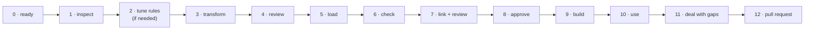

# Use-case example 4 — Onboarding existing designs: from a Confluence export to the knowledge graph

> **Status: test script, 2026-10-29.** The plain guide for the same workflow: [`sdem-onboarding-workflow.md`](../sdem-onboarding-workflow.md). Expected results for Run A are sealed below and checked automatically on every push (`tests/test_use_case_example_4.py`). Run B is yours to do on the work machine with a real export. The whole workflow is explained in [`sdem-onboarding-workflow.md`](../sdem-onboarding-workflow.md); commands in the [user guide](../sdem-workbench-user-guide.md) §8.7.

## What this tests

An architect has exported Confluence designs and wants them in SDEM: transformed into architecture entities, reviewed, loaded into a workspace, linked, approved and built into the knowledge graph — with **nothing lost**: what does not fit an entity is kept as gap records, shown on the dashboard, and closed by a person.



## The commands in plain words

The same table as the [onboarding workflow §3](../sdem-onboarding-workflow.md#3-the-commands-in-plain-words) (a test keeps them identical). Every command's full options: the [user guide's command reference](../sdem-workbench-user-guide.md#7-command-reference).

Each command does one job. The steps below use them in this order.

| # | Command | In plain words |
|---|---|---|
| 1 | `sdem transform inspect <export folder>` | **Look before you start.** Shows what is in your export and what SDEM can read. Changes nothing |
| 2 | `sdem transform run <export folder> -o work/history` | **Read the designs.** Turns the pages into a list of *suggested* architecture items, and writes a report for you to read |
| 3 | *(you read `work/history/extraction-report.md`)* | **Check the suggestions.** Decide which are wrong |
| 4 | `sdem load work/history --workspace workspaces/history --person <you> --exclude <wrong ones>` | **Keep the good ones.** Copies the items you accept into your project; whatever did not fit is kept as *gaps*. Add `--dry-run` first to see what would happen |
| 5 | `sdem check --workspace workspaces/history` | **Health check.** Confirms everything follows the rules |
| 6 | `sdem link --workspace workspaces/history --out work/links` | **Suggest connections.** SDEM proposes how items connect across layers (e.g. *this app runs on this server*) |
| 7 | `sdem review work/links/proposals.json` | **See the suggested connections**, weakest first |
| 8 | `sdem approve <id> … --reviewer <you> --evidence <document>` | **Accept a connection.** You confirm it, and name the document that proves it |
| 9 | `sdem build --workspace workspaces/history --out work/graph` | **Make the picture.** Builds the connected view — the knowledge graph — from what you accepted |
| 10 | `sdem trace <item>` · `sdem impact <item> --change retire` | **Ask questions.** *What does this depend on?* · *What breaks if we remove this?* |
| 11 | `sdem dashboard --workspace workspaces/history -o work/dashboard.html` | **See it as a web page** — everything above, clickable, in your browser |
| 12 | `sdem designs --workspace workspaces/history --gaps` | **See the gaps** — what did not fit, still waiting for you |
| 13 | `sdem designs accept` · `resolve <gap id> … --person <you> --note "<why>"` | **Close a gap.** *Accept* = leave it as it is; *resolve* = you have dealt with it |
| 14 | in your **private** workspace repository: `git add workspaces/<domain>` → commit → pull request | **Save and share** — your accepted work goes for review |

**In short:** **read** (1–2) → **you check** (3) → **keep** (4–5) → **connect** (6–8) → **picture** (9) → **use** (10–11) → **tidy up** (12–13) → **save** (14).

**Remember:**
- `--person` / `--reviewer` is always **your name** — only a person can accept items, connections and gaps.
- `work/` is your **scratch area** — never saved to Git; keep the export there.
- `workspaces/history/` is **the real result** — that is what you save.
- Any command explains itself: add `--help` (e.g. `sdem load --help`).

## Two runs

| Run | Data | Purpose | Results |
|---|---|---|---|
| **A — rehearsal** | the made-up export `examples/designs/confluence-folder-export` (Payments Hub Design) | learn the steps; prove SDEM behaves as expected | must match the **expected** column exactly |
| **B — real** | your Confluence export, on the work machine | prove the workflow on real designs | record **counts and observations only** — never content, names or screenshots of real designs outside the organisation |

## Before you start

| # | Check | ✓ |
|---|---|---|
| P1 | VS Code open on the SDEM project; a terminal pane; `python3 -m sdem --help` works | |
| P2 | On a new branch: `git checkout -b import/<name>` | |
| P3 | **The export is under `work/`** (e.g. `work/imports/payarch/`) — only `work/`, `private/` and `secrets/` are kept out of Git | |
| P4 | Run A: `mkdir -p work/imports && cp -r examples/designs/confluence-folder-export work/imports/payarch` | |
| P5 | Your organisation's A2 (BIAN) dataset to hand — Run A uses `examples/payment-initiation/a2-service-domain.json` | |
| P6 | Run A uses `--ocr off` everywhere, so the results are the same on every machine. Run B: OCR on (the default) unless your organisation does not allow it | |

## The steps

Run A's commands below; for Run B use your own paths and names. **Expected** = Run A's sealed result.

### 1 · Inspect — nothing is written
```bash
sdem transform inspect work/imports/payarch --ocr off
```
| Expected (Run A) | A ✓ | B — record |
|---|---|---|
| `6 pages, 6 tables, 7 diagrams read (… 4 PlantUML; 3 not linked to a page) … 3 pictures for a person, 3 provenance files` | | pages, tables, diagrams, pictures |
| tables: application · capability · server → read (HT-01, HT-07, HT-04); source/target → HL-01; owner/review date/approval → **page facts**; risk/impact/mitigation → **no entity type** | | tables marked *no rule* |
| `Coverage: 80% captured (45 captured, 11 not captured, 4 skipped by design)` | | coverage % |

Run B: if tables or shapes you need show *no rule* / *unclassified*, do step 2. `--anonymous` gives the folder layout without names, safe to share.

### 2 · Tune the rules — only if needed
```bash
sdem transform rules -o rules/transform-rules.json      # a copy of SDEM's rules; add your column names, label words, shapes
sdem transform inspect work/imports/payarch --rules rules/transform-rules.json --ocr off
```
Run A: not needed. Run B: record which words you added (not the content).

### 3 · Transform
```bash
sdem transform run work/imports/payarch -o work/history --ocr off
```
| Expected (Run A) | A ✓ | B — record |
|---|---|---|
| `6 pages read: A1 3 records, A3 6 records, A4 8 records, 7 links inside, 6 candidate links between, 3 pictures for a person` | | entities per layer |
| `coverage: … tables and diagrams 95% …` (text and pictures vary with OCR) | | coverage by kind |
| `check: 1 error(s)` | | errors |
| writes `a1-business.json`, `a3-application.json`, `a4-technology.json`, `extraction.json`, `design-index.json`, `extraction-report.md` — **no A2** | | |

### 4 · Review — read `work/history/extraction-report.md`
| Section | Expected (Run A) | A ✓ | B — record |
|---|---|---|---|
| Coverage | 80% captured | | lowest-covered pages |
| Check | `HIS-A3-PAYMENT-ORDER: required attribute 'attributes' missing (LC-04)` | | |
| Records | 17 candidates, each with page, place, rule, confidence (never above medium), reasoning | | wrong names / types found |
| Not captured | text not read 5, needs a person 3, no entity type 1 (the Risks table), column not mapped 1 (*Support hours*), file not read 1 (`payments-hld-v1.pdf`) | | categories and counts |
| **Decision** | reject `HIS-A3-PAYMENT-ORDER` (fails the check) | | ids rejected, and why |

Optional: in Copilot Chat, `/sdem-onboarding-review work/history` explains each candidate and suggests the rejections.

### 5 · Load — dry run first
```bash
sdem load work/history --workspace workspaces/history --person <your name> --exclude HIS-A3-PAYMENT-ORDER \
  --a2 examples/payment-initiation/a2-service-domain.json --dry-run
```
then the same **without** `--dry-run`.

| Expected (Run A) | A ✓ | B — record |
|---|---|---|
| `loaded (LOAD-001) into workspaces/history: A1 3 entities, A3 5 entities, A4 8 entities, 7 links inside architectures; A2 dataset added` | | |
| `gap records: 13 (text not read 5, needs a person 3, column not mapped 2, no entity type 1, file not read 1, rejected at load 1)` | | gap counts |
| `reconciliation: 17 candidates = 16 loaded + 0 already in the workspace + 1 excluded; 60 items read = 45 captured + 4 skipped by design + 11 not captured` | | **does it balance?** |
| `workspaces/history/` holds `a1…a4` datasets, `mappings.json` (empty), `designs/design-records.json`, `loads/LOAD-001.json` | | |
| `--dry-run` wrote nothing | | |

### 6 · Check
```bash
sdem check --workspace workspaces/history
```
| Expected (Run A) | A ✓ | B |
|---|---|---|
| `OK` for A1, A2, A3, A4, mappings and **design records** | | |

### 7 · Link and review
```bash
sdem link --workspace workspaces/history --out work/links
sdem review work/links/proposals.json
```
| Expected (Run A) | A ✓ | B — record |
|---|---|---|
| 5 proposals, all **0.4** | | proposals by type |
| 3 × DEPLOYED_ON (Clearing Gateway → PAYAPP01; Payments Hub, Sanctions Screening → Payments Kubernetes Cluster), each *capped at low: … transformed from a document (DEC-E-11)* | | |
| 2 × SUPPORTED_BY: Payment Clearing → SD-PE; Payment Initiation → SD-PI | | |

### 8 · Approve — a person, with evidence
```bash
sdem approve P-RUN-001 --proposals work/links/proposals.json --workspace workspaces/history --reviewer <your name> \
  --evidence deployment_design:PAYARCH-55501#notes
sdem approve P-RUN-005 --proposals work/links/proposals.json --workspace workspaces/history --reviewer <your name> \
  --evidence business_architecture_document:PAYARCH-55501#context --evidence domain_scope_assessment:DSA-1
#   → refused: "a link to a BIAN element needs the BIAN release it relies on: add --bian-release <release>"
sdem approve P-RUN-005 … --bian-release BIAN-RELEASE-X
```
| Expected (Run A) | A ✓ | B — record |
|---|---|---|
| `approved MAP-001: HIS-A3-CLEARING-GATEWAY -DEPLOYED_ON-> HIS-A4-PAYAPP01` | | links approved |
| P-RUN-005 without `--bian-release` **refused**, nothing written | | |
| `approved MAP-002: HIS-A1-PAYMENT-INITIATION -SUPPORTED_BY-> SD-PI` | | |
| `--reviewer copilot` (try it) is refused | | |

### 9 · Build
```bash
sdem build --workspace workspaces/history --out work/graph
sdem build work/history/a1-business.json work/history/a3-application.json workspaces/history/mappings.json --out work/refused   # the candidates: must be refused
```
| Expected (Run A) | A ✓ | B |
|---|---|---|
| `build 1 accepted: … a2 (24 nodes, 33 edges), a3 (5, 5), a4 (8, 2), designs.graph.json (24 nodes, 42 edges), federated.graph.json (4 nodes, 2 edges)` | | |
| `sdem build` on `work/history` (the candidates) is **refused** (CTL-23) | | |

### 10 · Use
```bash
sdem trace HIS-A1-PAYMENT-INITIATION --graph work/graph --direction down
sdem trace HIS-A3-PAYMENTS-HUB --graph work/graph
sdem impact HIS-A4-PAYAPP01 --change retire --graph work/graph
sdem dashboard --workspace workspaces/history -o work/history-dashboard.html
```
| Expected (Run A) | A ✓ | B — record |
|---|---|---|
| Payment Initiation `-SUPPORTED_BY->` SD-PI (MAP-002) | | a trace that matters to you |
| Payments Hub ends with `DOCUMENTED IN: DOC-55501 Payments Hub Design (2022-05-10) — 7 open gap(s)` | | |
| retiring PAYAPP01 → Clearing Gateway *design_change_required* via MAP-001; supersede MAP-001 | | |
| dashboard: *What needs your attention* shows **13 open gap(s)**; tab **Designs & gaps** lists them with resolve/accept commands | | |

### 11 · Deal with gaps
```bash
sdem designs --workspace workspaces/history --gaps --status open
sdem designs accept  <risks gap id> --workspace workspaces/history --person <your name> --note "risks stay in the risk register"
sdem designs resolve <pdf gap id>   --workspace workspaces/history --person <your name> --note "HLD v1 superseded by this design"
sdem check --workspace workspaces/history
```
| Expected (Run A) | A ✓ | B — record |
|---|---|---|
| `gaps: 13` (by category as in step 5) | | open gaps |
| accept → `12 open gap(s) left`; resolve → `11 open gap(s) left` | | gaps closed, by decision |
| `accept` without `--note`, or with `--person copilot`, is refused | | |
| `OK: design records` | | |

### 12 · Commit through a pull request
In this test you worked in the SDEM project, which ignores `workspaces/` — so there is nothing to commit. With real designs you work in your private workspace repository, loading into `workspaces/<domain>`, and then:
```bash
git add workspaces/<domain>               # datasets, mappings.json, designs/, loads/ — never work/
git commit -m "Onboard Payments Hub Design (LOAD-001), 2 approved links"
git push -u origin onboard/payarch     # open a pull request; a reviewer merges it
```
| Expected | ✓ |
|---|---|
| `git status` shows nothing under `work/` | |

### Repeat load — nothing twice
```bash
sdem load work/history --workspace workspaces/history --person <your name> --exclude HIS-A3-PAYMENT-ORDER
```
| Expected (Run A) | A ✓ |
|---|---|
| `loaded (LOAD-002): A1 0, A3 0, A4 0 entities`; `reconciliation: 17 candidates = 0 loaded + 16 already in the workspace + 1 excluded` | |
| still 13 gap records; the two you closed keep their status | |

## Acceptance criteria (sealed)

| # | Criterion | Steps |
|---|---|---|
| C1 | The export is read whatever its layout; nothing is written before the transform | 1 |
| C2 | Candidates are A1, A3, A4 only — never A2 — each with page, place, rule, confidence ≤ medium, reasoning | 3, 4 |
| C3 | Every item is accounted for: captured + skipped + not captured = items read | 1, 5 |
| C4 | Only the entities kept are loaded, unchanged; the workspace is checked before anything is written; the load is recorded | 5, 6 |
| C5 | What did not fit is kept as gap records; the reconciliation balances | 5 |
| C6 | Links between architectures are proposed, never loaded; links from document-derived entities are capped at low | 7 |
| C7 | Only a person approves, with the evidence the link type needs (and the BIAN release for BIAN links) | 8 |
| C8 | The graph is built only from loaded data and approved links; candidates are refused | 9 |
| C9 | Trace and impact work across the loaded design; gaps are visible on trace and the dashboard, outside the knowledge graph | 10 |
| C10 | Gaps are closed only by a person, with a note, on record | 11 |
| C11 | A repeated load adds nothing twice | repeat |
| C12 | Nothing confidential enters Git (`work/` ignored) | 12 |

## Results

| Run | Date | Who | Steps passed | Criteria passed | Notes (counts and observations only) |
|---|---|---|---|---|---|
| A | | | / 12 + repeat | / 12 | |
| B | | | / 12 + repeat | / 12 | |

**Send back after Run B** (safe to share): the anonymous inspect output (`--anonymous`), the coverage %, the counts per step, which rules you tuned, and any step that did not behave as described. Never the export, page names, entity names or the report.
