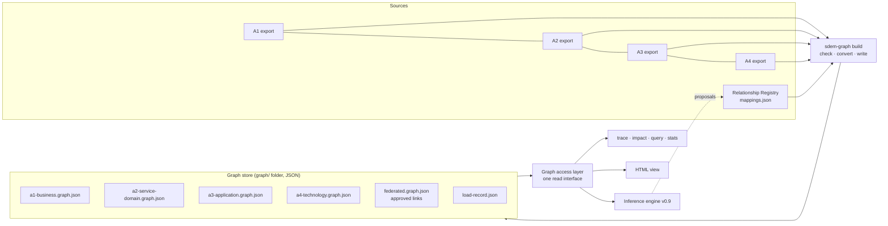

# SDEM — Graph Store Design (local, JSON)

> **Status: approved and built, 2026-10-25** (decisions GD-01…GD-09 as recommended). Code: `sdem/store.py`, `sdem/view.py`, `sdem-graph build | query | baseline | view`; example stores in `examples/*/graph/`. Companion to [`graph-store-spec.md`](graph-store-spec.md), which states the requirements (GS-*) this design meets. It closes decisions DEC-01 (graph store) and DEC-03 (one store or five) in [`knowledge-graph-spec.md`](knowledge-graph-spec.md) §12.

## 1. What it is, in one paragraph

Today SDEM builds its knowledge graphs **in memory** every time a command runs, from the export files, and throws them away afterwards. The **graph store** keeps them: it writes each checked local knowledge graph, and the federated graph of approved cross-architecture links, to **JSON files on the local device**. Queries (trace, impact, unmapped, …), the HTML view, and later the inference engine read those files. No server, no database, no install — Python only, so it runs on a locked-down work laptop. Files are in a published graph format, **JSON Graph Format (JGF) v2** (MIT licence), and live in git, so every change to the graph is versioned and diffable.

## 2. Where it sits



In the logical architecture diagram, the store **is** the four "A1…A4 Graph & Schema" boxes and the "Federated Knowledge Graph / Cross-layer Mapping Registry & Traceability" box, made persistent.

## 3. The files

```
graph/
  a1-business.graph.json          local knowledge graph A1
  a2-service-domain.graph.json    local knowledge graph A2
  a3-application.graph.json       local knowledge graph A3
  a4-technology.graph.json        local knowledge graph A4
  federated.graph.json            the approved cross-architecture links
  load-record.json                every build: inputs, checks, outputs, accepted or rejected
  baselines/<name>/…              optional frozen copies (e.g. before a release)
  view.html                       optional generated picture of the graph
```

One folder per estate. For the repository's examples that is `examples/<estate>/graph/` (committed, checked current in CI). For real institution data the folder is wherever the institution chooses — **never this public repository**.

**One folder, five graph files** — the logical split the knowledge-graph spec asks for (four local graphs and one federated graph) without five databases.

## 4. What a node and an edge look like

A **node** is one record from an export. JGF keys nodes by a string; SDEM's key is `<level>:<id>@<version>`, because the same id can appear in two architectures and a record can have several versions.

```json
"A1:PRC-PAY-01@1.0": {
  "label": "Capture and validate payment instruction",
  "metadata": {
    "level": "A1", "type": "A1.BusinessProcess", "id": "PRC-PAY-01", "version": "1.0",
    "lifecycle_status": "active",
    "description": "Capture the instruction from the channel, validate it, obtain authorisation.",
    "attributes": { "owner": "ROLE-PAY-OFFICER", "criticality": "high", "frequency": "continuous", "level": 2,
                    "invokes": ["SO-PI-01", "SO-PI-02"] }
  }
}
```

A **within-architecture edge** is one relationship from the export; it records which within-level row allowed it.

```json
{ "id": "A1:PRC-PAY-01-composition-ACT-PAY-01a", "source": "A1:PRC-PAY-01@1.0", "target": "A1:ACT-PAY-01a@1.0",
  "relation": "composition", "metadata": { "scope": "within-level", "row": "RA1-24" } }
```

A **cross-architecture edge** (in `federated.graph.json`) is one **approved** registry record, carrying its approval data — the reason a property graph suits SDEM better than plain triples.

```json
{ "id": "PAY-003", "source": "A1:PRC-PAY-01@1.0", "target": "A2:SD-PI@1.0", "relation": "USES_DOMAIN",
  "metadata": { "scope": "cross-level", "status": "approved", "perspective": "process",
                "evidence": ["process_model:PM-MAKE-PAYMENT-2026"],
                "rationale": "Capture and validation invoke Initiate and Evaluate of the domain",
                "baseline_id": "PAY-BASE-2026-Q4", "reviewer_id": "jane.architect", "approved_at": "2026-10-22" } }
```

The federated file also lists each linked record as a small **stub node** (key, label, level, type, and which file holds the full node), so the file is valid JGF on its own and readable without the local files.

## 5. How a build works

`sdem-graph build <exports> <registry> --out graph/`

1. **Read** the four exports and the registry.
2. **Check** them exactly as `sdem-graph check` does today: entity types, within-level rows, the data model (all 14 logical rules), the registry records and that every approved link resolves.
3. **If anything fails** — write nothing to the graph files, keep the last good graph, add a *rejected* entry to the load record listing every error, exit with an error. (Closes KG-L-03 and KG-R-03, *keep the previous graph*.)
4. **Otherwise convert** to JGF and write the five files — deterministically: same inputs, byte-identical files (sorted keys, fixed order, no timestamps inside the graph files), so a git diff shows only real changes.
5. **Record** the build in the load record: input files with their versions and checksums, metamodel version, counts, warnings, output checksums. That entry is the load's **baseline** (KG-V-01).

Rebuilds are full, as the knowledge-graph spec already allows (KG-R-02); incremental update can come later with change handling (v0.11).

## 6. How it is read — the graph access layer

Everything that reads the graph goes through **one interface** (in `sdem/store.py`): *records of a type (including subtypes), a record by id, its attributes, its within-level links, its approved cross-level links, the build's baseline.* Two implementations sit behind it:

| Implementation | Reads from | Used by |
|---|---|---|
| **Store** | the `graph/` JSON files | queries, view, engine — the normal path |
| **Exports** | export files directly, built in memory (today's code) | `sdem-graph check`, and as the reference the store is tested against |

Every existing query must give **identical answers** from either — that is the main acceptance test. The engine (v0.10) is written only against the interface, so a database could replace the files later without changing it.

## 7. Queries

| Query | Command | Status today |
|---|---|---|
| Trace (down / up, with part–whole) | `sdem-graph trace … --graph graph/` | built in memory; gains `--graph` |
| Impact | `sdem-graph impact … --graph graph/` | built in memory; gains `--graph` |
| Stats | `sdem-graph stats --graph graph/` | built in memory; gains `--graph` |
| **Find records** by level, type, attribute value | `sdem-graph query --type A1.BusinessProcess --where criticality=high` | new |
| **Neighbours** within an architecture | `sdem-graph query --neighbours PRC-PAY-01 --kind composition` | new (KG-L-04) |
| **Unmapped** — records with no approved cross-level link where a rule expects one (the engine's work list) | `sdem-graph query --unmapped A2` | new (KG-Q-04) |
| Baseline — answer against a frozen copy | any query with `--graph graph/baselines/<name>` | new (KG-V-02) |

## 8. Seeing it — the HTML view

`sdem-graph view --graph graph/` writes `graph/view.html`: **one self-contained file, no internet needed** (no CDN). It draws the four architectures as horizontal bands — A1 at the top, A4 at the bottom — with within-level links inside a band and approved links crossing between bands. Click a record to see its attributes and links; filter by architecture or type; pick a record to highlight its trace up or down.

## 9. Limits, honestly

| Limit | Why acceptable now | When it bites | Then |
|---|---|---|---|
| Held in memory when read | tens of thousands of records load in a second or two | a whole bank's estate | move behind the same interface to a database |
| One writer at a time | builds are run by one person or a pipeline | many architects editing at once | a database, or builds only through a pipeline |
| Full rebuild per change | small files, fast | very large estates | incremental update (v0.11) |
| No built-in graph browser | the generated HTML view | heavy exploration | load the JGF into a graph tool, or a database later |

## 10. Decisions — recommendations for one approval

| # | Decision | Recommendation | Why |
|---|---|---|---|
| GD-01 | File format | **JSON Graph Format v2**, with an SDEM profile (what goes in `metadata`) | published, MIT, simple; nodes and edges both carry data |
| GD-02 | Node key | **`<level>:<id>@<version>`** | ids can repeat across architectures; records are versioned |
| GD-03 | Layout | **one folder, four local files + one federated file + load record** | matches the logical split; closes DEC-03 |
| GD-04 | What the federated file holds | **approved links only**; proposals stay in the registry until approved | the graph shows only what an architect accepted |
| GD-05 | Failed build | **keep the last good graph**, record the rejection | never replace a good graph with a broken one |
| GD-06 | Determinism | **byte-identical output for identical input; timestamps only in the load record** | clean git history and diffs |
| GD-07 | Where files live | examples committed under `examples/<estate>/graph/`; **real data never in this repository** | IP and confidentiality |
| GD-08 | Dependencies | **Python standard library only**; the view has no CDN | runs on any locked-down device |
| GD-09 | Build order | access layer + build + load record → queries → view → then the engine | the engine then reads the stored graph |
