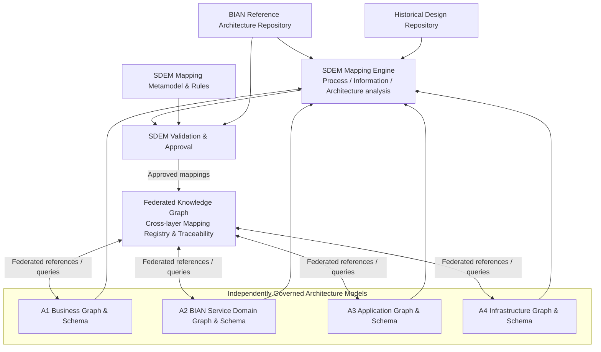
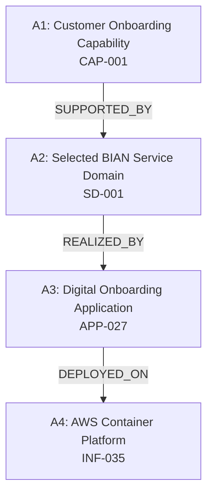
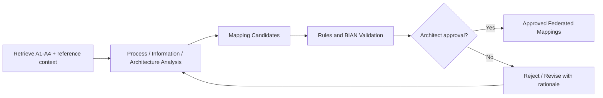

# Service Domain Enterprise Metamodel (SDEM)

> **A record, in its original words.** It uses SDEM's old names (SDMM, *mapping set*, *export*, `sdmm-*` …) — what each means today: [`renamed-from-sdmm.md`](renamed-from-sdmm.md).
## Solution Design Specification

> **Current state (2026-10-25).** The original solution design, kept as a record. The relationship type catalogue now has **nine** types (`DEPLOYED_AS` added to the eight listed in §5.1 and §12); `A1.ProcessActivity` is `A1.BusinessActivity`; the *SDEM Mapping Engine* is the Architecture Relationship Inference Engine, specified in [`relationship-rules-spec.md`](../relationship-rules-spec.md) and built (v0.10): `sdem/rules_engine.py`, run with `sdem-infer rules --graph <store>`; passes all 8 acceptance cases (`sdem-accept`). Delivery phases are tracked in [`ROADMAP.md`](../ROADMAP.md).

**Document status:** Proposed design baseline / draft for architecture review  
**Version:** 1.0  
**Architecture scope:** A1–A4  
**Primary architecture pattern:** Federated knowledge graph with independently governed level-specific models  
**Terminology note:** *Service Domain Enterprise Metamodel (SDEM)* is the platform's proposed name, not an official BIAN standard or product.

---

## 1. Purpose and definition

The **Service Domain Enterprise Metamodel (SDEM)** is a federated architecture mapping model that establishes and maintains traceable relationships between:

- **A1 — Business Architecture:** business capabilities, value streams, processes, requirements and business information.
- **A2 — BIAN Service Domain Architecture:** bank-specific selection and composition of BIAN Service Domains, Service Operations, Business Scenarios, Control Records and Business Object Models (BOMs).
- **A3 — High-Level Application Architecture:** applications, components, APIs, integration contracts and relevant data entities.
- **A4 — Detailed Infrastructure Architecture:** hosting, deployments, compute, networking, storage, security and infrastructure dependencies.

The SDEM incorporates BIAN reference architecture definitions and alignment guidance where applicable, and extends that basis using bank-specific enterprise architecture mapping rules. It preserves historical architecture artefacts while enabling new designs to follow BIAN-aligned A2 standards.

### 1.1 Design objectives

1. Establish semantic links between independently owned A1, A2, A3 and A4 models.
2. Use BIAN's BCM–Service Landscape alignment, scenarios, BOM and semantic interfaces to ground BIAN-specific mapping decisions.
3. Support mappings for **process, information and architecture** perspectives.
4. Provide bidirectional graph traversal for upstream/downstream impact assessment without duplicating every edge in reverse.
5. Preserve legacy designs as references; do not silently rewrite or convert them.
6. Record provenance, confidence, validation, approval and version information for each mapping.
7. Separate **AI mapping proposals** from **approved architecture facts**.
8. Allow approved mapping changes to trigger impact analysis and proposed revisions to affected designs.

### 1.2 Non-goals

- Automatically replacing or modernising legacy applications.
- Treating a BIAN Service Domain as necessarily equivalent to one deployable microservice.
- Assuming BIAN supplies full bank-specific A3 or A4 implementation mappings.
- Automatically publishing regenerated designs without architect approval.
- Treating illustrative SDEM relationship names as formal BIAN or ArchiMate relationship names.

---

## 2. Context and architecture principles

The bank's **existing design lifecycle** is A1 Business, A2 Conceptual, A3 High-Level Application and A4 Detailed Infrastructure. New designs replace the A2 conceptual approach with **BIAN Service Domain Architecture**. Existing designs remain unchanged as historical records, but can be discovered, referenced, compared, and reused as approved patterns.

Each level maintains its **own design entity instances, schema and knowledge graph**. A **federated knowledge graph** provides a shared cross-layer query and traceability view. The BIAN reference architecture repository and Historical Design Repository are assumed to exist outside the primary diagram; they must be connected to SDEM even when not visually depicted.

**Separation of concerns:**

- The **BIAN Reference Model** defines canonical BIAN concepts and version-specific relationships.
- Each **A1–A4 knowledge graph** owns bank-specific entity instances and in-layer relationships.
- The **SDEM mapping metamodel** defines which *cross-layer* relationships are permitted and their semantics.
- The **SDEM mapping registry / federated knowledge graph** stores approved cross-layer mappings and may also retain proposed mappings in a separate state.
- The **SDEM Mapping Engine** analyses sources and proposes mappings; it does not make unreviewed AI conclusions authoritative.

### 2.1 Logical architecture



> The diagram describes **logical responsibilities**, not a requirement for five separate physical graph databases. Federation may be implemented with graph links, a cross-layer edge store, or an indexed virtual view.

---

## 3. SDEM mapping scope

| Mapping concern | Direction / layers | BIAN reference or bank methodology | SDEM responsibility |
|---|---|---|---|
| Business capability | A1 → A2 | BIAN Business Capability Model (BCM)–Service Landscape alignment | Align A1 capabilities to selected BIAN Service Domains; support many-to-many mappings. |
| Process and value stream | A1 → A2 | BIAN Value Stream–Business Scenario alignment guidance | Relate A1 value streams/processes to BIAN scenarios and operations, with scenario suitability review. |
| Information | A1 ↔ A2; A2 ↔ A3 | BIAN BOM, business objects and Control Record definitions | Relate bank business concepts and application information to canonical BIAN semantics. |
| Logical service implementation | A2 → A3 | BIAN Service Operations and Semantic APIs, plus bank implementation rules | Identify which A3 application components and API operations realise selected A2 functions. |
| Infrastructure deployment | A3 → A4 | Bank enterprise architecture metamodel; ArchiMate where adopted | Relate application components to deployments, hosting and infrastructure dependencies. |

**Reference boundary:** BIAN supplies reference definitions, modelling constraints and alignment *guidance*; the SDEM must supply bank-specific entity matching, evidence evaluation, identity resolution, approvals, and A3/A4 implementation relationships.

---

## 4. Three horizontal mapping perspectives

The SDEM uses three **logical analysis perspectives**. They are not required to be three physically separate graphs or AI agents. They can be implemented as reusable mapping workflows reading the federated context.

| Perspective | Reads | Proposes |
|---|---|---|
| **Process Mapping** | A1 value streams, processes, requirements; A2 BIAN scenarios/operations; optionally A3 workflow evidence | `A1.ValueStream ALIGNED_TO A2.BusinessScenario`; `A1.ProcessActivity USES_DOMAIN A2.ServiceDomain` when justified. |
| **Information Mapping** | A1 business objects; BIAN BOM/Control Records; A3 data entities and API payload schemas | A1↔A2 and A2↔A3 semantic object relationships with field-level evidence where needed. |
| **Architecture Mapping** | A1 capabilities; A2 Service Domains/operations; A3 apps/APIs; A4 infrastructure; historical designs/patterns | Capability support, functional realisation, interface implementation and deployment links. |

These perspectives resemble the *types of analysis* described for ABLEMENTS' Process, Data and Architecture modules. **SDEM is an independent bank-specific solution**; the ABLEMENTS terminology is an architectural analogy, not evidence that ABLEMENTS uses this exact metamodel.

---

## 5. Core relationship metamodel

### 5.1 Permitted relationship definitions

The authoritative list is `schema/relationship-types.json`; this table mirrors it.

| `mapping_type_id` | Source type | Relationship | Target type | Perspective | Authority |
|---|---|---|---|---|---|
| `CAPABILITY_SUPPORTED_BY_DOMAIN` | `A1.BusinessCapability` | `SUPPORTED_BY` | `A2.ServiceDomain` | architecture | bian_alignment_guidance |
| `VALUE_STREAM_ALIGNED_TO_SCENARIO` | `A1.ValueStream` | `ALIGNED_TO` | `A2.BusinessScenario` | process | bian_alignment_guidance |
| `PROCESS_USES_DOMAIN` | `A1.BusinessProcess` | `USES_DOMAIN` | `A2.ServiceDomain` | process | enterprise_rule |
| `BUSINESS_OBJECT_ALIGNED_TO_BIAN_OBJECT` | `A1.BusinessObject` | `ALIGNED_TO` | `A2.BusinessObject` | information | bian_alignment_guidance |
| `DOMAIN_REALIZED_BY_COMPONENT` | `A2.ServiceDomain` | `REALIZED_BY` | `A3.ApplicationComponent` | architecture | enterprise_rule |
| `OPERATION_IMPLEMENTED_BY_API` | `A2.ServiceOperation` | `IMPLEMENTED_BY` | `A3.APIOperation` | architecture | enterprise_rule |
| `BIAN_OBJECT_MAPPED_TO_DATA_ENTITY` | `A2.BusinessObject` | `MAPPED_TO` | `A3.DataEntity` | information | enterprise_rule |
| `COMPONENT_DEPLOYED_ON_INFRASTRUCTURE` | `A3.ApplicationComponent` | `DEPLOYED_ON` | `A4.InfrastructureComponent` | architecture | enterprise_rule |

All eight are many-to-many. Every edge points from layer *n* to layer *n+1*; the registry self-check rejects same-layer or layer-skipping definitions.

These labels are **proposed SDEM vocabulary**. They must be explicitly bound to the bank's architecture metamodel; do not claim that the labels are official BIAN or automatically equivalent to ArchiMate `Serving`, `Realization` or `Assignment` relations.

### 5.2 Mapping rule registry

Store permissible cross-layer relationships in a versioned registry (`schema/relationship-types.json`, versioned by `$schema_version`). Each entry carries:

- `mapping_type_id` and `relationship`.
- `source_type` and `target_type`, each prefixed with its layer (`A1.`–`A4.`).
- `perspective` (`process`, `information`, `architecture`).
- `direction_semantics` (a descriptive definition of the edge).
- `cardinality` and `required_evidence` (evidence *kinds* a mapping of this type should cite).
- `authority` (`bian_reference`, `bian_alignment_guidance`, `enterprise_rule`; see §10.1).
- `rule_version` and `owner` (responsible architecture function).

The registry must reject invalid source/target type combinations. It should not prohibit legitimate many-to-many mappings. A mapping document may declare the `registry_version` it was validated against; the validator rejects a mismatch so a registry change cannot silently orphan existing records.

### 5.3 Core architecture mapping record

The record shape is defined by `schema/relationship-registry.schema.json`. The mapping type is derived from the `(source.type, relationship, target.type)` triple, so it is not repeated on the record.

```yaml
mapping_id: MAP-0001
source:
  id: CAP-001
  type: A1.BusinessCapability
  version: '2.1'
relationship: SUPPORTED_BY
target:
  id: SD-001                                # bank design identifier
  type: A2.ServiceDomain
  version: '1.0'
  canonical_id: '<BIAN canonical id>'       # resolved via the licensed reference adapter
perspective: architecture                    # optional; must match the registry entry
status: proposed
confidence: 0.91                             # model estimate; not proof of correctness
rationale: 'Candidate association based on capability responsibilities and domain scope.'
evidence:
  - 'DOC-BA-001#section-3'
bian_release: '<approved BIAN release>'      # required when the registry authority is bian_*
baseline_id: BASE-2026-Q1
created_by: 'SDEM Mapping Engine'
# reviewer_id, approved_at   — required once status is approved / rejected / superseded
# previous_mapping_id        — supersession link; every superseded record needs a successor
# valid_from, valid_to       — applicability window
```

Production schema should also capture tenant/bank/project scope, security classification, model version, creation time, correlation/run IDs, and optimistic locking information.

---

## 6. A1-to-A4 worked example

**Use case:** The bank introduces a new Digital Customer Onboarding design, reusing existing CRM/onboarding application patterns and infrastructure as evidence.

### 6.1 Example entity instance chain

| Level | Example entity instance | Illustrative identifier |
|---|---|---|
| A1 | Customer Onboarding Business Capability | `CAP-001` |
| A2 | Selected BIAN-aligned Customer Onboarding Service Domain | `SD-001` (bank design identifier) |
| A3 | Digital Onboarding Application Component | `APP-027` |
| A4 | AWS Container Platform | `INF-035` |

> The illustrative domain label and interactions must be checked against the bank's selected BIAN release; the example is not an approved canonical BIAN mapping.



### 6.2 Process/data/architecture evidence

| Perspective | Example evidence | Mapping candidate |
|---|---|---|
| Process | A1 onboarding workflow includes identity verification | A1 workflow/value stream ↔ relevant A2 scenario/operation |
| Information | A1 customer identity business object and A3 customer records | A1 business object ↔ A2 BIAN object ↔ A3 data entity |
| Architecture | A3 onboarding application implements specific onboarding functionality | A2 Service Domain / operation ↔ A3 component / API operation |

**Expected result:** a graph of typed, evidence-backed links; not merely a single document-to-document association.

---

## 7. Mapping engine workflow

1. **Identify scope:** choose initiative, impacted A1–A4 model versions, bank standards, and BIAN reference release.
2. **Retrieve context:** query relevant level-specific graphs, approved mappings, BIAN reference definitions and historical design repository.
3. **Analyse by perspective:** Process, Information and Architecture workflows extract evidence and propose candidate relationships.
4. **Resolve identity:** map candidate object names to stable entity instance identifiers; distinguish canonical BIAN reference IDs from bank-specific IDs.
5. **Validate deterministically:** enforce mapping types, allowed endpoints, referenced versions, source authenticity and rule prerequisites.
6. **Assess semantic suitability:** compare responsibility boundaries, process evidence and information meaning; flag uncertain or contradictory candidates.
7. **Architect review:** approve, reject or revise proposed relationships, retaining the decision trail.
8. **Publish mappings:** promote approved links to the federated graph and bind them to an architecture baseline.
9. **Generate views:** regenerate impact views, matrices and architecture diagrams *from model data*, not from unchecked LLM text.



---

## 8. Upstream, downstream and change propagation

### 8.1 Traversal

An edge is normally stored once, in its defined direction; **bidirectional queries traverse it forward or backward**. For example, `A1 Capability → SUPPORTED_BY → A2 Service Domain` supports both “which domains support this capability?” and “which capabilities depend on this domain?” without duplicating inverse edges.

### 8.2 Change flow

1. A new approved model revision or proposed design change emits a `MappingChangeEvent`.
2. The impact engine traverses directly and indirectly connected mappings, recording paths and versions.
3. Rules classify impacted objects as `design_change_required`, `review_required`, or `no_impact` based on the actual change type and relationship semantics (see `docs/architecture-governance-spec.md`).
4. AI proposes changes to affected architecture models and documents, referencing original source evidence and patterns.
5. Level owners validate and approve changes before a new consistent architecture baseline is published.
6. Historical entity instance versions, prior mappings and old approved baselines remain queryable.

**Example:** Moving an A3 application to a different A4 hosting platform may require A3 deployment and A4 infrastructure updates while leaving A2 functional semantics unchanged. Graph reachability alone is not proof that all levels must be modified.

### 8.3 Lifecycle statuses

`proposed → validated → approved → superseded`, with `needs_review` and `rejected` as side states (enforced by `schema/relationship-registry.schema.json`). Approval must be tied to actor (`reviewer_id`), timestamp (`approved_at`) and baseline; a `superseded` record must be referenced by its successor's `previous_mapping_id`. AI-generated candidate edges must never silently enter the approved design graph.

---

## 9. Data architecture entities

| Entity / record | Responsibility |
|---|---|
| `architecture_entity_ref` | Stable federated reference to level, entity, ID, version, and authoritative graph. |
| `mapping_type` | Versioned registry of legal relationship definitions and evidence requirements. |
| `architecture_mapping` | Typed cross-layer relationship instance with lifecycle state. |
| `mapping_evidence` | Source artefacts, citations, inferred justifications and validation evidence. |
| `mapping_decision` | Architect review decision, approver, timestamp and rationale. |
| `architecture_baseline` | Consistent approved selection of A1–A4 design and mapping versions. |
| `mapping_change_event` | Change trigger and impact-assessment correlation. |
| `mapping_impact` | Affected mapping/entity, traversed path, impact classification and proposed action. |
| `reference_binding` | Link to official BIAN definitions, release/version and approved bank-specific extension. |
| `historical_design_ref` | Immutable reference to legacy documentation, diagrams, previous decisions and reusable patterns. |

### 9.1 Storage responsibilities

- **A1–A4 graphs:** source of truth for their own entity instances and internal relationships.
- **Federated graph / SDEM registry:** source of truth for cross-layer mapping records and relationship metadata.
- **BIAN reference repository:** source of truth for imported/licensed, versioned BIAN definitions and reference constraints.
- **Historical repository:** source of truth for preserved prior documents/diagrams and pattern evidence.
- **Metadata / governance store:** source of truth for mapping rules, decisions, lifecycle and baselines (can share an implementation with the registry).

Avoid copying all four layer graphs into an additional physical database unless query and operational needs justify materialisation.

---

## 10. Validation and governance requirements

| Validation | Required behaviour |
|---|---|
| Schema/type validity | Check permitted source and target entities for each mapping type. |
| Reference resolution | Check that both endpoints exist and specified versions are accessible. |
| BIAN conformity | Resolve canonical IDs against the selected BIAN release and reject invented canonical definitions. |
| Semantics | Check that mapping rationale matches functional boundaries, object meaning or implementation evidence. |
| Cardinality | Permit BIAN many-to-many mappings where appropriate; detect contradictory exclusive claims if bank rules apply. |
| Evidence/provenance | Require a traceable document, reference definition or approved architecture decision. |
| Temporal consistency | Validate applicable dates, baseline versions and supersession chains. |
| Governance | Approval gates for all published architecture facts and generated design baselines. |
| Security | Apply bank data classification and authorisation when retrieving cross-layer artefacts. |
| Audit | Preserve mapping changes, prompts/model versions where relevant, rules applied and reviewer decisions. |

### 10.1 BIAN versus bank-specific rule attribution

Each registry entry declares an `authority`, which every mapping of that type inherits:

- `bian_reference`: constrained by a canonical BIAN concept or relationship.
- `bian_alignment_guidance`: grounded in BIAN alignment methodology, but still requires bank-specific judgment.
- `enterprise_rule`: required by the bank's modelling, application or infrastructure standards.

Mappings under either `bian_*` authority must name a `bian_release`; when a reference adapter is attached, any `canonical_id` on their endpoints is resolved against that release.

No bank-specific mapping rule should be misrepresented as normative BIAN terminology.

---

## 11. Outputs and architecture artefacts

SDEM should expose:

- A1–A2 capability-to-Service-Domain mapping matrix.
- A1–A2 value-stream/process-to-scenario mapping report.
- Business information/BOM alignment report with Control Record references.
- A2–A3 Service Domain and operation realisation matrix.
- A3–A4 deployment and infrastructure dependency map.
- Federated upstream/downstream dependency views and impact reports.
- Mapping evidence, confidence, approvals and historical lineage.
- Machine-readable export of approved cross-layer mappings for design generators and governance tools.

Architecture diagrams and generated design documents should be projections of the approved graph and relevant level-owned design models.

---

## 12. Implementation approach

### Phase 1 — Define the metamodel

Create the four level-owned entity contracts, SDEM mapping type registry, versioned entity references, and the eight initial mapping types listed in §5.1 (seven relationship labels: `SUPPORTED_BY`, `ALIGNED_TO`, `USES_DOMAIN`, `REALIZED_BY`, `IMPLEMENTED_BY`, `MAPPED_TO`, `DEPLOYED_ON`). Bind type constraints and specify evidence/approval rules.

### Phase 2 — One end-to-end vertical slice

Use **Customer Onboarding** to link a single A1 capability, selected A2 domain, A3 component and A4 hosting component. Add at least one process and one information mapping, with source references and a review workflow.

### Phase 3 — AI-assisted candidate mapping

Implement Process, Information and Architecture analysis as reusable workflows. Produce proposals with evidence and confidence indicators; require deterministic checks and approval.

### Phase 4 — Change-impact traversal

Simulate one A1 requirement change and one A4 deployment change. Confirm graph traversal in both directions and distinguish direct impact from potentially unaffected layers.

### Phase 5 — Controlled design regeneration

Connect SDEM to A1–A4 design generators so impact results can produce reviewable draft changes and maintain approved, immutable baselines.

---

## 13. Acceptance criteria

1. Every published cross-layer relationship conforms to a versioned mapping type definition.
2. An approved A1 capability can be traced through relevant A2 and A3 entity instances to A4 where actual relationships exist.
3. An A4 deployment instance can be traversed upstream to affected A3, A2 and A1 instances.
4. Mappings support legitimate one-to-many and many-to-many relationships.
5. Each mapping includes source and target versions, evidence, rationale and review state.
6. Historical designs remain unchanged and referenceable alongside new BIAN-aligned designs.
7. BIAN-specific mappings identify canonical definitions and their release version; custom extensions are labelled separately.
8. AI-proposed mappings cannot publish as approved without validation and human approval.
9. An impact event identifies affected entity instances, the traversal paths and whether actual design changes are required.
10. The platform can reconstruct an approved A1–A4 mapping view for a past baseline.

---

## 14. Open design decisions

- **Physical graph strategy:** four databases, namespaces/subgraphs in one database, or another federated implementation.
- **Mapping ownership:** dedicated SDEM service or a governed component within the existing federated graph service.
- **Canonical identifiers:** entity instance ID and version formats across bank-owned and BIAN reference objects.
- **Modelling standard:** which ArchiMate relationship semantics are adopted for bank-owned mappings and how they relate to SDEM labels.
- **BIAN ingestion:** approved sources, licensing, structured metamodel extraction and reference-release upgrade procedure.
- **Governance:** mapping approval authority, automated validation thresholds and exceptional override path.
- **Impact scope:** definition of material design changes and what constitutes a required downstream revision.

---

## 15. Summary

The **Service Domain Enterprise Metamodel (SDEM)** is the bank's proposed horizontal cross-layer mapping model for A1–A4. It reuses BIAN BCM–Service Landscape alignment, Business Scenarios, BOM/Control Records and Semantic APIs where applicable, extending those reference semantics through bank-owned A3 implementation and A4 infrastructure relationships. It operates over independently governed level-specific graphs through a federated mapping registry, and enables evidence-backed, versioned and bidirectionally queryable traceability. AI mapping analysis proposes relationships; deterministic rules and architects validate and approve them.
