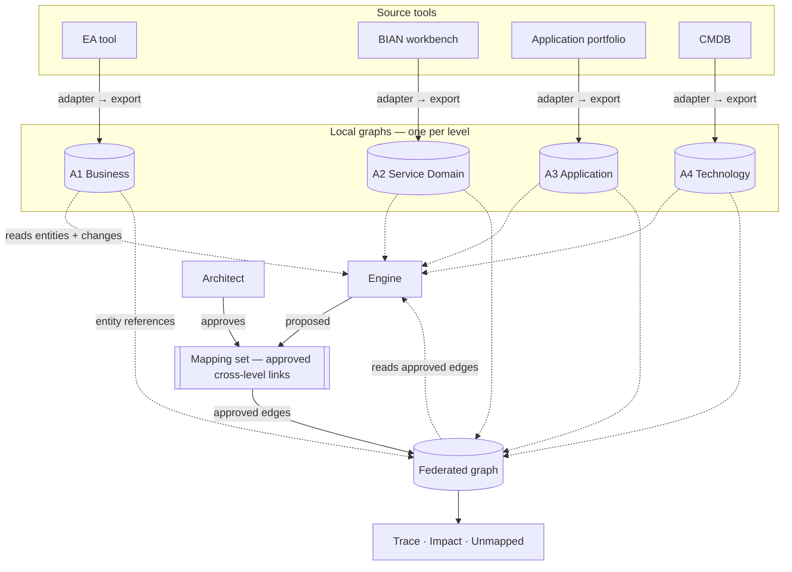

# SDMM Knowledge Graph Specification — local and federated graphs

Generated from the schemas and records by `python -m sdmm.kgspec`; the test suite checks it is current. Companion to `docs/mapping-model-design-spec.md`, which specifies the engine. This document specifies the graphs: what each holds, how its nodes and edges are shaped, how identity and versions work, what queries it must answer, and how it is loaded. Requirements carry `KG-*` IDs; each says whether it is **built** (in `sdmm/graph.py` and the validators) or **not built**.

## 1. Architecture

Four **local graphs**, one per architecture level, each owned by the team that governs that level, and one **federated graph** that holds only the approved links between levels and resolves each link's ends into the local graphs. The federated graph never copies a local graph's content and never holds a proposal. The engine reads both kinds of graph and writes only proposals to the mapping set; an architect's approval is the only way a proposal becomes a federated edge.



| Graph | Holds | Owner | Source | Built from |
|---|---|---|---|---|
| A1 Business Architecture local graph | the level's entity instances and the links inside the level | business architecture | EA tool — capability, value-stream and process models | one level export (`schema/level-model.schema.json`) |
| A2 Service Domain Architecture local graph | the level's entity instances and the links inside the level | BIAN alignment (enterprise architecture) | BIAN workbench / the bank's BIAN alignment | one level export (`schema/level-model.schema.json`) |
| A3 Application Architecture local graph | the level's entity instances and the links inside the level | application architecture | application portfolio, API catalogue, data models | one level export (`schema/level-model.schema.json`) |
| A4 Technology Architecture local graph | the level's entity instances and the links inside the level | infrastructure / platform engineering | CMDB, deployment manifests | one level export (`schema/level-model.schema.json`) |
| Federated graph | approved cross-level edges, and references to their ends in the local graphs | enterprise architecture | the mapping set | the mapping set (`schema/mapping.schema.json`) joined to the four local graphs |


| ID | Requirement | Status |
|---|---|---|
| KG-A-01 | Hold each level in its own local graph, loaded only from that level's export; a change in one level never requires reloading another. | built (in memory) |
| KG-A-02 | Hold in the federated graph only approved cross-level edges and references to their ends; never copy local content; never hold a proposed, rejected or superseded record as an edge used for answers. | built (in memory) |
| KG-A-03 | The engine reads the four local graphs (entities, within-level links, and what changed since the last baseline) and the federated graph (approved edges), read-only; it never writes to either. Approved edges stop it re-proposing what exists and are the inputs to its step-3 derivations. | partly built (reads exports and approved mappings directly; change-since-baseline not built) |

## 2. Local graphs

### 2.1 Node schema (every level)

One node per instance in the export. Fields from `schema/level-model.schema.json` › `instance`:

| Field | Type | Required | Note |
|---|---|---|---|
| `id` | string | yes | node key; see §4 identity |
| `type` | string | yes | an entity from the catalogue; concrete, never abstract or artefact |
| `version` | string | yes | the instance's version, matched by mapping ends |
| `name` | string | yes |  |
| `lifecycle_status` | planned, active, deprecated, retired | no |  |
| `canonical_id` | string | no | the external reference identity (e.g. a BIAN id) on A2 nodes |
| `attributes` | object | no | level-specific properties, including the join keys of §2.3 |
| `description` | string | no | Plain-language description of this instance; the text a mapping engine reads |
| `definition_uri` | string | no | Where the authoritative description lives in the institution's tooling |

Graph header fields (one per local graph): `level`, `model_id`, `model_version`, `metamodel_version`, `source_system` — `model_version` is the local graph's version (§5).

### 2.2 Edge schema (every level)

One edge per relationship in the export, from `relationship`:

| Field | Type | Required |
|---|---|---|
| `source` | string | yes |
| `kind` | string | yes |
| `target` | string | yes |
| `name` | string | no |

### 2.3 Node and edge types per level

| Level | Node types (concrete) | Edge rows | Join-key properties |
|---|---|---|---|
| A1 Business Architecture | 10: BusinessCapability, ValueStream, ValueStreamStage, BusinessProcess, BusinessActivity, BusinessService, BusinessActor, BusinessRole, BusinessObject, BusinessRequirement | 48 (`RA1-01` …) | BusinessActivity.invokes, BusinessCapability.description, BusinessObject.attributes, BusinessObject.field_aliases, BusinessProcess.invokes, BusinessRequirement.applies_to, BusinessService.inputs, BusinessService.outputs, ValueStream.stages |
| A2 Service Domain Architecture | 12: BusinessArea, BusinessDomain, ServiceDomain, FunctionalPattern, AssetType, ControlRecord, ServiceGroup, ServiceOperation, BehaviorQualifier, BusinessScenario, BusinessObject, BusinessObjectAttribute | 17 (`RA2-01` …) | AssetType.aliases, BehaviorQualifier.aliases, BusinessObject.attributes, BusinessScenario.operation_sequence, ControlRecord.attributes, ControlRecord.lifecycle_states, ServiceDomain.asset_type, ServiceDomain.functional_pattern, ServiceOperation.action_term, ServiceOperation.behavior_qualifier, ServiceOperation.input_attributes, ServiceOperation.output_attributes |
| A3 Application Architecture | 8: ApplicationComponent, ApplicationService, ApplicationInterface, ApplicationFunction, APIOperation, DataEntity, Event, SolutionBuildingBlock | 31 (`RA3-01` …) | APIOperation.method, APIOperation.path, APIOperation.payload_fields, ApplicationComponent.built_as, ApplicationComponent.deployed_as, ApplicationComponent.deployed_on, ApplicationComponent.network_zone, ApplicationFunction.consumes, ApplicationFunction.exposed_through, ApplicationInterface.exposed_through, ApplicationInterface.field_aliases, ApplicationService.consumes, DataEntity.attributes, DataEntity.field_aliases, DataEntity.stored_in, Event.published_to, SolutionBuildingBlock.components |
| A4 Technology Architecture | 10: Deployment, DeploymentEnvironment, Node, Device, SystemSoftware, TechnologyService, TechnologyInterface, CommunicationNetwork, Path, Artifact | 36 (`RA4-01` …) | Artifact.of_component, CommunicationNetwork.connects, Deployment.component_id, Deployment.environment_id, Deployment.platform_id, Device.hosts, Node.hosts, Path.carries, Path.from, Path.network, Path.to, SystemSoftware.hosts, TechnologyInterface.exposes, TechnologyInterface.of_service |

Every allowed edge is a row in `metamodel/level-relationships.json`, listed with ID, source, reasoning and verification in `docs/relationships-planning.md`. `association` is allowed between any two nodes of one level.

### 2.4 Local graph requirements

| ID | Requirement | Status |
|---|---|---|
| KG-L-01 | Accept a node only if its `type` resolves to a concrete, non-artefact catalogue entity of the graph's level. | built |
| KG-L-02 | Accept an edge only if both ends are nodes of this graph and (source type, kind, target type) matches a constraint row of the level through inheritance, or the kind is `association`. | built |
| KG-L-03 | Reject the whole export, and keep the previously loaded local graph, if any node or edge fails; report every failure. | built (check); keep-previous not built |
| KG-L-04 | Answer within-level queries on its own: neighbours by kind, part-whole closure (composition, aggregation), and nodes by type and lifecycle status. | partly built (closure in trace); per-level query API not built |

## 3. Federated graph

### 3.1 Edge types — the nine registry relationships

| Relationship | Source node type → target node type | Cardinality | Perspective | Authority |
|---|---|---|---|---|
| `SUPPORTED_BY` (CAPABILITY_SUPPORTED_BY_DOMAIN) | A1.BusinessCapability → A2.ServiceDomain | many to many | architecture | bian_alignment_guidance |
| `ALIGNED_TO` (VALUE_STREAM_ALIGNED_TO_SCENARIO) | A1.ValueStream → A2.BusinessScenario | many to many | process | bian_alignment_guidance |
| `USES_DOMAIN` (PROCESS_USES_DOMAIN) | A1.BusinessProcess → A2.ServiceDomain | many to many | process | enterprise_rule |
| `ALIGNED_TO` (BUSINESS_OBJECT_ALIGNED_TO_BIAN_OBJECT) | A1.BusinessObject → A2.BusinessObject | many to many | information | bian_alignment_guidance |
| `REALIZED_BY` (DOMAIN_REALIZED_BY_COMPONENT) | A2.ServiceDomain → A3.ApplicationComponent | many to many | architecture | enterprise_rule |
| `IMPLEMENTED_BY` (OPERATION_IMPLEMENTED_BY_API) | A2.ServiceOperation → A3.APIOperation | many to many | architecture | enterprise_rule |
| `MAPPED_TO` (BIAN_OBJECT_MAPPED_TO_DATA_ENTITY) | A2.BusinessObject → A3.DataEntity | many to many | information | enterprise_rule |
| `DEPLOYED_ON` (COMPONENT_DEPLOYED_ON_INFRASTRUCTURE) | A3.ApplicationComponent → A4.InfrastructureComponent | many to many | architecture | enterprise_rule |
| `DEPLOYED_AS` (COMPONENT_DEPLOYED_AS_DEPLOYMENT) | A3.ApplicationComponent → A4.Deployment | many to many | architecture | enterprise_rule |

Adjacent levels only (A1→A2, A2→A3, A3→A4). A level-skipping answer is a path, never a stored edge. The 41 candidate and derived rows of the plan are never federated edges.

### 3.2 Edge schema

One edge per approved mapping record; its fields become the edge's properties (`schema/mapping.schema.json` › `mapping`):

| Field | Type | Required |
|---|---|---|
| `mapping_id` | string | yes |
| `source` | entity | yes |
| `target` | entity | yes |
| `relationship` | string | yes |
| `perspective` | process, information, architecture | no |
| `status` | proposed, validated, needs_review, approved, rejected, superseded | yes |
| `evidence` | array | yes |
| `rationale` | string | yes |
| `baseline_id` | string | yes |
| `confidence` | number | no |
| `bian_release` | string | no |
| `reviewer_id` | string | no |
| `created_by` | string | no |
| `approved_at` | string | no |
| `valid_from` | string | no |
| `valid_to` | string | no |
| `previous_mapping_id` | string | no |

Each end (`source`, `target`) is a reference, not a copy: `id`, `type`, `version`, `canonical_id`.

### 3.3 Resolving an edge's ends

1. The end's `type` prefix names the level, and therefore the local graph.
2. The local graph must contain a node with that `id` and `version`.
3. The node's concrete type must be the end's `type` or a descendant of it (is-a) — so a `DEPLOYED_ON` edge to `A4.InfrastructureComponent` resolves to a node, system software or device.
4. An end that does not resolve makes the edge unresolved: reported, not used.

### 3.4 Federated graph requirements

| ID | Requirement | Status |
|---|---|---|
| KG-F-01 | Load an edge only from a record with `status: approved`; keep the other statuses in the mapping set for history but never in answers unless a query asks for them explicitly. | built (`--status`) |
| KG-F-02 | Resolve every edge end into its local graph by level prefix, id, version and is-a; report unresolved ends and exclude those edges. | built (`sdmm-graph check`) |
| KG-F-03 | Store only adjacent-level edges of the nine registry relationships; derive level-skipping answers as paths with the mapping id of every hop. | built |
| KG-F-04 | Collapse duplicate edges between the same two nodes with the same relationship into one answer hop listing every mapping id. | built |

## 4. Identity

The federated graph points into the local graphs by id. These rules keep those pointers valid.


| ID | Requirement | Status |
|---|---|---|
| KG-I-01 | A node id is unique within its level and stable for the life of the thing it names; it is never reused for a different thing, even after retirement. | not enforced (uniqueness within an export is checked; stability across versions is not) |
| KG-I-02 | A rename changes `name`, never `id`. A genuine re-keying in a source tool is handled as retire-and-add: the old node is retired, the new one added, and the mappings to the old one are superseded by mappings to the new one. | not built (needs export diff) |
| KG-I-03 | A2 nodes that correspond to a BIAN concept carry `canonical_id`; the federated edge's A2 end repeats it, and BIAN-authority edges require it before approval. | built |
| KG-I-04 | Institution aliases (asset-type, qualifier, field and glossary aliases) are node attributes, never alternative ids. | built (convention) |

## 5. Versions and baselines

| Thing | Versioned by | Meaning |
|---|---|---|
| A node | `version` | the instance's own version, which an edge end pins |
| A local graph | `model_version`, `metamodel_version` | which export and which catalogue it was built from |
| An edge | `baseline_id`, `valid_from` / `valid_to`, `previous_mapping_id` | which release it belongs to, its validity, and what it replaced |
| The federated graph | the set of (local graph `model_version` ×4, mapping-set commit) it was loaded from | one reproducible state |


| ID | Requirement | Status |
|---|---|---|
| KG-V-01 | Record, for every federated load, the four local `model_version`s and the mapping-set version used — the load's baseline — and return it with every answer. | not built |
| KG-V-02 | Keep earlier baselines queryable, so an impact analysis can be rerun against the state it was originally run on. | not built (git history of the files is the substitute today) |
| KG-V-03 | Never edit an approved edge; change is a new edge with `previous_mapping_id` and the old one `superseded`. | built |
| KG-V-04 | Reject a federated load where the four local graphs disagree on `metamodel_version`. | built |

## 6. Queries the graphs must answer

| Query | Must answer | Implemented by | Status |
|---|---|---|---|
| KG-Q-01 Trace | from any node, follow approved edges down (towards A4) or up (towards A1), optionally through within-level part-whole links; every hop shows the mapping id | `sdmm-graph trace`, `--follow-composition` | built |
| KG-Q-02 Impact | given a node and a change kind (modify, replace, retire, rehost), classify every dependent node design_change_required / review_required / no_impact and list the edges to supersede | `sdmm-graph impact`, impact-rules.json | built |
| KG-Q-03 Check | validate the four local graphs and the federated edges; report every unresolved or disallowed item | `sdmm-graph check` | built |
| KG-Q-04 Unmapped | list nodes of a level with no approved cross-level edge where the plan expects one — the engine's work list | new | not built |
| KG-Q-05 History | for an edge or a node, list its superseded predecessors and the baselines it appeared in | mapping-set history | not built |
| KG-Q-06 Stats | counts of nodes, edges and statuses per level | `sdmm-graph stats` | built |

## 7. Load and refresh

```
source tool → adapter → level export → validate (local) → load local graph
                                                  ↓
mapping set (approved records) → validate → resolve ends → load federated graph → record baseline
```

| Step | Requirement | Status |
|---|---|---|
| KG-R-01 | An adapter per source tool translates its records to a level export; adapters are institution-specific and live in the institution's private repository. | not built (examples are hand-written exports) |
| KG-R-02 | A local graph is rebuilt in full from its export; incremental update is an optimisation, not a requirement. | built (full rebuild) |
| KG-R-03 | A failed export validation leaves the previous local graph in place and raises an alert. | not built |
| KG-R-04 | The federated graph is rebuilt whenever a local graph or the mapping set changes. | built (rebuilt on every run) |
| KG-R-05 | The refresh trigger is configurable per source: on demand, scheduled, event-driven, or refresh-on-read (§9 DEC-02). | not built |

## 8. Governance boundary

| Actor | May | May not |
|---|---|---|
| Level owner | change its source tool; publish a new export | write federated edges |
| Engine | read local graphs and approved edges; write proposals | approve; write to any graph |
| Architect | approve, reject or supersede mapping records | edit an approved record |
| Agent (assistant) | query the graphs; run the engine and validators | approve; write to any graph or mapping set |
| Graph loader | rebuild graphs from exports and the mapping set | change any input |


| ID | Requirement | Status |
|---|---|---|
| KG-G-01 | Only an architect action sets `approved`; no automated component, engine or agent may. | built (convention; validator requires reviewer_id and approved_at) |

## 9. Open design decisions

| ID | Decision | Options | SDMM default |
|---|---|---|---|
| DEC-01 | Graph store | in memory from files (today); property graph (e.g. Neo4j: nodes and edges map one-to-one to §2 and §3); RDF store (named graph per local graph, edges as reified statements with PROV) | in memory until a team needs persistent queries; then property graph |
| DEC-02 | Refresh trigger per source | on demand; scheduled; event-driven (webhook); refresh-on-read | on demand now; event-driven where the tool supports it |
| DEC-03 | One store or five | one store with a partition per local graph plus the federated edges; or separate stores per team federated by id | one store, partitioned, until teams need independent operation |
| DEC-04 | Agent access | CLI run by the assistant; VS Code extension; context snapshot; MCP where policy allows | per the organisation's Copilot policy |
| DEC-05 | Standard export of the mapping set | none; SSSOM; RDF + PROV-O | SSSOM export when interoperability is needed |

## 10. Requirements index

31 requirements — built 20, not 9, partly 2. Groups: A architecture, L local graph, F federated graph, I identity, V versions, Q queries, R load and refresh, G governance.

| ID | Requirement | Basis | Status |
|---|---|---|---|
| KG-A-01 | Hold each level in its own local graph, loaded only from that level's export; a change in one level never requires reloading another. | level-model.schema.json; `LevelGraph` | built (in memory) |
| KG-A-02 | Hold in the federated graph only approved cross-level edges and references to their ends; never copy local content; never hold a proposed, rejected or superseded record as an edge used for answers. | mapping.schema.json; `FederatedGraph` status filter | built (in memory) |
| KG-A-03 | The engine reads the four local graphs (entities, within-level links, and what changed since the last baseline) and the federated graph (approved edges), read-only; it never writes to either. Approved edges stop it re-proposing what exists and are the inputs to its step-3 derivations. | mapping-model-design-spec §6; §8 governance | partly built (reads exports and approved mappings directly; change-since-baseline not built) |
| KG-L-01 | Accept a node only if its `type` resolves to a concrete, non-artefact catalogue entity of the graph's level. | entity catalogue | built |
| KG-L-02 | Accept an edge only if both ends are nodes of this graph and (source type, kind, target type) matches a constraint row of the level through inheritance, or the kind is `association`. | level-relationships.json | built |
| KG-L-03 | Reject the whole export, and keep the previously loaded local graph, if any node or edge fails; report every failure. | `sdmm-graph check` | built (check); keep-previous not built |
| KG-L-04 | Answer within-level queries on its own: neighbours by kind, part-whole closure (composition, aggregation), and nodes by type and lifecycle status. | `LevelGraph` | partly built (closure in trace); per-level query API not built |
| KG-F-01 | Load an edge only from a record with `status: approved`; keep the other statuses in the mapping set for history but never in answers unless a query asks for them explicitly. | mapping.schema.json status | built (`--status`) |
| KG-F-02 | Resolve every edge end into its local graph by level prefix, id, version and is-a; report unresolved ends and exclude those edges. | §3.3 | built (`sdmm-graph check`) |
| KG-F-03 | Store only adjacent-level edges of the nine registry relationships; derive level-skipping answers as paths with the mapping id of every hop. | relationship-types.json | built |
| KG-F-04 | Collapse duplicate edges between the same two nodes with the same relationship into one answer hop listing every mapping id. | `walk` via['also'] | built |
| KG-I-01 | A node id is unique within its level and stable for the life of the thing it names; it is never reused for a different thing, even after retirement. | new requirement | not enforced (uniqueness within an export is checked; stability across versions is not) |
| KG-I-02 | A rename changes `name`, never `id`. A genuine re-keying in a source tool is handled as retire-and-add: the old node is retired, the new one added, and the mappings to the old one are superseded by mappings to the new one. | new requirement; supersession | not built (needs export diff) |
| KG-I-03 | A2 nodes that correspond to a BIAN concept carry `canonical_id`; the federated edge's A2 end repeats it, and BIAN-authority edges require it before approval. | mapping.schema.json; validator | built |
| KG-I-04 | Institution aliases (asset-type, qualifier, field and glossary aliases) are node attributes, never alternative ids. | export-conventions.json | built (convention) |
| KG-V-01 | Record, for every federated load, the four local `model_version`s and the mapping-set version used — the load's baseline — and return it with every answer. | new requirement | not built |
| KG-V-02 | Keep earlier baselines queryable, so an impact analysis can be rerun against the state it was originally run on. | new requirement | not built (git history of the files is the substitute today) |
| KG-V-03 | Never edit an approved edge; change is a new edge with `previous_mapping_id` and the old one `superseded`. | `sdmm-diff` | built |
| KG-V-04 | Reject a federated load where the four local graphs disagree on `metamodel_version`. | Metamodel load | built |
| KG-Q-01 | Trace: from any node, follow approved edges down (towards A4) or up (towards A1), optionally through within-level part-whole links; every hop shows the mapping id. | `sdmm-graph trace`, `--follow-composition` | built |
| KG-Q-02 | Impact: given a node and a change kind (modify, replace, retire, rehost), classify every dependent node design_change_required / review_required / no_impact and list the edges to supersede. | `sdmm-graph impact`, impact-rules.json | built |
| KG-Q-03 | Check: validate the four local graphs and the federated edges; report every unresolved or disallowed item. | `sdmm-graph check` | built |
| KG-Q-04 | Unmapped: list nodes of a level with no approved cross-level edge where the plan expects one — the engine's work list. | new | not built |
| KG-Q-05 | History: for an edge or a node, list its superseded predecessors and the baselines it appeared in. | mapping-set history | not built |
| KG-Q-06 | Stats: counts of nodes, edges and statuses per level. | `sdmm-graph stats` | built |
| KG-R-01 | An adapter per source tool translates its records to a level export; adapters are institution-specific and live in the institution's private repository. | §7 | not built (examples are hand-written exports) |
| KG-R-02 | A local graph is rebuilt in full from its export; incremental update is an optimisation, not a requirement. | §7 | built (full rebuild) |
| KG-R-03 | A failed export validation leaves the previous local graph in place and raises an alert. | §7 | not built |
| KG-R-04 | The federated graph is rebuilt whenever a local graph or the mapping set changes. | §7 | built (rebuilt on every run) |
| KG-R-05 | The refresh trigger is configurable per source: on demand, scheduled, event-driven, or refresh-on-read (§9 DEC-02). | §7 | not built |
| KG-G-01 | Only an architect action sets `approved`; no automated component, engine or agent may. | mapping-execution.md §2; registry enterprise_rule | built (convention; validator requires reviewer_id and approved_at) |

