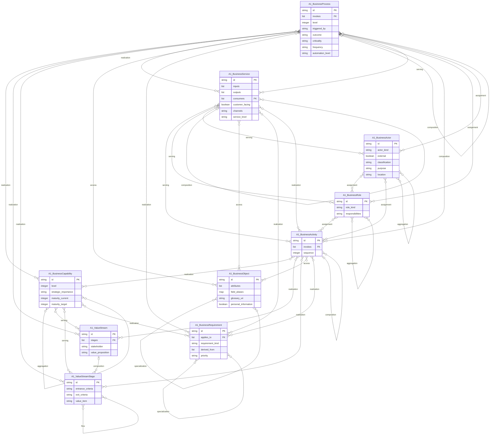
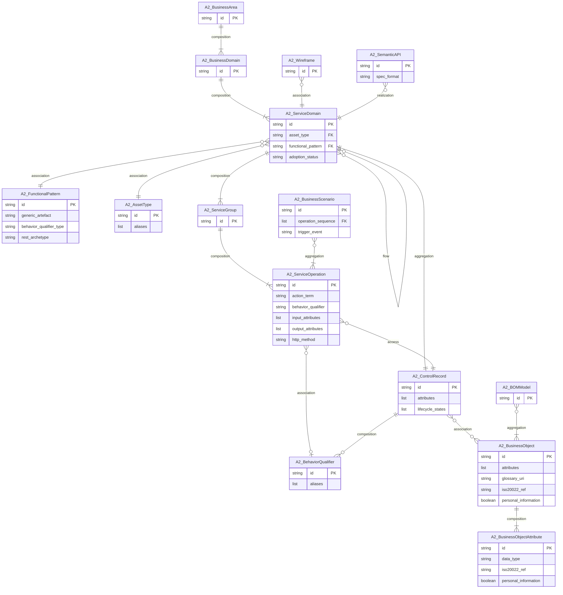
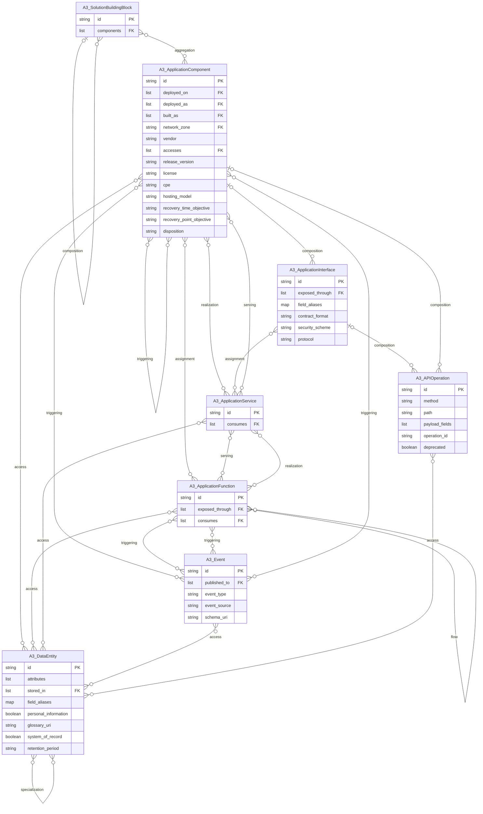
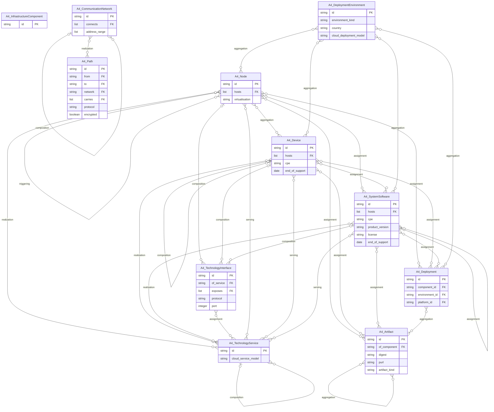

# SDEM Logical Data Model

Generated by `python -m sdem.logical` from the Architecture Metamodel records; the test suite checks it is current.

## What this is

A **data model** says, for each kind of thing an architecture holds: **what it is**, **how one is identified**, **what fields it has**, and **what it links to**. This document is that model for the four architectures, one section per architecture and **one card per entity**. Everything else — the rules, the allowed values, where each decision comes from, and how the example data measures up — is at the end.

### Every entity also has these fields

Every instance of every entity carries the same core fields, so the cards below do not repeat them:

| Field | Type | Required | Meaning |
|---|---|---|---|
| `id` | string | yes | the instance's permanent key — the source tool's own persistent id |
| `type` | string | yes | an entity type from the catalogue |
| `version` | string | yes | the instance's version |
| `name` | string | yes | human-readable name |
| `lifecycle_status` | enum: planned, active, deprecated, retired | no | lifecycle state |
| `canonical_id` | string | no | external reference id, e.g. a BIAN concept id on A2 instances |
| `description` | string | no | scope statement |
| `definition_uri` | string | no | link to the source definition |
| `attributes` | object | no | the entity type's own attributes (this document) |

and these common attributes (approved 2026-10-24; optional):

| Attribute | Type | Allowed values / refers to | Meaning |
|---|---|---|---|
| `source_id` | string | — | the record's key in the tool it came from |
| `created` | date | — | date it was created in the source |
| `modified` | date | — | date it was last changed in the source |
| `valid_from` | date | — | date it comes into force |
| `valid_to` | date | — | date it stops being in force (empty = open-ended) |
| `replaces` | string | refers to same entity type | the earlier instance this one supersedes |
| `replaced_by` | string | refers to same entity type | the later instance that supersedes this one |
| `conforms_to` | list<string> | — | standards, frameworks or policies it follows (e.g. "BIAN BCM 14.0") |
| `subject` | list<string> | — | topic tags (e.g. "payments", "fraud") |
| `owner` | string | refers to A1.BusinessActor, A1.BusinessRole | the actor or role accountable for it |
| `access_classification` | string | public, internal, confidential, restricted | how sensitive it is and who may see it |

### How to read a card

- **Identified by** — besides `id`, the fields that make it unique as a real-world thing.
- **Fields** — the entity's own fields. *Required* fields must be present. A field that **refers to** another entity holds that entity's `id`; when it points into another architecture it is a *join key* the inference engine uses, not a link in the graph.
- **Links** — the relationships allowed with other entities in the same architecture, with how many are allowed on each side.

## 1. A1 Business Architecture

10 entities. The diagram shows the entities, their key fields and references, and the links between them.

### `A1.BusinessCapability`

*entity*

A business ability independent of how it is implemented

**Identified by:** `name` — no standard key; SDEM recommends a unique name within the export so duplicates can be detected

**Fields**

| Field | Type | Required | Meaning | Refers to |
|---|---|---|---|---|
| `level` | integer | no | depth in the capability hierarchy (1 = top) | — |
| `strategic_importance` | text | no | how much the capability matters to strategy | one of: core, differentiating, supporting, commodity |
| `maturity_current` | integer | no | current maturity, 1 (low) to 5 (high) | — |
| `maturity_target` | integer | no | target maturity, 1 to 5 | — |

**Links**

| Link | With | How many |
|---|---|---|
| composition (with itself) | `BusinessCapability` | any number |
| aggregation (with itself) | `BusinessCapability` | any number |
| serving → | `ValueStream` | any number |
| serving → | `ValueStreamStage` | any number |
| ← realization | `BusinessProcess` | any number |
| ← realization | `BusinessActivity` | any number |
| realization → | `BusinessRequirement` | any number |

### `A1.ValueStream`

*entity*

The stages by which stakeholders receive value

**Identified by:** `name` — no standard key; SDEM recommends a unique name within the export so duplicates can be detected

**Fields**

| Field | Type | Required | Meaning | Refers to |
|---|---|---|---|---|
| `stages` | list | no | ordered ids of the stream's stages | `A1.ValueStreamStage` |
| `stakeholder` | text | no | who the value stream delivers value to | — |
| `value_proposition` | text | no | the value the stream delivers | — |

**Links**

| Link | With | How many |
|---|---|---|
| ← serving | `BusinessCapability` | any number |
| composition → | `ValueStreamStage` | any number |
| ← realization | `BusinessProcess` | any number |
| ← realization | `BusinessActivity` | any number |

### `A1.ValueStreamStage`

*entity* · a kind of `A1.ValueStream` and inherits its fields

One named segment of a value stream

**Identified by:** `name` — no standard key; SDEM recommends a unique name within the export so duplicates can be detected

**Fields**

| Field | Type | Required | Meaning | Refers to |
|---|---|---|---|---|
| `entrance_criteria` | text | no | condition for entering the stage | — |
| `exit_criteria` | text | no | condition for completing the stage | — |
| `value_item` | text | no | the value the stage adds | — |

**Links**

| Link | With | How many |
|---|---|---|
| ← serving | `BusinessCapability` | any number |
| ← composition | `ValueStream` | at most one |
| triggering (with itself) | `ValueStreamStage` | any number |
| flow (with itself) | `ValueStreamStage` | any number |
| ← realization | `BusinessProcess` | any number |
| ← realization | `BusinessActivity` | any number |

### `A1.BusinessProcess`

*entity*

Coordinated business behaviour

**Identified by:** `name` — no standard key; SDEM recommends a unique name within the export so duplicates can be detected

**Fields**

| Field | Type | Required | Meaning | Refers to |
|---|---|---|---|---|
| `invokes` | list | no | A2 operations the process steps call | `A2.ServiceOperation` *(join key)* |
| `level` | integer | no | depth in the process hierarchy (1 = top) | — |
| `triggered_by` | text | no | the business event that starts it | — |
| `outcome` | text | no | the result it produces | — |
| `criticality` | text | no | how critical the process is to the bank | one of: high, medium, low |
| `frequency` | text | no | how often it runs | one of: continuous, daily, weekly, monthly, ad hoc |
| `automation_level` | text | no | how far it is automated | one of: manual, partly automated, automated |

**Links**

| Link | With | How many |
|---|---|---|
| realization → | `BusinessCapability` | any number |
| realization → | `ValueStream` | any number |
| realization → | `ValueStreamStage` | any number |
| realization → | `BusinessService` | any number |
| access → | `BusinessObject` | any number |
| realization → | `BusinessRequirement` | any number |
| triggering (with itself) | `BusinessProcess` | any number |
| flow (with itself) | `BusinessProcess` | any number |
| composition → | `BusinessActivity` | any number |
| composition (with itself) | `BusinessProcess` | any number |
| ← serving | `BusinessService` | any number |
| ← assignment | `BusinessRole` | any number |
| ← assignment | `BusinessActor` | any number |

### `A1.BusinessActivity`

*entity* · a kind of `A1.BusinessProcess` and inherits its fields

A fine-grained activity within a process

**Identified by:** `name` — no standard key; SDEM recommends a unique name within the export so duplicates can be detected

**Fields**

| Field | Type | Required | Meaning | Refers to |
|---|---|---|---|---|
| `invokes` | list | no | A2 operations the activity calls | `A2.ServiceOperation` *(join key)* |
| `sequence` | integer | no | position of the step within its process | — |

**Links**

| Link | With | How many |
|---|---|---|
| realization → | `BusinessCapability` | any number |
| realization → | `ValueStream` | any number |
| realization → | `ValueStreamStage` | any number |
| realization → | `BusinessService` | any number |
| access → | `BusinessObject` | any number |
| realization → | `BusinessRequirement` | any number |
| triggering (with itself) | `BusinessActivity` | any number |
| flow (with itself) | `BusinessActivity` | any number |
| ← composition | `BusinessProcess` | at most one |
| composition (with itself) | `BusinessActivity` | any number |
| ← serving | `BusinessService` | any number |
| ← assignment | `BusinessRole` | any number |
| ← assignment | `BusinessActor` | any number |

### `A1.BusinessService`

*entity*

Business behaviour exposed to consumers

**Identified by:** `name` — no standard key; SDEM recommends a unique name within the export so duplicates can be detected

**Fields**

| Field | Type | Required | Meaning | Refers to |
|---|---|---|---|---|
| `inputs` | list | no | attribute names the service takes | — |
| `outputs` | list | no | attribute names the service returns | — |
| `consumers` | list | no | the actors or roles the service serves | `A1.BusinessActor`, `A1.BusinessRole` |
| `customer_facing` | boolean | no | whether customers use it directly | — |
| `channels` | text | no | channels it is offered through | one of: branch, online, mobile, contact centre, partner, API |
| `service_level` | text | no | the committed service level (e.g. "same day") | — |

**Links**

| Link | With | How many |
|---|---|---|
| ← realization | `BusinessProcess` | any number |
| ← realization | `BusinessActivity` | any number |
| serving → | `BusinessProcess` | any number |
| serving → | `BusinessActivity` | any number |
| serving → | `BusinessRole` | any number |
| serving → | `BusinessActor` | any number |
| composition (with itself) | `BusinessService` | any number |
| access → | `BusinessObject` | any number |
| realization → | `BusinessRequirement` | any number |

### `A1.BusinessActor`

*entity*

An individual or organisation capable of business behaviour

**Identified by:** `name` — no standard key; SDEM recommends a unique name within the export so duplicates can be detected

**Fields**

| Field | Type | Required | Meaning | Refers to |
|---|---|---|---|---|
| `actor_kind` | text | no | whether it is a formal organisation, a unit or a person | one of: formal organisation, organisational unit, person |
| `external` | boolean | no | whether it is outside the bank | — |
| `classification` | text | no | its category (e.g. regulator, partner, business line) | — |
| `purpose` | text | no | why the unit or organisation exists | — |
| `location` | text | no | the site where it is based | — |

**Links**

| Link | With | How many |
|---|---|---|
| ← serving | `BusinessService` | any number |
| assignment → | `BusinessRole` | any number |
| assignment → | `BusinessProcess` | any number |
| assignment → | `BusinessActivity` | any number |
| composition (with itself) | `BusinessActor` | any number |
| aggregation (with itself) | `BusinessActor` | any number |

### `A1.BusinessRole`

*entity*

Responsibility for a class of business behaviour

**Identified by:** `name` — no standard key; SDEM recommends a unique name within the export so duplicates can be detected

**Fields**

| Field | Type | Required | Meaning | Refers to |
|---|---|---|---|---|
| `role_kind` | text | no | whether it is a generic role or a specific post | one of: role, post |
| `responsibilities` | text | no | what the role is responsible for | — |

**Links**

| Link | With | How many |
|---|---|---|
| ← serving | `BusinessService` | any number |
| ← assignment | `BusinessActor` | any number |
| assignment → | `BusinessProcess` | any number |
| assignment → | `BusinessActivity` | any number |
| composition (with itself) | `BusinessRole` | any number |
| aggregation (with itself) | `BusinessRole` | any number |

### `A1.BusinessObject`

*entity*

A business-level information concept

**Identified by:** `name` — no standard key; SDEM recommends a unique name within the export so duplicates can be detected

**Fields**

| Field | Type | Required | Meaning | Refers to |
|---|---|---|---|---|
| `attributes` | list | no | glossary attribute names | — |
| `field_aliases` | name map | no | glossary name → canonical attribute name | — |
| `glossary_uri` | text | no | link to the agreed glossary definition | — |
| `personal_information` | boolean | no | whether it holds information about an identifiable person | — |

**Links**

| Link | With | How many |
|---|---|---|
| ← access | `BusinessProcess` | any number |
| ← access | `BusinessActivity` | any number |
| ← access | `BusinessService` | any number |
| composition (with itself) | `BusinessObject` | any number |
| aggregation (with itself) | `BusinessObject` | any number |
| specialization (with itself) | `BusinessObject` | any number |

### `A1.BusinessRequirement`

*entity*

An expressed architectural requirement

**Identified by:** `name` — no standard key; SDEM recommends a unique name within the export so duplicates can be detected

**Fields**

| Field | Type | Required | Meaning | Refers to |
|---|---|---|---|---|
| `applies_to` | list | no | ids of the processes or activities the requirement constrains | `A1.BusinessProcess`, `A1.BusinessActivity` |
| `requirement_kind` | text | no | whether it is a requirement, a constraint or a principle | one of: requirement, constraint, principle |
| `derived_from` | list | no | the regulation, policy or decision it comes from | — |
| `priority` | text | no | how important it is to meet (must, should, could, won't) | one of: must, should, could, won't |

**Links**

| Link | With | How many |
|---|---|---|
| ← realization | `BusinessProcess` | any number |
| ← realization | `BusinessActivity` | any number |
| ← realization | `BusinessService` | any number |
| ← realization | `BusinessCapability` | any number |
| composition (with itself) | `BusinessRequirement` | any number |
| specialization (with itself) | `BusinessRequirement` | any number |

## 2. A2 Service Domain Architecture

15 entities. The diagram shows the entities, their key fields and references, and the links between them.

### `A2.BusinessArea`

*entity*

Top-level grouping of the Service Landscape

**Identified by:** `name` — no standard key; SDEM recommends a unique name within the export so duplicates can be detected

**Fields:** core fields only.

**Links**

| Link | With | How many |
|---|---|---|
| composition → | `BusinessDomain` | one or more |

### `A2.BusinessDomain`

*entity*

Coarse functional grouping within a Business Area

**Identified by:** `name` — no standard key; SDEM recommends a unique name within the export so duplicates can be detected

**Fields:** core fields only.

**Links**

| Link | With | How many |
|---|---|---|
| ← composition | `BusinessArea` | exactly one |
| composition → | `ServiceDomain` | one or more |

### `A2.ServiceDomain`

*entity*

A discrete functional scope of the bank and its responsibilities

**Identified by:** `canonical_id` — a BIAN Service Domain is identified by its BIAN concept id; one instance per BIAN domain in an estate

**Fields**

| Field | Type | Required | Meaning | Refers to |
|---|---|---|---|---|
| `asset_type` | text | yes | id of the domain's asset type | `A2.AssetType` |
| `functional_pattern` | text | yes | id of the domain's functional pattern | `A2.FunctionalPattern` |
| `adoption_status` | text | no | how far the bank intends to adopt the Service Domain | one of: adopted, partly adopted, planned, not adopted |

**Links**

| Link | With | How many |
|---|---|---|
| ← composition | `BusinessDomain` | exactly one |
| composition → | `ServiceGroup` | one or more |
| aggregation → | `ControlRecord` | exactly one |
| association → | `FunctionalPattern` | exactly one |
| association → | `AssetType` | exactly one |
| flow (with itself) | `ServiceDomain` | any number |
| ← association | `Wireframe` | any number |
| ← realization | `SemanticAPI` | any number |

### `A2.FunctionalPattern`

*entity*

The generic behaviour pattern a Service Domain applies

**Identified by:** `name` — no standard key; SDEM recommends a unique name within the export so duplicates can be detected

**Fields**

| Field | Type | Required | Meaning | Refers to |
|---|---|---|---|---|
| `generic_artefact` | text | no | the kind of control record the pattern manages (the pattern as a noun) | — |
| `behavior_qualifier_type` | text | no | the kind of behaviour qualifier used to break the pattern down | — |
| `rest_archetype` | text | no | the REST resource archetype the pattern's control record maps to | one of: document, collection, controller |

**Links**

| Link | With | How many |
|---|---|---|
| ← association | `ServiceDomain` | any number |

### `A2.AssetType`

*entity*

The class of asset a Service Domain manages through its lifecycle

**Identified by:** `name` — no standard key; SDEM recommends a unique name within the export so duplicates can be detected

**Fields**

| Field | Type | Required | Meaning | Refers to |
|---|---|---|---|---|
| `aliases` | list | no | tokens the estate uses for the asset | — |

**Links**

| Link | With | How many |
|---|---|---|
| ← association | `ServiceDomain` | any number |

### `A2.ControlRecord`

*entity*

Lifecycle and control information for a Service Domain's activity

**Identified by:** `owning service domain` — BIAN gives each Service Domain exactly one control record

**Fields**

| Field | Type | Required | Meaning | Refers to |
|---|---|---|---|---|
| `attributes` | list | yes | the control record's attribute names | — |
| `lifecycle_states` | list | no | ordered lifecycle states | — |

**Links**

| Link | With | How many |
|---|---|---|
| ← aggregation | `ServiceDomain` | exactly one |
| composition → | `BehaviorQualifier` | any number |
| association → | `BusinessObject` | any number |
| ← access | `ServiceOperation` | any number |

### `A2.ServiceGroup`

*entity*

A grouping of a Service Domain's operations

**Identified by:** `name` — no standard key; SDEM recommends a unique name within the export so duplicates can be detected

**Fields:** core fields only.

**Links**

| Link | With | How many |
|---|---|---|
| ← composition | `ServiceDomain` | exactly one |
| composition → | `ServiceOperation` | one or more |

### `A2.ServiceOperation`

*entity*

An operation a Service Domain exposes

**Identified by:** `owning service domain`, `action_term`, `behavior_qualifier` — BIAN names an operation by its domain, action term and qualifier (Semantic API Practitioner Guide §3.2.5); two operations with the same three are the same operation

**Fields**

| Field | Type | Required | Meaning | Refers to |
|---|---|---|---|---|
| `action_term` | text | yes | one of BIAN's 17 action terms | one of: Activate, Configure, Feedback, Create, Initiate, Register, Evaluate, Provide, Update, Control, Exchange, Capture, Execute, Request, Grant, Retrieve, Notify |
| `behavior_qualifier` | text | no | qualifier name, or null | — |
| `input_attributes` | list | yes | control-record attributes the operation takes | — |
| `output_attributes` | list | yes | control-record attributes the operation returns | — |
| `http_method` | text | no | the HTTP method of the operation, where it is not derivable or the bank overrides BIAN | one of: GET, PUT, POST, PATCH, DELETE |

**Links**

| Link | With | How many |
|---|---|---|
| ← composition | `ServiceGroup` | exactly one |
| association → | `BehaviorQualifier` | at most one |
| ← aggregation | `BusinessScenario` | any number |
| access → | `ControlRecord` | exactly one |

### `A2.BehaviorQualifier`

*entity*

A refinement of a Service Domain's generic behaviour

**Identified by:** `name` — no standard key; SDEM recommends a unique name within the export so duplicates can be detected

**Fields**

| Field | Type | Required | Meaning | Refers to |
|---|---|---|---|---|
| `aliases` | list | no | tokens the estate's API paths use for the qualifier | — |

**Links**

| Link | With | How many |
|---|---|---|
| ← association | `ServiceOperation` | any number |
| ← composition | `ControlRecord` | exactly one |

### `A2.BusinessScenario`

*entity*

An illustrative, non-prescriptive collaboration of Service Domain operations

**Identified by:** `canonical_id` — identified by its BIAN scenario id

**Fields**

| Field | Type | Required | Meaning | Refers to |
|---|---|---|---|---|
| `operation_sequence` | list | yes | ordered ids of the operations the scenario sequences | `A2.ServiceOperation` |
| `trigger_event` | text | no | the business event that starts the scenario | — |

**Links**

| Link | With | How many |
|---|---|---|
| aggregation → | `ServiceOperation` | one or more |

### `A2.BusinessObject`

*entity*

A canonical business information concept

**Identified by:** `canonical_id` — identified by its BIAN Business Object Model id

**Fields**

| Field | Type | Required | Meaning | Refers to |
|---|---|---|---|---|
| `attributes` | list | yes | the canonical object's attribute names | — |
| `glossary_uri` | text | no | link to the agreed glossary definition | — |
| `iso20022_ref` | text | no | the matching ISO 20022 business component | — |
| `personal_information` | boolean | no | whether it holds information about an identifiable person | — |

**Links**

| Link | With | How many |
|---|---|---|
| composition → | `BusinessObjectAttribute` | one or more |
| ← association | `ControlRecord` | any number |
| ← aggregation | `BOMModel` | any number |

### `A2.BusinessObjectAttribute`

*entity*

A property of a Business Object

**Identified by:** `name` — no standard key; SDEM recommends a unique name within the export so duplicates can be detected

**Fields**

| Field | Type | Required | Meaning | Refers to |
|---|---|---|---|---|
| `data_type` | text | no | the attribute's data type in the Business Object Model | — |
| `iso20022_ref` | text | no | the matching ISO 20022 business element | — |
| `personal_information` | boolean | no | whether the attribute is personal information | — |

**Links**

| Link | With | How many |
|---|---|---|
| ← composition | `BusinessObject` | exactly one |

### `A2.BOMModel`

*artefact — a document, never instantiated*

A versioned Business Object Model artefact

**Fields:** core fields only.

**Links**

| Link | With | How many |
|---|---|---|
| aggregation → | `BusinessObject` | one or more |

### `A2.Wireframe`

*artefact — a document, never instantiated*

An archetypal Service Domain interaction pattern artefact

**Fields:** core fields only.

**Links**

| Link | With | How many |
|---|---|---|
| association → | `ServiceDomain` | exactly one |

### `A2.SemanticAPI`

*artefact — a document, never instantiated*

A Semantic API definition artefact

**Fields**

| Field | Type | Required | Meaning | Refers to |
|---|---|---|---|---|
| `spec_format` | text | no | the format of the published API definition | one of: OpenAPI 3.1, OpenAPI 3.0, Swagger 2.0 |

**Links**

| Link | With | How many |
|---|---|---|
| realization → | `ServiceDomain` | exactly one |

## 3. A3 Application Architecture

8 entities. The diagram shows the entities, their key fields and references, and the links between them.

### `A3.ApplicationComponent`

*entity*

A modular, deployable part of an application

**Identified by:** `name` — no standard key; SDEM recommends a unique name within the export so duplicates can be detected

**Fields**

| Field | Type | Required | Meaning | Refers to |
|---|---|---|---|---|
| `deployed_on` | list | no | ids of the A4 platforms that host it | `A4.InfrastructureComponent` *(join key)* |
| `deployed_as` | list | no | ids of its A4 deployments | `A4.Deployment` *(join key)* |
| `built_as` | list | no | ids of the A4 artifacts it is built as | `A4.Artifact` *(join key)* |
| `network_zone` | text | no | id of the A4 network it sits in | `A4.CommunicationNetwork` *(join key)* |
| `vendor` | text | no | the supplier of the component ("in-house" when built by the bank) | — |
| `accesses` *(deprecated)* | list | no | data entities it accesses | `A3.DataEntity` |
| `release_version` | text | no | the product release that is in use (not the version of this model record) | — |
| `license` | text | no | the licence, as an SPDX identifier (e.g. Apache-2.0) | — |
| `cpe` | text | no | the product's CPE 2.3 name, for vulnerability matching | — |
| `hosting_model` | text | no | how the application is hosted | one of: on-premises, IaaS, PaaS, SaaS |
| `recovery_time_objective` | text | no | how quickly the application must be back after an outage (e.g. "4h") | — |
| `recovery_point_objective` | text | no | how much data loss is tolerable, as a time (e.g. "15m") | — |
| `disposition` | text | no | what the bank plans to do with the application | one of: keep, enhance, replace, retire |

**Links**

| Link | With | How many |
|---|---|---|
| composition (with itself) | `ApplicationComponent` | any number |
| aggregation (with itself) | `ApplicationComponent` | any number |
| composition → | `ApplicationInterface` | any number |
| assignment → | `ApplicationFunction` | any number |
| realization → | `ApplicationService` | any number |
| ← serving | `ApplicationService` | any number |
| flow (with itself) | `ApplicationComponent` | any number |
| serving (with itself) | `ApplicationComponent` | any number |
| triggering (with itself) | `ApplicationComponent` | any number |
| access → | `DataEntity` | any number |
| triggering → | `Event` | any number |
| ← triggering | `Event` | any number |
| composition → | `APIOperation` | any number |
| ← aggregation | `SolutionBuildingBlock` | any number |

### `A3.ApplicationService`

*entity*

Externally exposed application behaviour

**Identified by:** `name` — no standard key; SDEM recommends a unique name within the export so duplicates can be detected

**Fields**

| Field | Type | Required | Meaning | Refers to |
|---|---|---|---|---|
| `consumes` | list | no | ids of A4 technology services it uses | `A4.TechnologyService` *(join key)* |

**Links**

| Link | With | How many |
|---|---|---|
| ← realization | `ApplicationFunction` | any number |
| ← realization | `ApplicationComponent` | any number |
| ← assignment | `ApplicationInterface` | any number |
| serving → | `ApplicationComponent` | any number |
| serving → | `ApplicationFunction` | any number |
| access → | `DataEntity` | any number |

### `A3.ApplicationInterface`

*entity*

An access point to an application service

**Identified by:** `name` — no standard key; SDEM recommends a unique name within the export so duplicates can be detected

**Fields**

| Field | Type | Required | Meaning | Refers to |
|---|---|---|---|---|
| `exposed_through` | list | no | ids of A4 technology interfaces it is exposed through | `A4.TechnologyInterface` *(join key)* |
| `field_aliases` | name map | no | product field name → canonical attribute name | — |
| `contract_format` | text | no | the format of the interface's machine-readable contract | one of: OpenAPI 3.1, OpenAPI 3.0, AsyncAPI 3.0, AsyncAPI 2.6, WSDL, GraphQL, none |
| `security_scheme` | text | no | how callers authenticate | one of: apiKey, http, mutualTLS, oauth2, openIdConnect |
| `protocol` | text | no | the protocol the interface uses (e.g. https, amqp, kafka, mqtt) | — |

**Links**

| Link | With | How many |
|---|---|---|
| ← composition | `ApplicationComponent` | at most one |
| assignment → | `ApplicationService` | any number |
| composition → | `APIOperation` | any number |

### `A3.ApplicationFunction`

*entity*

Internal application behaviour

**Identified by:** `name` — no standard key; SDEM recommends a unique name within the export so duplicates can be detected

**Fields**

| Field | Type | Required | Meaning | Refers to |
|---|---|---|---|---|
| `exposed_through` | list | no | ids of the API operations the function is reached through | `A3.APIOperation` |
| `consumes` | list | no | ids of A4 technology services it uses | `A4.TechnologyService` *(join key)* |

**Links**

| Link | With | How many |
|---|---|---|
| ← assignment | `ApplicationComponent` | any number |
| realization → | `ApplicationService` | any number |
| ← serving | `ApplicationService` | any number |
| composition (with itself) | `ApplicationFunction` | any number |
| triggering (with itself) | `ApplicationFunction` | any number |
| flow (with itself) | `ApplicationFunction` | any number |
| access → | `DataEntity` | any number |
| triggering → | `Event` | any number |
| ← triggering | `Event` | any number |

### `A3.APIOperation`

*entity*

A callable operation of an API contract

**Identified by:** `owning interface`, `method`, `path` — OpenAPI makes an operation unique by path and method within one API

**Fields**

| Field | Type | Required | Meaning | Refers to |
|---|---|---|---|---|
| `method` | text | yes | HTTP method, or BATCH / MQ / FILE for non-HTTP | one of: GET, POST, PUT, PATCH, DELETE, HEAD, OPTIONS, BATCH, MQ, FILE |
| `path` | text | yes | resource path | — |
| `payload_fields` | list | yes | request and response field names | — |
| `operation_id` | text | no | the operation's unique id in its API contract | — |
| `deprecated` | boolean | no | whether the operation is deprecated in its contract | — |

**Links**

| Link | With | How many |
|---|---|---|
| ← composition | `ApplicationInterface` | at most one |
| ← composition | `ApplicationComponent` | at most one |
| access → | `DataEntity` | any number |

### `A3.DataEntity`

*entity*

A logical data entity held by an application

**Identified by:** `stored_in`, `name` — a table or entity name is unique within the store that holds it

**Fields**

| Field | Type | Required | Meaning | Refers to |
|---|---|---|---|---|
| `attributes` | list | yes | column names | — |
| `stored_in` | list | no | ids of the A4 system software or artifact holding it | `A4.SystemSoftware`, `A4.Artifact` *(join key)* |
| `field_aliases` | name map | no | column name → canonical attribute name | — |
| `personal_information` | boolean | no | whether it holds information about an identifiable person | — |
| `glossary_uri` | text | no | link to the agreed glossary definition | — |
| `system_of_record` | boolean | no | whether this application is the authoritative source for the data | — |
| `retention_period` | text | no | how long the data must be kept (e.g. "7y") | — |

**Links**

| Link | With | How many |
|---|---|---|
| ← access | `ApplicationComponent` | any number |
| ← access | `ApplicationFunction` | any number |
| ← access | `ApplicationService` | any number |
| composition (with itself) | `DataEntity` | any number |
| aggregation (with itself) | `DataEntity` | any number |
| specialization (with itself) | `DataEntity` | any number |
| ← access | `Event` | any number |
| ← access | `APIOperation` | any number |

### `A3.Event`

*entity*

An event an application produces or consumes

**Identified by:** `name` — no standard key; SDEM recommends a unique name within the export so duplicates can be detected

**Fields**

| Field | Type | Required | Meaning | Refers to |
|---|---|---|---|---|
| `published_to` | list | no | ids of A4 technology services (brokers) it is published to | `A4.TechnologyService` *(join key)* |
| `event_type` | text | no | the type name the event carries (e.g. "payment.initiated") | — |
| `event_source` | text | no | the source the event identifies itself with | — |
| `schema_uri` | text | no | link to the schema the event data follows | — |

**Links**

| Link | With | How many |
|---|---|---|
| ← triggering | `ApplicationComponent` | any number |
| ← triggering | `ApplicationFunction` | any number |
| triggering → | `ApplicationFunction` | any number |
| triggering → | `ApplicationComponent` | any number |
| access → | `DataEntity` | any number |

### `A3.SolutionBuildingBlock`

*entity*

An organisation-defined reusable solution grouping

**Identified by:** `name` — no standard key; SDEM recommends a unique name within the export so duplicates can be detected

**Fields**

| Field | Type | Required | Meaning | Refers to |
|---|---|---|---|---|
| `components` | list | no | ids of the components the building block aggregates | `A3.ApplicationComponent` |

**Links**

| Link | With | How many |
|---|---|---|
| aggregation → | `ApplicationComponent` | any number |
| composition (with itself) | `SolutionBuildingBlock` | any number |

## 4. A4 Technology Architecture

11 entities. The diagram shows the entities, their key fields and references, and the links between them.

### `A4.InfrastructureComponent`

*abstract — never instantiated*

Abstract supertype of every Technology Architecture entity; retained for compatibility with earlier relationship registries

**Fields:** core fields only.

### `A4.Deployment`

*entity* · a kind of `A4.InfrastructureComponent` and inherits its fields

An application as deployed into a specific environment

**Identified by:** `component_id`, `environment_id`, `platform_id` — one deployment per component, environment and platform

**Fields**

| Field | Type | Required | Meaning | Refers to |
|---|---|---|---|---|
| `component_id` | text | yes | id of the A3 component deployed | `A3.ApplicationComponent` *(join key)* |
| `environment_id` | text | yes | id of the environment | `A4.DeploymentEnvironment` |
| `platform_id` | text | yes | id of the A4 platform it runs on | `A4.InfrastructureComponent` |

**Links**

| Link | With | How many |
|---|---|---|
| ← assignment | `Node` | any number |
| ← assignment | `Device` | any number |
| ← assignment | `SystemSoftware` | any number |
| ← aggregation | `DeploymentEnvironment` | any number |
| aggregation → | `Artifact` | any number |

### `A4.DeploymentEnvironment`

*entity* · a kind of `A4.InfrastructureComponent` and inherits its fields

A governed runtime boundary such as production or test

**Identified by:** `name` — no standard key; SDEM recommends a unique name within the export so duplicates can be detected

**Fields**

| Field | Type | Required | Meaning | Refers to |
|---|---|---|---|---|
| `environment_kind` | text | no | what the environment is for | one of: production, pre-production, test, development, disaster recovery |
| `country` | text | no | the country where the environment runs, as an ISO 3166-1 alpha-2 code | — |
| `cloud_deployment_model` | text | no | the cloud deployment model of the environment | one of: private, community, public, hybrid |

**Links**

| Link | With | How many |
|---|---|---|
| aggregation → | `Deployment` | any number |
| aggregation → | `Node` | any number |
| aggregation → | `Device` | any number |
| aggregation → | `SystemSoftware` | any number |

### `A4.Node`

*entity* · a kind of `A4.InfrastructureComponent` and inherits its fields

A computational host, physical or virtual

**Identified by:** `name` — no standard key; SDEM recommends a unique name within the export so duplicates can be detected

**Fields**

| Field | Type | Required | Meaning | Refers to |
|---|---|---|---|---|
| `hosts` | list | no | ids of A3 components it hosts | `A3.ApplicationComponent` *(join key)* |
| `virtualisation` | text | no | whether the node is physical, a virtual machine or a container | one of: physical, virtual machine, container |

**Links**

| Link | With | How many |
|---|---|---|
| composition (with itself) | `Node` | any number |
| aggregation (with itself) | `Node` | any number |
| aggregation → | `Device` | any number |
| assignment → | `SystemSoftware` | any number |
| assignment → | `Artifact` | any number |
| realization → | `TechnologyService` | any number |
| composition → | `TechnologyInterface` | any number |
| ← serving | `TechnologyService` | any number |
| assignment → | `Deployment` | any number |
| flow (with itself) | `Node` | any number |
| triggering (with itself) | `Node` | any number |
| ← aggregation | `DeploymentEnvironment` | any number |

### `A4.Device`

*entity* · a kind of `A4.InfrastructureComponent` and inherits its fields

Physical computing hardware

**Identified by:** `name` — no standard key; SDEM recommends a unique name within the export so duplicates can be detected

**Fields**

| Field | Type | Required | Meaning | Refers to |
|---|---|---|---|---|
| `hosts` | list | no | ids of A3 components it hosts | `A3.ApplicationComponent` *(join key)* |
| `cpe` | text | no | the device's CPE 2.3 name, for vulnerability matching | — |
| `end_of_support` | date | no | the date the supplier stops supporting it | — |

**Links**

| Link | With | How many |
|---|---|---|
| ← aggregation | `Node` | any number |
| assignment → | `SystemSoftware` | any number |
| assignment → | `Artifact` | any number |
| realization → | `TechnologyService` | any number |
| composition → | `TechnologyInterface` | any number |
| ← serving | `TechnologyService` | any number |
| assignment → | `Deployment` | any number |
| aggregation (with itself) | `Device` | any number |
| ← aggregation | `DeploymentEnvironment` | any number |
| composition (with itself) | `Device` | any number |

### `A4.SystemSoftware`

*entity* · a kind of `A4.InfrastructureComponent` and inherits its fields

Platform or runtime software

**Identified by:** `name` — no standard key; SDEM recommends a unique name within the export so duplicates can be detected

**Fields**

| Field | Type | Required | Meaning | Refers to |
|---|---|---|---|---|
| `hosts` | list | no | ids of A3 components it hosts | `A3.ApplicationComponent` *(join key)* |
| `cpe` | text | no | the software's CPE 2.3 name, for vulnerability matching | — |
| `product_version` | text | no | the release of the product in use | — |
| `license` | text | no | the licence, as an SPDX identifier | — |
| `end_of_support` | date | no | the date the supplier stops supporting it | — |

**Links**

| Link | With | How many |
|---|---|---|
| ← assignment | `Node` | any number |
| ← assignment | `Device` | any number |
| assignment (with itself) | `SystemSoftware` | any number |
| assignment → | `Artifact` | any number |
| realization → | `TechnologyService` | any number |
| composition → | `TechnologyInterface` | any number |
| ← serving | `TechnologyService` | any number |
| assignment → | `Deployment` | any number |
| ← aggregation | `DeploymentEnvironment` | any number |

### `A4.TechnologyService`

*entity* · a kind of `A4.InfrastructureComponent` and inherits its fields

Technical behaviour delivered to consumers

**Identified by:** `name` — no standard key; SDEM recommends a unique name within the export so duplicates can be detected

**Fields**

| Field | Type | Required | Meaning | Refers to |
|---|---|---|---|---|
| `cloud_service_model` | text | no | the cloud service model the service is delivered as | one of: IaaS, PaaS, SaaS |

**Links**

| Link | With | How many |
|---|---|---|
| ← realization | `Node` | any number |
| serving → | `Node` | any number |
| ← realization | `Device` | any number |
| serving → | `Device` | any number |
| ← realization | `SystemSoftware` | any number |
| serving → | `SystemSoftware` | any number |
| ← assignment | `TechnologyInterface` | any number |
| composition (with itself) | `TechnologyService` | any number |

### `A4.TechnologyInterface`

*entity* · a kind of `A4.InfrastructureComponent` and inherits its fields

An access point for a technology service

**Identified by:** `name` — no standard key; SDEM recommends a unique name within the export so duplicates can be detected

**Fields**

| Field | Type | Required | Meaning | Refers to |
|---|---|---|---|---|
| `of_service` | text | no | id of its technology service | `A4.TechnologyService` |
| `exposes` | list | no | ids of A3 interfaces reachable through it | `A3.ApplicationInterface` *(join key)* |
| `protocol` | text | no | the service name of the protocol, from the IANA registry (e.g. https) | — |
| `port` | integer | no | the port the interface listens on | — |

**Links**

| Link | With | How many |
|---|---|---|
| ← composition | `Node` | at most one |
| ← composition | `Device` | at most one |
| ← composition | `SystemSoftware` | at most one |
| assignment → | `TechnologyService` | any number |

### `A4.CommunicationNetwork`

*entity* · a kind of `A4.InfrastructureComponent` and inherits its fields

Communication infrastructure

**Identified by:** `name` — no standard key; SDEM recommends a unique name within the export so duplicates can be detected

**Fields**

| Field | Type | Required | Meaning | Refers to |
|---|---|---|---|---|
| `connects` | list | no | ids of nodes and devices on the network | `A4.Node`, `A4.Device` |
| `address_range` | list | no | the network's address ranges in CIDR notation (e.g. 10.20.0.0/16) | — |

**Links**

| Link | With | How many |
|---|---|---|
| realization → | `Path` | any number |
| composition (with itself) | `CommunicationNetwork` | any number |

### `A4.Path`

*entity* · a kind of `A4.InfrastructureComponent` and inherits its fields

A route between nodes

**Identified by:** `name` — no standard key; SDEM recommends a unique name within the export so duplicates can be detected

**Fields**

| Field | Type | Required | Meaning | Refers to |
|---|---|---|---|---|
| `from` | text | no | id of one end | `A4.Node`, `A4.Device` |
| `to` | text | no | id of the other end | `A4.Node`, `A4.Device` |
| `network` | text | no | id of the network realizing the path | `A4.CommunicationNetwork` |
| `carries` | list | no | ids of A3 components whose traffic uses the path | `A3.ApplicationComponent` *(join key)* |
| `protocol` | text | no | the service name of the protocol on the path (IANA) | — |
| `encrypted` | boolean | no | whether traffic on the path is encrypted in transit | — |

**Links**

| Link | With | How many |
|---|---|---|
| ← realization | `CommunicationNetwork` | any number |

### `A4.Artifact`

*entity* · a kind of `A4.InfrastructureComponent` and inherits its fields

A deployable technology-level artefact

**Identified by:** `name` — no standard key; SDEM recommends a unique name within the export so duplicates can be detected

**Fields**

| Field | Type | Required | Meaning | Refers to |
|---|---|---|---|---|
| `of_component` | text | no | id of the A3 component it is a build of | `A3.ApplicationComponent` *(join key)* |
| `digest` | text | no | the content digest that identifies the exact build (e.g. sha256:…) | — |
| `purl` | text | no | the package URL (pkg:type/namespace/name@version) | — |
| `artifact_kind` | text | no | what kind of artefact it is | one of: container image, package, binary, script, configuration |

**Links**

| Link | With | How many |
|---|---|---|
| ← assignment | `Node` | any number |
| ← assignment | `Device` | any number |
| ← assignment | `SystemSoftware` | any number |
| composition (with itself) | `Artifact` | any number |
| aggregation (with itself) | `Artifact` | any number |
| ← aggregation | `Deployment` | any number |

## 5. Links between architectures

The model above covers each architecture on its own. Links **between** architectures are the nine relationship types below; actual links are records in the Architecture Relationship Registry, proposed by the inference engine and approved by architects.

| Relationship | From → to | How many |
|---|---|---|
| `SUPPORTED_BY` | `A1.BusinessCapability` → `A2.ServiceDomain` | many to to to many |
| `ALIGNED_TO` | `A1.ValueStream` → `A2.BusinessScenario` | many to to to many |
| `USES_DOMAIN` | `A1.BusinessProcess` → `A2.ServiceDomain` | many to to to many |
| `ALIGNED_TO` | `A1.BusinessObject` → `A2.BusinessObject` | many to to to many |
| `REALIZED_BY` | `A2.ServiceDomain` → `A3.ApplicationComponent` | many to to to many |
| `IMPLEMENTED_BY` | `A2.ServiceOperation` → `A3.APIOperation` | many to to to many |
| `MAPPED_TO` | `A2.BusinessObject` → `A3.DataEntity` | many to to to many |
| `DEPLOYED_ON` | `A3.ApplicationComponent` → `A4.InfrastructureComponent` | many to to to many |
| `DEPLOYED_AS` | `A3.ApplicationComponent` → `A4.Deployment` | many to to to many |

---

## Appendix A. Rules

The rules the data must satisfy, and which the checker enforces today.

| ID | Rule | Detail | Status |
|---|---|---|---|
| LC-01 | Instance identity | `id` + `version` is unique within a level export | **enforced** |
| LC-02 | Entity typing | every instance's `type` is a concrete, non-artefact entity type of the export's level | **enforced** |
| LC-03 | Within-level relationships | every relationship matches a within-level row of its level (through inheritance), or is `association` | **enforced** |
| LC-04 | Required attributes | every attribute marked required is present | **enforced** |
| LC-05 | Attribute types | every attribute value has its declared type | **enforced** |
| LC-06 | Enumerations | enumerated attributes (`action_term`, `method`, `lifecycle_status`) take an allowed value | **enforced** |
| LC-07 | Same-level references | a reference attribute whose target is in the same level names an instance of the declared type in the same export | **enforced** |
| LC-08 | Cross-level references | a reference attribute whose target is in another level names an instance of the declared type in the estate | **enforced as a warning** |
| LC-09 | Natural keys | no two instances of a type share their identifier key within an export | **enforced** |
| LC-10 | Cardinality — maximum | no instance exceeds the stated maximum of a BIAN or ArchiMate-composition row (e.g. a service group in two Service Domains) | **enforced** |
| LC-10m | Cardinality — minimum (completeness) | an instance meets the stated minimum (e.g. a Service Domain has a control record); exports may legitimately be partial selections of BIAN, so a shortfall is a completeness warning, not an error | **enforced** |
| LC-11 | Cross-level relationship ends | both ends of every registry record resolve to instances of the right type, level and version | **enforced** |
| LC-12 | Registry immutability | approved, rejected and superseded registry records are never edited | **enforced** |
| LC-13 | Deprecated attributes | deprecated attributes raise a warning | **enforced** |

## Appendix B. How the example data measures up

The 7 example estates (447 instances) checked by `sdem-graph check` against the enforced rules. No errors; 29 completeness warning(s), where an example exports part of BIAN's structure (a business domain without its area, a business object without attribute instances, a stub Service Domain without its groups or control record).

| Rule | Values checked | Failures |
|---|---|---|
| LC-04 | 478 | 0 |
| LC-05 | 804 | 0 |
| LC-06 | 586 | 0 |
| LC-07 | 124 | 0 |
| LC-08 (warning) | 136 | 0 |
| LC-09 | 316 | 0 |
| LC-10 | 1106 | 0 |
| LC-10m (warning) | 1106 | 29 |
| LC-13 deprecated field in use | — | 0 |
| fields not in the model | — | 0 |

## Appendix C. Where the model's decisions come from

Each entity's, field's and link's source, reasoning and confidence are in [`architecture-entity-design.md`](architecture-entity-design.md), [`architecture-attribute-design.md`](architecture-attribute-design.md) and [`relationships-planning.md`](relationships-planning.md). In summary:

| Decision | Count | Basis |
|---|---|---|
| Link counts — SDEM default | 92 | no standard sets a number; left open |
| Link counts — ArchiMate composition semantics | 25 | a part belongs to at most one whole (ArchiMate) |
| Link counts — BIAN | 14 | stated by BIAN |
| Link counts — SDEM reading | 1 | SDEM's reading of a BIAN page |
| Identifiers — SDEM | 34 | SDEM recommendation: a unique name |
| Identifiers — BIAN | 5 | BIAN concept ids and operation naming |
| Identifiers — OpenAPI | 1 | path and method unique per API |

## Appendix D. Where this sits

| Layer | Content | Status |
|---|---|---|
| Conceptual | which entities exist and which links are allowed | complete |
| **Logical (this document)** | identifiers, typed fields, allowed values, references, link counts, rules | designed; 14 of 14 rules enforced |
| Physical | one export JSON Schema per entity; a graph store schema | not generated yet — next build |

