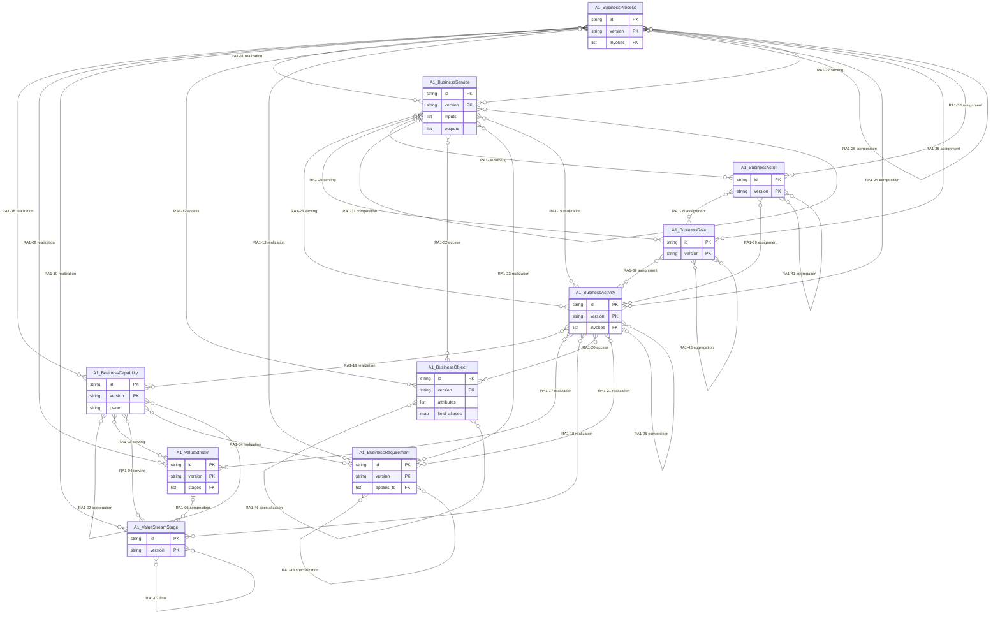
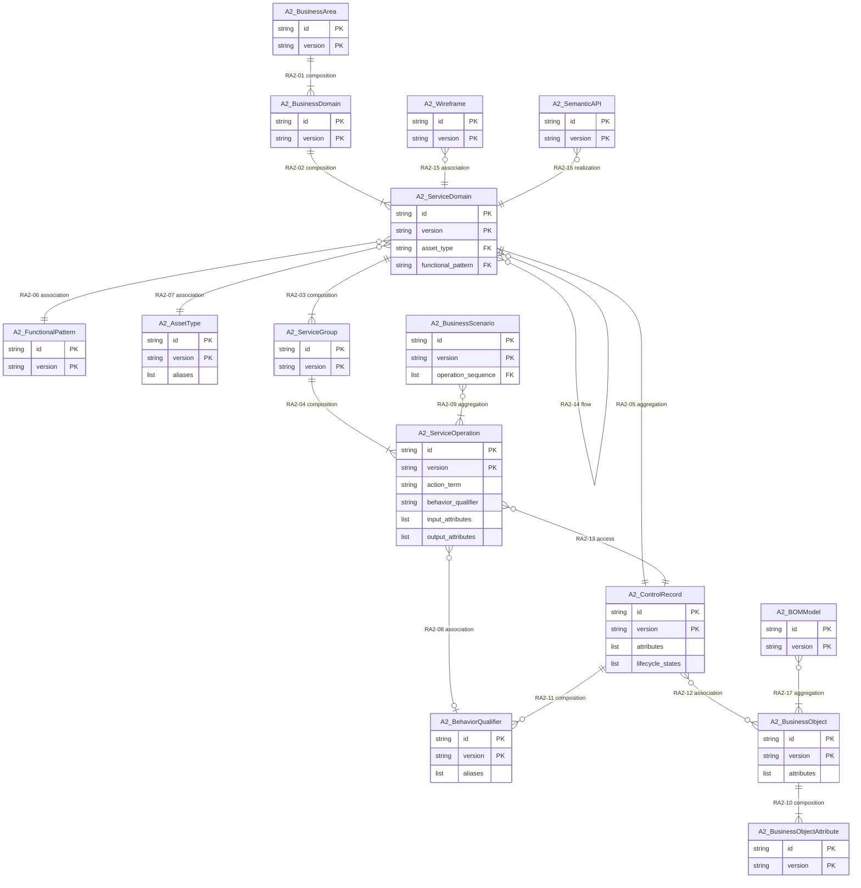
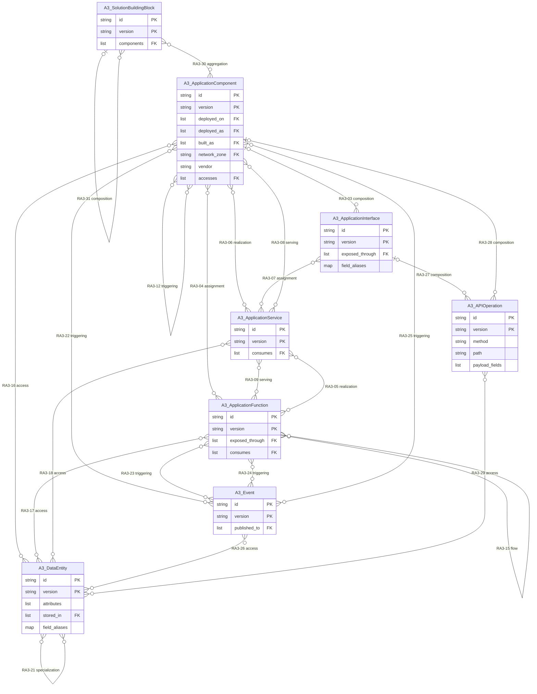
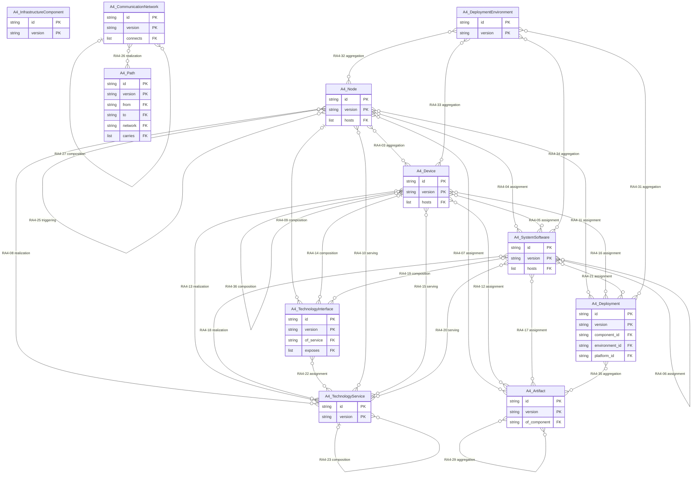

# SDEM Logical Data Model

Generated by `python -m sdem.logical` from the Architecture Metamodel records; the test suite checks it is current. This is the **platform-independent model** of the four architectures: entity types, their **identifiers**, **attributes** with types, allowed values and **references**, **relationships with cardinality**, and the **constraints** that bind them. It is assembled from [`architecture-entity-design.md`](architecture-entity-design.md), [`architecture-attribute-design.md`](architecture-attribute-design.md) and [`relationships-planning.md`](relationships-planning.md); the physical models (export JSON Schemas, a graph store schema) are to be generated from it.

## 1. Model-driven layers

| Layer | Content | Status |
|---|---|---|
| Conceptual | entity types and the relationships between them | complete |
| **Logical (this document)** | identifiers, typed attributes, allowed values, references, cardinality, constraints | **designed**; 5 of 14 constraints enforced |
| Physical | per-entity export JSON Schemas; graph store schema (DEC-01) | not generated yet — next build |

## 2. Building blocks

| Element | Defined in | Count |
|---|---|---|
| Entity types | entity records | 44 (1 abstract, 3 artefacts) |
| Core fields on every instance | `entity-attributes.json` › core_fields | 9 |
| Attributes | `entity-attributes.json` › attributes | 54: 33 reference, 16 value, 3 alias map, 2 enumeration |
| Within-level relationships | `level-relationships.json` | 132, each with cardinality |
| Cross-level relationship types | `relationship-types.json` | 9 |
| Constraints | this model | 14 |

## 3. Identifiers

Every instance is identified by `id` (unique within its level, permanent, never reused) and `version`; a relationship end pins both. The **natural key** makes an instance unique *as a thing* — what the export diff uses to spot duplicates and re-keys.

| Entity type | Natural key | Basis | Reasoning |
|---|---|---|---|
| `A2.ServiceDomain` | `canonical_id` | BIAN | a BIAN Service Domain is identified by its BIAN concept id; one instance per BIAN domain in an estate |
| `A2.ControlRecord` | `owning service domain` | BIAN | BIAN gives each Service Domain exactly one control record |
| `A2.ServiceOperation` | `owning service domain`, `action_term`, `behavior_qualifier` | BIAN | BIAN names an operation by its domain, action term and qualifier (Semantic API Practitioner Guide §3.2.5); two operations with the same three are the same operation |
| `A2.BusinessScenario` | `canonical_id` | BIAN | identified by its BIAN scenario id |
| `A2.BusinessObject` | `canonical_id` | BIAN | identified by its BIAN Business Object Model id |
| `A3.APIOperation` | `owning interface`, `method`, `path` | OpenAPI | OpenAPI makes an operation unique by path and method within one API |
| `A3.DataEntity` | `stored_in`, `name` | SDEM | a table or entity name is unique within the store that holds it |
| `A4.Deployment` | `component_id`, `environment_id`, `platform_id` | SDEM | one deployment per component, environment and platform |
| all other concrete types (32) | `name` | SDEM | no standard key; a unique name within the export is recommended |

## 4. Core fields

| Field | Type | Required | Allowed values |
|---|---|---|---|
| `id` | string | yes | — |
| `type` | string | yes | — |
| `version` | string | yes | — |
| `name` | string | yes | — |
| `lifecycle_status` | enum: planned, active, deprecated, retired | no | planned, active, deprecated, retired |
| `canonical_id` | string | no | — |
| `description` | string | no | — |
| `definition_uri` | string | no | — |
| `attributes` | object | no | — |

## 5. Enumerations

| Attribute | Allowed values | Source |
|---|---|---|
| `A2.ServiceOperation.action_term` | Activate, Configure, Feedback, Create, Initiate, Register, Evaluate, Provide, Update, Control, Exchange, Capture, Execute, Request, Grant, Retrieve, Notify | BIAN Semantic API Practitioner Guide §3.2.5, Figure 14 — 17 action terms |
| `A3.APIOperation.method` | GET, POST, PUT, PATCH, DELETE, HEAD, OPTIONS, BATCH, MQ, FILE | HTTP methods (OpenAPI); BATCH, MQ and FILE are SDEM values for non-HTTP interfaces (use case H1) |
| core `lifecycle_status` | planned, active, deprecated, retired | SDEM |
| relationship `kind` | composition, aggregation, assignment, realization, serving, access, flow, triggering, specialization, association | ArchiMate 3.2 |

## 6. Cross-level references (join keys)

18 reference attributes point *across* architectures. They are not relationships: they are the data the inference engine joins on to propose registry records (for example `deployed_on` → a `DEPLOYED_ON` record). Approved records, not these attributes, become federated edges.

| Attribute | References | Read by |
|---|---|---|
| `A1.BusinessProcess.invokes` | `A2.ServiceOperation` | S04 |
| `A1.BusinessActivity.invokes` | `A2.ServiceOperation` | S06, S07 |
| `A3.ApplicationComponent.deployed_on` | `A4.InfrastructureComponent` | S33, S34, S35 |
| `A3.ApplicationComponent.deployed_as` | `A4.Deployment` | S32 |
| `A3.ApplicationComponent.built_as` | `A4.Artifact` | S39 |
| `A3.ApplicationComponent.network_zone` | `A4.CommunicationNetwork` | S37 |
| `A3.ApplicationService.consumes` | `A4.TechnologyService` | S41 |
| `A3.ApplicationInterface.exposed_through` | `A4.TechnologyInterface` | S43 |
| `A3.ApplicationFunction.consumes` | `A4.TechnologyService` | S45 |
| `A3.DataEntity.stored_in` | `A4.SystemSoftware`, `A4.Artifact` | S49, S50 |
| `A3.Event.published_to` | `A4.TechnologyService` | S51; aligns with AsyncAPI channels (not adopted) |
| `A4.Deployment.component_id` | `A3.ApplicationComponent` | S32, S33, S40 |
| `A4.Node.hosts` | `A3.ApplicationComponent` | S33, S34 |
| `A4.Device.hosts` | `A3.ApplicationComponent` | S35 |
| `A4.SystemSoftware.hosts` | `A3.ApplicationComponent` | S33 |
| `A4.Path.carries` | `A3.ApplicationComponent` | S38 |
| `A4.TechnologyInterface.exposes` | `A3.ApplicationInterface` | S43 |
| `A4.Artifact.of_component` | `A3.ApplicationComponent` | S39 |

## 7. A1 Business Architecture

### 7.1 Entity–relationship diagram

Cardinality markers follow crow's-foot notation; labels carry the within-level row ID and kind. Inheritance is listed in the table below (an ER diagram has no notation for it).

### 7.2 Entities and attributes

| Entity type | Kind | Identifier | Attributes (`*` required, `→` reference) |
|---|---|---|---|
| `A1.BusinessCapability` | concrete | name | `owner` string |
| `A1.ValueStream` | concrete | name | `stages` list<string> → ValueStreamStage |
| `A1.ValueStreamStage` | concrete, is-a `A1.ValueStream` | name | — (core fields only) |
| `A1.BusinessProcess` | concrete | name | `invokes` list<string> → ServiceOperation |
| `A1.BusinessActivity` | concrete, is-a `A1.BusinessProcess` | name | `invokes` list<string> → ServiceOperation |
| `A1.BusinessService` | concrete | name | `inputs` list<string>; `outputs` list<string> |
| `A1.BusinessActor` | concrete | name | — (core fields only) |
| `A1.BusinessRole` | concrete | name | — (core fields only) |
| `A1.BusinessObject` | concrete | name | `attributes` list<string>; `field_aliases` map<string,string> |
| `A1.BusinessRequirement` | concrete | name | `applies_to` list<string> → BusinessProcess, BusinessActivity |

### 7.3 Relationships and cardinality

| ID | Source | Kind | Target | Source per target | Target per source | Basis |
|---|---|---|---|---|---|---|
| RA1-01 | `A1.BusinessCapability` | composition | `A1.BusinessCapability` | 0..1 | 0..* | ArchiMate composition semantics |
| RA1-02 | `A1.BusinessCapability` | aggregation | `A1.BusinessCapability` | 0..* | 0..* | SDEM default |
| RA1-03 | `A1.BusinessCapability` | serving | `A1.ValueStream` | 0..* | 0..* | SDEM default |
| RA1-04 | `A1.BusinessCapability` | serving | `A1.ValueStreamStage` | 0..* | 0..* | SDEM default |
| RA1-05 | `A1.ValueStream` | composition | `A1.ValueStreamStage` | 0..1 | 0..* | ArchiMate composition semantics |
| RA1-06 | `A1.ValueStreamStage` | triggering | `A1.ValueStreamStage` | 0..* | 0..* | SDEM default |
| RA1-07 | `A1.ValueStreamStage` | flow | `A1.ValueStreamStage` | 0..* | 0..* | SDEM default |
| RA1-08 | `A1.BusinessProcess` | realization | `A1.BusinessCapability` | 0..* | 0..* | SDEM default |
| RA1-09 | `A1.BusinessProcess` | realization | `A1.ValueStream` | 0..* | 0..* | SDEM default |
| RA1-10 | `A1.BusinessProcess` | realization | `A1.ValueStreamStage` | 0..* | 0..* | SDEM default |
| RA1-11 | `A1.BusinessProcess` | realization | `A1.BusinessService` | 0..* | 0..* | SDEM default |
| RA1-12 | `A1.BusinessProcess` | access | `A1.BusinessObject` | 0..* | 0..* | SDEM default |
| RA1-13 | `A1.BusinessProcess` | realization | `A1.BusinessRequirement` | 0..* | 0..* | SDEM default |
| RA1-14 | `A1.BusinessProcess` | triggering | `A1.BusinessProcess` | 0..* | 0..* | SDEM default |
| RA1-15 | `A1.BusinessProcess` | flow | `A1.BusinessProcess` | 0..* | 0..* | SDEM default |
| RA1-16 | `A1.BusinessActivity` | realization | `A1.BusinessCapability` | 0..* | 0..* | SDEM default |
| RA1-17 | `A1.BusinessActivity` | realization | `A1.ValueStream` | 0..* | 0..* | SDEM default |
| RA1-18 | `A1.BusinessActivity` | realization | `A1.ValueStreamStage` | 0..* | 0..* | SDEM default |
| RA1-19 | `A1.BusinessActivity` | realization | `A1.BusinessService` | 0..* | 0..* | SDEM default |
| RA1-20 | `A1.BusinessActivity` | access | `A1.BusinessObject` | 0..* | 0..* | SDEM default |
| RA1-21 | `A1.BusinessActivity` | realization | `A1.BusinessRequirement` | 0..* | 0..* | SDEM default |
| RA1-22 | `A1.BusinessActivity` | triggering | `A1.BusinessActivity` | 0..* | 0..* | SDEM default |
| RA1-23 | `A1.BusinessActivity` | flow | `A1.BusinessActivity` | 0..* | 0..* | SDEM default |
| RA1-24 | `A1.BusinessProcess` | composition | `A1.BusinessActivity` | 0..1 | 0..* | ArchiMate composition semantics |
| RA1-25 | `A1.BusinessProcess` | composition | `A1.BusinessProcess` | 0..1 | 0..* | ArchiMate composition semantics |
| RA1-26 | `A1.BusinessActivity` | composition | `A1.BusinessActivity` | 0..1 | 0..* | ArchiMate composition semantics |
| RA1-27 | `A1.BusinessService` | serving | `A1.BusinessProcess` | 0..* | 0..* | SDEM default |
| RA1-28 | `A1.BusinessService` | serving | `A1.BusinessActivity` | 0..* | 0..* | SDEM default |
| RA1-29 | `A1.BusinessService` | serving | `A1.BusinessRole` | 0..* | 0..* | SDEM default |
| RA1-30 | `A1.BusinessService` | serving | `A1.BusinessActor` | 0..* | 0..* | SDEM default |
| RA1-31 | `A1.BusinessService` | composition | `A1.BusinessService` | 0..1 | 0..* | ArchiMate composition semantics |
| RA1-32 | `A1.BusinessService` | access | `A1.BusinessObject` | 0..* | 0..* | SDEM default |
| RA1-33 | `A1.BusinessService` | realization | `A1.BusinessRequirement` | 0..* | 0..* | SDEM default |
| RA1-34 | `A1.BusinessCapability` | realization | `A1.BusinessRequirement` | 0..* | 0..* | SDEM default |
| RA1-35 | `A1.BusinessActor` | assignment | `A1.BusinessRole` | 0..* | 0..* | SDEM default |
| RA1-36 | `A1.BusinessRole` | assignment | `A1.BusinessProcess` | 0..* | 0..* | SDEM default |
| RA1-37 | `A1.BusinessRole` | assignment | `A1.BusinessActivity` | 0..* | 0..* | SDEM default |
| RA1-38 | `A1.BusinessActor` | assignment | `A1.BusinessProcess` | 0..* | 0..* | SDEM default |
| RA1-39 | `A1.BusinessActor` | assignment | `A1.BusinessActivity` | 0..* | 0..* | SDEM default |
| RA1-40 | `A1.BusinessActor` | composition | `A1.BusinessActor` | 0..1 | 0..* | ArchiMate composition semantics |
| RA1-41 | `A1.BusinessActor` | aggregation | `A1.BusinessActor` | 0..* | 0..* | SDEM default |
| RA1-42 | `A1.BusinessRole` | composition | `A1.BusinessRole` | 0..1 | 0..* | ArchiMate composition semantics |
| RA1-43 | `A1.BusinessRole` | aggregation | `A1.BusinessRole` | 0..* | 0..* | SDEM default |
| RA1-44 | `A1.BusinessObject` | composition | `A1.BusinessObject` | 0..1 | 0..* | ArchiMate composition semantics |
| RA1-45 | `A1.BusinessObject` | aggregation | `A1.BusinessObject` | 0..* | 0..* | SDEM default |
| RA1-46 | `A1.BusinessObject` | specialization | `A1.BusinessObject` | 0..* | 0..* | SDEM default |
| RA1-47 | `A1.BusinessRequirement` | composition | `A1.BusinessRequirement` | 0..1 | 0..* | ArchiMate composition semantics |
| RA1-48 | `A1.BusinessRequirement` | specialization | `A1.BusinessRequirement` | 0..* | 0..* | SDEM default |

## 8. A2 Service Domain Architecture

### 8.1 Entity–relationship diagram

Cardinality markers follow crow's-foot notation; labels carry the within-level row ID and kind. Inheritance is listed in the table below (an ER diagram has no notation for it).

### 8.2 Entities and attributes

| Entity type | Kind | Identifier | Attributes (`*` required, `→` reference) |
|---|---|---|---|
| `A2.BusinessArea` | concrete | name | — (core fields only) |
| `A2.BusinessDomain` | concrete | name | — (core fields only) |
| `A2.ServiceDomain` | concrete | canonical_id | `asset_type`* string → AssetType; `functional_pattern`* string → FunctionalPattern |
| `A2.FunctionalPattern` | concrete | name | — (core fields only) |
| `A2.AssetType` | concrete | name | `aliases` list<string> |
| `A2.ControlRecord` | concrete | owning service domain | `attributes`* list<string>; `lifecycle_states` list<string> |
| `A2.ServiceGroup` | concrete | name | — (core fields only) |
| `A2.ServiceOperation` | concrete | owning service domain, action_term, behavior_qualifier | `action_term`* string; `behavior_qualifier` string; `input_attributes`* list<string>; `output_attributes`* list<string> |
| `A2.BehaviorQualifier` | concrete | name | `aliases` list<string> |
| `A2.BusinessScenario` | concrete | canonical_id | `operation_sequence`* list<string> → ServiceOperation |
| `A2.BusinessObject` | concrete | canonical_id | `attributes`* list<string> |
| `A2.BusinessObjectAttribute` | concrete | name | — (core fields only) |
| `A2.BOMModel` | artefact | — | — (core fields only) |
| `A2.Wireframe` | artefact | — | — (core fields only) |
| `A2.SemanticAPI` | artefact | — | — (core fields only) |

### 8.3 Relationships and cardinality

| ID | Source | Kind | Target | Source per target | Target per source | Basis |
|---|---|---|---|---|---|---|
| RA2-01 | `A2.BusinessArea` | composition | `A2.BusinessDomain` | 1..1 | 1..* | BIAN |
| RA2-02 | `A2.BusinessDomain` | composition | `A2.ServiceDomain` | 1..1 | 1..* | BIAN |
| RA2-03 | `A2.ServiceDomain` | composition | `A2.ServiceGroup` | 1..1 | 1..* | BIAN |
| RA2-04 | `A2.ServiceGroup` | composition | `A2.ServiceOperation` | 1..1 | 1..* | BIAN |
| RA2-05 | `A2.ServiceDomain` | aggregation | `A2.ControlRecord` | 1..1 | 1..1 | BIAN |
| RA2-06 | `A2.ServiceDomain` | association | `A2.FunctionalPattern` | 0..* | 1..1 | BIAN |
| RA2-07 | `A2.ServiceDomain` | association | `A2.AssetType` | 0..* | 1..1 | BIAN |
| RA2-08 | `A2.ServiceOperation` | association | `A2.BehaviorQualifier` | 0..* | 0..1 | BIAN |
| RA2-09 | `A2.BusinessScenario` | aggregation | `A2.ServiceOperation` | 0..* | 1..* | BIAN |
| RA2-10 | `A2.BusinessObject` | composition | `A2.BusinessObjectAttribute` | 1..1 | 1..* | BIAN |
| RA2-11 | `A2.ControlRecord` | composition | `A2.BehaviorQualifier` | 1..1 | 0..* | BIAN |
| RA2-12 | `A2.ControlRecord` | association | `A2.BusinessObject` | 0..* | 0..* | SDEM default |
| RA2-13 | `A2.ServiceOperation` | access | `A2.ControlRecord` | 0..* | 1..1 | BIAN |
| RA2-14 | `A2.ServiceDomain` | flow | `A2.ServiceDomain` | 0..* | 0..* | SDEM default |
| RA2-15 | `A2.Wireframe` | association | `A2.ServiceDomain` | 0..* | 1..1 | BIAN |
| RA2-16 | `A2.SemanticAPI` | realization | `A2.ServiceDomain` | 0..* | 1..1 | BIAN |
| RA2-17 | `A2.BOMModel` | aggregation | `A2.BusinessObject` | 0..* | 1..* | SDEM reading |

## 9. A3 Application Architecture

### 9.1 Entity–relationship diagram

Cardinality markers follow crow's-foot notation; labels carry the within-level row ID and kind. Inheritance is listed in the table below (an ER diagram has no notation for it).

### 9.2 Entities and attributes

| Entity type | Kind | Identifier | Attributes (`*` required, `→` reference) |
|---|---|---|---|
| `A3.ApplicationComponent` | concrete | name | `deployed_on` list<string> → InfrastructureComponent; `deployed_as` list<string> → Deployment; `built_as` list<string> → Artifact; `network_zone` string → CommunicationNetwork; `vendor` string; `accesses` list<string> → DataEntity *(deprecated)* |
| `A3.ApplicationService` | concrete | name | `consumes` list<string> → TechnologyService |
| `A3.ApplicationInterface` | concrete | name | `exposed_through` list<string> → TechnologyInterface; `field_aliases` map<string,string> |
| `A3.ApplicationFunction` | concrete | name | `exposed_through` list<string> → APIOperation; `consumes` list<string> → TechnologyService |
| `A3.APIOperation` | concrete | owning interface, method, path | `method`* string; `path`* string; `payload_fields`* list<string> |
| `A3.DataEntity` | concrete | stored_in, name | `attributes`* list<string>; `stored_in` list<string> → SystemSoftware, Artifact; `field_aliases` map<string,string> |
| `A3.Event` | concrete | name | `published_to` list<string> → TechnologyService |
| `A3.SolutionBuildingBlock` | concrete | name | `components` list<string> → ApplicationComponent |

### 9.3 Relationships and cardinality

| ID | Source | Kind | Target | Source per target | Target per source | Basis |
|---|---|---|---|---|---|---|
| RA3-01 | `A3.ApplicationComponent` | composition | `A3.ApplicationComponent` | 0..1 | 0..* | ArchiMate composition semantics |
| RA3-02 | `A3.ApplicationComponent` | aggregation | `A3.ApplicationComponent` | 0..* | 0..* | SDEM default |
| RA3-03 | `A3.ApplicationComponent` | composition | `A3.ApplicationInterface` | 0..1 | 0..* | ArchiMate composition semantics |
| RA3-04 | `A3.ApplicationComponent` | assignment | `A3.ApplicationFunction` | 0..* | 0..* | SDEM default |
| RA3-05 | `A3.ApplicationFunction` | realization | `A3.ApplicationService` | 0..* | 0..* | SDEM default |
| RA3-06 | `A3.ApplicationComponent` | realization | `A3.ApplicationService` | 0..* | 0..* | SDEM default |
| RA3-07 | `A3.ApplicationInterface` | assignment | `A3.ApplicationService` | 0..* | 0..* | SDEM default |
| RA3-08 | `A3.ApplicationService` | serving | `A3.ApplicationComponent` | 0..* | 0..* | SDEM default |
| RA3-09 | `A3.ApplicationService` | serving | `A3.ApplicationFunction` | 0..* | 0..* | SDEM default |
| RA3-10 | `A3.ApplicationComponent` | flow | `A3.ApplicationComponent` | 0..* | 0..* | SDEM default |
| RA3-11 | `A3.ApplicationComponent` | serving | `A3.ApplicationComponent` | 0..* | 0..* | SDEM default |
| RA3-12 | `A3.ApplicationComponent` | triggering | `A3.ApplicationComponent` | 0..* | 0..* | SDEM default |
| RA3-13 | `A3.ApplicationFunction` | composition | `A3.ApplicationFunction` | 0..1 | 0..* | ArchiMate composition semantics |
| RA3-14 | `A3.ApplicationFunction` | triggering | `A3.ApplicationFunction` | 0..* | 0..* | SDEM default |
| RA3-15 | `A3.ApplicationFunction` | flow | `A3.ApplicationFunction` | 0..* | 0..* | SDEM default |
| RA3-16 | `A3.ApplicationComponent` | access | `A3.DataEntity` | 0..* | 0..* | SDEM default |
| RA3-17 | `A3.ApplicationFunction` | access | `A3.DataEntity` | 0..* | 0..* | SDEM default |
| RA3-18 | `A3.ApplicationService` | access | `A3.DataEntity` | 0..* | 0..* | SDEM default |
| RA3-19 | `A3.DataEntity` | composition | `A3.DataEntity` | 0..1 | 0..* | ArchiMate composition semantics |
| RA3-20 | `A3.DataEntity` | aggregation | `A3.DataEntity` | 0..* | 0..* | SDEM default |
| RA3-21 | `A3.DataEntity` | specialization | `A3.DataEntity` | 0..* | 0..* | SDEM default |
| RA3-22 | `A3.ApplicationComponent` | triggering | `A3.Event` | 0..* | 0..* | SDEM default |
| RA3-23 | `A3.ApplicationFunction` | triggering | `A3.Event` | 0..* | 0..* | SDEM default |
| RA3-24 | `A3.Event` | triggering | `A3.ApplicationFunction` | 0..* | 0..* | SDEM default |
| RA3-25 | `A3.Event` | triggering | `A3.ApplicationComponent` | 0..* | 0..* | SDEM default |
| RA3-26 | `A3.Event` | access | `A3.DataEntity` | 0..* | 0..* | SDEM default |
| RA3-27 | `A3.ApplicationInterface` | composition | `A3.APIOperation` | 0..1 | 0..* | ArchiMate composition semantics |
| RA3-28 | `A3.ApplicationComponent` | composition | `A3.APIOperation` | 0..1 | 0..* | ArchiMate composition semantics |
| RA3-29 | `A3.APIOperation` | access | `A3.DataEntity` | 0..* | 0..* | SDEM default |
| RA3-30 | `A3.SolutionBuildingBlock` | aggregation | `A3.ApplicationComponent` | 0..* | 0..* | SDEM default |
| RA3-31 | `A3.SolutionBuildingBlock` | composition | `A3.SolutionBuildingBlock` | 0..1 | 0..* | ArchiMate composition semantics |

## 10. A4 Technology Architecture

### 10.1 Entity–relationship diagram

Cardinality markers follow crow's-foot notation; labels carry the within-level row ID and kind. Inheritance is listed in the table below (an ER diagram has no notation for it).

### 10.2 Entities and attributes

| Entity type | Kind | Identifier | Attributes (`*` required, `→` reference) |
|---|---|---|---|
| `A4.InfrastructureComponent` | abstract | — | — (core fields only) |
| `A4.Deployment` | concrete, is-a `A4.InfrastructureComponent` | component_id, environment_id, platform_id | `component_id`* string → ApplicationComponent; `environment_id`* string → DeploymentEnvironment; `platform_id`* string → InfrastructureComponent |
| `A4.DeploymentEnvironment` | concrete, is-a `A4.InfrastructureComponent` | name | — (core fields only) |
| `A4.Node` | concrete, is-a `A4.InfrastructureComponent` | name | `hosts` list<string> → ApplicationComponent |
| `A4.Device` | concrete, is-a `A4.InfrastructureComponent` | name | `hosts` list<string> → ApplicationComponent |
| `A4.SystemSoftware` | concrete, is-a `A4.InfrastructureComponent` | name | `hosts` list<string> → ApplicationComponent |
| `A4.TechnologyService` | concrete, is-a `A4.InfrastructureComponent` | name | — (core fields only) |
| `A4.TechnologyInterface` | concrete, is-a `A4.InfrastructureComponent` | name | `of_service` string → TechnologyService; `exposes` list<string> → ApplicationInterface |
| `A4.CommunicationNetwork` | concrete, is-a `A4.InfrastructureComponent` | name | `connects` list<string> → Node, Device |
| `A4.Path` | concrete, is-a `A4.InfrastructureComponent` | name | `from` string → Node, Device; `to` string → Node, Device; `network` string → CommunicationNetwork; `carries` list<string> → ApplicationComponent |
| `A4.Artifact` | concrete, is-a `A4.InfrastructureComponent` | name | `of_component` string → ApplicationComponent |

### 10.3 Relationships and cardinality

| ID | Source | Kind | Target | Source per target | Target per source | Basis |
|---|---|---|---|---|---|---|
| RA4-01 | `A4.Node` | composition | `A4.Node` | 0..1 | 0..* | ArchiMate composition semantics |
| RA4-02 | `A4.Node` | aggregation | `A4.Node` | 0..* | 0..* | SDEM default |
| RA4-03 | `A4.Node` | aggregation | `A4.Device` | 0..* | 0..* | SDEM default |
| RA4-04 | `A4.Node` | assignment | `A4.SystemSoftware` | 0..* | 0..* | SDEM default |
| RA4-05 | `A4.Device` | assignment | `A4.SystemSoftware` | 0..* | 0..* | SDEM default |
| RA4-06 | `A4.SystemSoftware` | assignment | `A4.SystemSoftware` | 0..* | 0..* | SDEM default |
| RA4-07 | `A4.Node` | assignment | `A4.Artifact` | 0..* | 0..* | SDEM default |
| RA4-08 | `A4.Node` | realization | `A4.TechnologyService` | 0..* | 0..* | SDEM default |
| RA4-09 | `A4.Node` | composition | `A4.TechnologyInterface` | 0..1 | 0..* | ArchiMate composition semantics |
| RA4-10 | `A4.TechnologyService` | serving | `A4.Node` | 0..* | 0..* | SDEM default |
| RA4-11 | `A4.Node` | assignment | `A4.Deployment` | 0..* | 0..* | SDEM default |
| RA4-12 | `A4.Device` | assignment | `A4.Artifact` | 0..* | 0..* | SDEM default |
| RA4-13 | `A4.Device` | realization | `A4.TechnologyService` | 0..* | 0..* | SDEM default |
| RA4-14 | `A4.Device` | composition | `A4.TechnologyInterface` | 0..1 | 0..* | ArchiMate composition semantics |
| RA4-15 | `A4.TechnologyService` | serving | `A4.Device` | 0..* | 0..* | SDEM default |
| RA4-16 | `A4.Device` | assignment | `A4.Deployment` | 0..* | 0..* | SDEM default |
| RA4-17 | `A4.SystemSoftware` | assignment | `A4.Artifact` | 0..* | 0..* | SDEM default |
| RA4-18 | `A4.SystemSoftware` | realization | `A4.TechnologyService` | 0..* | 0..* | SDEM default |
| RA4-19 | `A4.SystemSoftware` | composition | `A4.TechnologyInterface` | 0..1 | 0..* | ArchiMate composition semantics |
| RA4-20 | `A4.TechnologyService` | serving | `A4.SystemSoftware` | 0..* | 0..* | SDEM default |
| RA4-21 | `A4.SystemSoftware` | assignment | `A4.Deployment` | 0..* | 0..* | SDEM default |
| RA4-22 | `A4.TechnologyInterface` | assignment | `A4.TechnologyService` | 0..* | 0..* | SDEM default |
| RA4-23 | `A4.TechnologyService` | composition | `A4.TechnologyService` | 0..1 | 0..* | ArchiMate composition semantics |
| RA4-24 | `A4.Node` | flow | `A4.Node` | 0..* | 0..* | SDEM default |
| RA4-25 | `A4.Node` | triggering | `A4.Node` | 0..* | 0..* | SDEM default |
| RA4-26 | `A4.CommunicationNetwork` | realization | `A4.Path` | 0..* | 0..* | SDEM default |
| RA4-27 | `A4.CommunicationNetwork` | composition | `A4.CommunicationNetwork` | 0..1 | 0..* | ArchiMate composition semantics |
| RA4-28 | `A4.Artifact` | composition | `A4.Artifact` | 0..1 | 0..* | ArchiMate composition semantics |
| RA4-29 | `A4.Artifact` | aggregation | `A4.Artifact` | 0..* | 0..* | SDEM default |
| RA4-30 | `A4.Device` | aggregation | `A4.Device` | 0..* | 0..* | SDEM default |
| RA4-31 | `A4.DeploymentEnvironment` | aggregation | `A4.Deployment` | 0..* | 0..* | SDEM default |
| RA4-32 | `A4.DeploymentEnvironment` | aggregation | `A4.Node` | 0..* | 0..* | SDEM default |
| RA4-33 | `A4.DeploymentEnvironment` | aggregation | `A4.Device` | 0..* | 0..* | SDEM default |
| RA4-34 | `A4.DeploymentEnvironment` | aggregation | `A4.SystemSoftware` | 0..* | 0..* | SDEM default |
| RA4-35 | `A4.Deployment` | aggregation | `A4.Artifact` | 0..* | 0..* | SDEM default |
| RA4-36 | `A4.Device` | composition | `A4.Device` | 0..1 | 0..* | ArchiMate composition semantics |

## 11. Cross-level relationship types

Registry records connect adjacent architectures only; level-skipping answers are paths.

| Type | Source → target | Relationship | Cardinality | Required evidence |
|---|---|---|---|---|
| CAPABILITY_SUPPORTED_BY_DOMAIN | `A1.BusinessCapability` → `A2.ServiceDomain` | `SUPPORTED_BY` | many to many | business_architecture_document, domain_scope_assessment |
| VALUE_STREAM_ALIGNED_TO_SCENARIO | `A1.ValueStream` → `A2.BusinessScenario` | `ALIGNED_TO` | many to many | process_model, scenario_suitability_review |
| PROCESS_USES_DOMAIN | `A1.BusinessProcess` → `A2.ServiceDomain` | `USES_DOMAIN` | many to many | process_model |
| BUSINESS_OBJECT_ALIGNED_TO_BIAN_OBJECT | `A1.BusinessObject` → `A2.BusinessObject` | `ALIGNED_TO` | many to many | business_glossary, object_alignment_review |
| DOMAIN_REALIZED_BY_COMPONENT | `A2.ServiceDomain` → `A3.ApplicationComponent` | `REALIZED_BY` | many to many | application_architecture_document |
| OPERATION_IMPLEMENTED_BY_API | `A2.ServiceOperation` → `A3.APIOperation` | `IMPLEMENTED_BY` | many to many | api_contract |
| BIAN_OBJECT_MAPPED_TO_DATA_ENTITY | `A2.BusinessObject` → `A3.DataEntity` | `MAPPED_TO` | many to many | data_model |
| COMPONENT_DEPLOYED_ON_INFRASTRUCTURE | `A3.ApplicationComponent` → `A4.InfrastructureComponent` | `DEPLOYED_ON` | many to many | deployment_design |
| COMPONENT_DEPLOYED_AS_DEPLOYMENT | `A3.ApplicationComponent` → `A4.Deployment` | `DEPLOYED_AS` | many to many | deployment_design |

## 12. Constraints

| ID | Constraint | Rule | Status | By |
|---|---|---|---|---|
| LC-01 | Instance identity | `id` + `version` is unique within a level export | **enforced** | `sdem-graph check` |
| LC-02 | Entity typing | every instance's `type` is a concrete, non-artefact entity type of the export's level | **enforced** | `sdem-graph check` |
| LC-03 | Within-level relationships | every relationship matches a within-level row of its level (through inheritance), or is `association` | **enforced** | `sdem-graph check` |
| LC-04 | Required attributes | every attribute marked required is present | **not enforced** | designed; next build |
| LC-05 | Attribute types | every attribute value has its declared type | **not enforced** | designed; next build |
| LC-06 | Enumerations | enumerated attributes (`action_term`, `method`, `lifecycle_status`) take an allowed value | **not enforced** | designed; next build |
| LC-07 | Same-level references | a reference attribute whose target is in the same level names an instance of the declared type in the same export | **not enforced** | designed; next build |
| LC-08 | Cross-level references | a reference attribute whose target is in another level names an instance of the declared type in the estate | **not enforced** | resolved by the inference engine (join keys); never a federated edge |
| LC-09 | Natural keys | no two instances of a type share their identifier key within an export | **not enforced** | designed; needed by the export diff |
| LC-10 | Cardinality — maximum | no instance exceeds the stated maximum of a BIAN or ArchiMate-composition row (e.g. a service group in two Service Domains) | **not enforced** | designed as an error; next build |
| LC-10m | Cardinality — minimum (completeness) | an instance meets the stated minimum (e.g. a Service Domain has a control record); exports may legitimately be partial selections of BIAN, so a shortfall is a completeness warning, not an error | **not enforced** | designed as a warning; next build |
| LC-11 | Cross-level relationship ends | both ends of every registry record resolve to instances of the right type, level and version | **enforced** | `sdem-graph check` |
| LC-12 | Registry immutability | approved, rejected and superseded registry records are never edited | **enforced** | `sdem-diff` |
| LC-13 | Deprecated attributes | deprecated attributes raise a warning | **not enforced** | designed; next build |

## 13. Conformance of the example estates

The 7 example estates (446 instances) measured against the constraints not yet enforced. No errors; 29 completeness warning(s), where an example exports part of BIAN's structure (a business domain without its area, a business object without attribute instances, a stub Service Domain without its groups or control record); 7 instance(s) still use a deprecated attribute.

| Constraint | Values checked | Failures |
|---|---|---|
| LC-04 | 478 | 0 |
| LC-05 | 703 | 0 |
| LC-06 | 558 | 0 |
| LC-07 | 126 | 0 |
| LC-08 | 134 | 0 |
| LC-09 | 315 | 0 |
| LC-10 | 1104 | 0 |
| LC-10m (warning) | 1104 | 29 |
| LC-13 (deprecated in use) | — | 7 |
| attributes not in the model | — | 0 |

## 14. Basis of the logical decisions

| Decision | Count | Basis |
|---|---|---|
| Cardinality — SDEM default | 92 | no standard multiplicity; left open |
| Cardinality — ArchiMate composition semantics | 25 | a part belongs to at most one whole (ArchiMate) |
| Cardinality — BIAN | 14 | stated by BIAN |
| Cardinality — SDEM reading | 1 | SDEM's reading of a BIAN page |
| Natural keys — SDEM | 34 | SDEM recommendation |
| Natural keys — BIAN | 5 | BIAN concept ids and operation naming |
| Natural keys — OpenAPI | 1 | path and method unique per API |

## Next

1. **Generate the physical export model**: one JSON Schema per entity type from this model, and make `sdem-graph check` enforce LC-04 … LC-10 and LC-13.
2. **Approve the model as a baseline** (`SDEM-METAMODEL-0.8`) after an independent review.
3. **Graph store schema** when a persistent store is chosen (knowledge-graph spec DEC-01).

