# Mapping logic — planning (v0.6)

> **Terminology (v0.7.0).** SDMM was renamed **SDEM — Service Domain Enterprise Metamodel**. This document keeps its original wording as a record, so read: *mapping set* / *mapping document* = **Architecture Relationship Registry**; *mapping model*, *plan* / *new mappings* = **Architecture Relationship Rules Model**; *registry* (the nine relationship types) = **relationship type catalogue**, part of the **Architecture Metamodel**; *mapping engine* / *executor* = **Architecture Relationship Inference Engine**; *local graph* / *federated graph* = **local / federated architecture knowledge graph**. Commands shown as `sdmm-*` and paths under `sdmm/` are now `sdem-*` and `sdem/` (the old names still work in v0.7 and are removed in v0.8.0). *Export* / *level export* / *level model* (the file of one architecture's records) = **architecture dataset** (renamed 2026-10-27; W3C DCAT sense of *dataset*). See [`sdem-overview.md`](sdem-overview.md).

> **Current state (2026-10-25).** The planning record behind the Relationship Rules Model. The rules are now encoded in `metamodel/relationship-rules.json` and specified in [`relationship-rules-spec.md`](relationship-rules-spec.md), which are authoritative where this document differs: all B-rows are encoded, and the §5.3 summary counts predate the final encoding (now high 28 / medium 20 / low 21 on the rule rows). The engine that applies them is built (v0.10): `sdem/rules_engine.py`, run with `sdem-infer rules --graph <store>`; passes all 8 acceptance cases (`sdem-accept`).

**Status:** planning record. When written, nothing here was implemented; the rules have since been encoded (see the note above), the engine has not. v0.4 delivered the structural logic (what a mapping *may* be); v0.5 delivered the harness (how an engine is scored). §1 is the Official BIAN-Only Mapping (what BIAN itself defines), §2 is the Official BIAN with Support Framework Mappings (what ArchiMate, TOGAF and W135 add where BIAN stops — every claim source-verified before use), and §3 plans the semantic logic: how software will *propose* what a mapping *should* be, for an architect to accept or reject.

**Ground rule, restated:** an engine's output is always `status: proposed`. The validator refuses approval without a named reviewer and date. Nothing below changes that.

---

## 1. Official BIAN-Only Mapping

What BIAN itself defines: its entities (§1.1), the mappings it defines between them (§1.2), and what it does not map (§1.3). Everything is taken from BIAN's public release notes for Service Landscape 13.0 and 14.0 and the Semantic API Practitioner Guide v8.1, with section and page references; no BIAN text is reproduced beyond short attributed phrases.

### 1.1 BIAN entities

All 44 catalogue entities. **Covered by BIAN** is "Yes" when BIAN defines the concept and publishes its instances, "No" otherwise; uncovered entities show "n/a". The BIAN entities (16) are the nodes of BIAN's own mapping model, described in §1.2 and §1.3.

Sources: **[SL14]** Service Landscape 14.0 InSite portal · **[RN14]** v14.0 release notes · **[SAPG]** Semantic API Practitioner Guide v8.1 · **[APIP]** BIAN Semantic API portal.


#### A1 — Business Architecture — 1 of 10 covered by BIAN

| Entity | Covered by BIAN | BIAN concept | BIAN source |
|---|---|---|---|
| `A1.BusinessCapability` | Yes | Business Capability (BCM) | [SL14] Business Capability Map |
| `A1.ValueStream` | No | n/a | n/a |
| `A1.ValueStreamStage` | No | n/a | n/a |
| `A1.BusinessProcess` | No | n/a | n/a |
| `A1.BusinessActivity` | No | n/a | n/a |
| `A1.BusinessService` | No | n/a | n/a |
| `A1.BusinessActor` | No | n/a | n/a |
| `A1.BusinessRole` | No | n/a | n/a |
| `A1.BusinessObject` | No | n/a | n/a |
| `A1.BusinessRequirement` | No | n/a | n/a |

#### A2 — Service Domain Architecture — 15 of 15 covered by BIAN

| Entity | Covered by BIAN | BIAN concept | BIAN source |
|---|---|---|---|
| `A2.BusinessArea` | Yes | Business Area | [SL14] Service Landscape views |
| `A2.BusinessDomain` | Yes | Business Domain | [SL14] Service Landscape views |
| `A2.ServiceDomain` | Yes | Service Domain | [SL14] per-domain pages; [SAPG] §2.4–2.5, §3.1–3.2 |
| `A2.FunctionalPattern` | Yes | Functional Pattern | [SL14] MetaModel Overview; [SAPG] §3.2.1 |
| `A2.AssetType` | Yes | Asset Type | [SL14] MetaModel Overview; [SAPG] §3.2.2 |
| `A2.ControlRecord` | Yes | Control Record | [SL14] Control Record Model Overview; [SAPG] §3.2.3 |
| `A2.ServiceGroup` | Yes | Service Group | [SL14] MetaModel Overview |
| `A2.ServiceOperation` | Yes | Service Operation | [SL14] per-domain operations with I/O parameters; [SAPG] §3.2.5 |
| `A2.BehaviorQualifier` | Yes | Behavior Qualifier | [SL14] MetaModel Overview; [SAPG] §3.2.4 |
| `A2.BusinessScenario` | Yes | Business Scenario | [SL14] Business Scenarios; [SAPG] §3.3 |
| `A2.BusinessObject` | Yes | Business Object (BOM) | [SL14] Business Object Model Overview; [SAPG] §3.2.7 |
| `A2.BusinessObjectAttribute` | Yes | Business Object attribute | [SL14] Business Object Model Overview |
| `A2.BOMModel` *(artefact)* | Yes | Business Object Model | [SL14] Business Object Model Overview |
| `A2.Wireframe` *(artefact)* | Yes | Wireframe | [SL14] Wireframes Overview; [SAPG] §3.4 |
| `A2.SemanticAPI` *(artefact)* | Yes | Semantic API | [APIP]; [SAPG] §3.5 |

#### A3 — Application Architecture — 0 of 8 covered by BIAN

| Entity | Covered by BIAN | BIAN concept | BIAN source |
|---|---|---|---|
| `A3.ApplicationComponent` | No | n/a | n/a |
| `A3.ApplicationService` | No | n/a | n/a |
| `A3.ApplicationInterface` | No | n/a | n/a |
| `A3.ApplicationFunction` | No | n/a | n/a |
| `A3.APIOperation` | No | n/a | n/a |
| `A3.DataEntity` | No | n/a | n/a |
| `A3.Event` | No | n/a | n/a |
| `A3.SolutionBuildingBlock` | No | n/a | n/a |

#### A4 — Technology Architecture — 0 of 11 covered by BIAN

| Entity | Covered by BIAN | BIAN concept | BIAN source |
|---|---|---|---|
| `A4.InfrastructureComponent` *(abstract)* | No | n/a | n/a |
| `A4.Deployment` | No | n/a | n/a |
| `A4.DeploymentEnvironment` | No | n/a | n/a |
| `A4.Node` | No | n/a | n/a |
| `A4.Device` | No | n/a | n/a |
| `A4.SystemSoftware` | No | n/a | n/a |
| `A4.TechnologyService` | No | n/a | n/a |
| `A4.TechnologyInterface` | No | n/a | n/a |
| `A4.CommunicationNetwork` | No | n/a | n/a |
| `A4.Path` | No | n/a | n/a |
| `A4.Artifact` | No | n/a | n/a |

**Totals: 16 of 44 entities covered by BIAN** — one at A1, all fifteen at A2, none at A3, none at A4.

### 1.2 Official BIAN Only Mapping

The relationships BIAN itself defines among its sixteen entities — its own mapping model. All are within the Service Domain Architecture (A2) except the first, which is the only BIAN relationship reaching A1 and is unpublished.

| ID | From | Mapping | To | What it says | Source |
|---|---|---|---|---|---|
| B01 | `A1.BusinessCapability` | aligns to | `A2.ServiceDomain` | **Unpublished** — mapped by the BCM working group in 2024, "not yet documented in the BIAN BiZZdesign repository" | [RN13] §3, [RN14] §3 |
| B02 | `A2.BusinessArea` | contains | `A2.BusinessDomain` | The landscape hierarchy, top level | [SL14] Service Landscape views |
| B03 | `A2.BusinessDomain` | contains | `A2.ServiceDomain` | Each Service Domain sits in exactly one Business Domain | [SL14] Service Landscape views |
| B04 | `A2.ServiceDomain` | applies | `A2.FunctionalPattern` | Every domain applies one generic behaviour pattern (e.g. Fulfil, Track, Analyse) | [SL14] MetaModel Overview; [SAPG] §3.2.1 |
| B05 | `A2.ServiceDomain` | manages | `A2.AssetType` | Every domain manages one class of asset through its lifecycle | [SL14] MetaModel Overview; [SAPG] §3.2.2 |
| B06 | `A2.ServiceDomain` | governs | `A2.ControlRecord` | Every domain has one control record: the lifecycle state of its pattern applied to its asset | [SL14] Control Record Model; [SAPG] §3.2.3 |
| B07 | `A2.ControlRecord` | is partitioned by | `A2.BehaviorQualifier` | Qualifiers divide the control record into sub-partitions of equivalent operational properties | [SL14] MetaModel Overview; [SAPG] §3.2.4 |
| B08 | `A2.ControlRecord` | attributes typed by | `A2.BusinessObject` / `A2.BusinessObjectAttribute` | Control record attributes draw on the Business Object Model; rationalised together in 14.0 | [SL14] BOM Overview; [RN14] §1.3 |
| B09 | `A2.ServiceDomain` | offers | `A2.ServiceGroup` | Operations are grouped per domain | [SL14] MetaModel Overview |
| B10 | `A2.ServiceGroup` | contains | `A2.ServiceOperation` | Each operation belongs to one group | [SL14] MetaModel Overview |
| B11 | `A2.ServiceOperation` | acts on | `A2.ControlRecord` (or a qualifier partition) | An operation's action term says what it does to the control record instance; attributes are filtered by action term for input/output | [SAPG] §3.2.5, §3.5 |
| B12 | `A2.ServiceDomain` | connects to | `A2.ServiceDomain` | First-order connections: which domains a domain typically exchanges with | [SAPG] §3.2.6 |
| B13 | `A2.BusinessScenario` | sequences | `A2.ServiceOperation` across domains | A scenario is an illustrative sequence of operation calls between domains (UML sequence diagram) | [SL14] Business Scenarios; [SAPG] §3.3 |
| B14 | `A2.Wireframe` | depicts | `A2.ServiceDomain` connections | Archetypal interaction pattern among a set of domains | [SL14] Wireframes Overview; [SAPG] §3.4 |
| B15 | `A2.SemanticAPI` | derived from | `A2.ServiceDomain` + its `A2.ServiceOperation`s | The reference API is the domain's operations in REST form | [APIP]; [SAPG] §3.5 |

B02–B13 are encoded as constraints in `metamodel/level-relationships.json`; B14–B15 are artefact relationships (see §3.1). B01 is the one BIAN mapping SDEM's `SUPPORTED_BY` arrow would rely on, and it does not exist publicly.

### 1.3 What BIAN does not map

| Would-be mapping | Status | Source |
|---|---|---|
| Business Capability → Service Domain | Work in progress, unpublished. Confirmed still in progress in June 2026: a working group is developing "an L1/L2 Business Capability taxonomy, a Value Stream catalogue and stage definitions, and the alignment of stages to Business Domains and orchestrating Service Domains" | [RN13] §3, [RN14] §3, [WQA26] |
| Value stream / stage → Business Domain and Service Domain | Not yet modelled. **Announced intent** (June 2026): value streams and stages will enter the BIAN metamodel, with each stage mapped to Business Domain(s) and a primary orchestrating Service Domain. When published, this becomes BIAN's first A1→A2 mapping and SDEM's `ALIGNED_TO` / `USES_DOMAIN` arrows gain a BIAN basis | [WQA26] |
| A bank's business process → Service Domain / operation | Never in scope; scenarios are illustrative, not a bank's processes | [SAPG] §3.3 |
| A bank's application → Service Domain | Method only (wireframe functional partition, legacy wrapping); BIAN holds no application data | [SAPG] §3.4, §4.3.1 |
| Anything → infrastructure or deployment | "does not assume or impose any physical properties"; implementation guidance only (§4.1–4.3) | [SAPG] §4.2.3 p. 87, Figure 34 p. 90 |

**Summary: BIAN's mapping model is 15 relationships among its own entities, 14 of them inside A2. It publishes nothing from A1 to A2 (the capability mapping is unfinished), nothing to a bank's applications beyond a method, and nothing to physical infrastructure.**

### 1.4 Consequences for the engine design

1. **A2 is the anchor.** It is the only level whose vocabulary *and instances* can be sourced publicly (with an institution's licence to use them). Every A1→A2 and A2→A3 inference is a comparison *against* A2 text. Populating a rich A2 level model from the portal — descriptions, scenarios, operations, control-record attributes — is the first engineering task, and it is an export, not an inference.

2. **The capability boundary has no BIAN answer.** Despite what our earlier provenance assumed, there is no published BCM↔Service Domain alignment to look up. An engine must infer it, and that inference carries the most risk of a plausible-but-wrong proposal. It gets the lowest default confidence and the strongest evidence requirement (`domain_scope_assessment` is already a required evidence kind for `SUPPORTED_BY`).

3. **The API boundary has the most mechanics.** BIAN's REST mapping gives action terms, resource archetypes and HTTP methods. An engine can be *rule-based* here, and its proposals can carry specific findings. Highest default confidence.

4. **The infrastructure boundary is text-free, but not pattern-free.** `DEPLOYED_ON` / `DEPLOYED_AS` come from deployment data, never from descriptions. The engine needs a structural source: a `relationships` entry in the A4 export that says which artefact runs where, or an attribute on the A3 instance naming its deployment target. BIAN's implementation guidance (§4.1–4.3) supplies a *prior* — a domain-aligned component is expected to deploy as a discrete container — which can raise confidence when the data agrees with the pattern, but never substitutes for the data.

5. **Existing approved mappings are the best evidence of all.** "Domain X is realised by application Y" makes "operation X.op is implemented by Y's API" far more likely. The engine should always read the federated graph before reading any description.

### 1.5 Corrections to the repository arising from this review

- `docs/reference-architecture-provenance.md`, the README and the v0.4 spec cite a "BIAN BCM *Statement of Alignment with the Service Landscape* (2023)" PDF. That URL returns 404 and BIAN's release notes describe the alignment as unfinished and unpublished. The citation is replaced by the v13 and v14 release notes, and `A1.BusinessCapability` keeps `evidence_status: interpreted_from_official_source` with that basis.
- The registry's `SUPPORTED_BY` and `ALIGNED_TO` (value stream) rules carry `authority: bian_alignment_guidance`. That remains correct — BIAN *intends* to provide this guidance and the BCM exists — but the planning assumption that an engine could consult a published alignment is withdrawn.

---

## 2. Official BIAN with Support Framework Mapping

**Status:** merged from `SDMM_Reference_Architecture_Entity_Mappings_A1_A4.md` (22 October 2026). **Step one — done in §2.6 — is to confirm each claimed mapping against its stated source before anything is changed.** A *Verification* column has been added to every row of §2.3 and §2.4 with the result. Analysis of what to adopt follows in §3. §1 established that BIAN's published mapping model stops at A2. This section inventories what the other reference frameworks — ArchiMate 3.2, TOGAF 10 and The Open Group's W135 (TOGAF–BIAN integration, 2013) — supply for the links BIAN leaves open, pair by pair, with a conservative statement of how official each contribution is.

### 2.1 Purpose

Three frameworks can fill gaps, in different ways:

| Framework | What it can supply | What it cannot |
|---|---|---|
| **ArchiMate 3.2** | Cross-layer *relationship semantics* between its own native elements (Business ↔ Application ↔ Technology: serving, realization, assignment, access), with normative allowed-relationship tables | Any correspondence between a BIAN instance and a bank's instance; BIAN entities are not ArchiMate elements |
| **TOGAF 10** | Architecture-content guidance: building blocks (ABB/SBB), content metamodel, how layers relate in a method | A fixed BIAN-to-SDEM element correspondence |
| **W135** (The Open Group, 2013) | The one published attempt to integrate TOGAF with the BIAN Service Landscape — scenario/process analysis, application overlay | Currency: it predates BIAN 14.0 and TOGAF 10; informational, not a conformance mapping |

Additional source key for this section: **[W135]** The Open Group White Paper W135, *Integrating the TOGAF® Standard with the BIAN Service Landscape*, Paul Bonnie, Thomas Obitz and the TOGAF–BIAN Collaboration Work Group, 22 October 2013, 43 pp., supersedes W120 (13 February 2012); written for BIAN Service Landscape 2.0 — https://publications.opengroup.org/w135 (free, **login required to download**)

### 2.2 Status vocabulary — read this before the tables

- **BIAN internal only:** BIAN officially defines an A2 structural or behavioural relationship, but that is **not** an official mapping to A1 or A3.
- **Guidance only:** an official publication discusses alignment, but does **not** supply a definitive instance-level or exact entity-type crosswalk.
- **ArchiMate native relationship support:** the modelling language defines cross-layer relationship semantics for **native ArchiMate elements**, subject to its normative relationship constraints. It does **not** map BIAN domain instances to a bank's application instances.
- **Not officially mapped:** no specific published official mapping for the SDEM pair was established in this review. This does not prove no publication exists.
- **BIAN artefact only:** the artefact is official evidence but is not a mapping endpoint.
- **TOGAF guidance only:** TOGAF supplies architecture-content guidance, not a fixed BIAN-to-SDEM element correspondence.

An entity can be **officially defined** without any **official cross-standard mapping** to another entity. An official *relationship type* is not a published list of *mapped instances*. Every adjacent-level target below is a **candidate mapping endpoint**, not an assertion that the two instances always match.

### 2.3 Candidate adjacent-level pairs — exhaustive for the documented set

It lists **every adjacent-level entity pairing identified in the entity-by-entity guidance**, including potential connections that **have no official mapping** and pairs **not supported by the current SDEM registry**. It is exhaustive **for the documented candidate set**, *not* every mathematically possible pair of the 41 entities, and not a claim that an arbitrary pair is semantically valid.

**Official coverage:** “ArchiMate modelling relationship” means the standard provides relevant relation semantics for its own native concepts, **not** a certified BIAN–ArchiMate correspondence and not necessarily a permitted exact SDEM pair. “Guidance only” means published method, **not** an exact entity crosswalk. “No verified official mapping” includes plausible but unverified candidate pairs. Neither implies a bank-specific mapping instance has been published. Only `SUPPORTED_BY`, `ALIGNED_TO`, `USES_DOMAIN`, `REALIZED_BY`, `IMPLEMENTED_BY`, `MAPPED_TO`, `DEPLOYED_AS`, `DEPLOYED_ON` are presently in the appropriate adjacent-level SDEM registry (including two different `ALIGNED_TO` types).

#### A1 → A2 — 14 candidate entity pairs

| ID | Source entity | Target entity | Official mapping coverage | Current SDEM rule | Mapping guidance / caveat | Verification (this review) |
|---|---|---|---|---|---|---|
| S01 | `A1.BusinessCapability` | `A2.ServiceDomain` | **Official guidance only; no exact cross-standard entity pair** | `SUPPORTED_BY` | BIAN BCM alignment; v14 crosswalk not verified/published | **Verified as *intent only*** — [RN14] §3, [WQA26]: mapping unpublished |
| S02 | `A1.ValueStream` | `A2.BusinessScenario` | **SDEM mapping only; no official equivalent** | `ALIGNED_TO` | Value Stream→scenario is SDEM-specific | n/a — SDEM definition, no external claim |
| S03 | `A1.ValueStreamStage` | `A2.BusinessScenario` | **No verified official cross-standard mapping** | Not implemented | Proposed stage→scenario interpretation | **Confirmed none** in [SL14], [SAPG], [RN14]; [AM], [TOGAF], [W135] not readable in this review |
| S04 | `A1.BusinessProcess` | `A2.ServiceDomain` | **Official guidance only; no exact cross-standard entity pair** | `USES_DOMAIN` | Process/domain matching is SDEM-specific; W135 scenario methodology | **Unverified** — rests on [W135], not readable in this review (login required); existence, date and SL 2.0 basis confirmed |
| S05 | `A1.BusinessProcess` | `A2.BusinessScenario` | **Official guidance only; no exact cross-standard entity pair** | Not implemented | W135 process/scenario guidance, not a direct prescribed correspondence | **Unverified** — rests on [W135], not readable in this review (login required); existence, date and SL 2.0 basis confirmed |
| S06 | `A1.BusinessActivity` | `A2.ServiceOperation` | **No verified official cross-standard mapping** | Not implemented | Activity-level candidate mappings | **Confirmed none** in [SL14], [SAPG], [RN14]; [AM], [TOGAF], [W135] not readable in this review |
| S07 | `A1.BusinessActivity` | `A2.ServiceDomain` | **No verified official cross-standard mapping** | Not implemented | Activity-level candidate mappings | **Confirmed none** in [SL14], [SAPG], [RN14]; [AM], [TOGAF], [W135] not readable in this review |
| S08 | `A1.BusinessService` | `A2.ServiceDomain` | **No verified official cross-standard mapping** | Not implemented | No published equivalence for this SDEM pair | **Confirmed none** in [SL14], [SAPG], [RN14]; [AM], [TOGAF], [W135] not readable in this review |
| S09 | `A1.BusinessService` | `A2.ServiceOperation` | **No verified official cross-standard mapping** | Not implemented | No published equivalence for this SDEM pair | **Confirmed none** in [SL14], [SAPG], [RN14]; [AM], [TOGAF], [W135] not readable in this review |
| S10 | `A1.BusinessActor` | `A2.BusinessScenario` | **No verified official cross-standard mapping** | Not implemented | Actor participation needs bank evidence | **Confirmed none** in [SL14], [SAPG], [RN14]; [AM], [TOGAF], [W135] not readable in this review |
| S11 | `A1.BusinessRole` | `A2.BusinessScenario` | **No verified official cross-standard mapping** | Not implemented | Role participation needs bank evidence | **Confirmed none** in [SL14], [SAPG], [RN14]; [AM], [TOGAF], [W135] not readable in this review |
| S12 | `A1.BusinessObject` | `A2.BusinessObject` | **Official guidance only; no exact cross-standard entity pair** | `ALIGNED_TO` | BOM semantic alignment; matching not predefined | **Verified as target only** — [SL14] BOM is published; no A1→A2 mapping method |
| S13 | `A1.BusinessRequirement` | `A2.ServiceDomain` | **No verified official cross-standard mapping** | Not implemented | Requirement traceability needs local design | **Confirmed none** in [SL14], [SAPG], [RN14]; [AM], [TOGAF], [W135] not readable in this review |
| S14 | `A1.BusinessRequirement` | `A2.ServiceOperation` | **No verified official cross-standard mapping** | Not implemented | Requirement traceability needs local design | **Confirmed none** in [SL14], [SAPG], [RN14]; [AM], [TOGAF], [W135] not readable in this review |

#### A2 → A3 — 17 candidate entity pairs

| ID | Source entity | Target entity | Official mapping coverage | Current SDEM rule | Mapping guidance / caveat | Verification (this review) |
|---|---|---|---|---|---|---|
| S15 | `A2.BusinessArea` | `A3.ApplicationComponent` | **No verified official cross-standard mapping** | Not implemented | Indirect only via A2.BusinessDomain and A2.ServiceDomain | **Confirmed none** in [SL14], [SAPG], [RN14]; [AM], [TOGAF], [W135] not readable in this review |
| S16 | `A2.BusinessDomain` | `A3.ApplicationComponent` | **No verified official cross-standard mapping** | Not implemented | Indirect only via A2.ServiceDomain | **Confirmed none** in [SL14], [SAPG], [RN14]; [AM], [TOGAF], [W135] not readable in this review |
| S17 | `A2.ServiceDomain` | `A3.ApplicationComponent` | **Official guidance only; no exact cross-standard entity pair** | `REALIZED_BY` | BIAN overlay guidance; bank-specific concrete allocation | **Verified** — [SAPG] §3.4 p. 52 (functional partition), §4.3.1 p. 91 |
| S18 | `A2.FunctionalPattern` | `A3.ApplicationFunction` | **No verified official cross-standard mapping** | Not implemented | Classification is official within BIAN, not cross-standard | **Confirmed none** in [SL14], [SAPG], [RN14]; [AM], [TOGAF], [W135] not readable in this review |
| S19 | `A2.AssetType` | `A3.DataEntity` | **No verified official cross-standard mapping** | Not implemented | Business asset meaning may inform data design | **Confirmed none** in [SL14], [SAPG], [RN14]; [AM], [TOGAF], [W135] not readable in this review |
| S20 | `A2.ControlRecord` | `A3.DataEntity` | **Official guidance only; no exact cross-standard entity pair** | Not implemented | BIAN logical design guidance, not fixed pairing | **Verified** — [SAPG] §4.2.2 pp. 80–87 (logical design extensions) |
| S21 | `A2.ControlRecord` | `A3.ApplicationFunction` | **Official guidance only; no exact cross-standard entity pair** | Not implemented | BIAN logical design guidance, not fixed pairing | **Verified** — [SAPG] §4.2.2 pp. 80–87 (logical design extensions) |
| S22 | `A2.ServiceGroup` | `A3.ApplicationService` | **No verified official cross-standard mapping** | Not implemented | ServiceGroup→ServiceOperation official only within BIAN | **Confirmed none** in [SL14], [SAPG], [RN14]; [AM], [TOGAF], [W135] not readable in this review |
| S23 | `A2.ServiceGroup` | `A3.ApplicationInterface` | **No verified official cross-standard mapping** | Not implemented | ServiceGroup→ServiceOperation official only within BIAN | **Confirmed none** in [SL14], [SAPG], [RN14]; [AM], [TOGAF], [W135] not readable in this review |
| S24 | `A2.ServiceOperation` | `A3.APIOperation` | **Official guidance only; no exact cross-standard entity pair** | `IMPLEMENTED_BY` | BIAN Semantic API/implementation alignment | **Verified** — [SAPG] §3.5 pp. 52–55 (REST mapping); [APIP] |
| S25 | `A2.ServiceOperation` | `A3.ApplicationService` | **Official guidance only; no exact cross-standard entity pair** | Not implemented | Service allocation requires local mapping | **Verified** — [SAPG] §3.5 p. 52 (operations = program interfaces of the application boundary) |
| S26 | `A2.BehaviorQualifier` | `A3.APIOperation` | **No verified official cross-standard mapping** | Not implemented | No verified exact cross-standard qualifier bridge | **Confirmed none** in [SL14], [SAPG], [RN14]; [AM], [TOGAF], [W135] not readable in this review |
| S27 | `A2.BehaviorQualifier` | `A3.DataEntity` | **No verified official cross-standard mapping** | Not implemented | No verified exact cross-standard qualifier bridge | **Confirmed none** in [SL14], [SAPG], [RN14]; [AM], [TOGAF], [W135] not readable in this review |
| S28 | `A2.BusinessScenario` | `A3.ApplicationService` | **Official guidance only; no exact cross-standard entity pair** | Not implemented | BIAN Wireframes/scenarios can inform application overlay | **Verified** — [SAPG] §3.4 (wireframe overlay), §3.3 |
| S29 | `A2.BusinessScenario` | `A3.ApplicationComponent` | **Official guidance only; no exact cross-standard entity pair** | Not implemented | BIAN Wireframes/scenarios can inform application overlay | **Verified** — [SAPG] §3.4 (wireframe overlay), §3.3 |
| S30 | `A2.BusinessObject` | `A3.DataEntity` | **Official guidance only; no exact cross-standard entity pair** | `MAPPED_TO` | BIAN BOM logical information mapping guidance | **Verified** — [SAPG] §3.2.7; [SL14] BOM |
| S31 | `A2.BusinessObjectAttribute` | `A3.DataEntity` | **No verified official cross-standard mapping** | Not implemented | Attribute-level mapping lacks specific A3 attribute type | **Confirmed none** in [SL14], [SAPG], [RN14]; [AM], [TOGAF], [W135] not readable in this review |

#### A3 → A4 — 23 candidate entity pairs

| ID | Source entity | Target entity | Official mapping coverage | Current SDEM rule | Mapping guidance / caveat | Verification (this review) |
|---|---|---|---|---|---|---|
| S32 | `A3.ApplicationComponent` | `A4.Deployment` | **SDEM mapping only; no official equivalent** | `DEPLOYED_AS` | SDEM-specific Deployment entity | n/a — SDEM definition, no external claim |
| S33 | `A3.ApplicationComponent` | `A4.InfrastructureComponent` | **SDEM mapping only; no official equivalent** | `DEPLOYED_ON` | Abstract compatibility supertype only | n/a — SDEM definition, no external claim |
| S34 | `A3.ApplicationComponent` | `A4.Node` | **ArchiMate modelling relationship; exact endpoint constraint to verify** | Not implemented | Indirect/realisation/deployment pattern; exact constraint needs check | **Unverified** — [AM] SSO-gated; not corroborated by the secondary sources read |
| S35 | `A3.ApplicationComponent` | `A4.Device` | **No verified official cross-standard mapping** | Not implemented | Potential indirect implementation/hosting paths; no direct prescribed pair | **Confirmed none** in [SL14], [SAPG], [RN14]; [AM], [TOGAF], [W135] not readable in this review |
| S36 | `A3.ApplicationComponent` | `A4.SystemSoftware` | **No verified official cross-standard mapping** | Not implemented | Potential indirect implementation/hosting paths; no direct prescribed pair | **Confirmed none** in [SL14], [SAPG], [RN14]; [AM], [TOGAF], [W135] not readable in this review |
| S37 | `A3.ApplicationComponent` | `A4.CommunicationNetwork` | **No verified official cross-standard mapping** | Not implemented | Potential indirect implementation/hosting paths; no direct prescribed pair | **Confirmed none** in [SL14], [SAPG], [RN14]; [AM], [TOGAF], [W135] not readable in this review |
| S38 | `A3.ApplicationComponent` | `A4.Path` | **No verified official cross-standard mapping** | Not implemented | Potential indirect implementation/hosting paths; no direct prescribed pair | **Confirmed none** in [SL14], [SAPG], [RN14]; [AM], [TOGAF], [W135] not readable in this review |
| S39 | `A3.ApplicationComponent` | `A4.Artifact` | **ArchiMate modelling relationship; exact endpoint constraint to verify** | Not implemented | ArchiMate Artifact realization pattern; direction/constraint to check | **Unverified** — [AM] SSO-gated; not corroborated by the secondary sources read |
| S40 | `A3.ApplicationComponent` | `A4.DeploymentEnvironment` | **SDEM mapping only; no official equivalent** | Not implemented | Indirect via A4.Deployment; SDEM extension | n/a — SDEM definition, no external claim |
| S41 | `A3.ApplicationService` | `A4.TechnologyService` | **ArchiMate modelling relationship; exact endpoint constraint to verify** | Not implemented | Technology service serves application architecture, not fixed instances | **Unverified against [AM] normative tables** (SSO-gated); pattern corroborated by secondary sources (technology service serves application behaviour / technology object realizes data object) |
| S42 | `A3.ApplicationService` | `A4.TechnologyInterface` | **No verified official cross-standard mapping** | Not implemented | Indirect via TechnologyService, not prescribed direct mapping | **Confirmed none** in [SL14], [SAPG], [RN14]; [AM], [TOGAF], [W135] not readable in this review |
| S43 | `A3.ApplicationInterface` | `A4.TechnologyInterface` | **No verified official cross-standard mapping** | Not implemented | Both standard entities, but no one-to-one interface correspondence | **Confirmed none** in [SL14], [SAPG], [RN14]; [AM], [TOGAF], [W135] not readable in this review |
| S44 | `A3.ApplicationInterface` | `A4.TechnologyService` | **No verified official cross-standard mapping** | Not implemented | Both standard entities, but no one-to-one interface correspondence | **Confirmed none** in [SL14], [SAPG], [RN14]; [AM], [TOGAF], [W135] not readable in this review |
| S45 | `A3.ApplicationFunction` | `A4.TechnologyService` | **ArchiMate modelling relationship; exact endpoint constraint to verify** | Not implemented | Technology serving application behaviour; constraint check required | **Unverified against [AM] normative tables** (SSO-gated); pattern corroborated by secondary sources (technology service serves application behaviour / technology object realizes data object) |
| S46 | `A3.ApplicationFunction` | `A4.SystemSoftware` | **No verified official cross-standard mapping** | Not implemented | Indirect via technology services | **Confirmed none** in [SL14], [SAPG], [RN14]; [AM], [TOGAF], [W135] not readable in this review |
| S47 | `A3.APIOperation` | `A4.Deployment` | **SDEM mapping only; no official equivalent** | Not implemented | APIOperation is SDEM extension; indirect via component/interface | n/a — SDEM definition, no external claim |
| S48 | `A3.APIOperation` | `A4.TechnologyInterface` | **SDEM mapping only; no official equivalent** | Not implemented | APIOperation is SDEM extension; indirect via component/interface | n/a — SDEM definition, no external claim |
| S49 | `A3.DataEntity` | `A4.Artifact` | **ArchiMate modelling relationship; exact endpoint constraint to verify** | Not implemented | ArchiMate Data Object→Artifact pattern; DataEntity is only aligned, not native | **Unverified against [AM] normative tables** (SSO-gated); pattern corroborated by secondary sources (technology service serves application behaviour / technology object realizes data object) |
| S50 | `A3.DataEntity` | `A4.SystemSoftware` | **No verified official cross-standard mapping** | Not implemented | May be indirectly hosted through runtime/database platform | **Confirmed none** in [SL14], [SAPG], [RN14]; [AM], [TOGAF], [W135] not readable in this review |
| S51 | `A3.Event` | `A4.TechnologyService` | **No verified official cross-standard mapping** | Not implemented | Indirect possibility; no cross-standard event/technology pair | **Confirmed none** in [SL14], [SAPG], [RN14]; [AM], [TOGAF], [W135] not readable in this review |
| S52 | `A3.SolutionBuildingBlock` | `A4.InfrastructureComponent` | **No verified official cross-standard mapping** | Not implemented | TOGAF SBB concept does not prescribe these SDEM correspondences | **Confirmed none** in [SL14], [SAPG], [RN14]; [AM], [TOGAF], [W135] not readable in this review |
| S53 | `A3.SolutionBuildingBlock` | `A4.Deployment` | **No verified official cross-standard mapping** | Not implemented | TOGAF SBB concept does not prescribe these SDEM correspondences | **Confirmed none** in [SL14], [SAPG], [RN14]; [AM], [TOGAF], [W135] not readable in this review |
| S54 | `A3.SolutionBuildingBlock` | `A4.Node` | **No verified official cross-standard mapping** | Not implemented | TOGAF SBB concept does not prescribe these SDEM correspondences | **Confirmed none** in [SL14], [SAPG], [RN14]; [AM], [TOGAF], [W135] not readable in this review |

#### Reference artefacts that are not mapping endpoints

| BIAN evidence artefact | Applicable entity mapping context | Official status | SDEM endpoint? |
|---|---|---|---|
| `A2.BOMModel` | `A1.BusinessObject` → `A2.BusinessObject` → `A3.DataEntity` | Official BIAN model artefact; **not** an official cross-standard entity pair | No |
| `A2.Wireframe` | `A1.BusinessProcess` / `A2.BusinessScenario` → `A3.ApplicationComponent` | Official BIAN modelling/evidence artefact; no bank-independent application pair | No |
| `A2.SemanticAPI` | `A2.ServiceOperation` → `A3.APIOperation` | Official BIAN API artefact; implementation correspondence is guidance | No |

#### Counts and limits

- **54 adjacent-level candidate pair rows:** A1→A2: 14, A2→A3: 17, A3→A4: 23.
- **Nine current SDEM relationship definitions**, whose endpoints are not necessarily the same as all candidate pairs above.
- **Three BIAN artefacts** documented separately because they are evidence, not legal mapping endpoints in the SDEM model.
- **Not covered:** within-layer relationships (already documented in the repo), non-adjacent direct links, and arbitrary unsupported cross-products.

### 2.4 Entity-by-entity gap table

> **Scope:** The original reference architecture and concept/source columns are retained. Mapping Guidance names potential participating entities and the authority of their relationship; it does not assert a mapping between two standards unless an official source establishes it. W135 (2013) is informational, aligns an older BIAN/TOGAF baseline, and should not be treated as proof of BIAN 14.0 + TOGAF 10 conformance.

**A1 — Business Architecture**

| Entity                   | Reference architecture                  | Concept                         | Source             | Direction | Adjacent-level mapped entity/entities | Official mapping coverage | Mapping Guidance | Verification (this review) |
| :--- | :--- | :--- | :--- | :--- | :--- | :--- | :--- | :--- |
| `A1.BusinessCapability` | BIAN BCM; ArchiMate Strategy | Business Capability; Capability | [RN14] §3; [AM] ch. 7 | A1→A2 | A2.ServiceDomain | **Guidance only** | BIAN BCM supports capability/domain alignment as an objective; no verified published release-14 entity crosswalk. SDEM SUPPORTED_BY. | **Verified as *intent only*** — [RN14] §3, [WQA26] |
| `A1.ValueStream` | ArchiMate Strategy | Value Stream | [AM] ch. 7; [RN14] §3 | A1→A2 | A2.BusinessScenario | **Not officially mapped** | SDEM ALIGNED_TO; ArchiMate defines Value Stream, but no official BIAN scenario pairing verified. | **Confirmed none** in BIAN sources; [AM]/[TOGAF]/[W135] not readable in this review |
| `A1.ValueStreamStage` | SDEM extension of Value Stream | — | [AM] ch. 7 (parent) | A1→A2 | A2.BusinessScenario | **Not officially mapped** | Stage is SDEM-specific; no official stage-to-scenario pair. | **Confirmed none** in BIAN sources; [AM]/[TOGAF]/[W135] not readable in this review |
| `A1.BusinessProcess` | ArchiMate Business | Business Process | [AM] ch. 8 | A1→A2 | A2.BusinessScenario; A2.ServiceDomain | **Guidance only** | W135 scenario/process analysis is methodological, not a normative one-to-one map; SDEM USES_DOMAIN. | **Unverified** — rests on [W135], not readable in this review (login required); existence, date and SL 2.0 basis confirmed |
| `A1.BusinessActivity` | SDEM extension of Business Process | — | [AM] ch. 8 (parent) | A1→A2 | A2.ServiceOperation; A2.ServiceDomain | **Not officially mapped** | Activity granularity is SDEM-specific; proposed trace via a process and scenario/operation. | **Confirmed none** in BIAN sources; [AM]/[TOGAF]/[W135] not readable in this review |
| `A1.BusinessService` | ArchiMate Business | Business Service | [AM] ch. 8 | A1→A2 | A2.ServiceDomain; A2.ServiceOperation | **Not officially mapped** | No official BusinessService=ServiceDomain equivalence. ArchiMate's native Business Service relations do not bridge BIAN automatically. | **Confirmed none** in BIAN sources; [AM]/[TOGAF]/[W135] not readable in this review |
| `A1.BusinessActor` | ArchiMate Business | Business Actor | [AM] ch. 8 | A1→A2 | A2.BusinessScenario | **Not officially mapped** | May participate in scenario context; no verified published BIAN–ArchiMate actor correspondence. | **Confirmed none** in BIAN sources; [AM]/[TOGAF]/[W135] not readable in this review |
| `A1.BusinessRole` | ArchiMate Business | Business Role | [AM] ch. 8 | A1→A2 | A2.BusinessScenario | **Not officially mapped** | Role/scenario involvement requires an SDEM-specific mapping; not present in the current registry. | **Confirmed none** in BIAN sources; [AM]/[TOGAF]/[W135] not readable in this review |
| `A1.BusinessObject` | ArchiMate Business; aligned to BIAN BOM | Business Object | [AM] ch. 8; [SL14] | A1→A2 | A2.BusinessObject | **Guidance only** | BIAN BOM informs semantic information alignment; exact enterprise-object equivalence must be assessed (SDEM ALIGNED_TO). | **Verified** — [SL14] BOM; [SAPG] §3.2.7 |
| `A1.BusinessRequirement` | ArchiMate Motivation | Requirement | [AM] ch. 6 | A1→A2 | A2.ServiceDomain; A2.ServiceOperation | **Not officially mapped** | Trace through requirements/decisions locally; no fixed published requirement-to-domain map. | **Confirmed none** in BIAN sources; [AM]/[TOGAF]/[W135] not readable in this review |

**A2 — Service Domain Architecture** — all BIAN reference, all `pending_release_validation` until verified against release 14.0

| Entity                                          | Reference architecture                                              | Concept                          | Source                       | Direction | Adjacent-level mapped entity/entities | Official mapping coverage | Mapping Guidance | Verification (this review) |
| :--- | :--- | :--- | :--- | :--- | :--- | :--- | :--- | :--- |
| `A2.BusinessArea` | BIAN Service Landscape | Business Area | [SL14] | A1↔A2; A2→A3 | A1.BusinessCapability; A3.ApplicationComponent (indirect) | **BIAN internal only** | BIAN hierarchy BusinessArea→BusinessDomain→ServiceDomain is defined; no direct official bank component mapping. | **Verified** — [SAPG] §3.1–3.2; [RN14] §1 |
| `A2.BusinessDomain` | BIAN Service Landscape | Business Domain | [SL14] | A1↔A2; A2→A3 | A1.BusinessCapability; A3.ApplicationComponent (indirect) | **BIAN internal only** | BIAN BusinessDomain→ServiceDomain grouping; implementation through ServiceDomain, not domain-to-application identity. | **Verified** — [SAPG] §3.1–3.2; [RN14] §1 |
| `A2.ServiceDomain` | BIAN Service Landscape | Service Domain | [SL14] MetaModel Overview | A1→A2→A3 | A1.BusinessCapability → A2.ServiceDomain → A3.ApplicationComponent | **Guidance only** | BIAN capability alignment and W135 application overlay are guidance; SDEM SUPPORTED_BY/REALIZED_BY are SDEM registry rules. | **Unverified** — rests on [W135], not readable in this review (login required); existence, date and SL 2.0 basis confirmed |
| `A2.FunctionalPattern` | BIAN Service Landscape | Functional Pattern | [SL14] MetaModel Overview | A2→A3 | A3.ApplicationFunction | **Not officially mapped** | BIAN classification within A2 is official; no verified cross-standard functional-pattern/function identity. | **Confirmed none** in BIAN sources; [AM]/[TOGAF]/[W135] not readable in this review |
| `A2.AssetType` | BIAN Service Landscape | Asset Type | [SL14] MetaModel Overview | A2→A3 | A3.DataEntity | **Not officially mapped** | BIAN asset semantics may inform data design; no direct published asset-type-to-data-entity map. | **Confirmed none** in BIAN sources; [AM]/[TOGAF]/[W135] not readable in this review |
| `A2.ControlRecord` | BIAN Control Record Model | Control Record | [SL14] Control Record Model | A2→A3 | A3.DataEntity; A3.ApplicationFunction | **Guidance only** | BIAN lifecycle/control record modelling supports logical design, not a canonical institution-specific data mapping. | **Verified** — [SAPG] §4.2.2 |
| `A2.ServiceGroup` | BIAN Service Landscape | Service Group | [SL14] MetaModel Overview | A2→A3 | A3.ApplicationService; A3.ApplicationInterface | **Not officially mapped** | BIAN ServiceGroup→ServiceOperation internal structure official; no exact cross-standard service-group map. | **Confirmed none** in BIAN sources; [AM]/[TOGAF]/[W135] not readable in this review |
| `A2.ServiceOperation` | BIAN Service Landscape; Semantic APIs | Service Operation | [SL14]; [SAPG] | A2→A3 | A3.APIOperation; A3.ApplicationService | **Guidance only** | BIAN Semantic API and W135 guide implementation; bank APIOperation linkage is SDEM IMPLEMENTED_BY. | **Unverified** — rests on [W135], not readable in this review (login required); existence, date and SL 2.0 basis confirmed |
| `A2.BehaviorQualifier` | BIAN Service Landscape; Semantic APIs | Behavior Qualifier | [SL14]; [SAPG] | A2→A3 | A3.APIOperation; A3.DataEntity | **Not officially mapped** | Official BIAN qualifier structure only; API/data correspondence needs local interpretation. | **Confirmed none** in BIAN sources; [AM]/[TOGAF]/[W135] not readable in this review |
| `A2.BusinessScenario` | BIAN Business Scenarios | Business Scenario (illustrative) | [SL14] Business Scenarios | A1↔A2→A3 | A1.BusinessProcess; A3.ApplicationService; A3.ApplicationComponent | **Guidance only** | BIAN defines participating operations/domains; W135 scenario-to-process/application analysis is guidance, not fixed bank mappings. | **Unverified** — rests on [W135], not readable in this review (login required); existence, date and SL 2.0 basis confirmed |
| `A2.BusinessObject` | BIAN Business Object Model | Business Object | [SL14] BOM | A1→A2→A3 | A1.BusinessObject → A2.BusinessObject → A3.DataEntity | **Guidance only** | BIAN BOM semantics and W135 logical data alignment; SDEM MAPPED_TO requires actual bank data mapping. | **Unverified** — rests on [W135], not readable in this review (login required); existence, date and SL 2.0 basis confirmed |
| `A2.BusinessObjectAttribute` | BIAN Business Object Model | BOM attribute | [SL14] BOM | A2→A3 | A3.DataEntity (attributes) | **Not officially mapped** | BIAN attributes are defined; SDEM has no separate A3 DataAttribute entity or official attribute-level bridge. | **Confirmed none** in BIAN sources; [AM]/[TOGAF]/[W135] not readable in this review |
| `A2.BOMModel` *(artefact)* | BIAN Business Object Model artefact | BOM model artefact | [SL14] BOM | Evidence across A1→A2→A3 | A1.BusinessObject; A2.BusinessObject; A3.DataEntity | **BIAN artefact only** | Official BIAN evidence/model artefact, not an SDEM mapping endpoint. | **Verified** — [SL14]; [SAPG] §3.4–3.5 |
| `A2.Wireframe` *(artefact)* | BIAN Wireframes artefact | Wireframe artefact | [SL14] Wireframes | Evidence across A1→A2→A3 | A2.BusinessScenario; A3.ApplicationComponent | **BIAN artefact only** | Official BIAN view used for design guidance; not an entity-level mapping endpoint. | **Verified** — [SL14]; [SAPG] §3.4–3.5 |
| `A2.SemanticAPI` *(artefact)* | BIAN Semantic APIs artefact | Semantic API artefact | [SAPG] | Evidence across A2→A3 | A2.ServiceOperation; A3.APIOperation | **BIAN artefact only** | Published BIAN semantic contract guidance; not an SDEM mapping endpoint. | **Verified** — [SL14]; [SAPG] §3.4–3.5 |

**A3 — Application Architecture**

| Entity                     | Reference architecture                                 | Concept                 | Source   | Direction | Adjacent-level mapped entity/entities | Official mapping coverage | Mapping Guidance | Verification (this review) |
| :--- | :--- | :--- | :--- | :--- | :--- | :--- | :--- | :--- |
| `A3.ApplicationComponent` | ArchiMate Application | Application Component | [AM] ch. 9 | A2→A3→A4 | A2.ServiceDomain → A3.ApplicationComponent → A4.Deployment / A4.Node | **ArchiMate A3→A4 only** | BIAN→component pairing is enterprise-specific; ArchiMate permits cross-layer application/technology relations, but SDEM DEPLOYED_AS is an extension. | **Unverified against [AM] normative tables** (SSO-gated); general pattern corroborated by secondary sources |
| `A3.ApplicationService` | ArchiMate Application | Application Service | [AM] ch. 9 | A2→A3→A4 | A2.ServiceOperation → A3.ApplicationService → A4.TechnologyService | **ArchiMate A3→A4 only** | BIAN service correspondence needs review; ArchiMate technology service can serve application elements subject to relationship constraints. | **Unverified against [AM] normative tables** (SSO-gated); general pattern corroborated by secondary sources |
| `A3.ApplicationInterface` | ArchiMate Application | Application Interface | [AM] ch. 9 | A2→A3→A4 | A2.ServiceOperation → A3.ApplicationInterface → A4.TechnologyInterface | **Not officially mapped end-to-end** | ArchiMate defines both interface types, but no universal direct interface-to-interface bridge or BIAN endpoint map. | **Confirmed none** in BIAN sources; [AM]/[TOGAF]/[W135] not readable in this review |
| `A3.ApplicationFunction` | ArchiMate Application | Application Function | [AM] ch. 9 | A2→A3→A4 | A2.ServiceDomain / A2.ServiceOperation → A3.ApplicationFunction → A4.TechnologyService | **ArchiMate A3→A4 only** | Application behaviour can be served by technology services in ArchiMate; BIAN function allocation remains local. | **Unverified against [AM] normative tables** (SSO-gated); general pattern corroborated by secondary sources |
| `A3.APIOperation` | SDEM extension; aligned to BIAN Semantic API / OpenAPI | — | [SAPG] | A2→A3→A4 | A2.ServiceOperation → A3.APIOperation → A4.Deployment (via ApplicationComponent) | **Guidance only to A3** | BIAN semantic operation correspondence is implementation guidance; APIOperation is an SDEM extension, no direct official A3→A4 pair. | **Verified** — [SAPG] |
| `A3.DataEntity` | ArchiMate Application (related) | Data Object | [AM] ch. 9 | A2→A3→A4 | A2.BusinessObject → A3.DataEntity → A4.Artifact | **ArchiMate A3→A4 analogue only** | ArchiMate Data Object/Artifact realization is modelled officially; SDEM DataEntity is aligned, not exactly that standard type. | **Unverified against [AM] normative tables** (SSO-gated); general pattern corroborated by secondary sources |
| `A3.Event` | ArchiMate Application (related) | Application Event | [AM] ch. 9 | A2→A3→A4 | A2.BusinessScenario / A2.ServiceOperation → A3.Event → A4.TechnologyService (indirect) | **Not officially mapped** | ArchiMate Application Event has native relationships; no direct BIAN event crosswalk or fixed event-to-technology bridge. | **Confirmed none** in BIAN sources; [AM]/[TOGAF]/[W135] not readable in this review |
| `A3.SolutionBuildingBlock` | TOGAF Architecture Content | Solution Building Block | [TOGAF] | A2→A3→A4 | A2.ServiceDomain → A3.SolutionBuildingBlock → A4.InfrastructureComponent | **TOGAF guidance only** | TOGAF describes SBBs, but does not prescribe BIAN domain-to-SBB or SBB-to-SDEM infrastructure pairing. | **Unverified** — [TOGAF] SSO-gated |

**A4 — Technology Architecture**

| Entity                                    | Reference architecture                          | Concept               | Source              | Direction | Adjacent-level mapped entity/entities | Official mapping coverage | Mapping Guidance | Verification (this review) |
| :--- | :--- | :--- | :--- | :--- | :--- | :--- | :--- | :--- |
| `A4.InfrastructureComponent` *(abstract)* | SDEM compatibility supertype of every A4 entity | — | — | A3→A4 | A3.ApplicationComponent → A4.InfrastructureComponent | **Not officially mapped** | SDEM abstract compatibility type, not a named ArchiMate entity; legacy DEPLOYED_ON registry rule. | **Confirmed none** in BIAN sources; [AM]/[TOGAF]/[W135] not readable in this review |
| `A4.Deployment` | SDEM extension of Artifact assigned to Node | — | [AM] ch. 10 (parents) | A3→A4 | A3.ApplicationComponent → A4.Deployment | **Not officially mapped** | SDEM DEPLOYED_AS; ArchiMate deployment can be modelled through Artifact/Node relationships, but Deployment is not a native ArchiMate type. | **Confirmed none** in BIAN sources; [AM]/[TOGAF]/[W135] not readable in this review |
| `A4.DeploymentEnvironment` | SDEM extension of Node grouping | — | [AM] ch. 10 (parent) | A3→A4 | A3.ApplicationComponent → A4.DeploymentEnvironment (via Deployment) | **Not officially mapped** | SDEM extension; no exact BIAN/TOGAF/ArchiMate cross-standard pair. | **Confirmed none** in BIAN sources; [AM]/[TOGAF]/[W135] not readable in this review |
| `A4.Node` | ArchiMate Technology | Node | [AM] ch. 10 | A3→A4 | A3.ApplicationComponent; A3.ApplicationService (via technology services/artifacts) | **ArchiMate native relationship support** | Official ArchiMate cross-layer structure and Artifact-on-Node modelling; no official BIAN ServiceDomain→Node mapping. | **Unverified against [AM] normative tables** (SSO-gated); general pattern corroborated by secondary sources |
| `A4.Device` | ArchiMate Technology | Device | [AM] ch. 10 | A3→A4 | A3.ApplicationComponent (indirect through A4.Node / A4.Artifact) | **ArchiMate native relationship support** | Official technology modelling; no direct universal application-component-to-device assignment. | **Unverified against [AM] normative tables** (SSO-gated); general pattern corroborated by secondary sources |
| `A4.SystemSoftware` | ArchiMate Technology | System Software | [AM] ch. 10 | A3→A4 | A3.ApplicationComponent (via A4.Node / A4.TechnologyService) | **ArchiMate native relationship support** | Official runtime element and relationships; specific applications/instances need bank evidence. | **Unverified against [AM] normative tables** (SSO-gated); general pattern corroborated by secondary sources |
| `A4.TechnologyService` | ArchiMate Technology | Technology Service | [AM] ch. 10 | A3→A4 | A3.ApplicationService; A3.ApplicationFunction; A3.ApplicationComponent | **ArchiMate native cross-layer support** | Official ArchiMate technology service serving semantics; no fixed BIAN service-operation mapping. | **Unverified against [AM] normative tables** (SSO-gated); general pattern corroborated by secondary sources |
| `A4.TechnologyInterface` | ArchiMate Technology | Technology Interface | [AM] ch. 10 | A3→A4 | A3.ApplicationInterface (via technology services) | **ArchiMate native model only** | Official technology-interface associations; no guaranteed cross-layer 1:1 interface equivalence. | **Unverified against [AM] normative tables** (SSO-gated); general pattern corroborated by secondary sources |
| `A4.CommunicationNetwork` | ArchiMate Technology | Communication Network | [AM] ch. 10 | A3→A4 | A3.ApplicationComponent (indirect via A4.Node / A4.Path) | **ArchiMate native model only** | Official network/node technology representation; no universal direct A3 component-to-network mapping. | **Unverified against [AM] normative tables** (SSO-gated); general pattern corroborated by secondary sources |
| `A4.Path` | ArchiMate Technology | Path | [AM] ch. 10 | A3→A4 | A3.ApplicationComponent (indirect via A4.Node) | **ArchiMate native model only** | Official technology connectivity modelling; no direct cross-standard component-to-path identity. | **Unverified against [AM] normative tables** (SSO-gated); general pattern corroborated by secondary sources |
| `A4.Artifact` | ArchiMate Technology | Artifact | [AM] ch. 10 | A3→A4 | A3.ApplicationComponent; A3.DataEntity | **ArchiMate native cross-layer support** | ArchiMate Artifact can realize application components/data objects and be deployed to nodes; bank-specific artifact linkage needed. | **Unverified against [AM] normative tables** (SSO-gated); general pattern corroborated by secondary sources |

### 2.5 Reference material and verification boundary

1. [BIAN Service Landscape 14.0](https://bian.org/servicelandscape-14-0-0/) — definitions, BIAN internal domain semantics.
2. [BIAN Semantic API Practitioner Guide v8.1](https://bian.org/wp-content/uploads/2024/12/BIAN-Semantic-API-Pactitioner-Guide-V8.1-FINAL.pdf) — implementation and operation/API guidance.
3. [BIAN 14.0 release notes](https://bian.org/wp-content/uploads/2026/02/BIAN-v14.0-Release-Notes-v1.0_-Final-Version.pdf) — BCM-to-domain mapping publication status; release context.
4. [The Open Group W135 — Integrating the TOGAF Standard with the BIAN Service Landscape](https://www.opengroup.org/ogsys/catalog/W135) — historical BIAN–TOGAF integration guidance (2013); **not** a certified BIAN 14.0/TOGAF 10 mapping.
5. [ArchiMate 3.2 specification](https://pubs.opengroup.org/architecture/archimate3-doc/) — chapters 6–10, cross-layer relationships, and normative allowed relationship tables. ArchiMate relations are directional, and exact permitted combinations must be validated against those tables before claiming conformance.
6. [TOGAF Standard, 10th Edition](https://pubs.opengroup.org/togaf-standard/) — architecture content and building block concepts.

**Not yet established:** exact section/table-level adjudication of each W135 counterpart against BIAN 14.0 and TOGAF 10; automated checking against the ArchiMate normative relationship matrix; live licensed BIAN instance reconciliation. These rows consequently use conservative support labels rather than pretending all entities have an official mapping.

### 2.6 Source verification — result

Every source cited in §2.3–2.5 was checked for accessibility and, where readable, its cited statements were read.

| Source | Accessible without login? | Read in this review? | What it verifies in §2 |
|---|---|---|---|
| [SL14] BIAN Service Landscape 14.0 portal | **Yes** | Portal structure and page inventory; MetaModel Overview, BOM and Control Record pages cited but not read page by page | BIAN entity existence and instances |
| [SAPG] Semantic API Practitioner Guide v8.1 | **Yes** (public PDF) | **Yes, in full** (110 pp., text extracted) | All "BIAN internal", "guidance only" and A2→A3 rows that cite it — **verified** with section and page |
| [RN13] / [RN14] release notes | **Yes** | **Yes, in full** | BCM status; A2 artefact inventory — **verified** |
| [WQA26] webinar Q&A, June 2026 | **Yes** | **Yes, in full** | Capability / value-stream mapping still in progress — **verified** |
| [APIP] BIAN Semantic API portal | **Yes** | Index only | Existence of reference API definitions |
| [AM] ArchiMate® 3.2 Specification | **No** — every edition on pubs.opengroup.org (3.2, 3.0, 2.1) redirects to Open Group SSO; the archive copy is not reachable from this environment | **No** | Nothing in §2 resting on ArchiMate is verified against the primary text. Two secondary sources corroborate the general cross-layer pattern (lower-layer *service* serves higher-layer element; lower-layer *object* realizes higher-layer object) but not the normative allowed-relationship tables |
| [TOGAF] Standard, 10th Edition | **No** — SSO | **No** | TOGAF rows unverified |
| [W135] Open Group White Paper W135 | Catalogue entry yes; **PDF requires login** | **No** — metadata only | W135 exists (22 Oct 2013, 43 pp., Bonnie/Obitz, supersedes W120, written for Service Landscape 2.0); its content is **unverified**, and every §2.4 cell that invokes "W135 scenario/process analysis", "W135 application overlay" or "W135 logical data alignment" is therefore unverified |

#### Verdict by claim class

| Claim class in §2.3–2.4 | Rows | Result |
|---|---|---|
| BIAN internal / BIAN artefact | A2 structural rows | **Verified** ([SAPG] §3.1–3.5, [RN14]) |
| Official guidance only, citing BIAN | `REALIZED_BY`, `IMPLEMENTED_BY`, `MAPPED_TO`, `USES_DOMAIN`, control-record and scenario rows | **Verified** with section/page |
| Official guidance only, capability alignment | `SUPPORTED_BY` rows | **Verified as intent only** — the mapping is unpublished ([RN14] §3, [WQA26]) |
| Official guidance only, citing W135 | process/scenario, application overlay, logical data rows in §2.4 | **Unverified** — W135 not readable |
| ArchiMate modelling relationship / native support | A3→A4 rows | **Unverified against the normative tables**; three pairs corroborated in pattern by secondary sources (ApplicationService ← TechnologyService, ApplicationFunction ← TechnologyService, DataEntity ← Artifact); ApplicationComponent → Node and ApplicationComponent → Artifact not corroborated by the sources read |
| TOGAF guidance only | SBB rows | **Unverified** |
| SDEM mapping only | `DEPLOYED_ON`, `DEPLOYED_AS`, value-stream rows | n/a — SDEM's own definitions, no external claim |
| No verified official mapping | remaining rows | **Confirmed none in the BIAN sources**; the three gated sources could not be searched |

#### Corrections required before §2 is used

1. **[AM] and [TOGAF] are not "publicly readable".** `docs/reference-architecture-provenance.md` and the README describe ArchiMate 3.2 and TOGAF 10 as public; both now require a free Open Group account (SSO) to read online, and the PDF is a licensed download. The wording is corrected in this commit. The entities derived from ArchiMate remain legitimately sourced — the standard is public in the ordinary sense — but *verification* of a specific relationship claim needs someone with an account.
2. **[W135] location and status.** Citations now point to https://publications.opengroup.org/w135 with the document's metadata; the earlier catalogue URL is dead.
3. **W135 is a 2013 document for Service Landscape 2.0.** Even once read, it is evidence of a *method* that predates the Service Landscape's current structure by twelve releases; §2.4 cells should cite it as historical method, never as a BIAN 14.0 mapping.

**Bottom line:** of §2's claims, everything that rests on BIAN is verified; everything that rests on ArchiMate, TOGAF or W135 is unverified in this review because the primary texts are login-gated. Nothing from §2 is adopted into the registry until the gated sources have been read by someone with access — which is a one-afternoon task with a free Open Group account.

## 3. Analysis

Outcome of §2.6 across the 54 candidate mappings in §2.3.

| Outcome | Count | Meaning |
|---|---|---|---|
| **Verified** | 8 | the claimed BIAN guidance exists; read at section and page in the Semantic API Practitioner Guide or the BOM |
| **Verified as intent / target only** | 2 | BIAN publishes the *target* or states the *intent*, but no mapping method |
| **Confirmed none** | 31 | the row claimed no official mapping, and none was found in the BIAN sources — the claim stands |
| **Unverified — W135** | 2 | rests on a document that requires a login |
| **Unverified — ArchiMate** | 5 | rests on the normative relationship tables, which require a login |
| **n/a — SDEM's own** | 6 | `DEPLOYED_ON`, `DEPLOYED_AS`, value-stream and similar: SDEM definitions with nothing external to confirm |

**41 of 54 are settled** (10 confirmed as claimed, 31 confirmed as "nothing official", 6 SDEM-only); **7 remain open**, all because the primary source is login-gated.

#### The ten confirmed mappings

| ID | Pair | SDEM rule | Source |
|---|---|---|---|
| S17 | `A2.ServiceDomain` → `A3.ApplicationComponent` | `REALIZED_BY` | [SAPG] §3.4 p. 52, §4.3.1 p. 91 |
| S24 | `A2.ServiceOperation` → `A3.APIOperation` | `IMPLEMENTED_BY` | [SAPG] §3.5 pp. 52–55; [APIP] |
| S30 | `A2.BusinessObject` → `A3.DataEntity` | `MAPPED_TO` | [SAPG] §3.2.7; [SL14] BOM |
| S20 | `A2.ControlRecord` → `A3.DataEntity` | — not in registry | [SAPG] §4.2.2 pp. 80–87 |
| S21 | `A2.ControlRecord` → `A3.ApplicationFunction` | — not in registry | [SAPG] §4.2.2 |
| S25 | `A2.ServiceOperation` → `A3.ApplicationService` | — not in registry | [SAPG] §3.5 p. 52 |
| S28 | `A2.BusinessScenario` → `A3.ApplicationService` | — not in registry | [SAPG] §3.4, §3.3 |
| S29 | `A2.BusinessScenario` → `A3.ApplicationComponent` | — not in registry | [SAPG] §3.4, §3.3 |
| S01 | `A1.BusinessCapability` → `A2.ServiceDomain` | `SUPPORTED_BY` | *intent only* — [RN14] §3, [WQA26]: mapping unpublished |
| S12 | `A1.BusinessObject` → `A2.BusinessObject` | `ALIGNED_TO` | *target only* — [SL14] BOM published; no A1→A2 method |

Every confirmed mapping with real guidance behind it sits on the **A2 → A3** boundary, consistent with §1: BIAN's published guidance leaves A2 in one direction only.

#### The seven still open

| ID | Pair | Blocked on | Secondary corroboration |
|---|---|---|---|
| S04 | `A1.BusinessProcess` → `A2.ServiceDomain` | [W135] (2013, Service Landscape 2.0) | — |
| S05 | `A1.BusinessProcess` → `A2.BusinessScenario` | [W135] | — |
| S41 | `A3.ApplicationService` → `A4.TechnologyService` | [AM] normative tables | pattern corroborated: technology service serves application behaviour |
| S45 | `A3.ApplicationFunction` → `A4.TechnologyService` | [AM] normative tables | pattern corroborated |
| S49 | `A3.DataEntity` → `A4.Artifact` | [AM] normative tables | pattern corroborated: technology object realizes data object |
| S34 | `A3.ApplicationComponent` → `A4.Node` | [AM] normative tables | **not** corroborated by the sources read |
| S39 | `A3.ApplicationComponent` → `A4.Artifact` | [AM] normative tables | **not** corroborated by the sources read |

#### By boundary

| Boundary | Verified | Confirmed none | Open | SDEM-only |
|---|---|---|---|---|
| A1 → A2 | 2 (intent / target only) | 9 | 2 (W135) | 1 |
| A2 → A3 | 8 | 9 | 0 | 0 |
| A3 → A4 | 0 | 13 | 5 (ArchiMate) | 5 |

#### Combined view — both tiers

§1 and §2 count different things. §1.2 lists the relationships **BIAN defines among its own entities**; §2.3 lists **candidate cross-level pairs** and asks what external authority each has. Put together, the complete set of *officially sourced* mappings available to SDEM today is:

| Tier | Section | Mappings | Status |
|---|---|---|---|
| **Official BIAN-Only** — BIAN's own relationships | §1.2 | 15: 14 inside A2 (verified — [SL14], [SAPG] §3.1–3.5, [RN14]), 1 to A1 (`BusinessCapability` → `ServiceDomain`, **unpublished**) | verified in §1 |
| **Official BIAN with Support Frameworks** — cross-level pairs with BIAN authority | §2.3, verified rows | 10: 8 A2→A3 guidance mappings + 2 A1→A2 intent/target-only | verified in §2.6 |
| **Official BIAN with Support Frameworks** — cross-level pairs with ArchiMate / TOGAF / W135 authority | §2.3, unverified rows | 7: 5 ArchiMate (A3→A4), 2 W135 (A1→A2) | **open** — login-gated sources |
| — | §2.3, remaining | 31 confirmed none + 6 SDEM-only | no official authority |

**Total officially sourced and verified: 24** (14 BIAN-internal + 10 cross-level with BIAN guidance), of which 3 are already registry rules with real guidance (`REALIZED_BY`, `IMPLEMENTED_BY`, `MAPPED_TO`), 2 are registry rules with intent/target only (`SUPPORTED_BY`, `ALIGNED_TO` object), and the 14 internal ones are encoded as A2 structure in `metamodel/level-relationships.json`. **Pending verification: 7.** Everything else SDEM maps is the institution's.

#### What follows

1. **Nothing in §2 adds to the registry on BIAN's authority beyond what §1 already gave.** The three registry rules with verified BIAN guidance — `REALIZED_BY`, `IMPLEMENTED_BY`, `MAPPED_TO` — were already there. The five further verified A2→A3 pairs (`ControlRecord` → `DataEntity` / `ApplicationFunction`, `ServiceOperation` → `ApplicationService`, `BusinessScenario` → `ApplicationService` / `ApplicationComponent`) are candidates for new rules with `bian_alignment_guidance` authority; whether they are *useful* enough to add is a §3 decision, not a sourcing one.
2. **The five ArchiMate rows are the most likely new A3→A4 rules**, with `archimate_native` as the authority once the allowed-relationship tables are confirmed. Three are already corroborated in pattern; two (`ApplicationComponent` → `Node` / `Artifact`) need the primary text, because in ArchiMate 3.x the component–node link is normally indirect (artifact realizes component; artifact assigned to node) and the row may need re-targeting rather than confirming.
3. **The two W135 rows are historical method at best.** Even when read, W135 describes a 2013 approach against Service Landscape 2.0; it can inform how the engine treats `USES_DOMAIN`, but it cannot be cited as authority for a BIAN 14.0 mapping.
4. **The remaining 31 "confirmed none" pairs stay institution-only.** They are not wrong as candidates; they simply have no external authority and would enter the registry, if at all, as `enterprise_rule`.
5. **To close the seven open rows:** one afternoon with a free Open Group account — ArchiMate 3.2 chapter 12 and Appendix B for the five, W135 pp. 1–43 for the two. Until then §2 contributes nothing to the registry and §3 proceeds on §1's basis alone.

### 3.1 Traceability matrix

One row per mapping across both tiers: the claim (§1.2 or §2.3), its authority, the verification result (§2.6), and where it lands — in the registry, in the level-model constraints, as a candidate, as open, or as institution-only. IDs are stable: `B` = Official BIAN-Only (§1.2), `S` = Official BIAN with Support Framework (§2.3).

**Machine-readable source:** `metamodel/official-mappings.json` holds all 69 entries with their tier, endpoints, authority, verification status and disposition. `tests/test_traceability.py` fails if this document's tables, the diagram in §4.2 or the registry drift from that file — so the file, not the prose, is the record.

| ID | Tier | From → To | Authority | Verification | Disposition |
|---|---|---|---|---|---|
| B01 | BIAN-only | `A1.BusinessCapability` *aligns to* `A2.ServiceDomain` | BIAN | **unpublished** ([RN13] §3, [RN14] §3, [WQA26]) | not encodable — unpublished; SDEM `SUPPORTED_BY` rests on intent only |
| B02 | BIAN-only | `A2.BusinessArea` *contains* `A2.BusinessDomain` | BIAN | verified — [SL14] | **encoded** — `level-relationships.json` constraint `A2.BusinessArea -composition-> A2.BusinessDomain` |
| B03 | BIAN-only | `A2.BusinessDomain` *contains* `A2.ServiceDomain` | BIAN | verified — [SL14] | **encoded** — `level-relationships.json` constraint `A2.BusinessDomain -composition-> A2.ServiceDomain` |
| B04 | BIAN-only | `A2.ServiceDomain` *applies* `A2.FunctionalPattern` | BIAN | verified — [SAPG] §3.2.1 | **encoded** — `level-relationships.json` constraint `A2.ServiceDomain -association-> A2.FunctionalPattern` |
| B05 | BIAN-only | `A2.ServiceDomain` *manages* `A2.AssetType` | BIAN | verified — [SAPG] §3.2.2 | **encoded** — `level-relationships.json` constraint `A2.ServiceDomain -association-> A2.AssetType` |
| B06 | BIAN-only | `A2.ServiceDomain` *governs* `A2.ControlRecord` | BIAN | verified — [SAPG] §3.2.3 | **encoded** — `level-relationships.json` constraint `A2.ServiceDomain -aggregation-> A2.ControlRecord` |
| B07 | BIAN-only | `A2.ControlRecord` *is partitioned by* `A2.BehaviorQualifier` | BIAN | verified — [SAPG] §3.2.4 | **encoded** — `level-relationships.json` constraint `A2.ControlRecord -composition-> A2.BehaviorQualifier` |
| B08 | BIAN-only | `A2.ControlRecord` *attributes typed by* `A2.BusinessObject` | BIAN | verified — [RN14] §1.3 | **encoded** — `level-relationships.json` constraint `A2.ControlRecord -association-> A2.BusinessObject` |
| B09 | BIAN-only | `A2.ServiceDomain` *offers* `A2.ServiceGroup` | BIAN | verified — [SL14] | **encoded** — `level-relationships.json` constraint `A2.ServiceDomain -composition-> A2.ServiceGroup` |
| B10 | BIAN-only | `A2.ServiceGroup` *contains* `A2.ServiceOperation` | BIAN | verified — [SL14] | **encoded** — `level-relationships.json` constraint `A2.ServiceGroup -composition-> A2.ServiceOperation` |
| B11 | BIAN-only | `A2.ServiceOperation` *acts on* `A2.ControlRecord` | BIAN | verified — [SAPG] §3.2.5, §3.5 | **encoded** — `level-relationships.json` constraint `A2.ServiceOperation -access-> A2.ControlRecord` |
| B12 | BIAN-only | `A2.ServiceDomain` *connects to* `A2.ServiceDomain` | BIAN | verified — [SAPG] §3.2.6 | **encoded** — `level-relationships.json` constraint `A2.ServiceDomain -flow-> A2.ServiceDomain` |
| B13 | BIAN-only | `A2.BusinessScenario` *sequences* `A2.ServiceOperation` | BIAN | verified — [SL14], [SAPG] §3.3 | **encoded** — `level-relationships.json` constraint `A2.BusinessScenario -aggregation-> A2.ServiceOperation` |
| B14 | BIAN-only | `A2.Wireframe` *depicts* `A2.ServiceDomain` | BIAN | verified — [SL14], [SAPG] §3.4 | artefact relationship — not a level-model constraint (artefacts are evidence, not endpoints) |
| B15 | BIAN-only | `A2.SemanticAPI` *derived from* `A2.ServiceDomain` | BIAN | verified — [APIP], [SAPG] §3.5 | artefact relationship — not a level-model constraint (artefacts are evidence, not endpoints) |
| S01 | Support | `A1.BusinessCapability` → `A2.ServiceDomain` | BIAN | Verified as *intent only | **registry rule** `CAPABILITY_SUPPORTED_BY_DOMAIN` |
| S02 | Support | `A1.ValueStream` → `A2.BusinessScenario` | SDEM | n/a | **registry rule** `VALUE_STREAM_ALIGNED_TO_SCENARIO` |
| S03 | Support | `A1.ValueStreamStage` → `A2.BusinessScenario` | none | Confirmed none** in [SL14], [SAPG], [RN14]; [AM], [TOGAF], [W135] not readable in this review | institution-only — would enter as `enterprise_rule` |
| S04 | Support | `A1.BusinessProcess` → `A2.ServiceDomain` | BIAN | Unverified | **registry rule** `PROCESS_USES_DOMAIN` |
| S05 | Support | `A1.BusinessProcess` → `A2.BusinessScenario` | BIAN | Unverified | open — W135; historical method at best |
| S06 | Support | `A1.BusinessActivity` → `A2.ServiceOperation` | none | Confirmed none** in [SL14], [SAPG], [RN14]; [AM], [TOGAF], [W135] not readable in this review | institution-only — would enter as `enterprise_rule` |
| S07 | Support | `A1.BusinessActivity` → `A2.ServiceDomain` | none | Confirmed none** in [SL14], [SAPG], [RN14]; [AM], [TOGAF], [W135] not readable in this review | institution-only — would enter as `enterprise_rule` |
| S08 | Support | `A1.BusinessService` → `A2.ServiceDomain` | none | Confirmed none** in [SL14], [SAPG], [RN14]; [AM], [TOGAF], [W135] not readable in this review | institution-only — would enter as `enterprise_rule` |
| S09 | Support | `A1.BusinessService` → `A2.ServiceOperation` | none | Confirmed none** in [SL14], [SAPG], [RN14]; [AM], [TOGAF], [W135] not readable in this review | institution-only — would enter as `enterprise_rule` |
| S10 | Support | `A1.BusinessActor` → `A2.BusinessScenario` | none | Confirmed none** in [SL14], [SAPG], [RN14]; [AM], [TOGAF], [W135] not readable in this review | institution-only — would enter as `enterprise_rule` |
| S11 | Support | `A1.BusinessRole` → `A2.BusinessScenario` | none | Confirmed none** in [SL14], [SAPG], [RN14]; [AM], [TOGAF], [W135] not readable in this review | institution-only — would enter as `enterprise_rule` |
| S12 | Support | `A1.BusinessObject` → `A2.BusinessObject` | BIAN | Verified as target only | **registry rule** `BUSINESS_OBJECT_ALIGNED_TO_BIAN_OBJECT` |
| S13 | Support | `A1.BusinessRequirement` → `A2.ServiceDomain` | none | Confirmed none** in [SL14], [SAPG], [RN14]; [AM], [TOGAF], [W135] not readable in this review | institution-only — would enter as `enterprise_rule` |
| S14 | Support | `A1.BusinessRequirement` → `A2.ServiceOperation` | none | Confirmed none** in [SL14], [SAPG], [RN14]; [AM], [TOGAF], [W135] not readable in this review | institution-only — would enter as `enterprise_rule` |
| S15 | Support | `A2.BusinessArea` → `A3.ApplicationComponent` | none | Confirmed none** in [SL14], [SAPG], [RN14]; [AM], [TOGAF], [W135] not readable in this review | institution-only — would enter as `enterprise_rule` |
| S16 | Support | `A2.BusinessDomain` → `A3.ApplicationComponent` | none | Confirmed none** in [SL14], [SAPG], [RN14]; [AM], [TOGAF], [W135] not readable in this review | institution-only — would enter as `enterprise_rule` |
| S17 | Support | `A2.ServiceDomain` → `A3.ApplicationComponent` | BIAN | Verified | **registry rule** `DOMAIN_REALIZED_BY_COMPONENT` |
| S18 | Support | `A2.FunctionalPattern` → `A3.ApplicationFunction` | none | Confirmed none** in [SL14], [SAPG], [RN14]; [AM], [TOGAF], [W135] not readable in this review | institution-only — would enter as `enterprise_rule` |
| S19 | Support | `A2.AssetType` → `A3.DataEntity` | none | Confirmed none** in [SL14], [SAPG], [RN14]; [AM], [TOGAF], [W135] not readable in this review | institution-only — would enter as `enterprise_rule` |
| S20 | Support | `A2.ControlRecord` → `A3.DataEntity` | BIAN | Verified | candidate rule — authority `bian_alignment_guidance`; usefulness decided in §5 |
| S21 | Support | `A2.ControlRecord` → `A3.ApplicationFunction` | BIAN | Verified | candidate rule — authority `bian_alignment_guidance`; usefulness decided in §5 |
| S22 | Support | `A2.ServiceGroup` → `A3.ApplicationService` | none | Confirmed none** in [SL14], [SAPG], [RN14]; [AM], [TOGAF], [W135] not readable in this review | institution-only — would enter as `enterprise_rule` |
| S23 | Support | `A2.ServiceGroup` → `A3.ApplicationInterface` | none | Confirmed none** in [SL14], [SAPG], [RN14]; [AM], [TOGAF], [W135] not readable in this review | institution-only — would enter as `enterprise_rule` |
| S24 | Support | `A2.ServiceOperation` → `A3.APIOperation` | BIAN | Verified | **registry rule** `OPERATION_IMPLEMENTED_BY_API` |
| S25 | Support | `A2.ServiceOperation` → `A3.ApplicationService` | BIAN | Verified | candidate rule — authority `bian_alignment_guidance`; usefulness decided in §5 |
| S26 | Support | `A2.BehaviorQualifier` → `A3.APIOperation` | none | Confirmed none** in [SL14], [SAPG], [RN14]; [AM], [TOGAF], [W135] not readable in this review | institution-only — would enter as `enterprise_rule` |
| S27 | Support | `A2.BehaviorQualifier` → `A3.DataEntity` | none | Confirmed none** in [SL14], [SAPG], [RN14]; [AM], [TOGAF], [W135] not readable in this review | institution-only — would enter as `enterprise_rule` |
| S28 | Support | `A2.BusinessScenario` → `A3.ApplicationService` | BIAN | Verified | candidate rule — authority `bian_alignment_guidance`; usefulness decided in §5 |
| S29 | Support | `A2.BusinessScenario` → `A3.ApplicationComponent` | BIAN | Verified | candidate rule — authority `bian_alignment_guidance`; usefulness decided in §5 |
| S30 | Support | `A2.BusinessObject` → `A3.DataEntity` | BIAN | Verified | **registry rule** `BIAN_OBJECT_MAPPED_TO_DATA_ENTITY` |
| S31 | Support | `A2.BusinessObjectAttribute` → `A3.DataEntity` | none | Confirmed none** in [SL14], [SAPG], [RN14]; [AM], [TOGAF], [W135] not readable in this review | institution-only — would enter as `enterprise_rule` |
| S32 | Support | `A3.ApplicationComponent` → `A4.Deployment` | SDEM | n/a | **registry rule** `COMPONENT_DEPLOYED_AS_DEPLOYMENT` |
| S33 | Support | `A3.ApplicationComponent` → `A4.InfrastructureComponent` | SDEM | n/a | **registry rule** `COMPONENT_DEPLOYED_ON_INFRASTRUCTURE` |
| S34 | Support | `A3.ApplicationComponent` → `A4.Node` | ArchiMate | Unverified | open — ArchiMate tables; likely `archimate_native` rule if confirmed |
| S35 | Support | `A3.ApplicationComponent` → `A4.Device` | none | Confirmed none** in [SL14], [SAPG], [RN14]; [AM], [TOGAF], [W135] not readable in this review | institution-only — would enter as `enterprise_rule` |
| S36 | Support | `A3.ApplicationComponent` → `A4.SystemSoftware` | none | Confirmed none** in [SL14], [SAPG], [RN14]; [AM], [TOGAF], [W135] not readable in this review | institution-only — would enter as `enterprise_rule` |
| S37 | Support | `A3.ApplicationComponent` → `A4.CommunicationNetwork` | none | Confirmed none** in [SL14], [SAPG], [RN14]; [AM], [TOGAF], [W135] not readable in this review | institution-only — would enter as `enterprise_rule` |
| S38 | Support | `A3.ApplicationComponent` → `A4.Path` | none | Confirmed none** in [SL14], [SAPG], [RN14]; [AM], [TOGAF], [W135] not readable in this review | institution-only — would enter as `enterprise_rule` |
| S39 | Support | `A3.ApplicationComponent` → `A4.Artifact` | ArchiMate | Unverified | open — ArchiMate tables; likely `archimate_native` rule if confirmed |
| S40 | Support | `A3.ApplicationComponent` → `A4.DeploymentEnvironment` | SDEM | n/a | SDEM definition |
| S41 | Support | `A3.ApplicationService` → `A4.TechnologyService` | ArchiMate | Unverified against [AM] normative tables** (SSO-gated); pattern corroborated by secondary sources (technology service serves application behaviour / technology object realizes data object) | open — ArchiMate tables; likely `archimate_native` rule if confirmed |
| S42 | Support | `A3.ApplicationService` → `A4.TechnologyInterface` | none | Confirmed none** in [SL14], [SAPG], [RN14]; [AM], [TOGAF], [W135] not readable in this review | institution-only — would enter as `enterprise_rule` |
| S43 | Support | `A3.ApplicationInterface` → `A4.TechnologyInterface` | none | Confirmed none** in [SL14], [SAPG], [RN14]; [AM], [TOGAF], [W135] not readable in this review | institution-only — would enter as `enterprise_rule` |
| S44 | Support | `A3.ApplicationInterface` → `A4.TechnologyService` | none | Confirmed none** in [SL14], [SAPG], [RN14]; [AM], [TOGAF], [W135] not readable in this review | institution-only — would enter as `enterprise_rule` |
| S45 | Support | `A3.ApplicationFunction` → `A4.TechnologyService` | ArchiMate | Unverified against [AM] normative tables** (SSO-gated); pattern corroborated by secondary sources (technology service serves application behaviour / technology object realizes data object) | open — ArchiMate tables; likely `archimate_native` rule if confirmed |
| S46 | Support | `A3.ApplicationFunction` → `A4.SystemSoftware` | none | Confirmed none** in [SL14], [SAPG], [RN14]; [AM], [TOGAF], [W135] not readable in this review | institution-only — would enter as `enterprise_rule` |
| S47 | Support | `A3.APIOperation` → `A4.Deployment` | SDEM | n/a | SDEM definition |
| S48 | Support | `A3.APIOperation` → `A4.TechnologyInterface` | SDEM | n/a | SDEM definition |
| S49 | Support | `A3.DataEntity` → `A4.Artifact` | ArchiMate | Unverified against [AM] normative tables** (SSO-gated); pattern corroborated by secondary sources (technology service serves application behaviour / technology object realizes data object) | open — ArchiMate tables; likely `archimate_native` rule if confirmed |
| S50 | Support | `A3.DataEntity` → `A4.SystemSoftware` | none | Confirmed none** in [SL14], [SAPG], [RN14]; [AM], [TOGAF], [W135] not readable in this review | institution-only — would enter as `enterprise_rule` |
| S51 | Support | `A3.Event` → `A4.TechnologyService` | none | Confirmed none** in [SL14], [SAPG], [RN14]; [AM], [TOGAF], [W135] not readable in this review | institution-only — would enter as `enterprise_rule` |
| S52 | Support | `A3.SolutionBuildingBlock` → `A4.InfrastructureComponent` | none | Confirmed none** in [SL14], [SAPG], [RN14]; [AM], [TOGAF], [W135] not readable in this review | institution-only — would enter as `enterprise_rule` |
| S53 | Support | `A3.SolutionBuildingBlock` → `A4.Deployment` | none | Confirmed none** in [SL14], [SAPG], [RN14]; [AM], [TOGAF], [W135] not readable in this review | institution-only — would enter as `enterprise_rule` |
| S54 | Support | `A3.SolutionBuildingBlock` → `A4.Node` | none | Confirmed none** in [SL14], [SAPG], [RN14]; [AM], [TOGAF], [W135] not readable in this review | institution-only — would enter as `enterprise_rule` |

**Summary:** 69 mappings traced — 15 BIAN-only (B01–B15) and 54 support-framework candidates (S01–S54). Of the 12 BIAN-internal relationships that should be level-model constraints (B02–B13; B14–B15 are artefact relationships), **all 12 are encoded** in `metamodel/level-relationships.json` (B07, B08, B11, B12 added in v0.5.1). Of the 54 candidates: 9 are existing registry rules, 5 are verified BIAN-guided candidates, 6 are open, 3 are SDEM definitions, 31 are institution-only.


## 4. Mapping Diagram

### 4.1 Entities by level

The four design models of the Service Domain Architecture Design Model, side by side A1 to A4, each column listing its entities top to bottom (`metamodel/`). Entity IDs are the catalogue `type` strings.

| **A1 Business Architecture** (10) | **A2 Service Domain Architecture** (15) | **A3 Application Architecture** (8) | **A4 Technology Architecture** (11) |
|:---|:---|:---|:---|
| `A1.BusinessCapability` | `A2.BusinessArea` | `A3.ApplicationComponent` | `A4.InfrastructureComponent` *(abstract)* |
| `A1.ValueStream` | `A2.BusinessDomain` | `A3.ApplicationService` | `A4.Deployment` |
| `A1.ValueStreamStage` | `A2.ServiceDomain` | `A3.ApplicationInterface` | `A4.DeploymentEnvironment` |
| `A1.BusinessProcess` | `A2.FunctionalPattern` | `A3.ApplicationFunction` | `A4.Node` |
| `A1.BusinessActivity` | `A2.AssetType` | `A3.APIOperation` | `A4.Device` |
| `A1.BusinessService` | `A2.ControlRecord` | `A3.DataEntity` | `A4.SystemSoftware` |
| `A1.BusinessActor` | `A2.ServiceGroup` | `A3.Event` | `A4.TechnologyService` |
| `A1.BusinessRole` | `A2.ServiceOperation` | `A3.SolutionBuildingBlock` | `A4.TechnologyInterface` |
| `A1.BusinessObject` | `A2.BehaviorQualifier` |  | `A4.CommunicationNetwork` |
| `A1.BusinessRequirement` | `A2.BusinessScenario` |  | `A4.Path` |
|  | `A2.BusinessObject` |  | `A4.Artifact` |
|  | `A2.BusinessObjectAttribute` |  |  |
|  | `A2.BOMModel` *(artefact)* |  |  |
|  | `A2.Wireframe` *(artefact)* |  |  |
|  | `A2.SemanticAPI` *(artefact)* |  |  |

Counts: A1 10 · A2 15 (12 entities + 3 artefacts) · A3 8 · A4 11 (10 concrete + 1 abstract) — 44 in total.

### 4.2 The 24 official connectors

Only the mappings that are officially sourced *and verified* (§3): the 14 BIAN-internal relationships (B02–B15, blue) and the 10 cross-level mappings with BIAN guidance (green; dashed where BIAN gives only intent or a target). Nothing unverified or institution-only is drawn. Source: `metamodel/official-mappings.puml`, **generated from `metamodel/official-mappings.json`** by `python -m sdmm.diagram` (the test suite fails if the committed diagram is stale).

Rendering: `.vscode/settings.json` points the VS Code PlantUML extension at the public PlantUML server, so the block below renders in Markdown preview without a local Java install (the diagram contains only public catalogue names). To export an SVG for GitHub: open the `.puml`, run *PlantUML: Export Current Diagram* (it lands in `metamodel/`), or install Java and run `plantuml -tsvg metamodel/official-mappings.puml`.

```plantuml
@startuml official-mappings
left to right direction
skinparam rectangle {
  BackgroundColor White
  BorderColor #424242
}
skinparam package {
  BackgroundColor #F5F5F5
  BorderColor #9E9E9E
}
skinparam ArrowColor #1565C0
skinparam ArrowFontSize 10
title Official mappings — 24 verified connectors (B = BIAN-internal, S = cross-level with BIAN guidance)

package "A1 Business Architecture" as A1 {
  rectangle "A1.BusinessCapability" as a1_businesscapability
  rectangle "A1.ValueStream" as a1_valuestream
  rectangle "A1.ValueStreamStage" as a1_valuestreamstage
  rectangle "A1.BusinessProcess" as a1_businessprocess
  rectangle "A1.BusinessActivity" as a1_businessactivity
  rectangle "A1.BusinessService" as a1_businessservice
  rectangle "A1.BusinessActor" as a1_businessactor
  rectangle "A1.BusinessRole" as a1_businessrole
  rectangle "A1.BusinessObject" as a1_businessobject
  rectangle "A1.BusinessRequirement" as a1_businessrequirement
}

package "A2 Service Domain Architecture" as A2 {
  rectangle "A2.BusinessArea" as a2_businessarea
  rectangle "A2.BusinessDomain" as a2_businessdomain
  rectangle "A2.ServiceDomain" as a2_servicedomain
  rectangle "A2.FunctionalPattern" as a2_functionalpattern
  rectangle "A2.AssetType" as a2_assettype
  rectangle "A2.ControlRecord" as a2_controlrecord
  rectangle "A2.ServiceGroup" as a2_servicegroup
  rectangle "A2.ServiceOperation" as a2_serviceoperation
  rectangle "A2.BehaviorQualifier" as a2_behaviorqualifier
  rectangle "A2.BusinessScenario" as a2_businessscenario
  rectangle "A2.BusinessObject" as a2_businessobject
  rectangle "A2.BusinessObjectAttribute" as a2_businessobjectattribute
  rectangle "A2.BOMModel\n(artefact)" as a2_bommodel
  rectangle "A2.Wireframe\n(artefact)" as a2_wireframe
  rectangle "A2.SemanticAPI\n(artefact)" as a2_semanticapi
}

package "A3 Application Architecture" as A3 {
  rectangle "A3.ApplicationComponent" as a3_applicationcomponent
  rectangle "A3.ApplicationService" as a3_applicationservice
  rectangle "A3.ApplicationInterface" as a3_applicationinterface
  rectangle "A3.ApplicationFunction" as a3_applicationfunction
  rectangle "A3.APIOperation" as a3_apioperation
  rectangle "A3.DataEntity" as a3_dataentity
  rectangle "A3.Event" as a3_event
  rectangle "A3.SolutionBuildingBlock" as a3_solutionbuildingblock
}

package "A4 Technology Architecture" as A4 {
  rectangle "A4.InfrastructureComponent\n(abstract)" as a4_infrastructurecomponent
  rectangle "A4.Deployment" as a4_deployment
  rectangle "A4.DeploymentEnvironment" as a4_deploymentenvironment
  rectangle "A4.Node" as a4_node
  rectangle "A4.Device" as a4_device
  rectangle "A4.SystemSoftware" as a4_systemsoftware
  rectangle "A4.TechnologyService" as a4_technologyservice
  rectangle "A4.TechnologyInterface" as a4_technologyinterface
  rectangle "A4.CommunicationNetwork" as a4_communicationnetwork
  rectangle "A4.Path" as a4_path
  rectangle "A4.Artifact" as a4_artifact
}

' --- B: BIAN's own relationships inside A2 (14)
a2_businessarea -[#1565C0]-> a2_businessdomain : B02 contains
a2_businessdomain -[#1565C0]-> a2_servicedomain : B03 contains
a2_servicedomain -[#1565C0]-> a2_functionalpattern : B04 applies
a2_servicedomain -[#1565C0]-> a2_assettype : B05 manages
a2_servicedomain -[#1565C0]-> a2_controlrecord : B06 governs
a2_controlrecord -[#1565C0]-> a2_behaviorqualifier : B07 is partitioned by
a2_controlrecord -[#1565C0]-> a2_businessobject : B08 attributes typed by
a2_servicedomain -[#1565C0]-> a2_servicegroup : B09 offers
a2_servicegroup -[#1565C0]-> a2_serviceoperation : B10 contains
a2_serviceoperation -[#1565C0]-> a2_controlrecord : B11 acts on
a2_servicedomain -[#1565C0]-> a2_servicedomain : B12 connects to
a2_businessscenario -[#1565C0]-> a2_serviceoperation : B13 sequences
a2_wireframe -[#1565C0]-> a2_servicedomain : B14 depicts
a2_semanticapi -[#1565C0]-> a2_servicedomain : B15 derived from

' --- S: cross-level mappings with BIAN guidance (8 solid, 2 dashed = intent/target only)
a2_servicedomain -[#2E7D32]-> a3_applicationcomponent : S17 REALIZED_BY
a2_controlrecord -[#2E7D32]-> a3_dataentity : S20 guidance
a2_controlrecord -[#2E7D32]-> a3_applicationfunction : S21 guidance
a2_serviceoperation -[#2E7D32]-> a3_apioperation : S24 IMPLEMENTED_BY
a2_serviceoperation -[#2E7D32]-> a3_applicationservice : S25 guidance
a2_businessscenario -[#2E7D32]-> a3_applicationservice : S28 guidance
a2_businessscenario -[#2E7D32]-> a3_applicationcomponent : S29 guidance
a2_businessobject -[#2E7D32]-> a3_dataentity : S30 MAPPED_TO
a1_businesscapability -[#2E7D32,dashed]-> a2_servicedomain : S01 SUPPORTED_BY (intent)
a1_businessobject -[#2E7D32,dashed]-> a2_businessobject : S12 ALIGNED_TO (target)

legend right
  Blue solid: BIAN-internal (B02–B15, 14)
  Green solid: cross-level, BIAN guidance (8)
  Green dashed: cross-level, intent/target only (2)
endlegend
@enduml
```



#### What the diagram shows, by boundary

| Boundary | Connectors drawn | What they are |
|---|---|---|
| **Inside A2** | **14** blue solid | B02–B15, BIAN's own structure — all verified, as expected |
| **A1 → A2** | **2** green dashed | S01 `SUPPORTED_BY` (intent only — the capability mapping is unpublished) and S12 `ALIGNED_TO` (target only — the BOM is published, the method is not). Dashed because neither is a real mapping |
| **A2 → A3** | **8** green solid | S17 `REALIZED_BY`, S24 `IMPLEMENTED_BY`, S30 `MAPPED_TO` (registry rules) plus S20, S21, S25, S28, S29 (BIAN guidance, not yet rules) |
| **A3 → A4** | **0** | Nothing official. BIAN publishes no mapping to infrastructure; the five ArchiMate candidates (S34, S39, S41, S45, S49) are unverified, and the registry rules `DEPLOYED_ON` / `DEPLOYED_AS` are SDEM's own definitions — correctly not drawn |

**Reading:** A2 is complete; A2→A3 is partially covered on the API and information path; A1→A2 has intent only; A4 is empty. A4 can only ever gain official connectors from ArchiMate — never from BIAN — and only once the five open rows are verified.

## 5. Engine architecture *(in planning)*

### 5.1 Starting point: SDEM's nine arrows against BIAN's mappings

§1 described BIAN's own mapping model. The engine works on **SDEM's** nine arrows (the registry). For each, does a BIAN mapping from §1.2 cover it? Where it does not, §5 has to design the inference, drawing on §2 for what other frameworks supply.

| SDEM arrow (registry rule) | Covered by a BIAN mapping? | Which one | What is left to the institution |
|---|---|---|---|
| `A1.BusinessCapability SUPPORTED_BY A2.ServiceDomain` | **No** | — (BCM→Service Domain unpublished) | The whole mapping |
| `A1.ValueStream ALIGNED_TO A2.BusinessScenario` | **No** | — (value streams not modelled) | The whole mapping; scenarios are a published target |
| `A1.BusinessProcess USES_DOMAIN A2.ServiceDomain` | **No** | — | The whole mapping; scenarios usable as templates |
| `A1.BusinessObject ALIGNED_TO A2.BusinessObject` | **No** | — (BOM is a target, not a mapping) | The whole mapping; BOM attributes are the published target |
| `A2.ServiceDomain REALIZED_BY A3.ApplicationComponent` | **Method only** | wireframe functional partition; legacy wrapping ([SAPG] §3.4, §4.3.1) | Deciding which application; BIAN says how to decide, not what |
| `A2.ServiceOperation IMPLEMENTED_BY A3.APIOperation` | **Yes** | REST mapping and reference APIs ([SAPG] §3.5; [APIP]) | Comparing the bank's API to the reference form |
| `A2.BusinessObject MAPPED_TO A3.DataEntity` | **Partial** | control record = REST resource ([SAPG] §3.5) | Matching the bank's data entity to the BOM object |
| `A3.ApplicationComponent DEPLOYED_ON A4.InfrastructureComponent` | **No** | — (deployment patterns only) | The whole mapping, from deployment data |
| `A3.ApplicationComponent DEPLOYED_AS A4.Deployment` | **No** | — (domain-as-container is a pattern, not a mapping) | The whole mapping, from deployment data |

**One arrow of nine is covered by a BIAN mapping; one is partially covered; one has a BIAN method; six have nothing.** The rest of §5 follows this row by row.

### 5.2 Gap-fill strategy — minimal inference

§3 and §4.2 show the official picture: A2 complete, A2→A3 partial, A1→A2 intent only, A4 empty. Filling the rest is two different problems, and only one of them ever needs inference.

#### Two gaps, two fillers

| Gap | Question | Who can fill it |
|---|---|---|
| **Mapping types** | Is this *kind* of arrow legitimate, and on whose authority? | Standards. BIAN for anything touching A2. **ArchiMate** for A3→A4: SDEM's A3 and A4 entities are ArchiMate-native, so ArchiMate's cross-layer rules apply directly (pending the five verifications S34, S39, S41, S45, S49). TOGAF supplies vocabulary (ABB/SBB) and ADM placement, not relationship rules |
| **Mapping instances** | Does *this* application run on *that* platform? | Never a standard. Always the institution: its data, its architects, or — last — inference |

ArchiMate cannot reach A1→A2 directly: it has no BIAN concepts. The one lever is that BIAN publishes the Service Landscape in ArchiMate 3.2 ([RN14] §1.2). If BIAN types a Service Domain as a specific ArchiMate element, that element's cross-layer rules would apply. **To check on the portal** (MetaModel Overview): which ArchiMate element types BIAN assigns to Service Domain, Business Capability and Business Scenario.

#### Five steps, in order of preference — inference last

| Step | Mechanism | Inference? | Arrows it fills |
|---|---|---|---|
| 1 | **Data join** — the institution's own records: CMDB, deployment manifests, API gateway inventory, data catalogue | none | `DEPLOYED_ON`, `DEPLOYED_AS`; most of `MAPPED_TO` |
| 2 | **Rule application** — BIAN's published REST mapping: action term, behaviour qualifier, control-record resource, HTTP method ([SAPG] §3.5) | none, deterministic | `IMPLEMENTED_BY` |
| 3 | **Derivation from approved arrows** — closure over records architects already approved: an application implementing operations of domain D realises D; a process using operations of D uses D; a capability whose processes all use D is a *candidate* for D | none; graph closure | `REALIZED_BY`, `USES_DOMAIN`, candidate `SUPPORTED_BY` |
| 4 | **Structural matching** — attribute names and types against BOM attributes; API paths against operation names | light, fully explainable | `ALIGNED_TO` (object), residual `IMPLEMENTED_BY` |
| 5 | **Text inference** — description similarity; model-assisted ranking with cited rationale | yes | only what is left: cold-start `SUPPORTED_BY`, `ALIGNED_TO` (value stream) |

Reading down: **A4 is filled entirely by step 1**; A2→A3 by steps 2–3; A1→A2 objects by step 4. The one arrow that genuinely needs step 5 is capability → Service Domain — the mapping BIAN itself has not finished — and even there the minimal-inference options come first: author it (a capability map is ~100 entries, not 10,000), derive it by step 3 once processes are mapped, or wait for BIAN's working group to publish ([WQA26]).

#### Direction of fill

The steps are chosen per arrow, but because of where the facts live the fill runs from two anchors toward A1:

```
A1  ◀─── derived from processes and operations (step 3) ───┐   ◀── last: text inference (step 5)
A2  ════ BIAN anchor: fully known (B02–B15) ════════════════╪══
A3  ◀── BIAN API rules push down (step 2) ──┐  ◀── derived from A3→A4 and API facts (step 3)
A4  ════ data anchor: deployment records (step 1) ═══════════   ◀── first
```

- **A4 first** — pure data; CMDB and manifests say what runs where. No inference, no BIAN.
- **A2 already full** — BIAN supplies it.
- **A2 → A3 next**, from both anchors meeting: BIAN's REST rules decide which API implements which operation (step 2); once operations are placed, which application realises a domain *follows* from which application hosts those APIs (step 3).
- **A1 → A2 last, mostly upward**: a process invoking operations of domain D uses D; a capability whose processes all land in D is supported by D. Only a capability with no mapped processes needs step 5 — and authoring, or waiting for BIAN's working group, come before it.

Data at the bottom, BIAN in the middle, inference only at the top and only for what nothing else reached. The single top-down move is step 2, BIAN's A2 rules applied to A3.

#### Design rules that follow

1. **Steps 1–3 are the engine's tier 1.** They produce proposals with no semantic judgement, so they can carry high default confidence and cite the data or the approved record they were derived from.
2. **Step 4 is tier 1 with a score.** Explainable, bounded, cites the attributes matched.
3. **Step 5 is tier 2, opt-in per arrow type**, and only runs on pairs no earlier step could settle. Its proposals carry low confidence and the strictest evidence requirement.
4. **A step-3 derivation is never auto-approved either.** It is still `proposed`: the architect confirms that the closure holds semantically, not just structurally.
5. **Type-level gaps are closed by registry changes, not by the engine.** When the ArchiMate rows verify, `DEPLOYED_ON` / `DEPLOYED_AS` move from `enterprise_rule` to `archimate_native` authority; the engine's behaviour on them is unchanged (still step 1).

### 5.3 New mappings — all 69 connections

Generated from `metamodel/relationship-rules.json` (every entry carries the official source reference where one exists, the rule decision, the step that fills its instances, the data that step needs, the reasoning and a confidence). The JSON is the record; this table is its projection and `tests/test_traceability.py` keeps them aligned.

**Fill steps:** 0 BIAN export · 1 data join · 2 rule application · 3 derivation · 4 structural matching · 5 text inference. **Confidence** rates both that the connection is a sound mapping and that the chosen fill produces correct instances.

#### Summary

| Measure | Count |
|---|---|
| Entries | 69 — 24 official, 44 gaps, 1 unpublished |
| Confidence | high 27 · medium 21 · low 21 |
| Rule decisions | registry rule 9 · candidate rule 5 · conditional (ArchiMate) 5 · derived path 17 · institution-only 15 · BIAN-internal 14 · historical method 1 · not a mapping 2 · not encodable 1 |
| Fill step | 0 BIAN export 14 · 1 data join 15 · 2 rule application 2 · 3 derivation 22 · 4 structural matching 13 · 5 text inference 1 · none 2 |

**Reading:** of 69 connections, exactly **one** (S01, capability → Service Domain, and only when no process is mapped) needs text inference. Everything else is BIAN export, a data join, a published rule, a derivation over approved arrows, or an explainable structural match. S36 (component → system software) turned out to be an instance of S33 via the entity hierarchy and is marked subsumed; S50 (data entity → database platform) remains the institution-only pair worth adopting as `enterprise_rule`.

#### Official BIAN-Only (B01–B15)

| ID | Pair | Relation | Status | Rule decision | Fill step | Confidence | Source reference | Reasoning |
|---|---|---|---|---|---|---|---|---|
| B01 | `A1.BusinessCapability` → `A2.ServiceDomain` | `aligns to` | unpublished | not encodable | 3 | **low** | [RN13] §3, [RN14] §3 | BIAN intends a capability→Service Domain mapping but has not published it (RN13/RN14 §3; working group still active June 2026). Until it lands, the connection can only be derived from processes that use a domain's operations (step 3), authored, or inferred from text (step 5). |
| B02 | `A2.BusinessArea` → `A2.BusinessDomain` | `contains` | official | bian internal | 0 | **high** | [SL14] Service Landscape views | BIAN's Service Landscape organises Business Domains under Business Areas; the hierarchy is published and instantiated for every domain. |
| B03 | `A2.BusinessDomain` → `A2.ServiceDomain` | `contains` | official | bian internal | 0 | **high** | [SL14] Service Landscape views | Every Service Domain sits in exactly one Business Domain in the published landscape. |
| B04 | `A2.ServiceDomain` → `A2.FunctionalPattern` | `applies` | official | bian internal | 0 | **high** | [SL14] MetaModel Overview; [SAPG] §3.2.1 | BIAN assigns one functional pattern per Service Domain; it is a fixed attribute of the domain definition. |
| B05 | `A2.ServiceDomain` → `A2.AssetType` | `manages` | official | bian internal | 0 | **high** | [SL14] MetaModel Overview; [SAPG] §3.2.2 | BIAN assigns one asset type per Service Domain; with the pattern it defines what the domain does to what. |
| B06 | `A2.ServiceDomain` → `A2.ControlRecord` | `governs` | official | bian internal | 0 | **high** | [SL14] Control Record Model; [SAPG] §3.2.3 | Each Service Domain governs one control record — the lifecycle state of its pattern applied to its asset. Defined per domain on the portal. |
| B07 | `A2.ControlRecord` → `A2.BehaviorQualifier` | `is partitioned by` | official | bian internal | 0 | **high** | [SL14] MetaModel Overview; [SAPG] §3.2.4 | Behavior qualifiers partition a control record into sub-partitions with equivalent operational properties; BIAN publishes them per domain. Constraint not yet encoded in level-relationships.json. |
| B08 | `A2.ControlRecord` → `A2.BusinessObject` | `attributes typed by` | official | bian internal | 0 | **high** | [SL14] BOM Overview; [RN14] §1.3 | Control-record attributes draw on the Business Object Model; the 14.0 rationalisation aligned the two models. Constraint not yet encoded. |
| B09 | `A2.ServiceDomain` → `A2.ServiceGroup` | `offers` | official | bian internal | 0 | **high** | [SL14] MetaModel Overview | Operations are grouped per domain into service groups on the portal. |
| B10 | `A2.ServiceGroup` → `A2.ServiceOperation` | `contains` | official | bian internal | 0 | **high** | [SL14] MetaModel Overview | Each service operation belongs to one service group. |
| B11 | `A2.ServiceOperation` → `A2.ControlRecord` | `acts on` | official | bian internal | 0 | **high** | [SAPG] §3.2.5, §3.5 | A service operation's action term states what it does to the control-record instance; BIAN defines the input/output in terms of the control record. Constraint not yet encoded. |
| B12 | `A2.ServiceDomain` → `A2.ServiceDomain` | `connects to` | official | bian internal | 0 | **high** | [SAPG] §3.2.6 | First-order connections list which domains a domain typically exchanges with; published per domain. Constraint not yet encoded. |
| B13 | `A2.BusinessScenario` → `A2.ServiceOperation` | `sequences` | official | bian internal | 0 | **high** | [SL14] Business Scenarios; [SAPG] §3.3 | A business scenario is a UML sequence of operation calls between domains; published per scenario. |
| B14 | `A2.Wireframe` → `A2.ServiceDomain` | `depicts` | official | bian internal | 0 | **high** | [SL14] Wireframes Overview; [SAPG] §3.4 | A wireframe depicts an archetypal set of domain connections; it is an evidence artefact, not a mapping endpoint. |
| B15 | `A2.SemanticAPI` → `A2.ServiceDomain` | `derived from` | official | bian internal | 0 | **high** | [APIP]; [SAPG] §3.5 | The Semantic API for a domain is its operations rendered in REST form; an artefact derived from the domain definition. |

#### A1 → A2 (S01–S14)

| ID | Pair | Relation | Status | Rule decision | Fill step | Confidence | Source reference | Reasoning |
|---|---|---|---|---|---|---|---|---|
| S01 | `A1.BusinessCapability` → `A2.ServiceDomain` | `SUPPORTED_BY` | official | registry rule | 3 | **medium** | [RN14] §3; [WQA26]: mapping unpublished | Registry rule SUPPORTED_BY with bian_alignment_guidance authority. BIAN publishes the two ends but not the method. Minimal-inference fill: derive the domain from the operations the capability's processes already use; a capability with no mapped processes falls to text inference at low confidence. A parent capability whose composed child is SUPPORTED_BY D is reported as a candidate only, never proposed (M0 run 2: it produced the run's only false proposal — scope is a judgement). Step 5 proposes only when the best domain shares ≥ 2 non-generic concepts and leads the runner-up by ≥ 1 (H1 finding 3). |
| S02 | `A1.ValueStream` → `A2.BusinessScenario` | `ALIGNED_TO` | gap | registry rule | 4 | **medium** | — | Registry rule ALIGNED_TO, SDEM's own definition — BIAN has not modelled value streams (RN14 §3). Fill by matching stage sequence to scenario interaction sequence (structure), then description text. BIAN's announced value-stream catalogue (WQA26) would turn this into a lookup. |
| S03 | `A1.ValueStreamStage` → `A2.BusinessScenario` | — | gap | derived path | 4 | **low** | [SL14]; [SAPG]; [RN14]; [AM]; [TOGAF]; [W135] not readable in this review | Stage→scenario is a finer grain of S02; nothing official. Once S02 holds, a stage maps to the scenario steps it covers by sequence position and text. Not a rule; a refinement an institution may record. |
| S04 | `A1.BusinessProcess` → `A2.ServiceDomain` | `USES_DOMAIN` | gap | registry rule | 3 | **medium** | [W135] | Registry rule USES_DOMAIN, enterprise_rule. W135 claims a method but is unread; BIAN scenarios are illustrative. Fill by derivation: a process whose steps invoke operations of domain D uses D. Where no operation mapping exists yet, structural match of step text to operation names. |
| S05 | `A1.BusinessProcess` → `A2.BusinessScenario` | — | gap | historical method | 4 | **low** | [W135] | Process→scenario alignment rests on W135 (2013, Service Landscape 2.0), unread. Plausible as sequence matching but has no current BIAN basis; not proposed as a rule until W135 is read and found to still apply. |
| S06 | `A1.BusinessActivity` → `A2.ServiceOperation` | — | gap | institution only | 1 | **medium** | [SL14]; [SAPG]; [RN14]; [AM]; [TOGAF]; [W135] not readable in this review | Activity→operation is the finest-grain process link and the most mechanically matchable (one activity, one operation call). No official authority, but it is the natural evidence for S04; an institution adopting it would fill it by name/parameter matching. Step 1 (pure join) when A1.BusinessActivity.attributes.invokes is present; step 4 name match otherwise (C1 finding 3). |
| S07 | `A1.BusinessActivity` → `A2.ServiceDomain` | — | gap | derived path | 3 | **medium** | [SL14]; [SAPG]; [RN14]; [AM]; [TOGAF]; [W135] not readable in this review | Activity→domain follows from activity→operation (S06) plus operation→domain (B10/B09). Never stored; derived. |
| S08 | `A1.BusinessService` → `A2.ServiceDomain` | — | gap | institution only | 5 | **low** | [SL14]; [SAPG]; [RN14]; [AM]; [TOGAF]; [W135] not readable in this review | ArchiMate Business Service has no BIAN counterpart; a bank's business services are typically coarser than domains. Only text inference could propose this; low value, low confidence. Not adopted by default. |
| S09 | `A1.BusinessService` → `A2.ServiceOperation` | — | gap | institution only | 4 | **low** | [SL14]; [SAPG]; [RN14]; [AM]; [TOGAF]; [W135] not readable in this review | Business service→operation would need the service's contract to be decomposed to operations; no authority, no method. Institution-only. |
| S10 | `A1.BusinessActor` → `A2.BusinessScenario` | — | gap | not a mapping | — | **low** | [SL14]; [SAPG]; [RN14]; [AM]; [TOGAF]; [W135] not readable in this review | Actors appear in scenarios as parties, informally. Context for a mapping, not a mapping; no registry rule proposed. |
| S11 | `A1.BusinessRole` → `A2.BusinessScenario` | — | gap | not a mapping | — | **low** | [SL14]; [SAPG]; [RN14]; [AM]; [TOGAF]; [W135] not readable in this review | Roles appear in scenario sequence diagrams as the parties performing steps, informally. Like actors (S10), they are context for a process mapping rather than a mapping endpoint; no registry rule is proposed. |
| S12 | `A1.BusinessObject` → `A2.BusinessObject` | `ALIGNED_TO` | official | registry rule | 4 | **medium** | [SL14] BOM is published | Registry rule ALIGNED_TO (object), bian_alignment_guidance. BIAN publishes the BOM as the target with attributes but no mapping method. Fill by attribute-level structural matching — the most tractable A1→A2 arrow; text only to break ties. |
| S13 | `A1.BusinessRequirement` → `A2.ServiceDomain` | — | gap | institution only | 3 | **low** | [SL14]; [SAPG]; [RN14]; [AM]; [TOGAF]; [W135] not readable in this review | Requirement→domain has no BIAN basis; traceability from requirements is the institution's. Derivable through the processes a requirement constrains, if those are mapped. Not a rule by default. |
| S14 | `A1.BusinessRequirement` → `A2.ServiceOperation` | — | gap | institution only | 3 | **low** | [SL14]; [SAPG]; [RN14]; [AM]; [TOGAF]; [W135] not readable in this review | As S13 at operation grain; derivable only after S06. |

#### A2 → A3 (S15–S31)

| ID | Pair | Relation | Status | Rule decision | Fill step | Confidence | Source reference | Reasoning |
|---|---|---|---|---|---|---|---|---|
| S15 | `A2.BusinessArea` → `A3.ApplicationComponent` | — | gap | derived path | 3 | **high** | [SL14]; [SAPG]; [RN14]; [AM]; [TOGAF]; [W135] not readable in this review | Business Area→application is reachable through Area⊃Domain⊃Service Domain (B02, B03) and REALIZED_BY (S17). A query, never a record — SDEM forbids level-skipping stores. Confidence is that of the derivation, which is mechanical. |
| S16 | `A2.BusinessDomain` → `A3.ApplicationComponent` | — | gap | derived path | 3 | **high** | [SL14]; [SAPG]; [RN14]; [AM]; [TOGAF]; [W135] not readable in this review | As S15 one level down: Business Domain→application via B03 and S17. |
| S17 | `A2.ServiceDomain` → `A3.ApplicationComponent` | `REALIZED_BY` | official | registry rule | 3 | **high** | [SAPG] §3.4 p. 52 (functional partition | Registry rule REALIZED_BY, verified BIAN method (SAPG §3.4 functional partition; §4.3.1 legacy wrapping). Minimal-inference fill: an application that implements a domain's operations (S24) realises the domain; where no API mapping exists, functional-partition comparison of descriptions (step 4). Confidence cap: any one implemented operation suffices for the derivation, so the cap is the strongest step-2 input (M1 finding 3). A recorded systematic interface deviation on the inputs does not lower the derivation (H1 finding 4). Fallback A closes over the information perspective (a component accessing an entity MAPPED_TO the domain's object); fallback B uses asset aliases in paths; no description-only fallback (H2 findings 2, 3). |
| S18 | `A2.FunctionalPattern` → `A3.ApplicationFunction` | — | gap | institution only | 3 | **low** | [SL14]; [SAPG]; [RN14]; [AM]; [TOGAF]; [W135] not readable in this review | Functional pattern→application function: the pattern classifies what a domain does (track, fulfil…); an application function might be tagged with the same classification, but BIAN offers no cross-standard method and the value is thin. Not adopted. Filled by derivation through A3.ApplicationFunction.exposed_through and the S24 arrows — step 3, not 4 (C2 finding 1). |
| S19 | `A2.AssetType` → `A3.DataEntity` | — | gap | institution only | 4 | **low** | [SL14]; [SAPG]; [RN14]; [AM]; [TOGAF]; [W135] not readable in this review | Asset type→data entity: the asset a domain manages often names the principal data entity, but BIAN gives no mapping and S30 (BOM→entity) covers the information path properly. Not adopted. |
| S20 | `A2.ControlRecord` → `A3.DataEntity` | — | official | candidate rule | 4 | **high** | [SAPG] §4.2.2 pp. 80–87 (logical design extensions | Verified BIAN guidance (SAPG §4.2.2: logical design extends the control record). A control record's attributes are the payload an application must hold; attribute-level matching to the application's data entities is deterministic enough to be tier 1. Candidate for a new rule with bian_alignment_guidance authority. A partition table (e.g. amendments) scores under threshold but can near-miss; the one-to-one fixpoint keeps it out of the main-table rule and the qualifier rule S27 claims it (C2 finding 2). |
| S21 | `A2.ControlRecord` → `A3.ApplicationFunction` | — | official | candidate rule | 3 | **medium** | [SAPG] §4.2.2 pp. 80–87 (logical design extensions | Verified BIAN guidance (SAPG §4.2.2). The control record's lifecycle is what an application function must drive; matching is by state/behaviour description, less mechanical than S20. Candidate rule, medium confidence. Filled by derivation through A3.ApplicationFunction.exposed_through and the S24 arrows — step 3, not 4 (C2 finding 1). |
| S22 | `A2.ServiceGroup` → `A3.ApplicationService` | — | gap | derived path | 3 | **medium** | [SL14]; [SAPG]; [RN14]; [AM]; [TOGAF]; [W135] not readable in this review | Service group→application service follows from the group's operations being implemented by APIs exposed through one application service/interface. Derived from S24 plus A3 composition; not stored. |
| S23 | `A2.ServiceGroup` → `A3.ApplicationInterface` | — | gap | derived path | 3 | **medium** | [SL14]; [SAPG]; [RN14]; [AM]; [TOGAF]; [W135] not readable in this review | As S22 for interfaces: the interface that exposes a group's operations' APIs. |
| S24 | `A2.ServiceOperation` → `A3.APIOperation` | `IMPLEMENTED_BY` | official | registry rule | 2 | **high** | [SAPG] §3.5 pp. 52–55 (REST mapping; [APIP] | Registry rule IMPLEMENTED_BY, verified BIAN rules (SAPG §3.5): operation → REST form is prescribed. Fill by a decision procedure (guide step 2, rewritten after M1): a boundary precondition, then action term ↔ method, qualifier ↔ path and attributes ↔ payload as pass/fail/neutral evidence, with one-to-one disambiguation per operation and API. A 'count of rules passed' is not a rule — on a six-operation domain it admitted nineteen wrong pairs. Mismatches (e.g. Retrieve on POST) are proposed one band lower with a finding. The most mechanical arrow in the model. Contention between operations for one API is decided by overlap count, ratio, then qualifier (proposed, H2 run 2; pending validation on an unseen gold). |
| S25 | `A2.ServiceOperation` → `A3.ApplicationService` | — | official | candidate rule | 3 | **high** | [SAPG] §3.5 p. 52 (operations = program interfaces of the application boundary | Verified BIAN statement (SAPG §3.5 p.52): a domain's operations make up the program interfaces at the application boundary. Operation→application service is the grouping of S24 results by the service that exposes them. Candidate rule; derivable. |
| S26 | `A2.BehaviorQualifier` → `A3.APIOperation` | — | gap | derived path | 2 | **high** | [SL14]; [SAPG]; [RN14]; [AM]; [TOGAF]; [W135] not readable in this review | Behavior qualifier→API: the qualifier is part of the REST resource path in BIAN's own mapping (SAPG §3.5 p.55). Covered by S24's rule application; a refinement, not a separate rule. |
| S27 | `A2.BehaviorQualifier` → `A3.DataEntity` | — | gap | derived path | 4 | **medium** | [SL14]; [SAPG]; [RN14]; [AM]; [TOGAF]; [W135] not readable in this review | Qualifier→data entity: the qualifier partitions the control record, so it partitions the data S20 maps. Follows from S20; not stored. |
| S28 | `A2.BusinessScenario` → `A3.ApplicationService` | — | official | candidate rule | 3 | **medium** | [SAPG] §3.4 (wireframe overlay | Verified BIAN guidance (SAPG §3.3–3.4): scenarios and wireframes show which operations an interaction uses; the application services implementing those operations realise the scenario. Derivable through S24/S25. Candidate rule for process-perspective traceability. |
| S29 | `A2.BusinessScenario` → `A3.ApplicationComponent` | — | official | candidate rule | 3 | **medium** | [SAPG] §3.4 (wireframe overlay | As S28 at component grain: the applications realising a scenario's domains. Derivable through S17. |
| S30 | `A2.BusinessObject` → `A3.DataEntity` | `MAPPED_TO` | official | registry rule | 4 | **high** | [SAPG] §3.2.7; [SL14] BOM | Registry rule MAPPED_TO, verified BIAN basis (SAPG §3.2.7 information profile; BOM). Fill by attribute-level structural matching against a published, well-structured target; a data catalogue export (step 1) often supplies it outright. One-to-one between objects and entities, iterated to a fixpoint; field_aliases from the interface export where supplied (H2 findings 1, 4). |
| S31 | `A2.BusinessObjectAttribute` → `A3.DataEntity` | — | gap | derived path | 4 | **high** | [SL14]; [SAPG]; [RN14]; [AM]; [TOGAF]; [W135] not readable in this review | Attribute→entity is the grain at which S30 is actually computed; SDEM has no A3 attribute entity, so it stays a refinement inside S30, not a rule. |

#### A3 → A4 (S32–S54)

| ID | Pair | Relation | Status | Rule decision | Fill step | Confidence | Source reference | Reasoning |
|---|---|---|---|---|---|---|---|---|
| S32 | `A3.ApplicationComponent` → `A4.Deployment` | `DEPLOYED_AS` | gap | registry rule | 1 | **high** | — | Registry rule DEPLOYED_AS, SDEM definition. No BIAN content; BIAN's domain-as-container pattern (SAPG §4.1) is a prior only. Fill by data join from deployment records — no inference. |
| S33 | `A3.ApplicationComponent` → `A4.InfrastructureComponent` | `DEPLOYED_ON` | gap | registry rule | 1 | **high** | — | Registry rule DEPLOYED_ON, SDEM compatibility definition accepting any concrete A4 entity. Fill by data join from the CMDB — no inference. Environment-agnostic: a component is DEPLOYED_ON every platform that hosts it (production, UAT, …); the environment is carried by the Deployment (S32). M1 finding 2. DEPLOYED_ON fans out per host layer: a component on a node pool, a runtime on that pool and an appliance yields three arrows (S34, S33, S35), each approved on its own evidence (C3 finding 2). |
| S34 | `A3.ApplicationComponent` → `A4.Node` | — | gap | conditional rule | 1 | **low** | [AM] SSO-gated | Component→node is the commonest deployment fact, but in ArchiMate 3.x the link is normally indirect (artifact realizes component; artifact assigned to node). The primary tables are login-gated and the secondary sources read do not corroborate a direct relationship. Instances come from data regardless; the rule's authority is open and the pair may need re-targeting via S39. |
| S35 | `A3.ApplicationComponent` → `A4.Device` | — | gap | institution only | 1 | **low** | [SL14]; [SAPG]; [RN14]; [AM]; [TOGAF]; [W135] not readable in this review | Component→physical device: real in on-prem estates, meaningless in cloud ones; ArchiMate reaches Device only through Node. Institution-only, data-filled where it exists. |
| S36 | `A3.ApplicationComponent` → `A4.SystemSoftware` | — | gap | institution only | 1 | **high** | [SL14]; [SAPG]; [RN14]; [AM]; [TOGAF]; [W135] not readable in this review | Component→system software is how most cloud deployments actually look (the fraud example's Kubernetes is SystemSoftware). BIAN's §4.2.3 utilities checklist is a prior; ArchiMate would route it through Node or Artifact. No authority yet, but high practical value; data-filled. Worth adopting as enterprise_rule. |
| S37 | `A3.ApplicationComponent` → `A4.CommunicationNetwork` | — | gap | institution only | 1 | **low** | [SL14]; [SAPG]; [RN14]; [AM]; [TOGAF]; [W135] not readable in this review | Component→network: reached through node and path in ArchiMate; a direct arrow is rarely how estates are recorded. Institution-only. |
| S38 | `A3.ApplicationComponent` → `A4.Path` | — | gap | institution only | 1 | **low** | [SL14]; [SAPG]; [RN14]; [AM]; [TOGAF]; [W135] not readable in this review | Component→network path: as S37, ArchiMate reaches a Path only through the nodes it connects, and estates record routes against nodes, not applications. Institution-only; data-filled from network records where they exist. |
| S39 | `A3.ApplicationComponent` → `A4.Artifact` | — | gap | conditional rule | 1 | **medium** | [AM] SSO-gated | Component→artifact is ArchiMate's own realization pattern (artifact realizes application component) and BIAN's domain-as-container packaging (SAPG §4.1) — but the primary tables are login-gated and the secondary sources read did not state it. Instances come from build data. Likely archimate_native once confirmed; the natural correction target for S34. |
| S40 | `A3.ApplicationComponent` → `A4.DeploymentEnvironment` | — | gap | derived path | 3 | **high** | — | Component→environment follows from component→deployment (S32) and the deployment's environment in the A4 export. Derived, never stored. |
| S41 | `A3.ApplicationService` → `A4.TechnologyService` | — | gap | conditional rule | 1 | **medium** | [AM] normative tables (SSO-gated | Technology service serving an application service is the canonical ArchiMate cross-layer relationship; corroborated in pattern by the secondary sources, primary tables login-gated. Instances come from platform-consumption data. Likely archimate_native once confirmed. |
| S42 | `A3.ApplicationService` → `A4.TechnologyInterface` | — | gap | derived path | 3 | **low** | [SL14]; [SAPG]; [RN14]; [AM]; [TOGAF]; [W135] not readable in this review | Application service→technology interface: reached through the technology service (S41) and its interface. Derived; thin value. Rewritten after C3: derive over S43/S44 (exposure), not S41 + composition (consumption). |
| S43 | `A3.ApplicationInterface` → `A4.TechnologyInterface` | — | gap | institution only | 1 | **low** | [SL14]; [SAPG]; [RN14]; [AM]; [TOGAF]; [W135] not readable in this review | Interface→technology interface: both exist in ArchiMate but with no prescribed one-to-one bridge; in practice an API gateway record. Institution-only. |
| S44 | `A3.ApplicationInterface` → `A4.TechnologyService` | — | gap | institution only | 1 | **low** | [SL14]; [SAPG]; [RN14]; [AM]; [TOGAF]; [W135] not readable in this review | Application interface→technology service: indirect via S41; not a distinct fact worth storing. |
| S45 | `A3.ApplicationFunction` → `A4.TechnologyService` | — | gap | conditional rule | 1 | **medium** | [AM] normative tables (SSO-gated | As S41 at application-function grain; same ArchiMate pattern, same corroboration status. |
| S46 | `A3.ApplicationFunction` → `A4.SystemSoftware` | — | gap | derived path | 3 | **low** | [SL14]; [SAPG]; [RN14]; [AM]; [TOGAF]; [W135] not readable in this review | Function→system software: follows from the component's runtime (S36). Derived. |
| S47 | `A3.APIOperation` → `A4.Deployment` | — | gap | derived path | 3 | **high** | — | API operation→deployment: an API runs where the component exposing it is deployed. Follows from S24-style composition and S32; derived, never stored. |
| S48 | `A3.APIOperation` → `A4.TechnologyInterface` | — | gap | derived path | 3 | **medium** | — | API operation→technology interface: the gateway endpoint that fronts it; derivable from gateway configuration once S47 holds. |
| S49 | `A3.DataEntity` → `A4.Artifact` | — | gap | conditional rule | 1 | **medium** | [AM] normative tables (SSO-gated | Technology object realizes data object is the ArchiMate pattern; corroborated in the secondary sources, primary login-gated. Instances come from storage/catalogue data. |
| S50 | `A3.DataEntity` → `A4.SystemSoftware` | — | gap | institution only | 1 | **medium** | [SL14]; [SAPG]; [RN14]; [AM]; [TOGAF]; [W135] not readable in this review | Data entity→database platform is a real and useful fact (where is this data held); ArchiMate reaches it through Artifact and Node. No authority yet; data-filled; worth adopting as enterprise_rule alongside S36. |
| S51 | `A3.Event` → `A4.TechnologyService` | — | gap | institution only | 1 | **low** | [SL14]; [SAPG]; [RN14]; [AM]; [TOGAF]; [W135] not readable in this review | Event→technology service: BIAN's event triggering is only a proposed extension (SAPG §3.6); the messaging platform record is the fact. Institution-only. |
| S52 | `A3.SolutionBuildingBlock` → `A4.InfrastructureComponent` | — | gap | derived path | 3 | **medium** | [SL14]; [SAPG]; [RN14]; [AM]; [TOGAF]; [W135] not readable in this review | A solution building block is a TOGAF grouping of components; its infrastructure follows from its components' deployments. Derived. |
| S53 | `A3.SolutionBuildingBlock` → `A4.Deployment` | — | gap | derived path | 3 | **medium** | [SL14]; [SAPG]; [RN14]; [AM]; [TOGAF]; [W135] not readable in this review | A solution building block's deployments follow from its member components' DEPLOYED_AS instances (S32) via the SBB's composition in the A3 export. Derived, never stored. |
| S54 | `A3.SolutionBuildingBlock` → `A4.Node` | — | gap | derived path | 3 | **low** | [SL14]; [SAPG]; [RN14]; [AM]; [TOGAF]; [W135] not readable in this review | As S52 for nodes; inherits S34's uncertainty. |

### 5.4 New-mappings diagram

Generated from `metamodel/relationship-rules.json` by `python -m sdmm.diagram` into `metamodel/relationship-rules.puml` (CI checks it is current). Every cross-level connection of the plan is drawn with its ID and coloured by rule decision; BIAN-internal rows are on the official diagram (§4), and the four rows the plan rules out are named in the legend. Entities with no cross-level mapping are greyed with the reason: the three A2 artefacts are never endpoints, and A1 actor and role are organisation, not mappings (S10, S11). Preview in VS Code with the PlantUML extension, or paste at https://www.plantuml.com/plantuml.

```plantuml
@startuml relationship-rules
left to right direction
skinparam rectangle {
  BackgroundColor White
  BorderColor #424242
}
skinparam package {
  BackgroundColor #F5F5F5
  BorderColor #9E9E9E
}
skinparam ArrowFontSize 9
skinparam ArrowThickness 1
title New mappings (plan) — 50 cross-level connections by rule decision; every one validated by the use-case suite

package "A1 Business Architecture" as A1 {
  rectangle "A1.BusinessCapability" as a1_businesscapability
  rectangle "A1.ValueStream" as a1_valuestream
  rectangle "A1.ValueStreamStage" as a1_valuestreamstage
  rectangle "A1.BusinessProcess" as a1_businessprocess
  rectangle "A1.BusinessActivity" as a1_businessactivity
  rectangle "A1.BusinessService" as a1_businessservice
  rectangle "A1.BusinessActor\n<size:9><i>no cross-level mapping: not a mapping: S10</i></size>" as a1_businessactor #EEEEEE
  rectangle "A1.BusinessRole\n<size:9><i>no cross-level mapping: not a mapping: S11</i></size>" as a1_businessrole #EEEEEE
  rectangle "A1.BusinessObject" as a1_businessobject
  rectangle "A1.BusinessRequirement" as a1_businessrequirement
}

package "A2 Service Domain Architecture" as A2 {
  rectangle "A2.BusinessArea" as a2_businessarea
  rectangle "A2.BusinessDomain" as a2_businessdomain
  rectangle "A2.ServiceDomain" as a2_servicedomain
  rectangle "A2.FunctionalPattern" as a2_functionalpattern
  rectangle "A2.AssetType" as a2_assettype
  rectangle "A2.ControlRecord" as a2_controlrecord
  rectangle "A2.ServiceGroup" as a2_servicegroup
  rectangle "A2.ServiceOperation" as a2_serviceoperation
  rectangle "A2.BehaviorQualifier" as a2_behaviorqualifier
  rectangle "A2.BusinessScenario" as a2_businessscenario
  rectangle "A2.BusinessObject" as a2_businessobject
  rectangle "A2.BusinessObjectAttribute" as a2_businessobjectattribute
  rectangle "A2.BOMModel\n(artefact)\n<size:9><i>no cross-level mapping: artefact — never an endpoint</i></size>" as a2_bommodel #EEEEEE
  rectangle "A2.Wireframe\n(artefact)\n<size:9><i>no cross-level mapping: artefact — never an endpoint</i></size>" as a2_wireframe #EEEEEE
  rectangle "A2.SemanticAPI\n(artefact)\n<size:9><i>no cross-level mapping: artefact — never an endpoint</i></size>" as a2_semanticapi #EEEEEE
}

package "A3 Application Architecture" as A3 {
  rectangle "A3.ApplicationComponent" as a3_applicationcomponent
  rectangle "A3.ApplicationService" as a3_applicationservice
  rectangle "A3.ApplicationInterface" as a3_applicationinterface
  rectangle "A3.ApplicationFunction" as a3_applicationfunction
  rectangle "A3.APIOperation" as a3_apioperation
  rectangle "A3.DataEntity" as a3_dataentity
  rectangle "A3.Event" as a3_event
  rectangle "A3.SolutionBuildingBlock" as a3_solutionbuildingblock
}

package "A4 Technology Architecture" as A4 {
  rectangle "A4.InfrastructureComponent\n(abstract)" as a4_infrastructurecomponent
  rectangle "A4.Deployment" as a4_deployment
  rectangle "A4.DeploymentEnvironment" as a4_deploymentenvironment
  rectangle "A4.Node" as a4_node
  rectangle "A4.Device" as a4_device
  rectangle "A4.SystemSoftware" as a4_systemsoftware
  rectangle "A4.TechnologyService" as a4_technologyservice
  rectangle "A4.TechnologyInterface" as a4_technologyinterface
  rectangle "A4.CommunicationNetwork" as a4_communicationnetwork
  rectangle "A4.Path" as a4_path
  rectangle "A4.Artifact" as a4_artifact
}

' --- catalogue rule (SDEM relationship type) (9)
a1_businesscapability -[#1565C0,bold]-> a2_servicedomain : S01 SUPPORTED_BY (step 3)
a1_valuestream -[#1565C0,bold]-> a2_businessscenario : S02 ALIGNED_TO (step 4)
a1_businessprocess -[#1565C0,bold]-> a2_servicedomain : S04 USES_DOMAIN (step 3)
a1_businessobject -[#1565C0,bold]-> a2_businessobject : S12 ALIGNED_TO (step 4)
a2_servicedomain -[#1565C0,bold]-> a3_applicationcomponent : S17 REALIZED_BY (step 3)
a2_serviceoperation -[#1565C0,bold]-> a3_apioperation : S24 IMPLEMENTED_BY (step 2)
a2_businessobject -[#1565C0,bold]-> a3_dataentity : S30 MAPPED_TO (step 4)
a3_applicationcomponent -[#1565C0,bold]-> a4_deployment : S32 DEPLOYED_AS (step 1)
a3_applicationcomponent -[#1565C0,bold]-> a4_infrastructurecomponent : S33 DEPLOYED_ON (step 1)

' --- candidate rule (proposed for the relationship type catalogue) (5)
a2_controlrecord -[#2E7D32]-> a3_dataentity : S20 step 4 high
a2_controlrecord -[#2E7D32]-> a3_applicationfunction : S21 step 3 medium
a2_serviceoperation -[#2E7D32]-> a3_applicationservice : S25 step 3 high
a2_businessscenario -[#2E7D32]-> a3_applicationservice : S28 step 3 medium
a2_businessscenario -[#2E7D32]-> a3_applicationcomponent : S29 step 3 medium

' --- conditional rule (fires on institution data) (5)
a3_applicationcomponent -[#EF6C00]-> a4_node : S34 step 1 low
a3_applicationcomponent -[#EF6C00]-> a4_artifact : S39 step 1 medium
a3_applicationservice -[#EF6C00]-> a4_technologyservice : S41 step 1 medium
a3_applicationfunction -[#EF6C00]-> a4_technologyservice : S45 step 1 medium
a3_dataentity -[#EF6C00]-> a4_artifact : S49 step 1 medium

' --- derived path (closure over other arrows, never proposed) (17)
a1_valuestreamstage -[#616161,dashed]-> a2_businessscenario : S03 step 4 low
a1_businessactivity -[#616161,dashed]-> a2_servicedomain : S07 step 3 medium
a2_businessarea -[#616161,dashed]-> a3_applicationcomponent : S15 step 3 high
a2_businessdomain -[#616161,dashed]-> a3_applicationcomponent : S16 step 3 high
a2_servicegroup -[#616161,dashed]-> a3_applicationservice : S22 step 3 medium
a2_servicegroup -[#616161,dashed]-> a3_applicationinterface : S23 step 3 medium
a2_behaviorqualifier -[#616161,dashed]-> a3_apioperation : S26 step 2 high
a2_behaviorqualifier -[#616161,dashed]-> a3_dataentity : S27 step 4 medium
a2_businessobjectattribute -[#616161,dashed]-> a3_dataentity : S31 step 4 high
a3_applicationcomponent -[#616161,dashed]-> a4_deploymentenvironment : S40 step 3 high
a3_applicationservice -[#616161,dashed]-> a4_technologyinterface : S42 step 3 low
a3_applicationfunction -[#616161,dashed]-> a4_systemsoftware : S46 step 3 low
a3_apioperation -[#616161,dashed]-> a4_deployment : S47 step 3 high
a3_apioperation -[#616161,dashed]-> a4_technologyinterface : S48 step 3 medium
a3_solutionbuildingblock -[#616161,dashed]-> a4_infrastructurecomponent : S52 step 3 medium
a3_solutionbuildingblock -[#616161,dashed]-> a4_deployment : S53 step 3 medium
a3_solutionbuildingblock -[#616161,dashed]-> a4_node : S54 step 3 low

' --- institution-only (reported from architecture dataset keys) (14)
a1_businessactivity -[#6A1B9A,dotted]-> a2_serviceoperation : S06 step 1 medium
a1_businessservice -[#6A1B9A,dotted]-> a2_servicedomain : S08 step 5 low
a1_businessservice -[#6A1B9A,dotted]-> a2_serviceoperation : S09 step 4 low
a1_businessrequirement -[#6A1B9A,dotted]-> a2_servicedomain : S13 step 3 low
a1_businessrequirement -[#6A1B9A,dotted]-> a2_serviceoperation : S14 step 3 low
a2_functionalpattern -[#6A1B9A,dotted]-> a3_applicationfunction : S18 step 3 low
a2_assettype -[#6A1B9A,dotted]-> a3_dataentity : S19 step 4 low
a3_applicationcomponent -[#6A1B9A,dotted]-> a4_device : S35 step 1 low
a3_applicationcomponent -[#6A1B9A,dotted]-> a4_communicationnetwork : S37 step 1 low
a3_applicationcomponent -[#6A1B9A,dotted]-> a4_path : S38 step 1 low
a3_applicationinterface -[#6A1B9A,dotted]-> a4_technologyinterface : S43 step 1 low
a3_applicationinterface -[#6A1B9A,dotted]-> a4_technologyservice : S44 step 1 low
a3_dataentity -[#6A1B9A,dotted]-> a4_systemsoftware : S50 step 1 medium
a3_event -[#6A1B9A,dotted]-> a4_technologyservice : S51 step 1 low

legend right
  <color:#1565C0>Bold</color>: catalogue rule (SDEM relationship type) (9)
  <color:#2E7D32>Solid</color>: candidate rule (proposed for the relationship type catalogue) (5)
  <color:#EF6C00>Solid</color>: conditional rule (fires on institution data) (5)
  <color:#616161>Dashed</color>: derived path (closure over other arrows, never proposed) (17)
  <color:#6A1B9A>Dotted</color>: institution-only (reported from architecture dataset keys) (14)
  Grey entity: no cross-level mapping by decision (artefacts are never endpoints; actors and roles are organisation, not mappings)
  Not drawn: S05 historical method, S10 not a mapping, S11 not a mapping, S36 subsumed, B01 not encodable; B02–B15 inside A2 are on official-mappings.puml
endlegend
@enduml
```


### 5.5 Within-level structure

The mappings are the cross-level arrows. Inside each architecture the entities are linked by ArchiMate relationship kinds recorded in each level export's `relationships` list: a graph of composition, aggregation, realization, assignment, access, serving, flow and triggering — not a single top-to-bottom chain. Every level's set comes from its reference architecture (README › *Reference architecture provenance*): A2 from BIAN's Service Landscape metamodel (17 rows, including the three artefact rows), A1 from ArchiMate 3.2 chapters 6–8 (48 rows), A3 from ArchiMate chapter 9 and TOGAF's solution building block (31 rows), A4 from ArchiMate chapter 10 plus the SDEM deployment extensions (36 rows). Association, ArchiMate's generic relationship, is permitted between any two entities of one level and is not drawn. Catalogue inheritance (`extends`) is drawn as specialization: a value-stream stage is-a value stream, a business activity is-a business process, and every concrete A4 entity is-a `A4.InfrastructureComponent`, the abstract `DEPLOYED_ON` target that is never instantiated. `sdmm-graph check` rejects any other within-level relationship. ArchiMate and TOGAF are login-gated, so those rows are paraphrased from the public chapter structure and marked unverified, like the S-row citations. Generated into `metamodel/level-relationships.puml` by `python -m sdmm.diagram`.

```plantuml
@startuml level-relationships
left to right direction
skinparam rectangle {
  BackgroundColor White
  BorderColor #424242
}
skinparam package {
  BackgroundColor #F5F5F5
  BorderColor #9E9E9E
}
skinparam ArrowFontSize 9
title Within-level structure — every level from its reference architecture: A2 BIAN; A1, A3, A4 ArchiMate 3.2 / TOGAF (association permitted everywhere, not drawn)

package "A1 Business Architecture" as A1 {
  rectangle "A1.BusinessCapability" as a1_businesscapability
  rectangle "A1.ValueStream" as a1_valuestream
  rectangle "A1.ValueStreamStage" as a1_valuestreamstage
  rectangle "A1.BusinessProcess" as a1_businessprocess
  rectangle "A1.BusinessActivity" as a1_businessactivity
  rectangle "A1.BusinessService" as a1_businessservice
  rectangle "A1.BusinessActor" as a1_businessactor
  rectangle "A1.BusinessRole" as a1_businessrole
  rectangle "A1.BusinessObject" as a1_businessobject
  rectangle "A1.BusinessRequirement" as a1_businessrequirement
  ' constraints from ArchiMate 3.2 ch. 6–8 (48)
  a1_businesscapability -[#1565C0]-> a1_businesscapability : RA1-01 composition
  a1_businesscapability -[#1565C0,dashed]-> a1_businesscapability : RA1-02 aggregation
  a1_businesscapability -[#EF6C00]-> a1_valuestream : RA1-03 serving
  a1_businesscapability -[#EF6C00]-> a1_valuestreamstage : RA1-04 serving
  a1_valuestream -[#1565C0]-> a1_valuestreamstage : RA1-05 composition
  a1_valuestreamstage -[#EF6C00,dotted]-> a1_valuestreamstage : RA1-06 triggering
  a1_valuestreamstage -[#EF6C00,dashed]-> a1_valuestreamstage : RA1-07 flow
  a1_businessprocess -[#2E7D32,dashed]-> a1_businesscapability : RA1-08 realization
  a1_businessprocess -[#2E7D32,dashed]-> a1_valuestream : RA1-09 realization
  a1_businessprocess -[#2E7D32,dashed]-> a1_valuestreamstage : RA1-10 realization
  a1_businessprocess -[#2E7D32,dashed]-> a1_businessservice : RA1-11 realization
  a1_businessprocess -[#616161,dotted]-> a1_businessobject : RA1-12 access
  a1_businessprocess -[#2E7D32,dashed]-> a1_businessrequirement : RA1-13 realization
  a1_businessprocess -[#EF6C00,dotted]-> a1_businessprocess : RA1-14 triggering
  a1_businessprocess -[#EF6C00,dashed]-> a1_businessprocess : RA1-15 flow
  a1_businessactivity -[#2E7D32,dashed]-> a1_businesscapability : RA1-16 realization
  a1_businessactivity -[#2E7D32,dashed]-> a1_valuestream : RA1-17 realization
  a1_businessactivity -[#2E7D32,dashed]-> a1_valuestreamstage : RA1-18 realization
  a1_businessactivity -[#2E7D32,dashed]-> a1_businessservice : RA1-19 realization
  a1_businessactivity -[#616161,dotted]-> a1_businessobject : RA1-20 access
  a1_businessactivity -[#2E7D32,dashed]-> a1_businessrequirement : RA1-21 realization
  a1_businessactivity -[#EF6C00,dotted]-> a1_businessactivity : RA1-22 triggering
  a1_businessactivity -[#EF6C00,dashed]-> a1_businessactivity : RA1-23 flow
  a1_businessprocess -[#1565C0]-> a1_businessactivity : RA1-24 composition
  a1_businessprocess -[#1565C0]-> a1_businessprocess : RA1-25 composition
  a1_businessactivity -[#1565C0]-> a1_businessactivity : RA1-26 composition
  a1_businessservice -[#EF6C00]-> a1_businessprocess : RA1-27 serving
  a1_businessservice -[#EF6C00]-> a1_businessactivity : RA1-28 serving
  a1_businessservice -[#EF6C00]-> a1_businessrole : RA1-29 serving
  a1_businessservice -[#EF6C00]-> a1_businessactor : RA1-30 serving
  a1_businessservice -[#1565C0]-> a1_businessservice : RA1-31 composition
  a1_businessservice -[#616161,dotted]-> a1_businessobject : RA1-32 access
  a1_businessservice -[#2E7D32,dashed]-> a1_businessrequirement : RA1-33 realization
  a1_businesscapability -[#2E7D32,dashed]-> a1_businessrequirement : RA1-34 realization
  a1_businessactor -[#6A1B9A]-> a1_businessrole : RA1-35 assignment
  a1_businessrole -[#6A1B9A]-> a1_businessprocess : RA1-36 assignment
  a1_businessrole -[#6A1B9A]-> a1_businessactivity : RA1-37 assignment
  a1_businessactor -[#6A1B9A]-> a1_businessprocess : RA1-38 assignment
  a1_businessactor -[#6A1B9A]-> a1_businessactivity : RA1-39 assignment
  a1_businessactor -[#1565C0]-> a1_businessactor : RA1-40 composition
  a1_businessactor -[#1565C0,dashed]-> a1_businessactor : RA1-41 aggregation
  a1_businessrole -[#1565C0]-> a1_businessrole : RA1-42 composition
  a1_businessrole -[#1565C0,dashed]-> a1_businessrole : RA1-43 aggregation
  a1_businessobject -[#1565C0]-> a1_businessobject : RA1-44 composition
  a1_businessobject -[#1565C0,dashed]-> a1_businessobject : RA1-45 aggregation
  a1_businessobject -[#424242]-> a1_businessobject : RA1-46 specialization
  a1_businessrequirement -[#1565C0]-> a1_businessrequirement : RA1-47 composition
  a1_businessrequirement -[#424242]-> a1_businessrequirement : RA1-48 specialization
  ' catalogue inheritance — entity extends parent (is-a; ArchiMate specialization) (2)
  a1_valuestreamstage -[#424242]-|> a1_valuestream : extends
  a1_businessactivity -[#424242]-|> a1_businessprocess : extends
}

package "A2 Service Domain Architecture" as A2 {
  rectangle "A2.BusinessArea" as a2_businessarea
  rectangle "A2.BusinessDomain" as a2_businessdomain
  rectangle "A2.ServiceDomain" as a2_servicedomain
  rectangle "A2.FunctionalPattern" as a2_functionalpattern
  rectangle "A2.AssetType" as a2_assettype
  rectangle "A2.ControlRecord" as a2_controlrecord
  rectangle "A2.ServiceGroup" as a2_servicegroup
  rectangle "A2.ServiceOperation" as a2_serviceoperation
  rectangle "A2.BehaviorQualifier" as a2_behaviorqualifier
  rectangle "A2.BusinessScenario" as a2_businessscenario
  rectangle "A2.BusinessObject" as a2_businessobject
  rectangle "A2.BusinessObjectAttribute" as a2_businessobjectattribute
  rectangle "A2.BOMModel\n(artefact)" as a2_bommodel
  rectangle "A2.Wireframe\n(artefact)" as a2_wireframe
  rectangle "A2.SemanticAPI\n(artefact)" as a2_semanticapi
  ' constraints from BIAN Service Landscape metamodel (17)
  a2_businessarea -[#1565C0]-> a2_businessdomain : RA2-01 composition
  a2_businessdomain -[#1565C0]-> a2_servicedomain : RA2-02 composition
  a2_servicedomain -[#1565C0]-> a2_servicegroup : RA2-03 composition
  a2_servicegroup -[#1565C0]-> a2_serviceoperation : RA2-04 composition
  a2_servicedomain -[#1565C0,dashed]-> a2_controlrecord : RA2-05 aggregation
  a2_servicedomain -[#9E9E9E,dotted]-> a2_functionalpattern : RA2-06 association
  a2_servicedomain -[#9E9E9E,dotted]-> a2_assettype : RA2-07 association
  a2_serviceoperation -[#9E9E9E,dotted]-> a2_behaviorqualifier : RA2-08 association
  a2_businessscenario -[#1565C0,dashed]-> a2_serviceoperation : RA2-09 aggregation
  a2_businessobject -[#1565C0]-> a2_businessobjectattribute : RA2-10 composition
  a2_controlrecord -[#1565C0]-> a2_behaviorqualifier : RA2-11 composition
  a2_controlrecord -[#9E9E9E,dotted]-> a2_businessobject : RA2-12 association
  a2_serviceoperation -[#616161,dotted]-> a2_controlrecord : RA2-13 access
  a2_servicedomain -[#EF6C00,dashed]-> a2_servicedomain : RA2-14 flow
  a2_wireframe -[#9E9E9E,dotted]-> a2_servicedomain : RA2-15 association
  a2_semanticapi -[#2E7D32,dashed]-> a2_servicedomain : RA2-16 realization
  a2_bommodel -[#1565C0,dashed]-> a2_businessobject : RA2-17 aggregation
}

package "A3 Application Architecture" as A3 {
  rectangle "A3.ApplicationComponent" as a3_applicationcomponent
  rectangle "A3.ApplicationService" as a3_applicationservice
  rectangle "A3.ApplicationInterface" as a3_applicationinterface
  rectangle "A3.ApplicationFunction" as a3_applicationfunction
  rectangle "A3.APIOperation" as a3_apioperation
  rectangle "A3.DataEntity" as a3_dataentity
  rectangle "A3.Event" as a3_event
  rectangle "A3.SolutionBuildingBlock" as a3_solutionbuildingblock
  ' constraints from ArchiMate 3.2 ch. 9; TOGAF (SBB) (31)
  a3_applicationcomponent -[#1565C0]-> a3_applicationcomponent : RA3-01 composition
  a3_applicationcomponent -[#1565C0,dashed]-> a3_applicationcomponent : RA3-02 aggregation
  a3_applicationcomponent -[#1565C0]-> a3_applicationinterface : RA3-03 composition
  a3_applicationcomponent -[#6A1B9A]-> a3_applicationfunction : RA3-04 assignment
  a3_applicationfunction -[#2E7D32,dashed]-> a3_applicationservice : RA3-05 realization
  a3_applicationcomponent -[#2E7D32,dashed]-> a3_applicationservice : RA3-06 realization
  a3_applicationinterface -[#6A1B9A]-> a3_applicationservice : RA3-07 assignment
  a3_applicationservice -[#EF6C00]-> a3_applicationcomponent : RA3-08 serving
  a3_applicationservice -[#EF6C00]-> a3_applicationfunction : RA3-09 serving
  a3_applicationcomponent -[#EF6C00,dashed]-> a3_applicationcomponent : RA3-10 flow
  a3_applicationcomponent -[#EF6C00]-> a3_applicationcomponent : RA3-11 serving
  a3_applicationcomponent -[#EF6C00,dotted]-> a3_applicationcomponent : RA3-12 triggering
  a3_applicationfunction -[#1565C0]-> a3_applicationfunction : RA3-13 composition
  a3_applicationfunction -[#EF6C00,dotted]-> a3_applicationfunction : RA3-14 triggering
  a3_applicationfunction -[#EF6C00,dashed]-> a3_applicationfunction : RA3-15 flow
  a3_applicationcomponent -[#616161,dotted]-> a3_dataentity : RA3-16 access
  a3_applicationfunction -[#616161,dotted]-> a3_dataentity : RA3-17 access
  a3_applicationservice -[#616161,dotted]-> a3_dataentity : RA3-18 access
  a3_dataentity -[#1565C0]-> a3_dataentity : RA3-19 composition
  a3_dataentity -[#1565C0,dashed]-> a3_dataentity : RA3-20 aggregation
  a3_dataentity -[#424242]-> a3_dataentity : RA3-21 specialization
  a3_applicationcomponent -[#EF6C00,dotted]-> a3_event : RA3-22 triggering
  a3_applicationfunction -[#EF6C00,dotted]-> a3_event : RA3-23 triggering
  a3_event -[#EF6C00,dotted]-> a3_applicationfunction : RA3-24 triggering
  a3_event -[#EF6C00,dotted]-> a3_applicationcomponent : RA3-25 triggering
  a3_event -[#616161,dotted]-> a3_dataentity : RA3-26 access
  a3_applicationinterface -[#1565C0]-> a3_apioperation : RA3-27 composition
  a3_applicationcomponent -[#1565C0]-> a3_apioperation : RA3-28 composition
  a3_apioperation -[#616161,dotted]-> a3_dataentity : RA3-29 access
  a3_solutionbuildingblock -[#1565C0,dashed]-> a3_applicationcomponent : RA3-30 aggregation
  a3_solutionbuildingblock -[#1565C0]-> a3_solutionbuildingblock : RA3-31 composition
}

package "A4 Technology Architecture" as A4 {
  rectangle "A4.InfrastructureComponent\n(abstract)" as a4_infrastructurecomponent
  rectangle "A4.Deployment" as a4_deployment
  rectangle "A4.DeploymentEnvironment" as a4_deploymentenvironment
  rectangle "A4.Node" as a4_node
  rectangle "A4.Device" as a4_device
  rectangle "A4.SystemSoftware" as a4_systemsoftware
  rectangle "A4.TechnologyService" as a4_technologyservice
  rectangle "A4.TechnologyInterface" as a4_technologyinterface
  rectangle "A4.CommunicationNetwork" as a4_communicationnetwork
  rectangle "A4.Path" as a4_path
  rectangle "A4.Artifact" as a4_artifact
  ' constraints from ArchiMate 3.2 ch. 10 (36)
  a4_node -[#1565C0]-> a4_node : RA4-01 composition
  a4_node -[#1565C0,dashed]-> a4_node : RA4-02 aggregation
  a4_node -[#1565C0,dashed]-> a4_device : RA4-03 aggregation
  a4_node -[#6A1B9A]-> a4_systemsoftware : RA4-04 assignment
  a4_device -[#6A1B9A]-> a4_systemsoftware : RA4-05 assignment
  a4_systemsoftware -[#6A1B9A]-> a4_systemsoftware : RA4-06 assignment
  a4_node -[#6A1B9A]-> a4_artifact : RA4-07 assignment
  a4_node -[#2E7D32,dashed]-> a4_technologyservice : RA4-08 realization
  a4_node -[#1565C0]-> a4_technologyinterface : RA4-09 composition
  a4_technologyservice -[#EF6C00]-> a4_node : RA4-10 serving
  a4_node -[#6A1B9A]-> a4_deployment : RA4-11 assignment
  a4_device -[#6A1B9A]-> a4_artifact : RA4-12 assignment
  a4_device -[#2E7D32,dashed]-> a4_technologyservice : RA4-13 realization
  a4_device -[#1565C0]-> a4_technologyinterface : RA4-14 composition
  a4_technologyservice -[#EF6C00]-> a4_device : RA4-15 serving
  a4_device -[#6A1B9A]-> a4_deployment : RA4-16 assignment
  a4_systemsoftware -[#6A1B9A]-> a4_artifact : RA4-17 assignment
  a4_systemsoftware -[#2E7D32,dashed]-> a4_technologyservice : RA4-18 realization
  a4_systemsoftware -[#1565C0]-> a4_technologyinterface : RA4-19 composition
  a4_technologyservice -[#EF6C00]-> a4_systemsoftware : RA4-20 serving
  a4_systemsoftware -[#6A1B9A]-> a4_deployment : RA4-21 assignment
  a4_technologyinterface -[#6A1B9A]-> a4_technologyservice : RA4-22 assignment
  a4_technologyservice -[#1565C0]-> a4_technologyservice : RA4-23 composition
  a4_node -[#EF6C00,dashed]-> a4_node : RA4-24 flow
  a4_node -[#EF6C00,dotted]-> a4_node : RA4-25 triggering
  a4_communicationnetwork -[#2E7D32,dashed]-> a4_path : RA4-26 realization
  a4_communicationnetwork -[#1565C0]-> a4_communicationnetwork : RA4-27 composition
  a4_artifact -[#1565C0]-> a4_artifact : RA4-28 composition
  a4_artifact -[#1565C0,dashed]-> a4_artifact : RA4-29 aggregation
  a4_device -[#1565C0,dashed]-> a4_device : RA4-30 aggregation
  a4_deploymentenvironment -[#1565C0,dashed]-> a4_deployment : RA4-31 aggregation
  a4_deploymentenvironment -[#1565C0,dashed]-> a4_node : RA4-32 aggregation
  a4_deploymentenvironment -[#1565C0,dashed]-> a4_device : RA4-33 aggregation
  a4_deploymentenvironment -[#1565C0,dashed]-> a4_systemsoftware : RA4-34 aggregation
  a4_deployment -[#1565C0,dashed]-> a4_artifact : RA4-35 aggregation
  a4_device -[#1565C0]-> a4_device : RA4-36 composition
  ' catalogue inheritance — entity extends parent (is-a; ArchiMate specialization) (10)
  a4_deployment -[#424242]-|> a4_infrastructurecomponent : extends
  a4_deploymentenvironment -[#424242]-|> a4_infrastructurecomponent : extends
  a4_node -[#424242]-|> a4_infrastructurecomponent : extends
  a4_device -[#424242]-|> a4_infrastructurecomponent : extends
  a4_systemsoftware -[#424242]-|> a4_infrastructurecomponent : extends
  a4_technologyservice -[#424242]-|> a4_infrastructurecomponent : extends
  a4_technologyinterface -[#424242]-|> a4_infrastructurecomponent : extends
  a4_communicationnetwork -[#424242]-|> a4_infrastructurecomponent : extends
  a4_path -[#424242]-|> a4_infrastructurecomponent : extends
  a4_artifact -[#424242]-|> a4_infrastructurecomponent : extends
}

legend right
  Kinds (ArchiMate 3.2): composition solid blue, aggregation dashed blue, realization dashed green, assignment purple,
  serving orange, flow dashed orange, triggering dotted orange, access dotted grey; association is permitted between any two entities of one level and is not drawn
  Every arrow is a constraint row in metamodel/level-relationships.json (ID shown; full table in docs/relationships-planning.md); sdem-graph check rejects any other within-level relationship.
  Hollow-headed black arrows: catalogue inheritance (extends). A4.InfrastructureComponent is abstract — never instantiated; it is the DEPLOYED_ON target type and every concrete A4 entity is-a InfrastructureComponent.
  A2 from BIAN (public portal); A1, A3, A4 paraphrased from ArchiMate 3.2 / TOGAF 10 chapter structure (login-gated, unverified) for the concept each entity derives from.
endlegend
@enduml
```



### 5.6 Merged view — within-level structure and cross-level mappings together

One canvas: the within-level links of §5.5 as thin light-grey arrows labelled only by kind, and the 50 cross-level connections of §5.4 with their plan IDs and decision colours. Generated into `metamodel/merged-relationships.puml` by `python -m sdmm.diagram`; the three source diagrams remain the readable detail.

```plantuml
@startuml merged-relationships
left to right direction
skinparam rectangle {
  BackgroundColor White
  BorderColor #424242
}
skinparam package {
  BackgroundColor #F5F5F5
  BorderColor #9E9E9E
}
skinparam ArrowFontSize 9
title Merged view — 132 within-level links (thin, kind only) and 50 cross-level mappings (plan ID, coloured by decision)

package "A1 Business Architecture" as A1 {
  rectangle "A1.BusinessCapability" as a1_businesscapability
  rectangle "A1.ValueStream" as a1_valuestream
  rectangle "A1.ValueStreamStage" as a1_valuestreamstage
  rectangle "A1.BusinessProcess" as a1_businessprocess
  rectangle "A1.BusinessActivity" as a1_businessactivity
  rectangle "A1.BusinessService" as a1_businessservice
  rectangle "A1.BusinessActor" as a1_businessactor #EEEEEE
  rectangle "A1.BusinessRole" as a1_businessrole #EEEEEE
  rectangle "A1.BusinessObject" as a1_businessobject
  rectangle "A1.BusinessRequirement" as a1_businessrequirement
  ' within A1 — constraint rows (48)
  a1_businesscapability -[#B0BEC5]-> a1_businesscapability : <size:8>RA1-01 composition</size>
  a1_businesscapability -[#B0BEC5]-> a1_businesscapability : <size:8>RA1-02 aggregation</size>
  a1_businesscapability -[#B0BEC5]-> a1_valuestream : <size:8>RA1-03 serving</size>
  a1_businesscapability -[#B0BEC5]-> a1_valuestreamstage : <size:8>RA1-04 serving</size>
  a1_valuestream -[#B0BEC5]-> a1_valuestreamstage : <size:8>RA1-05 composition</size>
  a1_valuestreamstage -[#B0BEC5]-> a1_valuestreamstage : <size:8>RA1-06 triggering</size>
  a1_valuestreamstage -[#B0BEC5]-> a1_valuestreamstage : <size:8>RA1-07 flow</size>
  a1_businessprocess -[#B0BEC5]-> a1_businesscapability : <size:8>RA1-08 realization</size>
  a1_businessprocess -[#B0BEC5]-> a1_valuestream : <size:8>RA1-09 realization</size>
  a1_businessprocess -[#B0BEC5]-> a1_valuestreamstage : <size:8>RA1-10 realization</size>
  a1_businessprocess -[#B0BEC5]-> a1_businessservice : <size:8>RA1-11 realization</size>
  a1_businessprocess -[#B0BEC5]-> a1_businessobject : <size:8>RA1-12 access</size>
  a1_businessprocess -[#B0BEC5]-> a1_businessrequirement : <size:8>RA1-13 realization</size>
  a1_businessprocess -[#B0BEC5]-> a1_businessprocess : <size:8>RA1-14 triggering</size>
  a1_businessprocess -[#B0BEC5]-> a1_businessprocess : <size:8>RA1-15 flow</size>
  a1_businessactivity -[#B0BEC5]-> a1_businesscapability : <size:8>RA1-16 realization</size>
  a1_businessactivity -[#B0BEC5]-> a1_valuestream : <size:8>RA1-17 realization</size>
  a1_businessactivity -[#B0BEC5]-> a1_valuestreamstage : <size:8>RA1-18 realization</size>
  a1_businessactivity -[#B0BEC5]-> a1_businessservice : <size:8>RA1-19 realization</size>
  a1_businessactivity -[#B0BEC5]-> a1_businessobject : <size:8>RA1-20 access</size>
  a1_businessactivity -[#B0BEC5]-> a1_businessrequirement : <size:8>RA1-21 realization</size>
  a1_businessactivity -[#B0BEC5]-> a1_businessactivity : <size:8>RA1-22 triggering</size>
  a1_businessactivity -[#B0BEC5]-> a1_businessactivity : <size:8>RA1-23 flow</size>
  a1_businessprocess -[#B0BEC5]-> a1_businessactivity : <size:8>RA1-24 composition</size>
  a1_businessprocess -[#B0BEC5]-> a1_businessprocess : <size:8>RA1-25 composition</size>
  a1_businessactivity -[#B0BEC5]-> a1_businessactivity : <size:8>RA1-26 composition</size>
  a1_businessservice -[#B0BEC5]-> a1_businessprocess : <size:8>RA1-27 serving</size>
  a1_businessservice -[#B0BEC5]-> a1_businessactivity : <size:8>RA1-28 serving</size>
  a1_businessservice -[#B0BEC5]-> a1_businessrole : <size:8>RA1-29 serving</size>
  a1_businessservice -[#B0BEC5]-> a1_businessactor : <size:8>RA1-30 serving</size>
  a1_businessservice -[#B0BEC5]-> a1_businessservice : <size:8>RA1-31 composition</size>
  a1_businessservice -[#B0BEC5]-> a1_businessobject : <size:8>RA1-32 access</size>
  a1_businessservice -[#B0BEC5]-> a1_businessrequirement : <size:8>RA1-33 realization</size>
  a1_businesscapability -[#B0BEC5]-> a1_businessrequirement : <size:8>RA1-34 realization</size>
  a1_businessactor -[#B0BEC5]-> a1_businessrole : <size:8>RA1-35 assignment</size>
  a1_businessrole -[#B0BEC5]-> a1_businessprocess : <size:8>RA1-36 assignment</size>
  a1_businessrole -[#B0BEC5]-> a1_businessactivity : <size:8>RA1-37 assignment</size>
  a1_businessactor -[#B0BEC5]-> a1_businessprocess : <size:8>RA1-38 assignment</size>
  a1_businessactor -[#B0BEC5]-> a1_businessactivity : <size:8>RA1-39 assignment</size>
  a1_businessactor -[#B0BEC5]-> a1_businessactor : <size:8>RA1-40 composition</size>
  a1_businessactor -[#B0BEC5]-> a1_businessactor : <size:8>RA1-41 aggregation</size>
  a1_businessrole -[#B0BEC5]-> a1_businessrole : <size:8>RA1-42 composition</size>
  a1_businessrole -[#B0BEC5]-> a1_businessrole : <size:8>RA1-43 aggregation</size>
  a1_businessobject -[#B0BEC5]-> a1_businessobject : <size:8>RA1-44 composition</size>
  a1_businessobject -[#B0BEC5]-> a1_businessobject : <size:8>RA1-45 aggregation</size>
  a1_businessobject -[#B0BEC5]-> a1_businessobject : <size:8>RA1-46 specialization</size>
  a1_businessrequirement -[#B0BEC5]-> a1_businessrequirement : <size:8>RA1-47 composition</size>
  a1_businessrequirement -[#B0BEC5]-> a1_businessrequirement : <size:8>RA1-48 specialization</size>
}

package "A2 Service Domain Architecture" as A2 {
  rectangle "A2.BusinessArea" as a2_businessarea
  rectangle "A2.BusinessDomain" as a2_businessdomain
  rectangle "A2.ServiceDomain" as a2_servicedomain
  rectangle "A2.FunctionalPattern" as a2_functionalpattern
  rectangle "A2.AssetType" as a2_assettype
  rectangle "A2.ControlRecord" as a2_controlrecord
  rectangle "A2.ServiceGroup" as a2_servicegroup
  rectangle "A2.ServiceOperation" as a2_serviceoperation
  rectangle "A2.BehaviorQualifier" as a2_behaviorqualifier
  rectangle "A2.BusinessScenario" as a2_businessscenario
  rectangle "A2.BusinessObject" as a2_businessobject
  rectangle "A2.BusinessObjectAttribute" as a2_businessobjectattribute
  rectangle "A2.BOMModel\n(artefact)" as a2_bommodel #EEEEEE
  rectangle "A2.Wireframe\n(artefact)" as a2_wireframe #EEEEEE
  rectangle "A2.SemanticAPI\n(artefact)" as a2_semanticapi #EEEEEE
  ' within A2 — constraint rows (17)
  a2_businessarea -[#B0BEC5]-> a2_businessdomain : <size:8>RA2-01 composition</size>
  a2_businessdomain -[#B0BEC5]-> a2_servicedomain : <size:8>RA2-02 composition</size>
  a2_servicedomain -[#B0BEC5]-> a2_servicegroup : <size:8>RA2-03 composition</size>
  a2_servicegroup -[#B0BEC5]-> a2_serviceoperation : <size:8>RA2-04 composition</size>
  a2_servicedomain -[#B0BEC5]-> a2_controlrecord : <size:8>RA2-05 aggregation</size>
  a2_servicedomain -[#B0BEC5]-> a2_functionalpattern : <size:8>RA2-06 association</size>
  a2_servicedomain -[#B0BEC5]-> a2_assettype : <size:8>RA2-07 association</size>
  a2_serviceoperation -[#B0BEC5]-> a2_behaviorqualifier : <size:8>RA2-08 association</size>
  a2_businessscenario -[#B0BEC5]-> a2_serviceoperation : <size:8>RA2-09 aggregation</size>
  a2_businessobject -[#B0BEC5]-> a2_businessobjectattribute : <size:8>RA2-10 composition</size>
  a2_controlrecord -[#B0BEC5]-> a2_behaviorqualifier : <size:8>RA2-11 composition</size>
  a2_controlrecord -[#B0BEC5]-> a2_businessobject : <size:8>RA2-12 association</size>
  a2_serviceoperation -[#B0BEC5]-> a2_controlrecord : <size:8>RA2-13 access</size>
  a2_servicedomain -[#B0BEC5]-> a2_servicedomain : <size:8>RA2-14 flow</size>
  a2_wireframe -[#B0BEC5]-> a2_servicedomain : <size:8>RA2-15 association</size>
  a2_semanticapi -[#B0BEC5]-> a2_servicedomain : <size:8>RA2-16 realization</size>
  a2_bommodel -[#B0BEC5]-> a2_businessobject : <size:8>RA2-17 aggregation</size>
}

package "A3 Application Architecture" as A3 {
  rectangle "A3.ApplicationComponent" as a3_applicationcomponent
  rectangle "A3.ApplicationService" as a3_applicationservice
  rectangle "A3.ApplicationInterface" as a3_applicationinterface
  rectangle "A3.ApplicationFunction" as a3_applicationfunction
  rectangle "A3.APIOperation" as a3_apioperation
  rectangle "A3.DataEntity" as a3_dataentity
  rectangle "A3.Event" as a3_event
  rectangle "A3.SolutionBuildingBlock" as a3_solutionbuildingblock
  ' within A3 — constraint rows (31)
  a3_applicationcomponent -[#B0BEC5]-> a3_applicationcomponent : <size:8>RA3-01 composition</size>
  a3_applicationcomponent -[#B0BEC5]-> a3_applicationcomponent : <size:8>RA3-02 aggregation</size>
  a3_applicationcomponent -[#B0BEC5]-> a3_applicationinterface : <size:8>RA3-03 composition</size>
  a3_applicationcomponent -[#B0BEC5]-> a3_applicationfunction : <size:8>RA3-04 assignment</size>
  a3_applicationfunction -[#B0BEC5]-> a3_applicationservice : <size:8>RA3-05 realization</size>
  a3_applicationcomponent -[#B0BEC5]-> a3_applicationservice : <size:8>RA3-06 realization</size>
  a3_applicationinterface -[#B0BEC5]-> a3_applicationservice : <size:8>RA3-07 assignment</size>
  a3_applicationservice -[#B0BEC5]-> a3_applicationcomponent : <size:8>RA3-08 serving</size>
  a3_applicationservice -[#B0BEC5]-> a3_applicationfunction : <size:8>RA3-09 serving</size>
  a3_applicationcomponent -[#B0BEC5]-> a3_applicationcomponent : <size:8>RA3-10 flow</size>
  a3_applicationcomponent -[#B0BEC5]-> a3_applicationcomponent : <size:8>RA3-11 serving</size>
  a3_applicationcomponent -[#B0BEC5]-> a3_applicationcomponent : <size:8>RA3-12 triggering</size>
  a3_applicationfunction -[#B0BEC5]-> a3_applicationfunction : <size:8>RA3-13 composition</size>
  a3_applicationfunction -[#B0BEC5]-> a3_applicationfunction : <size:8>RA3-14 triggering</size>
  a3_applicationfunction -[#B0BEC5]-> a3_applicationfunction : <size:8>RA3-15 flow</size>
  a3_applicationcomponent -[#B0BEC5]-> a3_dataentity : <size:8>RA3-16 access</size>
  a3_applicationfunction -[#B0BEC5]-> a3_dataentity : <size:8>RA3-17 access</size>
  a3_applicationservice -[#B0BEC5]-> a3_dataentity : <size:8>RA3-18 access</size>
  a3_dataentity -[#B0BEC5]-> a3_dataentity : <size:8>RA3-19 composition</size>
  a3_dataentity -[#B0BEC5]-> a3_dataentity : <size:8>RA3-20 aggregation</size>
  a3_dataentity -[#B0BEC5]-> a3_dataentity : <size:8>RA3-21 specialization</size>
  a3_applicationcomponent -[#B0BEC5]-> a3_event : <size:8>RA3-22 triggering</size>
  a3_applicationfunction -[#B0BEC5]-> a3_event : <size:8>RA3-23 triggering</size>
  a3_event -[#B0BEC5]-> a3_applicationfunction : <size:8>RA3-24 triggering</size>
  a3_event -[#B0BEC5]-> a3_applicationcomponent : <size:8>RA3-25 triggering</size>
  a3_event -[#B0BEC5]-> a3_dataentity : <size:8>RA3-26 access</size>
  a3_applicationinterface -[#B0BEC5]-> a3_apioperation : <size:8>RA3-27 composition</size>
  a3_applicationcomponent -[#B0BEC5]-> a3_apioperation : <size:8>RA3-28 composition</size>
  a3_apioperation -[#B0BEC5]-> a3_dataentity : <size:8>RA3-29 access</size>
  a3_solutionbuildingblock -[#B0BEC5]-> a3_applicationcomponent : <size:8>RA3-30 aggregation</size>
  a3_solutionbuildingblock -[#B0BEC5]-> a3_solutionbuildingblock : <size:8>RA3-31 composition</size>
}

package "A4 Technology Architecture" as A4 {
  rectangle "A4.InfrastructureComponent\n(abstract)" as a4_infrastructurecomponent
  rectangle "A4.Deployment" as a4_deployment
  rectangle "A4.DeploymentEnvironment" as a4_deploymentenvironment
  rectangle "A4.Node" as a4_node
  rectangle "A4.Device" as a4_device
  rectangle "A4.SystemSoftware" as a4_systemsoftware
  rectangle "A4.TechnologyService" as a4_technologyservice
  rectangle "A4.TechnologyInterface" as a4_technologyinterface
  rectangle "A4.CommunicationNetwork" as a4_communicationnetwork
  rectangle "A4.Path" as a4_path
  rectangle "A4.Artifact" as a4_artifact
  ' within A4 — constraint rows (36)
  a4_node -[#B0BEC5]-> a4_node : <size:8>RA4-01 composition</size>
  a4_node -[#B0BEC5]-> a4_node : <size:8>RA4-02 aggregation</size>
  a4_node -[#B0BEC5]-> a4_device : <size:8>RA4-03 aggregation</size>
  a4_node -[#B0BEC5]-> a4_systemsoftware : <size:8>RA4-04 assignment</size>
  a4_device -[#B0BEC5]-> a4_systemsoftware : <size:8>RA4-05 assignment</size>
  a4_systemsoftware -[#B0BEC5]-> a4_systemsoftware : <size:8>RA4-06 assignment</size>
  a4_node -[#B0BEC5]-> a4_artifact : <size:8>RA4-07 assignment</size>
  a4_node -[#B0BEC5]-> a4_technologyservice : <size:8>RA4-08 realization</size>
  a4_node -[#B0BEC5]-> a4_technologyinterface : <size:8>RA4-09 composition</size>
  a4_technologyservice -[#B0BEC5]-> a4_node : <size:8>RA4-10 serving</size>
  a4_node -[#B0BEC5]-> a4_deployment : <size:8>RA4-11 assignment</size>
  a4_device -[#B0BEC5]-> a4_artifact : <size:8>RA4-12 assignment</size>
  a4_device -[#B0BEC5]-> a4_technologyservice : <size:8>RA4-13 realization</size>
  a4_device -[#B0BEC5]-> a4_technologyinterface : <size:8>RA4-14 composition</size>
  a4_technologyservice -[#B0BEC5]-> a4_device : <size:8>RA4-15 serving</size>
  a4_device -[#B0BEC5]-> a4_deployment : <size:8>RA4-16 assignment</size>
  a4_systemsoftware -[#B0BEC5]-> a4_artifact : <size:8>RA4-17 assignment</size>
  a4_systemsoftware -[#B0BEC5]-> a4_technologyservice : <size:8>RA4-18 realization</size>
  a4_systemsoftware -[#B0BEC5]-> a4_technologyinterface : <size:8>RA4-19 composition</size>
  a4_technologyservice -[#B0BEC5]-> a4_systemsoftware : <size:8>RA4-20 serving</size>
  a4_systemsoftware -[#B0BEC5]-> a4_deployment : <size:8>RA4-21 assignment</size>
  a4_technologyinterface -[#B0BEC5]-> a4_technologyservice : <size:8>RA4-22 assignment</size>
  a4_technologyservice -[#B0BEC5]-> a4_technologyservice : <size:8>RA4-23 composition</size>
  a4_node -[#B0BEC5]-> a4_node : <size:8>RA4-24 flow</size>
  a4_node -[#B0BEC5]-> a4_node : <size:8>RA4-25 triggering</size>
  a4_communicationnetwork -[#B0BEC5]-> a4_path : <size:8>RA4-26 realization</size>
  a4_communicationnetwork -[#B0BEC5]-> a4_communicationnetwork : <size:8>RA4-27 composition</size>
  a4_artifact -[#B0BEC5]-> a4_artifact : <size:8>RA4-28 composition</size>
  a4_artifact -[#B0BEC5]-> a4_artifact : <size:8>RA4-29 aggregation</size>
  a4_device -[#B0BEC5]-> a4_device : <size:8>RA4-30 aggregation</size>
  a4_deploymentenvironment -[#B0BEC5]-> a4_deployment : <size:8>RA4-31 aggregation</size>
  a4_deploymentenvironment -[#B0BEC5]-> a4_node : <size:8>RA4-32 aggregation</size>
  a4_deploymentenvironment -[#B0BEC5]-> a4_device : <size:8>RA4-33 aggregation</size>
  a4_deploymentenvironment -[#B0BEC5]-> a4_systemsoftware : <size:8>RA4-34 aggregation</size>
  a4_deployment -[#B0BEC5]-> a4_artifact : <size:8>RA4-35 aggregation</size>
  a4_device -[#B0BEC5]-> a4_device : <size:8>RA4-36 composition</size>
}

' --- cross-level: catalogue rule (SDEM relationship type) (9)
a1_businesscapability -[#1565C0,bold]-> a2_servicedomain : S01 SUPPORTED_BY
a1_valuestream -[#1565C0,bold]-> a2_businessscenario : S02 ALIGNED_TO
a1_businessprocess -[#1565C0,bold]-> a2_servicedomain : S04 USES_DOMAIN
a1_businessobject -[#1565C0,bold]-> a2_businessobject : S12 ALIGNED_TO
a2_servicedomain -[#1565C0,bold]-> a3_applicationcomponent : S17 REALIZED_BY
a2_serviceoperation -[#1565C0,bold]-> a3_apioperation : S24 IMPLEMENTED_BY
a2_businessobject -[#1565C0,bold]-> a3_dataentity : S30 MAPPED_TO
a3_applicationcomponent -[#1565C0,bold]-> a4_deployment : S32 DEPLOYED_AS
a3_applicationcomponent -[#1565C0,bold]-> a4_infrastructurecomponent : S33 DEPLOYED_ON

' --- cross-level: candidate rule (proposed for the relationship type catalogue) (5)
a2_controlrecord -[#2E7D32]-> a3_dataentity : S20
a2_controlrecord -[#2E7D32]-> a3_applicationfunction : S21
a2_serviceoperation -[#2E7D32]-> a3_applicationservice : S25
a2_businessscenario -[#2E7D32]-> a3_applicationservice : S28
a2_businessscenario -[#2E7D32]-> a3_applicationcomponent : S29

' --- cross-level: conditional rule (fires on institution data) (5)
a3_applicationcomponent -[#EF6C00]-> a4_node : S34
a3_applicationcomponent -[#EF6C00]-> a4_artifact : S39
a3_applicationservice -[#EF6C00]-> a4_technologyservice : S41
a3_applicationfunction -[#EF6C00]-> a4_technologyservice : S45
a3_dataentity -[#EF6C00]-> a4_artifact : S49

' --- cross-level: derived path (closure over other arrows, never proposed) (17)
a1_valuestreamstage -[#616161,dashed]-> a2_businessscenario : S03
a1_businessactivity -[#616161,dashed]-> a2_servicedomain : S07
a2_businessarea -[#616161,dashed]-> a3_applicationcomponent : S15
a2_businessdomain -[#616161,dashed]-> a3_applicationcomponent : S16
a2_servicegroup -[#616161,dashed]-> a3_applicationservice : S22
a2_servicegroup -[#616161,dashed]-> a3_applicationinterface : S23
a2_behaviorqualifier -[#616161,dashed]-> a3_apioperation : S26
a2_behaviorqualifier -[#616161,dashed]-> a3_dataentity : S27
a2_businessobjectattribute -[#616161,dashed]-> a3_dataentity : S31
a3_applicationcomponent -[#616161,dashed]-> a4_deploymentenvironment : S40
a3_applicationservice -[#616161,dashed]-> a4_technologyinterface : S42
a3_applicationfunction -[#616161,dashed]-> a4_systemsoftware : S46
a3_apioperation -[#616161,dashed]-> a4_deployment : S47
a3_apioperation -[#616161,dashed]-> a4_technologyinterface : S48
a3_solutionbuildingblock -[#616161,dashed]-> a4_infrastructurecomponent : S52
a3_solutionbuildingblock -[#616161,dashed]-> a4_deployment : S53
a3_solutionbuildingblock -[#616161,dashed]-> a4_node : S54

' --- cross-level: institution-only (reported from export keys) (14)
a1_businessactivity -[#6A1B9A,dotted]-> a2_serviceoperation : S06
a1_businessservice -[#6A1B9A,dotted]-> a2_servicedomain : S08
a1_businessservice -[#6A1B9A,dotted]-> a2_serviceoperation : S09
a1_businessrequirement -[#6A1B9A,dotted]-> a2_servicedomain : S13
a1_businessrequirement -[#6A1B9A,dotted]-> a2_serviceoperation : S14
a2_functionalpattern -[#6A1B9A,dotted]-> a3_applicationfunction : S18
a2_assettype -[#6A1B9A,dotted]-> a3_dataentity : S19
a3_applicationcomponent -[#6A1B9A,dotted]-> a4_device : S35
a3_applicationcomponent -[#6A1B9A,dotted]-> a4_communicationnetwork : S37
a3_applicationcomponent -[#6A1B9A,dotted]-> a4_path : S38
a3_applicationinterface -[#6A1B9A,dotted]-> a4_technologyinterface : S43
a3_applicationinterface -[#6A1B9A,dotted]-> a4_technologyservice : S44
a3_dataentity -[#6A1B9A,dotted]-> a4_systemsoftware : S50
a3_event -[#6A1B9A,dotted]-> a4_technologyservice : S51

legend right
  Light grey thin arrows: within-level constraint rows (ArchiMate kind as label) — A2 from BIAN; A1, A3, A4 from ArchiMate 3.2 / TOGAF
  <color:#1565C0>Bold</color>: cross-level catalogue rule (SDEM relationship type) (9)
  <color:#2E7D32>Solid</color>: cross-level candidate rule (proposed for the relationship type catalogue) (5)
  <color:#EF6C00>Solid</color>: cross-level conditional rule (fires on institution data) (5)
  <color:#616161>Dashed</color>: cross-level derived path (closure over other arrows, never proposed) (17)
  <color:#6A1B9A>Dotted</color>: cross-level institution-only (reported from export keys) (14)
  Grey entity: no cross-level mapping by decision
  Detail: official-mappings.puml, relationship-rules.puml, level-relationships.puml
endlegend
@enduml
```

