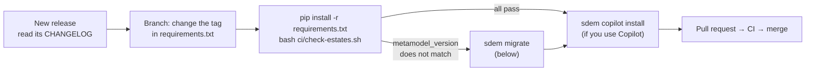

# Running SDEM — administration

> **Status: current (v0.9.4)** — for the platform owner and estate owners: installing, upgrading, moving estates to a new rulebook, backups, releases, health checks and troubleshooting. Who does each task: the [operating model](sdem-operating-model.md).

## Installing

| On | Do |
|---|---|
| An architect's machine | Python 3.10 or later (3.13 recommended: `brew install python@3.13` on a Mac — Macs come with 3.9, which is too old); then in the estate repository `python3.13 -m venv .venv` (or `/opt/homebrew/bin/python3.13 -m venv .venv` if not found), `source .venv/bin/activate`, `pip install -r requirements.txt`; check with `sdem --version` |
| CI | the estate template's workflow installs the pinned release on every run — nothing to do |
| Without installing | `python3 -m sdem …` from a checkout of the SDEM repository |

Every architect runs the same release: the one pinned in the estate repository's `requirements.txt`. Step by step for architects: the [user guide §3](sdem-workbench-user-guide.md#3-set-up--once).

## Upgrading SDEM



Upgrade within a month of a release, and never skip one that moves the rulebook version. Architects then run `pip install -r requirements.txt` again.

## When the rulebook changes

Every dataset and registry says which rulebook version it was written for (`metamodel_version`). If a release changes the rulebook, SDEM refuses the old files and tells you to migrate:

```bash
sdem migrate --estate estates/<domain> --person <you> --dry-run   # what would change; the estate checked; nothing written
sdem migrate --estate estates/<domain> --person <you>             # migrate, check, write all-or-nothing, record migrations/MIG-nnn.json
```

The release records exactly how data moves from the old version to the new; a migration that would break the estate writes nothing. Approved connections are never changed in meaning. A team that needs a new kind of thing or attribute asks the SDEM owner — **describing the kind of thing, never the real design**. Policy, for builders: [rulebook versioning](design/sdem-rulebook-versioning.md).

## When your BIAN layer changes

More service domains, or a new BIAN release: re-import into the shared `bian/a2-service-domain.json` (with `--previous`), then

```bash
sdem bian update --root estates --a2 bian/a2-service-domain.json --person <you> --dry-run    # what changes in each estate
sdem bian update --root estates --a2 bian/a2-service-domain.json --person <you>
```

Every estate is checked before any is written; a service domain an approved connection depends on cannot be dropped until that connection is superseded. Each estate records the update in `bian-updates/`.

## Backups and history

| What | Kept by | To restore |
|---|---|---|
| Estates (data, registry, gap and load records) | Git — every change is a reviewed commit | `git revert` or check out an earlier commit |
| Approved connections | the registry — never edited, only superseded; `sdem diff` proves it | the history is in the file itself |
| The knowledge graph | nothing to back up — rebuilt from the estate by `sdem build` | `sdem build --estate … -o …` |
| A named point in time | `sdem baseline <name> --graph <store>` freezes the graph under `baselines/<name>/` | read it with `--graph <store>/baselines/<name>` |
| Agents' change sets | `coordination/` in the estate | `sdem change revert <CS-id>` |

Back up the estate repository as you would any important repository; the rest can be rebuilt.

## Releases of SDEM

SDEM releases are tagged by the SDEM owner after every check passes, and listed in the [CHANGELOG](../CHANGELOG.md). A release that changes the rulebook says so and includes its migration. The roadmap: [ROADMAP](design/ROADMAP.md).

## Health — what to watch

| Check | How | Healthy |
|---|---|---|
| Estate checks on `main` | the estate repository's CI | always green |
| Open gaps | `sdem designs --estate <dir> --gaps --status open`, or the dashboard | going down month on month |
| Proposals waiting | dashboard *Attention*; `sdem link` then `sdem review` | reviewed within two weeks |
| Graph out of date | dashboard warning; `sdem dashboard --graph <store>` | rebuilt after every merge |
| SDEM version | `sdem --version` against the latest release | the latest, or the one before |

## Limits

About 1 second to propose connections for 2,000 records, about 17 seconds for 8,000; a dashboard for 8,000 records is a 20 MB page. Comfortable: a few thousand records per estate — split a larger architecture into several estates ([details](sdem-architecture.md#limits)).

## Troubleshooting

**Exit codes** — every command ends with one:

| Code | Means | Do |
|---|---|---|
| `0` | done | — |
| `1` | a check found problems, or refused the action | read the `ERROR:` lines; fix the data |
| `2` | the command or its input is wrong — a missing folder, a file that is not valid JSON, a wrong option | check the command (`sdem <command> --help`) and the path |
| `3` | a fault in SDEM | run it again with `SDEM_DEBUG=1 sdem …`; report it as an issue on the SDEM repository **with no real data** |

| Problem | Do |
|---|---|
| `sdem: command not found` | activate the environment: `source .venv/bin/activate` |
| `python3.13: command not found` (or `brew: command not found`) after installing | Homebrew's folder is not on your path: use the full path, `/opt/homebrew/bin/python3.13` (Apple silicon) or `/usr/local/bin/python3.13` (Intel); to fix it for good, run `eval "$(/opt/homebrew/bin/brew shellenv)"` and add that line to `~/.zprofile` |
| `pip install -e .` fails: *File "setup.py" or "setup.cfg" not found … editable mode currently requires a setuptools-based build* | the `.venv` was made with Python older than 3.10 (its old `pip` gives this misleading message) — `rm -rf .venv`, then make it again with 3.13 |
| `pip install` fails: *Package 'sdem' requires a different Python: 3.9.6 not in '>=3.10'* | the same — recreate `.venv` with 3.13 |
| `metamodel_version … does not match` | the rulebook changed — [migrate](#when-the-rulebook-changes) |
| CI fails: *an approved link was edited or removed* | someone edited `mappings.json` by hand — revert it; to change a connection, supersede it with `sdem approve --supersedes` |
| CI fails: *does not pass sdem check* | run `sdem check --estate <dir>` locally and fix what it lists |
| `build … rejected` | the data has errors; the previous graph is kept — run `sdem check` |
| Errors about a specific rule or control | the [user guide's troubleshooting table](sdem-workbench-user-guide.md#11-troubleshooting) lists each message and what to do |

## Housekeeping

- `work/` is scratch space: design exports, proposals, graph stores, dashboards. It is never committed; clear it when you like.
- Design exports stay in `work/`, on the machine that is allowed to hold them.
- SDEM removes its own temporary files (for example, from reading pictures) when it exits.
