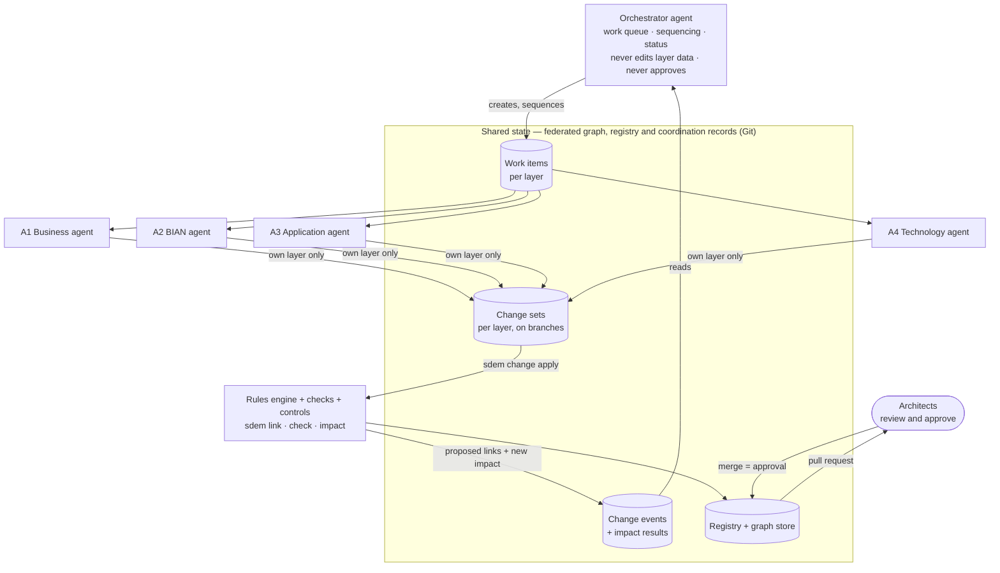
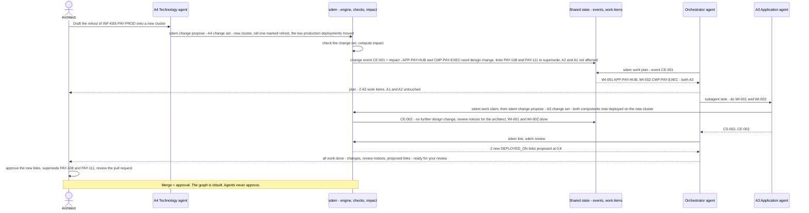
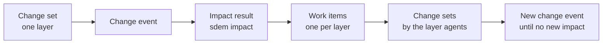
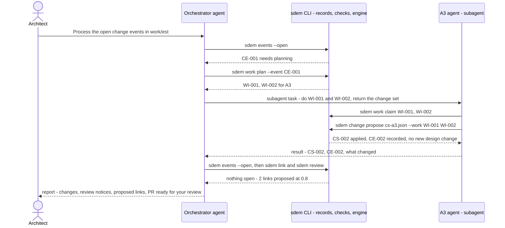

# SDEM Agent Platform — Design

> **Status: approved by the owner 2026-10-28 (AG-D01…D09); Level 1 built** — coordination records and commands (`sdem change`, `events`, `work`), controls CTL-19/20, the agent files in `.github/agents/`, tested in [use-case example 3](use-case-example-3.md). **To confirm in the owner's VS Code:** the spike ([`sdem-agent-platform-spike.md`](sdem-agent-platform-spike.md)). Requirements: [`sdem-agent-platform-spec.md`](sdem-agent-platform-spec.md). Assessment against what makes a good agent platform: [`sdem-agent-platform-principles.md`](sdem-agent-platform-principles.md). Builds on the SDEM workbench ([`sdem-workbench-design.md`](sdem-workbench-design.md)): VS Code, the `sdem` CLI as the only interface, GitHub Copilot Chat for AI, no MCP.
>
> Diagrams are Mermaid (GitHub shows them; in VS Code use the *Markdown Preview Mermaid Support* extension).

## 1. Purpose

Architects want **agents** to help generate and manage designs at each architecture level, and to carry a change **upstream and downstream** across the levels. This document designs that agent platform on top of SDEM's data architecture.

**In one line:** one **agent per architecture** (A1–A4) owns its layer; a **orchestrator agent** organises the work; they coordinate **through the federated graph** — change events and work items — not by messaging each other; the **rules engine** decides cross-layer links; **architects approve**.

## 2. Is the data architecture ready for agents?

Both sides are now built for Level 1 (2026-10-28). Real designs still need ingestion and a licensed BIAN catalogue.

| Agents need to … | Ready? | What exists / what is missing |
|---|---|---|
| read their layer's records and rules | ✅ | layer graphs and schemas, rulebook, `sdem query --json` |
| see across layers, upstream and downstream | ✅ | federated graph, `sdem trace --json`, `sdem impact --json` |
| know what a change affects | ✅ | `sdem impact` — deterministic, classified (design change required / no impact), links to supersede |
| propose cross-layer links | ✅ | the rules engine, `sdem link` — proposals only |
| plan layers that do not exist yet | ✅ | AID, `sdem aid` — kept apart from real data (CTL-16/17) |
| keep projections and AI content out of real data | ✅ | CTL-16, CTL-17 |
| **write** records into their own layer safely | ✅ | `sdem change propose` — checked before it lands |
| be **limited to their own layer** | ✅ | CTL-19; layer agents also cannot call each other (`agents: []`) |
| record **change events** and **work items** | ✅ | `<estate>/coordination/`: change sets, events with stored impact, work items |
| show **which agent and which person** changed what | ✅ | CTL-20 on every change set and work-item step |
| work in parallel without clashing | ◐ | Git branches can; not designed |
| work on real designs | ❌ | ingestion (v0.11), licensed BIAN catalogue (v0.15) |

## 3. The approach — layer agents and an orchestrator over one shared graph



### 3.1 Who does what

| Actor | Does | Never |
|---|---|---|
| **A1 Business agent** | drafts and maintains business designs (capabilities, value streams, processes) in A1; names the BIAN operations processes invoke; fixes A1 check errors; explains A1 | changes another layer; creates cross-layer links; approves |
| **A2 BIAN agent** | selects and maintains the BIAN service domains, operations and business objects in A2 — **from the BIAN catalogue only** | invents BIAN elements (CTL-17); changes another layer; approves |
| **A3 Application agent** | drafts and maintains applications, components, APIs and data entities in A3 | changes another layer; creates cross-layer links; approves |
| **A4 Technology agent** | drafts and maintains platforms, deployments and environments in A4 | changes another layer; creates cross-layer links; approves |
| **Orchestrator agent** | reads change events and impact results; creates, sequences and tracks work items; reports progress and open questions to architects | edits any layer's data; decides links; approves |
| **Rules engine** (not an agent) | proposes cross-layer links (`sdem link`); computes impact (`sdem impact`) | approves |
| **Checks and controls** (not an agent) | accept or reject every change set (CTL-01…17, CTL-19/20 proposed) | — |
| **Architect** | decides; approves by merging a reviewed pull request; can override or stop any work item | — |

## 4. How a change flows

Example (real ids from the `payment-initiation` estate): the technology team will **rehost the production payments cluster** `INF-K8S-PAY-PROD`.



**The rules:**

1. **A change starts as a change set** in one layer, on a branch — never a direct edit of real data.
2. **Impact is computed, not negotiated.** `sdem impact` decides what is affected, deterministically, and stores it with a **change event**.
3. **The orchestrator turns impact into work items** — one per affected layer and record — and sequences them (e.g. A4 before A3 for a rehost; A1 before A2 for a new capability).
4. **Each layer agent changes only its own layer**, through `sdem change propose`, which checks before anything lands (CTL-19).
5. **Cross-layer links come from the rules engine**, never from an agent.
6. **New impact starts a new round** — until no further impact remains, or an architect stops it.
7. **One pull request per change event**, reviewed and merged by an architect. **Merge = approval.**

## 5. Coordination records

These records are the agents' only channel to each other. They live in the project (Git), next to the registry, so every step is visible and auditable — one file per record in `<estate>/coordination/change-sets/`, `events/` and `work-items/`, with ids scoped to the Git branch they were made on, so agents on different branches never clash; `sdem check` checks them. They implement the original design's `mapping_change_event` and `mapping_impact` entities ([`BIAN_SDEM_Design_Specification.md`](BIAN_SDEM_Design_Specification.md) §9).

| Record | Holds | Written by |
|---|---|---|
| **Change set** | the proposed record changes to **one layer** (add, update, retire), its reason, the agent and the person behind it | a layer agent (or a person) |
| **Change event** | what changed (the change set, or an approved merge), when, by whom | `sdem change propose` / on merge |
| **Impact result** | the affected records, the traversal paths, the classification, the links to supersede — the output of `sdem impact` | `sdem` (deterministic) |
| **Work item** | one task for one layer: the record(s), what to do, why (the change event and impact path), status (`open` → `in progress` → `done` / `blocked` / `cancelled`), who holds it | the orchestrator |



## 6. Why agents do not message each other directly

| Direct agent-to-agent messages | Coordination through the graph |
|---|---|
| the reasons live in conversations between agents — hard to audit | every change, event, impact and work item is a record in Git |
| can loop (A2 asks A3, A3 asks A2 …) or drift into disagreement | `sdem impact` decides what is affected; the orchestrator sequences |
| each agent must know the others | each agent knows only its layer and the shared graph |
| no single view of the work in progress | the work queue shows everything open, by layer |
| AI deciding cross-layer relationships | the rules engine decides links from the rulebook |

The federated graph already encodes upstream and downstream. Letting agents re-negotiate it in conversation would discard SDEM's strongest property: **traceable, rule-based links**.

## 7. Platform — GitHub Copilot as the local agent platform

The project holds the agent files; the agents run inside **GitHub Copilot in VS Code**. Copilot has no message bus between agents and no background runtime that listens for triggers — so the agents coordinate through **the coordination records** (work items and change events), and the **orchestrator calls the layer agents as subagents**.

### 7.1 What Copilot provides, and how SDEM uses it

| Copilot feature | What it does | SDEM use |
|---|---|---|
| **Custom agents** — `.github/agents/*.agent.md` | an agent's instructions plus a `tools` list ("only those tools are available") | the orchestrator and the four layer agents, versioned with the rulebook |
| **Subagents** — the `agent` tool and the `agents` allowlist | an agent runs another custom agent on a focused task in its own context; the subagent "returns a focused result to the main agent". Each call is stateless. `agents: []` blocks subagent use | **the orchestrator calls the layer agents**; layer agents have `agents: []`, so they **cannot** call each other |
| **Handoffs** | a button after a response that switches to another agent with a prepared prompt (the person clicks; local only) | the architect moves from the orchestrator to a layer agent |
| **Copilot CLI agent** (formerly "background agent") | a CLI session that keeps running when VS Code is closed — started by a person | longer runs; not a listener |
| **Copilot CLI programmatic mode** | `copilot -p … --agent <name> --no-ask-user --allow-tool …` in scripts and CI | Level 3 only (§7.4) |
| **Cloud agent** | assign an issue to Copilot (a custom agent can be chosen); works in GitHub's cloud and opens a pull request | Level 3 only (§7.4) |

Feature names and file formats change between versions (subagents were experimental in late 2025). **The spike** ([`sdem-agent-platform-spike.md`](sdem-agent-platform-spike.md)) confirms them in the organisation's VS Code before anyone relies on them.

### 7.2 The agent files

```
.github/
├── copilot-instructions.md            ground rules every Copilot chat reads (workbench WB-C01)
└── agents/
    ├── sdem-orchestrator.agent.md     tools: agent, read, search, execute · agents: the four layer agents · no change commands
    ├── sdem-a1-business.agent.md      tools: read, search, edit, execute · agents: []
    ├── sdem-a2-bian.agent.md          tools: read, search, edit, execute · agents: [] · adds BIAN only from the catalogue
    ├── sdem-a3-application.agent.md   tools: read, search, edit, execute · agents: []
    └── sdem-a4-technology.agent.md    tools: read, search, edit, execute · agents: []
├── prompts/                           / commands: sdem-explain, sdem-fix, sdem-review, sdem-impact-note, sdem-pr, aid-explain,
│                                      sdem-process-events (orchestrator), sdem-layer-work, example3-rehost (A4 agent)
└── skills/                            loaded when relevant: sdem-change-sets (with worked examples), sdem-records,
                                       sdem-approve-links (with the evidence table), sdem-trace-impact
```

Set-up for a GitHub account, a Copilot plan and VS Code: [`sdem-copilot-setup.md`](sdem-copilot-setup.md).

`execute` is the terminal tool's name (VS Code's tool set for terminal commands) — the spike confirms it (step S2). Layer agents need `edit` only to write their change-set drafts; their data reaches the datasets **only** through `sdem change propose` — a direct edit is detected by `sdem check` (AG-S08).

### 7.3 How the agents communicate — Level 1, on request (built)



- **Orchestrator → layer agent:** a subagent call with the estate, the work item ids and the person — every time, because each call is stateless.
- **Layer agent → orchestrator:** the subagent's result, and the records it created (change set, change event).
- **Layer agent → layer agent:** **never** — blocked by `agents: []`. A change in one layer reaches another only as impact, recorded by `sdem`, planned by the orchestrator.
- The records are **durable**: if a session ends, nothing is lost; `sdem events --open` and `sdem work list` show where things stand.

### 7.4 Triggers — three levels

| Level | How work starts | Runs where | Status |
|---|---|---|---|
| **1 On request** | the architect asks the orchestrator (or a layer agent) in Copilot Chat | the architect's VS Code | **built** (agent files + commands) |
| **2 Queue prompts** | no listener is needed: the work queue is the trigger. `sdem change propose` ends with the next command (*"the orchestrator runs sdem work plan --event CE-…"*); `sdem events --open` shows anything waiting; optional Git hook or VS Code task to print open work | the architect's VS Code | prompts built; hook / task not built |
| **3 Automated** | a GitHub Actions workflow on an event (push to a change branch, new issue, schedule) runs `copilot -p "Process open SDEM change events" --agent sdem-orchestrator --no-ask-user --allow-tool 'shell(sdem:*)'`, or someone assigns an issue to Copilot's cloud agent with the orchestrator — the result is a pull request; **a person still merges it** | GitHub's cloud | **only with the organisation's approval** — design data processed in the cloud, a token, usage cost; one user report of the cloud agent overriding a custom agent's instructions to test first |

All three levels use the **same agent files and the same `sdem` commands** — moving up a level changes only who presses *go*. Approval stays human (AG-D06).

## 8. Controls

| Control | Status | What it enforces |
|---|---|---|
| CTL-01…15 | built | the rulebook: data, links, evidence, approval fields |
| CTL-16 | built | projected or AI content never enters real data |
| CTL-17 | built | projections carry provenance, are capped, invent no BIAN element |
| **CTL-19** | built | **layer ownership** — a change set touches one declared layer; an agent's change set only its own layer |
| **CTL-21** | built | **human approval** — a reviewer that is an agent or a tool is rejected (`sdem validate`, `sdem approve`) |
| **CTL-20** | built | **change provenance** — every change set and work item records the agent and the person; nothing lands without both |
| CI | built | every check and test on every push |
| Approval | built (process) | a person merges a reviewed pull request; agents never approve |

## 9. Relation to the rest of SDEM

| Part | How agents use it |
|---|---|
| **Workbench** | agents are Copilot custom agents in the same VS Code project; the CLI is their only way in |
| **Mapping lane** (engine, registry, graph store) | agents read it; the engine proposes the links their changes need |
| **Planning lane** (AID) | a layer agent may use AID to *plan* a design before drafting the real change set; projections stay apart |
| **Controls** | apply to every agent change exactly as to a person's |

## 10. Limits and risks

| Risk | Mitigation |
|---|---|
| an agent drafts a wrong design | change sets are checked; architects review the pull request; work items can be cancelled |
| a change ripples without end | each round needs new impact; the orchestrator caps rounds and asks the architect |
| two agents change the same records | one branch per change event; one layer per change set; Git shows conflicts |
| Copilot features differ by version | the spike confirms them first (agent files, terminal tool name, subagents) |
| an agent edits a dataset directly instead of proposing a change set | **detected** (AG-S08): `sdem check` verifies every layer's dataset against its chain of change sets; a person's hand edit is recorded with `sdem change adopt` |
| agents act on made-up data only today | real use needs ingestion (v0.11) and a licensed BIAN catalogue (v0.15) |

## 11. Decisions — approved by the owner 2026-10-28

| # | Decision | Recommendation | Confidence |
|---|---|---|---|
| AG-D01 | Agent structure | **one agent per architecture (A1–A4) + one orchestrator** | high |
| AG-D02 | How agents coordinate | **through the federated graph** — change events, impact results, work items — **not direct agent-to-agent messages** | high |
| AG-D03 | Orchestrator's role | **coordinates work only**: creates, sequences and tracks work items; never edits layer data, never decides links, never approves | high |
| AG-D04 | Who decides cross-layer links | **the rules engine** proposes; architects approve; agents never create cross-layer links | high |
| AG-D05 | How agents change data | **change sets, one layer each, checked before landing** (`sdem change propose`), on branches; layer ownership enforced (CTL-19), provenance recorded (CTL-20) | high |
| AG-D06 | Approval | **a person merges a reviewed pull request**, one per change event; agents never approve | high |
| AG-D07 | Platform | **GitHub Copilot is the local agent platform**: the agent files live in the project (`.github/agents/`); the orchestrator calls the layer agents as **subagents**; layer agents cannot call each other (`agents: []`); everything through the `sdem` CLI; no MCP | medium — confirm with the spike |
| AG-D08 | Proof | **use-case example 3**: an A4 rehost carried by the agents to an approved pull request, expected results sealed before the run, scored like examples 1 and 2 | high |
| AG-D09 | Triggers | **Level 1 on request** now; **Level 2** the durable work queue and `sdem` prompts instead of a listener; **Level 3** GitHub Actions or the cloud agent **only with the organisation's approval**, same agent files and commands | high |

## 12. Open questions

| ID | Question | Recommendation |
|---|---|---|
| AG-Q01 | Which Copilot feature defines the agents in the organisation's VS Code version, and what is the terminal tool called? | Run the spike ([`sdem-agent-platform-spike.md`](sdem-agent-platform-spike.md)) |
| AG-Q02 | How many impact rounds before the orchestrator stops and asks? | 3, then ask the architect |
| AG-Q03 | One pull request per change event, or per layer? | Per change event — the reviewer sees the whole ripple at once |
| AG-Q04 | Should the A2 agent be allowed to add BIAN domains to A2 from the catalogue without a business request? | No — only in answer to a work item or an architect's request |
