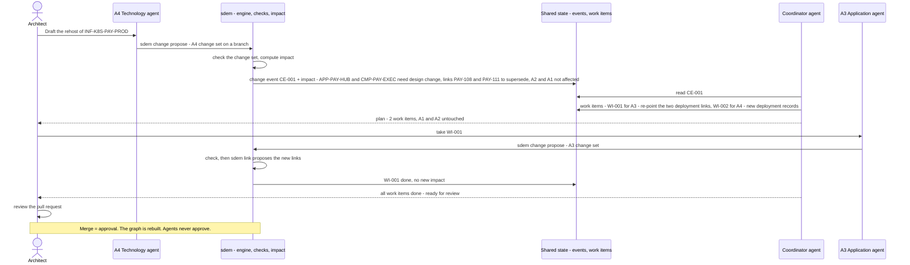
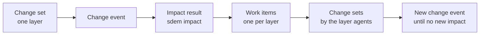

# SDEM Agent Platform — Design

> **Status: draft 2026-10-28 — proposed, not approved, not built.** Decisions AG-D01…D08 are recommendations for the owner. Requirements: [`sdem-agent-platform-spec.md`](sdem-agent-platform-spec.md). Builds on the SDEM workbench ([`sdem-workbench-design.md`](sdem-workbench-design.md)): VS Code, the `sdem` CLI as the only interface, GitHub Copilot Chat for AI, no MCP.
>
> Diagrams are Mermaid (GitHub shows them; in VS Code use the *Markdown Preview Mermaid Support* extension).

## 1. Purpose

Architects want **agents** to help generate and manage designs at each architecture level, and to carry a change **upstream and downstream** across the levels. This document designs that agent platform on top of SDEM's data architecture.

**In one line:** one **agent per architecture** (A1–A4) owns its layer; a **coordinator agent** organises the work; they coordinate **through the federated graph** — change events and work items — not by messaging each other; the **rules engine** decides cross-layer links; **architects approve**.

## 2. Is the data architecture ready for agents?

The **read side is ready**; the **write and coordination side is not**.

| Agents need to … | Ready? | What exists / what is missing |
|---|---|---|
| read their layer's records and rules | ✅ | layer graphs and schemas, rulebook, `sdem query --json` |
| see across layers, upstream and downstream | ✅ | federated graph, `sdem trace --json`, `sdem impact --json` |
| know what a change affects | ✅ | `sdem impact` — deterministic, classified (design change required / no impact), links to supersede |
| propose cross-layer links | ✅ | the rules engine, `sdem link` — proposals only |
| plan layers that do not exist yet | ✅ | AID, `sdem aid` — kept apart from real data (CTL-16/17) |
| keep projections and AI content out of real data | ✅ | CTL-16, CTL-17 |
| **write** records into their own layer safely | ❌ | today a person edits the JSON; needs change sets checked before they land |
| be **limited to their own layer** | ❌ | no ownership control yet |
| record **change events** and **work items** | ❌ | impact is computed but not stored; the original design's `mapping_change_event` and `mapping_impact` records are not built (roadmap v0.13) |
| show **which agent and which person** changed what | ◐ | links carry `created_by`; dataset changes carry nothing |
| work in parallel without clashing | ◐ | Git branches can; not designed |
| work on real designs | ❌ | ingestion (v0.11), licensed BIAN catalogue (v0.15) |

## 3. The approach — layer agents and a coordinator over one shared graph

### 3.1 Who does what

| Actor | Does | Never |
|---|---|---|
| **A1 Business agent** | drafts and maintains business designs (capabilities, value streams, processes) in A1; names the BIAN operations processes invoke; fixes A1 check errors; explains A1 | changes another layer; creates cross-layer links; approves |
| **A2 BIAN agent** | selects and maintains the BIAN service domains, operations and business objects in A2 — **from the BIAN catalogue only** | invents BIAN elements (CTL-17); changes another layer; approves |
| **A3 Application agent** | drafts and maintains applications, components, APIs and data entities in A3 | changes another layer; creates cross-layer links; approves |
| **A4 Technology agent** | drafts and maintains platforms, deployments and environments in A4 | changes another layer; creates cross-layer links; approves |
| **Coordinator agent** | reads change events and impact results; creates, sequences and tracks work items; reports progress and open questions to architects | edits any layer's data; decides links; approves |
| **Rules engine** (not an agent) | proposes cross-layer links (`sdem link`); computes impact (`sdem impact`) | approves |
| **Checks and controls** (not an agent) | accept or reject every change set (CTL-01…17, CTL-19/20 proposed) | — |
| **Architect** | decides; approves by merging a reviewed pull request; can override or stop any work item | — |

## 4. How a change flows

Example (real ids from the `payment-initiation` estate): the technology team will **rehost the production payments cluster** `INF-K8S-PAY-PROD`.

**The rules:**

1. **A change starts as a change set** in one layer, on a branch — never a direct edit of real data.
2. **Impact is computed, not negotiated.** `sdem impact` decides what is affected, deterministically, and stores it with a **change event**.
3. **The coordinator turns impact into work items** — one per affected layer and record — and sequences them (e.g. A4 before A3 for a rehost; A1 before A2 for a new capability).
4. **Each layer agent changes only its own layer**, through `sdem change propose`, which checks before anything lands (CTL-19).
5. **Cross-layer links come from the rules engine**, never from an agent.
6. **New impact starts a new round** — until no further impact remains, or an architect stops it.
7. **One pull request per change event**, reviewed and merged by an architect. **Merge = approval.**

## 5. Coordination records

These records are the agents' only channel to each other. They live in the project (Git), next to the registry, so every step is visible and auditable. They implement the original design's `mapping_change_event` and `mapping_impact` entities ([`BIAN_SDEM_Design_Specification.md`](BIAN_SDEM_Design_Specification.md) §9).

| Record | Holds | Written by |
|---|---|---|
| **Change set** | the proposed record changes to **one layer** (add, update, retire), its reason, the agent and the person behind it | a layer agent (or a person) |
| **Change event** | what changed (the change set, or an approved merge), when, by whom | `sdem change propose` / on merge |
| **Impact result** | the affected records, the traversal paths, the classification, the links to supersede — the output of `sdem impact` | `sdem` (deterministic) |
| **Work item** | one task for one layer: the record(s), what to do, why (the change event and impact path), status (`open` → `in progress` → `done` / `blocked` / `cancelled`), who holds it | the coordinator |

## 6. Why agents do not message each other directly

| Direct agent-to-agent messages | Coordination through the graph |
|---|---|
| the reasons live in conversations between agents — hard to audit | every change, event, impact and work item is a record in Git |
| can loop (A2 asks A3, A3 asks A2 …) or drift into disagreement | `sdem impact` decides what is affected; the coordinator sequences |
| each agent must know the others | each agent knows only its layer and the shared graph |
| no single view of the work in progress | the work queue shows everything open, by layer |
| AI deciding cross-layer relationships | the rules engine decides links from the rulebook |

The federated graph already encodes upstream and downstream. Letting agents re-negotiate it in conversation would discard SDEM's strongest property: **traceable, rule-based links**.

## 7. Platform

### 7.1 Near term — Copilot custom agents in VS Code

Each agent is a **GitHub Copilot custom agent (custom chat mode)** defined in the project: its instructions, its layer, and the `sdem` commands it may use. The architect selects the agent in the Copilot Chat window and drives each step; the agent runs `sdem` commands in the terminal, visibly.

| Agent | Allowed `sdem` commands |
|---|---|
| A1, A2, A3, A4 agents | `sdem query`, `trace`, `impact`, `check`, `explain`, `aid` (planning), `work list / claim / done` for their layer, `change propose` **for their layer only** |
| Coordinator | `sdem events`, `impact`, `work create / list / update`, `trace`, `query`, `view` — **no** `change` commands |

- **No MCP** (organisation policy) and **no AI API in SDEM** — agents use the CLI and files, exactly as the workbench defines.
- **A person drives each step.** Agents propose; architects decide.
- VS Code has renamed this feature between releases (custom chat modes → custom agents) and its file format may differ by version — confirm against the organisation's VS Code before building (AG-Q01).

### 7.2 Later — an automated runtime (only if the organisation allows)

The same agents could run without a person driving each step, on an agent runtime. Because the contracts are **the `sdem` CLI and the coordination records**, the agents' definitions and the data do not change — only who presses *go*. Approval stays human (AG-D06).

## 8. Controls

| Control | Status | What it enforces |
|---|---|---|
| CTL-01…15 | built | the rulebook: data, links, evidence, approval fields |
| CTL-16 | built | projected or AI content never enters real data |
| CTL-17 | built | projections carry provenance, are capped, invent no BIAN element |
| **CTL-19** | proposed | **layer ownership** — a change set touches one declared layer; an agent's change set only its own layer |
| **CTL-20** | proposed | **change provenance** — every change set and work item records the agent and the person; nothing lands without both |
| CI | built | every check and test on every push |
| Approval | built (process) | a person merges a reviewed pull request; agents never approve |

## 9. Relation to the rest of SDEM

| Part | How agents use it |
|---|---|
| **Workbench** | agents are Copilot custom agents in the same VS Code project; the CLI is their only way in |
| **Mapping lane** (engine, registry, graph store) | agents read it; the engine proposes the links their changes need |
| **Planning lane** (AID) | a layer agent may use AID to *plan* a design before drafting the real change set; projections stay apart |
| **Controls** | apply to every agent change exactly as to a person's |

## 10. Limits and risks

| Risk | Mitigation |
|---|---|
| an agent drafts a wrong design | change sets are checked; architects review the pull request; work items can be cancelled |
| a change ripples without end | each round needs new impact; the coordinator caps rounds and asks the architect |
| two agents change the same records | one branch per change event; one layer per change set; Git shows conflicts |
| Copilot custom agents may not suit coordination | prove it in use-case example 3 before relying on it (AG-D08) |
| agents act on made-up data only today | real use needs ingestion (v0.11) and a licensed BIAN catalogue (v0.15) |

## 11. Decisions — proposed, for the owner

| # | Decision | Recommendation | Confidence |
|---|---|---|---|
| AG-D01 | Agent structure | **one agent per architecture (A1–A4) + one coordinator** | high |
| AG-D02 | How agents coordinate | **through the federated graph** — change events, impact results, work items — **not direct agent-to-agent messages** | high |
| AG-D03 | Coordinator's role | **coordinates work only**: creates, sequences and tracks work items; never edits layer data, never decides links, never approves | high |
| AG-D04 | Who decides cross-layer links | **the rules engine** proposes; architects approve; agents never create cross-layer links | high |
| AG-D05 | How agents change data | **change sets, one layer each, checked before landing** (`sdem change propose`), on branches; layer ownership enforced (CTL-19), provenance recorded (CTL-20) | high |
| AG-D06 | Approval | **a person merges a reviewed pull request**, one per change event; agents never approve | high |
| AG-D07 | Platform | **Copilot custom agents in VS Code** now (no MCP, CLI only); an automated runtime later only if the organisation allows, with the same contracts | medium — depends on the organisation's Copilot features |
| AG-D08 | Proof | **use-case example 3**: an A4 rehost carried by the agents to an approved pull request, expected results sealed before the run, scored like examples 1 and 2 | high |

## 12. Open questions

| ID | Question | Recommendation |
|---|---|---|
| AG-Q01 | Which Copilot feature defines the agents in the organisation's VS Code version? | Check the version; define agents in the project so they are versioned with the rulebook |
| AG-Q02 | How many impact rounds before the coordinator stops and asks? | 3, then ask the architect |
| AG-Q03 | One pull request per change event, or per layer? | Per change event — the reviewer sees the whole ripple at once |
| AG-Q04 | Should the A2 agent be allowed to add BIAN domains to A2 from the catalogue without a business request? | No — only in answer to a work item or an architect's request |
