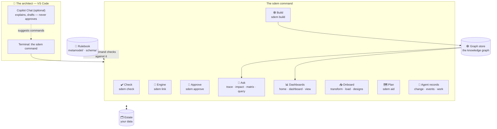
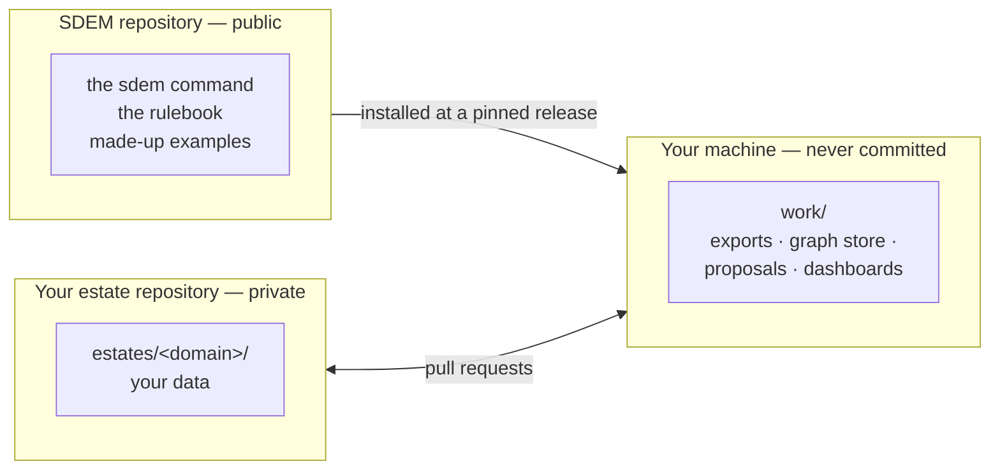

# SDEM architecture — how it is built and where data lives

> **Status: current (v0.9.5)** — for architects and platform owners who run SDEM: its parts, where every file lives, how a change flows, what checks it, and its limits. How each part was designed, for builders: [`design/`](design/README.md).

## The parts

SDEM is one command, `sdem`, written in Python with no other dependencies. It reads and writes JSON files on your machine — **no server, no database, no network, no AI inside**.



| Part | Command | What it does |
|---|---|---|
| **Check** | `sdem check`, `sdem validate` | every record and connection against the rulebook |
| **Engine** | `sdem link` | proposes connections between layers, by rules, with reasons and confidence |
| **Approve** | `sdem review`, `sdem approve` | a person reviews proposals and approves them, with evidence |
| **Build** | `sdem build`, `sdem baseline` | builds the knowledge graph from data that passes every check; freezes a named version |
| **Ask** | `sdem trace`, `impact`, `matrix`, `query`, `explain` | answers questions from the knowledge graph |
| **Dashboards** | `sdem home`, `dashboard`, `view` | read-only web pages, written as local HTML files |
| **Onboard** | `sdem transform`, `load`, `designs` | brings existing designs in from a Confluence export |
| **Plan** | `sdem aid` | projects missing layers for planning — kept apart from real data |
| **Agents** | `sdem change`, `events`, `work` | the records the Copilot agents work through |
| **Maintain** | `sdem migrate`, `diff`, `model` | move an estate to a new rulebook; prove approved links unchanged; maintainers' checks |

Every command and its options: the [command reference](sdem-workbench-user-guide.md#7-command-reference).

## Where everything lives



| Where | What | Committed? |
|---|---|---|
| **The base BIAN** — `bian/` (inside the installed SDEM) | BIAN's public Semantic APIs 14.0.0, packed — where your BIAN layer is imported from unless you use your own | in the SDEM repository; replaced by your own pack if you have one |
| **The rulebook** — `metamodel/`, `schema/` (inside the installed SDEM) | the kinds of thing, links, rules, controls, file formats | in the SDEM repository; changed only by the SDEM owner |
| **An estate** — a folder, e.g. `estates/payments/` | your data — see below | **yes**, in your private estate repository |
| **The graph store** — e.g. `work/graph/` | the knowledge graph `sdem build` writes | no — rebuilt from the estate at any time |
| **Scratch** — `work/` | design exports, proposals, dashboards, reports | **never** (ignored by Git) |

### Inside an estate

This is the one full list; other documents link here.

| File or folder | Holds | Written by | By hand? |
|---|---|---|---|
| `a1-business.json` … `a4-technology.json` | one layer's records and the links inside it (one to four files) | your source tools, `sdem load`, `sdem change` (agents) | **yes**, then `sdem check` |
| `mappings.json` | **the registry**: every connection between layers, with status, evidence, reviewer and date | `sdem approve`, `sdem connect` | no — CI refuses an edited approved connection |
| `designs/design-records.json` | the pages onboarded designs came from, and the **gap records** | `sdem load`, `sdem designs` | no |
| `loads/LOAD-nnn.json` | what each load brought in, by whom, and the reconciliation | `sdem load` | no |
| `bian-updates/BU-nnn.json` | each update of the estate's BIAN layer | `sdem bian update` | no |
| `migrations/MIG-nnn.json` | each move to a new rulebook version | `sdem migrate` | no |
| `coordination/` | agents' change sets, change events and work items | `sdem change`, `events`, `work` | no |

### Inside a graph store

`sdem build` writes one graph file per layer (`a1-business.graph.json` …), `federated.graph.json` (all four joined by the approved connections), and `load-record.json` (every build: inputs, checks, accepted or rejected). Format: JSON Graph Format. `sdem baseline <name>` freezes a copy under `baselines/<name>/`.

## How a change flows

```mermaid
sequenceDiagram
    actor A as Architect
    participant S as sdem
    participant E as Estate (Git branch)
    actor R as Reviewer
    A->>S: change data (load, edit a dataset)
    S->>E: checked first — refused if it breaks a rule
    A->>S: sdem link
    S-->>A: proposals, weakest first, with reasons
    A->>S: sdem approve (my name, the evidence)
    S->>E: approved connection added to mappings.json
    A->>E: commit, push, pull request
    E->>R: CI runs the checks; reviewer reads the change
    R->>E: merge — the approval is now final
    A->>S: sdem build → trace, impact, dashboards
```

## What checks what

| Moment | Check | If it fails |
|---|---|---|
| Every command that writes | the rulebook's controls on the data it would write | nothing is written (writes are all-or-nothing) |
| `sdem approve` | reviewer is a person; evidence of the kind the connection needs; the record is valid | refused |
| `sdem build` | every record and connection; no unreviewed onboarding candidates | the last good graph is kept; the failure is logged |
| Pull request (estate CI) | `sdem check`, `sdem build`, approved connections unchanged since the base branch | the pull request cannot merge (with branch protection) |
| Merge | a code owner's review | — |

Every control in plain words: [the rulebook guide](sdem-rulebook-guide.md#the-controls--what-sdem-refuses).

## What runs where, and what leaves the machine

| | Runs on | Network |
|---|---|---|
| The `sdem` command | the architect's machine | **none** |
| Reading text in pictures (onboarding) | the machine's own text recognition (macOS) or Tesseract | none; `--ocr off` turns it off |
| PlantUML diagram previews | locally (this project's VS Code setting) | none |
| Estate checks (CI) | your organisation's GitHub runners | installs the pinned SDEM release |
| Copilot (optional) | GitHub, under your organisation's agreement | only what you send in chat |

## Limits

| Measured 2026-10-29 | |
|---|---|
| The engine (`sdem link`) | about 1 s for 2,000 records; about 17 s for 8,000 |
| One dashboard | 1 s and a 4 MB page for 2,000 records; 13 s and a 20 MB page for 8,000 |
| Comfortable size | a few thousand records per estate; split a larger architecture into several estates |
| Python | 3.10 or later (tested on 3.10–3.13) |
