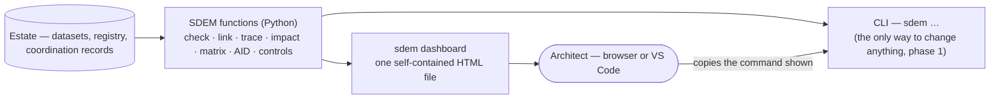

# SDEM Dashboard — Design

> **Status: phase 1 approved and built 2026-10-28** (`sdem dashboard`, `sdem matrix`, `sdem impact --report`); **phase 2 proposed, not approved** (`sdem serve`, a local web app with actions). Requirements: [`sdem-dashboard-spec.md`](sdem-dashboard-spec.md).

## 1. Why

SDEM runs on its own — every function is a `sdem` command, and none needs AI (the engine and AID are rules in code). But without Copilot it is a tool for technical architects: commands to remember, text output to read, JSON to edit, and no single view of an estate. The dashboard gives architects **one page** that shows the estate's health, what needs their attention, the traces, impacts and matrices — and the exact commands to act.

## 2. The principle — one engine, the dashboard only shows



- **All logic stays in SDEM's Python functions.** The dashboard computes everything with the same functions the CLI uses — checks, traces, impacts, matrices — and the page only **displays** the results. No architecture logic in the browser.
- **Phase 1 is read-only.** The page cannot change data; where an action is needed, it shows the exact `sdem` command to copy. Every control stays exactly where it is.
- **No server, no network.** One HTML file with its data inside; it opens offline in a browser or in VS Code's built-in browser (*Simple Browser*). Regenerate it after a change.
- **Not AI.** The dashboard works with Copilot switched off.

## 3. What the architect sees

```
┌─ SDEM — payment-initiation ───────────────────────────── generated 2026-10-28 · rules 0.4.0 ┐
│ [Overview] [Review] [Trace & impact] [Matrices] [Changes & work] [AID plans] [Controls]      │
├──────────────────────────────────────────────────────────────────────────────────────────────┤
│ HEALTH     A1 ✅ 16 records   A2 ⚠ 24 (6 advice)   A3 ✅ 16   A4 ✅ 12   Registry ✅ 18 links │
│ ATTENTION  3 proposals to review · 2 open work items · 0 direct edits · graph store current  │
│ COVERAGE   A1 100% linked · A2 67% · A3 81% · A4 92%   (records with an approved link)       │
└──────────────────────────────────────────────────────────────────────────────────────────────┘
```

| Tab | Shows | Act with |
|---|---|---|
| **Overview** | health per layer (errors and advice, in plain words), record counts, coverage, what needs attention | the command shown for each item |
| **Review** | links the rules engine proposes, weakest first: rule, reasoning, confidence, the evidence needed for approval | `sdem approve …` (copy button) |
| **Trace & impact** | pick a record: its chain down to technology and up to business; pick a change kind: the classified impact — printable as a report | `sdem impact … --report` |
| **Matrices** | business → BIAN → application → technology, from approved links: capability→domain, domain→application, application→technology | `sdem matrix` |
| **Changes & work** | change events with impact, work items with their history, direct edits waiting to be adopted | `sdem work …`, `sdem change …` |
| **AID plans** | a projection beside the real design: what was projected, from what, how sure; gap results | `sdem aid …` |
| **Controls** | every control, where it runs, its last tested result | — |

## 4. New CLI outputs the dashboard needs (useful on their own)

| Command | Gives |
|---|---|
| `sdem matrix --estate DIR [--md FILE] [--json]` | the matrices from approved links — capability → service domain → application → technology, and each pair — as text, Markdown or JSON |
| `sdem impact <id> --change <kind> --estate DIR --report FILE.md` | a printable impact report: the change, every affected record with layer, classification, path and reason, links to supersede, and the architect's confirmation line |

## 5. Phase 2 (proposed) — `sdem serve`

A local web app (Python standard library, `localhost` only, no external access) with buttons for the common actions — check, link, build, approve (with your name and evidence), claim work, revert — and a **record editor with forms** that validates as you type, replacing JSON editing.

- Every button calls **the same functions as the CLI**, so CTL-16…22 apply unchanged.
- It changes decision SDEM-D07 from "the CLI is the only interface" to **"one engine, two front ends (CLI and local GUI); no logic in the GUI"**.
- It opens a local port on the architect's machine — the organisation may need to approve that.

## 6. Decisions

| # | Decision | Recommendation | Status |
|---|---|---|---|
| DB-D01 | A dashboard for architects | **one self-contained, read-only HTML file per estate** (`sdem dashboard`), generated by SDEM; offline; no server | approved 2026-10-28, built |
| DB-D02 | Where the logic lives | **in SDEM's Python functions only**; the page displays precomputed results | approved, built |
| DB-D03 | How architects act from it | **copy the exact `sdem` command** shown beside each item (phase 1) | approved, built |
| DB-D04 | New outputs | `sdem matrix` and `sdem impact --report`, usable without the dashboard | approved, built |
| DB-D05 | Phase 2 — `sdem serve` with actions and forms | **after phase 1 has been used**; amend SDEM-D07 to "one engine, two front ends" | proposed — owner to decide |

## 7. Limits

| Limit | Consequence |
|---|---|
| a snapshot, not live | regenerate after a change (`sdem dashboard …`); the page shows when it was generated and warns if the graph store is out of date |
| read-only | actions are copied commands until phase 2 |
| one estate per page | estates are separate today; an enterprise-wide view comes with real ingestion |
| size | precomputed traces and impacts for every record — fine for hundreds of records; very large estates may need phase 2's on-demand queries |
