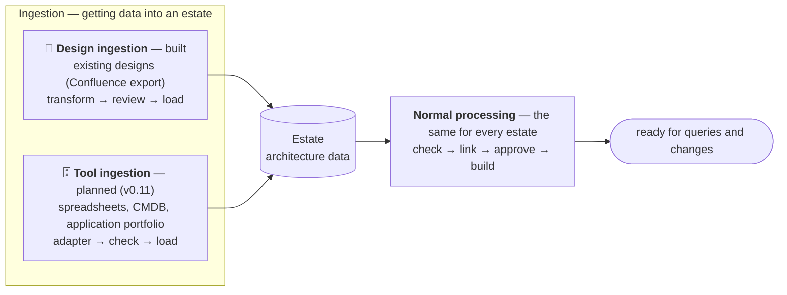
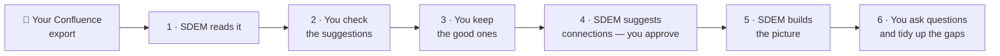

# User guide — using SDEM with your existing designs

> For architects. How to bring designs you already have (exported from Confluence) into SDEM, check them, connect them, and ask questions of them. No AI needed. To **test** the workflow step by step with expected results, use [`use-case-example-4.md`](use-case-example-4.md); for the reasoning behind each step, [`sdem-designs-import-workflow.md`](sdem-designs-import-workflow.md).

## Where this fits

This is **SDEM's design ingestion** — getting your existing designs into an estate (steps 1–4 below) — followed by SDEM's **normal processing** (steps 5–8), the same for every estate. Afterwards your designs are ready for queries and changes.



## What you will do



At the end, your past designs are **architecture data** — business capabilities, applications, servers and the links between them — that you can trace, analyse for impact, and see on a dashboard. Everything SDEM could not turn into data (a table of risks, a photo, a PDF) is **kept as a gap** for you to deal with — nothing is lost.

## The commands in plain words

| # | Command | In plain words |
|---|---|---|
| 1 | `sdem transform inspect <export folder>` | **Look before you start.** Shows what is in your export and what SDEM can read. Changes nothing |
| 2 | `sdem transform run <export folder> -o work/history` | **Read the designs.** Turns the pages into a list of *suggested* architecture items, and writes a report for you to read |
| 3 | *(you read `work/history/extraction-report.md`)* | **Check the suggestions.** Decide which are wrong |
| 4 | `sdem load work/history --estate estates/history --person <you> --exclude <wrong ones>` | **Keep the good ones.** Copies the items you accept into your project; whatever did not fit is kept as *gaps*. Add `--dry-run` first to see what would happen |
| 5 | `sdem check --estate estates/history` | **Health check.** Confirms everything follows the rules |
| 6 | `sdem link --estate estates/history --out work/links` | **Suggest connections.** SDEM proposes how items connect across layers (e.g. *this app runs on this server*) |
| 7 | `sdem review work/links/proposals.json` | **See the suggested connections**, weakest first |
| 8 | `sdem approve <id> … --reviewer <you> --evidence <document>` | **Accept a connection.** You confirm it, and name the document that proves it |
| 9 | `sdem build --estate estates/history --out work/graph` | **Make the picture.** Builds the connected view — the knowledge graph — from what you accepted |
| 10 | `sdem trace <item>` · `sdem impact <item> --change retire` | **Ask questions.** *What does this depend on?* · *What breaks if we remove this?* |
| 11 | `sdem dashboard --estate estates/history -o work/dashboard.html` | **See it as a web page** — everything above, clickable, in your browser |
| 12 | `sdem designs --estate estates/history --gaps` | **See the gaps** — what did not fit, still waiting for you |
| 13 | `sdem designs accept` · `resolve <gap id> … --person <you> --note "<why>"` | **Close a gap.** *Accept* = leave it as it is; *resolve* = you have dealt with it |
| 14 | `git add estates/history` → commit → pull request | **Save and share** — your accepted work goes for review |

**In short:** **read** (1–2) → **you check** (3) → **keep** (4–5) → **connect** (6–8) → **picture** (9) → **use** (10–11) → **tidy up** (12–13) → **save** (14).

**Remember:**
- `--person` / `--reviewer` is always **your name** — only a person can accept items, connections and gaps.
- `work/` is your **scratch area** — never saved to Git; keep the export there.
- `estates/history/` is **the real result** — that is what you save.
- Any command explains itself: add `--help` (e.g. `sdem load --help`).

## Before you start

1. Open the SDEM project in **VS Code** and open a **terminal** (*Terminal → New Terminal*).
2. Check SDEM works: `python3 -m sdem --help` (or `sdem --help` if it is installed).
3. Start a branch for this work: `git checkout -b import/<name>`.
4. **Put your export under `work/`**, e.g. `work/imports/payarch/`. Only `work/`, `private/` and `secrets/` are kept out of Git — anywhere else, your designs could be committed and shared.
5. Have your organisation's **BIAN layer** to hand (an `a2-service-domain.json`) — needed once, so SDEM can connect your designs to BIAN.

> The examples below show what you will see with the made-up export `tests/fixtures/confluence-folder-export`. Try it first: `cp -r tests/fixtures/confluence-folder-export work/imports/payarch`.

## Step by step

### 1 · Look before you start
```bash
sdem transform inspect work/imports/payarch
```
You see what is in the export and what SDEM will read:
```
6 pages, 6 tables, 7 diagrams read … 3 pictures for a person, 3 provenance files in the root
  [application | purpose | status | support hours] → HT-01     ← read as applications
  [risk | impact | mitigation] → no entity type                  ← SDEM has no place for risks: kept as a gap
Coverage: 80% captured (45 captured, 11 not captured, 4 skipped by design)
```
**If a table or diagram you need shows *no rule* or *unclassified***, SDEM does not know your words yet — copy the rules and add them, then look again:
```bash
cp metamodel/transform-rules.json work/my-rules.json      # e.g. add "system name" as an application column
sdem transform inspect work/imports/payarch --rules work/my-rules.json
```

### 2 · Read the designs
```bash
sdem transform run work/imports/payarch -o work/history          # add --rules work/my-rules.json if you made one
```
```
6 pages read: A1 3 records, A3 6 records, A4 8 records, 7 links inside, 6 candidate links between
check: 1 error(s) — see extraction-report.md
```
These are **suggestions** — nothing is in your project yet.

### 3 · Check the suggestions
Open `work/history/extraction-report.md` (in VS Code: right-click → *Open Preview*). Read, in this order:

| Section | What to look for |
|---|---|
| **Coverage** | how much of each page SDEM understood |
| **Check** | items that break the rules — e.g. *Payment Order: attribute list missing* |
| **Records** | every suggested item, with **the page and place it came from**, how sure SDEM is, and why. Look for wrong names or types |
| **Not captured** | what did not fit — a risks table, a column, a sentence, a PDF |
| **For a person** | pictures and diagrams only you can interpret |

Write down the ids of the items you do **not** want, e.g. `HIS-A3-PAYMENT-ORDER`.
*Tip:* in Copilot Chat, `/sdem-import-review work/history` explains each item and suggests what to reject — you decide.

### 4 · Keep the good ones
Try it first with `--dry-run` (writes nothing), then run it for real:
```bash
sdem load work/history --estate estates/history --person <your name> --exclude HIS-A3-PAYMENT-ORDER \
  --a2 <your BIAN layer>/a2-service-domain.json --dry-run
sdem load work/history --estate estates/history --person <your name> --exclude HIS-A3-PAYMENT-ORDER \
  --a2 <your BIAN layer>/a2-service-domain.json
```
```
loaded (LOAD-001) into estates/history: A1 3 entities, A3 5 entities, A4 8 entities, 7 links inside architectures
gap records: 13 — what did not fit an entity, kept beside the estate
reconciliation: 17 candidates = 16 loaded + 0 already in the estate + 1 excluded
```
The *reconciliation* proves nothing was lost. `--a2` is needed only the first time.

### 5 · Health check
```bash
sdem check --estate estates/history
```
Every line should say `OK`.

### 6 · Suggest and review connections
```bash
sdem link --estate estates/history --out work/links
sdem review work/links/proposals.json
```
```
[0.4] P-RUN-001  Clearing Gateway   DEPLOYED_ON  PAYAPP01    — capped at low: from a document
[0.4] P-RUN-005  Payment Initiation SUPPORTED_BY SD-PI (BIAN)
```
Every connection from a past design is marked **low** — check each against its Confluence page. `sdem designs --estate estates/history --entity <id>` tells you which page an item came from.

### 7 · Accept the right connections
```bash
sdem approve P-RUN-001 --proposals work/links/proposals.json --estate estates/history \
  --reviewer <your name> --evidence deployment_design:<page or document id>
```
For a connection to BIAN, also give the BIAN release: `--bian-release <release>` (SDEM tells you if it is missing). The **evidence** is the document that proves the connection — SDEM tells you which kind each connection needs.

### 8 · Make the picture
```bash
sdem build --estate estates/history --out work/graph
```
```
build 1 accepted: … federated.graph.json (4 nodes, 2 edges), designs.graph.json (24 nodes, 42 edges)
```

### 9 · Ask questions
```bash
sdem trace HIS-A1-PAYMENT-INITIATION --graph work/graph            # what does this capability depend on?
sdem impact HIS-A4-PAYAPP01 --change retire --graph work/graph      # what breaks if we retire this server?
sdem dashboard --estate estates/history -o work/dashboard.html     # open it in your browser
```
The trace ends with **where the item is documented** — its Confluence pages and their open gaps. The dashboard shows everything, clickable, with a **Designs & gaps** tab.

### 10 · Tidy up the gaps
```bash
sdem designs --estate estates/history --gaps --status open
sdem designs accept  <gap id> --estate estates/history --person <your name> --note "risks stay in the risk register"
sdem designs resolve <gap id> --estate estates/history --person <your name> --note "added by hand as HIS-A3-…"
```
You do not have to close every gap at once — the dashboard keeps showing what is open.

### 11 · Save and share
```bash
git add estates/history
git commit -m "Import <design name> (LOAD-001)"
git push -u origin import/<name>        # then open a pull request; a reviewer merges it
```
Never add `work/` — it holds the export.

## Next time

Repeat steps 1–11 for the next export, into the **same** `estates/history`. SDEM adds what is new, skips what is already there, and **stops** if something already there would change — so nothing is overwritten by accident.

## If something goes wrong

| You see | It means | Do |
|---|---|---|
| `no pages found` | the folder is not the export | point to the folder that holds the pages |
| many tables *no rule* | SDEM does not know your column names | step 1: copy the rules and add your words |
| `load` says `refused — nothing written` | an item breaks the rules, or one already in the estate would change | read the message; `--exclude` the item, or fix it |
| `approve` says `add --bian-release` | a connection to BIAN needs the BIAN release | add `--bian-release <release>` |
| `build` says `CTL-23` | you pointed it at `work/history` (the suggestions) | build from `--estate estates/history` |
| OCR errors on pictures | your Mac's text recognition is not available | add `--ocr off`; the pictures are listed for you as gaps |
