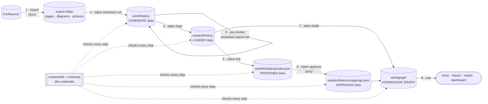

# From a Confluence export to the knowledge graph — the workflow

> **Status: describes what is built (2026-10-28).** One page for the whole journey of past designs into SDEM: what each step does to the data, what it produces, where it lives, what stops bad data, and how ready the data is after each step. Step by step, with the expected result of each step (a test script): [`use-case-example-4.md`](use-case-example-4.md). Details: [`sdem-transform-design.md`](sdem-transform-design.md) (transform), [`sdem-load-design.md`](sdem-load-design.md) (load), [`sdem-workbench-user-guide.md`](sdem-workbench-user-guide.md) §8.7 (commands).

## 1. The whole journey in one picture

**Only two steps create anything new:**
- **the transform** creates the architecture data
- **`sdem build`** creates the graphs

Every other step reviews, moves, proposes or approves.

## 2. Step by step

| # | Step | Who | What happens to the data | Produces | Lives in | Stopped by | Data is now |
|---|---|---|---|---|---|---|---|
| 1 | **Export** | you / Confluence | pages, diagrams and pictures leave Confluence | an export folder (any layout) | e.g. `~/designs/export` — never in this repository | — | **raw** |
| 2 | **Transform** — `sdem transform run` | SDEM (rules; on-device OCR for pictures) | every item is accounted for — captured, skipped by design, or **not captured** (listed with its place and text; nothing silently lost); **the architecture data is created**: A1, A3, A4 entities and the links inside each architecture, in the schema format, each with its source | candidate datasets `a1/a3/a4-*.json`, `extraction.json` (evidence, candidate links between architectures, BIAN mentions), `design-index.json`, `extraction-report.md` | `work/history` | nothing is refused — problems are **reported** ("check: 1 error") so you can see them | **candidate**: in the right format, *not yet* reviewed, *maybe* not valid |
| 3 | **Review** | you | you decide what is right — validation cannot tell an OCR misread from a real name | a decision: the ids to reject | — | your judgement | **reviewed** |
| 4 | **Load** — `sdem load` | you run it | **the data is not changed.** The entities you keep are copied, unchanged, into the estate; the ones you reject are left out; the dataset label changes from *candidate* to *loaded*; your decision is recorded. **Everything that did not fit is kept too**, as design and gap records | the estate's datasets (+ your A2 dataset with `--a2`, once), `designs/design-records.json` (a record per page, a gap record per item that did not fit), an empty `mappings.json` for a new estate, `loads/LOAD-<n>.json` (with the reconciliation) | `estates/history` | **refused, nothing written**, if the estate would fail validation, if an entity already there would change, or if the person is not a person | **loaded**: validated *and* reviewed — real estate data |
| 5 | **Link** — `sdem link` | SDEM (the rules engine) | links **between** architectures are **proposed** from the loaded data (e.g. Clearing Gateway DEPLOYED_ON PAYAPP01); links touching document-derived entities are capped at low (DEC-E-11) | `proposals.json` | `work/links` | — (proposals only) | **proposed links** |
| 6 | **Approve** — `sdem approve` | you | a proposed link becomes an approved record — with your name, the date, the evidence, and the BIAN release for links to BIAN | records in `mappings.json` | `estates/history/mappings.json` | **refused, nothing written**, if evidence or the BIAN release is missing, or the reviewer is not a person | **approved links** |
| 7 | **Build** — `sdem build` | SDEM | **the graphs are created** from the loaded data and the approved links | the graph store: one graph per architecture + `federated.graph.json` (the knowledge graph) + `designs.graph.json` (pages and gaps, linked to the entities) | `work/graph` | **refused** if any data fails validation, or if it is unloaded candidate data (CTL-23) | **ready** — for trace, impact, matrices, dashboards |

## 3. Validated and reviewed — both are needed

| | Means | Checked by | Example |
|---|---|---|---|
| **Validated** | follows the schemas and the metamodel (types, required attributes, allowed links) | SDEM, automatically — reported by the transform, **enforced** by the load and the build | "Payment Order" has no attribute list → fails |
| **Reviewed** | correct about the real design | **you** | "Sanctions Checkel" passes validation but is an OCR misread of "Checker" → you reject it |

The transform produces data that may be neither. The load accepts only data that is **both**. That is why the load exists: `link`, `approve` and `build` work on the estate, and the estate must hold only validated, reviewed data.

## 4. The metamodel and the schemas — the rulebook, not an output

The metamodel (`metamodel/`) and the schemas (`schema/`) are **written and approved before any data**. No step generates them from architecture data, and no step changes them. Every step checks the data against them:

| Rulebook file | Used by | For |
|---|---|---|
| `metamodel/a1…a4-*.json`, `entity-attributes.json` | transform, load, check, build | which entity types exist, their attributes |
| `metamodel/level-relationships.json` | transform, load, check, build | which links are allowed **inside** an architecture |
| `schema/relationship-types.json`, `metamodel/relationship-rules.json` | transform (candidate links), link | which links may exist **between** architectures; the engine's rules |
| `schema/level-model.schema.json`, `schema/entities/<A>/<Entity>.schema.json` | transform output, load, check | the format of a dataset and of each entity |
| `schema/relationship-registry.schema.json`, `mapping.schema.json` | approve | the format of an approved link |
| `schema/graph-store.schema.json` | build | the format of the graph store |
| `metamodel/transform-rules.json` | transform | how to read tables, diagrams and text (yours to tune) |

`sdem model regenerate` produces **documents about** the rulebook (specs, diagrams, the controls register) — not from data.

## 5. Worked example — the made-up export

`tests/fixtures/confluence-folder-export` (Payments Hub Design; readme/source/evidence in the root, raw HTML and diagrams in `archives/`, sections as folders):

| # | Command | Result |
|---|---|---|
| 2 | `sdem transform run tests/fixtures/confluence-folder-export -o work/history` | A1 3, A3 8, A4 8 candidate entities; 7 links inside; 6 candidate links between; check: 1 error (Payment Order) |
| 3 | review `work/history/extraction-report.md` | reject `HIS-A3-PAYMENT-ORDER` (invalid) and `HIS-A3-SANCTIONS-CHECKEL` (OCR misread) |
| 4 | `sdem load work/history --estate estates/history --person jane.architect --exclude HIS-A3-PAYMENT-ORDER HIS-A3-SANCTIONS-CHECKEL --a2 <your>/a2-service-domain.json` | `LOAD-001`: A1 3, A3 6, A4 8 entities, 7 links, A2 added — the kept entities byte-for-byte as the transform wrote them |
| 5 | `sdem link --estate estates/history --out work/links` | 5 proposals: 3 DEPLOYED_ON (low, DEC-E-11), 2 capability → BIAN Service Domain |
| 6 | `sdem approve P-RUN-001 … --evidence deployment_design:…` · `sdem approve P-RUN-005 … --bian-release BIAN-RELEASE-X` | MAP-001, MAP-002 in `mappings.json` |
| 7 | `sdem build --estate estates/history --out work/graph` | A1 3, A2 24, A3 6, A4 8 nodes; knowledge graph: 2 approved links |
| 8 | `sdem trace HIS-A1-PAYMENT-INITIATION --graph work/graph` | Payment Initiation → SD-PI (MAP-002) |

## 6. Common questions

| Question | Answer |
|---|---|
| Does the transform produce the graph? | No — it produces the **architecture data** (candidates). The graph comes from `sdem build`. |
| Where does data that does not fit an entity go? | Into **gap records** beside the architecture data (`designs/design-records.json`), loaded with the entities and built into a designs graph — never inside A1–A4. `sdem designs --entity <id>` and `sdem trace` show them. |
| Does the load change the data? | No. It **copies** the entities you keep, unchanged, into the estate, after checking the whole estate, and records your decision. |
| Why not just copy the files? | `sdem build` refuses unloaded candidate data (CTL-23); the load checks the estate as a whole, refuses conflicts instead of overwriting, and records who approved what. |
| Where do links between architectures come from? | Not from the transform or the load: `sdem link` proposes them from the loaded data; **you** approve them. The transform's candidate links are hints — the "deployed on" ones are written as data so `sdem link` finds them. |
| Where does the metamodel come from? | It is the rulebook, written and approved beforehand. Nothing generates it from data. |
| Is A2 (BIAN) data transformed from the designs? | Never (CTL-17). BIAN names found are listed as mentions; your A2 dataset (from the BIAN catalogue) is added once with `--a2`. |
| When is the data "ready"? | After `sdem build`: loaded (validated and reviewed), links approved, graph built. |
