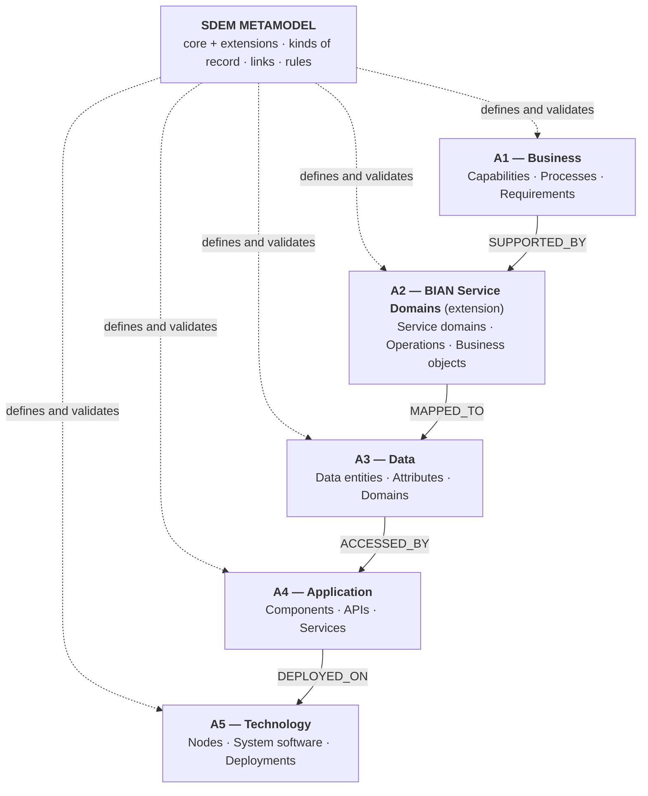
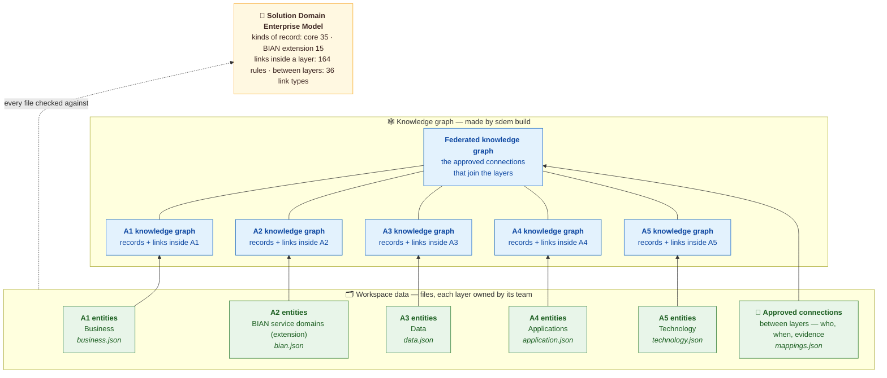
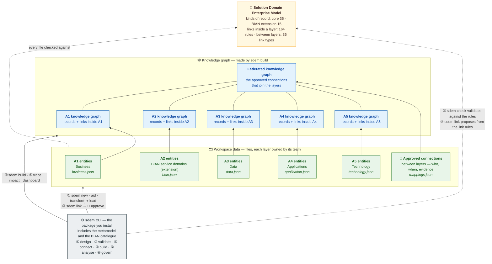
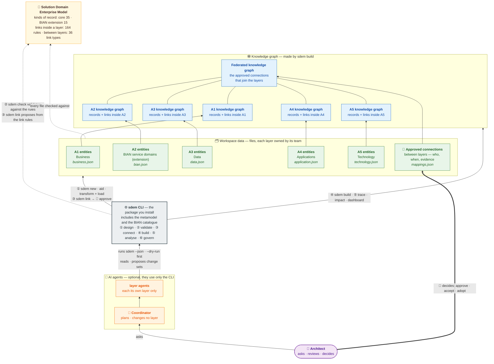
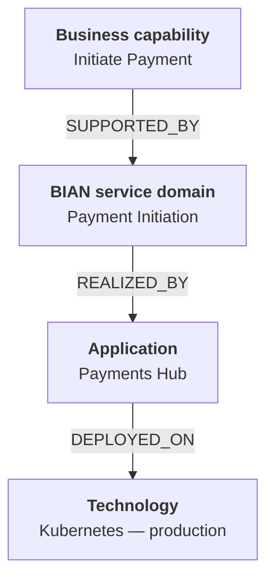
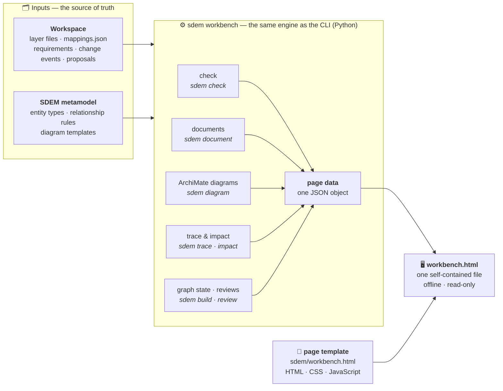
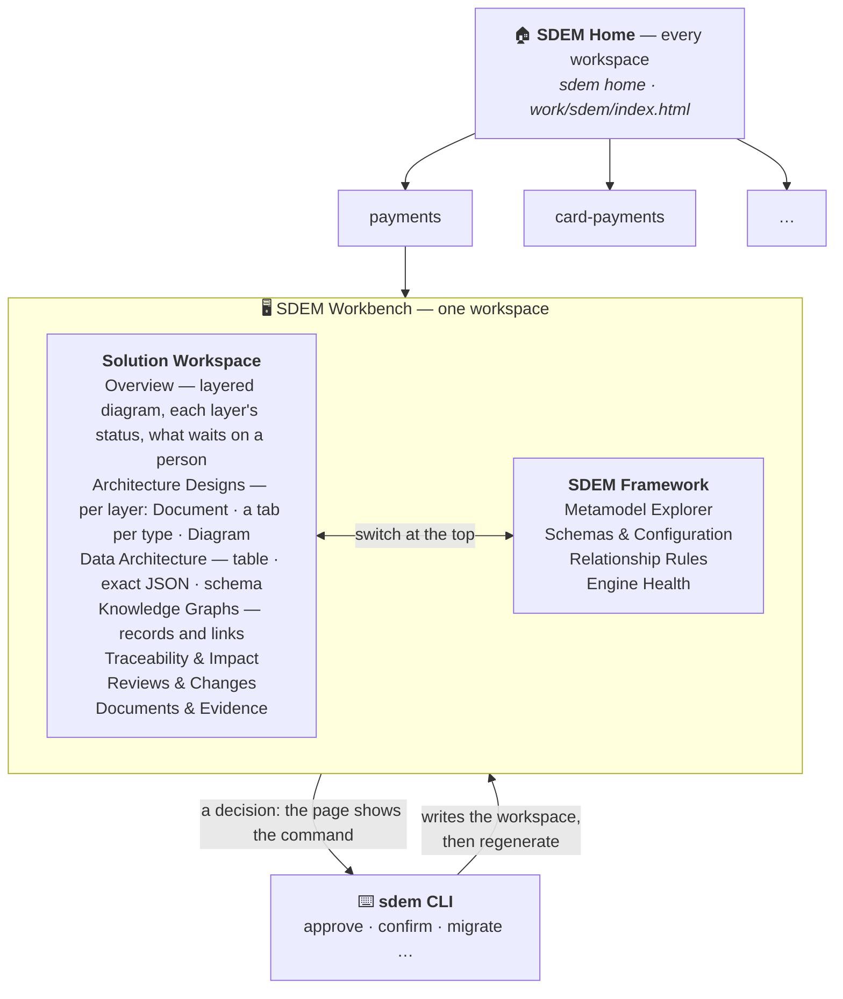

# How SDEM works

> **Status: current (v0.21.14)** — what SDEM is, the metamodel at its heart, its three components (the data architecture, the CLI, optional AI agents), the BIAN catalogue it ships, the local HTML workbench, and how it compares with other architecture tools. Moved here from the README, which is now a quick start. How a design gets in and how a trace works: [From a design to a trace](sdem-from-design-to-trace.md).

## What is an Enterprise Metamodel?

An **Enterprise Metamodel defines the types of architecture element an organisation can model and the rules for how they relate.** SDEM's metamodel has a **core** of four layers, aligned to TOGAF's architecture domains, and **extensions** that add to it:

| Design without BIAN (the core) | Design with the BIAN extension |
|---|---|
| A1 Business | A1 Business |
| — | A2 BIAN Service Domains |
| A2 Data | A3 Data |
| A3 Application | A4 Application |
| A4 Technology | A5 Technology |

Each layer's kinds of record and links are ArchiMate 3.2's (BIAN's for the service domains). An extension such as BIAN adds a layer in the stack; one such as Security adds a layer beside it, drawn over the design's own layers.

**The metamodel** defines the permitted records and relationships. **The workspace** stores the actual designs. **The knowledge graph** connects their approved relationships.

| Question | SDEM capability |
|---|---|
| **What do we have?** | Model and validate the architecture against the metamodel (`sdem check`) |
| **How is everything connected?** | Trace approved relationships across the layers (`sdem trace`) |
| **What happens when something changes?** | Analyse dependencies and change impact (`sdem impact`) |
| **Is the design whole?** | SDEM's verdict on the design's integrity (`sdem model integrity --check`) |



Links between layers are approved by a person before a trace follows them; a design without BIAN links Business to Data and Application directly. In full: [the metamodel in plain words](sdem-metamodel-guide.md) · [from a design to a trace](sdem-from-design-to-trace.md).

## The three components

SDEM consists of three core components, each standing on the one below. The three diagrams build on each other: the data architecture first, then the CLI added beneath it, then the agents beneath the CLI — the same picture each time, one layer more. **The agents are optional; the data and the tools are not.**

### 1 · Data architecture — the foundation



- **Enterprise Metamodel:** the architecture entity types, attributes, relationships and validation rules, built from BIAN, ArchiMate 3.2 and TOGAF ([metamodel guide](sdem-metamodel-guide.md)).
- **Architecture workspace:** the actual designs, approved connections, requirements, evidence and recorded decisions, as structured JSON in your own repository under Git.
- **Knowledge graph:** the architecture entities and their approved relationships, used for dependency tracing and impact analysis.

The workspace is the **source of truth**. The knowledge graph is **derived** from it by `sdem build` and can be rebuilt after any change. Organisation profiles add your own entity types, attributes, constraints and extra layers ([profiles](design/sdem-profile-spec.md)).

### 2 · CLI tools — the architecture engine

One Python command, `sdem`. **The data architecture comes with it:** installing SDEM installs the metamodel (its core layers and the BIAN extension) and the base BIAN catalogue inside the `sdem` package. Your designs and their knowledge graph live in your workspace; the CLI creates, checks, connects and builds them at each step of the lifecycle. **Every function works without AI.** 👤: a person decides. The diagram is the data architecture above, with the CLI added:



| Lifecycle step | What it does | Main commands | Data architecture used |
|---|---|---|---|
| **① Design** | create, import or infer designs | `new`, `bian search`, `aid`, `transform` + `load`, `change propose` | writes the workspace's layer files; A2 domains copied from the BIAN catalogue, marked inferred until confirmed |
| **② Validate** | check the designs | `check`, `validate` | the metamodel: entity types, attributes, link rules |
| **③ Connect** | propose links between layers; a person approves | `link`, `review`, `approve`, `connect` | the metamodel's cross-layer link types → approved connections in `mappings.json` |
| **④ Build** | generate the knowledge graph | `build` | the workspace → four layer graphs and the federated graph; refuses if checks fail |
| **⑤ Explore and analyse** | trace, impact, requirements, read-only HTML pages | `trace`, `impact`, `query`, `matrix`, `requirements evaluate`, `home`, `dashboard`, `view` | the knowledge graph — approved connections only |
| **⑥ Govern** | decisions, history, upgrades, profiles | `events`, `governance verify`, `upgrade check`, `profile` | the workspace record; profiles extend the metamodel, never change it |

**Ten commands cover everyday design work** — `new`, `status`, `aid`, `check`, `comply`, `approve`, `trace`, `impact`, `document`, `workbench` — listed first by `sdem --help` and walked through in the [quick start](sdem-quick-start.md); `sdem status` says where a design is and what to do next. Inside a workspace folder, `--workspace` is found for you. Every command takes `--json` and `--help` (with a worked example); writing commands take `--dry-run`. The pages: **SDEM Home** (the framework, metamodel and workspaces), the **workspace dashboard** (health, relationships, changes, governance) and the **architecture graph** (entities and approved connections). In full: [the commands, step by step](sdem-workbench-user-guide.md#4c-from-your-designs-to-the-knowledge-graph--the-commands). Every command and option: the [CLI reference](reference/cli-reference.md); the jobs end to end: [scenarios](sdem-scenarios.md).

### 3 · AI agents — optional architecture assistants

The agents sit **on top of** the CLI and the data architecture, never beside them. An agent doesn't keep its own copy of the architecture or its own rules: it asks `sdem` (always with `--json`), and `sdem` reads and checks the workspace against the metamodel. So an agent sees exactly what a person sees, gets the same answer every time, and can change the architecture only the way a person can — through a checked, recorded change set. `sdem agents install` writes the instruction files for GitHub Copilot, Claude Code, OpenAI Codex or Gemini CLI; SDEM itself contains no AI. The diagram is the CLI diagram above, with the agents added — they are instructed to reach the data architecture only through the CLI, and the architect makes the decisions:



**How an architect uses them:** ask in plain words (*"what breaks if we rehost the payments cluster?"*, *"draft the A1 design for a ledger"*). The agent runs the commands, answers with the command each fact came from, and drafts changes as change sets. Anything that is a decision — approving a connection, accepting an impact or a risk, adopting an edit — it prepares as an exact command **for you to run**.

**Agent best practice, built in.** The controls follow common guidance for using AI agents safely — SDEM enforces most of them, and the agents' instructions repeat them:

| Practice | How SDEM does it |
|---|---|
| **Ground answers in tools, not memory** | facts come only from `sdem` output and the files; every statement gives its source, reasoning and confidence |
| **Deterministic tools** | SDEM contains no AI: the same command on the same workspace always gives the same answer |
| **Structured interface** | `--json` on every command; `sdem commands --json` to discover them; errors as JSON with a code and a hint |
| **Least privilege** | one layer per agent; the coordinator changes none (control CTL-19); cross-layer links only from the rules engine |
| **Preview before acting** | `--dry-run` on every writing command lists what would change |
| **Human in the loop** | agents propose, check, preview and explain; only a person approves, accepts or adopts |
| **Audit trail** | every change is a recorded change set; a direct file edit is flagged as unrecorded (`sdem check`) until a person adopts it |
| **State outside the conversation** | the architecture lives in the workspace, not the chat: any new session — or person — reads the same model |
| **Say what isn't known** | inferred records stay marked until confirmed; `sdem impact` reports what it could not see; a missing path is not proof of no impact |

Agent instructions constrain intended behaviour; SDEM's validation and governance controls enforce the architecture rules. Instructions alone do not stop an agent with file access from editing workspace files directly — SDEM then flags the edit as unrecorded, and nothing is accepted until a person adopts it. So these are safeguards, not a security boundary: a `--person` name is attribution. Where decisions must be verifiable, use the [governed mode](design/sdem-governance.md) — signed approvals checked by `sdem governance verify`. Set-up: the [AI agent setup guide](sdem-agent-setup.md). How the CLI, an agent and documents fit together: [ways of working](sdem-ways-of-working.md).

## Example — the Payments architecture

The synthetic **Payments** example that ships with SDEM models these approved relationships:



If the production Kubernetes platform is rehosted, `sdem impact` traces the connected applications, service domains and capabilities and classifies the effect: a design change for *Payments Hub* and *Execution Gateway*; none for the BIAN domain and capability above. Architects review the findings, evaluate the requirements and record their decisions.

**Change is analysed across the whole architecture, not within one isolated diagram.**

## The BIAN Service Domain catalogue

SDEM ships a built-in catalogue of **258 BIAN Service Domains** from BIAN's Semantic APIs, release 14.0.0 — the distinct areas of banking functionality, from payments and lending to accounting and customer servicing. It is the foundation of the BIAN layer: instead of defining banking functions from scratch, you take the domains your architecture needs from it.

Examples, grouped for reading (the groups are SDEM's, not BIAN's classification):

| Area | Example Service Domains |
|---|---|
| **Accounting and finance** | Financial Accounting · Account Reconciliation · Position Keeping · Internal Bank Account |
| **Payments** | Payment Order Initiation · Direct Debit · Standing Order · Transaction Engine |
| **Lending and credit** | Loan · Consumer Loan · Corporate Loan · Mortgage Loan · Syndicated Loan · Credit Facility |
| **Accounts and deposits** | Current Account · Savings Account · Term Deposit · Virtual Account · Cash Concentration · Notional Pooling |
| **Cards and merchants** | Credit Card · Merchant Acquiring Facility |
| **Investments and markets** | Investment Account · Investment Portfolio Management · Custody Administration · Market Making · Public Offering |
| **Corporate and specialised finance** | Factoring · Corporate Lease · Project Finance · Corporate Payroll Services · Corporate Trust Services |
| **Customer services** | Customer Event History · Customer Tax Handling · Reward Points Account |

**[Explore the complete catalogue — 258 Service Domains](https://github.com/taumoeps/sdem-extensions/blob/main/metamodel/bian/sdem_bian/data/catalogue/base-14.0.0.json)**, or list it with `sdem bian list --base`. For each domain the catalogue holds its **operations** (method, path, input and output fields), its **control record** and fields, and its **behaviour qualifiers** — what lets AID find the domains a business process uses. BIAN's descriptions and object schemas are left out.

| Catalogue | |
|---|---|
| **File** | [`base-14.0.0.json`](https://github.com/taumoeps/sdem-extensions/blob/main/metamodel/bian/sdem_bian/data/catalogue/base-14.0.0.json) in the `sdem-bian` extension (about 3.4 MB; since SDEM 0.22 BIAN ships only there, BX-15) — what it is: [`README.md`](https://github.com/taumoeps/sdem-extensions/blob/main/metamodel/bian/sdem_bian/data/catalogue/README.md) |
| **Source** | [BIAN's public repository](https://github.com/bian-official/public), Semantic APIs 14.0.0 |
| **Licence** | Apache License 2.0 (BIAN's) |
| **In a workspace** | a shared reference — each workspace holds only the domains it needs |

## The SDEM Workbench (local HTML pages)

**SDEM Workbench** is the HTML interface for architects: one page per workspace that shows its designs, data, diagrams, knowledge graph, trace and impact, reviews and evidence, and SDEM's own metamodel. It is **generated** by the CLI from the workspace files — nothing to install or host, no server, no database, nothing loaded from the internet — and it is **read-only**: where a person has a decision to make, the page shows the `sdem` command to run, and the CLI records it.

```bash
sdem workbench --workspace workspaces/payments -o work/workbench.html   # one workspace
sdem home --root workspaces -o work/sdem                                # SDEM Home + every workspace's workbench
open work/workbench.html
```

### Creating and refreshing the page

You create the page with one of the commands below; no other command writes it. It is a **snapshot**: it shows the workspace as it was when the page was written, and does not update itself.

| Command | Writes the workbench? |
|---|---|
| `sdem workbench --workspace workspaces/payments -o work/workbench.html` | **Yes** — one workspace, to the file you name |
| `sdem home --root workspaces -o work/sdem` | **Yes** — SDEM Home and a workbench for every workspace (`work/sdem/workspaces/<name>-workbench.html`) |
| `sdem new … --explore` | **Yes** — runs `build`, `view`, `dashboard` and `home`, so the workbench comes with it |
| `sdem build`, `approve`, `aid confirm`, `change apply`, … | **No** — they change the workspace or the graph, not the page |

**To refresh it** after any change (an approval, a confirmed record, an applied change set):

1. Run the same command again — e.g. `sdem home --root workspaces -o work/sdem`. It takes a second or two.
2. Reload the page in the browser (⌘R / Ctrl+R). The address is unchanged, so you return to the same view.

The header shows when the page is out of date: **generated** is when it was written, and the **inputs** fingerprint changes whenever the workspace files change.

### How it is created



1. **Read** — the workspace's datasets, approved connections, requirements, change events and proposals, and the metamodel.
2. **Compute** — everything the page shows is worked out in Python by the same functions as the CLI commands, so the page and the CLI always agree: the checks, each layer as a document, the ArchiMate diagrams (from the templates in `sdem/viewpoints.json`, laid out by SDEM), trace and impact for every record, the graph's state and what waits for review.
3. **Write** — the results go into the page template as one JSON object, giving a single HTML file with its styles, script and diagrams inside it. The same inputs give the same page; regenerate it after every change.

### How it works



- **Two views, one switch.** *Solution Workspace* is the architecture of this workspace; *SDEM Framework* is what the metamodel allows — entity types, schemas, the relationship rules and the engine's health. A record links to its type's definition, and a type to its records.
- **Everything is linked.** A name in a table, a document, a diagram or a trace opens that record in full under its type tab: where it came from, its attributes, its links inside the layer, its connections to other layers with their evidence and approver, and the requirements about it.
- **Diagrams are ArchiMate**, drawn from the same templates for every workspace: the layered view on the Overview, and each layer's views under Architecture Designs → Diagram. Only stored links and approved connections are drawn; gaps are listed above the diagram. Select a shape to open its record ([diagram spec](design/sdem-diagram-spec.md)).
- **Every view has an address** (e.g. `workbench.html#ws/designs/A1/A1.BusinessCapability/CAP-PAY-010`), so a link to a record or a diagram can be shared or bookmarked.
- **Read-only by design.** Approving a connection, confirming an inferred record or migrating a workspace is done with the CLI, under a person's name and with evidence; the page shows the exact command, with a Copy button. Rebuild the page afterwards to see the change.
- **SDEM Home** lists every workspace under `--root`, each opening its own workbench (with a link back). *Not yet:* Home in the workbench's design, replacing the older per-workspace dashboard ([UX spec](design/sdem-workbench-ux-spec.md), step 2).

More: [workbench user guide](sdem-workbench-user-guide.md) · [UX spec](design/sdem-workbench-ux-spec.md).

## What kind of architecture tool is SDEM?

SDEM brings together four complementary approaches to architecture tooling:

| Tool classification                      | Existing examples                                                                                                                    | What SDEM provides                                                                                                                                                                                                                       |
| ---------------------------------------- | ------------------------------------------------------------------------------------------------------------------------------------ | ---------------------------------------------------------------------------------------------------------------------------------------------------------------------------------------------------------------------------------------- |
| **Enterprise Architecture Metamodel**    | [SAP LeanIX](https://www.leanix.net/), [Bizzdesign](https://bizzdesign.com/), [Avolution ABACUS](https://www.avolutionsoftware.com/) | A predefined, customisable architecture metamodel covering Business (A1), BIAN Service Domain (A2), Application (A3) and Technology (A4), including entity types, attributes, permitted relationships, constraints and validation rules. |
| **Solution Architecture Modelling**      | [Sparx Enterprise Architect](https://sparxsystems.com/), [Archi](https://www.archimatetool.com/)                                     | Workspaces that instantiate four interconnected design models, enabling architects to develop, relate and validate solution architectures across business, BIAN Service Domains, applications and infrastructure.               |
| **Architecture-as-Code (AaC)**           | [Architecture-as-Code](https://arch-as-code.org/), [Structurizr](https://structurizr.com/), [LikeC4](https://likec4.dev/)            | Architecture maintained as structured, version-controlled data, supported by CLI automation, deterministic validation, generated views, reports and integration with development workflows.                                              |
| **BIAN-centred Architecture Governance** | [BIAN](https://bian.org/) reference architecture and BIAN-enabled architecture platforms                                             | BIAN Service Domain and operation modelling, deterministic architecture inference, evidence-based relationship governance, federated knowledge graphs, architecture traceability and change-impact analysis.                             |

## Relationship to existing architecture platforms

General-purpose Enterprise Architecture platforms such as SAP LeanIX, Bizzdesign and Avolution ABACUS provide overlapping capabilities in metamodel management, architecture modelling, dependency analysis and governance.

Detailed modelling tools such as Sparx Enterprise Architect also support solution architecture design, extensible metamodels and custom validation or automation.

SDEM can complement established architecture repositories and modelling platforms by providing a structured methodology and automation engine for developing and governing solution designs.
