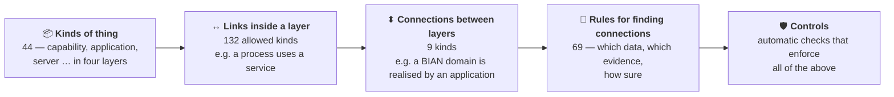

# The metamodel in plain words

> **Status: current (v0.9.10)** — what SDEM's metamodel contains and how to read it. The full, generated detail is in [`reference/`](reference/README.md); you do not need it to use SDEM.

The **metamodel** decides what SDEM will accept. Every record and every connection is checked against it, and SDEM refuses anything that breaks it. It lives in the `metamodel/` and `schema/` folders, and only the SDEM owner changes it ([how a change is made](sdem-administration.md#when-the-metamodel-changes)).

## What the metamodel says

Every kind of thing, link and rule names **where it comes from** (BIAN, ArchiMate 3.2 or TOGAF 10, or an SDEM extension), **why**, and **how sure** — so a reviewer can check it ([provenance](reference/reference-architecture-provenance.md)).

## The kinds of thing, by layer

| Layer | Kinds of thing | Examples |
|---|---|---|
| **A1 · Business** (10) | what the business does and who does it | capability, value stream and stage, process, activity, business service, business object, actor, role, requirement |
| **A2 · BIAN Service Domains** (15) | BIAN's standard building blocks | business area and domain, service domain, service operation, control record, business object, business scenario, semantic API … |
| **A3 · Applications** (8) | the systems that do the work | application component, service, function, interface, API operation, event, data entity, solution building block |
| **A4 · Technology** (10) | where the systems run | node, device, system software, network, path, technology service and interface, deployment, deployment environment, artifact |

Plus one *abstract* kind (A4 infrastructure component) that groups the technology an application can run on. Every kind with its attributes, sources and reasoning: [entity design](reference/architecture-entity-design.md) · [attribute design](reference/architecture-attribute-design.md).

## The nine connections between layers

Only these nine are allowed. Each needs **evidence of a named kind** before a person can approve it.

| From | Connection | To | Evidence needed |
|---|---|---|---|
| A1 capability | is **supported by** | A2 service domain | business architecture document; domain scope assessment |
| A1 value stream | is **aligned to** | A2 business scenario | process model; scenario suitability review |
| A1 process | **uses** | A2 service domain | process model |
| A1 business object | is **aligned to** | A2 business object | business glossary; object alignment review |
| A2 service domain | is **realised by** | A3 application component | application architecture document |
| A2 service operation | is **implemented by** | A3 API operation | API contract |
| A2 business object | is **mapped to** | A3 data entity | data model |
| A3 application component | is **deployed on** | A4 infrastructure | deployment design |
| A3 application component | is **deployed as** | A4 deployment | deployment design |

## Four things that look alike

| | **Metamodel** | **Rules for finding connections** | **The registry** | **The formats (schemas)** |
|---|---|---|---|---|
| In one word | **types** | **rules** | **real connections** | **form** |
| Says | an A2 service operation *may be* implemented by an A3 API operation | *how* to find that: match the HTTP method and the payload; high confidence; needs an API contract | *this* operation *is* implemented by *this* API — approved by Jane | which fields a connection record must have |
| Example | `OPERATION_IMPLEMENTED_BY_API` | `S24` | `PAY-101` | `relationship-registry.schema.json` |
| Changed by | the SDEM owner | the SDEM owner | the engine proposes; a person approves | the SDEM owner |

**Quick test:** a real thing like `SO-PI-01` → the registry. A rule with a step, a confidence and the data it needs → the rules. An allowed kind of link with no rule → the metamodel. A list of fields → a schema.

## How sure SDEM is

Every proposed connection says how sure the engine is — **high**, **medium** or **low** — and why: the rule it used, the data that matched, the published source behind the rule. **Nothing is approved automatically.** A record suggested from a design document (onboarding) is never above *medium*, and a connection to one never above *low* until it is confirmed; a planned (AID) one never above *medium*, and never real data.

## The controls — what SDEM refuses

| What it protects | Controls | SDEM refuses … |
|---|---|---|
| **Records** | CTL-01 … 04, 24 | an unknown kind of thing; a wrong or missing attribute; a link inside a layer that the metamodel does not allow; a record that does not match its format; a BIAN record taken from a design document instead of a BIAN source |
| **Connections** | CTL-05 … 08 | a connection that is not one of the nine; an approval with no reviewer, date or evidence; any edit to an approved connection (it is superseded instead); a connection to a record that does not exist |
| **People in charge** | CTL-21, 20, 23 | an approval by an agent; a change without the person behind it; an onboarded design that a person has not loaded |
| **The engine** | CTL-09, 10, 22 | an engine that finds fewer right connections than the tested runs; output that is not *proposed*; a rule that is not in the metamodel |
| **The metamodel itself** | CTL-11 … 14 | an item without its source and reasoning; a confidence that breaks the rule; a generated document out of date; any change to the owner's frozen specification |
| **The knowledge graph** | CTL-15 | building it from data that fails a check (the last good one is kept) |
| **Planning (AID)** | CTL-16, 17 | a planned design entering real data; a planned element above medium confidence |
| **Agents** | CTL-19 | an agent changing a layer that is not its own |

Every control, where it runs and its last test result: [controls register](reference/controls-register.md).

## The architecture model in numbers

The same numbers appear in the [rules specification](design/relationship-rules-spec.md) and the [model diagram](design/architecture-model-diagram.puml); a test keeps all three in step with the records.

| What | Count | Where in the spec | In the diagram |
|---|---|---|---|
| Entity types (boxes) | 44 | §2 | every box |
| Within-level rows: links allowed *inside* one architecture | 132 | §3.1 (`RA…`) | thin grey arrows |
| Relationship type catalogue: kinds of link allowed *between* architectures | 9 | §4.1 | named on the blue arrows |
| Plan rows: rules for finding cross-level relationships | 69 | §4.2 (`S…`, `B…`) | — |
| …of which drawn as cross-level rules | 50 | §4.3 | coloured arrows |
| …of which catalogue rules, the only ones that produce registry records | 9 | §4.3 | blue arrows |
| Join keys the rules read from the architecture datasets | 52 | §5 (`K…`) | — |
| Inference engine requirements | 33 | §10 (`REQ-…`) | — |

## Reading the architecture-model diagram

[`architecture-model-diagram.puml`](design/architecture-model-diagram.puml) draws the metamodel (kinds of thing and the links allowed inside a layer) and the rules for finding connections. It does **not** draw any real connection. (Open it with the PlantUML extension in VS Code; it renders on your machine.)

| On the diagram | Means |
|---|---|
| A box, e.g. `A3.APIOperation` | a **kind** of thing — no real record like `API-PI-01` appears |
| Four columns | the four architectures, A1 to A4 |
| Thin grey arrow, e.g. `RA3-27 composition` | a link allowed **inside** a layer |
| Blue arrow, e.g. `S24 IMPLEMENTED_BY` | a rule the engine uses to **propose a connection** |
| Green, orange, dashed or dotted arrow, e.g. `S20` | another rule: reported as a hint, never a connection |
| Grey box | a kind of thing with no rule between layers, by decision |

To see which connections *do* exist, open a workspace's `mappings.json`, or run `sdem trace`.

## The formal names

The specifications use formal names; in plain words they are:

| Plain words (this guide) | Formal name |
|---|---|
| the metamodel | **Architecture Metamodel** |
| the rules for finding connections | **Architecture Relationship Rules Model** |
| the engine (`sdem link`) | **Architecture Relationship Inference Engine** |
| the registry — approved connections (`mappings.json`) | **Architecture Relationship Registry** |
| the nine connections | **relationship type catalogue** |
| one layer's records as a graph · all four joined | **local** · **federated architecture knowledge graph** |
