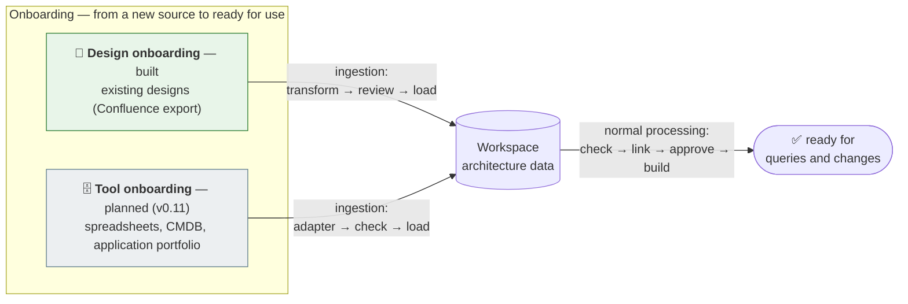
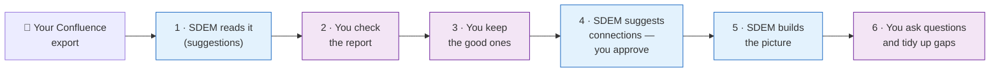
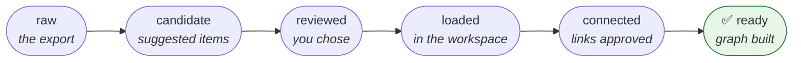

# SDEM onboarding — bringing your existing designs into SDEM

> **Status: current guide — design onboarding is built (v0.9.12); every command shown was run on the test exports.**

> **One document for design onboarding** (built 2026-10-28): what onboarding is, how to do it — the commands and each step with what you will see — what each step does to the data, and when the data is ready. To **test** it step by step with sealed expected results: [`use-case-example-4.md`](evidence/use-case-example-4.md). Technical detail: [`sdem-transform-design.md`](design/sdem-transform-design.md) (reading the designs), [`sdem-load-design.md`](design/sdem-load-design.md) (loading, gap records). For architects; no AI needed.

## 1. What onboarding is

**Onboarding** is bringing data from a new source into SDEM until it is **governed and ready for use** — reviewed, checked against the metamodel, connected, approved and built into the knowledge graph. There are two routes:



| Term | Means |
|---|---|
| **Onboarding** | the whole process: new source → ready for use |
| **Ingestion** | the first part: getting the data into a workspace (for designs: transform → review → load) |
| **Normal processing** | the second part, the same for every workspace however its data arrived: check → link → approve → build |
| **Workspace** | one area's architecture, in one folder (here `workspaces/history/`) — started once with `sdem new`, and every design of the area is loaded into it |

## 2. The process at a glance



How ready the data is after each stage:



At the end, your designs are **architecture data** — business capabilities, applications, servers and the links between them — that you can trace, analyse for impact and see on a dashboard. What SDEM could not turn into data (a table of risks, a photo, a PDF) is **kept as a gap** for you to deal with — nothing is lost.

## 3. The commands in plain words

Every command's full options: the [user guide's command reference](sdem-workbench-user-guide.md#7-command-reference).

| # | Command | In plain words |
|---|---|---|
| 0 | `sdem new --workspace workspaces/history --person <you>` | **Start the workspace** — once. Creates the folder where this area's architecture is kept; BIAN's service domains are read from the catalogue |
| 1 | `sdem transform inspect <export folder>` | **Look before you start.** Shows what is in your export and what SDEM can read. Changes nothing |
| 2 | `sdem transform run <export folder> -o work/history` | **Read the designs.** Turns the pages into a list of *suggested* architecture items, and writes a report for you to read |
| 3 | *(you read `work/history/extraction-report.md`)* | **Check the suggestions.** Decide which are wrong |
| 4 | `sdem load work/history --workspace workspaces/history --person <you> --exclude <wrong ones>` | **Keep the good ones.** Copies the items you accept into your project; whatever did not fit is kept as *gaps*. Add `--dry-run` first to see what would happen |
| 4a | `sdem aid --workspace workspaces/history --person <you>` | **Bring in BIAN.** Adds the BIAN service domains your designs point to, from the catalogue — marked *inferred*, with the reason; you confirm or reject them (`sdem aid confirm`, `sdem aid reject`) |
| 5 | `sdem check --workspace workspaces/history` | **Health check.** Confirms everything follows the rules |
| 6 | `sdem link --workspace workspaces/history --out work/links` | **Suggest connections.** SDEM proposes how items connect across layers (e.g. *this app runs on this server*) |
| 7 | `sdem review work/links/proposals.json` | **See the suggestions again**, weakest first — `sdem link` already shows them; also for AID's proposals (`<workspace>/aid/AID-nnn-proposals.json`) |
| 8 | `sdem approve <id> … --reviewer <you> --evidence <document>` | **Accept a connection.** You confirm it, and name the document that proves it |
| 9 | `sdem build --workspace workspaces/history --out work/graph` | **Make the picture.** Builds the connected view — the knowledge graph — from what you accepted |
| 10 | `sdem trace <item>` · `sdem impact <item> --change retire` | **Ask questions.** *What does this depend on?* · *What breaks if we remove this?* |
| 11 | `sdem dashboard --workspace workspaces/history -o work/dashboard.html` | **See it as a web page** — everything above, clickable, in your browser |
| 12 | `sdem designs --workspace workspaces/history --gaps` | **See the gaps** — what did not fit, still waiting for you |
| 13 | `sdem designs accept` · `resolve <gap id> … --person <you> --note "<why>"` | **Close a gap.** *Accept* = leave it as it is; *resolve* = you have dealt with it |
| 14 | in your **private** workspace repository: `git add workspaces/<domain>` → commit → pull request | **Save and share** — your accepted work goes for review |

**In short:** **read** (1–2) → **you check** (3) → **keep** (4–5) → **connect** (6–8) → **picture** (9) → **use** (10–11) → **tidy up** (12–13) → **save** (14). Commands 1–4 are **ingestion**; 5–9 are **normal processing**.

**Remember:**
- `--person` / `--reviewer` is always **your name** — only a person can accept items, connections and gaps.
- `work/` is your **scratch area** — never saved to Git; keep the export there.
- `workspaces/history/` is **the real result** — that is what you save.
- Any command explains itself: add `--help` (e.g. `sdem load --help`).

## 4. Before you start

1. Open the SDEM project in **VS Code** and open a **terminal** (*Terminal → New Terminal*).
2. Check SDEM works: `source .venv/bin/activate`, then `sdem --version` (not installed yet? [user guide §3](sdem-workbench-user-guide.md#3-set-up--once)).
3. Start a branch for this work: `git checkout -b onboard/<name>`.
4. **Put your export under `work/`**, e.g. `work/imports/payarch/`. Only `work/`, `private/` and `secrets/` are kept out of Git — anywhere else, your designs could be committed and shared.
5. **Nothing to prepare for BIAN** — the catalogue (all of BIAN's service domains) comes with SDEM; after the load, `sdem aid` brings into the workspace only the domains your designs point to, or add one with `sdem bian custom --add` ([*Your BIAN (A2) layer*](#your-bian-a2-layer) below). **For the made-up sample** the walkthrough uses a small practice layer of two domains, so its outputs match: `sdem bian import --base --only "Payment Order Initiation" "Payment Rail" -o work/bian/a2-service-domain.json`.

> The examples below show what you will see with the made-up export `examples/designs/confluence-folder-export`, with `--ocr off` (the same on every machine). Try it first: `mkdir -p work/imports && cp -r examples/designs/confluence-folder-export work/imports/payarch`.

### Your BIAN (A2) layer

**What it is.** One file, `a2-service-domain.json`, listing the BIAN service domains your organisation uses (and, if you have them, their operations and business objects) in SDEM's format. It is the bridge in the middle of the picture: business capabilities connect *to* it, applications connect *from* it. It is shared — one file for every domain and workspace — and owned by whoever looks after BIAN in your organisation.

**Why the designs cannot supply it.** SDEM never builds BIAN records from design documents: BIAN names it finds are only listed as *hints*. The BIAN layer comes from an authoritative source, added once with `--a2` when you first load.

**Where it comes from** — in order of preference:

| Source | When | How |
|---|---|---|
| **The base BIAN that ships with SDEM** (recommended to start) | always — BIAN's public Semantic APIs 14.0.0 are inside SDEM (Apache-2.0, see `bian/README.md`) | `sdem bian import --base --all -o work/bian/a2-service-domain.json` (or `--only` the domains you use) — nothing to download; checked, with a report |
| **Your organisation's own BIAN** | you have a newer release, your own selection or your own extensions, in BIAN's format | pack it once: `sdem bian pack <folder> -o bian/our-bian.json` (keep it in your workspace repository), then `--base bian/our-bian.json` instead of `--base`; or import straight from the folder |
| **Your organisation's BIAN catalogue in another format** | e.g. a member's model export | convert it to SDEM's A2 format (the file below); `sdem check` validates it |
| **A starter file, by hand** | you have no catalogue yet | list the service domains your area uses, from BIAN's public Service Landscape — **names only, described in your own words** (do not copy BIAN text) — as below |
| **None yet** | you want to start without BIAN | `sdem new --no-bian`; applications still connect to technology — but **business does not connect to applications at all**, because every one of SDEM's connections between those layers passes through BIAN. Add the layer before you need business-to-technology traces |

**Which service domains to import.** Three ways:

| Option | Imports | When |
|---|---|---|
| `--all` | all 258 service domains in BIAN 14.0.0 | **the simplest start**, especially if you are new to service domains |
| `--only "<name>" …` | the domains you name | you know which ones your designs use: search the base for their words — `sdem bian list --base \| grep -i payment` |
| `--from <file>` | the names in a file, one per line | a longer list, kept in your repository |

The 66 domains whose asset type and functional pattern SDEM cannot work out are **imported marked *not known yet*** (`classification: unknown`) — listed in the report and in a template, `…needs-patterns.csv`. They can be connected through their operations; `sdem check` gives advice on each (two lines: asset type, pattern) until the values are given. For 60 of them SDEM keeps an **inference record** — 48 already accepted by the SDEM owner, so `--all` gives 240 domains with full values and 18 not known yet ([BIAN inferences](reference/bian-inferences.md)): each inferred value with its source, reasoning and confidence, a status and a history. The import applies an entry once a person accepts it — `sdem bian inference accept <id> --person <you> --reason "…"` — and the domain then records `classification: inferred` and the entry's id, so the value can be traced, challenged (`challenge`) or changed (`change`) later; every change names a person and a reason. To keep your own decisions, copy the record into your workspace repository (`bian/inferences-14.0.0.json`) and import with `--inferences bian/inferences-14.0.0.json`. Or give values yourself: fill in the template from the BIAN portal and run the import again with `--patterns <template>`; a row left empty is simply skipped. Add more domains later with `--previous`. **Are the derived asset types and patterns good enough?** Yes for a pilot: they are marked *to confirm* in the report, and whoever owns BIAN for you confirms them later (it needs access to the BIAN portal).

**Importing your BIAN layer.** SDEM reads the base (or your own pack, or a folder of BIAN's files) — nothing is fetched — and writes each service domain you name with its operations (and their input and output fields, which the engine matches your APIs against), its control record, behaviour qualifiers and service groups, recording BIAN's release on every record. Two things to know:

- **Asset type and functional pattern** are not in BIAN's API files. SDEM works them out from the control record's name where BIAN's published naming allows (about three in four domains) and lists them in the report **to confirm**; the rest are imported marked *not known yet* and listed in a template to fill in — you give them in a small CSV from the BIAN portal: `--patterns patterns.csv` with rows `service domain,asset type,functional pattern`.
- **BIAN's descriptions are left out.** The base never has them; to include them, or business objects (`--objects`), import from a folder of BIAN's files with `--descriptions`.
- **Every record says which BIAN it came from** — release, file — so moving later from the base to your own BIAN is reported, not silent (`--previous <your current file>`).

**Where to write it.** In your **workspace repository**: `-o bian/a2-service-domain.json`, then commit it — the catalogue every workspace chooses from (with no shared layer, workspaces use the base BIAN). A workspace holds only the domains its design needs — `sdem aid` brings them in, `sdem bian custom --add` adds one by hand. `sdem bian update` refreshes in each workspace only the domains it holds. **When you change it later** (more service domains, a new BIAN release), bring every workspace up to date: `sdem bian update --root workspaces --a2 bian/a2-service-domain.json --person <you>` — checked first; it refuses if an approved connection points to a service domain you dropped (supersede that connection first). Practising **in the SDEM project**: `-o work/bian/a2-service-domain.json` (the SDEM project's own `bian/` folder holds the base).

```bash
sdem bian import --base --only "Payment Order Initiation" "Payment Rail" -o work/bian/a2-service-domain.json     # practising in the SDEM project
```
```
wrote work/bian/a2-service-domain.json: 2 service domain(s) from BIAN release 14.0.0 — AssetType 2, BehaviorQualifier 7, ControlRecord 2, FunctionalPattern 2, ServiceDomain 2, ServiceGroup 9, ServiceOperation 43
checked: no errors (2 advice); report work/bian/a2-service-domain.report.md
confirm: 2 derived asset type(s) and functional pattern(s) — listed in the report
```

A starter file with one service domain. Every service domain must name its **asset type** (what it looks after) and its **functional pattern** (what it does with it), each a record of its own — so the smallest valid file has three records. It loads; `sdem check` adds advice (`WARN … LC-10m`) to add its business domain, service group and control record later. A test loads this exact file on every push.

```json
{
  "level": "A2", "model_id": "our-bian-layer", "model_version": "2026.11",
  "metamodel_version": "0.7.0", "source_system": "HAND-ENTERED",
  "instances": [
    {"id": "SD-PAYMENT-ORDER-INITIATION", "type": "A2.ServiceDomain", "version": "1.0", "name": "Payment Order Initiation",
     "lifecycle_status": "active", "description": "Starts customer payments, in our own words.",
     "attributes": {"asset_type": "AT-PAYMENT-ORDER", "functional_pattern": "FP-PROCESS"}},
    {"id": "AT-PAYMENT-ORDER", "type": "A2.AssetType", "version": "1.0", "name": "Payment Order",
     "lifecycle_status": "active", "description": "What the service domain looks after."},
    {"id": "FP-PROCESS", "type": "A2.FunctionalPattern", "version": "1.0", "name": "Process",
     "lifecycle_status": "active", "description": "What the service domain does with it."}
  ],
  "relationships": [
    {"source": "SD-PAYMENT-ORDER-INITIATION", "kind": "association", "target": "AT-PAYMENT-ORDER"},
    {"source": "SD-PAYMENT-ORDER-INITIATION", "kind": "association", "target": "FP-PROCESS"}
  ]
}
```

The kinds of BIAN record and what each is for: [the metamodel in plain words](sdem-metamodel-guide.md#the-kinds-of-thing-by-layer); the fields each needs: the [logical data model](reference/logical-data-model.md) (look up the record kind, e.g. *A2.ServiceDomain*). A complete example: `examples/payment-initiation/a2-service-domain.json` (made up).

## 5. Step by step

### 1 · Look before you start
```bash
sdem transform inspect work/imports/payarch --ocr off
```
You see what is in the export and what SDEM will read:
```
6 pages, 6 tables, 7 diagrams read … 3 pictures for a person, 3 provenance files in the root
  [application | purpose | status | support hours] → HT-01     ← read as applications
  [risk | impact | mitigation] → no entity type                  ← SDEM has no place for risks: kept as a gap
Coverage: 80% captured (45 captured, 11 not captured, 4 skipped by design)
```
**If a table or diagram you need shows *no rule* or *unclassified***, SDEM does not know your words yet — copy the rules and add them, then look again:
```bash
sdem transform rules -o rules/transform-rules.json        # a copy of SDEM's rules, committed in your workspace repository; e.g. add "system name" as an application column
sdem transform inspect work/imports/payarch --rules rules/transform-rules.json --ocr off
```

### 2 · Read the designs
```bash
sdem transform run work/imports/payarch -o work/history --ocr off     # add --rules rules/transform-rules.json if you made one
```
```
6 pages read: A1 3 records, A3 6 records, A4 8 records, 7 links inside, 6 candidate links between, 3 pictures for a person
coverage: 80% of items captured — tables and diagrams 95%, text 38%, pictures 0%, files 75%; the rest kept for gap records
check: 1 error(s) — see extraction-report.md
```
**Tables and diagrams** is the number to watch (aim for 90% or more): it is what SDEM's rules read. Plain text and pictures are not read without AI or a person — they are kept as gap records, so nothing is lost.
These are **suggestions** — nothing is in your project yet.

### 3 · Check the suggestions
Open `work/history/extraction-report.md` (in VS Code: right-click → *Open Preview*). Read, in this order:

| Section | What to look for |
|---|---|
| **Coverage** | how much of each page SDEM understood |
| **Check** | items that break the rules — e.g. *Payment Order: attribute list missing* |
| **Records** | every suggested item, with **the page and place it came from**, how sure SDEM is, and why. Look for wrong names or types |
| **Not captured** | what did not fit — a risks table, a column, a sentence, a PDF |
| **For a person** | pictures and diagrams only you can interpret |

Write down the ids of the items you do **not** want, e.g. `HIS-A3-PAYMENT-ORDER`.
*Tip:* in Copilot Chat, `/sdem-onboarding-review work/history` explains each item and suggests what to reject — you decide.

### 4 · Keep the good ones
Start the workspace once (step 0), then try the load first with `--dry-run` (writes nothing), then run it for real. `--person` is required: loading is your decision about which suggestions become architecture data, and SDEM records who made it.
```bash
sdem new --workspace workspaces/history --person <your name> --bian work/bian/a2-service-domain.json   # in your workspace repository: no --bian — it uses bian/a2-service-domain.json
sdem load work/history --workspace workspaces/history --person <your name> --exclude HIS-A3-PAYMENT-ORDER --dry-run
sdem load work/history --workspace workspaces/history --person <your name> --exclude HIS-A3-PAYMENT-ORDER
```
```
loaded (LOAD-001) into workspaces/history: A1 3 entities, A3 5 entities, A4 8 entities, 7 links inside architectures
design records: 11 page(s); gap records: 13 — what did not fit an entity, kept beside the workspace (…)
reconciliation: 17 candidates = 16 loaded + 0 already in the workspace + 1 excluded
```
The *reconciliation* proves nothing was lost. **Then bring in BIAN:** `sdem aid --workspace workspaces/history --person <your name>` adds the BIAN service domains your designs point to (here *Payment Order Initiation*, from the capability *Payment Initiation*), each marked *inferred* with the reason — confirm it with `sdem aid confirm SD-PAYMENT-ORDER-INITIATION …` once you agree. **Ingestion is now complete**; the rest is normal processing.

### 5 · Health check
```bash
sdem check --workspace workspaces/history
```
No `ERROR` lines, and the last line says `OK`. `WARN` lines are advice — the metamodel suggests a link that is still missing; fix them when you can.

### 6 · Suggest and review connections
```bash
sdem link --workspace workspaces/history --out work/links
sdem review work/links/proposals.json
```
```
4 proposed link(s), weakest first:
  [0.4] P-RUN-001  HIS-A3-CLEARING-GATEWAY -DEPLOYED_ON-> HIS-A4-PAYAPP01   rule S34
  [0.4] P-RUN-002  HIS-A3-PAYMENTS-HUB -DEPLOYED_ON-> HIS-A4-PAYMENTS-KUBERNETES-CLUSTER   rule S34
  [0.4] P-RUN-003  HIS-A3-SANCTIONS-SCREENING -DEPLOYED_ON-> HIS-A4-PAYMENTS-KUBERNETES-CLUSTER   rule S34
  [0.4] P-RUN-004  HIS-A1-PAYMENT-INITIATION -SUPPORTED_BY-> SD-PAYMENT-ORDER-INITIATION   rule S01
```
Every connection from a past design is marked **low** — check each against its Confluence page. `sdem designs --workspace workspaces/history --entity <id>` tells you which page an item came from.

### 7 · Accept the right connections
```bash
sdem approve P-RUN-002 --proposals work/links/proposals.json --workspace workspaces/history \
  --reviewer <your name> --evidence deployment_design:<page or document id>
sdem approve P-RUN-004 --proposals work/links/proposals.json --workspace workspaces/history \
  --reviewer <your name> --evidence business_architecture_document:<doc> --evidence domain_scope_assessment:<doc> \
  --bian-release 14.0.0
```
```
approved MAP-001: HIS-A3-PAYMENTS-HUB -DEPLOYED_ON-> HIS-A4-PAYMENTS-KUBERNETES-CLUSTER  (reviewer …, evidence deployment_design:…)
approved MAP-002: HIS-A1-PAYMENT-INITIATION -SUPPORTED_BY-> SD-PAYMENT-ORDER-INITIATION  (reviewer …, evidence business_architecture_document:…; domain_scope_assessment:…)
```
The **evidence** is the document that proves the connection — SDEM tells you which kinds each connection needs; a connection resting on BIAN's guidance (like *supported by*) also needs the BIAN release, `--bian-release 14.0.0`.

**Connections SDEM cannot see.** Designs rarely give an application's API operations in enough detail for SDEM to work out which BIAN service domain the application **realises** — and without that connection, a capability never traces through to the applications and technology. When you know it, and have the document that shows it, state it yourself:
```bash
sdem connect SD-PAYMENT-ORDER-INITIATION REALIZED_BY HIS-A3-PAYMENTS-HUB --workspace workspaces/history \
  --reviewer <your name> --evidence application_architecture_document:<page or document id> \
  --rationale "The Payments Hub design names it as the payment-order initiation service"
```
```
connected MAP-003: SD-PAYMENT-ORDER-INITIATION -REALIZED_BY-> HIS-A3-PAYMENTS-HUB  (stated by …, evidence application_architecture_document:…)
```
It gets the same checks as `sdem approve` — your name, the evidence the connection needs, both records must exist — and the record says it was stated by you. Then the trace runs all the way: capability → BIAN service domain → application → technology (step 9).

### 8 · Make the picture
```bash
sdem build --workspace workspaces/history --out work/graph
```
```
build 1 accepted: … designs.graph.json (24 nodes, 42 edges), federated.graph.json (4 nodes, 3 edges)
```
**The data is now ready for queries and changes.**

### 9 · Ask questions
```bash
sdem trace HIS-A1-PAYMENT-INITIATION --direction down --graph work/graph   # what does this capability depend on?
sdem impact HIS-A4-PAYMENTS-KUBERNETES-CLUSTER --change retire --graph work/graph   # what breaks if we retire this cluster?
sdem dashboard --workspace workspaces/history -o work/dashboard.html     # open it in your browser
```
```
HIS-A1-PAYMENT-INITIATION 'Payment Initiation'  [A1 Business · Business Capability]
└─ -SUPPORTED_BY-> SD-PAYMENT-ORDER-INITIATION 'Payment Order Initiation'  [A2 BIAN · Service Domain]  (MAP-002)
   └─ -REALIZED_BY-> HIS-A3-PAYMENTS-HUB 'Payments Hub'  [A3 Application · Application Component]  (MAP-003)
      └─ -DEPLOYED_ON-> HIS-A4-PAYMENTS-KUBERNETES-CLUSTER 'Payments Kubernetes Cluster'  [A4 Technology · Node]  (MAP-001)
```
Capability → BIAN → application → technology, every step an approved connection. The impact of retiring the cluster follows the same approved connections back up:
```
  design_change_required   A4  HIS-A4-PAYMENTS-KUBERNETES-CLUSTER  Payments Kubernetes Cluster  via -
  design_change_required   A3  HIS-A3-PAYMENTS-HUB                 Payments Hub  via MAP-001
  review_required          A2  SD-PAYMENT-ORDER-INITIATION         Payment Order Initiation  via MAP-001, MAP-003
  review_required          A1  HIS-A1-PAYMENT-INITIATION           Payment Initiation  via MAP-001, MAP-003, MAP-002
```
Only approved connections count — an item whose connection you did not approve shows no impact. The trace ends with **where the item is documented** — its Confluence pages and their open gaps. The dashboard shows everything, clickable, with a **Designs & gaps** tab.

### 10 · Tidy up the gaps
```bash
sdem designs --workspace workspaces/history --gaps --status open
sdem designs accept  <gap id> --workspace workspaces/history --person <your name> --note "risks stay in the risk register"
sdem designs resolve <gap id> --workspace workspaces/history --person <your name> --note "added by hand as HIS-A3-…"
```
You do not have to close every gap at once — the dashboard keeps showing what is open.

### 11 · Save and share
**Practising on the sample?** Nothing to save: this SDEM project ignores `workspaces/` and `work/` on purpose, so made-up and real data can never be committed here.

**Real designs:** do the whole onboarding inside your team's **private workspace repository** (made from the [workspace template](../templates/workspace-repo/README.md), which installs SDEM), loading into `workspaces/<domain>` instead of `workspaces/history`. Then:
```bash
git add workspaces/<domain>                # datasets, mappings.json, designs/, loads/ — never work/
git commit -m "Onboard <design name> (LOAD-001)"
git push -u origin onboard/<name>       # then open a pull request; a reviewer merges it
```
Never copy `work/` — it holds the export. **Your approvals become final when the pull request is merged.**

## 6. What each step does to the data

In short: the **transform** reads and writes *candidates* (nothing in your workspace changes); the **load** copies the ones you keep, unchanged, and records what did not fit as gap records; **link** proposes connections and **approve**/**connect** make them real; **build** makes the knowledge graph from approved data only. Step by step, with a diagram of where every file goes, for those who want the detail: [onboarding — what happens to the data](design/sdem-onboarding-internals.md#what-each-step-does-to-the-data).

## 7. Validated and reviewed — both are needed

| | Means | Checked by | Example |
|---|---|---|---|
| **Validated** | follows the schemas and the metamodel (types, required attributes, allowed links) | SDEM, automatically — reported by the transform, **enforced** by the load and the build | "Payment Order" has no attribute list → fails |
| **Reviewed** | correct about the real design | **you** | an OCR misread passes validation but is wrong → you reject it |

The transform produces data that may be neither; the load accepts only data that is **both**. That is why the load exists: `link`, `approve` and `build` work on the workspace, and the workspace must hold only validated, reviewed data.

## 8. What did not fit — gap records

Nothing is thrown away. What does not fit an architecture entity is kept **beside** the workspace — never inside the architectures, never in the knowledge graph — as **gap records** in `workspaces/history/designs/design-records.json`, with a **design record** for each source page (its facts, coverage and link).

| Kind of gap | Example |
|---|---|
| no entity type | a table of risks — a possible gap in the metamodel, for the owner |
| column not mapped | "Support hours: 24x7" — kept with its application |
| text not read | a sentence with no known name in it |
| needs a person | a photo or sketch |
| file not read | a PDF |
| rejected at load | an item you excluded |

You are told in the transform report, the load's output, `sdem trace` (*N open gap(s)*), `sdem designs`, and the dashboard (*What needs your attention*, the **Designs & gaps** tab). A gap is closed only by a person — `resolve` or `accept`, with a note, on record.

## 9. The metamodel and schemas — not an output

Onboarding never changes the metamodel and schemas: your designs are checked **against** it. If something in your designs has no place in it, it is kept as a gap record and your in-house SDEM lead can raise it. More: [onboarding — the metamodel is not an output](design/sdem-onboarding-internals.md#the-metamodel-is-not-an-output).

## 10. Next time

Repeat the steps for the next export, into the **same** `workspaces/history`. SDEM adds what is new, skips what is already there, and **stops** if something already there would change — so nothing is overwritten by accident. Gaps you have closed keep their status.

## 11. If something goes wrong

| You see | It means | Do |
|---|---|---|
| `no pages found` | the folder is not the export | point to the folder that holds the pages |
| many tables *no rule* | SDEM does not know your column names | step 1: copy the rules and add your words |
| `load` says `refused — nothing written` | an item breaks the rules, or one already in the workspace would change | read the message; `--exclude` the item, or fix it |
| `approve` says `add --bian-release` | a connection to BIAN needs the BIAN release | add `--bian-release <release>` |
| `build` says `CTL-23` | you pointed it at `work/history` (the suggestions) | build from `--workspace workspaces/history` |
| OCR errors on pictures | your Mac's text recognition is not available | add `--ocr off`; the pictures are listed for you as gaps |

## 12. Common questions

| Question | Answer |
|---|---|
| Is my design onboarded after step 11? | Yes, once the pull request is merged: it is in the workspace, checked, connected and built — ready for queries and changes. |
| Does the transform produce the graph? | No — it produces the **architecture data** (candidates). The graph comes from `sdem build`. |
| Does the load change the data? | No. It **copies** the entities you keep, unchanged, into the workspace, after checking the whole workspace, and records your decision. |
| Why not just copy the files? | `sdem build` refuses unloaded candidate data (CTL-23); the load checks the workspace as a whole, refuses conflicts instead of overwriting, and records who approved what. |
| Where do links between architectures come from? | `sdem link` proposes them from the loaded data; **you** approve them. The transform's "deployed on" findings are written as data so `sdem link` finds them. |
| Where does the metamodel come from? | It is written and approved beforehand. Nothing generates it from data. |
| Is A2 (BIAN) data taken from the designs? | Never — the transform does not create BIAN records (control CTL-24). BIAN names found are listed as hints; your A2 dataset (from the BIAN catalogue) is added once with `--a2`. |
| Is the knowledge graph saved? | No — `work/graph/` is rebuilt from the workspace with `sdem build` whenever needed. The workspace is what you save. |
