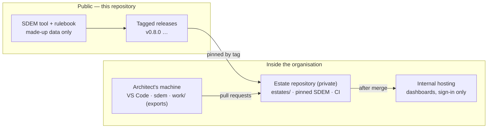

# SDEM operating model — running SDEM for real

> **Status: proposed 2026-10-29** (audit phase 4), for the owner's approval. How an organisation runs SDEM on real architecture data: where things live, who does what, how changes, upgrades and rulebook changes flow, support, and what has to be true before starting. The pilot that tests it: [`sdem-pilot-plan.md`](sdem-pilot-plan.md).

## 1. Where things live

| Thing | Lives in | Never in |
|---|---|---|
| The tool and the rulebook | this public repository, as tagged releases | — |
| Real architecture data (estates) | the organisation's **private estate repository**, made from [`templates/estate-repo`](../templates/estate-repo/README.md) | this repository, issues, public chat |
| Design exports (Confluence) | `work/` on the machine allowed to hold them | any repository |
| Dashboards | authenticated internal hosting | public Pages, public buckets, links without sign-in |

**One estate per domain.** Every domain works the same way — same rulebook, same commands, same checks; a domain joins by adding a folder in `estates/` with its owner and code owners. The only per-domain setting is the transform's word list ([pilot plan — tuning](sdem-pilot-plan.md#tuning-for-the-domain)).

**Why:** the employer owns its designs; this repository is public. One private estate repository per organisation (or per division) keeps the boundary simple and auditable. **Confidence: high** — follows from the IP constraint and the 2026-10-29 audit finding.

## 2. Roles

| Role | Who | Does |
|---|---|---|
| **Architect** | the architects of A1, A3, A4 (and A2 where licensed) | onboard designs, keep their layer's data current, propose and approve links in their area, resolve gaps |
| **Reviewer** (code owner) | named senior architects per layer, in `CODEOWNERS` | review and merge pull requests; a reviewer is always a person |
| **Estate owner** | one person per estate — usually the domain's lead architect | accountable for the estate's quality: gaps worked down, links reviewed, CI green |
| **Rulebook owner** | the SDEM owner (today: Steven Taumoepeau) | approves every rulebook change and baseline; the high-level spec stays frozen without them |
| **SDEM maintainer** | whoever builds SDEM (today: the owner) | tool fixes and releases, migrations, answering SDEM questions |
| **Platform owner** | the organisation's engineering platform team | the private repository, branch protection, CI runners, internal hosting, Copilot policy |

### Who does what (R = does it, A = accountable, C = consulted)

| Activity | Architect | Reviewer | Estate owner | Rulebook owner | Maintainer | Platform |
|---|---|---|---|---|---|---|
| Onboard a design | R | C | A | | | |
| Approve a link (`sdem approve`) | R | | A | | | |
| Merge a pull request | | R | A | | | |
| Resolve or accept a gap | R | C | A | C (if it needs a new entity type) | | |
| Change the rulebook | C | | C | **A** | R | |
| Release SDEM | | | | A | R | |
| Upgrade SDEM in the estate repository | | R | A | | C | |
| Migrate an estate (`sdem migrate`) | R | R | A | | C | |
| Branch protection, CI, hosting | | | C | | C | **R/A** |

## 3. How work flows

**Everyday change** — always a branch and a pull request: an SDEM command (load, approve, designs resolve) → `sdem check` locally → pull request → CI *Estate checks* → code-owner review → merge → dashboards rebuilt. Approvals become final at merge.

**A gap that needs a new entity type or attribute** — the estate owner raises it with the rulebook owner, **without real data** (describe the kind of thing, not the design). If approved: the maintainer changes the rulebook, bumps `metamodel_version` with a recorded migration ([`sdem-rulebook-versioning.md`](sdem-rulebook-versioning.md)), and releases; estates upgrade (below).

**Upgrading SDEM** — the estate owner changes the pin in a pull request; CI runs; `sdem migrate` if the rulebook version changed; merge. Upgrade within a month of a release; skip none that carry a migration.

**Release cadence** — SDEM releases when there is something worth releasing, tagged by the owner after CI passes; a rulebook change is always its own release, named in the CHANGELOG.

## 4. Support

| Problem | Where it goes | Rule |
|---|---|---|
| An SDEM error or bug | an issue on the SDEM repository | **no real data** — reproduce with the examples or describe it |
| A question about our data | the estate owner | in the estate repository's issues or the team channel |
| A rule seems wrong | the rulebook owner | describe the kind of thing, not the design |
| Security | SDEM's [`SECURITY.md`](../SECURITY.md) — private report | |
| CI or hosting is down | the platform owner | |

SDEM failures say what to do: exit `1` a check refused (read the message), `2` the input is wrong, `3` a fault in SDEM — report it with `SDEM_DEBUG=1` output, after removing any real names.

## 5. Health — what the estate owner watches

| Measure | From | Healthy |
|---|---|---|
| CI on `main` | Estate checks | always green |
| Open gaps | `sdem designs --gaps --status open`, dashboard | going down month on month |
| Proposals waiting | dashboard *Attention* | reviewed within two weeks |
| SDEM version | `requirements.txt` | the latest release, or the one before |
| Coverage of onboarded designs | each load's `extraction.json` | 90% or more of items captured |

## 6. Before starting — what must be true

| # | Precondition | Owner | Why |
|---|---|---|---|
| 1 | **Legal and IP clearance** to run SDEM on the organisation's designs ([`PUBLICATION_CHECKLIST.md`](PUBLICATION_CHECKLIST.md)) | owner | the designs belong to the employer; SDEM is personal open source |
| 2 | Private estate repository with **branch protection and code owners** | platform | without it a person's approval is not enforced ([`sdem-repository-protection.md`](sdem-repository-protection.md)) |
| 3 | **Python 3.10 or later** on architects' machines (3.11+ recommended) | platform | SDEM requires 3.10; Python 3.9 reached end of life in October 2025 (PEP 596 — high confidence) |
| 4 | **Dashboard hosting decided** — internal, sign-in only | platform | dashboards show real architecture |
| 5 | **Copilot policy** known (allowed or not; no MCP) | platform | SDEM works without Copilot; with it, Copilot files must match the pinned release |
| 6 | **A2 (BIAN)**: the organisation's BIAN licence position | owner | real BIAN ids need a licensed catalogue (ROADMAP v0.15); without it, A2 holds only what is public |

## 7. Decisions for the owner

| # | Decision | Recommendation | Confidence |
|---|---|---|---|
| OM-1 | One estate repository for the organisation, or one per division | **one**, with one folder per estate — simplest to protect and to report across | medium — depends on how divisions share data |
| OM-2 | Who is the first estate owner | the architect leading the pilot domain | high |
| OM-3 | Where dashboards are hosted | the organisation's existing intranet or internal static hosting behind sign-in | medium — depends on what exists |
| OM-4 | Support hours | best effort during the pilot; review at its end | high |
