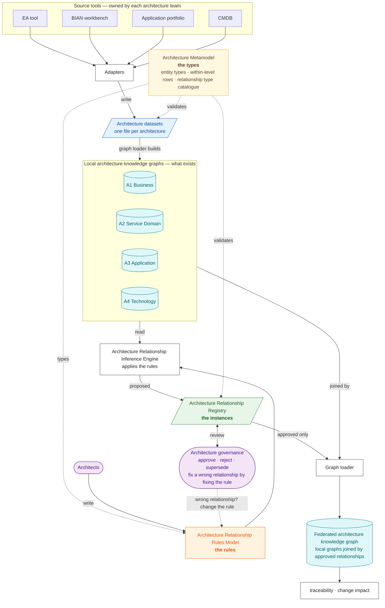

# SDEM Overview — read this first

**Service Domain Enterprise Metamodel (SDEM)** is an open-source, model-driven enterprise architecture metamodel designed to define, validate and govern architecture entities and relationships across Business, Service Domain, Application and Technology architectures.

SDEM provides a structured foundation for four local architecture knowledge graphs and a federated architecture knowledge graph, enabling end-to-end architecture traceability, relationship governance and change-impact analysis. Its architecture relationship rules and inference components support evidence-based discovery and validation of relationships between architecture entities.

SDEM is BIAN-aligned but is not an official BIAN standard or BIAN-endorsed framework. *(Until v0.6.2 it was called SDMM, the BIAN Service Domain Mapping Model.)*

## The short version

- The **Architecture Metamodel** defines *what kinds of thing exist* in each architecture and *which kinds of relationship are allowed*.
- Each architecture's **data** is loaded into its own **local architecture knowledge graph**: *what exists*.
- Architects write the **Architecture Relationship Rules Model**: *how* a relationship between two architectures is established, and on what evidence.
- The **Architecture Relationship Inference Engine** applies the rules to the data and proposes relationships into the **Architecture Relationship Registry**.
- Architects **review** them. The **graph loader** joins the local graphs with the approved relationships into the **federated architecture knowledge graph**, which answers questions across architectures.

**Metamodel → data → rules → inference → registry → review → federated graph.**

## Principles

1. **Model-driven architecture.** Entities, relationships and constraints are defined by explicit metamodels.
2. **Four architecture levels.** A1 Business, A2 Service Domain, A3 Application, A4 Technology.
3. **Independent local knowledge graphs.** Each level has its own entities and relationships.
4. **Federated knowledge graph.** Approved cross-architecture relationships connect the local graphs.
5. **Typed relationships.** Relationship types and constraints govern valid connections.
6. **Evidence-based inference.** Automated relationship discovery provides supporting evidence.
7. **Governance.** Relationships carry versions, approval status, provenance and lifecycle history.
8. **Bidirectional traceability.** Dependencies can be traversed upstream and downstream.
9. **Change-impact analysis.** A change to an entity can be traced across levels.

| Level | Architecture | Scope |
|---|---|---|
| **A1** | Business Architecture | capabilities, processes, business services and business objects |
| **A2** | Service Domain Architecture | BIAN Service Domains, operations, control records and business objects |
| **A3** | Application Architecture | applications, application services, APIs, events and data entities |
| **A4** | Technology Architecture | infrastructure, deployment, platforms, networks and environments |

---

## The components and their boundaries

| Component | Is | Is not | Lives in |
|---|---|---|---|
| **Architecture Metamodel** | the **types**: entity types per level, the links allowed *inside* each level, and the **relationship type catalogue** — the nine kinds of link allowed *between* levels | any real entity; any rule for finding a link | `metamodel/a1…a4-*.json`, `metamodel/level-relationships.json`, `schema/relationship-types.json` |
| **Architecture Relationship Rules Model** | the **rules**: for each cross-level pair, how a relationship is established, from which data, with what evidence and confidence | the list of allowed types (that is the metamodel); any real link | `metamodel/relationship-rules.json` (plan rows `S…`), `metamodel/export-conventions.json` (join keys) |
| **Architecture Relationship Inference Engine** | the **program** that applies the rules to the local graphs and proposes relationships | an approver; a store | `sdem/rules_engine.py` (`sdem-infer rules`) — built; passes all 8 acceptance cases |
| **Architecture Relationship Registry** | the **instances**: actual relationships between real entities, with evidence, status, versions and approval provenance | rules; the graph | `examples/<estate>/mappings.json`, form `schema/relationship-registry.schema.json` |
| **Local architecture knowledge graph** | one level's real entities and the links inside it, built from that level's architecture dataset | anything cross-level | `sdem/graph.py` (`LevelGraph`), in memory |
| **Federated architecture knowledge graph** | the four local graphs joined by the **approved** registry records | editable; a holder of proposals | `sdem/graph.py` (`FederatedGraph`), in memory |
| **Architecture Governance** | approval, supersession, immutability of approved records, impact classification | automated approval | `sdem-validate`, `sdem-diff`, `schema/impact-rules.json`; [`architecture-governance-spec.md`](architecture-governance-spec.md) |

> **Two names to keep apart.** The **relationship type catalogue** (`schema/relationship-types.json`) is the nine *types* — part of the metamodel. The **Architecture Relationship Registry** is the *instances*. Every registry record carries `registry_version`: that legacy field name refers to the catalogue's version.

## Two lanes: mapping and planning

SDEM runs two lanes on one rulebook (the metamodel) and one set of engine rules.

```
                ┌────────── rulebook (metamodel) + BIAN reference ──────────┐
 MAPPING LANE — "as is" (governed)                PLANNING LANE — AID, "what should be"
 all available architecture datasets              the layers an architect has (one or more)
   → engine proposes links                          → AID projects the missing layers
   → architect approves → registry                  → projection package (PRJ-, never approved)
   → federated knowledge graph (real)  ◄── gap analysis ──►  projected design
```

The planning lane — **Architecture Inference Design (AID)** — may read real data but never writes into the mapping lane. A projection becomes real only when the design is built and arrives as a real architecture dataset. See [`aid-design.md`](aid-design.md).

## The four things that look alike

| | **Architecture Metamodel** | **Relationship Rules Model** | **Relationship Registry** | **Schema** |
|---|---|---|---|---|
| In one word | **types** | **rules** | **instances** | **form** |
| Says | `A2.ServiceOperation` may be `IMPLEMENTED_BY` an `A3.APIOperation` | how to establish that: match method and payload; high confidence; needs an API contract | *this* operation is implemented by *this* API, approved by Jane | which fields a registry record must have |
| Example ID | `OPERATION_IMPLEMENTED_BY_API` | `S24` | `PAY-101` | — |
| Has status, reviewer, date | no | no | **yes** | no |
| Written by | the SDEM model owner | architects | the inference engine; architects review | the SDEM model owner |

**Quick test:** a real thing like `SO-PI-01` → **registry**. A rule with a step, a confidence and data needed → **rules model**. A permitted kind of link with no rule → **metamodel**. A list of fields → **schema**.

### The same relationship at every layer

**Metamodel — the type** (`schema/relationship-types.json`):

```json
{ "mapping_type_id": "OPERATION_IMPLEMENTED_BY_API", "source_type": "A2.ServiceOperation",
  "relationship": "IMPLEMENTED_BY", "target_type": "A3.APIOperation", "required_evidence": ["api_contract"] }
```

**Rules model — the rule** (`metamodel/relationship-rules.json`): find it at step 2 by matching the HTTP method to the operation's action and the payload to its attributes; confidence high.

```json
{ "id": "S24", "source": "A2.ServiceOperation", "target": "A3.APIOperation", "rule_decision": "registry_rule",
  "fill_step": 2, "confidence": "high" }
```

**Registry — the instance** (`examples/payment-initiation/mappings.json`):

```json
{ "mapping_id": "PAY-101",
  "source": { "id": "SO-PI-01", "type": "A2.ServiceOperation" }, "relationship": "IMPLEMENTED_BY",
  "target": { "id": "API-PI-01", "type": "A3.APIOperation" }, "status": "approved",
  "evidence": ["api_contract:payments-api-v2.yaml#/paths/~1payment-instructions/post"],
  "rationale": "Initiate ↔ POST; 8/8 attributes in payload", "reviewer_id": "jane.architect", "approved_at": "2026-10-22" }
```

**Schema — the form** (`schema/relationship-registry.schema.json`): every record needs `mapping_id`, `source`, `relationship`, `target`, `status`, `evidence`, `rationale`, `baseline_id`; `status` is one of proposed, validated, needs_review, approved, rejected, superseded.

> **Legacy field names.** Registry records keep the field names `mapping_id`, `mappings`, `previous_mapping_id`, and the type catalogue keeps `mapping_type_id` and `registry_version`. They sit inside immutable approved records, so they were not renamed in v0.7; *mapping* there means one relationship record. The rule decision value `registry_rule` likewise means "a rule for one of the nine catalogued types" (shown as *catalogue rule*).

---

## The architecture model in numbers

The same numbers appear in [`relationship-rules-spec.md`](relationship-rules-spec.md) and [`architecture-model-diagram.puml`](architecture-model-diagram.puml); a test keeps all three in step with the records.

| What | Count | Where in the spec | In the diagram |
|---|---|---|---|
| Entity types (boxes) | 44 | §2 | every box |
| Within-level rows: links allowed *inside* one architecture | 132 | §3.1 (`RA…`) | thin grey arrows |
| Relationship type catalogue: kinds of link allowed *between* architectures | 9 | §4.1 | named on the blue arrows |
| Plan rows: rules for finding cross-level relationships | 69 | §4.2 (`S…`, `B…`) | — |
| …of which drawn as cross-level rules | 50 | §4.3 | coloured arrows |
| …of which catalogue rules, the only ones that produce registry records | 9 | §4.3 | blue arrows |
| Join keys the rules read from the architecture datasets | 52 | §5 (`K…`) | — |
| Inference engine requirements | 33 | §10 (`REQ-…`) | — |

## Reading the architecture-model diagram

[`architecture-model-diagram.puml`](architecture-model-diagram.puml) draws the **Architecture Metamodel** (entity types and within-level rows) and the **Relationship Rules Model** (cross-level rules). It does **not** draw the registry.

| On the diagram | Means |
|---|---|
| A box, e.g. `A3.APIOperation` | an entity **type** — no real instance like `API-PI-01` appears |
| Four columns | the four architectures, A1 to A4 |
| Thin grey arrow, e.g. `RA3-27 composition` | a **within-level row** of the metamodel |
| Blue arrow, e.g. `S24 IMPLEMENTED_BY` | a **catalogue rule**: the inference engine uses it to propose registry records |
| Green, orange, dashed or dotted arrow, e.g. `S20` | another **plan row**: reported as a candidate; never a registry record |
| Grey box | an entity type with no cross-level rule, by decision (artefacts; actor and role) |

To see which relationships *do* exist, open a registry, e.g. `examples/payment-initiation/mappings.json`, or run `sdem-graph trace`.

## How they connect



| Colour | Means |
|---|---|
| Yellow | definitions: the Architecture Metamodel |
| Blue | data about what exists: architecture datasets |
| Teal | knowledge graphs |
| Orange | the rules: the Relationship Rules Model |
| Green | the instances: the Relationship Registry |
| White | programs: adapters, inference engine, graph loader, queries |
| Purple | people and governance |

## Who does what

| Role | Does | Never |
|---|---|---|
| Architecture team (A1, A2, A3 or A4) | keeps its own tool up to date | writes cross-architecture relationships |
| SDEM model owner | maintains the Architecture Metamodel | approves relationships |
| Architect | writes the Relationship Rules Model; reviews the registry; decides which rules may auto-approve | edits an approved record (it is superseded instead) |
| Inference engine | applies the rules; writes records as `proposed` | changes the rules or the metamodel; approves its own records (except rules an architect declared auto-approved) |
| Graph loader | loads architecture datasets and approved records | changes any input |

## A worked example, start to finish

From `examples/payment-initiation/`:

1. **Architecture dataset → local graph.** The A2 architecture dataset lists `SO-PI-01 Initiate Payment Instruction` (action *Initiate*). The A3 architecture dataset lists `API-PI-01 POST /payment-instructions` with its payload fields. Both pass the metamodel's checks.
2. **Metamodel.** `IMPLEMENTED_BY` from `A2.ServiceOperation` to `A3.APIOperation` is a catalogued type.
3. **Rules model.** Rule S24: the API belongs to the domain's application, the HTTP method fits the action (*Initiate* ⇔ POST), the payload carries the operation's attributes.
4. **Inference engine.** POST fits *Initiate*, 8 of 8 attributes match. It writes `PAY-101`, status `proposed`, confidence 0.8, with that working as evidence.
5. **Registry → governance.** Jane checks `PAY-101` and sets it to `approved`.
6. **Graph loader → federated graph.** Loads the four architecture datasets and the approved records.
7. **Traceability.** `sdem-graph trace CAP-PAY-010 --direction down` walks from the *Initiate Payment* capability to the Service Domain, the Payments Hub, and the Kubernetes cluster it runs on — each step citing its record ID.

## What is built

| Part | Status |
|---|---|
| Architecture Metamodel; architecture datasets, local and federated knowledge graphs, graph loader, traceability, change impact | built |
| Data model: attributes, logical rules (all enforced), per-entity schemas | built |
| Graph store: local JSON files (JSON Graph Format), load record, baselines, queries, offline HTML view ([`graph-store-design.md`](graph-store-design.md)) | built |
| Relationship Rules Model | built as records; tested across ten use cases, eleven runs |
| Relationship Registry format, schemas, validators, immutability guard | built |
| Inference engine | built (v0.10): steps 1–5 and design mode; passes all 8 acceptance cases against the hand-executed runs (`sdem-accept`); a blind case is still needed to show it generalises |
| Adapters, architecture dataset diff, refresh trigger, review queue, query service interface, assistant access | specified ([`knowledge-graph-spec.md`](knowledge-graph-spec.md) §11), not built |

## Glossary

The essentials; the full list is in [`glossary.md`](glossary.md).

| Term | Means |
|---|---|
| **A1 … A4** | the four architectures: Business, Service Domain (BIAN), Application, Technology |
| **Entity type** | a *kind* of thing, e.g. `A3.APIOperation` — defined by the metamodel |
| **Entity / instance** | a *real* thing of that kind, e.g. `API-PI-01` |
| **Within-level row** | a link type allowed inside one architecture, e.g. `RA3-27` |
| **Relationship type catalogue** | the nine link types allowed between architectures, e.g. `IMPLEMENTED_BY` |
| **Plan row / rule** | how one cross-level relationship is established, e.g. `S24` |
| **Catalogue rule** | a plan row for one of the nine catalogued types — the only rules that produce registry records |
| **Registry record** | one actual relationship, e.g. `PAY-101` |
| **Architecture dataset** | the file an adapter writes for one architecture |
| **Graph loader** | the program that builds the local and federated knowledge graphs |
| **Trace / impact** | follow relationships across architectures / find what a change affects |

## The SDEM workbench — how architects use it

The architect opens the SDEM project in **VS Code**, the enterprise architecture tool, and runs SDEM from the **terminal pane** — the **CLI** is SDEM's only interface: every engine and function is a command. The **GitHub Copilot Chat** window gives AI support: it explains command output, suggests the right command, and drafts notes and pull requests. **Git** holds the history; a link is approved in a reviewed pull request, by a person. The AI helps, but the rules and controls decide what is valid — and every journey also works with Copilot switched off. How to use it, step by step: [`sdem-workbench-user-guide.md`](sdem-workbench-user-guide.md). Design and requirements: [`sdem-workbench-design.md`](sdem-workbench-design.md), [`sdem-workbench-spec.md`](sdem-workbench-spec.md) (decision SDEM-D01).

## Read more

| Document | Specifies |
|---|---|
| [`logical-data-model.md`](logical-data-model.md) · [`physical-data-model.md`](physical-data-model.md) · [`architecture-entity-design.md`](architecture-entity-design.md) · [`architecture-attribute-design.md`](architecture-attribute-design.md) · [`architecture-metamodel-detail-level-spec.md`](architecture-metamodel-detail-level-spec.md) (governing) · [`architecture-metamodel-high-level-spec.md`](architecture-metamodel-high-level-spec.md) (reference) · [`relationships-planning.md`](relationships-planning.md) · [`reference-architecture-provenance.md`](reference-architecture-provenance.md) | the Architecture Metamodel: entity types, within-level rows, provenance |
| [`relationship-rules-spec.md`](relationship-rules-spec.md) · [`architecture-model-diagram.puml`](architecture-model-diagram.puml) | the Relationship Rules Model and the inference engine's requirements |
| [`relationship-registry-spec.md`](relationship-registry-spec.md) | the Relationship Registry: record fields, statuses, transitions, immutability |
| [`knowledge-graph-design.md`](knowledge-graph-design.md) · [`knowledge-graph-spec.md`](knowledge-graph-spec.md) | the local and federated architecture knowledge graphs |
| [`architecture-governance-spec.md`](architecture-governance-spec.md) | approval, supersession, impact |
| [`sdem-agent-platform-design.md`](sdem-agent-platform-design.md) · [`sdem-agent-platform-spec.md`](sdem-agent-platform-spec.md) | the agent platform (proposed): layer agents and a coordinator over the federated graph |
| [`sdem-workbench-design.md`](sdem-workbench-design.md) · [`sdem-workbench-spec.md`](sdem-workbench-spec.md) | the SDEM workbench: VS Code as the architects' tool, GitHub Copilot Chat as the AI interface (no MCP) |
| [`use-case-testing.md`](use-case-testing.md) · [`relationships-testing.md`](relationships-testing.md) | how the model was tested |
