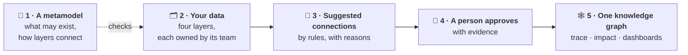
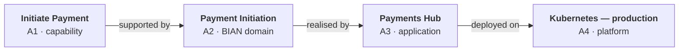

# SDEM — read this first

> **Status: current (v0.18.0)** — what SDEM is and the ideas behind it, in plain words. No prior knowledge assumed.

**SDEM (Service Domain Enterprise Metamodel)** connects an organisation's architecture — what the business does, the BIAN building blocks, the applications and the technology underneath — into **one picture you can ask questions of**. It checks every piece against a metamodel, suggests how the pieces connect, and keeps **a person in charge of every decision**. It is open source, runs on your own machine, and uses no AI inside.

## The problem it solves

*"What does this capability depend on?"* · *"What breaks if we retire this platform?"* · *"Which applications deliver this BIAN domain?"* Today the answers are spread across Confluence, spreadsheets, the EA tool and the CMDB — and in people's heads. SDEM keeps them in one connected, checked place, with the evidence for every connection.

## Five ideas

1. **A metamodel** says what kinds of thing may exist in each layer — capability, BIAN service domain, application, server … — and how layers may connect. It is built from public standards: BIAN, ArchiMate and TOGAF. → [The metamodel in plain words](sdem-metamodel-guide.md)
2. **Your data** is one file per layer — **A1 Business, A2 BIAN, A3 Applications, A4 Technology** — kept in a folder called a *workspace* — the authoritative architecture, in your own repository. SDEM checks every record against the metamodel.
3. **SDEM suggests connections** between the layers using rules (not AI), and says why and how sure it is.
4. **A person approves** each connection, naming the document that proves it. Approved connections are never edited — a wrong one is replaced by a new one, so the history stays.
5. **SDEM builds a knowledge graph** of all four layers joined by the approved connections, and answers questions from it: *trace* (what depends on what), *impact* (what a change affects), *dashboards*.

## A worked example

From the made-up workspace `examples/payment-initiation/`:

- The BIAN data lists the operation *Initiate Payment Instruction*; the application data lists the API `POST /payment-instructions` with its fields. Both pass the metamodel's checks.
- SDEM's rule for *operation implemented by API* matches *Initiate* to `POST` and finds 8 of 8 fields in the payload, so it **suggests** the connection — high confidence, with that reasoning.
- Jane reads the API contract and **approves** it.
- Now `sdem trace` walks from the *Initiate Payment* capability down to the Kubernetes cluster — and `sdem impact` on that cluster lists every application, domain and capability that would need a look if it were retired.

## Two ways to use it

| | **Mapping what exists** | **Planning what should be (AID)** |
|---|---|---|
| Question | how is our real architecture connected? | what should the missing layers look like? |
| You give it | the layers you have | one or more layers, plus the BIAN catalogue |
| You get | approved connections and the knowledge graph | a *projected* design, kept apart and never approved |

A projected design becomes real only when it is built and arrives as real data.

## Bringing in what you already have

Existing designs in Confluence can be **onboarded**: SDEM reads an export — tables, diagrams, text, text in pictures — and suggests records, each with the page it came from; you keep the good ones; anything that does not fit is kept as a *gap record*. → [Onboarding workflow](sdem-onboarding-workflow.md)

## How you work with it

You open SDEM in **VS Code** and run the `sdem` command in the terminal; every task is one command, and every command works without AI. **GitHub Copilot** (optional) can explain output and draft notes, but never approves. Your changes go through **Git** and a pull request, so a reviewer sees every decision. → [User guide](sdem-workbench-user-guide.md)

## What kind of tool is SDEM?

Three complementary descriptions of one framework — not three products:

| Classification | What it means for SDEM |
|---|---|
| **Architecture-as-Code CLI** | Architects define architecture as structured data, validate it against modelling rules and generate human-readable architecture views and reports. |
| **Enterprise Architecture Framework** | SDEM integrates business, service domain, application and technology architecture into one connected model. |
| **BIAN Service Domain Framework** | SDEM uses banking service domains as the organising reference for connecting business capabilities to their supporting applications and infrastructure. |

The `sdem` command line is the primary operational interface — but the framework is the metamodel, the architecture data, the rules and the views together, not just the commands.

**Architecture-as-Code.** "Architecture-as-Code tools take structured architecture designs, validate them against modelling rules, and automatically generate human-readable diagrams, design documents and reports." SDEM applies the approach like this:

- architecture data is held in **structured, version-controlled JSON files** — the workspace, in your own repository;
- its **metamodel** defines the valid entities, attributes and relationships;
- the **CLI** validates, processes, queries and governs the architecture data;
- the **knowledge graph** connects the architecture records through their approved relationships;
- generated **HTML pages** — SDEM Home, the workspace dashboard, the architecture graph — provide human-readable visualisation and analysis; SDEM also writes Markdown impact reports (`sdem impact --report`), Markdown matrices (`sdem matrix --md`) and CSV traces (`sdem trace --csv`). It does not write complete solution design documents.

SDEM does not generate application code or provision infrastructure — it models and analyses the architecture.

## The parts, and what is authoritative

| Component | Responsibility |
|---|---|
| **1 · Metamodel** | the architecture rules: valid entity types, attributes, relationships and constraints of each layer — built from BIAN, ArchiMate 3.2 and TOGAF; changed only by a versioned, recorded release ([metamodel guide](sdem-metamodel-guide.md)) |
| **2 · JSON Workspace** | the persistent architecture data: a folder in **your own repository** with the A1–A4 datasets, the approved relationships (the registry), requirements, evidence references, change sets and recorded decisions |
| **3 · Python CLI** (`sdem`) | the architecture engine and the governed way to change the workspace: validation, deterministic relationship inference, governance controls, trace and impact, graph generation |
| **4 · Knowledge Graph** | the connected, **derived** model: generated from the workspace, it answers trace and impact questions |
| **5 · HTML Workbench** | human-readable views — SDEM Home, the workspace dashboard, the architecture graph — generated, offline and **read-only** |
| **6 · AI agents** (optional) | assisted creation, querying and analysis through the same CLI and controls; they never approve |

What is the source of truth, and what is derived:

| | Kind | Kept in |
|---|---|---|
| Architecture datasets (A1–A4), requirements, change sets, decisions | **authoritative** — your architecture | the workspace (your repository, under Git) |
| Approved relationships | **authoritative** — each approved by a person, with evidence; never edited, only superseded | the workspace's registry, `mappings.json` |
| Proposed relationships, AID-inferred records | **proposals** — not architecture until a person approves or confirms them | proposal files; inferred records carry a visible mark |
| Metamodel and validation rules | **definitions** — what may exist; part of the SDEM release you installed | SDEM (never edited in your repository; your own rules go in a profile) |
| Knowledge graph, SDEM Home, dashboard, graph view | **derived** — rebuilt from the workspace; snapshots of it | generated folders; safe to delete and regenerate |
| AI agents | **optional consumers** — they draft and query through the same CLI and controls; they never approve | your agent of choice |

- **The architecture persists in the workspace, not in a conversation.** Any new AI session — or person — reads the same architecture through the CLI; SDEM knows only what was recorded there.
- **The CLI is the governed way to change it**: every change is checked, and changes and decisions are recorded. The JSON files are ordinary files and can be edited directly — SDEM then reports the edit as unrecorded until a person adopts it — so governance is a process with checks and a record, not a filesystem security boundary ([governance](design/sdem-governance.md)).
- **The knowledge graph is derived**, not a second source of truth: rebuild it after the workspace changes; SDEM's pages say when a graph is out of date.

**The lifecycle** — the usual order, though steps repeat and not every change needs all of them:

| Step | Purpose | With |
|---|---|---|
| **Define** | create or import architecture records into the workspace | `sdem new`, change sets, `sdem transform` + `load`, `sdem aid` |
| **Validate** | check records against the metamodel | `sdem check` |
| **Connect** | infer or propose relationships between the layers | `sdem link` — **proposals**, not yet architecture |
| **Approve** | review the evidence and accept valid relationships | `sdem approve`, `sdem connect` — a person's recorded decision |
| **Build** | generate the architecture knowledge graph | `sdem build` |
| **Explore** | see the architecture in the HTML workbench | `sdem home`, `dashboard`, `view` |
| **Analyse** | trace dependencies and assess change impacts | `sdem trace`, `impact`, `matrix` |
| **Govern** | keep requirements, evidence, decisions and change history | `sdem requirements`, `events`, `governance verify` |

## What makes SDEM distinctive

SDEM brings these together as one framework, rather than leaving them to be assembled from separate components:

- a **BIAN-centred enterprise architecture metamodel**, with **four connected architecture layers**;
- **relationship inference by deterministic rules** — every proposal with its rule, reasoning and confidence — and **human review and approval** with evidence;
- **local and federated knowledge graphs**, **dependency tracing** and **change-impact analysis** (including requirements against a change);
- **architecture governance**: recorded decisions, change sets and events, verifiable signed approvals in governed mode;
- **organisation-specific extensions** through profiles;
- **CLI automation** with machine-readable output, and **optional AI-agent integration** (GitHub Copilot, Claude Code, Codex, Gemini CLI);
- generated **HTML Home, Dashboard and Architecture Graph** pages.

Other architecture-as-code and modelling tools (for example Archi, Structurizr, LikeC4) can be extended to do comparable things; what SDEM offers is a **predefined, integrated, banking-oriented** architecture framework and workflow, ready to use. That is how SDEM is positioned — not a claim that it is first, only or best.

## Customise it for your organisation

SDEM is not one bank's architecture. Its core is a reusable, BIAN-centred foundation; each organisation adds its own on top, in its own repository:

- **organisation profiles** (`sdem-profile.json`, optionally extending a shared base profile) add your own kinds of record, attributes with allowed values, rules (including conditional and cross-record rules), link kinds inside a layer, layers above A1 or below A4, requirement categories and your own names ([profiles](design/sdem-profile-spec.md), [added layers](design/sdem-layers-spec.md));
- your **applications, technology environments and standards** are your own data, in your own workspaces;
- **governance** is configured per workspace — from local evaluation to governed mode with signed, verified approvals ([governance](design/sdem-governance.md)).

Two banks can use the same SDEM framework while maintaining different architecture models, organisation profiles, infrastructure environments and governance configurations. What stays fixed — so that every bank's model remains comparable and every upgrade safe — are the core layers, entity types and the relationship types between layers; a profile adds, it never redefines them. Changing a workflow itself means changing SDEM.

## Where to go next

| To | Read |
|---|---|
| explore the synthetic Payments architecture in five minutes — Home, dashboard and graph | [Explore your architecture](sdem-workbench-user-guide.md#4a-explore-your-architecture--home-dashboard-and-graph) |
| what you can do, by goal (explore, design, connect, analyse, govern, operate) | [Architect tasks](sdem-workbench-user-guide.md#4b-architect-tasks--what-you-can-do-by-goal) |
| install SDEM and try it in 15 minutes | [User guide](sdem-workbench-user-guide.md) |
| understand the metamodel | [The metamodel in plain words](sdem-metamodel-guide.md) |
| see how SDEM is built and where data lives | [SDEM architecture](sdem-architecture.md) |
| set it up for your team | [Configuration](sdem-configuration.md) · [Administration](sdem-administration.md) · [Operating model](sdem-operating-model.md) |
| look up a word | [Glossary](glossary.md) |

The knowledge graphs in more depth, for builders: [knowledge-graph-design.md](design/knowledge-graph-design.md).

## The formal names

The specifications use formal names. In plain words: the **Architecture Metamodel** is the metamodel described above; the **Architecture Relationship Rules Model** is the rules for finding connections; the **Architecture Relationship Inference Engine** is the engine (`sdem link`); the **Architecture Relationship Registry** is the approved connections (`mappings.json`); the **local** and **federated architecture knowledge graphs** are one layer's records as a graph, and all four joined. SDEM had another name before v0.7 ([what changed](history/renamed-from-sdmm.md)).
