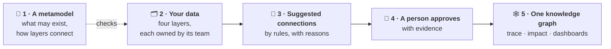
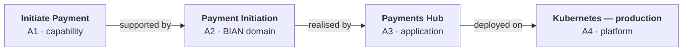

# SDEM — read this first

> **Status: current (v0.9.8)** — what SDEM is and the ideas behind it, in plain words. No prior knowledge assumed.

**SDEM (Service Domain Enterprise Metamodel)** connects an organisation's architecture — what the business does, the BIAN building blocks, the applications and the technology underneath — into **one picture you can ask questions of**. It checks every piece against a metamodel, suggests how the pieces connect, and keeps **a person in charge of every decision**. It is open source, runs on your own machine, and uses no AI inside.

## The problem it solves

*"What does this capability depend on?"* · *"What breaks if we retire this platform?"* · *"Which applications deliver this BIAN domain?"* Today the answers are spread across Confluence, spreadsheets, the EA tool and the CMDB — and in people's heads. SDEM keeps them in one connected, checked place, with the evidence for every connection.

## Five ideas

1. **A metamodel** says what kinds of thing may exist in each layer — capability, BIAN service domain, application, server … — and how layers may connect. It is built from public standards: BIAN, ArchiMate and TOGAF. → [The metamodel in plain words](sdem-metamodel-guide.md)
2. **Your data** is one file per layer — **A1 Business, A2 BIAN, A3 Applications, A4 Technology** — kept in a folder called an *estate*. SDEM checks every record against the metamodel.
3. **SDEM suggests connections** between the layers using rules (not AI), and says why and how sure it is.
4. **A person approves** each connection, naming the document that proves it. Approved connections are never edited — a wrong one is replaced by a new one, so the history stays.
5. **SDEM builds a knowledge graph** of all four layers joined by the approved connections, and answers questions from it: *trace* (what depends on what), *impact* (what a change affects), *dashboards*.

## A worked example

From the made-up estate `examples/payment-initiation/`:

- The BIAN data lists the operation *Initiate Payment Instruction*; the application data lists the API `POST /payment-instructions` with its fields. Both pass the metamodel's checks.
- SDEM's rule for *operation implemented by API* matches *Initiate* to `POST` and finds 8 of 8 fields in the payload, so it **suggests** the connection — high confidence, with that reasoning.
- Jane reads the API contract and **approves** it.
- Now `sdem trace` walks from the *Initiate Payment* capability down to the Kubernetes cluster — and `sdem impact` on that cluster lists every application, domain and capability that would need a look if it were retired.

## Two ways to use it

| | **Mapping what exists** | **Planning what should be (AID)** |
|---|---|---|
| Question | how is our real architecture connected? | what should the missing layers look like? |
| You give it | the layers you have | one or more layers, plus the BIAN catalogue |
| You get | approved connections and the knowledge graph | a *projected* design, kept apart and never approved |

A projected design becomes real only when it is built and arrives as real data.

## Bringing in what you already have

Existing designs in Confluence can be **onboarded**: SDEM reads an export — tables, diagrams, text, text in pictures — and suggests records, each with the page it came from; you keep the good ones; anything that does not fit is kept as a *gap record*. → [Onboarding workflow](sdem-onboarding-workflow.md)

## How you work with it

You open SDEM in **VS Code** and run the `sdem` command in the terminal; every task is one command, and every command works without AI. **GitHub Copilot** (optional) can explain output and draft notes, but never approves. Your changes go through **Git** and a pull request, so a reviewer sees every decision. → [User guide](sdem-workbench-user-guide.md)

## Where to go next

| To | Read |
|---|---|
| install SDEM and try it in 15 minutes | [User guide](sdem-workbench-user-guide.md) |
| understand the metamodel | [The metamodel in plain words](sdem-metamodel-guide.md) |
| see how SDEM is built and where data lives | [SDEM architecture](sdem-architecture.md) |
| set it up for your team | [Configuration](sdem-configuration.md) · [Administration](sdem-administration.md) · [Operating model](sdem-operating-model.md) |
| look up a word | [Glossary](glossary.md) |

The knowledge graphs in more depth, for builders: [knowledge-graph-design.md](design/knowledge-graph-design.md).

## The formal names

The specifications use formal names. In plain words: the **Architecture Metamodel** is the metamodel described above; the **Architecture Relationship Rules Model** is the rules for finding connections; the **Architecture Relationship Inference Engine** is the engine (`sdem link`); the **Architecture Relationship Registry** is the approved connections (`mappings.json`); the **local** and **federated architecture knowledge graphs** are one layer's records as a graph, and all four joined. SDEM had another name before v0.7 ([what changed](history/renamed-from-sdmm.md)).
