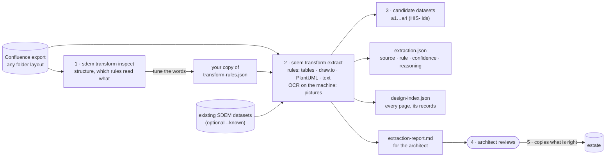

# SDEM Transform — Turning past designs into architecture entities

`sdem transform` takes an **export** of past designs (from Confluence) and **transforms** it into SDEM architecture entities. Getting the pages out of Confluence — the export — is done by the architect or Confluence; SDEM does the transform. (Named `sdem history` until 2026-10-28.)

> **Status: built 2026-10-28, tested on two synthetic exports only** (Confluence's standard HTML export, and a prepared export with provenance files in the root, raw HTML and diagrams in `archives/`, sections as folders — `tests/fixtures/`). `sdem transform inspect` and `sdem transform extract`. Requirements: [`sdem-transform-spec.md`](sdem-transform-spec.md). It is the first part of the historical design repository (original design §9; roadmap v0.11 ingestion and v0.16 history).

## 1. The problem

Past designs live in Confluence as **narrative pages with embedded diagrams and tables**. To trace them, compare them with new BIAN-aligned designs, or reuse them, SDEM needs their content as architecture records. But:

- the designs are **the organisation's confidential information** — they never leave the work machine, and nobody outside sees them;
- the work machine has **no AI** (no large language model) — so the reading is done by **rules**; the only machine learning used is the computer's own **on-device text recognition (OCR)** for the text in pictures, which can be switched off;
- SDEM was built **without seeing a single real page** — so the rules must be easy to adjust on the work machine, without code.

## 2. How it works

In five steps — SDEM does the first three, the architect the last two:

| Step | Who | What happens |
|---|---|---|
| **1. Scan** | `sdem transform inspect` | walks the whole export and works out its structure: root files = provenance, `.html`/`.md`/`.txt`/`.csv` = pages, folder names = sections, draw.io and PlantUML = diagrams, other images = pictures; shows which rule reads each table and shape. Writes nothing |
| **2. Read** | `sdem transform extract` | tables → entities (by column headings) and links (source/target tables); draw.io and PlantUML → entities from shapes, links from lines and nesting; text → links between names already found; pictures → names read by OCR (never links) |
| **3. Write** | `sdem transform extract` | candidate datasets (`a1…a4`, `HIS-` ids), `extraction.json` (source, rule, confidence, reasoning for every item), `design-index.json` (every page and its entities), `extraction-report.md` — into the output folder only; the estate is not touched |
| **4. Review** | the architect | keeps, fixes or deletes each candidate against its page (confidence is never above medium) |
| **5. Adopt** | the architect | copies what is right into the estate; `sdem check`, `sdem link`, `sdem approve` as usual |



On the work machine:

```bash
# 1. Put the export in a folder outside the repository, e.g. ~/designs/payarch (Confluence's HTML export or a prepared one)
sdem transform inspect ~/designs/payarch                       # tables, diagram shapes, headings — and which rule reads each
cp metamodel/transform-rules.json my-rules.json                # 2. only if inspect shows "no rule" or "unclassified" items you want
sdem transform extract ~/designs/payarch -o work/history --rules my-rules.json --known estate/a3-application.json
open work/history/extraction-report.md                        # 3. review
```

## 2a. Any folder layout

The reader does not depend on Confluence's own export layout. It sorts every file by **what it is and where it sits**:

| File | Treated as |
|---|---|
| Files in the export's **root** that are not HTML pages (readme, source, evidence — Markdown, text, JSON, CSV, anything) | **provenance**: listed with size and SHA-256. JSON and CSV lists are matched to pages (a row whose value equals a page's file path, file name or title) and fill in the page id, link, title, date and space (`manifest_keys` in the rules) |
| `.html`, `.md`, `.txt`, `.csv` **anywhere else** (e.g. raw HTML in `archives/`, section files in section folders) | **pages**: HTML headings, tables, paragraphs and pictures; Markdown headings, pipe tables, paragraphs and ``; text paragraphs; a CSV is one table |
| Any file holding a **draw.io diagram** — wherever it is | a **diagram**, linked to the page whose HTML or Markdown **refers to it** (resolved from the page's own folder; or the picture the page shows has the same name in the same folder). A diagram no page refers to is still read, with its folder as context, and listed for a person |
| Other pictures | **for a person**, whether a page shows them or they just sit in a section folder |

**Folders are sections.** `Payments Hub Design/3. Infrastructure/servers.csv` is read as if under the headings "Payments Hub Design › Infrastructure" (numbering dropped; container folders such as `archives` and `attachments` left out). That is what places a shape with nothing else to go by in the right architecture.

`sdem transform inspect EXPORT --anonymous` prints the folder layout — what each folder holds — with folder names replaced by F1, F2 …, so the structure can be described to someone outside without naming anything.

If the same content appears twice (e.g. a section both in the raw HTML and in its folder), the records merge by name and both places are listed as sources.

## 3. What it reads, and how sure it is

| In the export | How (rules) | Confidence |
|---|---|---|
| **Tables** with a heading row | The column headings choose the entity type: a table with an "Application" column lists application components (rule HT-01); "Server" → nodes; "Capability" → capabilities; "Database" → system software… Other columns fill the description, lifecycle status ("Live" → active, "Decommissioned" → retired) and attributes (vendor, version, hosting). | medium |
| **Source/target tables** (interface lists) | A row "Payments Hub → Fraud Screening" becomes a flow between the two (HL-01). Names not found elsewhere become application components. | medium (link), low (new names) |
| **draw.io diagrams** | Read from the diagram's own file, whatever its name: a plain `.drawio`/XML file, a compressed one, or a PNG/SVG with the diagram inside it. A shape's **ArchiMate type** gives the entity type (HD-01…23); otherwise its **fill colour** gives the architecture and its **label or shape** the type ("cluster" → node, cylinder → system software). | medium (ArchiMate shape), low (colour, words) |
| **Lines** in diagrams | A line between two shapes in one architecture becomes a relationship of the first kind the rulebook allows for the pair ("triggers" on the line → triggering); a shape drawn **inside** another is part of it — or, across architectures, deployed on it. | low |
| **PlantUML diagrams** | Read from the **source**, not the picture: `.puml` files, `@startuml` blocks in pages (HTML code blocks, Markdown ```` ```plantuml ````, text files), PNGs with the source in their `plantuml` text chunk, SVGs with an encoded `plantuml-src`. Element keywords give the type (`component`, `node`, `database`, `actor` …), as do C4 macros (`Person`, `Container`, `ContainerDb`, `Deployment_Node` …) and ArchiMate (`archimate … <<application-component>>`, `Application_Component(…)`); arrows and `Rel(…)` give links (`Rel_Serving` → serving); nesting gives part-of or deployed-on. Activity diagrams, mind maps and Gantt charts are listed for a person (HU-*). | medium (typed), low (untyped, sequence participants) |
| **Pictures** (screenshots, exported PNG/JPG) | **Text read by OCR on the machine**: macOS's built-in text recognition (Apple Vision — nothing to install) or Tesseract where installed; SVG pictures' text is read exactly. Stacked lines become one label (name, then description); captions in small letters (usually on lines) are skipped. A label becomes a candidate only when a name already found, a label word or the section decides its type (HO-*). **Boxes and lines are not read** — the picture is always listed for a person, with the labels read. | low |
| **Narrative text** | Only **names already found** (in tables, diagrams or the `--known` datasets) are recognised. Two names joined by a simple phrase become a link: "X sends … to Y" → flow, "X calls Y" → Y serves X, "X is hosted on Y" → deployed on. Text **never creates** a record. | low |
| **Key-value tables** (Owner \| Payments team) | Not read; shown by `inspect`. | — |

Never above medium: every record is a **candidate** until a person confirms it (as AID-B6 caps name-only evidence).

## 4. What it produces — and what it does not

```
Confluence ──export──▶ folder ──sdem transform extract──▶ candidate entities + evidence
 (architect)                          (transform)                         │
                                                              the architect reviews and adopts
                                                                          ▼
                                     estate (a1…a4 datasets) ──sdem link / approve──▶ mappings.json
                                                                          │
                                                                     sdem build
                                                                          ▼
                                                                knowledge graph ──▶ trace, impact, dashboard
```

| Produces | | Does not produce | Why — and how it is made |
|---|---|---|---|
| **Architecture entities** (candidates) and the **links inside each architecture** | ✅ | **The metamodel** | the fixed rulebook (entity types, allowed links): the transform **uses** it to type and check every record, never changes it |
| **Evidence** for every entity and link (page, place, rule, confidence, reasoning) | ✅ | **Approved links between architectures** (`mappings.json`) | they need a person's approval with evidence — `sdem link` proposes, `sdem approve` approves; the transform only lists candidates |
| **Candidate links between architectures** (in `extraction.json`, not in any dataset) | ✅ | **The knowledge graph** (graph store) | built from reviewed, real data only — `sdem build` after adoption |
| **Design index** — every page and its entities | ✅ | | |

### The files

| File | Holds |
|---|---|
| `a1-business.json` … `a4-technology.json` | The candidate records in SDEM's normal dataset format, so `sdem check` works on them. Ids `HIS-<layer>-<NAME>`; `version` = the page's last-modified date; `attributes.source_id` = `confluence:<page ids>`; `source_system` = `CONFLUENCE-EXTRACT`. Only links inside one architecture. |
| `extraction.json` | Every record and link with **all its sources** — page, place (table and row, diagram and shape, paragraph), rule, confidence, reasoning; the same name as an existing record (`--known`); candidate **links between architectures** (with the SDEM link type that fits, e.g. COMPONENT_DEPLOYED_ON_INFRASTRUCTURE); items for a person; the check result; fingerprints of the export and the rules. |
| `design-index.json` | **Every design page**: title, space, breadcrumb, file, last modified, the records found on it, existing records it mentions, its diagrams and pictures. This is the reference record that keeps each design linked to what it describes — even pages nothing could be read from. |
| `extraction-report.md` | The review page: summary, check, records, links, candidate links between architectures, items for a person, designs, next steps. |

Links between architectures are **not** written to any dataset or registry: they are candidates for `sdem link` and `sdem approve` once the records are real.

## 5. Working without seeing the real pages

| Risk | How it is handled |
|---|---|
| Real exports differ from the sample | `inspect` shows the structure — column headings, draw.io shape names, headings, each with the rule that read it or "no rule" / "unclassified". |
| Your pages use other words | All words, shapes, colours and phrases are in **`metamodel/transform-rules.json`**. Copy it, add your words, pass `--rules`. No code changes. |
| A wrong guess becomes "fact" | Candidates only; confidence never above medium; every item says where it came from and why; the architect copies what is right. |
| Content leaks | No network, no large language model, Python standard library only (OCR uses the computer's own text recognition, on the machine; `--ocr off` turns it off). The export, the outputs and the report stay on the work machine. The sample in this repository is made up. |

## 6. Assumptions about Confluence's export (to confirm on the first real run)

| Assumption | Basis | Confidence |
|---|---|---|
| (standard Confluence layout, still supported) HTML space export: one `.html` per page named `Title_<pageId>.html` (older: `<pageId>.html`); the body in `div#main-content`; "last modified on …" in `div.page-metadata`; files in `attachments/<pageId>/` | general knowledge of Confluence exports; not checked against Atlassian's documentation today | medium |
| draw.io keeps the editable diagram as an attachment (XML, possibly compressed), with a PNG preview on the page | general knowledge of the draw.io Confluence app | medium |
| PlantUML PNGs keep the source in a `plantuml` text chunk; SVGs in a `<?plantuml-src …?>` instruction, encoded as in PlantUML URLs | general knowledge of PlantUML; the decoder reproduces PlantUML's documented example (`SyfFKj2rKt3CoKnELR1Io4ZDoSa70000` = "Bob -> Alice : hello") | medium (high for the encoding) |
| macOS Vision text recognition is usable from `osascript` (JavaScript for Automation) without installing anything | **tested on this machine** (macOS 26.4) — read every label of a rendered diagram; a locked-down Mac may block `osascript` (then Tesseract, or `--ocr off`) | high here; to confirm on the work Mac |
| draw.io's ArchiMate 3 shapes are styled `shape=mxgraph.archimate3.application;appType=comp` (and `…tech;techType=node`, …) | general knowledge of draw.io's shape library | medium — business-layer styles least sure; `inspect` shows the styles actually used |

If any of these is wrong, `inspect` shows it at once (0 pages, 0 diagrams, or shapes "unclassified"); most fixes are a rules change, the first two may need a small code change.

## 7. Decisions

| # | Decision | Recommendation | Status |
|---|---|---|---|
| HI-D01 | How past designs come into SDEM | **index every design, convert with rules, a person confirms** (option 4 of the discussion: reference index plus candidates) | built 2026-10-28 |
| HI-D02 | AI for narrative and pictures | **No large language model on the work machine.** Pictures: **OCR** (macOS Vision built in, or Tesseract) reads their text — a local, on-device text-recognition model, no network, not a chat AI; **check your organisation allows it** (`--ocr off` turns it off). Narrative meaning stays with a person | decided for OCR 2026-10-28; LLM drafting open — owner |
| HI-D03 | Where adopted historical records live | **a separate historical estate** (e.g. `estates/history/`) so `sdem check`, `trace` and the dashboard work on it, apart from current designs; or merged into the current estate when the system still exists | open — owner |
| HI-D04 | Guard against candidates entering real data unreviewed | a control like CTL-16 for `CONFLUENCE-EXTRACT` datasets (today they pass `sdem check`, by design, so they can be reviewed) | proposed |

## 8. Limits

- From pictures only their text is read (OCR), never their boxes and lines; OCR can misread (e.g. "Checker" → "Checkel") — always low confidence, always listed for a person.
- Visio and Gliffy diagrams, PDFs and Word attachments are not read (listed for a person where they appear on a page).
- PlantUML: `!include`d files and `!define` macros are not expanded; activity, mind-map and Gantt diagrams are not read.
- Narrative text is read only for names already known and a few phrases; most narrative meaning is left to a person.
- Key-value tables are not read.
- Names are matched exactly (ignoring case and punctuation): "Payments Hub" and "Payment Hub" become two records — the report shows both.
