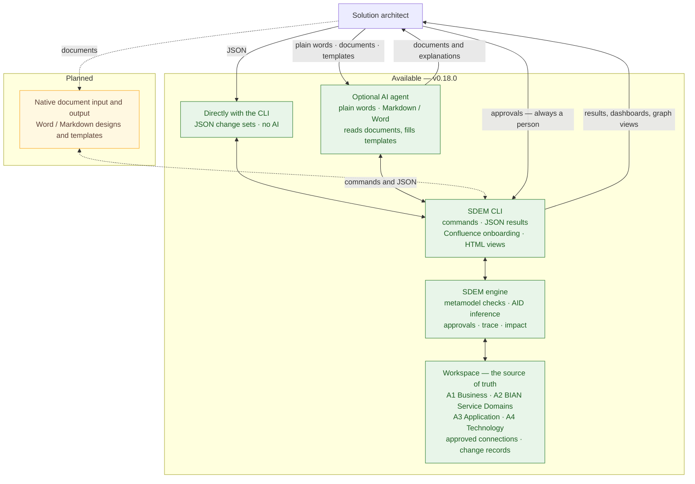

# Ways of working with SDEM — CLI, AI agent, documents

> **Status: current (v0.18.0).** What is available today, and what is planned but not built. SDEM is ready to evaluate on synthetic data; real designs follow a pilot ([what that needs](../README.md#using-sdem-on-real-designs)).

SDEM's metamodel, CLI and workspace are the same however you work. The workspace is the source of truth; every cross-layer connection needs a person's approval.

## 1. Directly with the CLI — no AI

SDEM contains no AI. The CLI creates, checks, infers, connects, traces and reports on its own.

1. Install SDEM and create a workspace (`sdem new`).
2. Write what you know as a JSON change set, using the A1–A4 types (`sdem types A1`, `sdem types change-set`).
3. Preview and apply it (`sdem change propose … --dry-run`, then without `--dry-run`); SDEM checks it against the metamodel.
4. Let AID infer the missing layers (`sdem aid`), review the candidates, confirm what you agree with and approve the connections (`sdem approve`).
5. Build the knowledge graph and use it: `sdem trace`, `sdem impact`, `sdem view`, `sdem dashboard`, `sdem home`.

**Existing designs** exported from Confluence come in without AI too: `sdem transform` turns the export into candidate records and a Markdown extraction report; you review them and `sdem load` the ones you keep ([onboarding](sdem-onboarding-workflow.md)).

The [Quick start](../README.md#quick-start) walks through steps 1–5 with every command.

## 2. With an AI agent

An agent — for example GitHub Copilot Chat in VS Code — is a natural-language front end to the same CLI. It is optional. Set-up: `sdem agents install` ([AI agent setup](sdem-agent-setup.md)).

**Design input**

1. You give the agent a new or existing design — Markdown, or Word (the agent converts it to text with its platform's tools).
2. The agent reads it against the SDEM metamodel and drafts JSON change sets — one per layer, every record citing the section it came from (`source_id: document:<file>#<section>`). The skill: `sdem-design-from-document`.
3. The agent previews and proposes them through the CLI (`--json`, `--dry-run` first); SDEM checks every change.
4. The agent can run AID and the rules engine; you review the inferred records and proposed connections.
5. **You** confirm, approve and accept — the agent prepares the exact command for you to run, never runs it for you.

Later changes work the same way: ask in plain words, the agent drafts the change set, SDEM checks it.

**Design output**

1. You give the agent a Word or Markdown template.
2. The agent queries the workspace through the CLI (`--json`) for the records, attributes and approved connections it needs.
3. The agent fills in the template and cites the command each fact came from.
4. You review the document.

Reading documents and filling in templates is done by the agent, not by SDEM; how well it works depends on the agent and how it is configured. SDEM's checks apply to whatever the agent proposes; the agent's instructions and SDEM's controls are listed in the README ([AI agents](../README.md#3--ai-agents--optional-architecture-assistants)).

## 3. Planned — not yet built

Native document input and output in the CLI, so architects and agents get the same document handling:

| Input | Output |
|---|---|
| read Word and Markdown designs (Confluence exports are already supported) | fill in Word and Markdown templates from the workspace |
| map what they describe to A1–A4 records and propose change sets | produce human-readable design documents from approved records and connections |
| report missing or ambiguous information for the architect | regenerate documents when the architecture changes |

Documents would remain an input and presentation format; the workspace stays the source of truth. These are intentions, not commitments, and have no date.

## 4. How the pieces fit

## 5. What each way supports

| Capability | CLI only | With an AI agent | Planned in the CLI |
|---|---|---|---|
| Create a workspace | yes | the agent runs the command | — |
| Design input as JSON | you write it | the agent drafts it | — |
| Confluence export input | yes (`sdem transform`, `sdem load`) | the agent runs the commands and explains the report | — |
| Word / Markdown design input | no | the agent reads the document | native input |
| Metamodel checks | yes | the agent runs the CLI | — |
| Inference (AID) and proposed connections | yes | the agent runs the CLI | — |
| Changes asked in plain words | no | the agent drafts the change set | — |
| JSON output | yes (`--json`) | the agent queries the CLI | — |
| Human-readable output | dashboards, graph views, reports | the agent writes explanations | — |
| Word / Markdown template output | no | the agent fills the template | native output |
| Approval of connections and decisions | a person | a person — the agent only prepares the command | a person |

SDEM works the same with or without AI: the metamodel, the CLI and the workspace keep the architecture consistent, traceable and governed however you interact with it.
