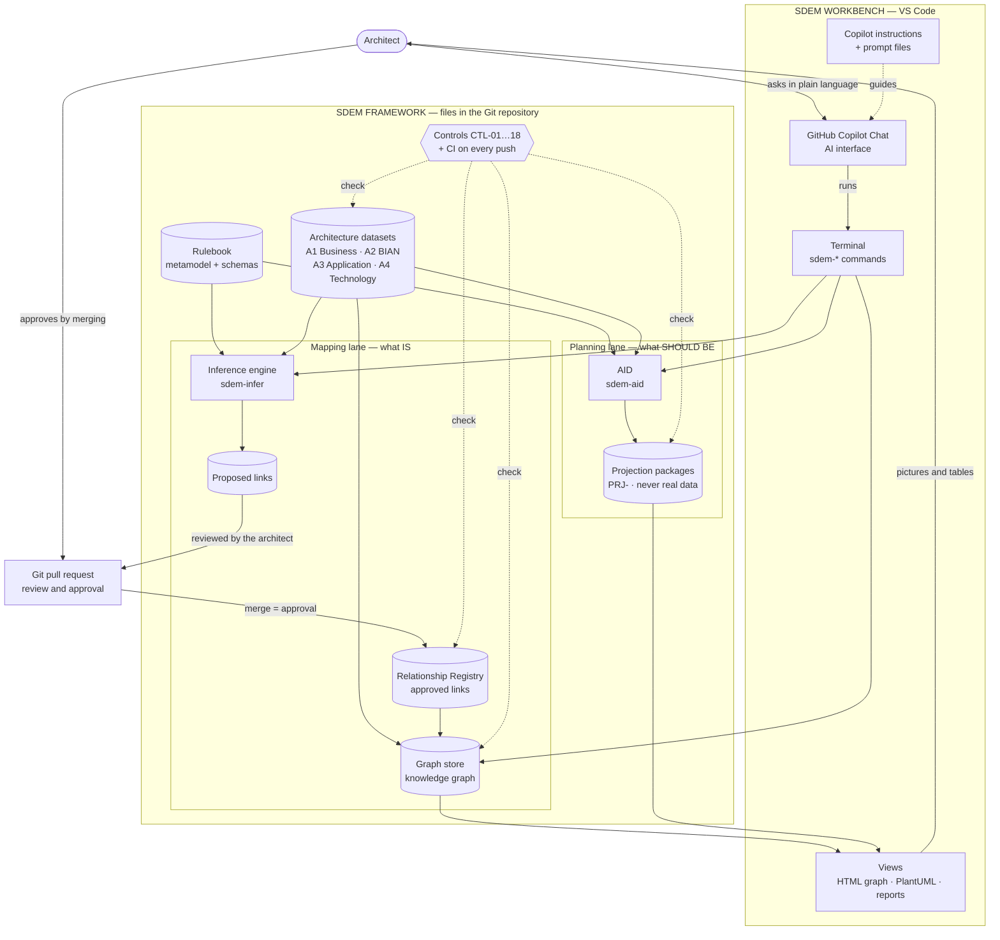
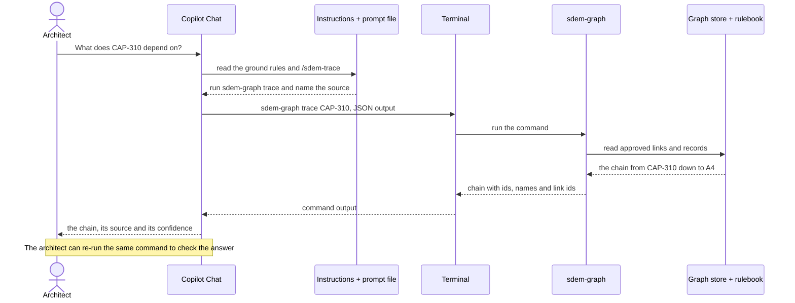
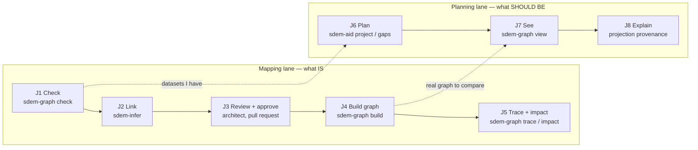
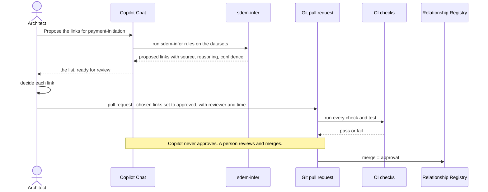
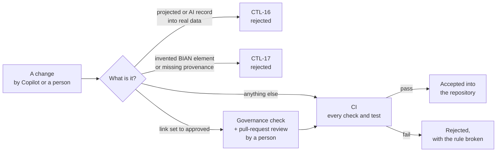
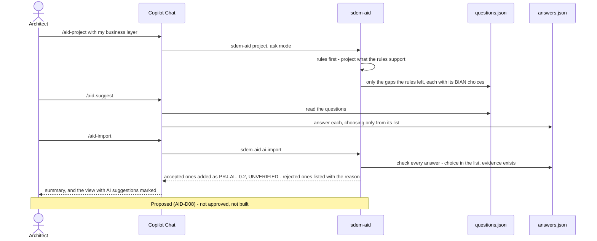

# SDEM Workbench — Design

> **Status: draft 2026-10-28.** Direction set by the owner (decision SDEM-D01: VS Code is the SDEM tool, GitHub Copilot Chat is its AI interface). Requirements: [`sdem-workbench-spec.md`](sdem-workbench-spec.md). The commands and controls exist; the Copilot set-up (instructions and prompt files) is **not built**.
>
> **Diagrams** are Mermaid: GitHub shows them as pictures; in VS Code install the recommended extension *Markdown Preview Mermaid Support* (`bierner.markdown-mermaid`, listed in `.vscode/extensions.json`) and open the Markdown preview. No diagram server is used.

## 1. What the workbench is

The **SDEM workbench** is how an architect uses SDEM day to day. It is not a new application — it is a set-up of tools architects already have:

- **VS Code** is the enterprise architecture tool: the architect opens, edits, reviews and views architecture data there.
- **GitHub Copilot Chat** is the AI interface: the architect asks in plain language; Copilot runs SDEM's commands, explains the results and drafts work.
- **SDEM's commands** (`sdem-*`) are the engine: the rules, the checks, the inference, trace, impact and gap analysis.
- **Git** is the history and the approval trail.

The AI helps; the **rules and controls decide** what is valid. Copilot can be wrong — SDEM's checks do not depend on it being right.

## 2. The layers

| Layer | What | Role | Built? |
|---|---|---|---|
| **Workbench** | VS Code | open, edit, review and view architecture data | yes (VS Code) |
| **AI interface** | GitHub Copilot Chat | answers in plain language by running SDEM commands; explains; drafts. **Never approves** | instructions and prompt files not built |
| **Engine** | `sdem-*` commands (Python) | check, link (engine), project (AID), trace, impact, gap analysis, views | built |
| **Rulebook** | `metamodel/`, `schema/` | what may exist and link, on what published basis | built |
| **Repository** | architecture datasets, Relationship Registry, graph store — JSON files in the repository | the real architecture data | built |
| **History and approval** | Git, with pull requests | who changed what and why; links are approved in reviewed changes | built (Git); approval flow to document |
| **Views** | generated HTML graph view, PlantUML diagrams, Markdown reports | pictures and tables for review — VS Code is not a drawing tool | built |
| **Controls** | CTL-01…17 (CTL-18 proposed), CI on every push | keep people and the AI honest: nothing unchecked becomes real | built |

### 2.1 How the workbench fits into the SDEM framework

The workbench (top) is how the architect reaches the framework (bottom). Copilot only reaches the framework **through the `sdem-*` commands**; the controls check everything that becomes real; approval is a person merging a reviewed pull request.



### 2.2 What the architect sees in VS Code

```
┌─ VS Code ────────────────────────────────────────────────────────────────────────────────────┐
│ EXPLORER               │ EDITOR                               │ COPILOT CHAT                 │
│ ▸ metamodel/  rulebook │ a3-application.json                  │ You: what does CAP-310       │
│ ▸ schema/              │ {                                    │      depend on?              │
│ ▾ examples/            │   "level": "A3",                     │                              │
│   ▾ card-fraud-alerts/ │   "instances": [                     │ Copilot: ran `sdem-graph     │
│     a1-business.json   │     { "id": "APP-FRAUD-ENGINE",      │ trace CAP-310` —             │
│     a2-service-…json   │       "type": "A3.Application…",     │ CAP-310 → SD-044 Fraud       │
│     a3-application.json│       ...                            │ Detection → APP-FRAUD-…      │
│     a4-technology.json │                                      │ → INF-CLOUD-K8S-PROD.        │
│     mappings.json      │                                      │ Source: sdem-graph trace,    │
│ ▸ docs/                │                                      │ FRD-001…006; approved links. │
│ ▸ .github/prompts/     │                                      │                              │
│                        ├──────────────────────────────────────┤ /sdem-check  /sdem-trace     │
│                        │ TERMINAL                             │ /aid-project /sdem-view      │
│                        │ $ sdem-graph trace CAP-310 …         │                              │
│                        │ DOWNSTREAM (depends on): …           │ [ Ask Copilot …            ] │
└────────────────────────┴──────────────────────────────────────┴──────────────────────────────┘
```

Files on the left are the real data and the rulebook; the editor shows a dataset; the terminal shows the command Copilot ran; the chat shows the answer **with its source** and the `/` commands from the prompt files. The trace shown is the real one from the `card-fraud-alerts` example.

### 2.3 How a question is answered



Copilot never answers an architecture question from memory: it runs the command, reads the output, and says where the answer came from.


## 3. How an architect works — the journeys

Each journey works by asking Copilot or by running the command directly; the result is the same.

| # | Journey | The architect says (Copilot Chat) | Copilot runs | Result |
|---|---|---|---|---|
| J1 | **Check data** | "check the payment datasets" | `sdem-graph check …` | errors and warnings, each with the rule broken |
| J2 | **Link the architectures** | "propose the links for payment-initiation" | `sdem-infer rules …` | proposed links with source, reasoning, confidence — for review |
| J3 | **Approve** | "show me the proposals to review" | reads the proposals file | the **architect** decides; the approved change goes through a pull request |
| J4 | **Build the knowledge graph** | "build the graph store" | `sdem-graph build …` | graph store and load record |
| J5 | **Trace and impact** | "what does CAP-310 depend on?" · "what breaks if this cluster is rehosted?" | `sdem-graph trace` · `sdem-graph impact` | chains with names, impact classified |
| J6 | **Plan with AID** | "I only have the business design — project the rest" | `sdem-aid project`, `check`, `gaps` | a projected design, marked and capped, kept apart from real data |
| J7 | **See it** | "show me the graph with the projection" | `sdem-graph view --projection …` | an HTML picture, projected parts dashed and labelled PROJECTED |
| J8 | **Explain** | "why was SD-CA projected?" | reads the projection package | the element's step, rule, published source, evidence, reasoning and confidence |

### 3.1 The journeys in order



### 3.2 How a link gets approved



## 4. Copilot's role and ground rules

Copilot is told these rules through `.github/copilot-instructions.md`, which Copilot reads automatically in this repository:

1. **Use SDEM's commands for facts.** Answer architecture questions from command output and files, not from memory; say which command or file each answer came from.
2. **Rules first.** The engine and AID's rules always run first; AI suggestions only fill gaps they report, and are marked, capped and labelled unverified.
3. **Never write projected or AI content into real data** — architecture datasets, the registry, the graph store. (Control CTL-16 also blocks it.)
4. **Never approve.** Copilot may prepare a review; a person approves, through a pull request.
5. **Source, reasoning, confidence** on every statement about the architecture.
6. **No MCP, no API keys**, and no data sent anywhere except through the organisation's approved Copilot.
7. **When unsure, say so** and name the command that would settle it.

## 5. How Copilot is connected — and why this way

| Mechanism | What it does | Why |
|---|---|---|
| `.github/copilot-instructions.md` | standing instructions: the ground rules, where things are, which command answers which question | read automatically; versioned with the rulebook |
| `.github/prompts/*.prompt.md` | one `/` command per journey (e.g. `/sdem-check`, `/sdem-trace`, `/aid-project`) | repeatable steps; the architect does not need to remember command options |
| VS Code terminal | Copilot runs `sdem-*` commands and reads their output (`--json` where available) | the same commands a person runs; nothing hidden |
| **Not** MCP | — | the organisation prohibits MCP on GitHub Copilot |
| **Not** an AI API in SDEM | — | no keys, no new data flows; Copilot is already approved |

SDEM must **work without Copilot**: every journey can be done by running the commands by hand. Copilot makes it easier; it is never required.

## 6. Safety — what keeps the AI honest

| Risk | Control |
|---|---|
| Copilot writes a projected or invented record into real data | CTL-16 rejects it in the dataset check, the registry validator and the store build |
| Copilot marks a link approved | the governance check requires a reviewer and approval time; approval happens only in a reviewed pull request (rule 4) |
| Copilot invents a BIAN domain | CTL-17 rejects any A2 element not in the catalogue |
| Copilot's answer sounds right but is wrong | answers must cite the command or file (rule 1); the architect can re-run it |
| A change breaks the rulebook or a generated document | CI runs every check and test on every push |
| AI suggestions taken as fact | marked `PRJ-AI-`, capped at 0.2, labelled UNVERIFIED (AID-D08, CTL-18 proposed) |



## 7. AI suggestions in AID — through Copilot

The AI suggestion layer proposed for AID (decision AID-D08, [`aid-design.md`](aid-design.md) §8) works **through Copilot**, not through an AI the SDEM code calls:

1. `sdem-aid project … --ask` runs the rules and writes `ai/questions.json` — each gap the rules could not fill, its context, the list of BIAN choices, and the exact answer format.
2. Copilot (prompt file `/aid-suggest`) answers into `ai/answers.json`.
3. `sdem-aid ai-import` checks every answer — a choice from the list, evidence that exists — and adds the accepted ones marked `PRJ-AI-`, at 0.2, labelled UNVERIFIED; CTL-18.

Both files stay in the projection package for audit. A re-import of the same answers gives the same result.



## 8. Data and privacy

- Architecture data stays in the repository and the architect's VS Code.
- The only AI is the organisation's approved Copilot; what it may see is set by the organisation's Copilot policy, not by SDEM.
- **This repository holds public and synthetic data only** — never an employer's architecture data.
- **PlantUML preview:** `.vscode/settings.json` points the PlantUML extension at the **public** server `www.plantuml.com`, which receives the diagram text. That is acceptable for this repository's synthetic data; for real architecture data use a local PlantUML (Java) or the organisation's own server.

## 9. Limits

| Limit | Consequence |
|---|---|
| VS Code is not a modelling tool | no drag-and-drop diagramming; diagrams and views are generated from the data |
| Suits architects comfortable with files, Git and chat | others need training, or the generated views and reports |
| Depends on the organisation's Copilot policy | models, data rules and features vary; SDEM must work with Copilot off |
| Copilot can make mistakes | the controls, not Copilot, decide what is valid |
| Copilot's model can be switched by the user | SDEM can record only the model the architect or Copilot states |
| Copilot is licensed per user | VS Code itself is free |

## 10. Decisions

| # | Decision | Recommendation | Status |
|---|---|---|---|
| SDEM-D01 | SDEM's tool for architects | **VS Code**, with **GitHub Copilot Chat** as the AI interface, `sdem-*` commands as the engine, Git as history and approval trail | **direction set by the owner 2026-10-28** |
| SDEM-D02 | How Copilot connects | repository instructions + prompt files + terminal commands; **no MCP, no AI API or keys in SDEM** | recommended — follows the organisation's policy |
| SDEM-D03 | Where approval happens | in a reviewed **pull request** that changes the registry; Copilot never approves | recommended |
| SDEM-D04 | Diagrams | generated from the data (HTML view, PlantUML); never hand-drawn as the source of truth | recommended — as built |
| SDEM-D05 | Copilot optional | every journey works by running the commands by hand | recommended |
| SDEM-D06 | PlantUML for real data | local or the organisation's own server, never the public one | recommended |

## 11. Open questions

| ID | Question | Recommendation |
|---|---|---|
| WB-Q01 | Package the set-up as a VS Code extension later? | Not now — instructions and prompt files need no code and no install; revisit if architects need buttons and panels |
| WB-Q02 | Should the HTML view open inside VS Code? | Yes, as a later step (a simple preview); a browser works today |
| WB-Q03 | Who reviews the Copilot instructions when the rulebook changes? | The rulebook owner; CI checks the instructions name only commands that exist |
