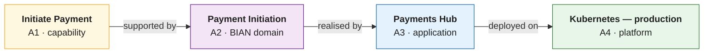
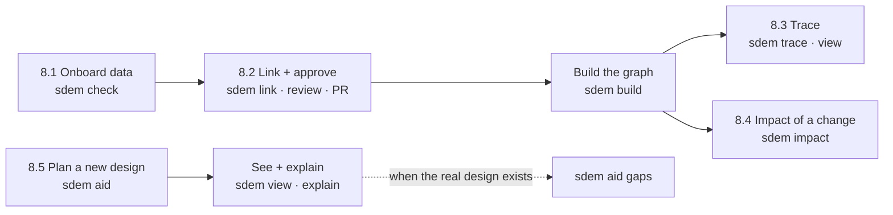

# SDEM Workbench — User Guide

> **Status: current guide (v0.18.0) — the one full command reference is §7.**

> For architects who are new to SDEM. No prior knowledge assumed. Every command and output in this guide was run on the examples in this project (2026-10-28).
>
> Related: [read this first](sdem-overview.md) (what SDEM is) · [glossary](glossary.md) (every term) · [configuration](sdem-configuration.md) and [administration](sdem-administration.md) (setting SDEM up for a team).

**Contents:** [1 What SDEM is](#1-what-sdem-is--in-two-minutes) · [2 Key words](#2-key-words) · [3 Set up](#3-set-up--once) · [4 The workbench screen](#4-the-workbench-screen) · [5 Quick start](#5-quick-start--15-minutes) · [6 Your architecture data](#6-your-architecture-data) · [7 Command reference](#7-command-reference) · [8 Workflow examples](#8-workflow-examples) · [9 Working with Copilot](#9-working-with-copilot) · [10 Rules you must know](#10-rules-you-must-know) · [11 Troubleshooting](#11-troubleshooting) · [12 Questions people ask](#12-questions-people-ask) · [13 Where to go next](#13-where-to-go-next)

---

## 1. What SDEM is — in two minutes

Every organisation describes its architecture in four separate places, usually kept by different teams in different tools:

| | Architecture | Describes | Example |
|---|---|---|---|
| **A1** | Business | capabilities, value streams, processes | *Initiate Payment*, *Capture and validate payment instruction* |
| **A2** | Service Domain (BIAN) | the BIAN service domains and their operations — the banking industry's standard building blocks | *Payment Initiation*, *Initiate Payment Instruction* |
| **A3** | Application | applications, components, APIs, data | *Payments Hub*, `POST /payment-instructions` |
| **A4** | Technology | platforms, clusters, deployments | *Managed Kubernetes — payments (production)* |

The hard questions cross all four: *Which applications support this capability? What breaks if we move this cluster? What would a new business design need underneath?* Nobody can answer them if the four architectures are not **linked**.

**SDEM — the Service Domain Enterprise Metamodel — links them**, with BIAN in the middle as the common language:

```
 A1 Business ──uses / supported by──► A2 BIAN service domains ──realised / implemented by──► A3 Applications ──deployed on / as──► A4 Technology
```

SDEM gives you:

- a **metamodel** — what may exist in each architecture and how things may be linked, each rule with its published source;
- **checks** — your data is tested against the metamodel before it is trusted;
- an **inference engine** — proposes the links between the architectures, each with its reasoning and confidence, for **you** to approve;
- a **knowledge graph** — the checked data and approved links, which you can **trace** end to end and use for **impact analysis**;
- **AID (Architecture Inference Design)** — a planning tool that projects the architecture layers you don't have yet, from the ones you do.

You run all of it from **VS Code**: commands in the terminal, and GitHub Copilot in the chat window to help.

## 2. Key words

| Word | Means |
|---|---|
| **Architecture dataset** | one file holding one architecture (A1, A2, A3 or A4) — its records and the links inside it |
| **Record** | one thing in an architecture: a capability, a service domain, an application, a cluster … each with an `id`, `type`, `name` |
| **Link** (relationship) | a connection between records of **different** architectures, e.g. *service domain Payment Initiation* is **REALIZED_BY** *application Payments Hub* |
| **Registry** (`mappings.json`) | the file of links, each with a status: `proposed` (suggested) or `approved` (a person accepted it) |
| **Metamodel** | the rules: which record types exist, which links are allowed, what evidence a link needs |
| **Inference engine** | proposes links by applying the metamodel to your data; never approves |
| **Graph store** | a folder holding the checked datasets and approved links as a knowledge graph — what trace, impact and the view read |
| **Trace** | follow the links from a record down (to technology) or up (to business) |
| **Impact** | which records a change (replace, rehost, retire …) affects, and how |
| **AID / projection** | Architecture Inference Design: a **projected** (planned, not real) design for the layers you don't have; ids start `PRJ-` |
| **Confidence** | how sure a proposal or projection is: 0.4 low, 0.6 medium, 0.8 high |
| **CLI** | the command line — typing `sdem …` commands in VS Code's terminal |

## 3. Set up — once

You need four things. Your IT team may install some of them for you.

| Tool | Why | Get it |
|---|---|---|
| **VS Code** | the workbench | code.visualstudio.com |
| **Python 3.10 or later** (3.13 recommended) | SDEM runs on it | Macs come with 3.9, which is too old: `brew install python@3.13` or the installer from python.org |
| **Git** | history, review and approval | git-scm.com (often already installed) |
| **An AI agent** (optional) — GitHub Copilot, Claude Code, Codex or Gemini CLI | AI help that runs `sdem` for you | step by step in [`sdem-agent-setup.md`](sdem-agent-setup.md) |

Then:

1. **Get the SDEM project** (the tool and the made-up examples — public):
   ```bash
   git clone https://github.com/taumoeps/bian-sdem-framework.git && cd bian-sdem-framework
   ```
   Your organisation's **real** data is in its private workspace repository, set up from [`templates/workspace-repo`](../templates/workspace-repo/README.md) — its README installs SDEM the same way, pinned to a release.
2. **Open it in VS Code:** *File → Open Folder…* → choose the `bian-sdem-framework` folder. When VS Code offers to install the **recommended extensions** (Python, GitHub Copilot Chat, Markdown Preview Mermaid Support), accept.
3. **Open the terminal pane:** *View → Terminal* (shortcut **Ctrl+`**).
4. **Find your Python 3.10 or later.** `python3 --version` — if it says 3.10 or later, use `python3` below. If it says 3.9, or `python3.13` gives *command not found* after you installed it, it is in Homebrew's folder:
   ```bash
   for d in /opt/homebrew/bin /usr/local/bin; do ls "$d" 2>/dev/null | grep "^python3\.1[0-9]*$" | sed "s|^|$d/|"; done
   ```
5. **Install SDEM** into a private Python environment for this project:
   ```bash
   python3.13 -m venv .venv           # or the full path you found, e.g. /opt/homebrew/bin/python3.13 -m venv .venv
   source .venv/bin/activate          # Windows: .venv\Scripts\activate
   pip install -e .
   ```
   If `pip` says *File "setup.py" … not found* or *requires a different Python*, the `.venv` was made with an old Python: `rm -rf .venv` and make it again with 3.13.
6. **Check it works:**
   ```bash
   sdem --help
   ```
   You should see the list of commands, starting with `check J1 check architecture datasets and registry against the metamodel`.

Each time you open a new terminal later, run the `activate` line from step 5 again. If you cannot install anything, every command also works as `python3 -m sdem …` from the project folder.

## 4. The workbench screen

```
┌─ VS Code — SDEM project ─────────────────────────────────────────────────────────────────────┐
│ EXPLORER               │ EDITOR                               │ COPILOT CHAT                 │
│ the project's files:   │ the file you opened, e.g. a dataset  │ ask for help in plain words  │
│ ▸ docs/      guides    │                                      │                              │
│ ▸ examples/  workspaces   │                                      │ "explain this output"        │
│ ▸ metamodel/ metamodel  │                                      │ "which command shows …?"     │
│ ▸ schema/              ├──────────────────────────────────────┤ "draft the impact note"     │
│ ▸ sdem/      the code  │ TERMINAL — where you run sdem        │                              │
│                        │ $ sdem check …                       │                              │
│                        │ OK: level A1 …                       │ [ Ask Copilot …            ] │
└────────────────────────┴──────────────────────────────────────┴──────────────────────────────┘
```

| Part | Open it | Use it for |
|---|---|---|
| **Explorer** | the file icon on the left | find and open files |
| **Editor** | click a file | read and edit datasets and the registry |
| **Terminal** | *View → Terminal* (**Ctrl+`**) | **run SDEM** — every `sdem` command |
| **Copilot Chat** | the chat icon, or **Ctrl+Alt+I** (Mac **⌃⌘I**) | **help** — explanations, the right command, drafts |
| **Source Control** | the branch icon on the left | see your changes, commit, open a pull request |

**The one idea to remember:** you run SDEM in the **terminal**; Copilot **helps** in the chat. Copilot never approves anything and never changes real data on its own.

## 4a. Explore your architecture — Home, dashboard and graph

Three generated pages let you explore an architecture without reading JSON. They open in any browser, offline, from the file — no server.

| Command | Page | For |
|---|---|---|
| `sdem home` | **SDEM Home** — `work/sdem/index.html` | SDEM itself (its architecture, metamodel, health) and every workspace, each with **Open Workbench**, **Open Workspace Dashboard** and **Open Architecture Graph** |
| `sdem workbench` | **Workbench** — one page per workspace (also written by `sdem home`) | the Solution Workspace — designs as documents, a table per type and ArchiMate diagrams; the datasets and their exact JSON; the knowledge graph; trace and impact; reviews and changes; documents and evidence — and the SDEM Framework: metamodel, schemas and configuration, relationship rules, engine health ([spec](design/sdem-workbench-ux-spec.md)) |
| `sdem diagram` | **ArchiMate diagrams** — SVG, HTML or JSON | the same views for every workspace from SDEM's templates: capabilities and value stream, business process, BIAN service domains, application cooperation, technology and deployment, layered (`--list`); `--focus <id>` for one element; only stored, approved links drawn and gaps said ([spec](design/sdem-diagram-spec.md)) |
| `sdem document` | **A design document** — Markdown or HTML per layer | one layer's design in reading order: every record with where it came from, its links and approved connections, the layer's requirements and its gaps |
| `sdem dashboard` | **Workspace Dashboard** — `<workspace>/dashboard.html` | one workspace: what needs attention, review, trace and impact, matrices, changes, controls |
| `sdem view` | **Architecture Graph** — `<workspace>/graph/view.html` | the workspace's knowledge graph: A1–A4 records and their links, filter, trace up and down |

**The quickest way in** — one command creates the synthetic Payments workspace, builds its graph and writes all three pages:

```bash
sdem new --workspace workspaces/payments --person <you> --example payment-initiation --explore
open work/sdem/index.html        # Linux: xdg-open · Windows: start
```

**Navigation:** Home → *Open Workspace Dashboard* → *Architecture Graph →* (header and Overview) → *← Workspace Dashboard* / *SDEM Home* (graph header) → *← SDEM home* (dashboard header). The links are relative, so the folder can be moved or zipped.

### Step by step — the bundled Payments example (macOS, Linux; Windows the same commands)

```bash
sdem --version                                                                          # 1. the installed version
sdem new --workspace workspaces/payments --person <you> --example payment-initiation    # 2. a synthetic Payments workspace
sdem check --workspace workspaces/payments                                              # 3. validate it
sdem build --workspace workspaces/payments --out workspaces/payments/graph               # 4. build its knowledge graph
sdem view --graph workspaces/payments/graph                                             # 5. the Architecture Graph page
sdem dashboard --workspace workspaces/payments                                          # 6. the Workspace Dashboard page
sdem home --root workspaces -o work/sdem                                                # 7. SDEM Home, with every workspace's dashboard and graph
open work/sdem/index.html                                                               #    (Linux: xdg-open; Windows: start)
```

8. **Navigate, and inspect Payments Hub:** in Home's *Workspaces* tab, *Open Workspace Dashboard* for **payments**; in its header, *Architecture Graph →*. In the graph, click **Payments Hub** (A3): its type, version, attributes (vendor, hosting model, recovery objectives …) and every link in and out. *← Workspace Dashboard* and *SDEM Home* take you back. The same at the terminal:
   ```bash
   sdem query --graph workspaces/payments/graph --type A3.ApplicationComponent --where "name=Payments Hub" --json
   sdem query --graph workspaces/payments/graph --neighbours APP-PAY-HUB
   ```
9. **Trace a capability down to technology** — in the graph, click *Initiate Payment* (A1) and choose *Trace: down*: the chain to the technology lights up. The same at the terminal:
   ```bash
   sdem trace CAP-PAY-010 --direction down --graph workspaces/payments/graph
   ```
   *Initiate Payment* → **SUPPORTED_BY** *Payment Initiation* (BIAN) → **REALIZED_BY** *Payments Hub* → **DEPLOYED_ON** *Managed Kubernetes — payments (production)*, each step with the approved link it rests on.
10. **An impact analysis** — what rehosting the production cluster affects:
    ```bash
    sdem impact INF-K8S-PAY-PROD --change rehost --graph workspaces/payments/graph
    ```
    *Payments Hub* and *Execution Gateway* need a design change; the BIAN domain and the business records above do not — and the coverage section says what the engine could and could not see. The dashboard's *Trace & impact* tab shows the same.
11. **A proposed connection versus an approved one.** Every connection in the example is already **approved** — a person approved it, with evidence; the graph draws only approved connections. To see a **proposal**, add one synthetic application through a change set (the governed way to change the workspace) and let the rules engine propose its connection:
    ```bash
    cat > new-app.json <<'EOF'
    {"layer": "A3", "reason": "a new notifications service (synthetic)", "changes": [{"op": "add", "record": {"id": "APP-PAY-NOTIFY", "type": "A3.ApplicationComponent", "version": "1.0", "name": "Payment Notifications", "lifecycle_status": "planned", "attributes": {"deployed_on": ["INF-K8S-PAY-PROD"]}}}]}
    EOF
    sdem change propose new-app.json --workspace workspaces/payments --agent architect --person <you>
    sdem link --workspace workspaces/payments --out workspaces/payments/links
    sdem dashboard --workspace workspaces/payments
    ```
    `sdem link` proposes *Payment Notifications* **DEPLOYED_ON** *Managed Kubernetes — payments (production)* (rule S33, confidence 0.8 — how strongly the data suggests it, not proof it is right). It appears in the dashboard's **Review** tab, not in the graph or the matrices: a proposal is not architecture until a person approves it, with the evidence its type needs — `sdem approve P-RUN-001 --proposals workspaces/payments/links/proposals.json --workspace workspaces/payments --reviewer <you> --evidence deployment_design:<document>`.
12. **Keep the views current.** The pages are snapshots. After any change to the workspace — like step 11 — the graph is out of date, and the dashboard says so, with the command. Regenerate in this order:
    ```bash
    sdem build --workspace workspaces/payments --out workspaces/payments/graph
    sdem view --graph workspaces/payments/graph
    sdem dashboard --workspace workspaces/payments
    sdem home --root workspaces -o work/sdem
    ```

Steps 5–6 write the pages inside the workspace; step 7 writes Home with its own copies of each workspace's dashboard and graph under `work/sdem/` — use Home to move between workspaces, the workspace's own pages for one workspace. `work/` is never committed.

### The dashboard's tabs

What kind of information each tab shows matters: **approved** architecture (records and links a person approved), **proposed** links (the rules engine's suggestions — not architecture until approved), **inferred** records (added by AID, marked, until a person confirms them), and **analysis** (calculated from the approved data).

| Tab | What you see | Why it matters | Payments example | Kind |
|---|---|---|---|---|
| **Overview** | what needs attention; each layer's records, errors and advice; how much of each is linked to the next layer; records not linked yet; the **Architecture graph** — link or state | the health of the workspace at a glance | A1 16 records, A2 24, A3 16, A4 12; 18 approved links; "nothing needs your attention" | approved + analysis |
| **Review** | the links the rules engine proposes, weakest first — rule, reasoning, the evidence needed, the `sdem approve` command | nothing becomes architecture until a person approves it, with evidence | none — every link in the example is already approved; add a record (e.g. a new application with `deployed_on`) and it appears here | **proposed** |
| **Trace & impact** | type a record: what it depends on, what depends on it, and what a change (modify, rehost, replace, retire) affects | answers "what breaks if…" from approved links | *Initiate Payment* down to the Kubernetes cluster; rehosting the cluster needs a design change in *Payments Hub* | analysis of approved |
| **Matrices** | capability → service domain → application → technology, each cell naming the approved link it rests on | the cross-layer picture in one table | *Initiate Payment* → *Payment Initiation* → *Payments Hub* → the production cluster | approved |
| **Changes & work** | change events with their calculated impact, work items, change sets, hand edits waiting to be adopted | how the architecture changes, and who works on what | empty in the fresh example; a change set (`sdem change propose`) adds an event here | recorded changes + analysis |
| **Designs & gaps** | for designs onboarded from Confluence: what each became, and what did not fit an entity — kept, not lost | nothing from past designs is silently dropped | none — the example was not onboarded from designs | imported + analysis |
| **AID plans** | with `--projection <folder>`: an AID projected design beside the real one | a plan for the missing layers, kept apart from real data | none until you run `sdem aid project` and pass its folder | **inferred** (a plan) |
| **Controls** | every control (CTL-…) that enforces the metamodel, when last tested, and the known gaps | what SDEM guarantees, and what it does not | 23 controls, 2 known gaps | SDEM itself |

### Snapshots — what the pages are and are not

- SDEM Home, the dashboard and the graph are **generated HTML files** — read-only snapshots, not editing screens. Every change goes through the `sdem` commands and their controls; the pages show the command to copy.
- Each page shows **when it was generated**; the graph shows the **build** it was drawn from.
- A page opened later **cannot see changes made since** — it was written then. After a change, regenerate: `sdem build …`, then `sdem view …`, `sdem dashboard …`, `sdem home …`.
- **A graph is linked only when it is current.** Otherwise the page says which state it is in, and gives the command:

| State | Meaning | Command shown |
|---|---|---|
| not built | no graph for this workspace yet | `sdem build --workspace … --out …/graph` |
| out of date | the workspace changed since the graph was built (a changed or new file) | `sdem build …`, then `sdem view …` |
| viewer not generated / out of date | the graph is current but its page was not (re)generated | `sdem view --graph …` |
| cannot be built yet | the workspace needs migrating to this SDEM's metamodel, or fails its checks | `sdem migrate … --dry-run` or `sdem check …` |

Design: [`sdem-dashboard-design.md`](design/sdem-dashboard-design.md).

## 4b. Architect tasks — what you can do, by goal

The same list is SDEM Home's *Architect tasks* tab. **Effect** says what each does to your architecture — *reads only*, *writes generated outputs only*, *proposes* (suggestions or marked records a person decides on), *changes the architecture* (a checked, recorded change set), or *a person's recorded decision*. Replace `<ws>` with your workspace folder and `<you>` with your name.

**Explore** — Understand the existing architecture

| Task | Command | Needs | Gives | Inspect it | Effect | Approval |
|---|---|---|---|---|---|---|
| See SDEM and every workspace | `sdem home --root workspaces -o work/sdem` | workspaces | SDEM Home | open work/sdem/index.html | writes generated outputs only | no |
| Examine one workspace | `sdem dashboard --workspace <ws>` | a workspace | its dashboard | open <ws>/dashboard.html | writes generated outputs only | no |
| See the architecture graph | `sdem build --workspace <ws> --out <ws>/graph · sdem view --graph <ws>/graph` | a workspace | the knowledge graph and its page | open <ws>/graph/view.html | writes generated outputs only | no |
| Look a record up | `sdem query --graph <ws>/graph --neighbours <id>` | a graph | the record and its links | the terminal, or --json | reads only | no |

**Design** — Create or update architecture

| Task | Command | Needs | Gives | Inspect it | Effect | Approval |
|---|---|---|---|---|---|---|
| Start a workspace | `sdem new --workspace <ws> --person <you> [--example payment-initiation --explore]` | a name | a workspace (empty, or the synthetic example) | sdem check --workspace <ws> | changes the architecture (checked, recorded) | no — your decision to start it |
| Write or change records | `sdem change propose <change-set.json> --workspace <ws> --agent architect --person <you> (fields: sdem types)` | a change set | records added, updated or retired; a change event with its impact | sdem change show <CS-id> | changes the architecture (checked, recorded) | no — checked; review in the pull request |
| Bring in existing designs | `sdem transform run <export> -o <dir> · sdem load <dir> --workspace <ws> --person <you>` | a Confluence export | records from past designs | the dashboard, Designs & gaps | changes the architecture (checked, recorded) | yes — you choose what to load |
| Fill the gaps with AID | `sdem aid --workspace <ws> --person <you>` | part of a design (e.g. A1 with BIAN operations) | inferred records, marked, and proposed connections | the dashboard; sdem aid confirm &#124; reject | proposes — a person decides | yes — confirm or reject each |
| Create a new design with your agent | `/sdem-new-design <what> (Copilot) — or the guide "Create a new design"` | a request | a checked A1 design, requirements, inferred A2–A4 and a review list | the review list | proposes — a person decides | yes — every decision is yours |

**Connect** — Establish relationships between layers

| Task | Command | Needs | Gives | Inspect it | Effect | Approval |
|---|---|---|---|---|---|---|
| Get proposed connections | `sdem link --workspace <ws> --out <ws>/links` | a workspace | proposed links, weakest first, with reasons | sdem review <ws>/links/proposals.json; the dashboard, Review | proposes — a person decides | yes — nothing is architecture until approved |
| Approve a connection | `sdem approve <id> --proposals <file> --workspace <ws> --reviewer <you> --evidence <kind:ref>` | a proposal and its evidence | an approved link in the registry | the dashboard, Matrices; sdem trace | a person's recorded decision | it is the approval |
| State a connection yourself | `sdem connect <source> <RELATIONSHIP> <target> --workspace <ws> --reviewer <you> --evidence <kind:ref> --rationale "…"` | two records and evidence | an approved link | sdem trace | a person's recorded decision | it is the approval |

**Analyse** — Understand dependencies and the effect of change

| Task | Command | Needs | Gives | Inspect it | Effect | Approval |
|---|---|---|---|---|---|---|
| Trace dependencies | `sdem trace <id or A1…A4> --direction down&#124;up --graph <ws>/graph` | a record or a layer | what it depends on / what depends on it, link by link | the terminal; the dashboard, Trace & impact | reads only | no |
| Assess a change | `sdem impact <id> --change modify&#124;rehost&#124;replace&#124;retire --graph <ws>/graph` | a record and a change | what the change affects, layer by layer, and what the engine could not see | the terminal; the dashboard, Trace & impact | reads only | no |
| The cross-layer matrix | `sdem matrix --graph <ws>/graph` | a graph | capability → domain → application → technology | the dashboard, Matrices | reads only | no |
| Requirements against a change | `sdem requirements evaluate --workspace <ws> --record <id> --change <kind> --proposed <id>` | requirements and a change | breaches now and after, risks, missing evidence | the terminal, or --json | reads only | no |

**Govern** — Keep the architecture correct and accountable

| Task | Command | Needs | Gives | Inspect it | Effect | Approval |
|---|---|---|---|---|---|---|
| Validate | `sdem check --workspace <ws>` | a workspace | errors and advice against the metamodel | the terminal; the dashboard, Overview | reads only | no |
| Validate a change across the layers | `sdem events validate <CE-id> --workspace <ws> … then each layer assesses` | a change event | each layer's assessment | sdem events show <CE-id> | proposes — a person decides | yes — a person accepts and authorises |
| Accept a change | `sdem events accept <CE-id> --workspace <ws> --person <you> --reason "…"` | a validated change | a recorded decision | sdem governance verify | a person's recorded decision | it is the decision |
| Verify decisions | `sdem governance verify --workspace <ws>` | decisions and signed commits | which decisions are verified | the terminal | reads only | no |

**Operate** — Configure and maintain SDEM

| Task | Command | Needs | Gives | Inspect it | Effect | Approval |
|---|---|---|---|---|---|---|
| Your organisation's specification | `sdem profile check &#124; show --workspace <ws>` | sdem-profile.json | your types, rules, layers on SDEM's | sdem types <layer> --workspace <ws> | reads only | no — adopting one is: sdem profile adopt |
| Before upgrading SDEM | `sdem upgrade check (the new version, side by side)` | your repository | migrations, profile, deprecations, steps | the terminal | reads only | no |
| Migrate a workspace | `sdem migrate --workspace <ws> --person <you> --dry-run, then without` | a workspace on an older metamodel | the workspace on this metamodel, recorded | migrations/MIG-nnn.json | changes the architecture (checked, recorded) | your decision to run it |
| Set up your AI agents | `sdem agents install` | your repository | instructions and skills for your agents | AGENTS.md | writes generated outputs only | no |

## 4c. From your designs to the knowledge graph — the commands

What the `sdem` command does, the steps from your designs to the knowledge graph, and how to choose BIAN service domains (moved here from the README in v0.18.0).

**What the `sdem` command does.** It is SDEM's engine and the only way the architecture is created, checked, connected, analysed and governed — 102 commands and subcommands, by goal:

| Goal | What it does | Main commands |
|---|---|---|
| **Set up** | create a workspace (empty, from an example or from another workspace); install the AI-agent files | `new`, `agents install` |
| **Design** | see what you may write; search BIAN; change the architecture with checked change sets; import designs from Confluence; infer the missing layers | `types`, `bian search`, `change propose` / `revert`, `transform` + `load`, `aid` |
| **Validate** | check records and links against the metamodel and your profile; check approved links' evidence | `check`, `validate`, `profile check` |
| **Connect** | propose cross-layer links by rules; review them; a person approves or rejects | `link`, `review`, `approve`, `connect`, `aid confirm` / `reject` |
| **Build and explore** | build the knowledge graph; generate the HTML pages | `build`, `view`, `dashboard`, `home` |
| **Analyse** | dependencies up and down; change impact (modify, rehost, replace, retire); queries; layer-to-layer matrices; requirements at risk; what changed | `trace`, `impact`, `query`, `matrix`, `requirements evaluate`, `diff` |
| **Govern** | requirements and measurements; change events and impact validation; work plans; verify signed decisions | `requirements`, `events`, `work plan`, `governance verify` |
| **Operate** | upgrade safely; migrate workspaces; release notes; organisation profiles | `upgrade check`, `migrate`, `releases`, `profile` |
| **Help** | every command, machine-readable; plain-language explanations | `commands --json`, `explain`, `--help` on every command |

Across all of them: `--json` output for scripts and agents; `--dry-run` before anything that writes; every change recorded (who, what, why); only a person approves; local only — no network, Python's standard library only. The full list: `sdem commands`; each command's `--help` has a worked example; the same commands by task are in [the user guide §4b](#4b-architect-tasks--what-you-can-do-by-goal).

**How the commands work together.** The same parts as the data architecture above, with each command on the step where it acts. Purple: a person decides.

```mermaid
flowchart LR
    IN["📄 <b>Your designs</b><br/>existing or new"]
    D["🗂️ <b>Workspace data</b><br/>A1 · A2 · A3 · A4 entities"]
    P["💡 <b>Proposed connections</b><br/>with reasons"]
    C["🔗 <b>Approved connections</b><br/><i>mappings.json</i>"]
    K["🕸️ <b>Knowledge graph</b><br/>four layer graphs +<br/>the federated graph"]
    A["📊 <b>Answers</b>"]
    PL["🧭 <b>Inferred records</b><br/>in the layers, marked —<br/>you confirm or reject"]
    MM["📘 <b>Metamodel</b><br/>what may exist and connect"]
    IN -->|"sdem new, then<br/>sdem transform · sdem load"| D
    IN -.->|"new design:<br/>sdem aid — fills the gaps,<br/>marked inferred"| PL
    PL -->|"sdem aid confirm"| D
    D -->|"sdem link"| P
    P -->|"👤 sdem approve<br/>(or sdem connect)"| C
    D -->|"sdem build"| K
    C -->|"sdem build"| K
    K -->|"sdem trace · impact<br/>matrix · dashboard"| A
    D -.->|"sdem check"| MM
    C -.->|"sdem check"| MM
    classDef r fill:#FFF8E1,stroke:#F9A825,color:#3E2723
    classDef d fill:#E8F5E9,stroke:#2E7D32,color:#1B5E20
    classDef g fill:#E3F2FD,stroke:#1565C0,color:#0D47A1
    classDef p fill:#F3E5F5,stroke:#6A1B9A,color:#4A148C
    classDef o fill:#ECEFF1,stroke:#455A64,color:#263238
    class MM r
    class D,C d
    class K,A g
    class P p
    class IN,PL o
```



The steps in order, from your designs to the knowledge graph:

| # | Step | Command | What happens | Who |
|---|---|---|---|---|
| 1 | **Start the workspace** | `sdem new --workspace <workspace> --person <you>` (in an organisation: add `--organisation <name>`) | creates the workspace: the four layers, empty, and an empty set of connections; BIAN's service domains stay in the catalogue until your design needs them; checked, recorded | **you** |
| 2 | *Existing design:* look at it | `sdem transform inspect <export>` | shows what is in the export and what SDEM can read; changes nothing | SDEM |
| 3 | *Existing design:* read it | `sdem transform run <export> -o work/history` | turns pages, tables and diagrams into *suggested* items, with a report of where each came from | SDEM |
| 4 | *Existing design:* keep the good ones | `sdem load work/history --workspace <workspace> --person <you>` | copies the items you accept into the workspace — you are recorded as the person who decided; what does not fit is kept as a gap record | **you** |
| — | **Fill the gaps** — after loading an existing design, or for a new one instead of steps 2–4 | `sdem aid --workspace <workspace> --person <you>` | from whatever the workspace has (any of A1…A4), adds what it is missing into its layer files — **the BIAN service domains your design points to**, and for a new design the applications and deployments — each marked *inferred*, with source, reasoning and confidence, and proposes the connections; you then `sdem aid confirm` or `sdem aid reject` each record | SDEM, then **you** |
| *optional* | Add a BIAN service domain | `sdem bian custom --workspace <workspace> --add "<service domain>" … --person <you>` — or keep one shared catalogue for every workspace: `sdem bian import --base --all -o bian/a2-service-domain.json` | `sdem aid` brings in the domains your design needs; add one it did not pick, or let the SDEM lead keep a shared catalogue — [choosing your BIAN service domains](#choosing-your-bian-service-domains) | **you**, or the SDEM lead for the catalogue |
| 5 | Check | `sdem check --workspace <workspace>` | every file against the metamodel; errors must be fixed, warnings are advice — also run by CI on every change | SDEM |
| 6 | Propose and review connections | `sdem link --workspace <workspace> --out work/links` | proposes connections between layers and shows them straight away, weakest first, each with its reasons — you judge which are true (`sdem review <file>` shows any proposals file again, such as AID's) | SDEM, then **you** |
| 7 | Approve | `sdem approve <id> --reviewer <you> --evidence <document>` — or `sdem connect` for one SDEM missed | writes the approved connection to `mappings.json`, with you, the date and the evidence; final when its pull request is merged | **you** |
| 8 | Build | `sdem build --workspace <workspace> --out work/graph` | makes the four layer graphs and the federated graph from the data and the approved connections | SDEM |

#### Choosing your BIAN service domains

**Nobody needs to know which to pick.** All 258 service domains of BIAN 14.0.0 are the **catalogue** — your organisation's shared BIAN layer, or the base BIAN that ships with SDEM — and the catalogue is read, never copied. A workspace holds **only the domains its design needs**: `sdem aid` brings them in from what you wrote, each marked *inferred* with the reason, for you to confirm or reject. To choose by hand instead:

| Option | Gives the workspace | When |
|---|---|---|
| *(nothing — `sdem aid` chooses)* | the domains your design points to | **the simplest start**, especially if you are new to service domains |
| `sdem bian custom --workspace <workspace> --add "Payment Order Initiation" … --person <you>` | these domains, beside what it holds | AID did not pick one you need — find names with `sdem bian list --base \| grep -i payment` |
| `sdem bian custom --workspace <workspace> --only … --person <you>` (or `--from my-domains.txt`) | exactly these domains | you know the area's list — kept in your repository and reviewed like code |

Every change is checked and recorded, and refuses to remove a domain an approved connection uses. When the SDEM lead updates the shared catalogue (`sdem bian update --root workspaces`), each workspace refreshes only the domains it holds.

**240 come with full values; 18 are marked *not known yet*.** The metamodel gives every service domain an *asset type* and a *functional pattern*. BIAN's public files do not state them; SDEM works them out from the control record's name, following BIAN's own naming rule, for 192 domains. For 48 more, SDEM's **inference record** supplies values a person has accepted. The other 18 have no accepted value yet. SDEM does not guess: those 66 are imported marked `classification: unknown`, can still be connected through their operations, and `sdem check` advises on each until the values are given. The inference record ([BIAN inferences](reference/bian-inferences.md)) holds each inferred value with its source, reasoning and confidence, a status and a history; the import applies an entry once a person has **accepted** it (`sdem bian inference accept <id> --person <you>`), and the domain records `classification: inferred` and the entry's id. Anyone can challenge or change an entry later, with a reason, and every change is kept. Or give values yourself: the import writes a template (`…needs-patterns.csv`) to fill in and use with `--patterns <template>`. A full BIAN layer does not flood you with proposals: on the example workspace, `sdem link` took about eight seconds and proposed 13 connections with all 258 domains loaded.

Then ask the graph: `sdem trace` (*what does this depend on?* — for one record, or a whole layer: `sdem trace A4 --direction up` shows which technology supports nothing above it), `sdem impact` (*what breaks if it goes?*), `sdem matrix`, `sdem view`, `sdem dashboard`. Every command, with examples: the [user guide](#7-command-reference).

**Follow one capability down to the technology** — every arrow an approved connection, with who approved it and the document that proves it:



**Ask "what if?"** — *retire the production Kubernetes platform* — and SDEM follows the connections: two applications need a design change; one BIAN domain, one capability and two processes need a review. An architect confirms before anything changes.

**People stay in charge.** SDEM checks, proposes and works out impact; a person approves each connection, loads onboarded designs and merges each change after review. SDEM records every such decision with attribution and provenance, and refuses an approval with no evidence or with an agent's name — but a typed name (`--person`) is attribution, not authentication. Verified human authority needs independently protected signing credentials, authorised signers and repository controls ([governance](design/sdem-governance.md)).

### How an architect uses it, in six steps

Six steps, the same for every area. Each links to where it is written in full.

1. **Install and practise.** [Install](../README.md#quick-start) SDEM, then do the user guide's [15-minute quick start](#5-quick-start--15-minutes) on the made-up example: check the data, build the knowledge graph, trace a business process down to its technology.
2. **Start your workspace** — `sdem new --workspace workspaces/<area> --person <you>`: the folder where your area's architecture is kept; it reads BIAN's service domains from the catalogue and holds only the ones your design needs.
3. **Bring in your design** — one of two routes:

   | Your design | What happens | In full |
   |---|---|---|
   | **Existing** — already documented, e.g. in Confluence | you export it; SDEM reads it into *suggested* items with a report (`sdem transform`); you keep the good ones (`sdem load`); what does not fit is kept as a gap record | the [onboarding workflow](sdem-onboarding-workflow.md) |
   | **New** — not built yet | you write what you have — any of the four layers, even a few capabilities and activities; `sdem aid` fills in what is missing (the BIAN domains, applications, APIs and deployments), each marked *inferred* with its source, reasoning and confidence; you review, confirm or reject, then validate as usual | [designing with AID](sdem-planning-with-aid.md) |

4. **Connect the layers.** SDEM proposes connections across the layers (`sdem link`). You approve the true ones, naming the document that proves each (`sdem approve`), or state one SDEM missed (`sdem connect`). Agents and Copilot never approve.
5. **Review.** Commit on a branch in your organisation's private workspace repository and open a pull request: a reviewer checks it and CI runs every check. A connection is final when the pull request is merged.
6. **Use it.** Build the knowledge graph (`sdem build`), then ask *what does this depend on?* (`sdem trace`), *what breaks if it goes?* (`sdem impact`), or open the dashboard (`sdem dashboard`). Copilot can explain any result in plain words.

Every task step by step: the user guide's [workflow examples](#8-workflow-examples).

## 5. Quick start — 15 minutes

This uses the synthetic example that ships with SDEM — a made-up bank's payments architecture, all four layers, already linked, with requirements. No clone is needed. Type each command in the terminal; replace `your.name` with your own name.

**Step 1 — start a workspace from the example, and name it so commands stay short:**
```bash
sdem new --workspace work/payments --person your.name --example payment-initiation
E=work/payments
```
*(Windows PowerShell: `$E="work/payments"` — and see §11 about `a*.json`. In a checkout of the SDEM repository, `E=examples/payment-initiation` works too.)*

**Step 2 — check the data against the metamodel (J1):**
```bash
sdem check --workspace $E
```
(`--workspace` names the workspace folder; it is the same as listing its five files, `$E/a*.json $E/mappings.json`.) You see one `OK` line per architecture and for the registry. `WARN` lines are advice (something the metamodel expects but does not require); `ERROR` lines must be fixed.
```
OK: level A1 (synthetic-bank-payments-a1)
WARN: level A2 (synthetic-bank-payments-a2): instance BD-PAYMENTS: 0 composition links with A2.BusinessArea, RA2-01 expects at least 1 (LC-10m)
… (six WARN lines in all)
OK: level A2 (synthetic-bank-payments-a2)
OK: level A3 (synthetic-bank-payments-a3)
OK: level A4 (synthetic-bank-payments-a4)
OK: mappings #1
```
The six warnings are expected for this example: the made-up BIAN layer leaves out some detail the metamodel recommends — a business area, the service groups and control records of two service domains, and the attributes of one business object. `OK` on every layer means the data is accepted.

**Step 3 — build the knowledge graph (J4):**
```bash
sdem build --workspace $E --out work/graph
```
```
WARN: … (the same six warnings)
build 1 accepted: a1-business.graph.json (16 nodes, 14 edges), …, federated.graph.json (26 nodes, 18 edges)
```
`work/` is your own scratch folder; Git ignores it.

**Step 4 — trace a business process down to technology (J5):**
```bash
sdem trace PRC-PAY-01 --direction down --graph work/graph
```
```
baseline: graph store work/graph, build 1 (A1 2026.10, A2 2026.10, A3 2026.10, A4 2026.10)
DOWNSTREAM (depends on):
PRC-PAY-01 'Capture and validate payment instruction'  [A1 Business · Business Process]
└─ -USES_DOMAIN-> SD-PI 'Payment Initiation (synthetic selection)'  [A2 BIAN · Service Domain]  (PAY-003)
   └─ -REALIZED_BY-> APP-PAY-HUB 'Payments Hub'  [A3 Application · Application Component]  (PAY-106)
      ├─ -DEPLOYED_ON-> INF-K8S-PAY-PROD 'Managed Kubernetes — payments (production)'  [A4 Technology · System Software]  (PAY-108)
      ├─ -DEPLOYED_AS-> DEP-PAYHUB-PROD 'Payments Hub — production'  [A4 Technology · Deployment]  (PAY-109)
      ├─ -DEPLOYED_AS-> DEP-PAYHUB-UAT 'Payments Hub — UAT'  [A4 Technology · Deployment]  (PAY-110)
      └─ -DEPLOYED_ON-> INF-K8S-PAY-UAT 'Managed Kubernetes — payments (UAT)'  [A4 Technology · System Software]  (PAY-113)
```
Read it as: *the process uses the Payment Initiation domain, which the Payments Hub realises, which runs on the production Kubernetes cluster.* Each record shows its layer (`[A2 BIAN · Service Domain]`). The codes in brackets (`PAY-003`) are the **approved connections** the chain follows — each one's id in `mappings.json`; under the tree, *CONNECTIONS FOLLOWED* lists who approved each, when, and the evidence.

**Step 5 — see it as a picture (J7):**
```bash
sdem view --graph work/graph
```
Open `work/graph/view.html` in your browser. Four bands, A1 to A4; click a record to see its details and links; choose *Trace: down* to highlight a chain.

**Step 6 — ask Copilot.** Open the chat and type:
> *Explain the trace output in the terminal in plain words. Which links does it rely on?*

Copilot reads the terminal output and explains it, naming the links. If it suggests a command, you decide whether to run it.

**You have now used the workbench.** Next, try the workflow examples in §8 — they are what you will do with your own architecture.

## 6. Your architecture data

### 6.1 The files

A workspace is a folder with up to five data files — and, once you use them, the records SDEM keeps beside them (loads, gaps, BIAN updates; [the full list](sdem-architecture.md#inside-a-workspace)):

| File | Holds |
|---|---|
| `a1-business.json` | the business architecture: capabilities, value streams, processes, activities, business objects, roles |
| `a2-service-domain.json` | the BIAN layer: the service domains you use, their operations, business objects |
| `a3-application.json` | applications, components, interfaces, APIs, data entities |
| `a4-technology.json` | platforms, clusters, system software, environments, deployments |
| `mappings.json` | the registry: the links between the architectures |

Eight example workspaces are in `examples/` (`payment-initiation`, `card-fraud-alerts`, `digital-lending`, `trade-finance`, `legacy-core-ledger`, `acquired-fintech`, `customer-onboarding`, and `reference-structure` — a test workspace with one example of every kind of thing and link, not a bank). **Start your own workspace by copying one** and changing its contents.

### 6.2 What a record looks like

Every record has an `id`, a `type`, a `version` and a `name`; most have a `description` and `attributes`. An application, from `a3-application.json`:

```json
{
  "id": "APP-PAY-HUB",
  "type": "A3.ApplicationComponent",
  "version": "7.1",
  "name": "Payments Hub",
  "lifecycle_status": "active",
  "description": "The bank's payment initiation platform: captures instructions …",
  "attributes": {
    "deployed_on": ["INF-K8S-PAY-PROD", "INF-K8S-PAY-UAT"],
    "deployed_as": ["DEP-PAYHUB-PROD", "DEP-PAYHUB-UAT"],
    "owner": "ROLE-PAY-OFFICER"
  }
}
```

A business process, from `a1-business.json` — note `invokes`: naming the BIAN operations a process uses is the strongest help you can give the engine:

```json
{
  "id": "PRC-PAY-01",
  "type": "A1.BusinessProcess",
  "version": "1.0",
  "name": "Capture and validate payment instruction",
  "attributes": { "invokes": ["SO-PI-01", "SO-PI-02"], "criticality": "high" }
}
```

Links **inside** one architecture go in that file's `relationships` list, e.g. `{"source": "APP-PAY-HUB", "kind": "composition", "target": "CMP-PAY-CAPTURE"}` (the hub is made of the capture component). Links **between** architectures go in the registry (§8.2).

You don't need to memorise the rules: write the data, run `sdem check`, and it tells you exactly what is missing or not allowed — and Copilot can explain each message.

**Editing by hand is fine for a layer's records** — add an application to `a3-application.json`, correct a name — then run `sdem check --workspace <dir>` and open a pull request. Two things are never edited by hand: **approved connections** (`mappings.json` — use `sdem approve`, and `--supersedes` to replace one; CI refuses an edited approved connection) and **SDEM's records** (`loads/`, `designs/`, `coordination/`). Once agents work on a layer through change sets, SDEM asks you to record a hand edit with `sdem change adopt` — it tells you when.

### 6.3 Where your real data may go

- **This project holds public and made-up data only.** Your organisation's real architecture data belongs in its **private workspace repository** ([template](../templates/workspace-repo/README.md); [operating model](sdem-operating-model.md)). `workspaces/` and `work/` are ignored here, so real data cannot be pushed to this repository by mistake.
- Diagrams previewed with the PlantUML extension are drawn **on your machine** (this project's setting; it needs Java and Graphviz — `brew install plantuml`). Never switch it to the public PlantUML server for real data.

## 7. Command reference

The *Journey* column groups commands by task: **J1** check · **J2** propose links · **J3** review and approve · **J4** build and store · **J5** trace, impact, matrices · **J6** plan missing layers (AID) · **J7** dashboards and views · **J8** explain · **J9** onboarding and your BIAN layer · **AG** agents.

**This is the one full list of SDEM's commands** — other documents show only the commands of their own task and link here. `sdem --help` lists them all; `sdem <command> --help` shows the options and a worked example. Exit codes: `0` OK, `1` issues found (or a check refused the action), `2` the command was typed wrongly or its input is unusable (a missing folder, a file that is not valid JSON), `3` an internal error in SDEM — one line; set `SDEM_DEBUG=1` to see the details. `sdem --version` shows the version.

| Command | Journey | What it does | When you use it | Typical next step |
|---|---|---|---|---|
| `sdem check --workspace <dir>` (or the files) | J1 | checks datasets and registry against the metamodel | after any change to the data | fix errors; `sdem build` |
| `sdem validate <registry>` | J1 | checks a registry or proposals file on its own (`--strict` treats warnings as errors) | after `sdem approve` or `sdem connect`, or before a pull request | `sdem check` |
| `sdem link --workspace <dir> --out <dir>` | J2 | the inference engine proposes the missing links, writes `proposals.json` and **shows them straight away**, weakest first (`--no-review` just writes them) | when data is new or changed | `sdem approve` (§8.2) |
| `sdem review <proposals.json>` | J3 | lists any proposals file again, weakest first, with rule, confidence and reasoning — `sdem link`'s, AID's (`<workspace>/aid/AID-nnn-proposals.json`), or a colleague's in a pull request | before approving | `sdem approve` (§8.2) |
| `sdem approve <id> --proposals … --workspace … --reviewer <you> --evidence <kind:ref> [--bian-release <release>]` | J3 | **you** approve a proposed link: writes a correct registry record, checks it first | after review | pull request |
| `sdem build <files> --out <dir>` | J4 | checks everything and writes the graph store | after approval, before trace and impact | `sdem trace`, `sdem view` |
| `sdem query --graph <dir> …` | J4 | finds records: `--type`, `--level`, `--where attr=value`, `--unmapped A2` (records still without a link) | to look things up | — |
| `sdem baseline <name> --graph <dir>` | J4 | freezes the graph store under a name (e.g. a release) | at milestones | — |
| `sdem home -o <dir> [--root <folder of workspaces>] [--workspace <dir>]` | J7 | the home page: SDEM's architecture, health, and a dashboard for every project (§4a) | first, and any time | open `<dir>/index.html` |
| `sdem dashboard --workspace <dir> -o <file.html>` | J7 | one workspace on one read-only page (§4a) | any time | the commands it shows |
| `sdem matrix --workspace <dir> [--md file.md]` | J5 | capability → domain → application → technology from approved links | for a report or review | — |
| `sdem trace <id> --graph <dir>` | J5 | follows links `--direction down` (to technology), `up` (to business) or both | "what does this depend on / what depends on it?" | `sdem impact` |
| `sdem trace A1|A2|A3|A4 --direction down|up|both --graph <dir>` | J5 | traces a **whole layer**: how many of its records are connected, which layers they reach, the **gaps** (records connected to nothing that way), then every chain; `--only-gaps`, `--to <layer>`, `--tree`, `--csv <file>` | "which technology supports no business? which capabilities have nothing behind them?" | `sdem matrix` |
| `sdem impact <id> --change <kind> --graph <dir> [--report file.md]` | J5 | classifies what a change affects; kinds: `modify`, `rehost`, `replace`, `retire`; `--report` writes a printable impact report | before a change | share the report |
| `sdem aid --workspace <dir> --person <you>` | J6 | **fills the workspace's gaps**: from whatever you wrote (any of A1…A4), adds the missing records to the layer files, each marked *inferred* with source, reasoning and confidence, and proposes the connections ([designing with AID](sdem-planning-with-aid.md)) | a new design | `sdem aid --workspace workspaces/payments --person jane.architect` |
| `sdem aid confirm <ids>` · `sdem aid reject <ids> --reason "…"` (`--workspace <dir> --person <you>`) | J6 | you decide on each inferred record: confirmed keeps the mark with your name; rejected is removed and never inferred again | after reviewing | |
| `sdem aid project --workspace <dir>` (or `--have <files> --catalogue <bian> --out <dir>`) | J6 | plans the layers you don't have, from the workspace's business and BIAN layers — kept apart in `<workspace>/plans/` (planning, not real data) | early design, scoping | `sdem view --projection`, `sdem explain` |
| `sdem aid check <dir>` · `sdem aid gaps <dir> --workspace <dir>` (or `--actual <files>`) | J6 | checks a projection; compares it with a real design | later, when the real design exists | — |
| `sdem view --graph <dir> [--projection <dir>] [-o file.html]` | J7 | writes the HTML picture | to see and share | open in a browser |
| `sdem explain <id> --proposals <file>` · `--projection <dir>` | J8 | why one link or projected element exists: rule, published source, evidence, reasoning, confidence | when you question a proposal | approve, reject or fix the data |
| `sdem change propose <file> --workspace <dir> --agent … --person …` | AG | a layer's change set: checked before it lands, then its impact recorded as a change event | agent platform (§9a) | the orchestrator plans the work |
| `sdem change revert <CS-id> --workspace <dir> --agent … --person …` | AG | undo the latest change set of a layer — restores it exactly, on record | a change was wrong | rebuild the graph store |
| `sdem change diff <drafted.json> --workspace <dir> [--complete] [-o <change-set.json>]` | AG | compares records drafted as a layer file with the workspace: what to add, what to update (only what differs), what is unchanged, conflicts and **possible duplicates**; a record the file leaves out stays — with `--complete` it is listed as a retirement candidate, never retired. Writes nothing to the workspace (AG-K09) | before proposing a drafted change set | `sdem change propose` the file it writes |
| `sdem handback --workspace <dir> [--json]` | AG | what is left for a person: values nobody knows yet, unconfirmed inferences and how strong their evidence is, links to review, possible duplicates, unsourced records, failing checks, events to plan — with the commands to run (AG-H01) | at the end of every task | run the commands it lists |
| `sdem comply --workspace <dir> [--as-of DATE] [--json]` | J1 | the organisation's standards (security, network, technology …) and reference-architecture patterns over the workspace — per rule and record compliant, non-compliant, unresolved or under an exception, grouped by standard and pattern; separate from `sdem check` (PR-19) | before a design review | meet the rule, or ask for an exception |
| `sdem pattern extract --from <diagram> --profile <file> --id <id> --owner <who> --anchor <label> [--out draft.json] [--compare included.json]` · `sdem pattern draw --workspace <dir> --id <id> [--anchor <record>] [--format svg\|html\|json] -o <file>` | J1 | a reference pattern drawn in draw.io, Visio, PlantUML or Mermaid → a draft pattern file (parts, connectors, zones) and a report of anything not mapped or not allowed; draw the pattern, or over a design: which part is there and which is missing (PR-21…PR-31) | a pattern diagram is new or changed | the pattern owner reviews the draft and includes it in the profile |
| `sdem exception grant --workspace <dir> --rule <id> --records <ids> --expires <date> --reason "…" --person <you>` · `sdem exception list` | J3 | a person's time-limited exception to one rule for named records — a governed decision; when it expires the finding is back (PR-18) | a standard cannot be met yet | review it before it expires |
| `sdem connect <source> <TYPE> <target> --workspace <dir> --reviewer <you> --evidence <kind:ref> --rationale "<why>"` | J3 | **you** state a connection the engine did not propose (e.g. a BIAN service domain *realised by* an application) — the same checks as `sdem approve` | when you know a connection the design does not show in detail | pull request |
| `sdem bian update --root workspaces --a2 bian/a2-service-domain.json --person <you>` | J9 | brings every workspace's BIAN layer up to date with your shared one — checked; never strands an approved connection; `--dry-run` first shows what would change | after changing the shared BIAN layer | pull request |
| `sdem copilot install [--to <repo>] [--dry-run] [--force]` | AG | puts SDEM's Copilot instructions, agents, prompts and skills into your workspace repository's `.github/`, matching this SDEM version; keeps files your team changed | once after installing SDEM in a workspace repository; again after each upgrade | reload VS Code |
| `sdem change adopt --workspace <dir> --layer <A1…A4> --person <you> --reason "<what you changed>"` | AG | records a hand edit to a layer that agents work on through change sets, so their next change set starts from it | when SDEM says a dataset *was changed outside a change set* | `sdem check` |
| `sdem events --workspace <dir> [--open]` | AG | change events, their impact and open work | to see what is waiting | `sdem work plan` |
| `sdem requirements evaluate --workspace <dir> --record <id> --change <kind> [--proposed <id>]` · `--event <CE-id>` | J5 | what a change does to the **requirements**: which confirmed requirements it touches (and why), whether each holds now and in the proposed architecture, the A1 obligations exposed — and the **risk findings**: confirmed breaches, potential risks, missing evidence, assumptions, each with the decision it needs | "is this platform change safe for the business?" | `sdem impact` |
| `sdem requirements list|show|check|trace <REQ-id>` · `propose <file>` · `confirm|retire <REQ-id>` · `measure --record … --metric … --value … --state current|proposed --evidence …` | J5 | the workspace's requirements registry (`requirements.json`): governed requirements with a subject, allocations and a measurable condition; measurements with evidence; only a person confirms | "which requirements apply here, and where do they come from?" | `sdem requirements evaluate` |
| `sdem events analyse <CE-id> --workspace <dir> --agent … --person …` | AG | recompute a change event's requirements and risk analysis after new evidence; assessments made against the old evidence become stale | after a measurement, link or requirement changes | `sdem events show` |
| `sdem events validate <CE-id> --workspace <dir> --agent sdem-orchestrator --person <name>` | AG | opens the **four-layer impact validation** of a change event — every layer, including those with no detected impact | before any work is planned from an event | `sdem events assess` |
| `sdem events assess <CE-id> --layer <A1…A4> --status impact_confirmed|no_impact_confirmed|impact_disputed|further_investigation_required --evidence <kind:ref> … --reasoning "…" --workspace <dir> --agent <layer agent> --person <name>` | AG | a layer agent's assessment of the calculated impact on its layer (no impact needs evidence; incomplete links need the uncertainty stated) | "is the engine right about my layer?" | `sdem events pending` |
| `sdem events show <CE-id> --workspace <dir>` · `sdem events pending --workspace <dir> [--layer A2]` | AG | calculated against assessed impact, per layer, and what still stops acceptance · the layers awaiting assessment | "where is this change's validation?" | `sdem impact` |
| `sdem events accept <CE-id> --workspace <dir> --person <you> --reason "…" [--final A1=review_required --resolve A1="…"] [--accept-risk RF-BREACH-…="…"]` · then `sdem events authorise <CE-id> --workspace <dir> --person <you>` | AG | **a person** accepts the final impact assessment — deciding every confirmed (proposed-state) requirement breach; a `current_breach_remediated` one needs no decision — and then, as a separate decision, authorises implementation (`accept … --authorise` does both at once, for evaluation) — then `sdem work plan` may run | after every layer has assessed | `sdem work plan` |
| `sdem work plan · list · claim …` | AG | work items: planned by the orchestrator, claimed and answered by the layer agents | agent platform (§9a) | `sdem change propose --work …` |
| `sdem transform inspect <export>` · `sdem transform run <export> -o <dir>` | J9 | **transforms** an export of past designs (Confluence) into candidate architecture entities, with rules: tables, draw.io and PlantUML diagrams, known names in the text, text in pictures (on-device OCR) → entities and links with their source; pictures listed for you | bringing in past designs (§8.7) | review `extraction-report.md` |
| `sdem new --organisation <name> --person <you>` | J9 | **starts an organisation**: its folder, a starter base profile `profiles/<name>-base.json` (its design specification, checked) and `workspaces/`; a workspace started in it (`--workspace workspaces/<area> --organisation <name>`, or from inside its folder) gets its own profile extending the base (WS-08…WS-10) |
| `sdem new --workspace <dir> --person <you>` | J9 | **starts a workspace**: the four layers — A2 your BIAN layer (the shared one, or all of the base BIAN; `--no-bian` for none) — and an empty set of connections; checked, recorded in `workspace.json` |
| `sdem bian custom --workspace <dir> --only <names…> --person <you>` (or `--from <file>`, `--all`) | J9 | **narrows one workspace's BIAN layer** to the service domains it uses — checked, recorded; refuses to remove a domain an approved connection uses |
| `sdem load <candidates> --workspace <dir> --person <you> --exclude <ids>` | J9 | **loads** the candidate entities you keep into a workspace — checked first, recorded; `--a2` adds your BIAN layer; `--dry-run` | after reviewing a transform (§8.7) | `sdem link` |
| `sdem designs --workspace <dir> [--entity <id>] [--gaps] [--category …] [--status open]` | J9 | the pages onboarded designs came from, and the **gap records** — what did not fit an entity, by category; `sdem trace` also ends with an entity's pages | after a load; to find what still needs a person | — |
| `sdem bian list --base` · `sdem bian import --base --all -o <file>` (or `--only <names…>`, `--from <file>`) · `sdem bian pack <folder> -o <file>` | J9 | your **BIAN (A2) layer**: from the **base BIAN** that ships with SDEM (BIAN's public Semantic APIs 14.0.0), from your own packed BIAN (`--base <file>`), or from a folder of BIAN's files; imports the service domains you name, checked, with a report of what to confirm; `--patterns`, `--previous`; from a folder also `--descriptions`, `--objects` | once, before onboarding; again for a new BIAN release | `sdem load … --a2 <file>` |
| `sdem bian inference list` · `show <id>` · `accept` · `challenge` · `change` · `reject <id> --person <you> --reason "…"` | J9 | SDEM's **inference record**: the asset types and functional patterns it infers for the 66 BIAN service domains BIAN does not publish them for — each with source, reasoning, confidence, status and history; the import applies **accepted** entries only ([BIAN inferences](reference/bian-inferences.md)) |
| `sdem designs resolve <gap id …> --workspace <dir> --person <you> --note "<what you did>"` · `accept` (same options) · `reopen` | J9 | closes a gap — *resolved* (now recorded in an entity) or *accepted* (deliberately not modelled); reopens one; each step kept in the gap's history | working down the gaps | `sdem designs --gaps --status open` |
| `sdem agents install [--platform copilot claude codex gemini] [--dry-run]` | AG | puts SDEM's instructions and skills for AI agents into your workspace repository: one `AGENTS.md` for every agent, `CLAUDE.md` pointing to it, the same skills in `.claude/skills/` and `.agents/skills/`, Gemini's settings and Copilot's files | "I want to use Claude Code / Codex / Gemini CLI with SDEM" | `sdem copilot install` |
| `sdem profile check|show --workspace <dir>` · `sdem profile example --out <dir>` | J1 | your organisation's **design specification on top of SDEM's metamodel** — `sdem-profile.json`: your own types (each extending an SDEM type), attributes with allowed values and required fields, rules (conditional with `when`, and across links — e.g. a production platform has a DR pair in another region), within-layer link kinds, requirement categories, and your names for layers and types; a team's profile may extend the organisation's base profile; `sdem check` enforces it | "we use our own specs, not the defaults" | `sdem check` |
| `sdem new --workspace <dir> --person <you> --profile <file>` · `sdem profile adopt --workspace <dir> --person <you> --reason "…"` | J1 | **layers your team adds** above A1 (e.g. strategy) or below A4 (e.g. sites): declared in the profile with their types and link types to the neighbouring layer; `new --profile` starts with every layer, `profile adopt` adds them to an existing workspace on record; trace, impact, validation (an agent per layer, `sdem-layer-<code>`), requirements and dashboards then work across all of them | "we model strategy above business and data centres below technology" | `sdem connect` (links to a new layer), `sdem agents install --workspace <dir>` |
| `sdem upgrade check` · `sdem releases --since <version>` | J9 | **before you switch versions**: run the new version, installed side by side, against your workspaces — what it means for you (migrations, your profile, deprecations, agent files, actions), nothing written; and what each release changed | "is it safe to upgrade?" | `sdem migrate`, `sdem agents install` |
| `sdem types [A1…A4 | <type> | requirement | change-set]` · `sdem bian search <words>` | J1 | **what you may write**: each kind of record's fields, allowed values and links (your profile's included with `--workspace`), the requirement and change-set formats; and the **BIAN operations** for plain words, with the ids to put in a process's `invokes` | "which values does criticality take?", "which BIAN operation posts to the ledger?" | `sdem change propose`, `sdem aid` |
| `sdem model status` · `sdem model usage --root workspaces` · `sdem bian impact --root workspaces --a2 <new layer>` | J9 | the metamodel's health: every part **not yet settled**, with its source and what would settle it; what your workspaces **use** (and which of SDEM's types none use); before a BIAN update, what **points at** records the new release drops, renames or changes — all read-only | "how settled is the metamodel?", "what will the new BIAN release break?" | `sdem bian update … --dry-run` |
| `sdem check --workspace <dir> --require-recorded` | J1 | also fails if a layer file, the registry or the requirements changed since SDEM last wrote them — an edit made outside `sdem`; a person accepts each with `sdem change adopt --layer A1…A4|registry|requirements` | CI where AI agents may write files | `sdem change adopt` |
| `sdem governance verify --workspace <dir> [--require-verified]` | J3 | every governed decision (approvals, connections, requirement confirmations, acceptances, residual risks, authorisations, adoptions, baselines): **verified** only when the person's own signed commit added it, else why not; a typed `--person` is attribution, not authentication | "was this really approved by that person?" — and in CI | `sdem events accept` |
| `sdem new --workspace <dir> --person <you> --from <folder>` | J9 | starts a workspace **with** existing layers, links and requirements as its baseline — checked, recorded in the ledger and as a decision; only at creation | moving an existing design into SDEM | `sdem load` |
| `sdem commands --json` | AG | every command and its options as data, with what each supports — for an agent. On **every** command: `--json` (results and failures as JSON, marked with the SDEM version), `--limit N` (cut long lists), `--dry-run` (nothing written; what would be is listed) — [built for agents](design/sdem-agent-cli-spec.md) | "what can an agent run, and how?" | `sdem copilot install` |
| `sdem diff --git HEAD~1 <registry>` | — | proves approved links were not edited | before a pull request | — |
| `sdem migrate --workspace <dir> --person <you> [--dry-run]` | — | moves a workspace to a new metamodel version ([versioning](design/sdem-metamodel-versioning.md)) | when SDEM says the `metamodel_version` does not match | — |
| `sdem model check` · `regenerate` · `accept` · `calibrate` · `examples` | — | maintainers: generated documents, engine acceptance tests, observed precision per confidence band and evidence class (AID-E03), use-case examples | when changing the metamodel | — |

Add `--json` to most commands for machine-readable output (Copilot can read it more reliably).

## 8. Workflow examples

The diagram shows how the workflows fit together; each is then written out step by step.



### 8.1 Onboard a workspace and fix its data

*Goal: get your four architecture datasets accepted by SDEM.*

1. Start from the example as a baseline and put your records in it:
   ```bash
   sdem new --workspace work/my-workspace --person your.name --example payment-initiation
   ```
2. Check it:
   ```bash
   sdem check --workspace work/my-workspace
   ```
3. Read each `ERROR`. Example — a record without a name, and a misspelt type:
   ```
   ERROR: level A3 (synthetic-bank-payments-a3): $.instances[0]: missing required property 'name'
   ```
   `$.instances[0]` means the first record in the `instances` list. Add the name, save, run `sdem check` again. Errors can appear a batch at a time — keep going until every line is `OK`.
4. Stuck on a message? In the chat:
   > *Explain this sdem check error and show me the fix in a3-application.json.*

**Done when:** every line is `OK` (warnings are advice).

### 8.2 Link the architectures and approve the links

*Goal: the engine proposes the links between your architectures; you decide which become real.*

The example workspace already has its links approved, so to practise, start from the registry **as it was before** they were approved — the example ships it as `m1-mappings-given.json`. Work in a separate practice copy, so the other examples in this guide keep working:

*(This exercise uses the example's practice files, which are in a checkout of the SDEM repository.)*

```bash
cp -R examples/payment-initiation work/practice-links
cp work/practice-links/m1-mappings-given.json work/practice-links/mappings.json   # the registry before approval
```

1. **Propose** (J2):
   ```bash
   sdem link --workspace work/practice-links --out work/links
   ```
   ```
   13 proposed link(s) written to work/links/proposals.json; candidates, inference log and any design datasets in work/links/
   next: sdem review work/links/proposals.json
   ```
2. **Review** (J3):
   ```bash
   sdem review work/links/proposals.json --names work/practice-links/a*.json
   ```
   ```
   13 proposed link(s), weakest first:

     [0.6] P-RUN-011  SO-PI-04 'Retrieve Payment Instruction' -IMPLEMENTED_BY-> API-PI-04 'Get payment instruction'   rule S24
           why: … method mismatch, proposed one band lower
     [0.8] P-RUN-001  APP-PAY-HUB 'Payments Hub' -DEPLOYED_AS-> DEP-PAYHUB-PROD 'Payments Hub — production'   rule S32
     …
     [0.8] P-RUN-013  SD-PI 'Payment Initiation (synthetic selection)' -REALIZED_BY-> APP-PAY-HUB 'Payments Hub'   rule S17
           why: implements SO-PI-01 via API-PI-01 (P-RUN-007); SO-PI-02 via API-PI-02 (P-RUN-008); …
   ```
   The weakest is first: P-RUN-011 is a lower band because the operation *Retrieve* is exposed by a `POST`, not a `GET` — worth a look. *Rule S17* is the rule the engine used; to see everything behind a proposal — the rule in words, its published source, the data, the reasoning: `sdem explain P-RUN-013 --proposals work/links/proposals.json`.
3. **Decide.** Ask yourself: is this true of our architecture, and do we have the document that shows it? Copilot can help:
   > *Walk me through the proposals in work/links/proposals.json, weakest first. What evidence would I need for each?*
4. **Approve — you, with `sdem approve`.** It writes the registry record for you — a new id, status `approved`, you as reviewer, today's date and the evidence — and checks the whole registry before writing anything:
   ```bash
   sdem approve P-RUN-013 --proposals work/links/proposals.json --workspace work/practice-links \
        --reviewer your.name --evidence application_architecture_document:AA-PAYHUB-HLD#s3
   ```
   ```
   approved PAY-006: SD-PI -REALIZED_BY-> APP-PAY-HUB  (reviewer your.name, 2026-10-29, evidence application_architecture_document:AA-PAYHUB-HLD#s3)
   work/practice-links/mappings.json updated and checked. Next: commit on a branch and open a pull request — the reviewed merge makes it final; then rebuild the graph store (sdem build --workspace … --out …).
   ```
   The reviewer must be a person — try `--reviewer copilot` and SDEM refuses: `ERROR: CTL-21: the reviewer must be a person, not 'copilot' — give your own name`. To replace an old link, add `--supersedes <old id>`. The record it writes:
   ```json
   {
     "mapping_id": "PAY-006",                                  ← a new id, unique in the registry
     "source": { "id": "SD-PI", … },
     "relationship": "REALIZED_BY",
     "target": { "id": "APP-PAY-HUB", … },
     "status": "approved",                                     ← was "proposed"
     "reviewer_id": "your.name",                               ← who approved
     "approved_at": "2026-10-29",                              ← when
     "evidence": ["application_architecture_document:AA-PAYHUB-HLD#s3", "engine_rationale:…"],
     …
   }
   ```
   **The evidence a link needs depends on its type** — the engine's reasoning alone is not enough. Where two kinds are listed, **both** are needed; links that rest on BIAN's guidance also need the **BIAN release** you relied on:

   | Link | Evidence — every kind listed | Also needs |
   |---|---|---|
   | capability **SUPPORTED_BY** service domain | `business_architecture_document` **and** `domain_scope_assessment` | `--bian-release` |
   | value stream **ALIGNED_TO** business scenario | `process_model` **and** `scenario_suitability_review` | `--bian-release` |
   | process **USES_DOMAIN** service domain | `process_model` | — |
   | business object **ALIGNED_TO** BIAN business object | `business_glossary` **and** `object_alignment_review` | `--bian-release` |
   | service domain **REALIZED_BY** application | `application_architecture_document` | — |
   | service operation **IMPLEMENTED_BY** API | `api_contract` | — |
   | BIAN business object **MAPPED_TO** data entity | `data_model` | — |
   | application **DEPLOYED_ON** / **DEPLOYED_AS** technology | `deployment_design` | — |

   Write each as `kind:document-reference`, and give each kind its own `--evidence`. For example, a capability supported by a BIAN domain:
   ```bash
   sdem approve P-RUN-… --proposals … --workspace … --reviewer your.name \
        --evidence business_architecture_document:BA-PAYMENTS#cap-map --evidence domain_scope_assessment:DSA-2026-04 \
        --bian-release 14.0.0
   ```
   If something is missing, SDEM says exactly what — e.g. `evidence missing required kind(s) ['domain_scope_assessment']`, or `add --bian-release <release>`.
5. **Check:**
   ```bash
   sdem validate --strict work/practice-links/mappings.json
   sdem check --workspace work/practice-links
   ```
   Both should end with `OK`.
6. **Pull request.** In *Source Control*, commit the registry change on a branch and open a pull request. A reviewer checks it; CI runs every check. **Merging the pull request is the approval.** Copilot can draft the description:
   > *Draft a pull-request description for the link I approved in mappings.json, citing its evidence.*
7. **Rebuild the graph** (J4) and see the link in use:
   ```bash
   sdem build --workspace work/practice-links --out work/practice-graph
   sdem trace SD-PI --direction down --graph work/practice-graph
   ```
   ```
   DOWNSTREAM (depends on):
   SD-PI 'Payment Initiation (synthetic selection)'  [A2 BIAN · Service Domain]
   └─ -REALIZED_BY-> APP-PAY-HUB 'Payments Hub'  [A3 Application · Application Component]  (PAY-006)
   ```

### 8.3 Trace a capability to technology — and back

*Goal: answer "what does this depend on?" and "what depends on this?".*

```bash
sdem trace CAP-PAY-010 --direction down --graph work/graph      # business → technology
sdem trace INF-K8S-PAY-PROD --direction up --graph work/graph   # technology → business
sdem view --graph work/graph                                    # the picture; choose Trace: down or up
```

Trace follows **approved** links only. If a chain stops early, a link is missing: `sdem query --graph work/graph --unmapped A2` lists records still waiting for one — then go back to §8.2.

### 8.4 Assess the impact of a technology change

*Goal: before rehosting the production payments cluster, know what it affects.*

```bash
sdem impact INF-K8S-PAY-PROD --change rehost --graph work/graph
```
```
IMPACT of 'rehost' on INF-K8S-PAY-PROD: hosting changes only; deployment records must be superseded, functional layers unaffected

  design_change_required   A4  INF-K8S-PAY-PROD  Managed Kubernetes — payments (production)  via -
  design_change_required   A3  APP-PAY-HUB       Payments Hub  via PAY-108
  no_impact                A2  SD-PI             Payment Initiation (synthetic selection)  via PAY-108, PAY-106
  no_impact                A1  CAP-PAY-010       Initiate Payment  via PAY-108, PAY-106, PAY-001
  …
  design_change_required   A3  CMP-PAY-EXEC      Execution Gateway  via PAY-111

  mappings to supersede: PAY-108, PAY-111

  Classification is structural; an architect confirms before any design changes.
```

Read it as: *rehosting the cluster needs design changes for the Payments Hub and the Execution Gateway (and their deployment links PAY-108 and PAY-111 must be replaced); the business capability and processes are not affected.* Then in the chat:
> *Draft an impact note for rehosting INF-K8S-PAY-PROD from the impact output, with each affected record and the reason.*

Other kinds of change: `--change modify`, `--change replace` (e.g. an application is replaced), `--change retire`.

### 8.5 Create a new design — and plan it with AID

From a short description to a checked business design, its requirements and SDEM's inference of the other layers: [Create a new design](sdem-new-design.md) — with your agent (`/sdem-new-design` in Copilot Chat) or by hand.


*Goal: you have only the business design; see what BIAN domains, applications and deployments it implies — before anything is built.* `sdem aid project` projects the missing layers as a **planned** design, kept apart from your real data and never approved. Step by step, with every command and output: [planning missing layers with AID](sdem-planning-with-aid.md).

### 8.6 Question a proposal or projection

*Goal: understand exactly why SDEM suggests something before you accept it.*

```bash
sdem explain P-RUN-001 --proposals work/links/proposals.json     # a proposed link
sdem explain SD-PI --projection work/prj                         # a projected element
```
Every answer shows the **rule** (e.g. S17), its **published source** where one exists (e.g. BIAN's Semantic API Practitioner Guide), the **records it came from**, the **reasoning** and the **confidence**. Low confidence (0.4) means weak evidence — often names only; treat it as a hint.

### 8.7 Onboard your existing designs (from Confluence)

*Goal: turn your organisation's past designs (Confluence pages with tables and diagrams) into SDEM data — on your machine, without AI, without the content leaving it.*

**The full walkthrough, every step with what you will see, is the [onboarding workflow](sdem-onboarding-workflow.md)** — follow that. In short:

```bash
mkdir -p work/imports && cp -r examples/designs/confluence-folder-export work/imports/payarch     # the made-up sample; your real export goes in work/imports/<name>/
sdem transform inspect work/imports/payarch --ocr off                    # what is in the export, what SDEM can read — changes nothing
sdem transform run work/imports/payarch -o work/history --ocr off        # suggestions + work/history/extraction-report.md
# read the report; note the ids you reject
sdem new --workspace workspaces/history --person <your name>               # start the workspace once — BIAN is read from the catalogue, not copiedomains
sdem load work/history --workspace workspaces/history --person <your name> --exclude HIS-A3-PAYMENT-ORDER
sdem link --workspace workspaces/history --out work/links                      # then review, approve, build — as in §8.2
```

- **Keep exports in `work/`** — it is never saved to Git. The result you keep is `workspaces/history/` (for real data, in your private workspace repository).
- Every suggestion says **which page, where on it, which rule and how sure** (never above medium); nothing is loaded until you run `sdem load`; anything that did not fit becomes a **gap record** — nothing is lost.
- **Your BIAN layer** holds only the domains your designs need: after the load, `sdem aid` brings them in; add one with `sdem bian custom --add` — what it is and where it comes from: [the workflow's *Your BIAN (A2) layer*](sdem-onboarding-workflow.md#your-bian-a2-layer).
- If your designs use table headings SDEM does not recognise: [configuration — onboarding](sdem-configuration.md#onboarding--reading-your-designs).

> **Never** put the real export or its outputs in a public repository or paste them into an AI chat outside what your organisation allows.

## 9. Working with Copilot

Copilot is your **assistant**, not your architect. It reads the project's files and your terminal output and helps you understand and decide.

**Ready-made prompts:** type `/` in the chat for SDEM's prompt files — `/sdem-explain`, `/sdem-fix`, `/sdem-review`, `/sdem-impact-note`, `/sdem-pr`, `/aid-explain`, `/sdem-onboarding-review` (and `/sdem-process-events`, `/sdem-layer-work` for the agents). Copilot also loads SDEM's skills (`.github/skills/`) when they fit your question.

**Good things to ask:**

| You want to … | Ask |
|---|---|
| understand output | *Explain the output in the terminal in plain words.* |
| fix data | *Explain this sdem check error and show the fix.* |
| find the right command | *Which sdem command shows what depends on INF-K8S-PAY-PROD?* |
| review proposals | *Walk me through work/links/proposals.json, weakest first, and what evidence each needs.* |
| write | *Draft an impact note from the impact output.* · *Draft the pull-request description.* |
| learn | *What does REALIZED_BY mean in SDEM, and which evidence does it need?* |

**What Copilot will not do** (and you should not ask it to):

- **approve** a link — a person approves, through a pull request;
- put **projected (`PRJ-`)** or AI-suggested content into real data — SDEM blocks it anyway;
- answer architecture questions **from memory** — it should run or point to an `sdem` command and name its source. If an answer has no source, ask: *Which command or file is that from?*

If Copilot suggests a command, read it before running it. If it is wrong, the command's output will show it — SDEM's checks, not Copilot, decide what is valid.

Copilot is optional: everything in this guide works without it.

### 9a. The SDEM agents

The project includes five Copilot agents (`.github/agents/`): **sdem-orchestrator** and one per architecture — **sdem-a1-business**, **sdem-a2-bian**, **sdem-a3-application**, **sdem-a4-technology**. Pick one in the Copilot Chat agent picker.

- A **layer agent** changes only its own architecture, and only through a checked **change set** (`sdem change propose`). Every change records the agent and **you** as the person.
- The **orchestrator** turns a change's impact into **work items**, calls the layer agents to do them, and reports to you. It never changes data and never approves.
- Agents never talk to each other directly — they coordinate through the work items and change events SDEM records in the workspace's `coordination/` folder.
- You still approve, by merging the pull request.

Try it on a copy of an example (the spike: [`sdem-agent-platform-spike.md`](sdem-agent-platform-spike.md)): ask **sdem-a4-technology** to rehost the production payments cluster, then ask **sdem-orchestrator** to *"process the open change events"*. The full flow, with real output, is in [`use-case-example-3.md`](evidence/use-case-example-3.md); the design in [`sdem-agent-platform-design.md`](design/sdem-agent-platform-design.md).

## 10. Rules you must know

1. **A person approves links** — with `sdem approve`, giving your name, the date and the required evidence, then a reviewed pull request. Never the engine, never Copilot (CTL-21 rejects an agent as reviewer).
2. **Approved links are never edited.** To change one, add a new record that supersedes it (`sdem diff` checks this).
3. **Once agents work on a layer, change it through change sets.** A hand edit is reported by `sdem check` until you record it with `sdem change adopt`.
4. **Projected (`PRJ-`) content is a plan, never real data.** SDEM rejects it in datasets, the registry and the graph store.
5. **Check before you trust.** Run `sdem check` after every change; CI runs everything again on every push.
6. **Public and made-up data only in this project.** Real architecture data goes only in your organisation's own copy.
7. **No PlantUML public server for real data** — use a local or company server.

## 11. Troubleshooting

| You see | Means | Do |
|---|---|---|
| `sdem: command not found` | SDEM is not installed in this terminal | run `source .venv/bin/activate` (Windows `.venv\Scripts\activate`), or use `python3 -m sdem …` |
| `ERROR: … missing required property 'name'` | a record lacks a required field | add it; `$.instances[0]` is the first record in the list |
| `ERROR: … duplicate mapping_id` | two links share an id | give the new one an unused id |
| `ERROR: … evidence missing required kind(s) [...]` | an approved link lacks the evidence its type needs | add `kind:document-reference` (§8.2 table) |
| `ERROR: … CTL-20 (AG-S08): … was changed outside a change set since CS-…` | **change provenance (CTL-20):** a dataset was edited by hand after agents started changing that layer | if it was you: `sdem change adopt --workspace <dir> --layer <A?> --person <you> --reason <why>`; if not, find out who and undo it |
| `ERROR: … CTL-21 …` | a link was approved with an agent or tool as reviewer | approve as yourself: `--reviewer your.name` |
| `ERROR: CTL-19: …` | a change set crosses its layer, or an agent works outside its layer | keep each change set to one layer; let the orchestrator plan the other layers' work |
| `ERROR: CTL-20: …` (other messages) | **change provenance (CTL-20):** a change set or work-item step without the agent or the person behind it | add `--agent` and `--person` |
| `ERROR: … cannot enter a real architecture dataset (CTL-16)` | projected content was put into real data | remove it; projections stay in their own folder |
| `WARN: … expects at least 1 (LC-10m)` | the metamodel recommends a link that is missing | advice — fix when you can |
| `build … rejected: N error(s); the previous graph store is unchanged` | the data has errors, so the graph was not rebuilt | run `sdem check` and fix the errors |
| `ERROR: 'CAP-999' is not an instance in any loaded level model` | that id is not in the data | check the spelling; `sdem query --graph work/graph --level A1` lists ids |
| a trace stops early | a link in the chain is not approved yet | `sdem query --graph … --unmapped A2`; then §8.2 |
| `no proposed links to review` | everything the engine can find is already approved | nothing to do — or add data that names its links (e.g. `invokes`) |
| `WARN: the graph store is out of date …` | the data changed after the graph store was built, so trace, impact and the view show the old picture | rebuild: `sdem build --workspace <workspace> --out <graph>` |
| Windows PowerShell and `a*.json` | PowerShell does not expand `*` — `sdem` does it itself | nothing to do; or use `--workspace <folder>` |
| Mermaid diagrams show as text | the preview extension is missing | install *Markdown Preview Mermaid Support*, or view the file on GitHub |

### Which SDEM am I running? Versions and migration

Several Python environments on one machine (a project `.venv`, a system Python, pipx) can each hold a different SDEM — the `sdem` your terminal finds may not be the one you installed last. Check:

```bash
which sdem                    # which sdem the terminal runs
sdem --version                # its version
./.venv/bin/sdem --version    # the project environment's version (Windows: .venv\Scripts\sdem --version)
python3 -m pip show sdem      # what this Python has installed
```

Activate the environment you mean (`source .venv/bin/activate`) or call it by its path. Two versions matter: the **package** version (`sdem --version`, e.g. 0.18.0) and the **metamodel** version — the format of your data. SDEM 0.15.0 and later use **metamodel 0.8.0**; a workspace written for 0.7.0 is refused until it is migrated — SDEM never migrates your data by itself, and the dashboard shows the graph as *cannot be built yet* with the command:

```bash
sdem migrate --workspace workspaces/payments-phaseb --person Steven --dry-run    # what would change; the workspace checked as it would be; nothing written
git switch -c migrate-metamodel-0.8.0 && git add -A && git commit -m "before migration"   # a restore point (or copy the folder)
sdem migrate --workspace workspaces/payments-phaseb --person Steven             # migrate, check, write all-or-nothing; recorded in migrations/MIG-nnn.json
sdem build --workspace workspaces/payments-phaseb --out workspaces/payments-phaseb/graph
sdem view --graph workspaces/payments-phaseb/graph && sdem dashboard --workspace workspaces/payments-phaseb
```

**Not every upgrade needs a migration.** A patch release (e.g. 0.16.0 → 0.16.1) never changes the metamodel; a minor one may — and says so. To find out for your workspaces, before switching, run the new version side by side (read-only):

```bash
python3 -m venv .sdem-next && .sdem-next/bin/pip install "sdem @ git+https://github.com/taumoeps/bian-sdem-framework@v<new>"
.sdem-next/bin/sdem upgrade check                     # per workspace: ready, migrate or blocked — and the steps
.sdem-next/bin/sdem releases --since <the version you use>
```

For one workspace with the version you have: `sdem migrate --workspace <ws> --person <you> --dry-run` answers *already at metamodel … — nothing to do*, or lists what would move. Generating pages (`sdem home`, `dashboard`, `view`, `new --explore`) never migrates or changes a workspace.

**Back up and restore:** the workspace is under Git — commit (or branch) before migrating, and `git revert` the migration commit to undo it; without Git, copy the workspace folder first and copy it back.

Review the dry run first: it lists every file that moves and what changes in the data (for 0.7.0 → 0.8.0: a `DEPLOYED_ON` connection that named the general A4 type gets its record's own type). If the migrated workspace would not pass its checks, nothing is written. To undo, revert the migration commit. Before upgrading SDEM itself, run the new version side by side: `sdem upgrade check` ([updating SDEM safely](design/sdem-update-framework.md)).

## 12. Questions people ask

**How do I reject a proposal?** Don't approve it. Proposals are only suggestions: they live in the `proposals.json` that `sdem link` writes to `work/`, and are made afresh each time you run it. Nothing is stored for a proposal you leave alone.

**An approved connection turned out to be wrong. How do I remove it?** Approved connections are never edited or deleted — that is how the history stays trustworthy. Replace it with the right one: `sdem approve <the right proposal> … --supersedes <wrong id>` (or `sdem connect … ` and then supersede). SDEM has **no command yet to withdraw a connection without a replacement**; until it does, ask your in-house SDEM lead — never edit `mappings.json` by hand.

**How do I retire an application or a server?** First see what it affects: `sdem impact <id> --change retire --graph <graph>`. Then, on a branch, set the record's `lifecycle_status` to `retired` in its layer's file (`planned`, `active`, `deprecated` and `retired` are the allowed values), supersede the connections the impact report lists, run `sdem check`, and open a pull request. Keep the record — history is kept, not deleted.

**Does SDEM work on Windows or Linux?** Yes — it needs only Python 3.10 or later (its checks run on Linux on every release). On Windows, activate the environment with `.venv\Scripts\activate`, and PowerShell does not expand `a*.json` (use `--workspace`). Reading text in pictures uses the Mac's own text recognition, or Tesseract where it is installed; otherwise add `--ocr off`. PlantUML previews need Java and Graphviz.

**How does SDEM relate to our EA tool or CMDB?** It does not replace them. Today data comes in from designs (onboarding) or as files in SDEM's format; reading straight from tools — spreadsheets, a CMDB, an application portfolio — is planned (*tool onboarding*, see the ROADMAP). What SDEM builds is open: the knowledge graph is written as JSON Graph Format files (`sdem build`), and the workspace itself is plain JSON in documented formats, so other tools can read both.

## 13. Where to go next

| To learn … | Read |
|---|---|
| how SDEM fits together | [`sdem-overview.md`](sdem-overview.md) |
| the metamodel: kinds of thing, connections, what SDEM refuses | [the metamodel in plain words](sdem-metamodel-guide.md) |
| the parts of SDEM and where every file lives | [SDEM architecture](sdem-architecture.md) |
| setting SDEM up and running it for a team | [configuration](sdem-configuration.md) · [administration](sdem-administration.md) · [operating model](sdem-operating-model.md) |
| every control and where it is checked | [controls register](reference/controls-register.md) |
| how SDEM was designed (for builders and reviewers) | [`design/`](design/README.md) |
| any term | [`glossary.md`](glossary.md) |
