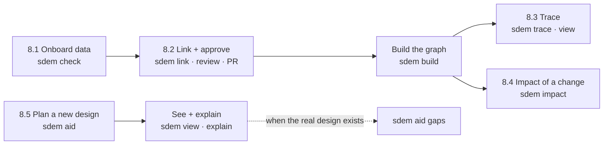

# SDEM Workbench — User Guide

> For architects who are new to SDEM. No prior knowledge assumed. Every command and output in this guide was run on the examples in this project (2026-10-28).
>
> Related: [`sdem-workbench-design.md`](sdem-workbench-design.md) (how the workbench is designed) · [`glossary.md`](glossary.md) (every term).

**Contents:** [1 What SDEM is](#1-what-sdem-is--in-two-minutes) · [2 Key words](#2-key-words) · [3 Set up](#3-set-up--once) · [4 The workbench screen](#4-the-workbench-screen) · [5 Quick start](#5-quick-start--15-minutes) · [6 Your architecture data](#6-your-architecture-data) · [7 Operations](#7-operations--every-command) · [8 Workflow examples](#8-workflow-examples) · [9 Working with Copilot](#9-working-with-copilot) · [10 Rules you must know](#10-rules-you-must-know) · [11 Troubleshooting](#11-troubleshooting) · [12 Where to go next](#12-where-to-go-next)

---

## 1. What SDEM is — in two minutes

Every bank describes its architecture in four separate places, usually kept by different teams in different tools:

| | Architecture | Describes | Example |
|---|---|---|---|
| **A1** | Business | capabilities, value streams, processes | *Initiate Payment*, *Capture and validate payment instruction* |
| **A2** | Service Domain (BIAN) | the BIAN service domains and their operations — the banking industry's standard building blocks | *Payment Initiation*, *Initiate Payment Instruction* |
| **A3** | Application | applications, components, APIs, data | *Payments Hub*, `POST /payment-instructions` |
| **A4** | Technology | platforms, clusters, deployments | *Managed Kubernetes — payments (production)* |

The hard questions cross all four: *Which applications support this capability? What breaks if we move this cluster? What would a new business design need underneath?* Nobody can answer them if the four architectures are not **linked**.

**SDEM — the Service Domain Enterprise Metamodel — links them**, with BIAN in the middle as the common language:

```
 A1 Business ──uses / supported by──► A2 BIAN service domains ──realised / implemented by──► A3 Applications ──deployed on / as──► A4 Technology
```

SDEM gives you:

- a **rulebook** (the metamodel) — what may exist in each architecture and how things may be linked, each rule with its published source;
- **checks** — your data is tested against the rulebook before it is trusted;
- an **inference engine** — proposes the links between the architectures, each with its reasoning and confidence, for **you** to approve;
- a **knowledge graph** — the checked data and approved links, which you can **trace** end to end and use for **impact analysis**;
- **AID (Architecture Inference Design)** — a planning tool that projects the architecture layers you don't have yet, from the ones you do.

You run all of it from **VS Code**: commands in the terminal, and GitHub Copilot in the chat window to help.

## 2. Key words

| Word | Means |
|---|---|
| **Architecture dataset** | one file holding one architecture (A1, A2, A3 or A4) — its records and the links inside it |
| **Record** | one thing in an architecture: a capability, a service domain, an application, a cluster … each with an `id`, `type`, `name` |
| **Link** (relationship) | a connection between records of **different** architectures, e.g. *service domain Payment Initiation* is **REALIZED_BY** *application Payments Hub* |
| **Registry** (`mappings.json`) | the file of links, each with a status: `proposed` (suggested) or `approved` (a person accepted it) |
| **Rulebook** (metamodel) | the rules: which record types exist, which links are allowed, what evidence a link needs |
| **Inference engine** | proposes links by applying the rulebook to your data; never approves |
| **Graph store** | a folder holding the checked datasets and approved links as a knowledge graph — what trace, impact and the view read |
| **Trace** | follow the links from a record down (to technology) or up (to business) |
| **Impact** | which records a change (replace, rehost, retire …) affects, and how |
| **AID / projection** | Architecture Inference Design: a **projected** (planned, not real) design for the layers you don't have; ids start `PRJ-` |
| **Confidence** | how sure a proposal or projection is: 0.4 low, 0.6 medium, 0.8 high |
| **CLI** | the command line — typing `sdem …` commands in VS Code's terminal |

## 3. Set up — once

You need four things. Your IT team may install some of them for you.

| Tool | Why | Get it |
|---|---|---|
| **VS Code** | the workbench | code.visualstudio.com |
| **Python 3.10 or later** (3.13 recommended) | SDEM runs on it | check with `python3 --version`; on a Mac `brew install python@3.13` or the installer from python.org |
| **Git** | history, review and approval | git-scm.com (often already installed) |
| **GitHub Copilot** (optional) | the AI help in the chat window | a Copilot plan on your GitHub account — step by step in [`sdem-copilot-setup.md`](sdem-copilot-setup.md) |

Then:

1. **Get the SDEM project** (the tool and the made-up examples — public):
   ```bash
   git clone https://github.com/taumoeps/bian-sdem-framework.git sdem
   ```
   Your organisation's **real** data is in its private estate repository, set up from [`templates/estate-repo`](../templates/estate-repo/README.md) — its README installs SDEM the same way, pinned to a release.
2. **Open it in VS Code:** *File → Open Folder…* → choose the `sdem` folder. When VS Code offers to install the **recommended extensions** (Python, GitHub Copilot Chat, Markdown Preview Mermaid Support), accept.
3. **Open the terminal pane:** *View → Terminal* (shortcut **Ctrl+`**).
4. **Install SDEM** into a private Python environment for this project:
   ```bash
   python3 -m venv .venv              # or python3.13 -m venv .venv if python3 is older than 3.10
   source .venv/bin/activate          # Windows: .venv\Scripts\activate
   pip install -e .
   ```
5. **Check it works:**
   ```bash
   sdem --help
   ```
   You should see the list of commands, starting with `check J1 check architecture datasets and registry against the rulebook`.

Each time you open a new terminal later, run the `activate` line from step 4 again. If you cannot install anything, every command also works as `python3 -m sdem …` from the project folder.

## 4. The workbench screen

```
┌─ VS Code — SDEM project ─────────────────────────────────────────────────────────────────────┐
│ EXPLORER               │ EDITOR                               │ COPILOT CHAT                 │
│ the project's files:   │ the file you opened, e.g. a dataset  │ ask for help in plain words  │
│ ▸ docs/      guides    │                                      │                              │
│ ▸ examples/  estates   │                                      │ "explain this output"        │
│ ▸ metamodel/ rulebook  │                                      │ "which command shows …?"     │
│ ▸ schema/              ├──────────────────────────────────────┤ "draft the impact note"     │
│ ▸ sdem/      the code  │ TERMINAL — where you run sdem        │                              │
│                        │ $ sdem check …                       │                              │
│                        │ OK: level A1 …                       │ [ Ask Copilot …            ] │
└────────────────────────┴──────────────────────────────────────┴──────────────────────────────┘
```

| Part | Open it | Use it for |
|---|---|---|
| **Explorer** | the file icon on the left | find and open files |
| **Editor** | click a file | read and edit datasets and the registry |
| **Terminal** | *View → Terminal* (**Ctrl+`**) | **run SDEM** — every `sdem` command |
| **Copilot Chat** | the chat icon, or **Ctrl+Alt+I** (Mac **⌃⌘I**) | **help** — explanations, the right command, drafts |
| **Source Control** | the branch icon on the left | see your changes, commit, open a pull request |

**The one idea to remember:** you run SDEM in the **terminal**; Copilot **helps** in the chat. Copilot never approves anything and never changes real data on its own.

## 4a. The dashboards — SDEM and each project on one page

**Start here:**

```bash
sdem home -o work/sdem
```

and open `work/sdem/index.html` (the command prints the full `file://` address). It opens on **SDEM's architecture** — every component (the BIAN reference, the rulebook, the mapping engine, validation and approval, the knowledge graph, the four architectures, AID and its projections, change coordination, the workbench), marked built or not, each clickable for what it is, where it lives and its live figures. The other tabs show SDEM itself — its health (checked as the page is made), the metamodel (every entity type, the links allowed inside and between the architectures, the engine's rules, a clickable picture), the configuration — and **every project**, each linking to its own dashboard. Add your own estates with `--estate <folder>` or `--root <folder of estates>`.

**One project's dashboard** on its own:

```bash
sdem dashboard --estate examples/payment-initiation -o work/dashboard.html
```

Open `work/dashboard.html` in your browser — or in VS Code: *Command Palette → Simple Browser: Show*, then paste the file's path. It works offline and needs no AI.

| Tab | Shows |
|---|---|
| **Overview** | what needs your attention; the health of each architecture (errors, advice); how much of each is linked to the other layers; records not linked yet |
| **Review** | the links the rules engine proposes, weakest first — rule, reasoning, the evidence you need to approve, and the `sdem approve` command to copy |
| **Trace & impact** | type a record: what it depends on, what depends on it, and the impact of a change (modify, rehost, replace, retire) |
| **Matrices** | capability → service domain → application → technology, from approved links |
| **Changes & work** | change events, work items, change sets, and any hand edits waiting to be adopted |
| **AID plans** | with `--projection <folder>`: the projected design beside the real one |
| **Controls** | every control and when it was last tested |

The page is **read-only**: it shows the exact `sdem` command for every action (with a *copy* button). It is a snapshot — run `sdem dashboard` again after a change. Design: [`sdem-dashboard-design.md`](sdem-dashboard-design.md).

## 5. Quick start — 15 minutes

This uses the example estate `examples/payment-initiation` — a made-up bank's payments architecture, all four layers, already linked. Type each command in the terminal.

**Step 1 — name the example folder, so commands stay short:**
```bash
E=examples/payment-initiation
```
*(Windows PowerShell: `$E="examples/payment-initiation"` — and see §11 about `a*.json`.)*

**Step 2 — check the data against the rulebook (J1):**
```bash
sdem check --estate $E
```
(`--estate` names the estate folder; it is the same as listing its five files, `$E/a*.json $E/mappings.json`.) You see one `OK` line per architecture and for the registry. `WARN` lines are advice (something the rulebook expects but does not require); `ERROR` lines must be fixed.
```
OK: level A1 (synthetic-bank-payments-a1)
WARN: level A2 (synthetic-bank-payments-a2): instance SD-PE: 0 composition links with A2.ServiceGroup, RA2-03 expects at least 1 (LC-10m)
… (six WARN lines in all)
OK: level A2 (synthetic-bank-payments-a2)
OK: level A3 (synthetic-bank-payments-a3)
OK: level A4 (synthetic-bank-payments-a4)
OK: mappings #1
```
The six warnings are expected for this example: the made-up BIAN layer leaves out some detail the rulebook recommends (here, the service groups of *Payment Execution*). `OK` on every layer means the data is accepted.

**Step 3 — build the knowledge graph (J4):**
```bash
sdem build --estate $E --out work/graph
```
```
WARN: … (the same six warnings)
build 1 accepted: a1-business.graph.json (16 nodes, 14 edges), …, federated.graph.json (26 nodes, 18 edges)
```
`work/` is your own scratch folder; Git ignores it.

**Step 4 — trace a business process down to technology (J5):**
```bash
sdem trace PRC-PAY-01 --direction down --graph work/graph
```
```
DOWNSTREAM (depends on):
PRC-PAY-01 'Capture and validate payment instruction'  [A1.BusinessProcess]
└─ -USES_DOMAIN-> SD-PI 'Payment Initiation (synthetic selection)'  [A2.ServiceDomain]  (PAY-003)
   └─ -REALIZED_BY-> APP-PAY-HUB 'Payments Hub'  [A3.ApplicationComponent]  (PAY-106)
      ├─ -DEPLOYED_ON-> INF-K8S-PAY-PROD 'Managed Kubernetes — payments (production)'  [A4.SystemSoftware]  (PAY-108)
      ├─ -DEPLOYED_AS-> DEP-PAYHUB-PROD 'Payments Hub — production'  [A4.Deployment]  (PAY-109)
      ├─ -DEPLOYED_AS-> DEP-PAYHUB-UAT 'Payments Hub — UAT'  [A4.Deployment]  (PAY-110)
      └─ -DEPLOYED_ON-> INF-K8S-PAY-UAT 'Managed Kubernetes — payments (UAT)'  [A4.SystemSoftware]  (PAY-113)
```
Read it as: *the process uses the Payment Initiation domain, which the Payments Hub realises, which runs on the production Kubernetes cluster.* The codes in brackets (`PAY-003`) are the approved links the chain follows.

**Step 5 — see it as a picture (J7):**
```bash
sdem view --graph work/graph
```
Open `work/graph/view.html` in your browser. Four bands, A1 to A4; click a record to see its details and links; choose *Trace: down* to highlight a chain.

**Step 6 — ask Copilot.** Open the chat and type:
> *Explain the trace output in the terminal in plain words. Which links does it rely on?*

Copilot reads the terminal output and explains it, naming the links. If it suggests a command, you decide whether to run it.

**You have now used the workbench.** Next, try the workflow examples in §8 — they are what you will do with your own architecture.

## 6. Your architecture data

### 6.1 The files

An estate is a folder with five files:

| File | Holds |
|---|---|
| `a1-business.json` | the business architecture: capabilities, value streams, processes, activities, business objects, roles |
| `a2-service-domain.json` | the BIAN layer: the service domains you use, their operations, business objects |
| `a3-application.json` | applications, components, interfaces, APIs, data entities |
| `a4-technology.json` | platforms, clusters, system software, environments, deployments |
| `mappings.json` | the registry: the links between the architectures |

Seven example estates are in `examples/` (`payment-initiation`, `card-fraud-alerts`, `digital-lending`, `trade-finance`, `legacy-core-ledger`, `acquired-fintech`, `customer-onboarding`). **Start your own estate by copying one** and changing its contents.

### 6.2 What a record looks like

Every record has an `id`, a `type`, a `version` and a `name`; most have a `description` and `attributes`. An application, from `a3-application.json`:

```json
{
  "id": "APP-PAY-HUB",
  "type": "A3.ApplicationComponent",
  "version": "7.1",
  "name": "Payments Hub",
  "lifecycle_status": "active",
  "description": "The bank's payment initiation platform: captures instructions …",
  "attributes": {
    "deployed_on": ["INF-K8S-PAY-PROD", "INF-K8S-PAY-UAT"],
    "deployed_as": ["DEP-PAYHUB-PROD", "DEP-PAYHUB-UAT"],
    "owner": "ROLE-PAY-OFFICER"
  }
}
```

A business process, from `a1-business.json` — note `invokes`: naming the BIAN operations a process uses is the strongest help you can give the engine:

```json
{
  "id": "PRC-PAY-01",
  "type": "A1.BusinessProcess",
  "version": "1.0",
  "name": "Capture and validate payment instruction",
  "attributes": { "invokes": ["SO-PI-01", "SO-PI-02"], "criticality": "high" }
}
```

Links **inside** one architecture go in that file's `relationships` list, e.g. `{"source": "APP-PAY-HUB", "kind": "composition", "target": "CMP-PAY-CAPTURE"}` (the hub is made of the capture component). Links **between** architectures go in the registry (§8.2).

You don't need to memorise the rules: write the data, run `sdem check`, and it tells you exactly what is missing or not allowed — and Copilot can explain each message.

### 6.3 Where your real data may go

- **This project holds public and made-up data only.** Your organisation's real architecture data belongs in its **private estate repository** ([template](../templates/estate-repo/README.md); [operating model](sdem-operating-model.md)). `estates/` and `work/` are ignored here, so real data cannot be pushed to this repository by mistake.
- Diagrams previewed with the PlantUML extension are drawn **on your machine** (this project's setting; it needs Java and Graphviz — `brew install plantuml`). Never switch it to the public PlantUML server for real data.

## 7. Command reference

**This is the one full list of SDEM's commands** — other documents show only the commands of their own task and link here. `sdem --help` lists them all; `sdem <command> --help` shows the options and a worked example. Exit codes: `0` OK, `1` issues found (or a check refused the action), `2` the command was typed wrongly or its input is unusable (a missing folder, a file that is not valid JSON), `3` an internal error in SDEM — one line; set `SDEM_DEBUG=1` to see the details. `sdem --version` shows the version.

| Command | Journey | What it does | When you use it | Typical next step |
|---|---|---|---|---|
| `sdem check --estate <dir>` (or the files) | J1 | checks datasets and registry against the rulebook | after any change to the data | fix errors; `sdem build` |
| `sdem validate <registry>` | J1 | checks a registry or proposals file on its own (`--strict` treats warnings as errors) | after editing `mappings.json` | `sdem check` |
| `sdem link <files> --out <dir>` | J2 | the inference engine proposes the missing links; writes `proposals.json` | when data is new or changed | `sdem review` |
| `sdem review <proposals.json>` | J3 | lists the proposals, weakest first, with rule, confidence and reasoning | before approving | `sdem approve` (§8.2) |
| `sdem approve <id> --proposals … --estate … --reviewer <you> --evidence <kind:ref> [--bian-release <release>]` | J3 | **you** approve a proposed link: writes a correct registry record, checks it first | after review | pull request |
| `sdem build <files> --out <dir>` | J4 | checks everything and writes the graph store | after approval, before trace and impact | `sdem trace`, `sdem view` |
| `sdem query --graph <dir> …` | J4 | finds records: `--type`, `--level`, `--where attr=value`, `--unmapped A2` (records still without a link) | to look things up | — |
| `sdem baseline <name> --graph <dir>` | J4 | freezes the graph store under a name (e.g. a release) | at milestones | — |
| `sdem home -o <dir> [--root <folder of estates>] [--estate <dir>]` | J7 | the home page: SDEM's architecture, health, and a dashboard for every project (§4a) | first, and any time | open `<dir>/index.html` |
| `sdem dashboard --estate <dir> -o <file.html>` | J7 | one estate on one read-only page (§4a) | any time | the commands it shows |
| `sdem matrix --estate <dir> [--md file.md]` | J5 | capability → domain → application → technology from approved links | for a report or review | — |
| `sdem trace <id> --graph <dir>` | J5 | follows links `--direction down` (to technology), `up` (to business) or both | "what does this depend on / what depends on it?" | `sdem impact` |
| `sdem impact <id> --change <kind> --graph <dir> [--report file.md]` | J5 | classifies what a change affects; kinds: `modify`, `rehost`, `replace`, `retire`; `--report` writes a printable impact report | before a change | share the report |
| `sdem aid project --have <files> --catalogue <bian> --out <dir>` | J6 | projects the layers you don't have (planning, not real data) | early design, scoping | `sdem view --projection`, `sdem explain` |
| `sdem aid check <dir>` · `sdem aid gaps <dir> --actual <files>` | J6 | checks a projection; compares it with a real design | later, when the real design exists | — |
| `sdem view --graph <dir> [--projection <dir>] [-o file.html]` | J7 | writes the HTML picture | to see and share | open in a browser |
| `sdem explain <id> --proposals <file>` · `--projection <dir>` | J8 | why one link or projected element exists: rule, published source, evidence, reasoning, confidence | when you question a proposal | approve, reject or fix the data |
| `sdem change propose <file> --estate <dir> --agent … --person …` | AG | a layer's change set: checked before it lands, then its impact recorded as a change event | agent platform (§9a) | the orchestrator plans the work |
| `sdem change revert <CS-id> --estate <dir> --agent … --person …` | AG | undo the latest change set of a layer — restores it exactly, on record | a change was wrong | rebuild the graph store |
| `sdem events --estate <dir> [--open]` | AG | change events, their impact and open work | to see what is waiting | `sdem work plan` |
| `sdem work plan · list · claim …` | AG | work items: planned by the orchestrator, claimed and answered by the layer agents | agent platform (§9a) | `sdem change propose --work …` |
| `sdem transform inspect <export>` · `sdem transform run <export> -o <dir>` | J9 | **transforms** an export of past designs (Confluence) into candidate architecture entities, with rules: tables, draw.io and PlantUML diagrams, known names in the text, text in pictures (on-device OCR) → entities and links with their source; pictures listed for you | bringing in past designs (§8.7) | review `extraction-report.md` |
| `sdem load <candidates> --estate <dir> --person <you> --exclude <ids>` | J9 | **loads** the candidate entities you keep into an estate — checked first, recorded; `--a2` adds your BIAN layer; `--dry-run` | after reviewing a transform (§8.7) | `sdem link` |
| `sdem designs --estate <dir> [--entity <id>] [--gaps] [--category …] [--status open]` | J9 | the pages onboarded designs came from, and the **gap records** — what did not fit an entity, by category; `sdem trace` also ends with an entity's pages | after a load; to find what still needs a person | — |
| `sdem designs resolve <gap id …> --estate <dir> --person <you> --note "<what you did>"` · `accept` (same options) · `reopen` | J9 | closes a gap — *resolved* (now recorded in an entity) or *accepted* (deliberately not modelled); reopens one; each step kept in the gap's history | working down the gaps | `sdem designs --gaps --status open` |
| `sdem diff --git HEAD~1 <registry>` | — | proves approved links were not edited | before a pull request | — |
| `sdem migrate --estate <dir> --person <you> [--dry-run]` | — | moves an estate to a new rulebook version ([versioning](sdem-rulebook-versioning.md)) | when SDEM says the `metamodel_version` does not match | — |
| `sdem model check` · `regenerate` · `accept` · `examples` | — | maintainers: generated documents, engine acceptance tests, use-case examples | when changing the rulebook | — |

Add `--json` to most commands for machine-readable output (Copilot can read it more reliably).

## 8. Workflow examples

The diagram shows how the workflows fit together; each is then written out step by step.



### 8.1 Onboard an estate and fix its data

*Goal: get your four architecture datasets accepted by SDEM.*

1. Copy an example estate as a starting point and put your records in it:
   ```bash
   cp -r examples/payment-initiation work/my-estate
   ```
2. Check it:
   ```bash
   sdem check work/my-estate/a*.json work/my-estate/mappings.json
   ```
3. Read each `ERROR`. Example — a record without a name, and a misspelt type:
   ```
   ERROR: level A3 (synthetic-bank-payments-a3): $.instances[0]: missing required property 'name'
   ```
   `$.instances[0]` means the first record in the `instances` list. Add the name, save, run `sdem check` again. Errors can appear a batch at a time — keep going until every line is `OK`.
4. Stuck on a message? In the chat:
   > *Explain this sdem check error and show me the fix in a3-application.json.*

**Done when:** every line is `OK` (warnings are advice).

### 8.2 Link the architectures and approve the links

*Goal: the engine proposes the links between your architectures; you decide which become real.*

In this example one approved link — *Payment Initiation is realised by the Payments Hub* — was removed from the registry to show the engine finding it again.

1. **Propose** (J2):
   ```bash
   sdem link work/my-estate/a*.json work/my-estate/mappings.json --out work/links
   ```
   ```
   1 proposed link(s) written to work/links/proposals.json; candidates, inference log and any design datasets in work/links/
   next: sdem review work/links/proposals.json
   ```
2. **Review** (J3):
   ```bash
   sdem review work/links/proposals.json --names work/my-estate/a*.json
   ```
   ```
   1 proposed link(s), weakest first:

     [0.8] P-RUN-001  SD-PI 'Payment Initiation (synthetic selection)' -REALIZED_BY-> APP-PAY-HUB 'Payments Hub'   rule S17
           why: implements SO-PI-01 via API-PI-01 (approved); SO-PI-04 via API-PI-04 (approved); …
   ```
   The engine proposes it at 0.8 (high) because the hub's APIs implement five of the domain's operations. To see everything behind a proposal: `sdem explain P-RUN-001 --proposals work/links/proposals.json`.
3. **Decide.** Ask yourself: is this true of our architecture, and do we have the document that shows it? Copilot can help:
   > *Walk me through the proposals in work/links/proposals.json, weakest first. What evidence would I need for each?*
4. **Approve — you, with `sdem approve`.** It writes the registry record for you — a new id, status `approved`, you as reviewer, today's date and the evidence — and checks the whole registry before writing anything:
   ```bash
   sdem approve P-RUN-001 --proposals work/links/proposals.json --estate work/my-estate \
        --reviewer your.name --evidence application_architecture_document:AA-PAYHUB-HLD#s3
   ```
   ```
   approved PAY-114: SD-PI -REALIZED_BY-> APP-PAY-HUB  (reviewer your.name, …, evidence application_architecture_document:AA-PAYHUB-HLD#s3)
   ```
   To replace an old link, add `--supersedes <old id>`. The reviewer must be a person — an agent name is refused (control CTL-21). For reference, the record it writes looks like this (you could also write it by hand):
   ```json
   {
     "mapping_id": "PAY-120",                                  ← a new id, unique in the registry
     "source": { "id": "SD-PI", … },
     "relationship": "REALIZED_BY",
     "target": { "id": "APP-PAY-HUB", … },
     "status": "approved",                                     ← was "proposed"
     "reviewer_id": "your.name",                               ← who approved
     "approved_at": "2026-10-28",                              ← when
     "evidence": ["application_architecture_document:AA-PAYHUB-HLD#s3", "engine_rationale:…"],
                                                               ← add the document that proves it
     …
   }
   ```
   **The evidence a link needs depends on its type** — the engine's reasoning alone is not enough to approve:

   | Link | Required evidence kind |
   |---|---|
   | capability **SUPPORTED_BY** service domain | `business_architecture_document`, `domain_scope_assessment` |
   | value stream **ALIGNED_TO** business scenario | `process_model`, `scenario_suitability_review` |
   | process **USES_DOMAIN** service domain | `process_model` |
   | business object **ALIGNED_TO** BIAN business object | `business_glossary`, `object_alignment_review` |
   | service domain **REALIZED_BY** application | `application_architecture_document` |
   | service operation **IMPLEMENTED_BY** API | `api_contract` |
   | BIAN business object **MAPPED_TO** data entity | `data_model` |
   | application **DEPLOYED_ON** / **DEPLOYED_AS** technology | `deployment_design` |

   Write evidence as `kind:document-reference`, e.g. `api_contract:payments-api-v2.yaml`.
5. **Check:**
   ```bash
   sdem validate --strict work/my-estate/mappings.json
   sdem check work/my-estate/a*.json work/my-estate/mappings.json
   ```
   If you forgot the evidence or reused an id, you will see, for example:
   ```
   ERROR: …mappings.json: mapping #18 (PAY-120): evidence missing required kind(s) ['application_architecture_document']
   ERROR: …mappings.json: mapping #11 (PAY-107): duplicate mapping_id
   ```
6. **Pull request.** In *Source Control*, commit the registry change on a branch and open a pull request. A reviewer checks it; CI runs every check. **Merging the pull request is the approval.** Copilot can draft the description:
   > *Draft a pull-request description for the link I approved in mappings.json, citing its evidence.*
7. **Rebuild the graph** (J4) and see the link in use:
   ```bash
   sdem build work/my-estate/a*.json work/my-estate/mappings.json --out work/graph
   sdem trace SD-PI --direction down --graph work/graph
   ```
   ```
   SD-PI 'Payment Initiation (synthetic selection)'  [A2.ServiceDomain]
   └─ -REALIZED_BY-> APP-PAY-HUB 'Payments Hub'  [A3.ApplicationComponent]  (PAY-120)
   ```

### 8.3 Trace a capability to technology — and back

*Goal: answer "what does this depend on?" and "what depends on this?".*

```bash
sdem trace CAP-PAY-010 --direction down --graph work/graph      # business → technology
sdem trace INF-K8S-PAY-PROD --direction up --graph work/graph   # technology → business
sdem view --graph work/graph                                    # the picture; choose Trace: down or up
```

Trace follows **approved** links only. If a chain stops early, a link is missing: `sdem query --graph work/graph --unmapped A2` lists records still waiting for one — then go back to §8.2.

### 8.4 Assess the impact of a technology change

*Goal: before rehosting the production payments cluster, know what it affects.*

```bash
sdem impact INF-K8S-PAY-PROD --change rehost --graph work/graph
```
```
IMPACT of 'rehost' on INF-K8S-PAY-PROD: hosting changes only; deployment records must be superseded, functional layers unaffected

  design_change_required   A4  INF-K8S-PAY-PROD  Managed Kubernetes — payments (production)  via -
  design_change_required   A3  APP-PAY-HUB       Payments Hub  via PAY-108
  no_impact                A2  SD-PI             Payment Initiation (synthetic selection)  via PAY-108, PAY-120
  no_impact                A1  CAP-PAY-010       Initiate Payment  via PAY-108, PAY-120, PAY-001
  …
  design_change_required   A3  CMP-PAY-EXEC      Execution Gateway  via PAY-111

  mappings to supersede: PAY-108, PAY-111

  Classification is structural; an architect confirms before any design changes.
```

Read it as: *rehosting the cluster needs design changes for the Payments Hub and the Execution Gateway (and their deployment links PAY-108 and PAY-111 must be replaced); the business capability and processes are not affected.* Then in the chat:
> *Draft an impact note for rehosting INF-K8S-PAY-PROD from the impact output, with each affected record and the reason.*

Other kinds of change: `--change modify`, `--change replace` (e.g. an application is replaced), `--change retire`.

### 8.5 Plan a new design with AID

*Goal: you have only the business design; see what BIAN domains, applications and deployments it implies — before anything is built.*

AID needs a **BIAN catalogue** — the BIAN service domains your organisation uses, as an A2 dataset. Here the example estate's A2 file stands in for it.

```bash
sdem aid project --have work/my-estate/a1-business.json --catalogue work/my-estate/a2-service-domain.json --out work/prj
```
```
projection PRJ-A1 written to work/prj: A2 16 records, A3 6 records, A4 1 records, 11 links
NOTE: SO-PI-06: Notify has no REST form — no API projected
```

- AID chose the BIAN domain the business needs (*Payment Initiation*, because the processes name its operations), projected **one application component** for it, **one API per operation** in BIAN's REST style, and **one deployment** — but **no platform or environment**, because nothing in the business design says anything about them.
- Everything projected has an id starting `PRJ-`, a confidence (never above 0.6) and its reasoning. **It is a plan, not real data** — SDEM refuses to load it into real data.

See it on top of what you have:
```bash
sdem view --graph work/graph --projection work/prj -o work/plan.html
```
Projected records and links are **dashed** and labelled **PROJECTED**. Ask why any element exists:
```bash
sdem explain SD-PI --projection work/prj
```
```
PROJECTED ELEMENT  SD-PI  Payment Initiation (synthetic selection)  (A2 A2.ServiceDomain)
  step              F1
  rule              BIAN catalogue reference
  source reference  BIAN reference catalogue … — the element is copied, not invented
  inferred from     ACT-PAY-01a 'Capture instruction', …, PRC-PAY-01 'Capture and validate payment instruction', …
  reasoning         the business layer points to it — S04 — invokes SO-PI-01 (PRC-PAY-01.invokes); …
  confidence        0.6
```

**Later, when the real design exists**, compare plan and reality:
```bash
sdem aid gaps work/prj --actual work/my-estate/a2-service-domain.json work/my-estate/a3-application.json work/my-estate/a4-technology.json work/my-estate/mappings.json
```
```
A2 service domains: {'projected': 1, 'real': 1, 'matched': 1, 'precision': 1.0, 'recall': 1.0}
A3 APIs (method and path): {'projected': 5, 'compared': 5, 'matched': 3, 'differs': 2, …}
A4 deployments: {'projected': 1, 'real': 1, 'matched': 0, …}
```
Each line says how close the plan was: here the domain and component were right, 3 of 5 APIs matched the real method and path, and the real application is deployed twice where AID planned once.

AID also works upwards — e.g. from technology only (`--have a4-technology.json`) it suggests the applications, domains and capabilities that technology appears to support, at low confidence. See [`aid-design.md`](aid-design.md).

### 8.6 Question a proposal or projection

*Goal: understand exactly why SDEM suggests something before you accept it.*

```bash
sdem explain P-RUN-001 --proposals work/links/proposals.json     # a proposed link
sdem explain SD-PI --projection work/prj                         # a projected element
```
Every answer shows the **rule** (e.g. S17), its **published source** where one exists (e.g. BIAN's Semantic API Practitioner Guide), the **records it came from**, the **reasoning** and the **confidence**. Low confidence (0.4) means weak evidence — often names only; treat it as a hint.

### 8.7 Onboard your existing designs (from Confluence)

> **Design onboarding** — the whole journey, export → transform → review → load → link → approve → build, step by step with the commands and what you will see: [`sdem-onboarding-workflow.md`](sdem-onboarding-workflow.md). The **test script** with the expected result of every step: [`use-case-example-4.md`](use-case-example-4.md).

*Goal: turn the organisation's past designs (Confluence pages with tables and draw.io diagrams) into candidate records — on the work machine, without AI, without the content leaving it.*

1. Put the export in a folder outside this repository's tracked files, e.g. `~/designs/payarch`. Any layout works: Confluence's own HTML export, or a prepared one (readme/source/evidence files in the root, raw HTML and diagrams in `archives/`, sections as folders).
2. See what is there and which rules read it — structure only:
   ```bash
   sdem transform inspect ~/designs/payarch
   ```
   It shows what each folder holds (add `--anonymous` to hide the folder names), and lists every table's column headings with the rule that reads it (`no rule` if none), every draw.io shape kind with the type it becomes (`unclassified` if none), and the headings.
3. If your pages use other words, copy the rules and add them — no code:
   ```bash
   cp metamodel/transform-rules.json my-rules.json      # e.g. add "system name" to HT-01's "name" list, "switch" to label_words
   ```
4. Extract — add your current datasets with `--known` so known names are recognised in the text and flagged when they already exist:
   ```bash
   sdem transform run ~/designs/payarch -o work/history --rules my-rules.json --known estate/a3-application.json
   ```
   Text in pictures is read on your Mac with its built-in text recognition (no install, no network); add `--ocr off` if your organisation does not allow it, or `--ocr tesseract` where Tesseract is installed. PlantUML diagrams are read from their source.
5. Open `work/history/extraction-report.md`. Every record says **which page, where on it** (table and row, diagram and shape, paragraph), **which rule**, **how sure** (never above medium) and **why**. Pasted pictures are listed for you to record by hand.
   **Nothing is silently lost:** the *Coverage* section gives the share of each page captured, and *Not captured* lists everything SDEM read but could not use — with its place and text — grouped as *no entity type* (e.g. a table of risks: a possible gap in the metamodel, for the owner), *column not mapped* (kept with each entity), *text not read*, *needs a person* (pictures), *file not read* (PDF, Word …) and more. Key-value tables (owner, review date) become the page's facts in `design-index.json`.
6. **Load** what is right (the L of the ETL) — name what to leave out, or what to keep:
   ```bash
   sdem load work/history --estate estates/history --person <your name> --exclude HIS-A3-SANCTIONS-CHECKEL HIS-A3-PAYMENT-ORDER \
             --a2 <your estate>/a2-service-domain.json        # once: your BIAN layer, so links to Service Domains can be proposed
   ```
   It checks the whole estate first (nothing is written if anything fails), records the load in `estates/history/loads/` with a reconciliation (candidates = loaded + already there + excluded), and lists the BIAN names found as hints. **What did not fit an entity is kept too**, in `estates/history/designs/design-records.json`: a *design record* per page (its facts, coverage, link) and a *gap record* per item that did not fit (a table of risks, an unmapped column, text, pictures, a PDF, each candidate you rejected). Add `--dry-run` to see what would happen.
7. Then as for any estate: `sdem link --estate estates/history --out work/links` → `sdem review` → `sdem approve` → `sdem build`. Links involving entities read from a document come out at **low** confidence — check them against the page. A graph is never built straight from the transform's output (CTL-23).

The transform writes **candidate A1, A3 and A4 entities** (never A2 — BIAN service domains come from the BIAN catalogue; BIAN names found are listed as mentions) and the links inside each architecture, with evidence. Expected outputs: [`sdem-transform-design.md`](sdem-transform-design.md) §4. It does not change the metamodel, approve links between architectures, or build the knowledge graph — those come after you load the entities (`sdem load`, then `sdem link`, `sdem approve`, `sdem build`). Load: [`sdem-load-design.md`](sdem-load-design.md).

Try it on the made-up sample first: `sdem transform run tests/fixtures/confluence-export-sample -o work/history`. Design: [`sdem-transform-design.md`](sdem-transform-design.md).

> **Never** put the real export or its outputs in a public repository or paste them into an AI chat outside what your organisation allows.

## 9. Working with Copilot

Copilot is your **assistant**, not your architect. It reads the project's files and your terminal output and helps you understand and decide.

**Ready-made prompts:** type `/` in the chat for SDEM's prompt files — `/sdem-explain`, `/sdem-fix`, `/sdem-review`, `/sdem-impact-note`, `/sdem-pr`, `/aid-explain` (and `/sdem-process-events`, `/sdem-layer-work` for the agents). Copilot also loads SDEM's skills (`.github/skills/`) when they fit your question.

**Good things to ask:**

| You want to … | Ask |
|---|---|
| understand output | *Explain the output in the terminal in plain words.* |
| fix data | *Explain this sdem check error and show the fix.* |
| find the right command | *Which sdem command shows what depends on INF-K8S-PAY-PROD?* |
| review proposals | *Walk me through work/links/proposals.json, weakest first, and what evidence each needs.* |
| write | *Draft an impact note from the impact output.* · *Draft the pull-request description.* |
| learn | *What does REALIZED_BY mean in SDEM, and which evidence does it need?* |

**What Copilot will not do** (and you should not ask it to):

- **approve** a link — a person approves, through a pull request;
- put **projected (`PRJ-`)** or AI-suggested content into real data — SDEM blocks it anyway;
- answer architecture questions **from memory** — it should run or point to an `sdem` command and name its source. If an answer has no source, ask: *Which command or file is that from?*

If Copilot suggests a command, read it before running it. If it is wrong, the command's output will show it — SDEM's checks, not Copilot, decide what is valid.

Copilot is optional: everything in this guide works without it.

### 9a. The SDEM agents

The project includes five Copilot agents (`.github/agents/`): **sdem-orchestrator** and one per architecture — **sdem-a1-business**, **sdem-a2-bian**, **sdem-a3-application**, **sdem-a4-technology**. Pick one in the Copilot Chat agent picker.

- A **layer agent** changes only its own architecture, and only through a checked **change set** (`sdem change propose`). Every change records the agent and **you** as the person.
- The **orchestrator** turns a change's impact into **work items**, calls the layer agents to do them, and reports to you. It never changes data and never approves.
- Agents never talk to each other directly — they coordinate through the work items and change events SDEM records in the estate's `coordination/` folder.
- You still approve, by merging the pull request.

Try it on a copy of an example (the spike: [`sdem-agent-platform-spike.md`](sdem-agent-platform-spike.md)): ask **sdem-a4-technology** to rehost the production payments cluster, then ask **sdem-orchestrator** to *"process the open change events"*. The full flow, with real output, is in [`use-case-example-3.md`](use-case-example-3.md); the design in [`sdem-agent-platform-design.md`](sdem-agent-platform-design.md).

## 10. Rules you must know

1. **A person approves links** — with `sdem approve`, giving your name, the date and the required evidence, then a reviewed pull request. Never the engine, never Copilot (CTL-21 rejects an agent as reviewer).
2. **Approved links are never edited.** To change one, add a new record that supersedes it (`sdem diff` checks this).
3. **Once agents work on a layer, change it through change sets.** A hand edit is reported by `sdem check` until you record it with `sdem change adopt`.
4. **Projected (`PRJ-`) content is a plan, never real data.** SDEM rejects it in datasets, the registry and the graph store.
5. **Check before you trust.** Run `sdem check` after every change; CI runs everything again on every push.
6. **Public and made-up data only in this project.** Real architecture data goes only in your organisation's own copy.
7. **No PlantUML public server for real data** — use a local or company server.

## 11. Troubleshooting

| You see | Means | Do |
|---|---|---|
| `sdem: command not found` | SDEM is not installed in this terminal | run `source .venv/bin/activate` (Windows `.venv\Scripts\activate`), or use `python3 -m sdem …` |
| `ERROR: … missing required property 'name'` | a record lacks a required field | add it; `$.instances[0]` is the first record in the list |
| `ERROR: … duplicate mapping_id` | two links share an id | give the new one an unused id |
| `ERROR: … evidence missing required kind(s) [...]` | an approved link lacks the evidence its type needs | add `kind:document-reference` (§8.2 table) |
| `ERROR: … CTL-20 (AG-S08): … was changed outside a change set since CS-…` | a dataset was edited by hand after agents started changing that layer | if it was you: `sdem change adopt --estate <dir> --layer <A?> --person <you> --reason <why>`; if not, find out who and undo it |
| `ERROR: … CTL-21 …` | a link was approved with an agent or tool as reviewer | approve as yourself: `--reviewer your.name` |
| `ERROR: CTL-19: …` | a change set crosses its layer, or an agent works outside its layer | keep each change set to one layer; let the orchestrator plan the other layers' work |
| `ERROR: CTL-20: …` | a change set or work-item step without the agent or the person | add `--agent` and `--person` |
| `ERROR: … cannot enter a real architecture dataset (CTL-16)` | projected content was put into real data | remove it; projections stay in their own folder |
| `WARN: … expects at least 1 (LC-10m)` | the rulebook recommends a link that is missing | advice — fix when you can |
| `build … rejected: N error(s); the previous graph store is unchanged` | the data has errors, so the graph was not rebuilt | run `sdem check` and fix the errors |
| `ERROR: 'CAP-999' is not an instance in any loaded level model` | that id is not in the data | check the spelling; `sdem query --graph work/graph --level A1` lists ids |
| a trace stops early | a link in the chain is not approved yet | `sdem query --graph … --unmapped A2`; then §8.2 |
| `no proposed links to review` | everything the engine can find is already approved | nothing to do — or add data that names its links (e.g. `invokes`) |
| `WARN: the graph store is out of date …` | the data changed after the graph store was built, so trace, impact and the view show the old picture | rebuild: `sdem build --estate <estate> --out <graph>` |
| Windows PowerShell and `a*.json` | PowerShell does not expand `*` — `sdem` does it itself | nothing to do; or use `--estate <folder>` |
| Mermaid diagrams show as text | the preview extension is missing | install *Markdown Preview Mermaid Support*, or view the file on GitHub |

## 12. Where to go next

| To learn … | Read |
|---|---|
| how SDEM fits together | [`sdem-overview.md`](sdem-overview.md) |
| how the workbench is designed, with diagrams | [`sdem-workbench-design.md`](sdem-workbench-design.md) |
| the rules in full (the governing spec) | [`architecture-metamodel-detail-level-spec.md`](architecture-metamodel-detail-level-spec.md) |
| how the engine proposes links | [`relationship-rules-spec.md`](relationship-rules-spec.md) |
| planning with AID | [`aid-design.md`](aid-design.md) · tested in [`use-case-example-2.md`](use-case-example-2.md) |
| every control and where it is checked | [`controls-register.md`](controls-register.md) |
| any term | [`glossary.md`](glossary.md) |
